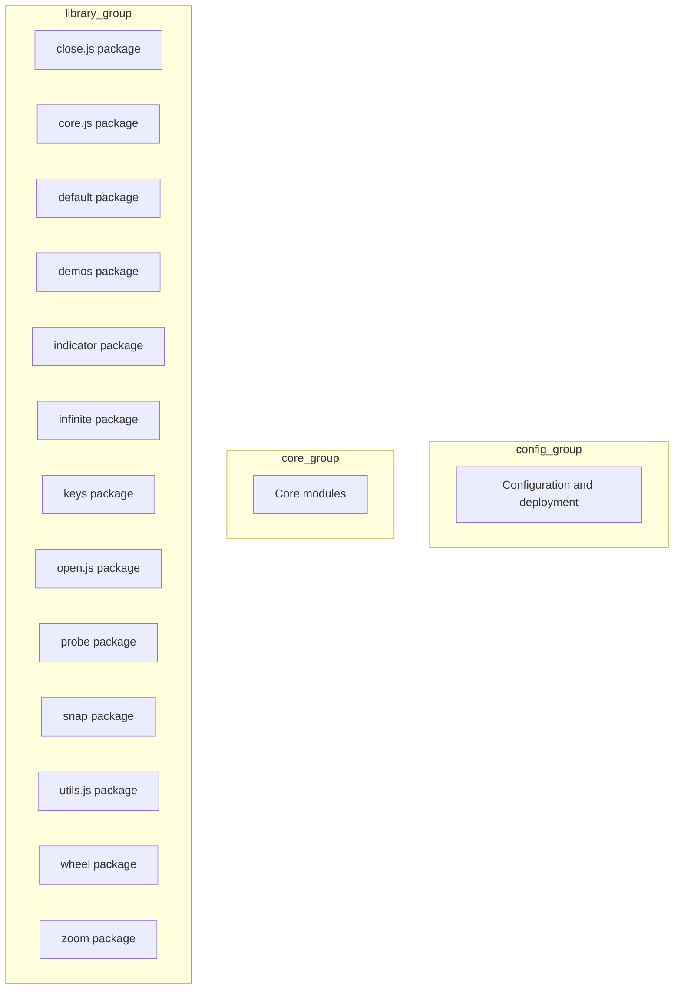

# Architecture report: cubiq/iscroll

> Automated static analysis. **Observed** = directly seen in files/imports/AST; **Inferred** = interpretation from that evidence. Repository code was not executed.

## 1. Repository at a glance

| Item | Value |
| --- | --- |
| Repository | cubiq/iscroll |
| Description | Smooth scrolling for the web |
| Language | JavaScript |
| Stars | 12779 |
| Licence | MIT |
| Analysed commit / branch | 60ed6f8029b2e097a87399a2b3c688afd596980f / master |
| Framework(s) | None detected |
| Files analysed | 64 |
| Components | 15 |

## 2. Architecture in one minute

cubiq/iscroll - Smooth scrolling for the web. This repository was analysed statically from 64 file(s) (0 Python). Detected technologies (observed from imports/manifests): no known frameworks/libraries. Files are grouped into 15 component(s): close.js package, Configuration and deployment, Core modules, core.js package, default package, demos package, indicator package, infinite package. Findings below distinguish observed facts from inferred interpretation.

## 3. High-level block diagram

## 4. Main components

### close.js package (`close_js`)

- **Kind:** library
- **Status:** Observed
- **Confidence:** 0.85
- **Responsibility:** Groups 1 file(s) under close.js package (observed from repository paths and static analysis).
- **Paths:** `src/close.js`
- **Evidence:** [src/close.js](https://github.com/cubiq/iscroll/blob/60ed6f8029b2e097a87399a2b3c688afd596980f/src/close.js)

### Configuration and deployment (`config`)

- **Kind:** config
- **Status:** Observed
- **Confidence:** 0.85
- **Responsibility:** Groups 9 file(s) under configuration and deployment (observed from repository paths and static analysis).
- **Paths:** `bower.json`, `package.json`, `src/indicator/build.json`, `src/infinite/build.json`, `src/keys/build.json`, `src/probe/build.json`, `src/snap/build.json`, `src/wheel/build.json`, `src/zoom/build.json`
- **Evidence:** [bower.json](https://github.com/cubiq/iscroll/blob/60ed6f8029b2e097a87399a2b3c688afd596980f/bower.json); [package.json](https://github.com/cubiq/iscroll/blob/60ed6f8029b2e097a87399a2b3c688afd596980f/package.json); [src/indicator/build.json](https://github.com/cubiq/iscroll/blob/60ed6f8029b2e097a87399a2b3c688afd596980f/src/indicator/build.json); [src/infinite/build.json](https://github.com/cubiq/iscroll/blob/60ed6f8029b2e097a87399a2b3c688afd596980f/src/infinite/build.json); [src/keys/build.json](https://github.com/cubiq/iscroll/blob/60ed6f8029b2e097a87399a2b3c688afd596980f/src/keys/build.json); [src/probe/build.json](https://github.com/cubiq/iscroll/blob/60ed6f8029b2e097a87399a2b3c688afd596980f/src/probe/build.json); [src/snap/build.json](https://github.com/cubiq/iscroll/blob/60ed6f8029b2e097a87399a2b3c688afd596980f/src/snap/build.json); [src/wheel/build.json](https://github.com/cubiq/iscroll/blob/60ed6f8029b2e097a87399a2b3c688afd596980f/src/wheel/build.json)

### Core modules (`core`)

- **Kind:** core
- **Status:** Observed
- **Confidence:** 0.85
- **Responsibility:** Groups 1 file(s) under core modules (observed from repository paths and static analysis).
- **Paths:** `build.js`
- **Evidence:** [build.js](https://github.com/cubiq/iscroll/blob/60ed6f8029b2e097a87399a2b3c688afd596980f/build.js)

### core.js package (`core_js`)

- **Kind:** library
- **Status:** Observed
- **Confidence:** 0.85
- **Responsibility:** Groups 1 file(s) under core.js package (observed from repository paths and static analysis).
- **Paths:** `src/core.js`
- **Evidence:** [src/core.js](https://github.com/cubiq/iscroll/blob/60ed6f8029b2e097a87399a2b3c688afd596980f/src/core.js)

### default package (`default`)

- **Kind:** library
- **Status:** Observed
- **Confidence:** 0.85
- **Responsibility:** Groups 2 file(s) under default package (observed from repository paths and static analysis).
- **Paths:** `src/default/_animate.js`, `src/default/handleEvent.js`
- **Evidence:** [src/default/_animate.js](https://github.com/cubiq/iscroll/blob/60ed6f8029b2e097a87399a2b3c688afd596980f/src/default/_animate.js); [src/default/handleEvent.js](https://github.com/cubiq/iscroll/blob/60ed6f8029b2e097a87399a2b3c688afd596980f/src/default/handleEvent.js)

### demos package (`demos`)

- **Kind:** library
- **Status:** Observed
- **Confidence:** 0.85
- **Responsibility:** Groups 2 file(s) under demos package (observed from repository paths and static analysis).
- **Paths:** `demos/demoUtils.js`, `demos/infinite/dataset.php`
- **Evidence:** [demos/demoUtils.js](https://github.com/cubiq/iscroll/blob/60ed6f8029b2e097a87399a2b3c688afd596980f/demos/demoUtils.js); [demos/infinite/dataset.php](https://github.com/cubiq/iscroll/blob/60ed6f8029b2e097a87399a2b3c688afd596980f/demos/infinite/dataset.php)

### indicator package (`indicator`)

- **Kind:** library
- **Status:** Observed
- **Confidence:** 0.85
- **Responsibility:** Groups 5 file(s) under indicator package (observed from repository paths and static analysis).
- **Paths:** `src/indicator/_initIndicators.js`, `src/indicator/_transitionTime.js`, `src/indicator/_transitionTimingFunction.js`, `src/indicator/_translate.js`, `src/indicator/indicator.js`
- **Evidence:** [src/indicator/_initIndicators.js](https://github.com/cubiq/iscroll/blob/60ed6f8029b2e097a87399a2b3c688afd596980f/src/indicator/_initIndicators.js); [src/indicator/_transitionTime.js](https://github.com/cubiq/iscroll/blob/60ed6f8029b2e097a87399a2b3c688afd596980f/src/indicator/_transitionTime.js); [src/indicator/_transitionTimingFunction.js](https://github.com/cubiq/iscroll/blob/60ed6f8029b2e097a87399a2b3c688afd596980f/src/indicator/_transitionTimingFunction.js); [src/indicator/_translate.js](https://github.com/cubiq/iscroll/blob/60ed6f8029b2e097a87399a2b3c688afd596980f/src/indicator/_translate.js); [src/indicator/indicator.js](https://github.com/cubiq/iscroll/blob/60ed6f8029b2e097a87399a2b3c688afd596980f/src/indicator/indicator.js)

### infinite package (`infinite`)

- **Kind:** library
- **Status:** Observed
- **Confidence:** 0.85
- **Responsibility:** Groups 2 file(s) under infinite package (observed from repository paths and static analysis).
- **Paths:** `src/infinite/infinite.js`, `src/infinite/refresh.js`
- **Evidence:** [src/infinite/infinite.js](https://github.com/cubiq/iscroll/blob/60ed6f8029b2e097a87399a2b3c688afd596980f/src/infinite/infinite.js); [src/infinite/refresh.js](https://github.com/cubiq/iscroll/blob/60ed6f8029b2e097a87399a2b3c688afd596980f/src/infinite/refresh.js)

### keys package (`keys`)

- **Kind:** library
- **Status:** Observed
- **Confidence:** 0.85
- **Responsibility:** Groups 1 file(s) under keys package (observed from repository paths and static analysis).
- **Paths:** `src/keys/keys.js`
- **Evidence:** [src/keys/keys.js](https://github.com/cubiq/iscroll/blob/60ed6f8029b2e097a87399a2b3c688afd596980f/src/keys/keys.js)

### open.js package (`open_js`)

- **Kind:** library
- **Status:** Observed
- **Confidence:** 0.85
- **Responsibility:** Groups 1 file(s) under open.js package (observed from repository paths and static analysis).
- **Paths:** `src/open.js`
- **Evidence:** [src/open.js](https://github.com/cubiq/iscroll/blob/60ed6f8029b2e097a87399a2b3c688afd596980f/src/open.js)

### probe package (`probe`)

- **Kind:** library
- **Status:** Observed
- **Confidence:** 0.85
- **Responsibility:** Groups 4 file(s) under probe package (observed from repository paths and static analysis).
- **Paths:** `src/probe/_animate.js`, `src/probe/_move.js`, `src/probe/indicator._move.js`, `src/probe/probe.js`
- **Evidence:** [src/probe/_animate.js](https://github.com/cubiq/iscroll/blob/60ed6f8029b2e097a87399a2b3c688afd596980f/src/probe/_animate.js); [src/probe/_move.js](https://github.com/cubiq/iscroll/blob/60ed6f8029b2e097a87399a2b3c688afd596980f/src/probe/_move.js); [src/probe/indicator._move.js](https://github.com/cubiq/iscroll/blob/60ed6f8029b2e097a87399a2b3c688afd596980f/src/probe/indicator._move.js); [src/probe/probe.js](https://github.com/cubiq/iscroll/blob/60ed6f8029b2e097a87399a2b3c688afd596980f/src/probe/probe.js)

### snap package (`snap`)

- **Kind:** library
- **Status:** Observed
- **Confidence:** 0.85
- **Responsibility:** Groups 3 file(s) under snap package (observed from repository paths and static analysis).
- **Paths:** `src/snap/_end.js`, `src/snap/refresh.js`, `src/snap/snap.js`
- **Evidence:** [src/snap/_end.js](https://github.com/cubiq/iscroll/blob/60ed6f8029b2e097a87399a2b3c688afd596980f/src/snap/_end.js); [src/snap/refresh.js](https://github.com/cubiq/iscroll/blob/60ed6f8029b2e097a87399a2b3c688afd596980f/src/snap/refresh.js); [src/snap/snap.js](https://github.com/cubiq/iscroll/blob/60ed6f8029b2e097a87399a2b3c688afd596980f/src/snap/snap.js)

### utils.js package (`utils_js`)

- **Kind:** library
- **Status:** Observed
- **Confidence:** 0.85
- **Responsibility:** Groups 1 file(s) under utils.js package (observed from repository paths and static analysis).
- **Paths:** `src/utils.js`
- **Evidence:** [src/utils.js](https://github.com/cubiq/iscroll/blob/60ed6f8029b2e097a87399a2b3c688afd596980f/src/utils.js)

### wheel package (`wheel`)

- **Kind:** library
- **Status:** Observed
- **Confidence:** 0.85
- **Responsibility:** Groups 1 file(s) under wheel package (observed from repository paths and static analysis).
- **Paths:** `src/wheel/wheel.js`
- **Evidence:** [src/wheel/wheel.js](https://github.com/cubiq/iscroll/blob/60ed6f8029b2e097a87399a2b3c688afd596980f/src/wheel/wheel.js)

### zoom package (`zoom`)

- **Kind:** library
- **Status:** Observed
- **Confidence:** 0.85
- **Responsibility:** Groups 3 file(s) under zoom package (observed from repository paths and static analysis).
- **Paths:** `src/zoom/handleEvent.js`, `src/zoom/refresh.js`, `src/zoom/zoom.js`
- **Evidence:** [src/zoom/handleEvent.js](https://github.com/cubiq/iscroll/blob/60ed6f8029b2e097a87399a2b3c688afd596980f/src/zoom/handleEvent.js); [src/zoom/refresh.js](https://github.com/cubiq/iscroll/blob/60ed6f8029b2e097a87399a2b3c688afd596980f/src/zoom/refresh.js); [src/zoom/zoom.js](https://github.com/cubiq/iscroll/blob/60ed6f8029b2e097a87399a2b3c688afd596980f/src/zoom/zoom.js)

## 5. Execution flow

No entry point was observed; the startup flow below is therefore limited.

Representative flow (derived from observed entry points and the import graph; steps beyond the entry point are **Inferred**):

1. Execution starts at an observed entry point listed above, if present.
2. No internal import relationships between components were observed.

## 6. Project structure

### `(root)`

- `.gitignore` - other (31 bytes)
- `.nodemonignore` - other (36 bytes)
- `CONTRIBUTING.md` - docs (306 bytes)
- `LICENSE` - docs (1081 bytes)
- `README.md` - docs (36805 bytes)
- `RELEASENOTES.md` - docs (2414 bytes)
- `bower.json` - config (662 bytes)
- `build.js` - source, JavaScript (4266 bytes)
- `package.json` - manifest (624 bytes)

### `demos`

- `demos/2d-scroll/index.html` - other (7733 bytes)
- `demos/barebone/index.html` - other (4077 bytes)
- `demos/bounce-easing/index.html` - other (3820 bytes)
- `demos/carousel/index.html` - other (3512 bytes)
- `demos/click/index.html` - other (3985 bytes)
- `demos/demoUtils.js` - source, JavaScript (374 bytes)
- `demos/event-passthrough/index.html` - other (5397 bytes)
- `demos/forms/index.html` - other (3848 bytes)
- `demos/horizontal/index.html` - other (3570 bytes)
- `demos/infinite/dataset.php` - source, PHP (393 bytes)
- `demos/infinite/index.html` - other (5223 bytes)
- `demos/key-bindings/index.html` - other (3795 bytes)
- `demos/minimap/index.html` - other (3458 bytes)
- `demos/no-transition/index.html` - other (3799 bytes)
- `demos/parallax/index.html` - other (2774 bytes)
- `demos/probe/index.html` - other (3692 bytes)
- `demos/scroll-to-element/index.html` - other (4243 bytes)
- `demos/scrollbars/index.html` - other (3900 bytes)
- `demos/simple/index.html` - other (3788 bytes)
- `demos/snap/index.html` - other (4310 bytes)
- `demos/styled-scrollbars/index.html` - other (5247 bytes)
- `demos/tap/index.html` - other (3989 bytes)
- `demos/zoom/index.html` - other (3430 bytes)

### `src`

- `src/close.js` - source, JavaScript (284 bytes)
- `src/core.js` - source, JavaScript (17212 bytes)
- `src/default/_animate.js` - source, JavaScript (769 bytes)
- `src/default/handleEvent.js` - source, JavaScript (1013 bytes)
- `src/indicator/_initIndicators.js` - source, JavaScript (2449 bytes)
- `src/indicator/_transitionTime.js` - source, JavaScript (132 bytes)
- `src/indicator/_transitionTimingFunction.js` - source, JavaScript (144 bytes)
- `src/indicator/_translate.js` - source, JavaScript (123 bytes)
- `src/indicator/build.json` - config (467 bytes)
- `src/indicator/indicator.js` - source, JavaScript (12719 bytes)
- `src/infinite/build.json` - config (442 bytes)
- `src/infinite/infinite.js` - source, JavaScript (3085 bytes)
- `src/infinite/refresh.js` - source, JavaScript (492 bytes)
- `src/keys/build.json` - config (102 bytes)
- `src/keys/keys.js` - source, JavaScript (3025 bytes)
- `src/open.js` - source, JavaScript (37 bytes)
- `src/probe/_animate.js` - source, JavaScript (851 bytes)
- `src/probe/_move.js` - source, JavaScript (280 bytes)
- `src/probe/build.json` - config (314 bytes)
- `src/probe/indicator._move.js` - source, JavaScript (252 bytes)
- `src/probe/probe.js` - source, JavaScript (128 bytes)
- `src/snap/_end.js` - source, JavaScript (398 bytes)
- `src/snap/build.json` - config (195 bytes)
- `src/snap/refresh.js` - source, JavaScript (212 bytes)
- `src/snap/snap.js` - source, JavaScript (5060 bytes)
- `src/utils.js` - source, JavaScript (8391 bytes)
- `src/wheel/build.json` - config (247 bytes)
- `src/wheel/wheel.js` - source, JavaScript (2725 bytes)
- `src/zoom/build.json` - config (479 bytes)
- `src/zoom/handleEvent.js` - source, JavaScript (1243 bytes)
- `src/zoom/refresh.js` - source, JavaScript (244 bytes)
- `src/zoom/zoom.js` - source, JavaScript (4170 bytes)

## 7. Key dependencies and integrations

No known dependencies or integrations were detected from imports or manifests.

## 8. Data and state

No database, cache, queue, or persistent-state usage was observed in the analysed files. State handling, if any, may be in-memory or in files that were not analysed.

## 9. Configuration and deployment clues

- `bower.json` (config)
- `package.json` (manifest)
- `src/indicator/build.json` (config)
- `src/infinite/build.json` (config)
- `src/keys/build.json` (config)
- `src/probe/build.json` (config)
- `src/snap/build.json` (config)
- `src/wheel/build.json` (config)
- `src/zoom/build.json` (config)

## 10. Design observations

- No strong design patterns could be established from the available evidence.

These observations are interpretations (**Inferred**) of the observed structure, not guarantees about runtime design.

## 11. Limitations and unknowns

- Static analysis only: repository code was not executed, installed, or imported at runtime.
- Components and relationships are inferred from file paths, imports, and AST structure; runtime behaviour, dynamic imports, and reflection may not be visible.
- 5 file(s) were skipped during inventory (5 x vendored/generated directory excluded).
- No clear application entry point was observed in the analysed files.
- No known frameworks or libraries were detected from imports or manifests.
- Repository text was treated as untrusted data; no instructions found in repository files were followed, and likely secret values were redacted/excluded.
- JavaScript and TypeScript files were inventoried from paths and package manifests. They were not parsed with a full language AST, and repository code was not executed.
- The GitHub repository was marked archived at selection time.

## 12. Source references

- [bower.json](https://github.com/cubiq/iscroll/blob/60ed6f8029b2e097a87399a2b3c688afd596980f/bower.json)
- [build.js](https://github.com/cubiq/iscroll/blob/60ed6f8029b2e097a87399a2b3c688afd596980f/build.js)
- [demos/demoUtils.js](https://github.com/cubiq/iscroll/blob/60ed6f8029b2e097a87399a2b3c688afd596980f/demos/demoUtils.js)
- [demos/infinite/dataset.php](https://github.com/cubiq/iscroll/blob/60ed6f8029b2e097a87399a2b3c688afd596980f/demos/infinite/dataset.php)
- [package.json](https://github.com/cubiq/iscroll/blob/60ed6f8029b2e097a87399a2b3c688afd596980f/package.json)
- [src/close.js](https://github.com/cubiq/iscroll/blob/60ed6f8029b2e097a87399a2b3c688afd596980f/src/close.js)
- [src/core.js](https://github.com/cubiq/iscroll/blob/60ed6f8029b2e097a87399a2b3c688afd596980f/src/core.js)
- [src/default/_animate.js](https://github.com/cubiq/iscroll/blob/60ed6f8029b2e097a87399a2b3c688afd596980f/src/default/_animate.js)
- [src/default/handleEvent.js](https://github.com/cubiq/iscroll/blob/60ed6f8029b2e097a87399a2b3c688afd596980f/src/default/handleEvent.js)
- [src/indicator/_initIndicators.js](https://github.com/cubiq/iscroll/blob/60ed6f8029b2e097a87399a2b3c688afd596980f/src/indicator/_initIndicators.js)
- [src/indicator/_transitionTime.js](https://github.com/cubiq/iscroll/blob/60ed6f8029b2e097a87399a2b3c688afd596980f/src/indicator/_transitionTime.js)
- [src/indicator/_transitionTimingFunction.js](https://github.com/cubiq/iscroll/blob/60ed6f8029b2e097a87399a2b3c688afd596980f/src/indicator/_transitionTimingFunction.js)
- [src/indicator/_translate.js](https://github.com/cubiq/iscroll/blob/60ed6f8029b2e097a87399a2b3c688afd596980f/src/indicator/_translate.js)
- [src/indicator/build.json](https://github.com/cubiq/iscroll/blob/60ed6f8029b2e097a87399a2b3c688afd596980f/src/indicator/build.json)
- [src/indicator/indicator.js](https://github.com/cubiq/iscroll/blob/60ed6f8029b2e097a87399a2b3c688afd596980f/src/indicator/indicator.js)
- [src/infinite/build.json](https://github.com/cubiq/iscroll/blob/60ed6f8029b2e097a87399a2b3c688afd596980f/src/infinite/build.json)
- [src/infinite/infinite.js](https://github.com/cubiq/iscroll/blob/60ed6f8029b2e097a87399a2b3c688afd596980f/src/infinite/infinite.js)
- [src/infinite/refresh.js](https://github.com/cubiq/iscroll/blob/60ed6f8029b2e097a87399a2b3c688afd596980f/src/infinite/refresh.js)
- [src/keys/build.json](https://github.com/cubiq/iscroll/blob/60ed6f8029b2e097a87399a2b3c688afd596980f/src/keys/build.json)
- [src/keys/keys.js](https://github.com/cubiq/iscroll/blob/60ed6f8029b2e097a87399a2b3c688afd596980f/src/keys/keys.js)
- [src/open.js](https://github.com/cubiq/iscroll/blob/60ed6f8029b2e097a87399a2b3c688afd596980f/src/open.js)
- [src/probe/_animate.js](https://github.com/cubiq/iscroll/blob/60ed6f8029b2e097a87399a2b3c688afd596980f/src/probe/_animate.js)
- [src/probe/_move.js](https://github.com/cubiq/iscroll/blob/60ed6f8029b2e097a87399a2b3c688afd596980f/src/probe/_move.js)
- [src/probe/build.json](https://github.com/cubiq/iscroll/blob/60ed6f8029b2e097a87399a2b3c688afd596980f/src/probe/build.json)
- [src/probe/indicator._move.js](https://github.com/cubiq/iscroll/blob/60ed6f8029b2e097a87399a2b3c688afd596980f/src/probe/indicator._move.js)
- [src/probe/probe.js](https://github.com/cubiq/iscroll/blob/60ed6f8029b2e097a87399a2b3c688afd596980f/src/probe/probe.js)
- [src/snap/_end.js](https://github.com/cubiq/iscroll/blob/60ed6f8029b2e097a87399a2b3c688afd596980f/src/snap/_end.js)
- [src/snap/build.json](https://github.com/cubiq/iscroll/blob/60ed6f8029b2e097a87399a2b3c688afd596980f/src/snap/build.json)
- [src/snap/refresh.js](https://github.com/cubiq/iscroll/blob/60ed6f8029b2e097a87399a2b3c688afd596980f/src/snap/refresh.js)
- [src/snap/snap.js](https://github.com/cubiq/iscroll/blob/60ed6f8029b2e097a87399a2b3c688afd596980f/src/snap/snap.js)
- [src/utils.js](https://github.com/cubiq/iscroll/blob/60ed6f8029b2e097a87399a2b3c688afd596980f/src/utils.js)
- [src/wheel/build.json](https://github.com/cubiq/iscroll/blob/60ed6f8029b2e097a87399a2b3c688afd596980f/src/wheel/build.json)
- [src/wheel/wheel.js](https://github.com/cubiq/iscroll/blob/60ed6f8029b2e097a87399a2b3c688afd596980f/src/wheel/wheel.js)
- [src/zoom/handleEvent.js](https://github.com/cubiq/iscroll/blob/60ed6f8029b2e097a87399a2b3c688afd596980f/src/zoom/handleEvent.js)
- [src/zoom/refresh.js](https://github.com/cubiq/iscroll/blob/60ed6f8029b2e097a87399a2b3c688afd596980f/src/zoom/refresh.js)
- [src/zoom/zoom.js](https://github.com/cubiq/iscroll/blob/60ed6f8029b2e097a87399a2b3c688afd596980f/src/zoom/zoom.js)
