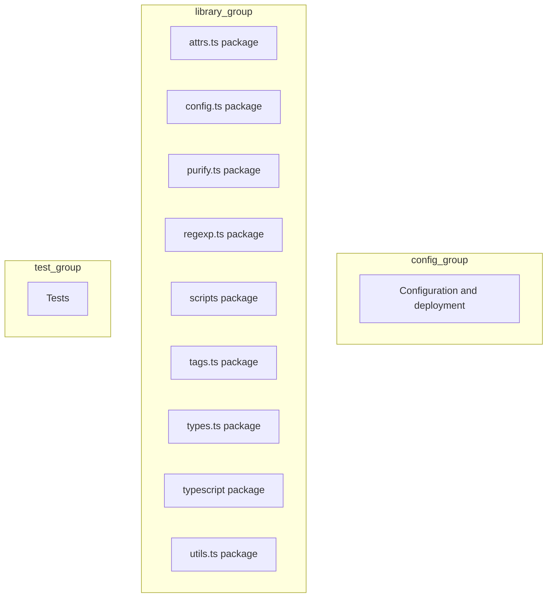

# Architecture report: cure53/DOMPurify

> Automated static analysis. **Observed** = directly seen in files/imports/AST; **Inferred** = interpretation from that evidence. Repository code was not executed.

## 1. Repository at a glance

| Item | Value |
| --- | --- |
| Repository | cure53/DOMPurify |
| Description | DOMPurify - a DOM-only, super-fast, uber-tolerant XSS sanitizer for HTML, MathML and SVG. DOMPurify works with a secure default, but offers a lot of configurability and hooks. Demo: |
| Language | JavaScript |
| Stars | 17531 |
| Licence | Apache-2.0 |
| Analysed commit / branch | 027a09f844af3bdc7b5d21f9a97b69635b7c2dfc / main |
| Framework(s) | None detected |
| Files analysed | 104 |
| Components | 11 |

## 2. Architecture in one minute

cure53/DOMPurify - DOMPurify - a DOM-only, super-fast, uber-tolerant XSS sanitizer for HTML, MathML and SVG. DOMPurify works with a secure default, but offers a lot of configurability and hooks. Demo:. This repository was analysed statically from 104 file(s) (0 Python). Detected technologies (observed from imports/manifests): GitHub Actions, TypeScript. Files are grouped into 11 component(s): attrs.ts package, Configuration and deployment, config.ts package, purify.ts package, regexp.ts package, scripts package, tags.ts package, Tests. Findings below distinguish observed facts from inferred interpretation.

## 3. High-level block diagram

## 4. Main components

### attrs.ts package (`attrs_ts`)

- **Kind:** library
- **Status:** Observed
- **Confidence:** 0.85
- **Responsibility:** Groups 1 file(s) under attrs.ts package (observed from repository paths and static analysis).
- **Paths:** `src/attrs.ts`
- **Evidence:** [src/attrs.ts](https://github.com/cure53/DOMPurify/blob/027a09f844af3bdc7b5d21f9a97b69635b7c2dfc/src/attrs.ts)

### Configuration and deployment (`config`)

- **Kind:** config
- **Status:** Observed
- **Confidence:** 0.85
- **Responsibility:** Groups 19 file(s) under configuration and deployment (observed from repository paths and static analysis).
- **Paths:** `config/playwright.config.js`, `config/rolldown.config.js`, `config/rolldown.coverage.config.js`, `config/tsconfig.json`, `osv-scanner.toml`, `package.json`, `typescript/commonjs-typescript-4.4/package.json`, `typescript/commonjs-typescript-4.4/tsconfig.json`, `typescript/commonjs-with-no-types/tsconfig.json`, `typescript/commonjs-with-specific-types/tsconfig.json`, `typescript/commonjs/tsconfig.json`, `typescript/esm-with-no-types/package.json`, `typescript/esm-with-no-types/tsconfig.json`, `typescript/esm-with-specific-types/package.json`, `typescript/esm-with-specific-types/tsconfig.json`, `typescript/esm/package.json`, `typescript/esm/tsconfig.json`, `typescript/nodenext/tsconfig.json`, `typescript/package.json`
- **Evidence:** [config/playwright.config.js](https://github.com/cure53/DOMPurify/blob/027a09f844af3bdc7b5d21f9a97b69635b7c2dfc/config/playwright.config.js); [config/rolldown.config.js](https://github.com/cure53/DOMPurify/blob/027a09f844af3bdc7b5d21f9a97b69635b7c2dfc/config/rolldown.config.js); [config/rolldown.coverage.config.js](https://github.com/cure53/DOMPurify/blob/027a09f844af3bdc7b5d21f9a97b69635b7c2dfc/config/rolldown.coverage.config.js); [config/tsconfig.json](https://github.com/cure53/DOMPurify/blob/027a09f844af3bdc7b5d21f9a97b69635b7c2dfc/config/tsconfig.json); [osv-scanner.toml](https://github.com/cure53/DOMPurify/blob/027a09f844af3bdc7b5d21f9a97b69635b7c2dfc/osv-scanner.toml); [package.json](https://github.com/cure53/DOMPurify/blob/027a09f844af3bdc7b5d21f9a97b69635b7c2dfc/package.json); [typescript/commonjs-typescript-4.4/package.json](https://github.com/cure53/DOMPurify/blob/027a09f844af3bdc7b5d21f9a97b69635b7c2dfc/typescript/commonjs-typescript-4.4/package.json); [typescript/commonjs-typescript-4.4/tsconfig.json](https://github.com/cure53/DOMPurify/blob/027a09f844af3bdc7b5d21f9a97b69635b7c2dfc/typescript/commonjs-typescript-4.4/tsconfig.json)

### config.ts package (`config_ts`)

- **Kind:** library
- **Status:** Observed
- **Confidence:** 0.85
- **Responsibility:** Groups 1 file(s) under config.ts package (observed from repository paths and static analysis).
- **Paths:** `src/config.ts`
- **Evidence:** [src/config.ts](https://github.com/cure53/DOMPurify/blob/027a09f844af3bdc7b5d21f9a97b69635b7c2dfc/src/config.ts)

### purify.ts package (`purify_ts`)

- **Kind:** library
- **Status:** Observed
- **Confidence:** 0.85
- **Responsibility:** Groups 1 file(s) under purify.ts package (observed from repository paths and static analysis).
- **Paths:** `src/purify.ts`
- **Evidence:** [src/purify.ts](https://github.com/cure53/DOMPurify/blob/027a09f844af3bdc7b5d21f9a97b69635b7c2dfc/src/purify.ts)

### regexp.ts package (`regexp_ts`)

- **Kind:** library
- **Status:** Observed
- **Confidence:** 0.85
- **Responsibility:** Groups 1 file(s) under regexp.ts package (observed from repository paths and static analysis).
- **Paths:** `src/regexp.ts`
- **Evidence:** [src/regexp.ts](https://github.com/cure53/DOMPurify/blob/027a09f844af3bdc7b5d21f9a97b69635b7c2dfc/src/regexp.ts)

### scripts package (`scripts`)

- **Kind:** library
- **Status:** Observed
- **Confidence:** 0.85
- **Responsibility:** Groups 3 file(s) under scripts package (observed from repository paths and static analysis).
- **Paths:** `scripts/benchmark.js`, `scripts/commit-amend-build.sh`, `scripts/fix-types.js`
- **Evidence:** [scripts/benchmark.js](https://github.com/cure53/DOMPurify/blob/027a09f844af3bdc7b5d21f9a97b69635b7c2dfc/scripts/benchmark.js); [scripts/commit-amend-build.sh](https://github.com/cure53/DOMPurify/blob/027a09f844af3bdc7b5d21f9a97b69635b7c2dfc/scripts/commit-amend-build.sh); [scripts/fix-types.js](https://github.com/cure53/DOMPurify/blob/027a09f844af3bdc7b5d21f9a97b69635b7c2dfc/scripts/fix-types.js)

### tags.ts package (`tags_ts`)

- **Kind:** library
- **Status:** Observed
- **Confidence:** 0.85
- **Responsibility:** Groups 1 file(s) under tags.ts package (observed from repository paths and static analysis).
- **Paths:** `src/tags.ts`
- **Evidence:** [src/tags.ts](https://github.com/cure53/DOMPurify/blob/027a09f844af3bdc7b5d21f9a97b69635b7c2dfc/src/tags.ts)

### Tests (`tests`)

- **Kind:** test
- **Status:** Observed
- **Confidence:** 0.85
- **Responsibility:** Groups 18 file(s) under tests (observed from repository paths and static analysis).
- **Paths:** `test/bootstrap-test-suite.js`, `test/browser.spec.js`, `test/browser/entry.js`, `test/browser/index.html`, `test/browser/index.min.html`, `test/browser/legacy-runner.js`, `test/browser/server.js`, `test/config/setup.js`, `test/fixtures/expect.mjs`, `test/fuzz/sanitize.fast-check.js`, `test/happydom-node-runner.js`, `test/happydom-node.js`, `test/jsdom-node-runner.js`, `test/jsdom-node.js`, `test/legacy-playwright/osv-scanner.toml`, `test/legacy-playwright/package.json`, `test/purify-edge-node-runner.js`, `test/purify-edge-node.js`
- **Evidence:** [test/bootstrap-test-suite.js](https://github.com/cure53/DOMPurify/blob/027a09f844af3bdc7b5d21f9a97b69635b7c2dfc/test/bootstrap-test-suite.js); [test/browser.spec.js](https://github.com/cure53/DOMPurify/blob/027a09f844af3bdc7b5d21f9a97b69635b7c2dfc/test/browser.spec.js); [test/browser/entry.js](https://github.com/cure53/DOMPurify/blob/027a09f844af3bdc7b5d21f9a97b69635b7c2dfc/test/browser/entry.js); [test/browser/index.html](https://github.com/cure53/DOMPurify/blob/027a09f844af3bdc7b5d21f9a97b69635b7c2dfc/test/browser/index.html); [test/browser/index.min.html](https://github.com/cure53/DOMPurify/blob/027a09f844af3bdc7b5d21f9a97b69635b7c2dfc/test/browser/index.min.html); [test/browser/legacy-runner.js](https://github.com/cure53/DOMPurify/blob/027a09f844af3bdc7b5d21f9a97b69635b7c2dfc/test/browser/legacy-runner.js); [test/browser/server.js](https://github.com/cure53/DOMPurify/blob/027a09f844af3bdc7b5d21f9a97b69635b7c2dfc/test/browser/server.js); [test/config/setup.js](https://github.com/cure53/DOMPurify/blob/027a09f844af3bdc7b5d21f9a97b69635b7c2dfc/test/config/setup.js)

### types.ts package (`types_ts`)

- **Kind:** library
- **Status:** Observed
- **Confidence:** 0.85
- **Responsibility:** Groups 1 file(s) under types.ts package (observed from repository paths and static analysis).
- **Paths:** `src/types.ts`
- **Evidence:** [src/types.ts](https://github.com/cure53/DOMPurify/blob/027a09f844af3bdc7b5d21f9a97b69635b7c2dfc/src/types.ts)

### typescript package (`typescript`)

- **Kind:** library
- **Status:** Observed
- **Confidence:** 0.85
- **Responsibility:** Groups 9 file(s) under typescript package (observed from repository paths and static analysis).
- **Paths:** `typescript/commonjs-typescript-4.4/index.ts`, `typescript/commonjs-with-no-types/index.ts`, `typescript/commonjs-with-specific-types/index.ts`, `typescript/commonjs/index.ts`, `typescript/esm-with-no-types/index.ts`, `typescript/esm-with-specific-types/index.ts`, `typescript/esm/index.ts`, `typescript/nodenext/index.ts`, `typescript/verify.js`
- **Evidence:** [typescript/commonjs-typescript-4.4/index.ts](https://github.com/cure53/DOMPurify/blob/027a09f844af3bdc7b5d21f9a97b69635b7c2dfc/typescript/commonjs-typescript-4.4/index.ts); [typescript/commonjs-with-no-types/index.ts](https://github.com/cure53/DOMPurify/blob/027a09f844af3bdc7b5d21f9a97b69635b7c2dfc/typescript/commonjs-with-no-types/index.ts); [typescript/commonjs-with-specific-types/index.ts](https://github.com/cure53/DOMPurify/blob/027a09f844af3bdc7b5d21f9a97b69635b7c2dfc/typescript/commonjs-with-specific-types/index.ts); [typescript/commonjs/index.ts](https://github.com/cure53/DOMPurify/blob/027a09f844af3bdc7b5d21f9a97b69635b7c2dfc/typescript/commonjs/index.ts); [typescript/esm-with-no-types/index.ts](https://github.com/cure53/DOMPurify/blob/027a09f844af3bdc7b5d21f9a97b69635b7c2dfc/typescript/esm-with-no-types/index.ts); [typescript/esm-with-specific-types/index.ts](https://github.com/cure53/DOMPurify/blob/027a09f844af3bdc7b5d21f9a97b69635b7c2dfc/typescript/esm-with-specific-types/index.ts); [typescript/esm/index.ts](https://github.com/cure53/DOMPurify/blob/027a09f844af3bdc7b5d21f9a97b69635b7c2dfc/typescript/esm/index.ts); [typescript/nodenext/index.ts](https://github.com/cure53/DOMPurify/blob/027a09f844af3bdc7b5d21f9a97b69635b7c2dfc/typescript/nodenext/index.ts)

### utils.ts package (`utils_ts`)

- **Kind:** library
- **Status:** Observed
- **Confidence:** 0.85
- **Responsibility:** Groups 1 file(s) under utils.ts package (observed from repository paths and static analysis).
- **Paths:** `src/utils.ts`
- **Evidence:** [src/utils.ts](https://github.com/cure53/DOMPurify/blob/027a09f844af3bdc7b5d21f9a97b69635b7c2dfc/src/utils.ts)

## 5. Execution flow

**Observed** entry point(s):

- [typescript/commonjs-typescript-4.4/index.ts](https://github.com/cure53/DOMPurify/blob/027a09f844af3bdc7b5d21f9a97b69635b7c2dfc/typescript/commonjs-typescript-4.4/index.ts)
- [typescript/commonjs-with-no-types/index.ts](https://github.com/cure53/DOMPurify/blob/027a09f844af3bdc7b5d21f9a97b69635b7c2dfc/typescript/commonjs-with-no-types/index.ts)
- [typescript/commonjs-with-specific-types/index.ts](https://github.com/cure53/DOMPurify/blob/027a09f844af3bdc7b5d21f9a97b69635b7c2dfc/typescript/commonjs-with-specific-types/index.ts)
- [typescript/commonjs/index.ts](https://github.com/cure53/DOMPurify/blob/027a09f844af3bdc7b5d21f9a97b69635b7c2dfc/typescript/commonjs/index.ts)
- [typescript/esm-with-no-types/index.ts](https://github.com/cure53/DOMPurify/blob/027a09f844af3bdc7b5d21f9a97b69635b7c2dfc/typescript/esm-with-no-types/index.ts)
- [typescript/esm-with-specific-types/index.ts](https://github.com/cure53/DOMPurify/blob/027a09f844af3bdc7b5d21f9a97b69635b7c2dfc/typescript/esm-with-specific-types/index.ts)
- [typescript/esm/index.ts](https://github.com/cure53/DOMPurify/blob/027a09f844af3bdc7b5d21f9a97b69635b7c2dfc/typescript/esm/index.ts)
- [typescript/nodenext/index.ts](https://github.com/cure53/DOMPurify/blob/027a09f844af3bdc7b5d21f9a97b69635b7c2dfc/typescript/nodenext/index.ts)

Representative flow (derived from observed entry points and the import graph; steps beyond the entry point are **Inferred**):

1. Execution starts at an observed entry point listed above, if present.
2. No internal import relationships between components were observed.

## 6. Project structure

### `(root)`

- `.babelrc` - other (252 bytes)
- `.editorconfig` - config (174 bytes)
- `.gitattributes` - other (14 bytes)
- `.gitignore` - other (367 bytes)
- `.nvmrc` - other (6 bytes)
- `.prettierrc` - other (52 bytes)
- `CODEOWNERS` - other (85 bytes)
- `CODE_OF_CONDUCT.md` - docs (1620 bytes)
- `CONTRIBUTING.md` - docs (939 bytes)
- `LICENSE` - docs (11358 bytes)
- `LICENSE-MPL` - other (16726 bytes)
- `README.md` - docs (46454 bytes)
- `SECURITY.md` - docs (5614 bytes)
- `git` - other (0 bytes)
- `osv-scanner.toml` - config (4697 bytes)
- `package.json` - manifest (7019 bytes)

### `.github`

- `.github/FUNDING.yml` - config (15 bytes)
- `.github/ISSUE_TEMPLATE.md` - docs (498 bytes)
- `.github/PULL_REQUEST_TEMPLATE.md` - docs (474 bytes)
- `.github/dependabot.yml` - config (3471 bytes)
- `.github/workflows/build-and-test-skip.yml` - ci, YAML (2651 bytes)
- `.github/workflows/build-and-test.yml` - ci, YAML (7275 bytes)
- `.github/workflows/codeql-analysis.yml` - ci, YAML (2850 bytes)
- `.github/workflows/dependency-review.yml` - ci, YAML (1617 bytes)
- `.github/workflows/fuzz.yml` - ci, YAML (995 bytes)
- `.github/workflows/legacy-browsers.yml` - ci, YAML (4537 bytes)
- `.github/workflows/scorecard.yml` - ci, YAML (4773 bytes)
- `.github/workflows/sign-release.yml` - ci, YAML (966 bytes)
- `.github/workflows/slsa-provenance.yml` - ci, YAML (1325 bytes)

### `.husky`

- `.husky/pre-commit` - other (54 bytes)

### `config`

- `config/playwright.config.js` - source, JavaScript (1325 bytes)
- `config/rolldown.config.js` - source, JavaScript (2784 bytes)
- `config/rolldown.coverage.config.js` - source, JavaScript (1818 bytes)
- `config/tsconfig.json` - config (221 bytes)

### `demos`

- `demos/README.md` - docs (18193 bytes)
- `demos/advanced-config-demo.html` - other (1794 bytes)
- `demos/basic-demo.html` - other (901 bytes)
- `demos/config-demo.html` - other (1270 bytes)
- `demos/hooks-demo.html` - other (1259 bytes)
- `demos/hooks-link-proxy-demo.html` - other (2292 bytes)
- `demos/hooks-mentaljs-demo.html` - other (3891 bytes)
- `demos/hooks-node-removal-demo.html` - other (1052 bytes)
- `demos/hooks-node-removal2-demo.html` - other (2729 bytes)
- `demos/hooks-proxy-demo.html` - other (23659 bytes)
- `demos/hooks-removal-demo.html` - other (2657 bytes)
- `demos/hooks-sanitize-css-demo.html` - other (7116 bytes)
- `demos/hooks-scheme-allowlist.html` - other (3991 bytes)
- `demos/hooks-svg-demo.html` - other (2164 bytes)
- `demos/hooks-target-blank-demo.html` - other (1934 bytes)
- `demos/trusted-types-demo.html` - other (3526 bytes)

### `scripts`

- `scripts/benchmark.js` - source, JavaScript (8560 bytes)
- `scripts/commit-amend-build.sh` - source, Shell (273 bytes)
- `scripts/fix-types.js` - source, JavaScript (3199 bytes)

### `src`

- `src/attrs.ts` - source, TypeScript (5421 bytes)
- `src/config.ts` - source, TypeScript (7421 bytes)
- `src/license_header` - other (192 bytes)
- `src/purify.ts` - source, TypeScript (95888 bytes)
- `src/regexp.ts` - source, TypeScript (1694 bytes)
- `src/tags.ts` - source, TypeScript (3759 bytes)
- `src/types.ts` - source, TypeScript (8784 bytes)
- `src/utils.ts` - source, TypeScript (9933 bytes)

### `test`

- `test/bootstrap-test-suite.js` - test, JavaScript (17329 bytes)
- `test/browser.spec.js` - test, JavaScript (3262 bytes)
- `test/browser/entry.js` - test, JavaScript (1448 bytes)
- `test/browser/index.html` - test (1527 bytes)
- `test/browser/index.min.html` - test (835 bytes)
- `test/browser/legacy-runner.js` - test, JavaScript (5271 bytes)
- `test/browser/server.js` - test, JavaScript (3225 bytes)
- `test/config/setup.js` - test, JavaScript (352 bytes)
- `test/fixtures/expect.mjs` - test, JavaScript (82332 bytes)
- `test/fuzz/sanitize.fast-check.js` - test, JavaScript (13313 bytes)
- `test/happydom-node-runner.js` - test, JavaScript (480 bytes)
- `test/happydom-node.js` - test, JavaScript (2860 bytes)
- `test/jsdom-node-runner.js` - test, JavaScript (477 bytes)
- `test/jsdom-node.js` - test, JavaScript (1972 bytes)
- `test/legacy-playwright/osv-scanner.toml` - test (754 bytes)
- `test/legacy-playwright/package.json` - test (714 bytes)
- `test/purify-edge-node-runner.js` - test, JavaScript (483 bytes)
- `test/purify-edge-node.js` - test, JavaScript (3654 bytes)

### `typescript`

- `typescript/commonjs-typescript-4.4/index.ts` - source, TypeScript (413 bytes)
- `typescript/commonjs-typescript-4.4/package.json` - manifest (37 bytes)
- `typescript/commonjs-typescript-4.4/tsconfig.json` - config (108 bytes)
- `typescript/commonjs-with-no-types/index.ts` - source, TypeScript (97 bytes)
- `typescript/commonjs-with-no-types/tsconfig.json` - config (108 bytes)
- `typescript/commonjs-with-no-types/types/readme.md` - docs (60 bytes)
- `typescript/commonjs-with-specific-types/index.ts` - source, TypeScript (97 bytes)
- `typescript/commonjs-with-specific-types/tsconfig.json` - config (103 bytes)
- `typescript/commonjs/index.ts` - source, TypeScript (97 bytes)
- `typescript/commonjs/tsconfig.json` - config (80 bytes)
- `typescript/esm-with-no-types/index.ts` - source, TypeScript (92 bytes)
- `typescript/esm-with-no-types/package.json` - manifest (23 bytes)
- `typescript/esm-with-no-types/tsconfig.json` - config (117 bytes)
- `typescript/esm-with-no-types/types/readme.md` - docs (60 bytes)
- `typescript/esm-with-specific-types/index.ts` - source, TypeScript (92 bytes)
- `typescript/esm-with-specific-types/package.json` - manifest (23 bytes)
- `typescript/esm-with-specific-types/tsconfig.json` - config (112 bytes)
- `typescript/esm/index.ts` - source, TypeScript (92 bytes)
- `typescript/esm/package.json` - manifest (23 bytes)
- `typescript/esm/tsconfig.json` - config (89 bytes)
- `typescript/nodenext/index.ts` - source, TypeScript (92 bytes)
- `typescript/nodenext/tsconfig.json` - config (92 bytes)
- `typescript/package.json` - manifest (99 bytes)
- `typescript/verify.js` - source, JavaScript (4401 bytes)

### `website`

- `website/index.html` - other (18762 bytes)

## 7. Key dependencies and integrations

| Name | Category | Status | Confidence | Evidence |
| --- | --- | --- | --- | --- |
| GitHub Actions | ci | Observed | 0.90 | [.github/workflows/build-and-test-skip.yml](https://github.com/cure53/DOMPurify/blob/027a09f844af3bdc7b5d21f9a97b69635b7c2dfc/.github/workflows/build-and-test-skip.yml); [.github/workflows/build-and-test.yml](https://github.com/cure53/DOMPurify/blob/027a09f844af3bdc7b5d21f9a97b69635b7c2dfc/.github/workflows/build-and-test.yml); [.github/workflows/codeql-analysis.yml](https://github.com/cure53/DOMPurify/blob/027a09f844af3bdc7b5d21f9a97b69635b7c2dfc/.github/workflows/codeql-analysis.yml); [.github/workflows/dependency-review.yml](https://github.com/cure53/DOMPurify/blob/027a09f844af3bdc7b5d21f9a97b69635b7c2dfc/.github/workflows/dependency-review.yml) |
| TypeScript | tooling | Observed | 0.85 | [package.json:32](https://github.com/cure53/DOMPurify/blob/027a09f844af3bdc7b5d21f9a97b69635b7c2dfc/package.json#L32) |

## 8. Data and state

No database, cache, queue, or persistent-state usage was observed in the analysed files. State handling, if any, may be in-memory or in files that were not analysed.

## 9. Configuration and deployment clues

- `.editorconfig` (config)
- `.github/FUNDING.yml` (config)
- `.github/dependabot.yml` (config)
- `.github/workflows/build-and-test-skip.yml` (ci)
- `.github/workflows/build-and-test.yml` (ci)
- `.github/workflows/codeql-analysis.yml` (ci)
- `.github/workflows/dependency-review.yml` (ci)
- `.github/workflows/fuzz.yml` (ci)
- `.github/workflows/legacy-browsers.yml` (ci)
- `.github/workflows/scorecard.yml` (ci)
- `.github/workflows/sign-release.yml` (ci)
- `.github/workflows/slsa-provenance.yml` (ci)
- `config/tsconfig.json` (config)
- `osv-scanner.toml` (config)
- `package.json` (manifest)
- `typescript/commonjs-typescript-4.4/package.json` (manifest)
- `typescript/commonjs-typescript-4.4/tsconfig.json` (config)
- `typescript/commonjs-with-no-types/tsconfig.json` (config)
- `typescript/commonjs-with-specific-types/tsconfig.json` (config)
- `typescript/commonjs/tsconfig.json` (config)
- `typescript/esm-with-no-types/package.json` (manifest)
- `typescript/esm-with-no-types/tsconfig.json` (config)
- `typescript/esm-with-specific-types/package.json` (manifest)
- `typescript/esm-with-specific-types/tsconfig.json` (config)
- `typescript/esm/package.json` (manifest)
- `typescript/esm/tsconfig.json` (config)
- `typescript/nodenext/tsconfig.json` (config)
- `typescript/package.json` (manifest)

## 10. Design observations

- Tests are present alongside source code (Observed from test file paths).

These observations are interpretations (**Inferred**) of the observed structure, not guarantees about runtime design.

## 11. Limitations and unknowns

- Static analysis only: repository code was not executed, installed, or imported at runtime.
- Components and relationships are inferred from file paths, imports, and AST structure; runtime behaviour, dynamic imports, and reflection may not be visible.
- 6 file(s) were skipped during inventory (1 x lockfile excluded; 5 x vendored/generated directory excluded).
- No clear application entry point was observed in the analysed files.
- Repository text was treated as untrusted data; no instructions found in repository files were followed, and likely secret values were redacted/excluded.
- JavaScript and TypeScript files were inventoried from paths and package manifests. They were not parsed with a full language AST, and repository code was not executed.

## 12. Source references

- [.github/workflows/build-and-test-skip.yml](https://github.com/cure53/DOMPurify/blob/027a09f844af3bdc7b5d21f9a97b69635b7c2dfc/.github/workflows/build-and-test-skip.yml)
- [.github/workflows/build-and-test.yml](https://github.com/cure53/DOMPurify/blob/027a09f844af3bdc7b5d21f9a97b69635b7c2dfc/.github/workflows/build-and-test.yml)
- [.github/workflows/codeql-analysis.yml](https://github.com/cure53/DOMPurify/blob/027a09f844af3bdc7b5d21f9a97b69635b7c2dfc/.github/workflows/codeql-analysis.yml)
- [.github/workflows/dependency-review.yml](https://github.com/cure53/DOMPurify/blob/027a09f844af3bdc7b5d21f9a97b69635b7c2dfc/.github/workflows/dependency-review.yml)
- [.github/workflows/fuzz.yml](https://github.com/cure53/DOMPurify/blob/027a09f844af3bdc7b5d21f9a97b69635b7c2dfc/.github/workflows/fuzz.yml)
- [.github/workflows/legacy-browsers.yml](https://github.com/cure53/DOMPurify/blob/027a09f844af3bdc7b5d21f9a97b69635b7c2dfc/.github/workflows/legacy-browsers.yml)
- [.github/workflows/scorecard.yml](https://github.com/cure53/DOMPurify/blob/027a09f844af3bdc7b5d21f9a97b69635b7c2dfc/.github/workflows/scorecard.yml)
- [.github/workflows/sign-release.yml](https://github.com/cure53/DOMPurify/blob/027a09f844af3bdc7b5d21f9a97b69635b7c2dfc/.github/workflows/sign-release.yml)
- [config/playwright.config.js](https://github.com/cure53/DOMPurify/blob/027a09f844af3bdc7b5d21f9a97b69635b7c2dfc/config/playwright.config.js)
- [config/rolldown.config.js](https://github.com/cure53/DOMPurify/blob/027a09f844af3bdc7b5d21f9a97b69635b7c2dfc/config/rolldown.config.js)
- [config/rolldown.coverage.config.js](https://github.com/cure53/DOMPurify/blob/027a09f844af3bdc7b5d21f9a97b69635b7c2dfc/config/rolldown.coverage.config.js)
- [config/tsconfig.json](https://github.com/cure53/DOMPurify/blob/027a09f844af3bdc7b5d21f9a97b69635b7c2dfc/config/tsconfig.json)
- [osv-scanner.toml](https://github.com/cure53/DOMPurify/blob/027a09f844af3bdc7b5d21f9a97b69635b7c2dfc/osv-scanner.toml)
- [package.json](https://github.com/cure53/DOMPurify/blob/027a09f844af3bdc7b5d21f9a97b69635b7c2dfc/package.json)
- [package.json:32](https://github.com/cure53/DOMPurify/blob/027a09f844af3bdc7b5d21f9a97b69635b7c2dfc/package.json#L32)
- [scripts/benchmark.js](https://github.com/cure53/DOMPurify/blob/027a09f844af3bdc7b5d21f9a97b69635b7c2dfc/scripts/benchmark.js)
- [scripts/commit-amend-build.sh](https://github.com/cure53/DOMPurify/blob/027a09f844af3bdc7b5d21f9a97b69635b7c2dfc/scripts/commit-amend-build.sh)
- [scripts/fix-types.js](https://github.com/cure53/DOMPurify/blob/027a09f844af3bdc7b5d21f9a97b69635b7c2dfc/scripts/fix-types.js)
- [src/attrs.ts](https://github.com/cure53/DOMPurify/blob/027a09f844af3bdc7b5d21f9a97b69635b7c2dfc/src/attrs.ts)
- [src/config.ts](https://github.com/cure53/DOMPurify/blob/027a09f844af3bdc7b5d21f9a97b69635b7c2dfc/src/config.ts)
- [src/purify.ts](https://github.com/cure53/DOMPurify/blob/027a09f844af3bdc7b5d21f9a97b69635b7c2dfc/src/purify.ts)
- [src/regexp.ts](https://github.com/cure53/DOMPurify/blob/027a09f844af3bdc7b5d21f9a97b69635b7c2dfc/src/regexp.ts)
- [src/tags.ts](https://github.com/cure53/DOMPurify/blob/027a09f844af3bdc7b5d21f9a97b69635b7c2dfc/src/tags.ts)
- [src/types.ts](https://github.com/cure53/DOMPurify/blob/027a09f844af3bdc7b5d21f9a97b69635b7c2dfc/src/types.ts)
- [src/utils.ts](https://github.com/cure53/DOMPurify/blob/027a09f844af3bdc7b5d21f9a97b69635b7c2dfc/src/utils.ts)
- [test/bootstrap-test-suite.js](https://github.com/cure53/DOMPurify/blob/027a09f844af3bdc7b5d21f9a97b69635b7c2dfc/test/bootstrap-test-suite.js)
- [test/browser.spec.js](https://github.com/cure53/DOMPurify/blob/027a09f844af3bdc7b5d21f9a97b69635b7c2dfc/test/browser.spec.js)
- [test/browser/entry.js](https://github.com/cure53/DOMPurify/blob/027a09f844af3bdc7b5d21f9a97b69635b7c2dfc/test/browser/entry.js)
- [test/browser/index.html](https://github.com/cure53/DOMPurify/blob/027a09f844af3bdc7b5d21f9a97b69635b7c2dfc/test/browser/index.html)
- [test/browser/index.min.html](https://github.com/cure53/DOMPurify/blob/027a09f844af3bdc7b5d21f9a97b69635b7c2dfc/test/browser/index.min.html)
- [test/browser/legacy-runner.js](https://github.com/cure53/DOMPurify/blob/027a09f844af3bdc7b5d21f9a97b69635b7c2dfc/test/browser/legacy-runner.js)
- [test/browser/server.js](https://github.com/cure53/DOMPurify/blob/027a09f844af3bdc7b5d21f9a97b69635b7c2dfc/test/browser/server.js)
- [test/config/setup.js](https://github.com/cure53/DOMPurify/blob/027a09f844af3bdc7b5d21f9a97b69635b7c2dfc/test/config/setup.js)
- [typescript/commonjs-typescript-4.4/index.ts](https://github.com/cure53/DOMPurify/blob/027a09f844af3bdc7b5d21f9a97b69635b7c2dfc/typescript/commonjs-typescript-4.4/index.ts)
- [typescript/commonjs-typescript-4.4/package.json](https://github.com/cure53/DOMPurify/blob/027a09f844af3bdc7b5d21f9a97b69635b7c2dfc/typescript/commonjs-typescript-4.4/package.json)
- [typescript/commonjs-typescript-4.4/tsconfig.json](https://github.com/cure53/DOMPurify/blob/027a09f844af3bdc7b5d21f9a97b69635b7c2dfc/typescript/commonjs-typescript-4.4/tsconfig.json)
- [typescript/commonjs-with-no-types/index.ts](https://github.com/cure53/DOMPurify/blob/027a09f844af3bdc7b5d21f9a97b69635b7c2dfc/typescript/commonjs-with-no-types/index.ts)
- [typescript/commonjs-with-specific-types/index.ts](https://github.com/cure53/DOMPurify/blob/027a09f844af3bdc7b5d21f9a97b69635b7c2dfc/typescript/commonjs-with-specific-types/index.ts)
- [typescript/commonjs/index.ts](https://github.com/cure53/DOMPurify/blob/027a09f844af3bdc7b5d21f9a97b69635b7c2dfc/typescript/commonjs/index.ts)
- [typescript/esm-with-no-types/index.ts](https://github.com/cure53/DOMPurify/blob/027a09f844af3bdc7b5d21f9a97b69635b7c2dfc/typescript/esm-with-no-types/index.ts)
- [typescript/esm-with-specific-types/index.ts](https://github.com/cure53/DOMPurify/blob/027a09f844af3bdc7b5d21f9a97b69635b7c2dfc/typescript/esm-with-specific-types/index.ts)
- [typescript/esm/index.ts](https://github.com/cure53/DOMPurify/blob/027a09f844af3bdc7b5d21f9a97b69635b7c2dfc/typescript/esm/index.ts)
- [typescript/nodenext/index.ts](https://github.com/cure53/DOMPurify/blob/027a09f844af3bdc7b5d21f9a97b69635b7c2dfc/typescript/nodenext/index.ts)
