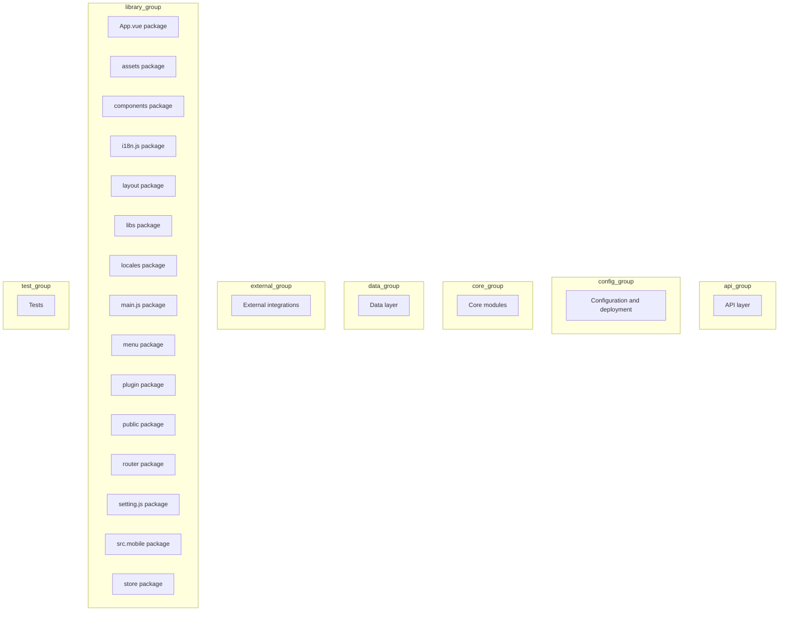

# Architecture report: d2-projects/d2-admin

> Automated static analysis. **Observed** = directly seen in files/imports/AST; **Inferred** = interpretation from that evidence. Repository code was not executed.

## 1. Repository at a glance

| Item | Value |
| --- | --- |
| Repository | d2-projects/d2-admin |
| Description | An elegant dashboard |
| Language | JavaScript |
| Stars | 12611 |
| Licence | MIT |
| Analysed commit / branch | 35d7aa1fc1fc8a9f35c707993fc7370393a41a48 / master |
| Framework(s) | Vue |
| Files analysed | 399 |
| Components | 21 |

## 2. Architecture in one minute

d2-projects/d2-admin - An elegant dashboard. This repository was analysed statically from 399 file(s) (0 Python). Detected technologies (observed from imports/manifests): GitHub Actions, Vue, axios. Files are grouped into 21 component(s): API layer, App.vue package, assets package, components package, Configuration and deployment, Core modules, Data layer, External integrations. Findings below distinguish observed facts from inferred interpretation.

## 3. High-level block diagram

## 4. Main components

### API layer (`api_layer`)

- **Kind:** api
- **Status:** Observed
- **Confidence:** 0.85
- **Responsibility:** Groups 89 file(s) under api layer (observed from repository paths and static analysis).
- **Paths:** `src.mobile/views/index.vue`, `src/api/_service.js`, `src/api/_tools.js`, `src/api/demo.js`, `src/api/sys.user.js`, `src/views/demo/components/container/api.vue`, `src/views/demo/components/container/card-bs.vue`, `src/views/demo/components/container/card-slot.vue`, `src/views/demo/components/container/card.vue`, `src/views/demo/components/container/components/d2-demo-article.vue`, `src/views/demo/components/container/full-bs.vue`, `src/views/demo/components/container/full-slot.vue`, `src/views/demo/components/container/full.vue`, `src/views/demo/components/container/ghost-bs.vue`, `src/views/demo/components/container/ghost-slot.vue`, `src/views/demo/components/container/ghost.vue`, `src/views/demo/components/countup/index.vue`, `src/views/demo/components/editor-quill/index.vue`, `src/views/demo/components/editor-quill/value.js`, `src/views/demo/components/editor-ueditor/index.vue`, `src/views/demo/components/highlight/code/css.js`, `src/views/demo/components/highlight/code/html.js`, `src/views/demo/components/highlight/code/javascript.js`, `src/views/demo/components/highlight/code/scss.js`, `src/views/demo/components/highlight/index.vue`, `src/views/demo/components/icon/components/d2-icon-cell.vue`, `src/views/demo/components/icon/data/index.js`, `src/views/demo/components/icon/icon-svg.vue`, `src/views/demo/components/icon/icon.vue`, `src/views/demo/components/icon/list.vue`, `src/views/demo/components/icon/select-svg.vue`, `src/views/demo/components/icon/select.vue`, `src/views/demo/components/index/index.vue`, `src/views/demo/components/json-tree/index.vue`, `src/views/demo/components/layout/grid.vue`, `src/views/demo/components/layout/splitpane.vue`, `src/views/demo/components/markdown/source.vue`, `src/views/demo/components/markdown/url.vue`, `src/views/demo/playground/add-routes/alternates/1.vue`, `src/views/demo/playground/add-routes/alternates/2.vue`, `src/views/demo/playground/add-routes/alternates/3.vue`, `src/views/demo/playground/add-routes/routes.vue`, `src/views/demo/playground/db/all/index.vue`, `src/views/demo/playground/db/page-public/index.vue`, `src/views/demo/playground/db/page-snapshot-public/index.vue`, `src/views/demo/playground/db/page-snapshot-user/index.vue`, `src/views/demo/playground/db/page-user/index.vue`, `src/views/demo/playground/db/public/index.vue`, `src/views/demo/playground/db/user/index.vue`, `src/views/demo/playground/env/index.vue`, `src/views/demo/playground/frame/d2-doc/index.vue`, `src/views/demo/playground/frame/html/index.vue`, `src/views/demo/playground/frame/report/index.vue`, `src/views/demo/playground/index/index.vue`, `src/views/demo/playground/locales/index.vue`, `src/views/demo/playground/log/ajax/index.vue`, `src/views/demo/playground/log/console/index.vue`, `src/views/demo/playground/log/error/index.vue`, `src/views/demo/playground/log/log/index.vue`, `src/views/demo/playground/page-argu/get.vue`, `src/views/demo/playground/page-argu/send.vue`, `src/views/demo/playground/page-cache/off.vue`, `src/views/demo/playground/page-cache/on.vue`, `src/views/demo/playground/page-cache/params.vue`, `src/views/demo/playground/store/fullscreen/index.vue`, `src/views/demo/playground/store/gray/index.vue`, `src/views/demo/playground/store/menu/index.vue`, `src/views/demo/playground/store/page/index.vue`, `src/views/demo/playground/store/size/index.vue`, `src/views/demo/playground/store/theme/index.vue`, `src/views/demo/playground/store/transition/index.vue`, `src/views/demo/playground/store/ua/index.vue`, `src/views/demo/plugins/clipboard-polyfill/index.vue`, `src/views/demo/plugins/day/index.vue`, `src/views/demo/plugins/export/table.vue`, `src/views/demo/plugins/export/txt.vue`, `src/views/demo/plugins/import/csv.vue`, `src/views/demo/plugins/import/xlsx.vue`, `src/views/demo/plugins/index/index.vue`, `src/views/demo/plugins/js-cookie/index.vue`, `src/views/system/error/404/index.vue`, `src/views/system/function/redirect/index.js`, `src/views/system/function/refresh/index.js`, `src/views/system/index/components/d2-badge/index.vue`, `src/views/system/index/components/d2-help/index.vue`, `src/views/system/index/components/d2-page-cover/index.vue`, `src/views/system/index/index.vue`, `src/views/system/log/index.vue`, `src/views/system/login/index.vue`
- **Evidence:** [src.mobile/views/index.vue](https://github.com/d2-projects/d2-admin/blob/35d7aa1fc1fc8a9f35c707993fc7370393a41a48/src.mobile/views/index.vue); [src/api/_service.js](https://github.com/d2-projects/d2-admin/blob/35d7aa1fc1fc8a9f35c707993fc7370393a41a48/src/api/_service.js); [src/api/_tools.js](https://github.com/d2-projects/d2-admin/blob/35d7aa1fc1fc8a9f35c707993fc7370393a41a48/src/api/_tools.js); [src/api/demo.js](https://github.com/d2-projects/d2-admin/blob/35d7aa1fc1fc8a9f35c707993fc7370393a41a48/src/api/demo.js); [src/api/sys.user.js](https://github.com/d2-projects/d2-admin/blob/35d7aa1fc1fc8a9f35c707993fc7370393a41a48/src/api/sys.user.js); [src/views/demo/components/container/api.vue](https://github.com/d2-projects/d2-admin/blob/35d7aa1fc1fc8a9f35c707993fc7370393a41a48/src/views/demo/components/container/api.vue); [src/views/demo/components/container/card-bs.vue](https://github.com/d2-projects/d2-admin/blob/35d7aa1fc1fc8a9f35c707993fc7370393a41a48/src/views/demo/components/container/card-bs.vue); [src/views/demo/components/container/card-slot.vue](https://github.com/d2-projects/d2-admin/blob/35d7aa1fc1fc8a9f35c707993fc7370393a41a48/src/views/demo/components/container/card-slot.vue)

### App.vue package (`app_vue`)

- **Kind:** library
- **Status:** Observed
- **Confidence:** 0.85
- **Responsibility:** Groups 1 file(s) under app.vue package (observed from repository paths and static analysis).
- **Paths:** `src/App.vue`
- **Evidence:** [src/App.vue](https://github.com/d2-projects/d2-admin/blob/35d7aa1fc1fc8a9f35c707993fc7370393a41a48/src/App.vue)

### assets package (`assets`)

- **Kind:** library
- **Status:** Observed
- **Confidence:** 0.85
- **Responsibility:** Groups 1 file(s) under assets package (observed from repository paths and static analysis).
- **Paths:** `src/assets/svg-icons/index.js`
- **Evidence:** [src/assets/svg-icons/index.js](https://github.com/d2-projects/d2-admin/blob/35d7aa1fc1fc8a9f35c707993fc7370393a41a48/src/assets/svg-icons/index.js)

### components package (`components`)

- **Kind:** library
- **Status:** Observed
- **Confidence:** 0.85
- **Responsibility:** Groups 31 file(s) under components package (observed from repository paths and static analysis).
- **Paths:** `src/components/d2-container-frame/index.vue`, `src/components/d2-container/components/d2-container-card-bs.vue`, `src/components/d2-container/components/d2-container-card.vue`, `src/components/d2-container/components/d2-container-full-bs.vue`, `src/components/d2-container/components/d2-container-full.vue`, `src/components/d2-container/components/d2-container-ghost-bs.vue`, `src/components/d2-container/components/d2-container-ghost.vue`, `src/components/d2-container/components/d2-source.vue`, `src/components/d2-container/components/mixins/bs.js`, `src/components/d2-container/components/mixins/normal.js`, `src/components/d2-container/index.js`, `src/components/d2-count-up/index.vue`, `src/components/d2-highlight/index.vue`, `src/components/d2-highlight/libs/htmlFormat.js`, `src/components/d2-icon-select/index.vue`, `src/components/d2-icon-svg-select/index.vue`, `src/components/d2-icon-svg/index.vue`, `src/components/d2-icon/index.vue`, `src/components/d2-link-btn/index.vue`, `src/components/d2-markdown/index.vue`, `src/components/d2-markdown/plugin/baidupan.js`, `src/components/d2-module-index-banner/index.vue`, `src/components/d2-module-index-menu/components/group.vue`, `src/components/d2-module-index-menu/components/item.vue`, `src/components/d2-module-index-menu/index.vue`, `src/components/d2-quill/index.vue`, `src/components/d2-scrollbar/index.vue`, `src/components/d2-ueditor/button/d2admin.js`, `src/components/d2-ueditor/index.vue`, `src/components/d2-ueditor/ueditor.config.js`, `src/components/index.js`
- **Evidence:** [src/components/d2-container-frame/index.vue](https://github.com/d2-projects/d2-admin/blob/35d7aa1fc1fc8a9f35c707993fc7370393a41a48/src/components/d2-container-frame/index.vue); [src/components/d2-container/components/d2-container-card-bs.vue](https://github.com/d2-projects/d2-admin/blob/35d7aa1fc1fc8a9f35c707993fc7370393a41a48/src/components/d2-container/components/d2-container-card-bs.vue); [src/components/d2-container/components/d2-container-card.vue](https://github.com/d2-projects/d2-admin/blob/35d7aa1fc1fc8a9f35c707993fc7370393a41a48/src/components/d2-container/components/d2-container-card.vue); [src/components/d2-container/components/d2-container-full-bs.vue](https://github.com/d2-projects/d2-admin/blob/35d7aa1fc1fc8a9f35c707993fc7370393a41a48/src/components/d2-container/components/d2-container-full-bs.vue); [src/components/d2-container/components/d2-container-full.vue](https://github.com/d2-projects/d2-admin/blob/35d7aa1fc1fc8a9f35c707993fc7370393a41a48/src/components/d2-container/components/d2-container-full.vue); [src/components/d2-container/components/d2-container-ghost-bs.vue](https://github.com/d2-projects/d2-admin/blob/35d7aa1fc1fc8a9f35c707993fc7370393a41a48/src/components/d2-container/components/d2-container-ghost-bs.vue); [src/components/d2-container/components/d2-container-ghost.vue](https://github.com/d2-projects/d2-admin/blob/35d7aa1fc1fc8a9f35c707993fc7370393a41a48/src/components/d2-container/components/d2-container-ghost.vue); [src/components/d2-container/components/d2-source.vue](https://github.com/d2-projects/d2-admin/blob/35d7aa1fc1fc8a9f35c707993fc7370393a41a48/src/components/d2-container/components/d2-source.vue)

### Configuration and deployment (`config`)

- **Kind:** config
- **Status:** Observed
- **Confidence:** 0.85
- **Responsibility:** Groups 7 file(s) under configuration and deployment (observed from repository paths and static analysis).
- **Paths:** `jsconfig.json`, `package.json`, `public/lib/UEditor/jsp/config.json`, `src/locales/en.json`, `src/locales/ja.json`, `src/locales/zh-chs.json`, `src/locales/zh-cht.json`
- **Evidence:** [jsconfig.json](https://github.com/d2-projects/d2-admin/blob/35d7aa1fc1fc8a9f35c707993fc7370393a41a48/jsconfig.json); [package.json](https://github.com/d2-projects/d2-admin/blob/35d7aa1fc1fc8a9f35c707993fc7370393a41a48/package.json); [public/lib/UEditor/jsp/config.json](https://github.com/d2-projects/d2-admin/blob/35d7aa1fc1fc8a9f35c707993fc7370393a41a48/public/lib/UEditor/jsp/config.json); [src/locales/en.json](https://github.com/d2-projects/d2-admin/blob/35d7aa1fc1fc8a9f35c707993fc7370393a41a48/src/locales/en.json); [src/locales/ja.json](https://github.com/d2-projects/d2-admin/blob/35d7aa1fc1fc8a9f35c707993fc7370393a41a48/src/locales/ja.json); [src/locales/zh-chs.json](https://github.com/d2-projects/d2-admin/blob/35d7aa1fc1fc8a9f35c707993fc7370393a41a48/src/locales/zh-chs.json); [src/locales/zh-cht.json](https://github.com/d2-projects/d2-admin/blob/35d7aa1fc1fc8a9f35c707993fc7370393a41a48/src/locales/zh-cht.json)

### Core modules (`core`)

- **Kind:** core
- **Status:** Observed
- **Confidence:** 0.85
- **Responsibility:** Groups 3 file(s) under core modules (observed from repository paths and static analysis).
- **Paths:** `babel.config.js`, `jest.config.js`, `vue.config.js`
- **Evidence:** [babel.config.js](https://github.com/d2-projects/d2-admin/blob/35d7aa1fc1fc8a9f35c707993fc7370393a41a48/babel.config.js); [jest.config.js](https://github.com/d2-projects/d2-admin/blob/35d7aa1fc1fc8a9f35c707993fc7370393a41a48/jest.config.js); [vue.config.js](https://github.com/d2-projects/d2-admin/blob/35d7aa1fc1fc8a9f35c707993fc7370393a41a48/vue.config.js)

### Data layer (`data_layer`)

- **Kind:** data
- **Status:** Observed
- **Confidence:** 0.85
- **Responsibility:** Groups 1 file(s) under data layer (observed from repository paths and static analysis).
- **Paths:** `src/components/d2-icon-select/data/index.js`
- **Evidence:** [src/components/d2-icon-select/data/index.js](https://github.com/d2-projects/d2-admin/blob/35d7aa1fc1fc8a9f35c707993fc7370393a41a48/src/components/d2-icon-select/data/index.js)

### External integrations (`external_integrations`)

- **Kind:** external
- **Status:** Observed
- **Confidence:** 0.85
- **Responsibility:** Groups 6 file(s) under external integrations (observed from repository paths and static analysis).
- **Paths:** `public/lib/UEditor/third-party/highcharts/adapters/mootools-adapter.js`, `public/lib/UEditor/third-party/highcharts/adapters/mootools-adapter.src.js`, `public/lib/UEditor/third-party/highcharts/adapters/prototype-adapter.js`, `public/lib/UEditor/third-party/highcharts/adapters/prototype-adapter.src.js`, `public/lib/UEditor/third-party/highcharts/adapters/standalone-framework.js`, `public/lib/UEditor/third-party/highcharts/adapters/standalone-framework.src.js`
- **Evidence:** [public/lib/UEditor/third-party/highcharts/adapters/mootools-adapter.js](https://github.com/d2-projects/d2-admin/blob/35d7aa1fc1fc8a9f35c707993fc7370393a41a48/public/lib/UEditor/third-party/highcharts/adapters/mootools-adapter.js); [public/lib/UEditor/third-party/highcharts/adapters/mootools-adapter.src.js](https://github.com/d2-projects/d2-admin/blob/35d7aa1fc1fc8a9f35c707993fc7370393a41a48/public/lib/UEditor/third-party/highcharts/adapters/mootools-adapter.src.js); [public/lib/UEditor/third-party/highcharts/adapters/prototype-adapter.js](https://github.com/d2-projects/d2-admin/blob/35d7aa1fc1fc8a9f35c707993fc7370393a41a48/public/lib/UEditor/third-party/highcharts/adapters/prototype-adapter.js); [public/lib/UEditor/third-party/highcharts/adapters/prototype-adapter.src.js](https://github.com/d2-projects/d2-admin/blob/35d7aa1fc1fc8a9f35c707993fc7370393a41a48/public/lib/UEditor/third-party/highcharts/adapters/prototype-adapter.src.js); [public/lib/UEditor/third-party/highcharts/adapters/standalone-framework.js](https://github.com/d2-projects/d2-admin/blob/35d7aa1fc1fc8a9f35c707993fc7370393a41a48/public/lib/UEditor/third-party/highcharts/adapters/standalone-framework.js); [public/lib/UEditor/third-party/highcharts/adapters/standalone-framework.src.js](https://github.com/d2-projects/d2-admin/blob/35d7aa1fc1fc8a9f35c707993fc7370393a41a48/public/lib/UEditor/third-party/highcharts/adapters/standalone-framework.src.js)

### i18n.js package (`i18n_js`)

- **Kind:** library
- **Status:** Observed
- **Confidence:** 0.85
- **Responsibility:** Groups 1 file(s) under i18n.js package (observed from repository paths and static analysis).
- **Paths:** `src/i18n.js`
- **Evidence:** [src/i18n.js](https://github.com/d2-projects/d2-admin/blob/35d7aa1fc1fc8a9f35c707993fc7370393a41a48/src/i18n.js)

### layout package (`layout`)

- **Kind:** library
- **Status:** Observed
- **Confidence:** 0.85
- **Responsibility:** Groups 21 file(s) under layout package (observed from repository paths and static analysis).
- **Paths:** `src/layout/header-aside/components/contextmenu/components/contentmenuList/index.vue`, `src/layout/header-aside/components/contextmenu/index.vue`, `src/layout/header-aside/components/header-color/index.vue`, `src/layout/header-aside/components/header-fullscreen/index.vue`, `src/layout/header-aside/components/header-locales/index.vue`, `src/layout/header-aside/components/header-log/index.vue`, `src/layout/header-aside/components/header-search/index.vue`, `src/layout/header-aside/components/header-size/index.vue`, `src/layout/header-aside/components/header-theme/components/d2-theme-list/index.vue`, `src/layout/header-aside/components/header-theme/index.vue`, `src/layout/header-aside/components/header-user/index.vue`, `src/layout/header-aside/components/libs/util.menu.js`, `src/layout/header-aside/components/menu-header/index.js`, `src/layout/header-aside/components/menu-side/index.js`, `src/layout/header-aside/components/mixin/menu.js`, `src/layout/header-aside/components/panel-search/components/panel-search-item/index.vue`, `src/layout/header-aside/components/panel-search/index.vue`, `src/layout/header-aside/components/tabs/index.vue`, `src/layout/header-aside/index.js`, `src/layout/header-aside/layout.vue`, `src/layout/header-aside/mixins/search.js`
- **Evidence:** [src/layout/header-aside/components/contextmenu/components/contentmenuList/index.vue](https://github.com/d2-projects/d2-admin/blob/35d7aa1fc1fc8a9f35c707993fc7370393a41a48/src/layout/header-aside/components/contextmenu/components/contentmenuList/index.vue); [src/layout/header-aside/components/contextmenu/index.vue](https://github.com/d2-projects/d2-admin/blob/35d7aa1fc1fc8a9f35c707993fc7370393a41a48/src/layout/header-aside/components/contextmenu/index.vue); [src/layout/header-aside/components/header-color/index.vue](https://github.com/d2-projects/d2-admin/blob/35d7aa1fc1fc8a9f35c707993fc7370393a41a48/src/layout/header-aside/components/header-color/index.vue); [src/layout/header-aside/components/header-fullscreen/index.vue](https://github.com/d2-projects/d2-admin/blob/35d7aa1fc1fc8a9f35c707993fc7370393a41a48/src/layout/header-aside/components/header-fullscreen/index.vue); [src/layout/header-aside/components/header-locales/index.vue](https://github.com/d2-projects/d2-admin/blob/35d7aa1fc1fc8a9f35c707993fc7370393a41a48/src/layout/header-aside/components/header-locales/index.vue); [src/layout/header-aside/components/header-log/index.vue](https://github.com/d2-projects/d2-admin/blob/35d7aa1fc1fc8a9f35c707993fc7370393a41a48/src/layout/header-aside/components/header-log/index.vue); [src/layout/header-aside/components/header-search/index.vue](https://github.com/d2-projects/d2-admin/blob/35d7aa1fc1fc8a9f35c707993fc7370393a41a48/src/layout/header-aside/components/header-search/index.vue); [src/layout/header-aside/components/header-size/index.vue](https://github.com/d2-projects/d2-admin/blob/35d7aa1fc1fc8a9f35c707993fc7370393a41a48/src/layout/header-aside/components/header-size/index.vue)

### libs package (`libs`)

- **Kind:** library
- **Status:** Observed
- **Confidence:** 0.85
- **Responsibility:** Groups 6 file(s) under libs package (observed from repository paths and static analysis).
- **Paths:** `src/libs/util.cookies.js`, `src/libs/util.db.js`, `src/libs/util.import.development.js`, `src/libs/util.import.production.js`, `src/libs/util.js`, `src/libs/util.log.js`
- **Evidence:** [src/libs/util.cookies.js](https://github.com/d2-projects/d2-admin/blob/35d7aa1fc1fc8a9f35c707993fc7370393a41a48/src/libs/util.cookies.js); [src/libs/util.db.js](https://github.com/d2-projects/d2-admin/blob/35d7aa1fc1fc8a9f35c707993fc7370393a41a48/src/libs/util.db.js); [src/libs/util.import.development.js](https://github.com/d2-projects/d2-admin/blob/35d7aa1fc1fc8a9f35c707993fc7370393a41a48/src/libs/util.import.development.js); [src/libs/util.import.production.js](https://github.com/d2-projects/d2-admin/blob/35d7aa1fc1fc8a9f35c707993fc7370393a41a48/src/libs/util.import.production.js); [src/libs/util.js](https://github.com/d2-projects/d2-admin/blob/35d7aa1fc1fc8a9f35c707993fc7370393a41a48/src/libs/util.js); [src/libs/util.log.js](https://github.com/d2-projects/d2-admin/blob/35d7aa1fc1fc8a9f35c707993fc7370393a41a48/src/libs/util.log.js)

### locales package (`locales`)

- **Kind:** library
- **Status:** Observed
- **Confidence:** 0.85
- **Responsibility:** Groups 1 file(s) under locales package (observed from repository paths and static analysis).
- **Paths:** `src/locales/mixin.js`
- **Evidence:** [src/locales/mixin.js](https://github.com/d2-projects/d2-admin/blob/35d7aa1fc1fc8a9f35c707993fc7370393a41a48/src/locales/mixin.js)

### main.js package (`main_js`)

- **Kind:** library
- **Status:** Observed
- **Confidence:** 0.85
- **Responsibility:** Groups 1 file(s) under main.js package (observed from repository paths and static analysis).
- **Paths:** `src/main.js`
- **Evidence:** [src/main.js](https://github.com/d2-projects/d2-admin/blob/35d7aa1fc1fc8a9f35c707993fc7370393a41a48/src/main.js)

### menu package (`menu`)

- **Kind:** library
- **Status:** Observed
- **Confidence:** 0.85
- **Responsibility:** Groups 4 file(s) under menu package (observed from repository paths and static analysis).
- **Paths:** `src/menu/index.js`, `src/menu/modules/demo-components.js`, `src/menu/modules/demo-playground.js`, `src/menu/modules/demo-plugins.js`
- **Evidence:** [src/menu/index.js](https://github.com/d2-projects/d2-admin/blob/35d7aa1fc1fc8a9f35c707993fc7370393a41a48/src/menu/index.js); [src/menu/modules/demo-components.js](https://github.com/d2-projects/d2-admin/blob/35d7aa1fc1fc8a9f35c707993fc7370393a41a48/src/menu/modules/demo-components.js); [src/menu/modules/demo-playground.js](https://github.com/d2-projects/d2-admin/blob/35d7aa1fc1fc8a9f35c707993fc7370393a41a48/src/menu/modules/demo-playground.js); [src/menu/modules/demo-plugins.js](https://github.com/d2-projects/d2-admin/blob/35d7aa1fc1fc8a9f35c707993fc7370393a41a48/src/menu/modules/demo-plugins.js)

### plugin package (`plugin`)

- **Kind:** library
- **Status:** Observed
- **Confidence:** 0.85
- **Responsibility:** Groups 4 file(s) under plugin package (observed from repository paths and static analysis).
- **Paths:** `src/plugin/d2admin/index.js`, `src/plugin/error/index.js`, `src/plugin/log/index.js`, `src/plugin/open/index.js`
- **Evidence:** [src/plugin/d2admin/index.js](https://github.com/d2-projects/d2-admin/blob/35d7aa1fc1fc8a9f35c707993fc7370393a41a48/src/plugin/d2admin/index.js); [src/plugin/error/index.js](https://github.com/d2-projects/d2-admin/blob/35d7aa1fc1fc8a9f35c707993fc7370393a41a48/src/plugin/error/index.js); [src/plugin/log/index.js](https://github.com/d2-projects/d2-admin/blob/35d7aa1fc1fc8a9f35c707993fc7370393a41a48/src/plugin/log/index.js); [src/plugin/open/index.js](https://github.com/d2-projects/d2-admin/blob/35d7aa1fc1fc8a9f35c707993fc7370393a41a48/src/plugin/open/index.js)

### public package (`public`)

- **Kind:** library
- **Status:** Observed
- **Confidence:** 0.85
- **Responsibility:** Groups 56 file(s) under public package (observed from repository paths and static analysis).
- **Paths:** `public/lib/UEditor/dialogs/attachment/attachment.js`, `public/lib/UEditor/dialogs/background/background.js`, `public/lib/UEditor/dialogs/charts/chart.config.js`, `public/lib/UEditor/dialogs/charts/charts.js`, `public/lib/UEditor/dialogs/emotion/emotion.js`, `public/lib/UEditor/dialogs/help/help.js`, `public/lib/UEditor/dialogs/image/image.js`, `public/lib/UEditor/dialogs/internal.js`, `public/lib/UEditor/dialogs/music/music.js`, `public/lib/UEditor/dialogs/scrawl/scrawl.js`, `public/lib/UEditor/dialogs/searchreplace/searchreplace.js`, `public/lib/UEditor/dialogs/spechars/spechars.js`, `public/lib/UEditor/dialogs/table/edittable.js`, `public/lib/UEditor/dialogs/template/config.js`, `public/lib/UEditor/dialogs/template/template.js`, `public/lib/UEditor/dialogs/video/video.js`, `public/lib/UEditor/dialogs/wordimage/tangram.js`, `public/lib/UEditor/dialogs/wordimage/wordimage.js`, `public/lib/UEditor/lang/en/en.js`, `public/lib/UEditor/lang/zh-cn/zh-cn.js`, `public/lib/UEditor/third-party/SyntaxHighlighter/shCore.js`, `public/lib/UEditor/third-party/codemirror/codemirror.js`, `public/lib/UEditor/third-party/highcharts/highcharts-more.js`, `public/lib/UEditor/third-party/highcharts/highcharts-more.src.js`, `public/lib/UEditor/third-party/highcharts/highcharts.js`, `public/lib/UEditor/third-party/highcharts/modules/annotations.js`, `public/lib/UEditor/third-party/highcharts/modules/annotations.src.js`, `public/lib/UEditor/third-party/highcharts/modules/canvas-tools.js`, `public/lib/UEditor/third-party/highcharts/modules/canvas-tools.src.js`, `public/lib/UEditor/third-party/highcharts/modules/data.js`, `public/lib/UEditor/third-party/highcharts/modules/data.src.js`, `public/lib/UEditor/third-party/highcharts/modules/drilldown.js`, `public/lib/UEditor/third-party/highcharts/modules/drilldown.src.js`, `public/lib/UEditor/third-party/highcharts/modules/exporting.js`, `public/lib/UEditor/third-party/highcharts/modules/exporting.src.js`, `public/lib/UEditor/third-party/highcharts/modules/funnel.js`, `public/lib/UEditor/third-party/highcharts/modules/funnel.src.js`, `public/lib/UEditor/third-party/highcharts/modules/heatmap.js`, `public/lib/UEditor/third-party/highcharts/modules/heatmap.src.js`, `public/lib/UEditor/third-party/highcharts/modules/map.js`, `public/lib/UEditor/third-party/highcharts/modules/map.src.js`, `public/lib/UEditor/third-party/highcharts/modules/no-data-to-display.js`, `public/lib/UEditor/third-party/highcharts/modules/no-data-to-display.src.js`, `public/lib/UEditor/third-party/highcharts/themes/dark-blue.js`, `public/lib/UEditor/third-party/highcharts/themes/dark-green.js`, `public/lib/UEditor/third-party/highcharts/themes/gray.js`, `public/lib/UEditor/third-party/highcharts/themes/grid.js`, `public/lib/UEditor/third-party/highcharts/themes/skies.js`, `public/lib/UEditor/third-party/video-js/video.js`, `public/lib/UEditor/third-party/webuploader/webuploader.custom.js`, `public/lib/UEditor/third-party/webuploader/webuploader.flashonly.js`, `public/lib/UEditor/third-party/webuploader/webuploader.html5only.js`, `public/lib/UEditor/third-party/webuploader/webuploader.withoutimage.js`, `public/lib/UEditor/third-party/zeroclipboard/ZeroClipboard.js`, `public/lib/UEditor/ueditor.config.js`, `public/lib/UEditor/ueditor.parse.js`
- **Evidence:** [public/lib/UEditor/dialogs/attachment/attachment.js](https://github.com/d2-projects/d2-admin/blob/35d7aa1fc1fc8a9f35c707993fc7370393a41a48/public/lib/UEditor/dialogs/attachment/attachment.js); [public/lib/UEditor/dialogs/background/background.js](https://github.com/d2-projects/d2-admin/blob/35d7aa1fc1fc8a9f35c707993fc7370393a41a48/public/lib/UEditor/dialogs/background/background.js); [public/lib/UEditor/dialogs/charts/chart.config.js](https://github.com/d2-projects/d2-admin/blob/35d7aa1fc1fc8a9f35c707993fc7370393a41a48/public/lib/UEditor/dialogs/charts/chart.config.js); [public/lib/UEditor/dialogs/charts/charts.js](https://github.com/d2-projects/d2-admin/blob/35d7aa1fc1fc8a9f35c707993fc7370393a41a48/public/lib/UEditor/dialogs/charts/charts.js); [public/lib/UEditor/dialogs/emotion/emotion.js](https://github.com/d2-projects/d2-admin/blob/35d7aa1fc1fc8a9f35c707993fc7370393a41a48/public/lib/UEditor/dialogs/emotion/emotion.js); [public/lib/UEditor/dialogs/help/help.js](https://github.com/d2-projects/d2-admin/blob/35d7aa1fc1fc8a9f35c707993fc7370393a41a48/public/lib/UEditor/dialogs/help/help.js); [public/lib/UEditor/dialogs/image/image.js](https://github.com/d2-projects/d2-admin/blob/35d7aa1fc1fc8a9f35c707993fc7370393a41a48/public/lib/UEditor/dialogs/image/image.js); [public/lib/UEditor/dialogs/internal.js](https://github.com/d2-projects/d2-admin/blob/35d7aa1fc1fc8a9f35c707993fc7370393a41a48/public/lib/UEditor/dialogs/internal.js)

### router package (`router`)

- **Kind:** library
- **Status:** Observed
- **Confidence:** 0.85
- **Responsibility:** Groups 5 file(s) under router package (observed from repository paths and static analysis).
- **Paths:** `src/router/index.js`, `src/router/modules/components.js`, `src/router/modules/playground.js`, `src/router/modules/plugins.js`, `src/router/routes.js`
- **Evidence:** [src/router/index.js](https://github.com/d2-projects/d2-admin/blob/35d7aa1fc1fc8a9f35c707993fc7370393a41a48/src/router/index.js); [src/router/modules/components.js](https://github.com/d2-projects/d2-admin/blob/35d7aa1fc1fc8a9f35c707993fc7370393a41a48/src/router/modules/components.js); [src/router/modules/playground.js](https://github.com/d2-projects/d2-admin/blob/35d7aa1fc1fc8a9f35c707993fc7370393a41a48/src/router/modules/playground.js); [src/router/modules/plugins.js](https://github.com/d2-projects/d2-admin/blob/35d7aa1fc1fc8a9f35c707993fc7370393a41a48/src/router/modules/plugins.js); [src/router/routes.js](https://github.com/d2-projects/d2-admin/blob/35d7aa1fc1fc8a9f35c707993fc7370393a41a48/src/router/routes.js)

### setting.js package (`setting_js`)

- **Kind:** library
- **Status:** Observed
- **Confidence:** 0.85
- **Responsibility:** Groups 1 file(s) under setting.js package (observed from repository paths and static analysis).
- **Paths:** `src/setting.js`
- **Evidence:** [src/setting.js](https://github.com/d2-projects/d2-admin/blob/35d7aa1fc1fc8a9f35c707993fc7370393a41a48/src/setting.js)

### src.mobile package (`src_mobile`)

- **Kind:** library
- **Status:** Observed
- **Confidence:** 0.85
- **Responsibility:** Groups 5 file(s) under src.mobile package (observed from repository paths and static analysis).
- **Paths:** `src.mobile/App.vue`, `src.mobile/main.js`, `src.mobile/router/index.js`, `src.mobile/store/index.js`, `src.mobile/vant.js`
- **Evidence:** [src.mobile/App.vue](https://github.com/d2-projects/d2-admin/blob/35d7aa1fc1fc8a9f35c707993fc7370393a41a48/src.mobile/App.vue); [src.mobile/main.js](https://github.com/d2-projects/d2-admin/blob/35d7aa1fc1fc8a9f35c707993fc7370393a41a48/src.mobile/main.js); [src.mobile/router/index.js](https://github.com/d2-projects/d2-admin/blob/35d7aa1fc1fc8a9f35c707993fc7370393a41a48/src.mobile/router/index.js); [src.mobile/store/index.js](https://github.com/d2-projects/d2-admin/blob/35d7aa1fc1fc8a9f35c707993fc7370393a41a48/src.mobile/store/index.js); [src.mobile/vant.js](https://github.com/d2-projects/d2-admin/blob/35d7aa1fc1fc8a9f35c707993fc7370393a41a48/src.mobile/vant.js)

### store package (`store`)

- **Kind:** library
- **Status:** Observed
- **Confidence:** 0.85
- **Responsibility:** Groups 17 file(s) under store package (observed from repository paths and static analysis).
- **Paths:** `src/store/index.js`, `src/store/modules/d2admin/index.js`, `src/store/modules/d2admin/modules/account.js`, `src/store/modules/d2admin/modules/color.js`, `src/store/modules/d2admin/modules/db.js`, `src/store/modules/d2admin/modules/fullscreen.js`, `src/store/modules/d2admin/modules/gray.js`, `src/store/modules/d2admin/modules/log.js`, `src/store/modules/d2admin/modules/menu.js`, `src/store/modules/d2admin/modules/page.js`, `src/store/modules/d2admin/modules/releases.js`, `src/store/modules/d2admin/modules/search.js`, `src/store/modules/d2admin/modules/size.js`, `src/store/modules/d2admin/modules/theme.js`, `src/store/modules/d2admin/modules/transition.js`, `src/store/modules/d2admin/modules/ua.js`, `src/store/modules/d2admin/modules/user.js`
- **Evidence:** [src/store/index.js](https://github.com/d2-projects/d2-admin/blob/35d7aa1fc1fc8a9f35c707993fc7370393a41a48/src/store/index.js); [src/store/modules/d2admin/index.js](https://github.com/d2-projects/d2-admin/blob/35d7aa1fc1fc8a9f35c707993fc7370393a41a48/src/store/modules/d2admin/index.js); [src/store/modules/d2admin/modules/account.js](https://github.com/d2-projects/d2-admin/blob/35d7aa1fc1fc8a9f35c707993fc7370393a41a48/src/store/modules/d2admin/modules/account.js); [src/store/modules/d2admin/modules/color.js](https://github.com/d2-projects/d2-admin/blob/35d7aa1fc1fc8a9f35c707993fc7370393a41a48/src/store/modules/d2admin/modules/color.js); [src/store/modules/d2admin/modules/db.js](https://github.com/d2-projects/d2-admin/blob/35d7aa1fc1fc8a9f35c707993fc7370393a41a48/src/store/modules/d2admin/modules/db.js); [src/store/modules/d2admin/modules/fullscreen.js](https://github.com/d2-projects/d2-admin/blob/35d7aa1fc1fc8a9f35c707993fc7370393a41a48/src/store/modules/d2admin/modules/fullscreen.js); [src/store/modules/d2admin/modules/gray.js](https://github.com/d2-projects/d2-admin/blob/35d7aa1fc1fc8a9f35c707993fc7370393a41a48/src/store/modules/d2admin/modules/gray.js); [src/store/modules/d2admin/modules/log.js](https://github.com/d2-projects/d2-admin/blob/35d7aa1fc1fc8a9f35c707993fc7370393a41a48/src/store/modules/d2admin/modules/log.js)

### Tests (`tests`)

- **Kind:** test
- **Status:** Observed
- **Confidence:** 0.85
- **Responsibility:** Groups 17 file(s) under tests (observed from repository paths and static analysis).
- **Paths:** `tests/unit/.eslintrc.js`, `tests/unit/d2-container-card-bs.spec.js`, `tests/unit/d2-container-card.spec.js`, `tests/unit/d2-container-frame.spec.js`, `tests/unit/d2-container-full-bs.spec.js`, `tests/unit/d2-container-full.spec.js`, `tests/unit/d2-container-ghost-bs.spec.js`, `tests/unit/d2-container-ghost.spec.js`, `tests/unit/d2-count-up.spec.js`, `tests/unit/d2-icon-select.spec.js`, `tests/unit/d2-icon-svg.spec.js`, `tests/unit/d2-icon.spec.js`, `tests/unit/d2-link-btn.spec.js`, `tests/unit/d2-module-index-banner.spec.js`, `tests/unit/d2-module-index-menu.spec.js`, `tests/unit/d2-page-cover.spec.js`, `tests/unit/d2-source.spec.js`
- **Evidence:** [tests/unit/.eslintrc.js](https://github.com/d2-projects/d2-admin/blob/35d7aa1fc1fc8a9f35c707993fc7370393a41a48/tests/unit/.eslintrc.js); [tests/unit/d2-container-card-bs.spec.js](https://github.com/d2-projects/d2-admin/blob/35d7aa1fc1fc8a9f35c707993fc7370393a41a48/tests/unit/d2-container-card-bs.spec.js); [tests/unit/d2-container-card.spec.js](https://github.com/d2-projects/d2-admin/blob/35d7aa1fc1fc8a9f35c707993fc7370393a41a48/tests/unit/d2-container-card.spec.js); [tests/unit/d2-container-frame.spec.js](https://github.com/d2-projects/d2-admin/blob/35d7aa1fc1fc8a9f35c707993fc7370393a41a48/tests/unit/d2-container-frame.spec.js); [tests/unit/d2-container-full-bs.spec.js](https://github.com/d2-projects/d2-admin/blob/35d7aa1fc1fc8a9f35c707993fc7370393a41a48/tests/unit/d2-container-full-bs.spec.js); [tests/unit/d2-container-full.spec.js](https://github.com/d2-projects/d2-admin/blob/35d7aa1fc1fc8a9f35c707993fc7370393a41a48/tests/unit/d2-container-full.spec.js); [tests/unit/d2-container-ghost-bs.spec.js](https://github.com/d2-projects/d2-admin/blob/35d7aa1fc1fc8a9f35c707993fc7370393a41a48/tests/unit/d2-container-ghost-bs.spec.js); [tests/unit/d2-container-ghost.spec.js](https://github.com/d2-projects/d2-admin/blob/35d7aa1fc1fc8a9f35c707993fc7370393a41a48/tests/unit/d2-container-ghost.spec.js)

## 5. Execution flow

**Observed** entry point(s):

- [src.mobile/main.js](https://github.com/d2-projects/d2-admin/blob/35d7aa1fc1fc8a9f35c707993fc7370393a41a48/src.mobile/main.js)
- [src.mobile/router/index.js](https://github.com/d2-projects/d2-admin/blob/35d7aa1fc1fc8a9f35c707993fc7370393a41a48/src.mobile/router/index.js)
- [src.mobile/store/index.js](https://github.com/d2-projects/d2-admin/blob/35d7aa1fc1fc8a9f35c707993fc7370393a41a48/src.mobile/store/index.js)
- [src/assets/svg-icons/index.js](https://github.com/d2-projects/d2-admin/blob/35d7aa1fc1fc8a9f35c707993fc7370393a41a48/src/assets/svg-icons/index.js)
- [src/components/d2-container/index.js](https://github.com/d2-projects/d2-admin/blob/35d7aa1fc1fc8a9f35c707993fc7370393a41a48/src/components/d2-container/index.js)
- [src/components/index.js](https://github.com/d2-projects/d2-admin/blob/35d7aa1fc1fc8a9f35c707993fc7370393a41a48/src/components/index.js)
- [src/layout/header-aside/index.js](https://github.com/d2-projects/d2-admin/blob/35d7aa1fc1fc8a9f35c707993fc7370393a41a48/src/layout/header-aside/index.js)
- [src/main.js](https://github.com/d2-projects/d2-admin/blob/35d7aa1fc1fc8a9f35c707993fc7370393a41a48/src/main.js)
- [src/menu/index.js](https://github.com/d2-projects/d2-admin/blob/35d7aa1fc1fc8a9f35c707993fc7370393a41a48/src/menu/index.js)
- [src/plugin/d2admin/index.js](https://github.com/d2-projects/d2-admin/blob/35d7aa1fc1fc8a9f35c707993fc7370393a41a48/src/plugin/d2admin/index.js)
- [src/plugin/error/index.js](https://github.com/d2-projects/d2-admin/blob/35d7aa1fc1fc8a9f35c707993fc7370393a41a48/src/plugin/error/index.js)
- [src/plugin/log/index.js](https://github.com/d2-projects/d2-admin/blob/35d7aa1fc1fc8a9f35c707993fc7370393a41a48/src/plugin/log/index.js)

Representative flow (derived from observed entry points and the import graph; steps beyond the entry point are **Inferred**):

1. Execution starts at an observed entry point listed above, if present.
2. No internal import relationships between components were observed.

## 6. Project structure

### `(root)`

- `.browserslistrc` - other (21 bytes)
- `.editorconfig` - config (121 bytes)
- `.eslintignore` - other (117 bytes)
- `.eslintrc.js` - source, JavaScript (526 bytes)
- `.gitignore` - other (214 bytes)
- `.postcssrc.js` - source, JavaScript (59 bytes)
- `.releaserc.js` - source, JavaScript (629 bytes)
- `LICENSE` - docs (1063 bytes)
- `README.md` - docs (10777 bytes)
- `README.zh.md` - docs (10888 bytes)
- `babel.config.js` - source, JavaScript (310 bytes)
- `d2-admin.babel` - other (6971 bytes)
- `jest.config.js` - source, JavaScript (59 bytes)
- `jsconfig.json` - config (202 bytes)
- `package.json` - manifest (2788 bytes)
- `vue.config.js` - source, JavaScript (7877 bytes)

### `.github`

- `.github/ISSUE_TEMPLATE/bug.md` - docs (206 bytes)
- `.github/ISSUE_TEMPLATE/demo.md` - docs (236 bytes)
- `.github/ISSUE_TEMPLATE/display.md` - docs (230 bytes)
- `.github/ISSUE_TEMPLATE/doc.md` - docs (242 bytes)
- `.github/ISSUE_TEMPLATE/feature.md` - docs (230 bytes)
- `.github/ISSUE_TEMPLATE/other.md` - docs (252 bytes)
- `.github/ISSUE_TEMPLATE/question.md` - docs (227 bytes)
- `.github/ISSUE_TEMPLATE/update.md` - docs (228 bytes)
- `.github/workflows/release.yml` - ci, YAML (731 bytes)
- `.github/workflows/star.yml` - ci, YAML (312 bytes)

### `docs`

- `docs/CHANGELOG.md` - docs (17436 bytes)

### `public`

- `public/html/demo.html` - other (2326 bytes)
- `public/image/loading/loading-spin.svg` - other (422 bytes)
- `public/index.html` - other (2495 bytes)
- `public/lib/UEditor/dialogs/anchor/anchor.html` - other (1627 bytes)
- `public/lib/UEditor/dialogs/attachment/attachment.css` - other (15063 bytes)
- `public/lib/UEditor/dialogs/attachment/attachment.html` - other (2370 bytes)
- `public/lib/UEditor/dialogs/attachment/attachment.js` - source, JavaScript (30378 bytes)
- `public/lib/UEditor/dialogs/background/background.css` - other (2491 bytes)
- `public/lib/UEditor/dialogs/background/background.html` - other (2954 bytes)
- `public/lib/UEditor/dialogs/background/background.js` - source, JavaScript (14757 bytes)
- `public/lib/UEditor/dialogs/charts/chart.config.js` - source, JavaScript (1414 bytes)
- `public/lib/UEditor/dialogs/charts/charts.css` - other (2601 bytes)
- `public/lib/UEditor/dialogs/charts/charts.html` - other (4886 bytes)
- `public/lib/UEditor/dialogs/charts/charts.js` - source, JavaScript (11149 bytes)
- `public/lib/UEditor/dialogs/emotion/emotion.css` - other (1842 bytes)
- `public/lib/UEditor/dialogs/emotion/emotion.html` - other (5757 bytes)
- `public/lib/UEditor/dialogs/emotion/emotion.js` - source, JavaScript (6480 bytes)
- `public/lib/UEditor/dialogs/gmap/gmap.html` - other (4134 bytes)
- `public/lib/UEditor/dialogs/help/help.css` - other (395 bytes)
- `public/lib/UEditor/dialogs/help/help.html` - other (2921 bytes)
- `public/lib/UEditor/dialogs/help/help.js` - source, JavaScript (1559 bytes)
- `public/lib/UEditor/dialogs/image/image.css` - other (19026 bytes)
- `public/lib/UEditor/dialogs/image/image.html` - other (5727 bytes)
- `public/lib/UEditor/dialogs/image/image.js` - source, JavaScript (129343 bytes)
- `public/lib/UEditor/dialogs/insertframe/insertframe.html` - other (4381 bytes)
- `public/lib/UEditor/dialogs/internal.js` - source, JavaScript (2682 bytes)
- `public/lib/UEditor/dialogs/link/link.html` - other (4512 bytes)
- `public/lib/UEditor/dialogs/map/map.html` - other (6150 bytes)
- `public/lib/UEditor/dialogs/map/show.html` - other (4967 bytes)
- `public/lib/UEditor/dialogs/music/music.css` - other (1706 bytes)
- `public/lib/UEditor/dialogs/music/music.html` - other (981 bytes)
- `public/lib/UEditor/dialogs/music/music.js` - source, JavaScript (8011 bytes)
- `public/lib/UEditor/dialogs/preview/preview.html` - other (1180 bytes)
- `public/lib/UEditor/dialogs/scrawl/scrawl.css` - other (3887 bytes)
- `public/lib/UEditor/dialogs/scrawl/scrawl.html` - other (4027 bytes)
- `public/lib/UEditor/dialogs/scrawl/scrawl.js` - source, JavaScript (27822 bytes)
- `public/lib/UEditor/dialogs/searchreplace/searchreplace.html` - other (4283 bytes)
- `public/lib/UEditor/dialogs/searchreplace/searchreplace.js` - source, JavaScript (4566 bytes)
- `public/lib/UEditor/dialogs/snapscreen/snapscreen.html` - other (1978 bytes)
- `public/lib/UEditor/dialogs/spechars/spechars.html` - other (849 bytes)
- `public/lib/UEditor/dialogs/spechars/spechars.js` - source, JavaScript (4727 bytes)
- `public/lib/UEditor/dialogs/table/edittable.css` - other (1192 bytes)
- `public/lib/UEditor/dialogs/table/edittable.html` - other (2394 bytes)
- `public/lib/UEditor/dialogs/table/edittable.js` - source, JavaScript (8934 bytes)
- `public/lib/UEditor/dialogs/table/edittd.html` - other (1556 bytes)
- `public/lib/UEditor/dialogs/table/edittip.html` - other (863 bytes)
- `public/lib/UEditor/dialogs/template/config.js` - source, JavaScript (12524 bytes)
- `public/lib/UEditor/dialogs/template/template.css` - other (1047 bytes)
- `public/lib/UEditor/dialogs/template/template.html` - other (948 bytes)
- `public/lib/UEditor/dialogs/template/template.js` - source, JavaScript (1644 bytes)
- `public/lib/UEditor/dialogs/video/video.css` - other (15553 bytes)
- `public/lib/UEditor/dialogs/video/video.html` - other (4277 bytes)
- `public/lib/UEditor/dialogs/video/video.js` - source, JavaScript (31296 bytes)
- `public/lib/UEditor/dialogs/webapp/webapp.html` - other (2437 bytes)
- `public/lib/UEditor/dialogs/wordimage/tangram.js` - source, JavaScript (47524 bytes)
- `public/lib/UEditor/dialogs/wordimage/wordimage.html` - other (6490 bytes)
- `public/lib/UEditor/dialogs/wordimage/wordimage.js` - source, JavaScript (4299 bytes)
- `public/lib/UEditor/index.html` - other (6775 bytes)
- `public/lib/UEditor/jsp/config.json` - config (6175 bytes)
- `public/lib/UEditor/jsp/controller.jsp` - other (393 bytes)
- `public/lib/UEditor/lang/en/en.js` - source, JavaScript (30046 bytes)
- `public/lib/UEditor/lang/zh-cn/zh-cn.js` - source, JavaScript (30020 bytes)
- `public/lib/UEditor/themes/default/css/ueditor.css` - other (45440 bytes)
- `public/lib/UEditor/themes/default/dialogbase.css` - other (1784 bytes)
- `public/lib/UEditor/themes/iframe.css` - other (42 bytes)
- `public/lib/UEditor/third-party/SyntaxHighlighter/shCore.js` - source, JavaScript (159505 bytes)
- `public/lib/UEditor/third-party/SyntaxHighlighter/shCoreDefault.css` - other (7117 bytes)
- `public/lib/UEditor/third-party/codemirror/codemirror.css` - other (2888 bytes)
- `public/lib/UEditor/third-party/codemirror/codemirror.js` - source, JavaScript (162186 bytes)
- `public/lib/UEditor/third-party/highcharts/adapters/mootools-adapter.js` - source, JavaScript (2264 bytes)
- `public/lib/UEditor/third-party/highcharts/adapters/mootools-adapter.src.js` - source, JavaScript (7790 bytes)
- `public/lib/UEditor/third-party/highcharts/adapters/prototype-adapter.js` - source, JavaScript (3310 bytes)
- `public/lib/UEditor/third-party/highcharts/adapters/prototype-adapter.src.js` - source, JavaScript (8934 bytes)
- `public/lib/UEditor/third-party/highcharts/adapters/standalone-framework.js` - source, JavaScript (5067 bytes)
- `public/lib/UEditor/third-party/highcharts/adapters/standalone-framework.src.js` - source, JavaScript (11658 bytes)
- `public/lib/UEditor/third-party/highcharts/highcharts-more.js` - source, JavaScript (21814 bytes)
- `public/lib/UEditor/third-party/highcharts/highcharts-more.src.js` - source, JavaScript (60180 bytes)
- `public/lib/UEditor/third-party/highcharts/highcharts.js` - source, JavaScript (140855 bytes)
- `public/lib/UEditor/third-party/highcharts/modules/annotations.js` - source, JavaScript (3398 bytes)
- `public/lib/UEditor/third-party/highcharts/modules/annotations.src.js` - source, JavaScript (8377 bytes)
- `public/lib/UEditor/third-party/highcharts/modules/canvas-tools.js` - source, JavaScript (57874 bytes)
- `public/lib/UEditor/third-party/highcharts/modules/canvas-tools.src.js` - source, JavaScript (100678 bytes)
- `public/lib/UEditor/third-party/highcharts/modules/data.js` - source, JavaScript (4436 bytes)
- `public/lib/UEditor/third-party/highcharts/modules/data.src.js` - source, JavaScript (15506 bytes)
- `public/lib/UEditor/third-party/highcharts/modules/drilldown.js` - source, JavaScript (5552 bytes)
- `public/lib/UEditor/third-party/highcharts/modules/drilldown.src.js` - source, JavaScript (10949 bytes)
- `public/lib/UEditor/third-party/highcharts/modules/exporting.js` - source, JavaScript (7246 bytes)
- `public/lib/UEditor/third-party/highcharts/modules/exporting.src.js` - source, JavaScript (17268 bytes)
- `public/lib/UEditor/third-party/highcharts/modules/funnel.js` - source, JavaScript (1974 bytes)
- `public/lib/UEditor/third-party/highcharts/modules/funnel.src.js` - source, JavaScript (6535 bytes)
- `public/lib/UEditor/third-party/highcharts/modules/heatmap.js` - source, JavaScript (535 bytes)
- `public/lib/UEditor/third-party/highcharts/modules/heatmap.src.js` - source, JavaScript (1130 bytes)
- `public/lib/UEditor/third-party/highcharts/modules/map.js` - source, JavaScript (10117 bytes)
- `public/lib/UEditor/third-party/highcharts/modules/map.src.js` - source, JavaScript (25763 bytes)
- `public/lib/UEditor/third-party/highcharts/modules/no-data-to-display.js` - source, JavaScript (1359 bytes)
- `public/lib/UEditor/third-party/highcharts/modules/no-data-to-display.src.js` - source, JavaScript (2861 bytes)
- `public/lib/UEditor/third-party/highcharts/themes/dark-blue.js` - source, JavaScript (4352 bytes)
- `public/lib/UEditor/third-party/highcharts/themes/dark-green.js` - source, JavaScript (4339 bytes)
- `public/lib/UEditor/third-party/highcharts/themes/gray.js` - source, JavaScript (4488 bytes)
- `public/lib/UEditor/third-party/highcharts/themes/grid.js` - source, JavaScript (1795 bytes)
- `public/lib/UEditor/third-party/highcharts/themes/skies.js` - source, JavaScript (1765 bytes)
- `public/lib/UEditor/third-party/video-js/font/vjs.svg` - other (9874 bytes)
- `public/lib/UEditor/third-party/video-js/video-js.css` - other (21318 bytes)
- `public/lib/UEditor/third-party/video-js/video.js` - source, JavaScript (55392 bytes)
- `public/lib/UEditor/third-party/webuploader/webuploader.css` - other (515 bytes)
- `public/lib/UEditor/third-party/webuploader/webuploader.custom.js` - source, JavaScript (198161 bytes)
- `public/lib/UEditor/third-party/webuploader/webuploader.flashonly.js` - source, JavaScript (138892 bytes)
- `public/lib/UEditor/third-party/webuploader/webuploader.html5only.js` - source, JavaScript (186627 bytes)
- `public/lib/UEditor/third-party/webuploader/webuploader.withoutimage.js` - source, JavaScript (151965 bytes)
- `public/lib/UEditor/third-party/zeroclipboard/ZeroClipboard.js` - source, JavaScript (43216 bytes)
- `public/lib/UEditor/ueditor.config.js` - source, JavaScript (22907 bytes)
- `public/lib/UEditor/ueditor.parse.js` - source, JavaScript (36787 bytes)
- `public/markdown/demo.md` - docs (485 bytes)
- `public/mobile.html` - other (1216 bytes)

### `src`

- `src/App.vue` - source, Vue (489 bytes)
- `src/api/_service.js` - source, JavaScript (4671 bytes)
- `src/api/_tools.js` - source, JavaScript (1102 bytes)
- `src/api/demo.js` - source, JavaScript (2219 bytes)
- `src/api/sys.user.js` - source, JavaScript (951 bytes)
- `src/assets/style/animate/vue-transition.scss` - other (498 bytes)
- `src/assets/style/fixed/base.scss` - other (269 bytes)
- `src/assets/style/fixed/element.scss` - other (644 bytes)
- `src/assets/style/fixed/markdown.scss` - other (116 bytes)
- `src/assets/style/fixed/n-progress.scss` - other (159 bytes)
- `src/assets/style/fixed/tree-view.scss` - other (83 bytes)
- `src/assets/style/fixed/vue-grid-layout.scss` - other (196 bytes)
- `src/assets/style/fixed/vue-splitpane.scss` - other (129 bytes)
- `src/assets/style/public-class.scss` - other (2352 bytes)
- `src/assets/style/public.scss` - other (776 bytes)
- `src/assets/style/theme/chester/index.scss` - other (51 bytes)
- `src/assets/style/theme/chester/setting.scss` - other (2457 bytes)
- `src/assets/style/theme/d2/index.scss` - other (51 bytes)
- `src/assets/style/theme/d2/setting.scss` - other (2606 bytes)
- `src/assets/style/theme/element/index.scss` - other (51 bytes)
- `src/assets/style/theme/element/setting.scss` - other (2457 bytes)
- `src/assets/style/theme/line/index.scss` - other (51 bytes)
- `src/assets/style/theme/line/setting.scss` - other (2666 bytes)
- `src/assets/style/theme/register.scss` - other (413 bytes)
- `src/assets/style/theme/star/index.scss` - other (51 bytes)
- `src/assets/style/theme/star/setting.scss` - other (2508 bytes)
- `src/assets/style/theme/theme-base.scss` - other (12710 bytes)
- `src/assets/style/theme/theme.scss` - other (14035 bytes)
- `src/assets/style/theme/tomorrow-night-blue/index.scss` - other (51 bytes)
- `src/assets/style/theme/tomorrow-night-blue/setting.scss` - other (2563 bytes)
- `src/assets/style/theme/violet/index.scss` - other (207 bytes)
- `src/assets/style/theme/violet/setting.scss` - other (2887 bytes)
- `src/assets/style/unit/color.scss` - other (416 bytes)
- `src/assets/svg-icons/icons/add.svg` - other (752 bytes)
- `src/assets/svg-icons/icons/alarm.svg` - other (1575 bytes)
- `src/assets/svg-icons/icons/camera.svg` - other (935 bytes)
- `src/assets/svg-icons/icons/d2-admin-text.svg` - other (7973 bytes)
- `src/assets/svg-icons/icons/d2-admin.svg` - other (2639 bytes)
- `src/assets/svg-icons/icons/history.svg` - other (676 bytes)
- `src/assets/svg-icons/icons/like.svg` - other (953 bytes)
- `src/assets/svg-icons/icons/love.svg` - other (840 bytes)
- `src/assets/svg-icons/icons/message.svg` - other (967 bytes)
- `src/assets/svg-icons/icons/notice.svg` - other (1021 bytes)
- `src/assets/svg-icons/icons/search.svg` - other (670 bytes)
- `src/assets/svg-icons/icons/share.svg` - other (1008 bytes)
- `src/assets/svg-icons/icons/star.svg` - other (966 bytes)
- `src/assets/svg-icons/icons/user.svg` - other (981 bytes)
- `src/assets/svg-icons/index.js` - source, JavaScript (256 bytes)
- `src/components/d2-container-frame/index.vue` - source, Vue (488 bytes)
- `src/components/d2-container/components/d2-container-card-bs.vue` - source, Vue (663 bytes)
- `src/components/d2-container/components/d2-container-card.vue` - source, Vue (745 bytes)
- `src/components/d2-container/components/d2-container-full-bs.vue` - source, Vue (592 bytes)
- `src/components/d2-container/components/d2-container-full.vue` - source, Vue (681 bytes)
- `src/components/d2-container/components/d2-container-ghost-bs.vue` - source, Vue (613 bytes)
- `src/components/d2-container/components/d2-container-ghost.vue` - source, Vue (686 bytes)
- `src/components/d2-container/components/d2-source.vue` - source, Vue (1601 bytes)
- `src/components/d2-container/components/mixins/bs.js` - source, JavaScript (1325 bytes)
- `src/components/d2-container/components/mixins/normal.js` - source, JavaScript (1667 bytes)
- `src/components/d2-container/index.js` - source, JavaScript (2861 bytes)
- `src/components/d2-count-up/index.vue` - source, Vue (1094 bytes)
- `src/components/d2-highlight/index.vue` - source, Vue (1209 bytes)
- `src/components/d2-highlight/libs/htmlFormat.js` - source, JavaScript (12660 bytes)
- `src/components/d2-highlight/libs/style.github.css` - other (1148 bytes)
- `src/components/d2-icon-select/data/index.js` - source, JavaScript (18618 bytes)
- `src/components/d2-icon-select/index.vue` - source, Vue (5160 bytes)
- `src/components/d2-icon-svg-select/index.vue` - source, Vue (3907 bytes)
- `src/components/d2-icon-svg/index.vue` - source, Vue (301 bytes)
- `src/components/d2-icon/index.vue` - source, Vue (304 bytes)
- `src/components/d2-link-btn/index.vue` - source, Vue (609 bytes)
- `src/components/d2-markdown/index.vue` - source, Vue (3287 bytes)
- `src/components/d2-markdown/plugin/baidupan.js` - source, JavaScript (1228 bytes)
- `src/components/d2-module-index-banner/index.vue` - source, Vue (3307 bytes)
- `src/components/d2-module-index-menu/components/group.vue` - source, Vue (2211 bytes)
- `src/components/d2-module-index-menu/components/item.vue` - source, Vue (431 bytes)
- `src/components/d2-module-index-menu/index.vue` - source, Vue (728 bytes)
- `src/components/d2-quill/index.vue` - source, Vue (2708 bytes)
- `src/components/d2-scrollbar/index.vue` - source, Vue (677 bytes)
- `src/components/d2-ueditor/button/d2admin.js` - source, JavaScript (482 bytes)
- `src/components/d2-ueditor/index.vue` - source, Vue (1009 bytes)
- `src/components/d2-ueditor/ueditor.config.js` - source, JavaScript (297 bytes)
- `src/components/index.js` - source, JavaScript (1143 bytes)
- `src/i18n.js` - source, JavaScript (1004 bytes)
- `src/layout/header-aside/components/contextmenu/components/contentmenuList/index.vue` - source, Vue (1069 bytes)
- `src/layout/header-aside/components/contextmenu/index.vue` - source, Vue (1379 bytes)
- `src/layout/header-aside/components/header-color/index.vue` - source, Vue (673 bytes)
- `src/layout/header-aside/components/header-fullscreen/index.vue` - source, Vue (585 bytes)
- `src/layout/header-aside/components/header-locales/index.vue` - source, Vue (717 bytes)
- `src/layout/header-aside/components/header-log/index.vue` - source, Vue (1116 bytes)
- `src/layout/header-aside/components/header-search/index.vue` - source, Vue (281 bytes)
- `src/layout/header-aside/components/header-size/index.vue` - source, Vue (1487 bytes)
- `src/layout/header-aside/components/header-theme/components/d2-theme-list/index.vue` - source, Vue (1293 bytes)
- `src/layout/header-aside/components/header-theme/index.vue` - source, Vue (758 bytes)
- `src/layout/header-aside/components/header-user/index.vue` - source, Vue (724 bytes)
- `src/layout/header-aside/components/libs/util.menu.js` - source, JavaScript (1409 bytes)
- `src/layout/header-aside/components/menu-header/index.js` - source, JavaScript (4361 bytes)
- `src/layout/header-aside/components/menu-side/index.js` - source, JavaScript (1115 bytes)
- `src/layout/header-aside/components/mixin/menu.js` - source, JavaScript (400 bytes)
- `src/layout/header-aside/components/panel-search/components/panel-search-item/index.vue` - source, Vue (2583 bytes)
- `src/layout/header-aside/components/panel-search/index.vue` - source, Vue (5123 bytes)
- `src/layout/header-aside/components/tabs/index.vue` - source, Vue (5881 bytes)
- `src/layout/header-aside/index.js` - source, JavaScript (53 bytes)
- `src/layout/header-aside/layout.vue` - source, Vue (5713 bytes)
- `src/layout/header-aside/mixins/search.js` - source, JavaScript (1573 bytes)
- `src/libs/util.cookies.js` - source, JavaScript (1036 bytes)
- `src/libs/util.db.js` - source, JavaScript (2673 bytes)
- `src/libs/util.import.development.js` - source, JavaScript (60 bytes)
- `src/libs/util.import.production.js` - source, JavaScript (57 bytes)
- `src/libs/util.js` - source, JavaScript (774 bytes)
- `src/libs/util.log.js` - source, JavaScript (1864 bytes)
- `src/locales/en.json` - config (407 bytes)
- `src/locales/ja.json` - config (551 bytes)
- `src/locales/mixin.js` - source, JavaScript (726 bytes)
- `src/locales/zh-chs.json` - config (374 bytes)
- `src/locales/zh-cht.json` - config (374 bytes)
- `src/main.js` - source, JavaScript (1486 bytes)
- `src/menu/index.js` - source, JavaScript (896 bytes)
- `src/menu/modules/demo-components.js` - source, JavaScript (3290 bytes)
- `src/menu/modules/demo-playground.js` - source, JavaScript (5590 bytes)
- `src/menu/modules/demo-plugins.js` - source, JavaScript (907 bytes)
- `src/plugin/d2admin/index.js` - source, JavaScript (1070 bytes)
- `src/plugin/error/index.js` - source, JavaScript (1692 bytes)
- `src/plugin/log/index.js` - source, JavaScript (659 bytes)
- `src/plugin/open/index.js` - source, JavaScript (118 bytes)
- `src/router/index.js` - source, JavaScript (2160 bytes)
- `src/router/modules/components.js` - source, JavaScript (4873 bytes)
- `src/router/modules/playground.js` - source, JavaScript (5567 bytes)
- `src/router/modules/plugins.js` - source, JavaScript (1671 bytes)
- `src/router/routes.js` - source, JavaScript (1826 bytes)
- `src/setting.js` - source, JavaScript (1647 bytes)
- `src/store/index.js` - source, JavaScript (167 bytes)
- `src/store/modules/d2admin/index.js` - source, JavaScript (376 bytes)
- `src/store/modules/d2admin/modules/account.js` - source, JavaScript (3383 bytes)
- `src/store/modules/d2admin/modules/color.js` - source, JavaScript (1966 bytes)
- `src/store/modules/d2admin/modules/db.js` - source, JavaScript (4732 bytes)
- `src/store/modules/d2admin/modules/fullscreen.js` - source, JavaScript (922 bytes)
- `src/store/modules/d2admin/modules/gray.js` - source, JavaScript (447 bytes)
- `src/store/modules/d2admin/modules/log.js` - source, JavaScript (1969 bytes)
- `src/store/modules/d2admin/modules/menu.js` - source, JavaScript (3133 bytes)
- `src/store/modules/d2admin/modules/page.js` - source, JavaScript (13763 bytes)
- `src/store/modules/d2admin/modules/releases.js` - source, JavaScript (468 bytes)
- `src/store/modules/d2admin/modules/search.js` - source, JavaScript (1216 bytes)
- `src/store/modules/d2admin/modules/size.js` - source, JavaScript (1805 bytes)
- `src/store/modules/d2admin/modules/theme.js` - source, JavaScript (2281 bytes)
- `src/store/modules/d2admin/modules/transition.js` - source, JavaScript (995 bytes)
- `src/store/modules/d2admin/modules/ua.js` - source, JavaScript (292 bytes)
- `src/store/modules/d2admin/modules/user.js` - source, JavaScript (827 bytes)
- `src/views/demo/components/container/api.vue` - source, Vue (2878 bytes)
- `src/views/demo/components/container/card-bs.vue` - source, Vue (352 bytes)
- `src/views/demo/components/container/card-slot.vue` - source, Vue (338 bytes)
- `src/views/demo/components/container/card.vue` - source, Vue (246 bytes)
- `src/views/demo/components/container/components/d2-demo-article.vue` - source, Vue (989 bytes)
- `src/views/demo/components/container/full-bs.vue` - source, Vue (340 bytes)
- `src/views/demo/components/container/full-slot.vue` - source, Vue (326 bytes)
- `src/views/demo/components/container/full.vue` - source, Vue (234 bytes)
- `src/views/demo/components/container/ghost-bs.vue` - source, Vue (484 bytes)
- `src/views/demo/components/container/ghost-slot.vue` - source, Vue (470 bytes)
- `src/views/demo/components/container/ghost.vue` - source, Vue (378 bytes)
- `src/views/demo/components/container/md/long.md` - docs (1985 bytes)
- `src/views/demo/components/container/md/short.md` - docs (283 bytes)
- `src/views/demo/components/countup/index.vue` - source, Vue (2361 bytes)
- `src/views/demo/components/editor-quill/index.vue` - source, Vue (1290 bytes)
- `src/views/demo/components/editor-quill/value.js` - source, JavaScript (365 bytes)
- `src/views/demo/components/editor-ueditor/index.vue` - source, Vue (829 bytes)
- `src/views/demo/components/highlight/code/css.js` - source, JavaScript (119 bytes)
- `src/views/demo/components/highlight/code/html.js` - source, JavaScript (135 bytes)
- `src/views/demo/components/highlight/code/javascript.js` - source, JavaScript (125 bytes)
- `src/views/demo/components/highlight/code/scss.js` - source, JavaScript (127 bytes)
- `src/views/demo/components/highlight/index.vue` - source, Vue (916 bytes)
- `src/views/demo/components/icon/components/d2-icon-cell.vue` - source, Vue (1963 bytes)
- `src/views/demo/components/icon/data/index.js` - source, JavaScript (18618 bytes)
- `src/views/demo/components/icon/icon-svg.vue` - source, Vue (822 bytes)
- `src/views/demo/components/icon/icon.vue` - source, Vue (522 bytes)
- `src/views/demo/components/icon/list.vue` - source, Vue (1104 bytes)
- `src/views/demo/components/icon/select-svg.vue` - source, Vue (560 bytes)
- `src/views/demo/components/icon/select.vue` - source, Vue (1169 bytes)
- `src/views/demo/components/index/index.vue` - source, Vue (432 bytes)
- `src/views/demo/components/json-tree/index.vue` - source, Vue (460 bytes)
- `src/views/demo/components/layout/grid.vue` - source, Vue (3409 bytes)
- `src/views/demo/components/layout/splitpane.vue` - source, Vue (1050 bytes)
- `src/views/demo/components/markdown/md/doc.md` - docs (669 bytes)
- `src/views/demo/components/markdown/source.vue` - source, Vue (267 bytes)
- `src/views/demo/components/markdown/url.vue` - source, Vue (158 bytes)
- `src/views/demo/playground/add-routes/alternates/1.vue` - source, Vue (135 bytes)
- `src/views/demo/playground/add-routes/alternates/2.vue` - source, Vue (135 bytes)
- `src/views/demo/playground/add-routes/alternates/3.vue` - source, Vue (135 bytes)
- `src/views/demo/playground/add-routes/routes.vue` - source, Vue (3373 bytes)
- `src/views/demo/playground/db/all/index.vue` - source, Vue (742 bytes)
- `src/views/demo/playground/db/page-public/index.vue` - source, Vue (3318 bytes)
- `src/views/demo/playground/db/page-snapshot-public/index.vue` - source, Vue (3930 bytes)
- `src/views/demo/playground/db/page-snapshot-user/index.vue` - source, Vue (3996 bytes)
- `src/views/demo/playground/db/page-user/index.vue` - source, Vue (3628 bytes)
- `src/views/demo/playground/db/public/index.vue` - source, Vue (3033 bytes)
- `src/views/demo/playground/db/user/index.vue` - source, Vue (3249 bytes)
- `src/views/demo/playground/env/index.vue` - source, Vue (275 bytes)
- `src/views/demo/playground/frame/d2-doc/index.vue` - source, Vue (81 bytes)
- `src/views/demo/playground/frame/html/index.vue` - source, Vue (82 bytes)
- `src/views/demo/playground/frame/report/index.vue` - source, Vue (79 bytes)
- `src/views/demo/playground/index/index.vue` - source, Vue (433 bytes)
- `src/views/demo/playground/locales/index.vue` - source, Vue (568 bytes)
- `src/views/demo/playground/log/ajax/index.vue` - source, Vue (585 bytes)
- `src/views/demo/playground/log/console/index.vue` - source, Vue (2146 bytes)
- `src/views/demo/playground/log/error/index.vue` - source, Vue (525 bytes)
- `src/views/demo/playground/log/log/index.vue` - source, Vue (679 bytes)
- `src/views/demo/playground/page-argu/get.vue` - source, Vue (602 bytes)
- `src/views/demo/playground/page-argu/send.vue` - source, Vue (1499 bytes)
- `src/views/demo/playground/page-cache/off.vue` - source, Vue (459 bytes)
- `src/views/demo/playground/page-cache/on.vue` - source, Vue (491 bytes)
- `src/views/demo/playground/page-cache/params.vue` - source, Vue (1065 bytes)
- `src/views/demo/playground/store/fullscreen/index.vue` - source, Vue (400 bytes)
- `src/views/demo/playground/store/gray/index.vue` - source, Vue (3878 bytes)
- `src/views/demo/playground/store/menu/index.vue` - source, Vue (3817 bytes)
- `src/views/demo/playground/store/page/index.vue` - source, Vue (2625 bytes)
- `src/views/demo/playground/store/size/index.vue` - source, Vue (784 bytes)
- `src/views/demo/playground/store/theme/index.vue` - source, Vue (1919 bytes)
- `src/views/demo/playground/store/transition/index.vue` - source, Vue (578 bytes)
- `src/views/demo/playground/store/ua/index.vue` - source, Vue (541 bytes)
- `src/views/demo/plugins/clipboard-polyfill/index.vue` - source, Vue (2563 bytes)
- `src/views/demo/plugins/day/index.vue` - source, Vue (8145 bytes)
- `src/views/demo/plugins/export/table.vue` - source, Vue (1796 bytes)
- `src/views/demo/plugins/export/txt.vue` - source, Vue (1073 bytes)
- `src/views/demo/plugins/import/csv.vue` - source, Vue (1398 bytes)
- `src/views/demo/plugins/import/xlsx.vue` - source, Vue (1440 bytes)
- `src/views/demo/plugins/index/index.vue` - source, Vue (410 bytes)
- `src/views/demo/plugins/js-cookie/index.vue` - source, Vue (2110 bytes)
- `src/views/system/error/404/index.vue` - source, Vue (489 bytes)
- `src/views/system/function/redirect/index.js` - source, JavaScript (159 bytes)
- `src/views/system/function/refresh/index.js` - source, JavaScript (221 bytes)
- `src/views/system/index/components/d2-badge/index.vue` - source, Vue (1453 bytes)
- `src/views/system/index/components/d2-help/image/qq.svg` - other (86000 bytes)
- `src/views/system/index/components/d2-help/image/we.svg` - other (28005 bytes)
- `src/views/system/index/components/d2-help/index.vue` - source, Vue (2212 bytes)
- `src/views/system/index/components/d2-page-cover/index.vue` - source, Vue (1227 bytes)
- `src/views/system/index/index.vue` - source, Vue (1701 bytes)
- `src/views/system/log/index.vue` - source, Vue (2903 bytes)
- `src/views/system/login/index.vue` - source, Vue (11988 bytes)

### `src.mobile`

- `src.mobile/App.vue` - source, Vue (68 bytes)
- `src.mobile/main.js` - source, JavaScript (247 bytes)
- `src.mobile/router/index.js` - source, JavaScript (256 bytes)
- `src.mobile/store/index.js` - source, JavaScript (168 bytes)
- `src.mobile/vant.js` - source, JavaScript (72 bytes)
- `src.mobile/views/index.vue` - source, Vue (134 bytes)

### `tests`

- `tests/unit/.eslintrc.js` - test, JavaScript (111 bytes)
- `tests/unit/d2-container-card-bs.spec.js` - test, JavaScript (1609 bytes)
- `tests/unit/d2-container-card.spec.js` - test, JavaScript (1562 bytes)
- `tests/unit/d2-container-frame.spec.js` - test, JavaScript (896 bytes)
- `tests/unit/d2-container-full-bs.spec.js` - test, JavaScript (1618 bytes)
- `tests/unit/d2-container-full.spec.js` - test, JavaScript (1487 bytes)
- `tests/unit/d2-container-ghost-bs.spec.js` - test, JavaScript (1815 bytes)
- `tests/unit/d2-container-ghost.spec.js` - test, JavaScript (1498 bytes)
- `tests/unit/d2-count-up.spec.js` - test, JavaScript (1585 bytes)
- `tests/unit/d2-icon-select.spec.js` - test, JavaScript (1243 bytes)
- `tests/unit/d2-icon-svg.spec.js` - test, JavaScript (577 bytes)
- `tests/unit/d2-icon.spec.js` - test, JavaScript (737 bytes)
- `tests/unit/d2-link-btn.spec.js` - test, JavaScript (793 bytes)
- `tests/unit/d2-module-index-banner.spec.js` - test, JavaScript (797 bytes)
- `tests/unit/d2-module-index-menu.spec.js` - test, JavaScript (1069 bytes)
- `tests/unit/d2-page-cover.spec.js` - test, JavaScript (1194 bytes)
- `tests/unit/d2-source.spec.js` - test, JavaScript (907 bytes)

## 7. Key dependencies and integrations

| Name | Category | Status | Confidence | Evidence |
| --- | --- | --- | --- | --- |
| GitHub Actions | ci | Observed | 0.90 | [.github/workflows/release.yml](https://github.com/d2-projects/d2-admin/blob/35d7aa1fc1fc8a9f35c707993fc7370393a41a48/.github/workflows/release.yml); [.github/workflows/star.yml](https://github.com/d2-projects/d2-admin/blob/35d7aa1fc1fc8a9f35c707993fc7370393a41a48/.github/workflows/star.yml) |
| Vue | framework | Observed | 0.85 | [package.json:5](https://github.com/d2-projects/d2-admin/blob/35d7aa1fc1fc8a9f35c707993fc7370393a41a48/package.json#L5) |
| axios | library | Observed | 0.85 | [package.json:16](https://github.com/d2-projects/d2-admin/blob/35d7aa1fc1fc8a9f35c707993fc7370393a41a48/package.json#L16) |

## 8. Data and state

- Data component `data_layer` (Observed): Groups 1 file(s) under data layer (observed from repository paths and static analysis).

## 9. Configuration and deployment clues

- `.editorconfig` (config)
- `.github/workflows/release.yml` (ci)
- `.github/workflows/star.yml` (ci)
- `jsconfig.json` (config)
- `package.json` (manifest)
- `public/lib/UEditor/jsp/config.json` (config)
- `src/locales/en.json` (config)
- `src/locales/ja.json` (config)
- `src/locales/zh-chs.json` (config)
- `src/locales/zh-cht.json` (config)

## 10. Design observations

- An entry/API layer is separated from other code (Inferred from paths and decorators).
- Data-related code is grouped separately, suggesting a data-layer boundary (Inferred).
- Tests are present alongside source code (Observed from test file paths).
- External integrations appear isolated behind a boundary component (Inferred from imports/paths).

These observations are interpretations (**Inferred**) of the observed structure, not guarantees about runtime design.

## 11. Limitations and unknowns

- Static analysis only: repository code was not executed, installed, or imported at runtime.
- Components and relationships are inferred from file paths, imports, and AST structure; runtime behaviour, dynamic imports, and reflection may not be visible.
- 6 file(s) were skipped during inventory (3 x generated/minified file excluded; 3 x likely secret file excluded).
- No clear application entry point was observed in the analysed files.
- Repository text was treated as untrusted data; no instructions found in repository files were followed, and likely secret values were redacted/excluded.
- JavaScript and TypeScript files were inventoried from paths and package manifests. They were not parsed with a full language AST, and repository code was not executed.

## 12. Source references

- [.github/workflows/release.yml](https://github.com/d2-projects/d2-admin/blob/35d7aa1fc1fc8a9f35c707993fc7370393a41a48/.github/workflows/release.yml)
- [.github/workflows/star.yml](https://github.com/d2-projects/d2-admin/blob/35d7aa1fc1fc8a9f35c707993fc7370393a41a48/.github/workflows/star.yml)
- [babel.config.js](https://github.com/d2-projects/d2-admin/blob/35d7aa1fc1fc8a9f35c707993fc7370393a41a48/babel.config.js)
- [jest.config.js](https://github.com/d2-projects/d2-admin/blob/35d7aa1fc1fc8a9f35c707993fc7370393a41a48/jest.config.js)
- [jsconfig.json](https://github.com/d2-projects/d2-admin/blob/35d7aa1fc1fc8a9f35c707993fc7370393a41a48/jsconfig.json)
- [package.json](https://github.com/d2-projects/d2-admin/blob/35d7aa1fc1fc8a9f35c707993fc7370393a41a48/package.json)
- [package.json:5](https://github.com/d2-projects/d2-admin/blob/35d7aa1fc1fc8a9f35c707993fc7370393a41a48/package.json#L5)
- [package.json:16](https://github.com/d2-projects/d2-admin/blob/35d7aa1fc1fc8a9f35c707993fc7370393a41a48/package.json#L16)
- [public/lib/UEditor/dialogs/attachment/attachment.js](https://github.com/d2-projects/d2-admin/blob/35d7aa1fc1fc8a9f35c707993fc7370393a41a48/public/lib/UEditor/dialogs/attachment/attachment.js)
- [public/lib/UEditor/dialogs/background/background.js](https://github.com/d2-projects/d2-admin/blob/35d7aa1fc1fc8a9f35c707993fc7370393a41a48/public/lib/UEditor/dialogs/background/background.js)
- [public/lib/UEditor/dialogs/charts/chart.config.js](https://github.com/d2-projects/d2-admin/blob/35d7aa1fc1fc8a9f35c707993fc7370393a41a48/public/lib/UEditor/dialogs/charts/chart.config.js)
- [public/lib/UEditor/dialogs/charts/charts.js](https://github.com/d2-projects/d2-admin/blob/35d7aa1fc1fc8a9f35c707993fc7370393a41a48/public/lib/UEditor/dialogs/charts/charts.js)
- [public/lib/UEditor/dialogs/emotion/emotion.js](https://github.com/d2-projects/d2-admin/blob/35d7aa1fc1fc8a9f35c707993fc7370393a41a48/public/lib/UEditor/dialogs/emotion/emotion.js)
- [public/lib/UEditor/dialogs/help/help.js](https://github.com/d2-projects/d2-admin/blob/35d7aa1fc1fc8a9f35c707993fc7370393a41a48/public/lib/UEditor/dialogs/help/help.js)
- [public/lib/UEditor/dialogs/image/image.js](https://github.com/d2-projects/d2-admin/blob/35d7aa1fc1fc8a9f35c707993fc7370393a41a48/public/lib/UEditor/dialogs/image/image.js)
- [public/lib/UEditor/dialogs/internal.js](https://github.com/d2-projects/d2-admin/blob/35d7aa1fc1fc8a9f35c707993fc7370393a41a48/public/lib/UEditor/dialogs/internal.js)
- [public/lib/UEditor/jsp/config.json](https://github.com/d2-projects/d2-admin/blob/35d7aa1fc1fc8a9f35c707993fc7370393a41a48/public/lib/UEditor/jsp/config.json)
- [public/lib/UEditor/third-party/highcharts/adapters/mootools-adapter.js](https://github.com/d2-projects/d2-admin/blob/35d7aa1fc1fc8a9f35c707993fc7370393a41a48/public/lib/UEditor/third-party/highcharts/adapters/mootools-adapter.js)
- [public/lib/UEditor/third-party/highcharts/adapters/mootools-adapter.src.js](https://github.com/d2-projects/d2-admin/blob/35d7aa1fc1fc8a9f35c707993fc7370393a41a48/public/lib/UEditor/third-party/highcharts/adapters/mootools-adapter.src.js)
- [public/lib/UEditor/third-party/highcharts/adapters/prototype-adapter.js](https://github.com/d2-projects/d2-admin/blob/35d7aa1fc1fc8a9f35c707993fc7370393a41a48/public/lib/UEditor/third-party/highcharts/adapters/prototype-adapter.js)
- [public/lib/UEditor/third-party/highcharts/adapters/prototype-adapter.src.js](https://github.com/d2-projects/d2-admin/blob/35d7aa1fc1fc8a9f35c707993fc7370393a41a48/public/lib/UEditor/third-party/highcharts/adapters/prototype-adapter.src.js)
- [public/lib/UEditor/third-party/highcharts/adapters/standalone-framework.js](https://github.com/d2-projects/d2-admin/blob/35d7aa1fc1fc8a9f35c707993fc7370393a41a48/public/lib/UEditor/third-party/highcharts/adapters/standalone-framework.js)
- [public/lib/UEditor/third-party/highcharts/adapters/standalone-framework.src.js](https://github.com/d2-projects/d2-admin/blob/35d7aa1fc1fc8a9f35c707993fc7370393a41a48/public/lib/UEditor/third-party/highcharts/adapters/standalone-framework.src.js)
- [src.mobile/App.vue](https://github.com/d2-projects/d2-admin/blob/35d7aa1fc1fc8a9f35c707993fc7370393a41a48/src.mobile/App.vue)
- [src.mobile/main.js](https://github.com/d2-projects/d2-admin/blob/35d7aa1fc1fc8a9f35c707993fc7370393a41a48/src.mobile/main.js)
- [src.mobile/router/index.js](https://github.com/d2-projects/d2-admin/blob/35d7aa1fc1fc8a9f35c707993fc7370393a41a48/src.mobile/router/index.js)
- [src.mobile/store/index.js](https://github.com/d2-projects/d2-admin/blob/35d7aa1fc1fc8a9f35c707993fc7370393a41a48/src.mobile/store/index.js)
- [src.mobile/vant.js](https://github.com/d2-projects/d2-admin/blob/35d7aa1fc1fc8a9f35c707993fc7370393a41a48/src.mobile/vant.js)
- [src.mobile/views/index.vue](https://github.com/d2-projects/d2-admin/blob/35d7aa1fc1fc8a9f35c707993fc7370393a41a48/src.mobile/views/index.vue)
- [src/App.vue](https://github.com/d2-projects/d2-admin/blob/35d7aa1fc1fc8a9f35c707993fc7370393a41a48/src/App.vue)
- [src/api/_service.js](https://github.com/d2-projects/d2-admin/blob/35d7aa1fc1fc8a9f35c707993fc7370393a41a48/src/api/_service.js)
- [src/api/_tools.js](https://github.com/d2-projects/d2-admin/blob/35d7aa1fc1fc8a9f35c707993fc7370393a41a48/src/api/_tools.js)
- [src/api/demo.js](https://github.com/d2-projects/d2-admin/blob/35d7aa1fc1fc8a9f35c707993fc7370393a41a48/src/api/demo.js)
- [src/api/sys.user.js](https://github.com/d2-projects/d2-admin/blob/35d7aa1fc1fc8a9f35c707993fc7370393a41a48/src/api/sys.user.js)
- [src/assets/svg-icons/index.js](https://github.com/d2-projects/d2-admin/blob/35d7aa1fc1fc8a9f35c707993fc7370393a41a48/src/assets/svg-icons/index.js)
- [src/components/d2-container-frame/index.vue](https://github.com/d2-projects/d2-admin/blob/35d7aa1fc1fc8a9f35c707993fc7370393a41a48/src/components/d2-container-frame/index.vue)
- [src/components/d2-container/components/d2-container-card-bs.vue](https://github.com/d2-projects/d2-admin/blob/35d7aa1fc1fc8a9f35c707993fc7370393a41a48/src/components/d2-container/components/d2-container-card-bs.vue)
- [src/components/d2-container/components/d2-container-card.vue](https://github.com/d2-projects/d2-admin/blob/35d7aa1fc1fc8a9f35c707993fc7370393a41a48/src/components/d2-container/components/d2-container-card.vue)
- [src/components/d2-container/components/d2-container-full-bs.vue](https://github.com/d2-projects/d2-admin/blob/35d7aa1fc1fc8a9f35c707993fc7370393a41a48/src/components/d2-container/components/d2-container-full-bs.vue)
- [src/components/d2-container/components/d2-container-full.vue](https://github.com/d2-projects/d2-admin/blob/35d7aa1fc1fc8a9f35c707993fc7370393a41a48/src/components/d2-container/components/d2-container-full.vue)
- [src/components/d2-container/components/d2-container-ghost-bs.vue](https://github.com/d2-projects/d2-admin/blob/35d7aa1fc1fc8a9f35c707993fc7370393a41a48/src/components/d2-container/components/d2-container-ghost-bs.vue)
- [src/components/d2-container/components/d2-container-ghost.vue](https://github.com/d2-projects/d2-admin/blob/35d7aa1fc1fc8a9f35c707993fc7370393a41a48/src/components/d2-container/components/d2-container-ghost.vue)
- [src/components/d2-container/components/d2-source.vue](https://github.com/d2-projects/d2-admin/blob/35d7aa1fc1fc8a9f35c707993fc7370393a41a48/src/components/d2-container/components/d2-source.vue)
- [src/components/d2-container/index.js](https://github.com/d2-projects/d2-admin/blob/35d7aa1fc1fc8a9f35c707993fc7370393a41a48/src/components/d2-container/index.js)
- [src/components/d2-icon-select/data/index.js](https://github.com/d2-projects/d2-admin/blob/35d7aa1fc1fc8a9f35c707993fc7370393a41a48/src/components/d2-icon-select/data/index.js)
- [src/components/index.js](https://github.com/d2-projects/d2-admin/blob/35d7aa1fc1fc8a9f35c707993fc7370393a41a48/src/components/index.js)
- [src/i18n.js](https://github.com/d2-projects/d2-admin/blob/35d7aa1fc1fc8a9f35c707993fc7370393a41a48/src/i18n.js)
- [src/layout/header-aside/components/contextmenu/components/contentmenuList/index.vue](https://github.com/d2-projects/d2-admin/blob/35d7aa1fc1fc8a9f35c707993fc7370393a41a48/src/layout/header-aside/components/contextmenu/components/contentmenuList/index.vue)
- [src/layout/header-aside/components/contextmenu/index.vue](https://github.com/d2-projects/d2-admin/blob/35d7aa1fc1fc8a9f35c707993fc7370393a41a48/src/layout/header-aside/components/contextmenu/index.vue)
- [src/layout/header-aside/components/header-color/index.vue](https://github.com/d2-projects/d2-admin/blob/35d7aa1fc1fc8a9f35c707993fc7370393a41a48/src/layout/header-aside/components/header-color/index.vue)
- [src/layout/header-aside/components/header-fullscreen/index.vue](https://github.com/d2-projects/d2-admin/blob/35d7aa1fc1fc8a9f35c707993fc7370393a41a48/src/layout/header-aside/components/header-fullscreen/index.vue)
- [src/layout/header-aside/components/header-locales/index.vue](https://github.com/d2-projects/d2-admin/blob/35d7aa1fc1fc8a9f35c707993fc7370393a41a48/src/layout/header-aside/components/header-locales/index.vue)
- [src/layout/header-aside/components/header-log/index.vue](https://github.com/d2-projects/d2-admin/blob/35d7aa1fc1fc8a9f35c707993fc7370393a41a48/src/layout/header-aside/components/header-log/index.vue)
- [src/layout/header-aside/components/header-search/index.vue](https://github.com/d2-projects/d2-admin/blob/35d7aa1fc1fc8a9f35c707993fc7370393a41a48/src/layout/header-aside/components/header-search/index.vue)
- [src/layout/header-aside/components/header-size/index.vue](https://github.com/d2-projects/d2-admin/blob/35d7aa1fc1fc8a9f35c707993fc7370393a41a48/src/layout/header-aside/components/header-size/index.vue)
- [src/layout/header-aside/index.js](https://github.com/d2-projects/d2-admin/blob/35d7aa1fc1fc8a9f35c707993fc7370393a41a48/src/layout/header-aside/index.js)
- [src/libs/util.cookies.js](https://github.com/d2-projects/d2-admin/blob/35d7aa1fc1fc8a9f35c707993fc7370393a41a48/src/libs/util.cookies.js)
- [src/libs/util.db.js](https://github.com/d2-projects/d2-admin/blob/35d7aa1fc1fc8a9f35c707993fc7370393a41a48/src/libs/util.db.js)
- [src/libs/util.import.development.js](https://github.com/d2-projects/d2-admin/blob/35d7aa1fc1fc8a9f35c707993fc7370393a41a48/src/libs/util.import.development.js)
- [src/libs/util.import.production.js](https://github.com/d2-projects/d2-admin/blob/35d7aa1fc1fc8a9f35c707993fc7370393a41a48/src/libs/util.import.production.js)
- [src/libs/util.js](https://github.com/d2-projects/d2-admin/blob/35d7aa1fc1fc8a9f35c707993fc7370393a41a48/src/libs/util.js)
- [src/libs/util.log.js](https://github.com/d2-projects/d2-admin/blob/35d7aa1fc1fc8a9f35c707993fc7370393a41a48/src/libs/util.log.js)
- [src/locales/en.json](https://github.com/d2-projects/d2-admin/blob/35d7aa1fc1fc8a9f35c707993fc7370393a41a48/src/locales/en.json)
- [src/locales/ja.json](https://github.com/d2-projects/d2-admin/blob/35d7aa1fc1fc8a9f35c707993fc7370393a41a48/src/locales/ja.json)
- [src/locales/mixin.js](https://github.com/d2-projects/d2-admin/blob/35d7aa1fc1fc8a9f35c707993fc7370393a41a48/src/locales/mixin.js)
- [src/locales/zh-chs.json](https://github.com/d2-projects/d2-admin/blob/35d7aa1fc1fc8a9f35c707993fc7370393a41a48/src/locales/zh-chs.json)
- [src/locales/zh-cht.json](https://github.com/d2-projects/d2-admin/blob/35d7aa1fc1fc8a9f35c707993fc7370393a41a48/src/locales/zh-cht.json)
- [src/main.js](https://github.com/d2-projects/d2-admin/blob/35d7aa1fc1fc8a9f35c707993fc7370393a41a48/src/main.js)
- [src/menu/index.js](https://github.com/d2-projects/d2-admin/blob/35d7aa1fc1fc8a9f35c707993fc7370393a41a48/src/menu/index.js)
- [src/menu/modules/demo-components.js](https://github.com/d2-projects/d2-admin/blob/35d7aa1fc1fc8a9f35c707993fc7370393a41a48/src/menu/modules/demo-components.js)
- [src/menu/modules/demo-playground.js](https://github.com/d2-projects/d2-admin/blob/35d7aa1fc1fc8a9f35c707993fc7370393a41a48/src/menu/modules/demo-playground.js)
- [src/menu/modules/demo-plugins.js](https://github.com/d2-projects/d2-admin/blob/35d7aa1fc1fc8a9f35c707993fc7370393a41a48/src/menu/modules/demo-plugins.js)
- [src/plugin/d2admin/index.js](https://github.com/d2-projects/d2-admin/blob/35d7aa1fc1fc8a9f35c707993fc7370393a41a48/src/plugin/d2admin/index.js)
- [src/plugin/error/index.js](https://github.com/d2-projects/d2-admin/blob/35d7aa1fc1fc8a9f35c707993fc7370393a41a48/src/plugin/error/index.js)
- [src/plugin/log/index.js](https://github.com/d2-projects/d2-admin/blob/35d7aa1fc1fc8a9f35c707993fc7370393a41a48/src/plugin/log/index.js)
- [src/plugin/open/index.js](https://github.com/d2-projects/d2-admin/blob/35d7aa1fc1fc8a9f35c707993fc7370393a41a48/src/plugin/open/index.js)
- [src/router/index.js](https://github.com/d2-projects/d2-admin/blob/35d7aa1fc1fc8a9f35c707993fc7370393a41a48/src/router/index.js)
- [src/router/modules/components.js](https://github.com/d2-projects/d2-admin/blob/35d7aa1fc1fc8a9f35c707993fc7370393a41a48/src/router/modules/components.js)
- [src/router/modules/playground.js](https://github.com/d2-projects/d2-admin/blob/35d7aa1fc1fc8a9f35c707993fc7370393a41a48/src/router/modules/playground.js)
- [src/router/modules/plugins.js](https://github.com/d2-projects/d2-admin/blob/35d7aa1fc1fc8a9f35c707993fc7370393a41a48/src/router/modules/plugins.js)
- [src/router/routes.js](https://github.com/d2-projects/d2-admin/blob/35d7aa1fc1fc8a9f35c707993fc7370393a41a48/src/router/routes.js)
- [src/setting.js](https://github.com/d2-projects/d2-admin/blob/35d7aa1fc1fc8a9f35c707993fc7370393a41a48/src/setting.js)
- [src/store/index.js](https://github.com/d2-projects/d2-admin/blob/35d7aa1fc1fc8a9f35c707993fc7370393a41a48/src/store/index.js)
- [src/store/modules/d2admin/index.js](https://github.com/d2-projects/d2-admin/blob/35d7aa1fc1fc8a9f35c707993fc7370393a41a48/src/store/modules/d2admin/index.js)
- [src/store/modules/d2admin/modules/account.js](https://github.com/d2-projects/d2-admin/blob/35d7aa1fc1fc8a9f35c707993fc7370393a41a48/src/store/modules/d2admin/modules/account.js)
- [src/store/modules/d2admin/modules/color.js](https://github.com/d2-projects/d2-admin/blob/35d7aa1fc1fc8a9f35c707993fc7370393a41a48/src/store/modules/d2admin/modules/color.js)
- [src/store/modules/d2admin/modules/db.js](https://github.com/d2-projects/d2-admin/blob/35d7aa1fc1fc8a9f35c707993fc7370393a41a48/src/store/modules/d2admin/modules/db.js)
- [src/store/modules/d2admin/modules/fullscreen.js](https://github.com/d2-projects/d2-admin/blob/35d7aa1fc1fc8a9f35c707993fc7370393a41a48/src/store/modules/d2admin/modules/fullscreen.js)
- [src/store/modules/d2admin/modules/gray.js](https://github.com/d2-projects/d2-admin/blob/35d7aa1fc1fc8a9f35c707993fc7370393a41a48/src/store/modules/d2admin/modules/gray.js)
- [src/store/modules/d2admin/modules/log.js](https://github.com/d2-projects/d2-admin/blob/35d7aa1fc1fc8a9f35c707993fc7370393a41a48/src/store/modules/d2admin/modules/log.js)
- [src/views/demo/components/container/api.vue](https://github.com/d2-projects/d2-admin/blob/35d7aa1fc1fc8a9f35c707993fc7370393a41a48/src/views/demo/components/container/api.vue)
- [src/views/demo/components/container/card-bs.vue](https://github.com/d2-projects/d2-admin/blob/35d7aa1fc1fc8a9f35c707993fc7370393a41a48/src/views/demo/components/container/card-bs.vue)
- [src/views/demo/components/container/card-slot.vue](https://github.com/d2-projects/d2-admin/blob/35d7aa1fc1fc8a9f35c707993fc7370393a41a48/src/views/demo/components/container/card-slot.vue)
- [tests/unit/.eslintrc.js](https://github.com/d2-projects/d2-admin/blob/35d7aa1fc1fc8a9f35c707993fc7370393a41a48/tests/unit/.eslintrc.js)
- [tests/unit/d2-container-card-bs.spec.js](https://github.com/d2-projects/d2-admin/blob/35d7aa1fc1fc8a9f35c707993fc7370393a41a48/tests/unit/d2-container-card-bs.spec.js)
- [tests/unit/d2-container-card.spec.js](https://github.com/d2-projects/d2-admin/blob/35d7aa1fc1fc8a9f35c707993fc7370393a41a48/tests/unit/d2-container-card.spec.js)
- [tests/unit/d2-container-frame.spec.js](https://github.com/d2-projects/d2-admin/blob/35d7aa1fc1fc8a9f35c707993fc7370393a41a48/tests/unit/d2-container-frame.spec.js)
- [tests/unit/d2-container-full-bs.spec.js](https://github.com/d2-projects/d2-admin/blob/35d7aa1fc1fc8a9f35c707993fc7370393a41a48/tests/unit/d2-container-full-bs.spec.js)
- [tests/unit/d2-container-full.spec.js](https://github.com/d2-projects/d2-admin/blob/35d7aa1fc1fc8a9f35c707993fc7370393a41a48/tests/unit/d2-container-full.spec.js)
- [tests/unit/d2-container-ghost-bs.spec.js](https://github.com/d2-projects/d2-admin/blob/35d7aa1fc1fc8a9f35c707993fc7370393a41a48/tests/unit/d2-container-ghost-bs.spec.js)
- [tests/unit/d2-container-ghost.spec.js](https://github.com/d2-projects/d2-admin/blob/35d7aa1fc1fc8a9f35c707993fc7370393a41a48/tests/unit/d2-container-ghost.spec.js)
- [vue.config.js](https://github.com/d2-projects/d2-admin/blob/35d7aa1fc1fc8a9f35c707993fc7370393a41a48/vue.config.js)
