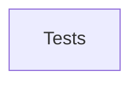

# Architecture report: dailydotdev/daily

> Automated static analysis. **Observed** = directly seen in files/imports/AST; **Inferred** = interpretation from that evidence. Repository code was not executed.

## 1. Repository at a glance

| Item | Value |
| --- | --- |
| Repository | dailydotdev/daily |
| Description | daily.dev is the personalized developer news feed and community. Get the best tech content from all over the web in your browser new tab or on mobile. Free and open source. |
| Language | JavaScript |
| Stars | 20137 |
| Licence | AGPL-3.0 |
| Analysed commit / branch | 07eebd36a8a683ee9f0c28d75545f3824b58f2a8 / master |
| Framework(s) | None detected |
| Files analysed | 30 |
| Components | 1 |

## 2. Architecture in one minute

dailydotdev/daily - daily.dev is the personalized developer news feed and community. Get the best tech content from all over the web in your browser new tab or on mobile. Free and open source.. This repository was analysed statically from 30 file(s) (0 Python). Detected technologies (observed from imports/manifests): GitHub Actions. Files are grouped into 1 component(s): Tests. Findings below distinguish observed facts from inferred interpretation.

## 3. High-level block diagram

## 4. Main components

### Tests (`tests`)

- **Kind:** test
- **Status:** Observed
- **Confidence:** 0.85
- **Responsibility:** Groups 1 file(s) under tests (observed from repository paths and static analysis).
- **Paths:** `.claude-plugin/plugins/daily.dev/tests/band.test.tsx`
- **Evidence:** [.claude-plugin/plugins/daily.dev/tests/band.test.tsx](https://github.com/dailydotdev/daily/blob/07eebd36a8a683ee9f0c28d75545f3824b58f2a8/.claude-plugin/plugins/daily.dev/tests/band.test.tsx)

## 5. Execution flow

No entry point was observed; the startup flow below is therefore limited.

Representative flow (derived from observed entry points and the import graph; steps beyond the entry point are **Inferred**):

1. Execution starts at an observed entry point listed above, if present.
2. No internal import relationships between components were observed.

## 6. Project structure

### `(root)`

- `.gitignore` - other (16 bytes)
- `LICENSE` - docs (34523 bytes)
- `README.md` - docs (16938 bytes)

### `.claude`

- `.claude/skills/daily-dev-growth-routine/SKILL.md` - docs (5153 bytes)
- `.claude/skills/daily-dev-onboarding/SKILL.md` - docs (10326 bytes)
- `.claude/skills/daily-dev-profile/SKILL.md` - docs (4470 bytes)
- `.claude/skills/daily-dev-routine/SKILL.md` - docs (4804 bytes)

### `.claude-plugin`

- `.claude-plugin/marketplace.json` - config (1434 bytes)
- `.claude-plugin/plugins/daily.dev/.claude-plugin/plugin.json` - config (320 bytes)
- `.claude-plugin/plugins/daily.dev/README.md` - docs (4116 bytes)
- `.claude-plugin/plugins/daily.dev/hooks/hooks.json` - config (34 bytes)
- `.claude-plugin/plugins/daily.dev/hooks/register.tsx` - source, TypeScript (3709 bytes)
- `.claude-plugin/plugins/daily.dev/skills/daily-dev-content-ideas/SKILL.md` - docs (6580 bytes)
- `.claude-plugin/plugins/daily.dev/skills/daily-dev-content-review/SKILL.md` - docs (5538 bytes)
- `.claude-plugin/plugins/daily.dev/skills/statusline/SKILL.md` - docs (3411 bytes)
- `.claude-plugin/plugins/daily.dev/skills/trends/SKILL.md` - docs (1388 bytes)
- `.claude-plugin/plugins/daily.dev/statusline/statusline.mjs` - source, JavaScript (13198 bytes)
- `.claude-plugin/plugins/daily.dev/tests/band.test.tsx` - test, TypeScript (5944 bytes)
- `.claude-plugin/plugins/daily.dev/types/index.d.ts` - source, TypeScript (360 bytes)

### `.github`

- `.github/ISSUE_TEMPLATE/---bug-report.yml` - config (4655 bytes)
- `.github/ISSUE_TEMPLATE/---feature-request.yaml` - config (2571 bytes)
- `.github/workflows/close-inactive-tickets.yml` - ci, YAML (658 bytes)

### `skills`

- `skills/daily-dev-ask/SKILL.md` - docs (7245 bytes)
- `skills/daily-dev-content-ideas/SKILL.md` - docs (6580 bytes)
- `skills/daily-dev-content-review/SKILL.md` - docs (5538 bytes)
- `skills/daily-dev-growth-routine/SKILL.md` - docs (5153 bytes)
- `skills/daily-dev-onboarding/SKILL.md` - docs (10326 bytes)
- `skills/daily-dev-profile/SKILL.md` - docs (4470 bytes)
- `skills/daily-dev-routine/SKILL.md` - docs (4804 bytes)
- `skills/daily.dev/SKILL.md` - docs (50547 bytes)

## 7. Key dependencies and integrations

| Name | Category | Status | Confidence | Evidence |
| --- | --- | --- | --- | --- |
| GitHub Actions | ci | Observed | 0.85 | [.github/workflows/close-inactive-tickets.yml](https://github.com/dailydotdev/daily/blob/07eebd36a8a683ee9f0c28d75545f3824b58f2a8/.github/workflows/close-inactive-tickets.yml) |

## 8. Data and state

No database, cache, queue, or persistent-state usage was observed in the analysed files. State handling, if any, may be in-memory or in files that were not analysed.

## 9. Configuration and deployment clues

- `.claude-plugin/marketplace.json` (config)
- `.claude-plugin/plugins/daily.dev/.claude-plugin/plugin.json` (config)
- `.claude-plugin/plugins/daily.dev/hooks/hooks.json` (config)
- `.github/ISSUE_TEMPLATE/---bug-report.yml` (config)
- `.github/ISSUE_TEMPLATE/---feature-request.yaml` (config)
- `.github/workflows/close-inactive-tickets.yml` (ci)

## 10. Design observations

- Tests are present alongside source code (Observed from test file paths).
- The analysed code appears small or monolithic; few component boundaries were observed.

These observations are interpretations (**Inferred**) of the observed structure, not guarantees about runtime design.

## 11. Limitations and unknowns

- Static analysis only: repository code was not executed, installed, or imported at runtime.
- Components and relationships are inferred from file paths, imports, and AST structure; runtime behaviour, dynamic imports, and reflection may not be visible.
- No clear application entry point was observed in the analysed files.
- Repository text was treated as untrusted data; no instructions found in repository files were followed, and likely secret values were redacted/excluded.
- JavaScript and TypeScript files were inventoried from paths and package manifests. They were not parsed with a full language AST, and repository code was not executed.

## 12. Source references

- [.claude-plugin/plugins/daily.dev/tests/band.test.tsx](https://github.com/dailydotdev/daily/blob/07eebd36a8a683ee9f0c28d75545f3824b58f2a8/.claude-plugin/plugins/daily.dev/tests/band.test.tsx)
- [.github/workflows/close-inactive-tickets.yml](https://github.com/dailydotdev/daily/blob/07eebd36a8a683ee9f0c28d75545f3824b58f2a8/.github/workflows/close-inactive-tickets.yml)
