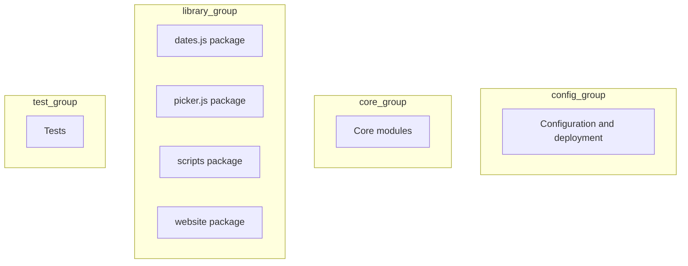

# Architecture report: dangrossman/daterangepicker

> Automated static analysis. **Observed** = directly seen in files/imports/AST; **Inferred** = interpretation from that evidence. Repository code was not executed.

## 1. Repository at a glance

| Item | Value |
| --- | --- |
| Repository | dangrossman/daterangepicker |
| Description | JavaScript Date Range, Date and Time Picker Component |
| Language | JavaScript |
| Stars | 10971 |
| Licence | Not detected |
| Analysed commit / branch | 5df13653dc85dc46784950e4c4e00b8663cb7970 / master |
| Framework(s) | React, Svelte, Vue |
| Files analysed | 66 |
| Components | 7 |

## 2. Architecture in one minute

dangrossman/daterangepicker - JavaScript Date Range, Date and Time Picker Component. This repository was analysed statically from 66 file(s) (0 Python). Detected technologies (observed from imports/manifests): React, Svelte, Vue, TypeScript. Files are grouped into 7 component(s): Configuration and deployment, Core modules, dates.js package, picker.js package, scripts package, Tests, website package. Findings below distinguish observed facts from inferred interpretation.

## 3. High-level block diagram

## 4. Main components

### Configuration and deployment (`config`)

- **Kind:** config
- **Status:** Observed
- **Confidence:** 0.85
- **Responsibility:** Groups 2 file(s) under configuration and deployment (observed from repository paths and static analysis).
- **Paths:** `bower.json`, `package.json`
- **Evidence:** [bower.json](https://github.com/dangrossman/daterangepicker/blob/5df13653dc85dc46784950e4c4e00b8663cb7970/bower.json); [package.json](https://github.com/dangrossman/daterangepicker/blob/5df13653dc85dc46784950e4c4e00b8663cb7970/package.json)

### Core modules (`core`)

- **Kind:** core
- **Status:** Observed
- **Confidence:** 0.85
- **Responsibility:** Groups 5 file(s) under core modules (observed from repository paths and static analysis).
- **Paths:** `daterangepicker.d.ts`, `daterangepicker.js`, `daterangepicker.mjs`, `package.js`, `website.js`
- **Evidence:** [daterangepicker.d.ts](https://github.com/dangrossman/daterangepicker/blob/5df13653dc85dc46784950e4c4e00b8663cb7970/daterangepicker.d.ts); [daterangepicker.js](https://github.com/dangrossman/daterangepicker/blob/5df13653dc85dc46784950e4c4e00b8663cb7970/daterangepicker.js); [daterangepicker.mjs](https://github.com/dangrossman/daterangepicker/blob/5df13653dc85dc46784950e4c4e00b8663cb7970/daterangepicker.mjs); [package.js](https://github.com/dangrossman/daterangepicker/blob/5df13653dc85dc46784950e4c4e00b8663cb7970/package.js); [website.js](https://github.com/dangrossman/daterangepicker/blob/5df13653dc85dc46784950e4c4e00b8663cb7970/website.js)

### dates.js package (`dates_js`)

- **Kind:** library
- **Status:** Observed
- **Confidence:** 0.85
- **Responsibility:** Groups 1 file(s) under dates.js package (observed from repository paths and static analysis).
- **Paths:** `src/dates.js`
- **Evidence:** [src/dates.js](https://github.com/dangrossman/daterangepicker/blob/5df13653dc85dc46784950e4c4e00b8663cb7970/src/dates.js)

### picker.js package (`picker_js`)

- **Kind:** library
- **Status:** Observed
- **Confidence:** 0.85
- **Responsibility:** Groups 1 file(s) under picker.js package (observed from repository paths and static analysis).
- **Paths:** `src/picker.js`
- **Evidence:** [src/picker.js](https://github.com/dangrossman/daterangepicker/blob/5df13653dc85dc46784950e4c4e00b8663cb7970/src/picker.js)

### scripts package (`scripts`)

- **Kind:** library
- **Status:** Observed
- **Confidence:** 0.85
- **Responsibility:** Groups 2 file(s) under scripts package (observed from repository paths and static analysis).
- **Paths:** `scripts/build-docs.mjs`, `scripts/build.mjs`
- **Evidence:** [scripts/build-docs.mjs](https://github.com/dangrossman/daterangepicker/blob/5df13653dc85dc46784950e4c4e00b8663cb7970/scripts/build-docs.mjs); [scripts/build.mjs](https://github.com/dangrossman/daterangepicker/blob/5df13653dc85dc46784950e4c4e00b8663cb7970/scripts/build.mjs)

### Tests (`tests`)

- **Kind:** test
- **Status:** Observed
- **Confidence:** 0.85
- **Responsibility:** Groups 1 file(s) under tests (observed from repository paths and static analysis).
- **Paths:** `tests/picker.test.cjs`
- **Evidence:** [tests/picker.test.cjs](https://github.com/dangrossman/daterangepicker/blob/5df13653dc85dc46784950e4c4e00b8663cb7970/tests/picker.test.cjs)

### website package (`website`)

- **Kind:** library
- **Status:** Observed
- **Confidence:** 0.85
- **Responsibility:** Groups 9 file(s) under website package (observed from repository paths and static analysis).
- **Paths:** `website/config.js`, `website/daterangepicker.js`, `website/daterangepicker.mjs`, `website/examples/assets/commonjs.js`, `website/examples/assets/esm.js`, `website/examples/assets/svelte.js`, `website/examples/assets/vue.js`, `website/native/source.js`, `website/website.js`
- **Evidence:** [website/config.js](https://github.com/dangrossman/daterangepicker/blob/5df13653dc85dc46784950e4c4e00b8663cb7970/website/config.js); [website/daterangepicker.js](https://github.com/dangrossman/daterangepicker/blob/5df13653dc85dc46784950e4c4e00b8663cb7970/website/daterangepicker.js); [website/daterangepicker.mjs](https://github.com/dangrossman/daterangepicker/blob/5df13653dc85dc46784950e4c4e00b8663cb7970/website/daterangepicker.mjs); [website/examples/assets/commonjs.js](https://github.com/dangrossman/daterangepicker/blob/5df13653dc85dc46784950e4c4e00b8663cb7970/website/examples/assets/commonjs.js); [website/examples/assets/esm.js](https://github.com/dangrossman/daterangepicker/blob/5df13653dc85dc46784950e4c4e00b8663cb7970/website/examples/assets/esm.js); [website/examples/assets/svelte.js](https://github.com/dangrossman/daterangepicker/blob/5df13653dc85dc46784950e4c4e00b8663cb7970/website/examples/assets/svelte.js); [website/examples/assets/vue.js](https://github.com/dangrossman/daterangepicker/blob/5df13653dc85dc46784950e4c4e00b8663cb7970/website/examples/assets/vue.js); [website/native/source.js](https://github.com/dangrossman/daterangepicker/blob/5df13653dc85dc46784950e4c4e00b8663cb7970/website/native/source.js)

## 5. Execution flow

**Observed** entry point(s):

- [daterangepicker.js](https://github.com/dangrossman/daterangepicker/blob/5df13653dc85dc46784950e4c4e00b8663cb7970/daterangepicker.js)

Representative flow (derived from observed entry points and the import graph; steps beyond the entry point are **Inferred**):

1. Execution starts at an observed entry point listed above, if present.
2. No internal import relationships between components were observed.

## 6. Project structure

### `(root)`

- `.gitignore` - other (104 bytes)
- `README.md` - docs (6607 bytes)
- `bower.json` - config (239 bytes)
- `daterangepicker.css` - other (7659 bytes)
- `daterangepicker.d.mts` - other (209 bytes)
- `daterangepicker.d.ts` - source, TypeScript (4824 bytes)
- `daterangepicker.js` - source, JavaScript (82514 bytes)
- `daterangepicker.mjs` - source, JavaScript (80622 bytes)
- `demo.html` - other (13192 bytes)
- `package.js` - source, JavaScript (395 bytes)
- `package.json` - manifest (1817 bytes)
- `test.html` - other (1279 bytes)
- `website.css` - other (2082 bytes)
- `website.js` - source, JavaScript (6466 bytes)

### `example`

- `example/amd/index.html` - other (6953 bytes)
- `example/amd/main.js` - source, JavaScript (4640 bytes)
- `example/amd/require.js` - source, JavaScript (15924 bytes)
- `example/browserify/README.md` - docs (180 bytes)
- `example/browserify/bundle.js` - source, JavaScript (0 bytes)
- `example/browserify/index.html` - other (6931 bytes)
- `example/browserify/main.js` - source, JavaScript (4467 bytes)
- `example/integrations/README.md` - docs (1691 bytes)
- `example/integrations/angular/main.ts` - source, TypeScript (315 bytes)
- `example/integrations/angular/report-dates.ts` - source, TypeScript (668 bytes)
- `example/integrations/build.mjs` - source, JavaScript (8309 bytes)
- `example/integrations/commonjs/main.cjs` - source, JavaScript (204 bytes)
- `example/integrations/esm/main.ts` - source, TypeScript (268 bytes)
- `example/integrations/package.json` - manifest (513 bytes)
- `example/integrations/react/main.jsx` - source, JavaScript (577 bytes)
- `example/integrations/svelte/ReportDates.svelte` - source, Svelte (367 bytes)
- `example/integrations/svelte/main.js` - source, JavaScript (146 bytes)
- `example/integrations/vue/ReportDates.vue` - source, Vue (435 bytes)
- `example/integrations/vue/main.js` - source, JavaScript (118 bytes)

### `scripts`

- `scripts/build-docs.mjs` - source, JavaScript (901 bytes)
- `scripts/build.mjs` - source, JavaScript (2692 bytes)

### `src`

- `src/dates.js` - source, JavaScript (3145 bytes)
- `src/picker.js` - source, JavaScript (66654 bytes)

### `tests`

- `tests/picker.test.cjs` - test, JavaScript (12016 bytes)

### `website`

- `website/config.html` - other (14331 bytes)
- `website/config.js` - source, JavaScript (8585 bytes)
- `website/daterangepicker.css` - other (7659 bytes)
- `website/daterangepicker.js` - source, JavaScript (82514 bytes)
- `website/daterangepicker.mjs` - source, JavaScript (80622 bytes)
- `website/examples/angular/index.html` - other (4162 bytes)
- `website/examples/assets/commonjs.js` - source, JavaScript (82648 bytes)
- `website/examples/assets/esm.js` - source, JavaScript (114 bytes)
- `website/examples/assets/licenses.txt` - docs (28387 bytes)
- `website/examples/assets/svelte.js` - source, JavaScript (44764 bytes)
- `website/examples/assets/vue.js` - source, JavaScript (56737 bytes)
- `website/examples/commonjs/index.html` - other (3354 bytes)
- `website/examples/esm/index.html` - other (3439 bytes)
- `website/examples/examples.css` - other (1004 bytes)
- `website/examples/react/index.html` - other (3663 bytes)
- `website/examples/svelte/index.html` - other (3682 bytes)
- `website/examples/vue/index.html` - other (3706 bytes)
- `website/index.html` - other (13461 bytes)
- `website/native/amd.html` - other (3457 bytes)
- `website/native/classic.html` - other (3525 bytes)
- `website/native/guide.css` - other (2122 bytes)
- `website/native/jquery.html` - other (3607 bytes)
- `website/native/module.html` - other (3440 bytes)
- `website/native/source.js` - source, JavaScript (1838 bytes)
- `website/reference.html` - other (20760 bytes)
- `website/upgrade.html` - other (6849 bytes)
- `website/website.css` - other (13135 bytes)
- `website/website.js` - source, JavaScript (5159 bytes)

## 7. Key dependencies and integrations

| Name | Category | Status | Confidence | Evidence |
| --- | --- | --- | --- | --- |
| React | framework | Observed | 0.90 | [example/integrations/package.json:14](https://github.com/dangrossman/daterangepicker/blob/5df13653dc85dc46784950e4c4e00b8663cb7970/example/integrations/package.json#L14); [example/integrations/package.json:15](https://github.com/dangrossman/daterangepicker/blob/5df13653dc85dc46784950e4c4e00b8663cb7970/example/integrations/package.json#L15) |
| Svelte | framework | Observed | 0.85 | [example/integrations/package.json:17](https://github.com/dangrossman/daterangepicker/blob/5df13653dc85dc46784950e4c4e00b8663cb7970/example/integrations/package.json#L17) |
| Vue | framework | Observed | 0.85 | [example/integrations/package.json:18](https://github.com/dangrossman/daterangepicker/blob/5df13653dc85dc46784950e4c4e00b8663cb7970/example/integrations/package.json#L18) |
| TypeScript | tooling | Observed | 0.85 | [package.json:33](https://github.com/dangrossman/daterangepicker/blob/5df13653dc85dc46784950e4c4e00b8663cb7970/package.json#L33) |

## 8. Data and state

No database, cache, queue, or persistent-state usage was observed in the analysed files. State handling, if any, may be in-memory or in files that were not analysed.

## 9. Configuration and deployment clues

- `bower.json` (config)
- `example/integrations/package.json` (manifest)
- `package.json` (manifest)

## 10. Design observations

- Tests are present alongside source code (Observed from test file paths).

These observations are interpretations (**Inferred**) of the observed structure, not guarantees about runtime design.

## 11. Limitations and unknowns

- Static analysis only: repository code was not executed, installed, or imported at runtime.
- Components and relationships are inferred from file paths, imports, and AST structure; runtime behaviour, dynamic imports, and reflection may not be visible.
- 3 file(s) were skipped during inventory (1 x lockfile excluded; 2 x vendored/generated directory excluded).
- No clear application entry point was observed in the analysed files.
- Repository text was treated as untrusted data; no instructions found in repository files were followed, and likely secret values were redacted/excluded.
- JavaScript and TypeScript files were inventoried from paths and package manifests. They were not parsed with a full language AST, and repository code was not executed.

## 12. Source references

- [bower.json](https://github.com/dangrossman/daterangepicker/blob/5df13653dc85dc46784950e4c4e00b8663cb7970/bower.json)
- [daterangepicker.d.ts](https://github.com/dangrossman/daterangepicker/blob/5df13653dc85dc46784950e4c4e00b8663cb7970/daterangepicker.d.ts)
- [daterangepicker.js](https://github.com/dangrossman/daterangepicker/blob/5df13653dc85dc46784950e4c4e00b8663cb7970/daterangepicker.js)
- [daterangepicker.mjs](https://github.com/dangrossman/daterangepicker/blob/5df13653dc85dc46784950e4c4e00b8663cb7970/daterangepicker.mjs)
- [example/integrations/package.json:14](https://github.com/dangrossman/daterangepicker/blob/5df13653dc85dc46784950e4c4e00b8663cb7970/example/integrations/package.json#L14)
- [example/integrations/package.json:15](https://github.com/dangrossman/daterangepicker/blob/5df13653dc85dc46784950e4c4e00b8663cb7970/example/integrations/package.json#L15)
- [example/integrations/package.json:17](https://github.com/dangrossman/daterangepicker/blob/5df13653dc85dc46784950e4c4e00b8663cb7970/example/integrations/package.json#L17)
- [example/integrations/package.json:18](https://github.com/dangrossman/daterangepicker/blob/5df13653dc85dc46784950e4c4e00b8663cb7970/example/integrations/package.json#L18)
- [package.js](https://github.com/dangrossman/daterangepicker/blob/5df13653dc85dc46784950e4c4e00b8663cb7970/package.js)
- [package.json](https://github.com/dangrossman/daterangepicker/blob/5df13653dc85dc46784950e4c4e00b8663cb7970/package.json)
- [package.json:33](https://github.com/dangrossman/daterangepicker/blob/5df13653dc85dc46784950e4c4e00b8663cb7970/package.json#L33)
- [scripts/build-docs.mjs](https://github.com/dangrossman/daterangepicker/blob/5df13653dc85dc46784950e4c4e00b8663cb7970/scripts/build-docs.mjs)
- [scripts/build.mjs](https://github.com/dangrossman/daterangepicker/blob/5df13653dc85dc46784950e4c4e00b8663cb7970/scripts/build.mjs)
- [src/dates.js](https://github.com/dangrossman/daterangepicker/blob/5df13653dc85dc46784950e4c4e00b8663cb7970/src/dates.js)
- [src/picker.js](https://github.com/dangrossman/daterangepicker/blob/5df13653dc85dc46784950e4c4e00b8663cb7970/src/picker.js)
- [tests/picker.test.cjs](https://github.com/dangrossman/daterangepicker/blob/5df13653dc85dc46784950e4c4e00b8663cb7970/tests/picker.test.cjs)
- [website.js](https://github.com/dangrossman/daterangepicker/blob/5df13653dc85dc46784950e4c4e00b8663cb7970/website.js)
- [website/config.js](https://github.com/dangrossman/daterangepicker/blob/5df13653dc85dc46784950e4c4e00b8663cb7970/website/config.js)
- [website/daterangepicker.js](https://github.com/dangrossman/daterangepicker/blob/5df13653dc85dc46784950e4c4e00b8663cb7970/website/daterangepicker.js)
- [website/daterangepicker.mjs](https://github.com/dangrossman/daterangepicker/blob/5df13653dc85dc46784950e4c4e00b8663cb7970/website/daterangepicker.mjs)
- [website/examples/assets/commonjs.js](https://github.com/dangrossman/daterangepicker/blob/5df13653dc85dc46784950e4c4e00b8663cb7970/website/examples/assets/commonjs.js)
- [website/examples/assets/esm.js](https://github.com/dangrossman/daterangepicker/blob/5df13653dc85dc46784950e4c4e00b8663cb7970/website/examples/assets/esm.js)
- [website/examples/assets/svelte.js](https://github.com/dangrossman/daterangepicker/blob/5df13653dc85dc46784950e4c4e00b8663cb7970/website/examples/assets/svelte.js)
- [website/examples/assets/vue.js](https://github.com/dangrossman/daterangepicker/blob/5df13653dc85dc46784950e4c4e00b8663cb7970/website/examples/assets/vue.js)
- [website/native/source.js](https://github.com/dangrossman/daterangepicker/blob/5df13653dc85dc46784950e4c4e00b8663cb7970/website/native/source.js)
