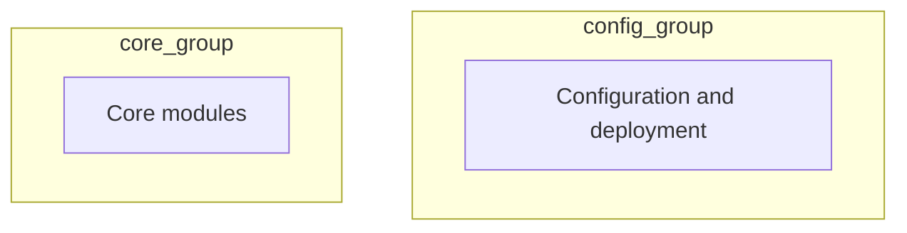

# Architecture report: davidshimjs/qrcodejs

> Automated static analysis. **Observed** = directly seen in files/imports/AST; **Inferred** = interpretation from that evidence. Repository code was not executed.

## 1. Repository at a glance

| Item | Value |
| --- | --- |
| Repository | davidshimjs/qrcodejs |
| Description | Cross-browser QRCode generator for javascript |
| Language | JavaScript |
| Stars | 14317 |
| Licence | MIT |
| Analysed commit / branch | 04f46c6a0708418cb7b96fc563eacae0fbf77674 / master |
| Framework(s) | None detected |
| Files analysed | 8 |
| Components | 2 |

## 2. Architecture in one minute

davidshimjs/qrcodejs - Cross-browser QRCode generator for javascript. This repository was analysed statically from 8 file(s) (0 Python). Detected technologies (observed from imports/manifests): no known frameworks/libraries. Files are grouped into 2 component(s): Configuration and deployment, Core modules. Findings below distinguish observed facts from inferred interpretation.

## 3. High-level block diagram

## 4. Main components

### Configuration and deployment (`config`)

- **Kind:** config
- **Status:** Observed
- **Confidence:** 0.85
- **Responsibility:** Groups 1 file(s) under configuration and deployment (observed from repository paths and static analysis).
- **Paths:** `bower.json`
- **Evidence:** [bower.json](https://github.com/davidshimjs/qrcodejs/blob/04f46c6a0708418cb7b96fc563eacae0fbf77674/bower.json)

### Core modules (`core`)

- **Kind:** core
- **Status:** Observed
- **Confidence:** 0.85
- **Responsibility:** Groups 1 file(s) under core modules (observed from repository paths and static analysis).
- **Paths:** `qrcode.js`
- **Evidence:** [qrcode.js](https://github.com/davidshimjs/qrcodejs/blob/04f46c6a0708418cb7b96fc563eacae0fbf77674/qrcode.js)

## 5. Execution flow

No entry point was observed; the startup flow below is therefore limited.

Representative flow (derived from observed entry points and the import graph; steps beyond the entry point are **Inferred**):

1. Execution starts at an observed entry point listed above, if present.
2. No internal import relationships between components were observed.

## 6. Project structure

### `(root)`

- `.gitignore` - other (26 bytes)
- `LICENSE` - docs (1098 bytes)
- `README.md` - docs (1096 bytes)
- `bower.json` - config (430 bytes)
- `index-svg.html` - other (1421 bytes)
- `index.html` - other (1204 bytes)
- `index.svg` - other (1106 bytes)
- `qrcode.js` - source, JavaScript (33168 bytes)

## 7. Key dependencies and integrations

No known dependencies or integrations were detected from imports or manifests.

## 8. Data and state

No database, cache, queue, or persistent-state usage was observed in the analysed files. State handling, if any, may be in-memory or in files that were not analysed.

## 9. Configuration and deployment clues

- `bower.json` (config)

## 10. Design observations

- No strong design patterns could be established from the available evidence.

These observations are interpretations (**Inferred**) of the observed structure, not guarantees about runtime design.

## 11. Limitations and unknowns

- Static analysis only: repository code was not executed, installed, or imported at runtime.
- Components and relationships are inferred from file paths, imports, and AST structure; runtime behaviour, dynamic imports, and reflection may not be visible.
- No clear application entry point was observed in the analysed files.
- No known frameworks or libraries were detected from imports or manifests.
- Repository text was treated as untrusted data; no instructions found in repository files were followed, and likely secret values were redacted/excluded.
- JavaScript and TypeScript files were inventoried from paths and package manifests. They were not parsed with a full language AST, and repository code was not executed.

## 12. Source references

- [bower.json](https://github.com/davidshimjs/qrcodejs/blob/04f46c6a0708418cb7b96fc563eacae0fbf77674/bower.json)
- [qrcode.js](https://github.com/davidshimjs/qrcodejs/blob/04f46c6a0708418cb7b96fc563eacae0fbf77674/qrcode.js)
