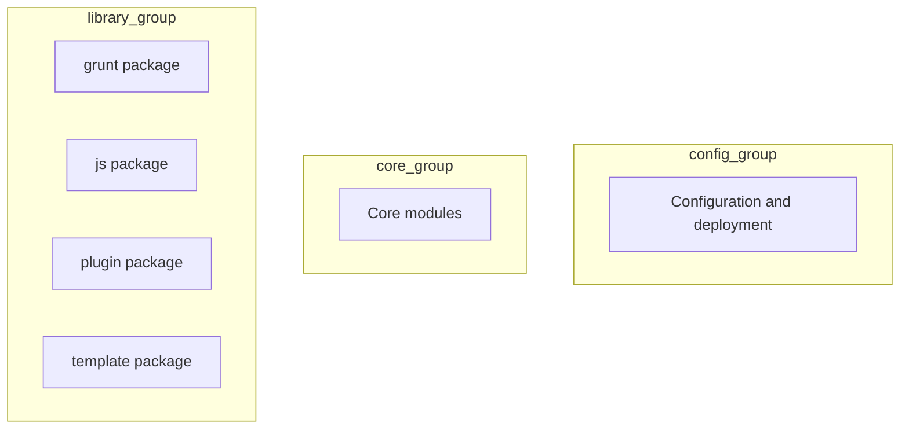

# Architecture report: dcloudio/mui

> Automated static analysis. **Observed** = directly seen in files/imports/AST; **Inferred** = interpretation from that evidence. Repository code was not executed.

## 1. Repository at a glance

| Item | Value |
| --- | --- |
| Repository | dcloudio/mui |
| Description | 最接近原生APP体验的高性能框架 |
| Language | JavaScript |
| Stars | 13462 |
| Licence | MIT |
| Analysed commit / branch | e216655901e51ca23112a65700e8f76d4fe008bc / master |
| Framework(s) | None detected |
| Files analysed | 273 |
| Components | 6 |

## 2. Architecture in one minute

dcloudio/mui - 最接近原生APP体验的高性能框架. This repository was analysed statically from 273 file(s) (0 Python). Detected technologies (observed from imports/manifests): no known frameworks/libraries. Files are grouped into 6 component(s): Configuration and deployment, Core modules, grunt package, js package, plugin package, template package. Findings below distinguish observed facts from inferred interpretation.

## 3. High-level block diagram

## 4. Main components

### Configuration and deployment (`config`)

- **Kind:** config
- **Status:** Observed
- **Confidence:** 0.85
- **Responsibility:** Groups 2 file(s) under configuration and deployment (observed from repository paths and static analysis).
- **Paths:** `package.json`, `plugin/picker/package.json`
- **Evidence:** [package.json](https://github.com/dcloudio/mui/blob/e216655901e51ca23112a65700e8f76d4fe008bc/package.json); [plugin/picker/package.json](https://github.com/dcloudio/mui/blob/e216655901e51ca23112a65700e8f76d4fe008bc/plugin/picker/package.json)

### Core modules (`core`)

- **Kind:** core
- **Status:** Observed
- **Confidence:** 0.85
- **Responsibility:** Groups 2 file(s) under core modules (observed from repository paths and static analysis).
- **Paths:** `Gruntfile.js`, `mui_snippets.rb`
- **Evidence:** [Gruntfile.js](https://github.com/dcloudio/mui/blob/e216655901e51ca23112a65700e8f76d4fe008bc/Gruntfile.js); [mui_snippets.rb](https://github.com/dcloudio/mui/blob/e216655901e51ca23112a65700e8f76d4fe008bc/mui_snippets.rb)

### grunt package (`grunt`)

- **Kind:** library
- **Status:** Observed
- **Confidence:** 0.85
- **Responsibility:** Groups 1 file(s) under grunt package (observed from repository paths and static analysis).
- **Paths:** `grunt/mui-namespace-generator.js`
- **Evidence:** [grunt/mui-namespace-generator.js](https://github.com/dcloudio/mui/blob/e216655901e51ca23112a65700e8f76d4fe008bc/grunt/mui-namespace-generator.js)

### js package (`js`)

- **Kind:** library
- **Status:** Observed
- **Confidence:** 0.85
- **Responsibility:** Groups 57 file(s) under js package (observed from repository paths and static analysis).
- **Paths:** `js/actions.js`, `js/ajax.plugin.js`, `js/input.plugin.js`, `js/modals.js`, `js/mui.active.js`, `js/mui.ajax.5+.js`, `js/mui.ajax.js`, `js/mui.animation.js`, `js/mui.animationframe.js`, `js/mui.back.5+.js`, `js/mui.back.js`, `js/mui.button.js`, `js/mui.class.js`, `js/mui.class.scroll.js`, `js/mui.class.scroll.pullrefresh.js`, `js/mui.class.scroll.slider.js`, `js/mui.detect.5+.js`, `js/mui.detect.js`, `js/mui.dialog.alert.js`, `js/mui.dialog.confirm.js`, `js/mui.dialog.prompt.js`, `js/mui.dialog.toast.js`, `js/mui.event.js`, `js/mui.fixed.animation.js`, `js/mui.fixed.bind.js`, `js/mui.fixed.classlist.js`, `js/mui.fixed.fastclick.js`, `js/mui.fixed.js`, `js/mui.fixed.keyboard.js`, `js/mui.gestures.drag.js`, `js/mui.gestures.flick.js`, `js/mui.gestures.hold.js`, `js/mui.gestures.js`, `js/mui.gestures.longtap.js`, `js/mui.gestures.pinch.js`, `js/mui.gestures.swipe.js`, `js/mui.gestures.tap.js`, `js/mui.init.5+.js`, `js/mui.init.js`, `js/mui.init.pullrefresh.js`, `js/mui.js`, `js/mui.jsonp.js`, `js/mui.layout.js`, `js/mui.namespace.js`, `js/mui.number.js`, `js/mui.offcanvas.js`, `js/mui.popup.js`, `js/mui.progressbar.js`, `js/mui.pullrefresh.5+.js`, `js/mui.pullrefresh.js`, `js/mui.target.js`, `js/mui.transparent.js`, `js/popovers.js`, `js/segmented-controllers.js`, `js/sliders.js`, `js/switches.js`, `js/tableviews.js`
- **Evidence:** [js/actions.js](https://github.com/dcloudio/mui/blob/e216655901e51ca23112a65700e8f76d4fe008bc/js/actions.js); [js/ajax.plugin.js](https://github.com/dcloudio/mui/blob/e216655901e51ca23112a65700e8f76d4fe008bc/js/ajax.plugin.js); [js/input.plugin.js](https://github.com/dcloudio/mui/blob/e216655901e51ca23112a65700e8f76d4fe008bc/js/input.plugin.js); [js/modals.js](https://github.com/dcloudio/mui/blob/e216655901e51ca23112a65700e8f76d4fe008bc/js/modals.js); [js/mui.active.js](https://github.com/dcloudio/mui/blob/e216655901e51ca23112a65700e8f76d4fe008bc/js/mui.active.js); [js/mui.ajax.5+.js](https://github.com/dcloudio/mui/blob/e216655901e51ca23112a65700e8f76d4fe008bc/js/mui.ajax.5%2B.js); [js/mui.ajax.js](https://github.com/dcloudio/mui/blob/e216655901e51ca23112a65700e8f76d4fe008bc/js/mui.ajax.js); [js/mui.animation.js](https://github.com/dcloudio/mui/blob/e216655901e51ca23112a65700e8f76d4fe008bc/js/mui.animation.js)

### plugin package (`plugin`)

- **Kind:** library
- **Status:** Observed
- **Confidence:** 0.85
- **Responsibility:** Groups 5 file(s) under plugin package (observed from repository paths and static analysis).
- **Paths:** `plugin/picker/gulpfile.js`, `plugin/picker/js/mui.dtpicker.js`, `plugin/picker/js/mui.picker.js`, `plugin/picker/js/mui.poppicker.js`, `plugin/share/plusShare.js`
- **Evidence:** [plugin/picker/gulpfile.js](https://github.com/dcloudio/mui/blob/e216655901e51ca23112a65700e8f76d4fe008bc/plugin/picker/gulpfile.js); [plugin/picker/js/mui.dtpicker.js](https://github.com/dcloudio/mui/blob/e216655901e51ca23112a65700e8f76d4fe008bc/plugin/picker/js/mui.dtpicker.js); [plugin/picker/js/mui.picker.js](https://github.com/dcloudio/mui/blob/e216655901e51ca23112a65700e8f76d4fe008bc/plugin/picker/js/mui.picker.js); [plugin/picker/js/mui.poppicker.js](https://github.com/dcloudio/mui/blob/e216655901e51ca23112a65700e8f76d4fe008bc/plugin/picker/js/mui.poppicker.js); [plugin/share/plusShare.js](https://github.com/dcloudio/mui/blob/e216655901e51ca23112a65700e8f76d4fe008bc/plugin/share/plusShare.js)

### template package (`template`)

- **Kind:** library
- **Status:** Observed
- **Confidence:** 0.85
- **Responsibility:** Groups 1 file(s) under template package (observed from repository paths and static analysis).
- **Paths:** `template/feedback/js/feedback.js`
- **Evidence:** [template/feedback/js/feedback.js](https://github.com/dcloudio/mui/blob/e216655901e51ca23112a65700e8f76d4fe008bc/template/feedback/js/feedback.js)

## 5. Execution flow

No entry point was observed; the startup flow below is therefore limited.

Representative flow (derived from observed entry points and the import graph; steps beyond the entry point are **Inferred**):

1. Execution starts at an observed entry point listed above, if present.
2. No internal import relationships between components were observed.

## 6. Project structure

### `(root)`

- `.gitignore` - other (86 bytes)
- `Gruntfile.js` - source, JavaScript (5855 bytes)
- `LICENSE` - docs (1096 bytes)
- `README.md` - docs (1845 bytes)
- `mui_snippets.rb` - source, Ruby (22928 bytes)
- `package.json` - manifest (1398 bytes)

### `examples`

- `examples/hello-mui/.project` - other (491 bytes)
- `examples/hello-mui/css/app.css` - other (462 bytes)
- `examples/hello-mui/css/feedback.css` - other (2396 bytes)
- `examples/hello-mui/css/icons-extra.css` - other (2813 bytes)
- `examples/hello-mui/css/mui.dtpicker.css` - other (3054 bytes)
- `examples/hello-mui/css/mui.imageviewer.css` - other (2512 bytes)
- `examples/hello-mui/css/mui.indexedlist.css` - other (2159 bytes)
- `examples/hello-mui/css/mui.listpicker.css` - other (2160 bytes)
- `examples/hello-mui/css/mui.picker.all.css` - other (6525 bytes)
- `examples/hello-mui/css/mui.picker.css` - other (2220 bytes)
- `examples/hello-mui/css/mui.poppicker.css` - other (1249 bytes)
- `examples/hello-mui/examples/accordion.html` - other (4114 bytes)
- `examples/hello-mui/examples/actionsheet-plus.html` - other (3462 bytes)
- `examples/hello-mui/examples/actionsheet.html` - other (4636 bytes)
- `examples/hello-mui/examples/ad.html` - other (1588 bytes)
- `examples/hello-mui/examples/ajax.html` - other (4847 bytes)
- `examples/hello-mui/examples/badges.html` - other (1823 bytes)
- `examples/hello-mui/examples/best-practices/list-to-detail/detail.html` - other (2883 bytes)
- `examples/hello-mui/examples/best-practices/list-to-detail/list-to-detail.css` - other (2691 bytes)
- `examples/hello-mui/examples/best-practices/list-to-detail/listview.html` - other (8488 bytes)
- `examples/hello-mui/examples/buttons-with-badges.html` - other (1846 bytes)
- `examples/hello-mui/examples/buttons-with-block.html` - other (2238 bytes)
- `examples/hello-mui/examples/buttons-with-icons.html` - other (2405 bytes)
- `examples/hello-mui/examples/buttons-with-loading.html` - other (4772 bytes)
- `examples/hello-mui/examples/buttons.html` - other (2642 bytes)
- `examples/hello-mui/examples/card.html` - other (3347 bytes)
- `examples/hello-mui/examples/checkbox.html` - other (2343 bytes)
- `examples/hello-mui/examples/date.html` - other (2576 bytes)
- `examples/hello-mui/examples/dialog.html` - other (2930 bytes)
- `examples/hello-mui/examples/dtpicker.html` - other (4888 bytes)
- `examples/hello-mui/examples/echarts.html` - other (3747 bytes)
- `examples/hello-mui/examples/feedback.html` - other (2919 bytes)
- `examples/hello-mui/examples/grid-default.html` - other (3100 bytes)
- `examples/hello-mui/examples/grid-pagination.html` - other (9378 bytes)
- `examples/hello-mui/examples/guide.html` - other (7335 bytes)
- `examples/hello-mui/examples/icons-extra.html` - other (6036 bytes)
- `examples/hello-mui/examples/icons.html` - other (7083 bytes)
- `examples/hello-mui/examples/im-chat.html` - other (20880 bytes)
- `examples/hello-mui/examples/imageviewer-native.html` - other (2701 bytes)
- `examples/hello-mui/examples/imageviewer.html` - other (4814 bytes)
- `examples/hello-mui/examples/indexed-list-select.html` - other (34461 bytes)
- `examples/hello-mui/examples/indexed-list.html` - other (24497 bytes)
- `examples/hello-mui/examples/info.html` - other (3246 bytes)
- `examples/hello-mui/examples/input.html` - other (3676 bytes)
- `examples/hello-mui/examples/lazyload-image.html` - other (2321 bytes)
- `examples/hello-mui/examples/list-triplex-row.html` - other (5183 bytes)
- `examples/hello-mui/examples/list-with-input.html` - other (2741 bytes)
- `examples/hello-mui/examples/locker-dom.html` - other (2378 bytes)
- `examples/hello-mui/examples/login.html` - other (2231 bytes)
- `examples/hello-mui/examples/media-list.html` - other (7216 bytes)
- `examples/hello-mui/examples/message-bottom.html` - other (2097 bytes)
- `examples/hello-mui/examples/modals.html` - other (1499 bytes)
- `examples/hello-mui/examples/nav-nativeObj.html` - other (1067 bytes)
- `examples/hello-mui/examples/nav.html` - other (4179 bytes)
- `examples/hello-mui/examples/nav_transparent.html` - other (3571 bytes)
- `examples/hello-mui/examples/nav_transparent_native.html` - other (3328 bytes)
- `examples/hello-mui/examples/numbox.html` - other (4360 bytes)
- `examples/hello-mui/examples/offcanvas-drag-down.html` - other (10282 bytes)
- `examples/hello-mui/examples/offcanvas-drag-left-plus-main.html` - other (8988 bytes)
- `examples/hello-mui/examples/offcanvas-drag-left-plus-menu.html` - other (3020 bytes)
- `examples/hello-mui/examples/offcanvas-drag-left.html` - other (8114 bytes)
- `examples/hello-mui/examples/offcanvas-drag-right-plus-main.html` - other (8129 bytes)
- `examples/hello-mui/examples/offcanvas-drag-right-plus-menu.html` - other (3057 bytes)
- `examples/hello-mui/examples/offcanvas-drag-right.html` - other (7997 bytes)
- `examples/hello-mui/examples/pagination.html` - other (5305 bytes)
- `examples/hello-mui/examples/picker.html` - other (5465 bytes)
- `examples/hello-mui/examples/popovers.html` - other (7342 bytes)
- `examples/hello-mui/examples/progressbar.html` - other (5648 bytes)
- `examples/hello-mui/examples/pullrefresh.html` - other (2552 bytes)
- `examples/hello-mui/examples/pullrefresh_main.html` - other (1250 bytes)
- `examples/hello-mui/examples/pullrefresh_sub.html` - other (3098 bytes)
- `examples/hello-mui/examples/pullrefresh_with_tab.html` - other (17458 bytes)
- `examples/hello-mui/examples/radio.html` - other (2759 bytes)
- `examples/hello-mui/examples/range.html` - other (2997 bytes)
- `examples/hello-mui/examples/setting.html` - other (28740 bytes)
- `examples/hello-mui/examples/slider-default.html` - other (2742 bytes)
- `examples/hello-mui/examples/slider-native.html` - other (1482 bytes)
- `examples/hello-mui/examples/slider-table-default.html` - other (2300 bytes)
- `examples/hello-mui/examples/slider-table-pagination.html` - other (4186 bytes)
- `examples/hello-mui/examples/slider-with-title.html` - other (3036 bytes)
- `examples/hello-mui/examples/switches.html` - other (2859 bytes)
- `examples/hello-mui/examples/tab-top-subpage-1.html` - other (4103 bytes)
- `examples/hello-mui/examples/tab-top-subpage-2.html` - other (4160 bytes)
- `examples/hello-mui/examples/tab-top-subpage-3.html` - other (1565 bytes)
- `examples/hello-mui/examples/tab-top-subpage-4.html` - other (4017 bytes)
- `examples/hello-mui/examples/tab-top-subpage-5.html` - other (4160 bytes)
- `examples/hello-mui/examples/tab-top-webview-main.html` - other (4687 bytes)
- `examples/hello-mui/examples/tab-vertical-scroll.html` - other (6101 bytes)
- `examples/hello-mui/examples/tab-webview-main.html` - other (3619 bytes)
- `examples/hello-mui/examples/tab-webview-subpage-about.html` - other (1187 bytes)
- `examples/hello-mui/examples/tab-webview-subpage-chat.html` - other (4549 bytes)
- `examples/hello-mui/examples/tab-webview-subpage-contact.html` - other (4279 bytes)
- `examples/hello-mui/examples/tab-webview-subpage-setting.html` - other (2017 bytes)
- `examples/hello-mui/examples/tab-with-segmented-control-vertical.html` - other (2724 bytes)
- `examples/hello-mui/examples/tab-with-segmented-control.html` - other (6047 bytes)
- `examples/hello-mui/examples/tab-with-viewpagerindicator.html` - other (7065 bytes)
- `examples/hello-mui/examples/tabbar-labels-only.html` - other (1179 bytes)
- `examples/hello-mui/examples/tabbar-with-submenus.html` - other (2376 bytes)
- `examples/hello-mui/examples/tabbar.html` - other (8993 bytes)
- `examples/hello-mui/examples/tableviews-with-badges.html` - other (2882 bytes)
- `examples/hello-mui/examples/tableviews-with-collapses.html` - other (3015 bytes)
- `examples/hello-mui/examples/tableviews-with-swipe.html` - other (6629 bytes)
- `examples/hello-mui/examples/tableviews.html` - other (2139 bytes)
- `examples/hello-mui/examples/typography.html` - other (1122 bytes)
- `examples/hello-mui/index-menu.html` - other (6276 bytes)
- `examples/hello-mui/index.html` - other (29722 bytes)
- `examples/hello-mui/js/95516.js` - source, JavaScript (1329 bytes)
- `examples/hello-mui/js/arttmpl.js` - source, JavaScript (4448 bytes)
- `examples/hello-mui/js/beecloud.js` - source, JavaScript (3711 bytes)
- `examples/hello-mui/js/city.data-3.js` - source, JavaScript (185725 bytes)
- `examples/hello-mui/js/city.data.js` - source, JavaScript (24779 bytes)
- `examples/hello-mui/js/feedback.js` - source, JavaScript (7361 bytes)
- `examples/hello-mui/js/mui.dtpicker.js` - source, JavaScript (14644 bytes)
- `examples/hello-mui/js/mui.imageViewer.js` - source, JavaScript (9426 bytes)
- `examples/hello-mui/js/mui.indexedlist.js` - source, JavaScript (6534 bytes)
- `examples/hello-mui/js/mui.lazyload.img.js` - source, JavaScript (3048 bytes)
- `examples/hello-mui/js/mui.lazyload.js` - source, JavaScript (8163 bytes)
- `examples/hello-mui/js/mui.listpicker.js` - source, JavaScript (12450 bytes)
- `examples/hello-mui/js/mui.locker.js` - source, JavaScript (10148 bytes)
- `examples/hello-mui/js/mui.picker.all.js` - source, JavaScript (30793 bytes)
- `examples/hello-mui/js/mui.picker.js` - source, JavaScript (11612 bytes)
- `examples/hello-mui/js/mui.poppicker.js` - source, JavaScript (4648 bytes)
- `examples/hello-mui/js/mui.previewimage.js` - source, JavaScript (13125 bytes)
- `examples/hello-mui/js/mui.pullToRefresh.js` - source, JavaScript (12545 bytes)
- `examples/hello-mui/js/mui.pullToRefresh.material.js` - source, JavaScript (12189 bytes)
- `examples/hello-mui/js/mui.view.js` - source, JavaScript (20490 bytes)
- `examples/hello-mui/js/mui.zoom.js` - source, JavaScript (11785 bytes)
- `examples/hello-mui/js/update.js` - source, JavaScript (1429 bytes)
- `examples/hello-mui/js/webviewGroup.js` - source, JavaScript (7882 bytes)
- `examples/hello-mui/manifest.json` - config (26432 bytes)
- `examples/login/.project` - other (487 bytes)
- `examples/login/README.md` - docs (754 bytes)
- `examples/login/css/feedback-page.css` - other (1444 bytes)
- `examples/login/css/style.css` - other (111 bytes)
- `examples/login/forget_password.html` - other (2209 bytes)
- `examples/login/js/app.js` - source, JavaScript (4081 bytes)
- `examples/login/js/feedback-page.js` - source, JavaScript (3100 bytes)
- `examples/login/js/feedback.js` - source, JavaScript (2879 bytes)
- `examples/login/js/mui.enterfocus.js` - source, JavaScript (574 bytes)
- `examples/login/js/mui.locker.js` - source, JavaScript (9882 bytes)
- `examples/login/js/mui.view.js` - source, JavaScript (19987 bytes)
- `examples/login/libs/easymob-webim-sdk/easemob.im-1.0.5.js` - source, JavaScript (147455 bytes)
- `examples/login/libs/easymob-webim-sdk/json2.js` - source, JavaScript (18058 bytes)
- `examples/login/libs/easymob-webim-sdk/quickstart.md` - docs (25735 bytes)
- `examples/login/libs/easymob-webim-sdk/strophe-custom-2.0.0.js` - source, JavaScript (178437 bytes)
- `examples/login/login.html` - other (8711 bytes)
- `examples/login/main.html` - other (2801 bytes)
- `examples/login/manifest.json` - config (11085 bytes)
- `examples/login/reg.html` - other (3836 bytes)
- `examples/login/setting.html` - other (16240 bytes)
- `examples/login/unlock.html` - other (3041 bytes)
- `examples/nativeTab/README.md` - docs (1403 bytes)
- `examples/nativeTab/css/mui.css` - other (96870 bytes)
- `examples/nativeTab/html/new-webview.html` - other (703 bytes)
- `examples/nativeTab/html/tab-webview-subpage-chat.html` - other (4771 bytes)
- `examples/nativeTab/html/tab-webview-subpage-contact.html` - other (4280 bytes)
- `examples/nativeTab/index.html` - other (6311 bytes)
- `examples/nativeTab/js/util.js` - source, JavaScript (3146 bytes)
- `examples/nativeTab/manifest.json` - config (14243 bytes)
- `examples/nativeTab/unpackage/.confirmed_dependencies` - other (1626 bytes)
- `examples/nativeTab/unpackage/.dependencies` - other (4 bytes)

### `grunt`

- `grunt/mui-namespace-generator.js` - source, JavaScript (715 bytes)

### `js`

- `js/actions.js` - source, JavaScript (648 bytes)
- `js/ajax.plugin.js` - source, JavaScript (34 bytes)
- `js/input.plugin.js` - source, JavaScript (9060 bytes)
- `js/modals.js` - source, JavaScript (841 bytes)
- `js/mui.active.js` - source, JavaScript (853 bytes)
- `js/mui.ajax.5+.js` - source, JavaScript (1071 bytes)
- `js/mui.ajax.js` - source, JavaScript (9091 bytes)
- `js/mui.animation.js` - source, JavaScript (809 bytes)
- `js/mui.animationframe.js` - source, JavaScript (1152 bytes)
- `js/mui.back.5+.js` - source, JavaScript (3677 bytes)
- `js/mui.back.js` - source, JavaScript (1035 bytes)
- `js/mui.button.js` - source, JavaScript (3628 bytes)
- `js/mui.class.js` - source, JavaScript (940 bytes)
- `js/mui.class.scroll.js` - source, JavaScript (29486 bytes)
- `js/mui.class.scroll.pullrefresh.js` - source, JavaScript (7600 bytes)
- `js/mui.class.scroll.slider.js` - source, JavaScript (12960 bytes)
- `js/mui.detect.5+.js` - source, JavaScript (570 bytes)
- `js/mui.detect.js` - source, JavaScript (1213 bytes)
- `js/mui.dialog.alert.js` - source, JavaScript (591 bytes)
- `js/mui.dialog.confirm.js` - source, JavaScript (711 bytes)
- `js/mui.dialog.prompt.js` - source, JavaScript (942 bytes)
- `js/mui.dialog.toast.js` - source, JavaScript (1639 bytes)
- `js/mui.event.js` - source, JavaScript (6979 bytes)
- `js/mui.fixed.animation.js` - source, JavaScript (697 bytes)
- `js/mui.fixed.bind.js` - source, JavaScript (1183 bytes)
- `js/mui.fixed.classlist.js` - source, JavaScript (1792 bytes)
- `js/mui.fixed.fastclick.js` - source, JavaScript (2045 bytes)
- `js/mui.fixed.js` - source, JavaScript (943 bytes)
- `js/mui.fixed.keyboard.js` - source, JavaScript (2057 bytes)
- `js/mui.gestures.drag.js` - source, JavaScript (1402 bytes)
- `js/mui.gestures.flick.js` - source, JavaScript (1163 bytes)
- `js/mui.gestures.hold.js` - source, JavaScript (885 bytes)
- `js/mui.gestures.js` - source, JavaScript (10879 bytes)
- `js/mui.gestures.longtap.js` - source, JavaScript (823 bytes)
- `js/mui.gestures.pinch.js` - source, JavaScript (1615 bytes)
- `js/mui.gestures.swipe.js` - source, JavaScript (805 bytes)
- `js/mui.gestures.tap.js` - source, JavaScript (1260 bytes)
- `js/mui.init.5+.js` - source, JavaScript (20096 bytes)
- `js/mui.init.js` - source, JavaScript (3313 bytes)
- `js/mui.init.pullrefresh.js` - source, JavaScript (2780 bytes)
- `js/mui.js` - source, JavaScript (10196 bytes)
- `js/mui.jsonp.js` - source, JavaScript (2728 bytes)
- `js/mui.layout.js` - source, JavaScript (524 bytes)
- `js/mui.namespace.js` - source, JavaScript (879 bytes)
- `js/mui.number.js` - source, JavaScript (4845 bytes)
- `js/mui.offcanvas.js` - source, JavaScript (20556 bytes)
- `js/mui.popup.js` - source, JavaScript (8678 bytes)
- `js/mui.progressbar.js` - source, JavaScript (5158 bytes)
- `js/mui.pullrefresh.5+.js` - source, JavaScript (17000 bytes)
- `js/mui.pullrefresh.js` - source, JavaScript (8824 bytes)
- `js/mui.target.js` - source, JavaScript (1924 bytes)
- `js/mui.transparent.js` - source, JavaScript (4709 bytes)
- `js/popovers.js` - source, JavaScript (8710 bytes)
- `js/segmented-controllers.js` - source, JavaScript (4499 bytes)
- `js/sliders.js` - source, JavaScript (11397 bytes)
- `js/switches.js` - source, JavaScript (4830 bytes)
- `js/tableviews.js` - source, JavaScript (16770 bytes)

### `plugin`

- `plugin/picker/css/mui.dtpicker.css` - other (3054 bytes)
- `plugin/picker/css/mui.picker.css` - other (2264 bytes)
- `plugin/picker/css/mui.poppicker.css` - other (1430 bytes)
- `plugin/picker/gulpfile.js` - source, JavaScript (1620 bytes)
- `plugin/picker/js/mui.dtpicker.js` - source, JavaScript (14644 bytes)
- `plugin/picker/js/mui.picker.js` - source, JavaScript (11612 bytes)
- `plugin/picker/js/mui.poppicker.js` - source, JavaScript (4535 bytes)
- `plugin/picker/package.json` - manifest (554 bytes)
- `plugin/share/plusShare.js` - source, JavaScript (3994 bytes)

### `sass`

- `sass/badges.scss` - other (1938 bytes)
- `sass/bars.scss` - other (8091 bytes)
- `sass/base.scss` - other (4622 bytes)
- `sass/buttons.scss` - other (5669 bytes)
- `sass/cards.scss` - other (4206 bytes)
- `sass/forms.scss` - other (11450 bytes)
- `sass/fullscreen.scss` - other (980 bytes)
- `sass/grid.scss` - other (2098 bytes)
- `sass/hack.scss` - other (523 bytes)
- `sass/icon.scss` - other (6564 bytes)
- `sass/iframe.scss` - other (198 bytes)
- `sass/iscroll.scss` - other (1138 bytes)
- `sass/loadings.scss` - other (4148 bytes)
- `sass/mixins.scss` - other (7165 bytes)
- `sass/modals.scss` - other (933 bytes)
- `sass/mui.scss` - other (955 bytes)
- `sass/normalize.scss` - other (8315 bytes)
- `sass/number.scss` - other (1488 bytes)
- `sass/off-canvas.scss` - other (3694 bytes)
- `sass/os.scss` - other (1217 bytes)
- `sass/pagination.scss` - other (2860 bytes)
- `sass/popovers.scss` - other (5482 bytes)
- `sass/popup.scss` - other (3735 bytes)
- `sass/progressbar.scss` - other (2932 bytes)
- `sass/pullrefreshs.scss` - other (17920 bytes)
- `sass/push.scss` - other (1261 bytes)
- `sass/scroll.scss` - other (2326 bytes)
- `sass/segmented-controls.scss` - other (4625 bytes)
- `sass/slider-cell.scss` - other (395 bytes)
- `sass/sliders.scss` - other (3781 bytes)
- `sass/switches.scss` - other (3204 bytes)
- `sass/table-views.scss` - other (14388 bytes)
- `sass/toast.scss` - other (462 bytes)
- `sass/type.scss` - other (580 bytes)
- `sass/variables.scss` - other (1687 bytes)

### `template`

- `template/feedback/css/feedback.css` - other (2396 bytes)
- `template/feedback/feedback.html` - other (2906 bytes)
- `template/feedback/js/feedback.js` - source, JavaScript (7156 bytes)
- `template/feedback/readme.md` - docs (2016 bytes)

## 7. Key dependencies and integrations

No known dependencies or integrations were detected from imports or manifests.

## 8. Data and state

No database, cache, queue, or persistent-state usage was observed in the analysed files. State handling, if any, may be in-memory or in files that were not analysed.

## 9. Configuration and deployment clues

- `examples/hello-mui/manifest.json` (config)
- `examples/login/manifest.json` (config)
- `examples/nativeTab/manifest.json` (config)
- `package.json` (manifest)
- `plugin/picker/package.json` (manifest)

## 10. Design observations

- No strong design patterns could be established from the available evidence.

These observations are interpretations (**Inferred**) of the observed structure, not guarantees about runtime design.

## 11. Limitations and unknowns

- Static analysis only: repository code was not executed, installed, or imported at runtime.
- Components and relationships are inferred from file paths, imports, and AST structure; runtime behaviour, dynamic imports, and reflection may not be visible.
- 9 file(s) were skipped during inventory (4 x generated/minified file excluded; 5 x vendored/generated directory excluded).
- No clear application entry point was observed in the analysed files.
- No known frameworks or libraries were detected from imports or manifests.
- Repository text was treated as untrusted data; no instructions found in repository files were followed, and likely secret values were redacted/excluded.
- JavaScript and TypeScript files were inventoried from paths and package manifests. They were not parsed with a full language AST, and repository code was not executed.

## 12. Source references

- [Gruntfile.js](https://github.com/dcloudio/mui/blob/e216655901e51ca23112a65700e8f76d4fe008bc/Gruntfile.js)
- [grunt/mui-namespace-generator.js](https://github.com/dcloudio/mui/blob/e216655901e51ca23112a65700e8f76d4fe008bc/grunt/mui-namespace-generator.js)
- [js/actions.js](https://github.com/dcloudio/mui/blob/e216655901e51ca23112a65700e8f76d4fe008bc/js/actions.js)
- [js/ajax.plugin.js](https://github.com/dcloudio/mui/blob/e216655901e51ca23112a65700e8f76d4fe008bc/js/ajax.plugin.js)
- [js/input.plugin.js](https://github.com/dcloudio/mui/blob/e216655901e51ca23112a65700e8f76d4fe008bc/js/input.plugin.js)
- [js/modals.js](https://github.com/dcloudio/mui/blob/e216655901e51ca23112a65700e8f76d4fe008bc/js/modals.js)
- [js/mui.active.js](https://github.com/dcloudio/mui/blob/e216655901e51ca23112a65700e8f76d4fe008bc/js/mui.active.js)
- [js/mui.ajax.5+.js](https://github.com/dcloudio/mui/blob/e216655901e51ca23112a65700e8f76d4fe008bc/js/mui.ajax.5%2B.js)
- [js/mui.ajax.js](https://github.com/dcloudio/mui/blob/e216655901e51ca23112a65700e8f76d4fe008bc/js/mui.ajax.js)
- [js/mui.animation.js](https://github.com/dcloudio/mui/blob/e216655901e51ca23112a65700e8f76d4fe008bc/js/mui.animation.js)
- [mui_snippets.rb](https://github.com/dcloudio/mui/blob/e216655901e51ca23112a65700e8f76d4fe008bc/mui_snippets.rb)
- [package.json](https://github.com/dcloudio/mui/blob/e216655901e51ca23112a65700e8f76d4fe008bc/package.json)
- [plugin/picker/gulpfile.js](https://github.com/dcloudio/mui/blob/e216655901e51ca23112a65700e8f76d4fe008bc/plugin/picker/gulpfile.js)
- [plugin/picker/js/mui.dtpicker.js](https://github.com/dcloudio/mui/blob/e216655901e51ca23112a65700e8f76d4fe008bc/plugin/picker/js/mui.dtpicker.js)
- [plugin/picker/js/mui.picker.js](https://github.com/dcloudio/mui/blob/e216655901e51ca23112a65700e8f76d4fe008bc/plugin/picker/js/mui.picker.js)
- [plugin/picker/js/mui.poppicker.js](https://github.com/dcloudio/mui/blob/e216655901e51ca23112a65700e8f76d4fe008bc/plugin/picker/js/mui.poppicker.js)
- [plugin/picker/package.json](https://github.com/dcloudio/mui/blob/e216655901e51ca23112a65700e8f76d4fe008bc/plugin/picker/package.json)
- [plugin/share/plusShare.js](https://github.com/dcloudio/mui/blob/e216655901e51ca23112a65700e8f76d4fe008bc/plugin/share/plusShare.js)
- [template/feedback/js/feedback.js](https://github.com/dcloudio/mui/blob/e216655901e51ca23112a65700e8f76d4fe008bc/template/feedback/js/feedback.js)
