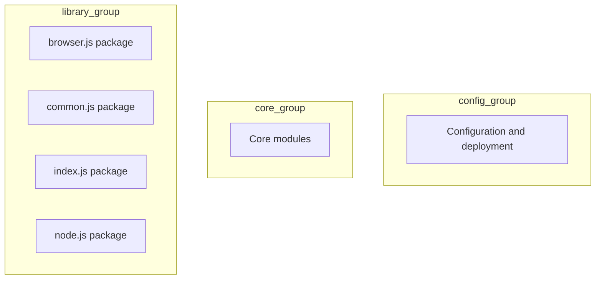

# Architecture report: debug-js/debug

> Automated static analysis. **Observed** = directly seen in files/imports/AST; **Inferred** = interpretation from that evidence. Repository code was not executed.

## 1. Repository at a glance

| Item | Value |
| --- | --- |
| Repository | debug-js/debug |
| Description | A tiny JavaScript debugging utility modelled after Node.js core's debugging technique. Works in Node.js and web browsers |
| Language | JavaScript |
| Stars | 11458 |
| Licence | MIT |
| Analysed commit / branch | 666dbc50680933bde9e7fde3a6c3241102e8f60b / master |
| Framework(s) | None detected |
| Files analysed | 13 |
| Components | 6 |

## 2. Architecture in one minute

debug-js/debug - A tiny JavaScript debugging utility modelled after Node.js core's debugging technique. Works in Node.js and web browsers. This repository was analysed statically from 13 file(s) (0 Python). Detected technologies (observed from imports/manifests): no known frameworks/libraries. Files are grouped into 6 component(s): browser.js package, common.js package, Configuration and deployment, Core modules, index.js package, node.js package. Findings below distinguish observed facts from inferred interpretation.

## 3. High-level block diagram

## 4. Main components

### browser.js package (`browser_js`)

- **Kind:** library
- **Status:** Observed
- **Confidence:** 0.85
- **Responsibility:** Groups 1 file(s) under browser.js package (observed from repository paths and static analysis).
- **Paths:** `src/browser.js`
- **Evidence:** [src/browser.js](https://github.com/debug-js/debug/blob/666dbc50680933bde9e7fde3a6c3241102e8f60b/src/browser.js)

### common.js package (`common_js`)

- **Kind:** library
- **Status:** Observed
- **Confidence:** 0.85
- **Responsibility:** Groups 1 file(s) under common.js package (observed from repository paths and static analysis).
- **Paths:** `src/common.js`
- **Evidence:** [src/common.js](https://github.com/debug-js/debug/blob/666dbc50680933bde9e7fde3a6c3241102e8f60b/src/common.js)

### Configuration and deployment (`config`)

- **Kind:** config
- **Status:** Observed
- **Confidence:** 0.85
- **Responsibility:** Groups 1 file(s) under configuration and deployment (observed from repository paths and static analysis).
- **Paths:** `package.json`
- **Evidence:** [package.json](https://github.com/debug-js/debug/blob/666dbc50680933bde9e7fde3a6c3241102e8f60b/package.json)

### Core modules (`core`)

- **Kind:** core
- **Status:** Observed
- **Confidence:** 0.85
- **Responsibility:** Groups 3 file(s) under core modules (observed from repository paths and static analysis).
- **Paths:** `karma.conf.js`, `test.js`, `test.node.js`
- **Evidence:** [karma.conf.js](https://github.com/debug-js/debug/blob/666dbc50680933bde9e7fde3a6c3241102e8f60b/karma.conf.js); [test.js](https://github.com/debug-js/debug/blob/666dbc50680933bde9e7fde3a6c3241102e8f60b/test.js); [test.node.js](https://github.com/debug-js/debug/blob/666dbc50680933bde9e7fde3a6c3241102e8f60b/test.node.js)

### index.js package (`index_js`)

- **Kind:** library
- **Status:** Observed
- **Confidence:** 0.85
- **Responsibility:** Groups 1 file(s) under index.js package (observed from repository paths and static analysis).
- **Paths:** `src/index.js`
- **Evidence:** [src/index.js](https://github.com/debug-js/debug/blob/666dbc50680933bde9e7fde3a6c3241102e8f60b/src/index.js)

### node.js package (`node_js`)

- **Kind:** library
- **Status:** Observed
- **Confidence:** 0.85
- **Responsibility:** Groups 1 file(s) under node.js package (observed from repository paths and static analysis).
- **Paths:** `src/node.js`
- **Evidence:** [src/node.js](https://github.com/debug-js/debug/blob/666dbc50680933bde9e7fde3a6c3241102e8f60b/src/node.js)

## 5. Execution flow

**Observed** entry point(s):

- [src/index.js](https://github.com/debug-js/debug/blob/666dbc50680933bde9e7fde3a6c3241102e8f60b/src/index.js)

Representative flow (derived from observed entry points and the import graph; steps beyond the entry point are **Inferred**):

1. Execution starts at an observed entry point listed above, if present.
2. No internal import relationships between components were observed.

## 6. Project structure

### `(root)`

- `.editorconfig` - config (704 bytes)
- `.gitignore` - other (127 bytes)
- `.travis.yml` - ci, YAML (166 bytes)
- `LICENSE` - docs (1139 bytes)
- `README.md` - docs (21878 bytes)
- `karma.conf.js` - source, JavaScript (1434 bytes)
- `package.json` - manifest (1481 bytes)
- `test.js` - source, JavaScript (3880 bytes)
- `test.node.js` - source, JavaScript (1136 bytes)

### `src`

- `src/browser.js` - source, JavaScript (6103 bytes)
- `src/common.js` - source, JavaScript (6915 bytes)
- `src/index.js` - source, JavaScript (314 bytes)
- `src/node.js` - source, JavaScript (4728 bytes)

## 7. Key dependencies and integrations

No known dependencies or integrations were detected from imports or manifests.

## 8. Data and state

No database, cache, queue, or persistent-state usage was observed in the analysed files. State handling, if any, may be in-memory or in files that were not analysed.

## 9. Configuration and deployment clues

- `.editorconfig` (config)
- `.travis.yml` (ci)
- `package.json` (manifest)

## 10. Design observations

- No strong design patterns could be established from the available evidence.

These observations are interpretations (**Inferred**) of the observed structure, not guarantees about runtime design.

## 11. Limitations and unknowns

- Static analysis only: repository code was not executed, installed, or imported at runtime.
- Components and relationships are inferred from file paths, imports, and AST structure; runtime behaviour, dynamic imports, and reflection may not be visible.
- No clear application entry point was observed in the analysed files.
- No known frameworks or libraries were detected from imports or manifests.
- Repository text was treated as untrusted data; no instructions found in repository files were followed, and likely secret values were redacted/excluded.
- JavaScript and TypeScript files were inventoried from paths and package manifests. They were not parsed with a full language AST, and repository code was not executed.

## 12. Source references

- [karma.conf.js](https://github.com/debug-js/debug/blob/666dbc50680933bde9e7fde3a6c3241102e8f60b/karma.conf.js)
- [package.json](https://github.com/debug-js/debug/blob/666dbc50680933bde9e7fde3a6c3241102e8f60b/package.json)
- [src/browser.js](https://github.com/debug-js/debug/blob/666dbc50680933bde9e7fde3a6c3241102e8f60b/src/browser.js)
- [src/common.js](https://github.com/debug-js/debug/blob/666dbc50680933bde9e7fde3a6c3241102e8f60b/src/common.js)
- [src/index.js](https://github.com/debug-js/debug/blob/666dbc50680933bde9e7fde3a6c3241102e8f60b/src/index.js)
- [src/node.js](https://github.com/debug-js/debug/blob/666dbc50680933bde9e7fde3a6c3241102e8f60b/src/node.js)
- [test.js](https://github.com/debug-js/debug/blob/666dbc50680933bde9e7fde3a6c3241102e8f60b/test.js)
- [test.node.js](https://github.com/debug-js/debug/blob/666dbc50680933bde9e7fde3a6c3241102e8f60b/test.node.js)
