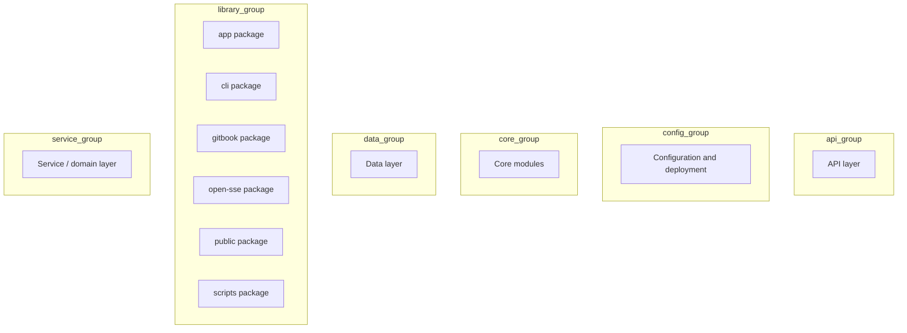

# Architecture report: decolua/9router

> Automated static analysis. **Observed** = directly seen in files/imports/AST; **Inferred** = interpretation from that evidence. Repository code was not executed.

## 1. Repository at a glance

| Item | Value |
| --- | --- |
| Repository | decolua/9router |
| Description | Unlimited FREE AI coding. Connect Claude Code, Codex, Cursor, Cline, Copilot, Antigravity to FREE Claude/GPT/Gemini via 40+ providers. Auto-fallback, RTK -40% tokens, never hit limits. |
| Language | JavaScript |
| Stars | 32433 |
| Licence | MIT |
| Analysed commit / branch | 1855aa44473e88feac9d3f131b9c0c5fc9706b68 / master |
| Framework(s) | Next.js, React |
| Files analysed | 800 |
| Components | 11 |

## 2. Architecture in one minute

decolua/9router - Unlimited FREE AI coding. Connect Claude Code, Codex, Cursor, Cline, Copilot, Antigravity to FREE Claude/GPT/Gemini via 40+ providers. Auto-fallback, RTK -40% tokens, never hit limits.. This repository was analysed statically from 800 file(s) (0 Python). Detected technologies (observed from imports/manifests): GitHub Actions, Next.js, React, Tailwind CSS, Docker, Docker Compose. Files are grouped into 11 component(s): API layer, app package, cli package, Configuration and deployment, Core modules, Data layer, gitbook package, open-sse package. Findings below distinguish observed facts from inferred interpretation.

## 3. High-level block diagram

## 4. Main components

### API layer (`api_layer`)

- **Kind:** api
- **Status:** Observed
- **Confidence:** 0.85
- **Responsibility:** Groups 67 file(s) under api layer (observed from repository paths and static analysis).
- **Paths:** `cli/src/cli/api/client.js`, `open-sse/handlers/chatCore.js`, `open-sse/handlers/chatCore/nonStreamingHandler.js`, `open-sse/handlers/chatCore/requestDetail.js`, `open-sse/handlers/chatCore/sseToJsonHandler.js`, `open-sse/handlers/chatCore/streamingHandler.js`, `open-sse/handlers/codexStt.js`, `open-sse/handlers/codexSttAudio.js`, `open-sse/handlers/embeddingProviders/_base.js`, `open-sse/handlers/embeddingProviders/gemini.js`, `open-sse/handlers/embeddingProviders/github.js`, `open-sse/handlers/embeddingProviders/index.js`, `open-sse/handlers/embeddingProviders/ollamaLocal.js`, `open-sse/handlers/embeddingProviders/openai.js`, `open-sse/handlers/embeddingProviders/openaiCompatNode.js`, `open-sse/handlers/embeddingProviders/selfhostedEmbedding.js`, `open-sse/handlers/embeddingsCore.js`, `open-sse/handlers/fetch/index.js`, `open-sse/handlers/geminiLiveStt.js`, `open-sse/handlers/imageGenerationCore.js`, `open-sse/handlers/imageProviders/_base.js`, `open-sse/handlers/imageProviders/antigravity.js`, `open-sse/handlers/imageProviders/blackForestLabs.js`, `open-sse/handlers/imageProviders/chatgpt-web.js`, `open-sse/handlers/imageProviders/cloudflareAi.js`, `open-sse/handlers/imageProviders/codex.js`, `open-sse/handlers/imageProviders/comfyui.js`, `open-sse/handlers/imageProviders/falAi.js`, `open-sse/handlers/imageProviders/gemini-web.js`, `open-sse/handlers/imageProviders/gemini.js`, `open-sse/handlers/imageProviders/grok-web.js`, `open-sse/handlers/imageProviders/huggingface.js`, `open-sse/handlers/imageProviders/index.js`, `open-sse/handlers/imageProviders/muse-web.js`, `open-sse/handlers/imageProviders/nanobanana.js`, `open-sse/handlers/imageProviders/openai.js`, `open-sse/handlers/imageProviders/runwayml.js`, `open-sse/handlers/imageProviders/sdwebui.js`, `open-sse/handlers/imageProviders/stabilityAi.js`, `open-sse/handlers/imageProviders/uc-web.js`, `open-sse/handlers/imageProviders/veoaifree-web.js`, `open-sse/handlers/responsesHandler.js`, `open-sse/handlers/search/callers.js`, `open-sse/handlers/search/chatSearch.js`, `open-sse/handlers/search/index.js`, `open-sse/handlers/search/normalizers.js`, `open-sse/handlers/sttCore.js`, `open-sse/handlers/systemoneCore.js`, `open-sse/handlers/ttsCore.js`, `open-sse/handlers/ttsProviders/_base.js`, `open-sse/handlers/ttsProviders/edgeTts.js`, `open-sse/handlers/ttsProviders/elevenlabs.js`, `open-sse/handlers/ttsProviders/gemini.js`, `open-sse/handlers/ttsProviders/genericFormats.js`, `open-sse/handlers/ttsProviders/googleTts.js`, `open-sse/handlers/ttsProviders/index.js`, `open-sse/handlers/ttsProviders/localDevice.js`, `open-sse/handlers/ttsProviders/minimax.js`, `open-sse/handlers/ttsProviders/ollamaLocal.js`, `open-sse/handlers/ttsProviders/openai.js`, `open-sse/handlers/ttsProviders/openrouter.js`, `open-sse/handlers/ttsProviders/selfhostedTts.js`, `open-sse/handlers/ttsProviders/xiaomi-mimo.js`, `open-sse/handlers/videoCore.js`, `open-sse/handlers/videoProviders/index.js`, `open-sse/handlers/videoProviders/openrouter.js`, `open-sse/handlers/videoProviders/vertex.js`
- **Evidence:** [cli/src/cli/api/client.js](https://github.com/decolua/9router/blob/1855aa44473e88feac9d3f131b9c0c5fc9706b68/cli/src/cli/api/client.js); [open-sse/handlers/chatCore.js](https://github.com/decolua/9router/blob/1855aa44473e88feac9d3f131b9c0c5fc9706b68/open-sse/handlers/chatCore.js); [open-sse/handlers/chatCore/nonStreamingHandler.js](https://github.com/decolua/9router/blob/1855aa44473e88feac9d3f131b9c0c5fc9706b68/open-sse/handlers/chatCore/nonStreamingHandler.js); [open-sse/handlers/chatCore/requestDetail.js](https://github.com/decolua/9router/blob/1855aa44473e88feac9d3f131b9c0c5fc9706b68/open-sse/handlers/chatCore/requestDetail.js); [open-sse/handlers/chatCore/sseToJsonHandler.js](https://github.com/decolua/9router/blob/1855aa44473e88feac9d3f131b9c0c5fc9706b68/open-sse/handlers/chatCore/sseToJsonHandler.js); [open-sse/handlers/chatCore/streamingHandler.js](https://github.com/decolua/9router/blob/1855aa44473e88feac9d3f131b9c0c5fc9706b68/open-sse/handlers/chatCore/streamingHandler.js); [open-sse/handlers/codexStt.js](https://github.com/decolua/9router/blob/1855aa44473e88feac9d3f131b9c0c5fc9706b68/open-sse/handlers/codexStt.js); [open-sse/handlers/codexSttAudio.js](https://github.com/decolua/9router/blob/1855aa44473e88feac9d3f131b9c0c5fc9706b68/open-sse/handlers/codexSttAudio.js)

### app package (`app`)

- **Kind:** library
- **Status:** Observed
- **Confidence:** 0.85
- **Responsibility:** Groups 40 file(s) under app package (observed from repository paths and static analysis).
- **Paths:** `src/app/(dashboard)/dashboard/basic-chat/BasicChatPageClient.js`, `src/app/(dashboard)/dashboard/basic-chat/page.js`, `src/app/(dashboard)/dashboard/cli-tools/CLIToolsPageClient.js`, `src/app/(dashboard)/dashboard/cli-tools/[toolId]/ToolDetailClient.js`, `src/app/(dashboard)/dashboard/cli-tools/[toolId]/page.js`, `src/app/(dashboard)/dashboard/cli-tools/components/AntigravityToolCard.js`, `src/app/(dashboard)/dashboard/cli-tools/components/ApiKeySelect.js`, `src/app/(dashboard)/dashboard/cli-tools/components/BaseUrlSelect.js`, `src/app/(dashboard)/dashboard/cli-tools/components/ClaudeToolCard.js`, `src/app/(dashboard)/dashboard/cli-tools/components/ClineToolCard.js`, `src/app/(dashboard)/dashboard/cli-tools/components/CodexToolCard.js`, `src/app/(dashboard)/dashboard/cli-tools/components/CopilotToolCard.js`, `src/app/(dashboard)/dashboard/cli-tools/components/CoworkToolCard.js`, `src/app/(dashboard)/dashboard/cli-tools/components/DeepSeekTuiToolCard.js`, `src/app/(dashboard)/dashboard/cli-tools/components/DefaultToolCard.js`, `src/app/(dashboard)/dashboard/cli-tools/components/DroidToolCard.js`, `src/app/(dashboard)/dashboard/cli-tools/components/EndpointPresetControl.js`, `src/app/(dashboard)/dashboard/cli-tools/components/GenericCliToolCard.js`, `src/app/(dashboard)/dashboard/cli-tools/components/GrokBuildToolCard.js`, `src/app/(dashboard)/dashboard/cli-tools/components/HermesToolCard.js`, `src/app/(dashboard)/dashboard/cli-tools/components/JcodeToolCard.js`, `src/app/(dashboard)/dashboard/cli-tools/components/KiloToolCard.js`, `src/app/(dashboard)/dashboard/cli-tools/components/MitmLinkCard.js`, `src/app/(dashboard)/dashboard/cli-tools/components/MitmServerCard.js`, `src/app/(dashboard)/dashboard/cli-tools/components/MitmToolCard.js`, `src/app/(dashboard)/dashboard/cli-tools/components/OpenClawToolCard.js`, `src/app/(dashboard)/dashboard/cli-tools/components/OpenCodeToolCard.js`, `src/app/(dashboard)/dashboard/cli-tools/components/ToolSummaryCard.js`, `src/app/(dashboard)/dashboard/cli-tools/components/cliEndpointMatch.js`, `src/app/(dashboard)/dashboard/cli-tools/components/cliEndpointPresets.js`, `src/app/(dashboard)/dashboard/cli-tools/components/codexConfig.js`, `src/app/(dashboard)/dashboard/cli-tools/components/index.js`, `src/app/(dashboard)/dashboard/cli-tools/page.js`, `src/app/(dashboard)/dashboard/combos/page.js`, `src/app/(dashboard)/dashboard/console-log/ConsoleLogClient.js`, `src/app/(dashboard)/dashboard/console-log/page.js`, `src/app/(dashboard)/dashboard/endpoint/EndpointPageClient.js`, `src/app/(dashboard)/dashboard/endpoint/components/EndpointRow.js`, `src/app/(dashboard)/dashboard/endpoint/components/KeyAccessControls.js`, `src/app/(dashboard)/dashboard/endpoint/components/SecurityWarning.js`
- **Evidence:** [src/app/(dashboard)/dashboard/basic-chat/BasicChatPageClient.js](https://github.com/decolua/9router/blob/1855aa44473e88feac9d3f131b9c0c5fc9706b68/src/app/%28dashboard%29/dashboard/basic-chat/BasicChatPageClient.js); [src/app/(dashboard)/dashboard/basic-chat/page.js](https://github.com/decolua/9router/blob/1855aa44473e88feac9d3f131b9c0c5fc9706b68/src/app/%28dashboard%29/dashboard/basic-chat/page.js); [src/app/(dashboard)/dashboard/cli-tools/CLIToolsPageClient.js](https://github.com/decolua/9router/blob/1855aa44473e88feac9d3f131b9c0c5fc9706b68/src/app/%28dashboard%29/dashboard/cli-tools/CLIToolsPageClient.js); [src/app/(dashboard)/dashboard/cli-tools/[toolId]/ToolDetailClient.js](https://github.com/decolua/9router/blob/1855aa44473e88feac9d3f131b9c0c5fc9706b68/src/app/%28dashboard%29/dashboard/cli-tools/%5BtoolId%5D/ToolDetailClient.js); [src/app/(dashboard)/dashboard/cli-tools/[toolId]/page.js](https://github.com/decolua/9router/blob/1855aa44473e88feac9d3f131b9c0c5fc9706b68/src/app/%28dashboard%29/dashboard/cli-tools/%5BtoolId%5D/page.js); [src/app/(dashboard)/dashboard/cli-tools/components/AntigravityToolCard.js](https://github.com/decolua/9router/blob/1855aa44473e88feac9d3f131b9c0c5fc9706b68/src/app/%28dashboard%29/dashboard/cli-tools/components/AntigravityToolCard.js); [src/app/(dashboard)/dashboard/cli-tools/components/ApiKeySelect.js](https://github.com/decolua/9router/blob/1855aa44473e88feac9d3f131b9c0c5fc9706b68/src/app/%28dashboard%29/dashboard/cli-tools/components/ApiKeySelect.js); [src/app/(dashboard)/dashboard/cli-tools/components/BaseUrlSelect.js](https://github.com/decolua/9router/blob/1855aa44473e88feac9d3f131b9c0c5fc9706b68/src/app/%28dashboard%29/dashboard/cli-tools/components/BaseUrlSelect.js)

### cli package (`cli`)

- **Kind:** library
- **Status:** Observed
- **Confidence:** 0.85
- **Responsibility:** Groups 29 file(s) under cli package (observed from repository paths and static analysis).
- **Paths:** `cli/cli.js`, `cli/hooks/postinstall.js`, `cli/hooks/sqliteRuntime.js`, `cli/hooks/trayRuntime.js`, `cli/scripts/build-cli.js`, `cli/scripts/buildMitm.js`, `cli/scripts/buildTrayArm64.js`, `cli/src/cli/commands/connect.js`, `cli/src/cli/commands/connectTools.js`, `cli/src/cli/commands/show.js`, `cli/src/cli/commands/xaiVideo.js`, `cli/src/cli/menus/apiKeys.js`, `cli/src/cli/menus/cliTools.js`, `cli/src/cli/menus/combos.js`, `cli/src/cli/menus/providers.js`, `cli/src/cli/menus/settings.js`, `cli/src/cli/terminalUI.js`, `cli/src/cli/tray/autostart.js`, `cli/src/cli/tray/tray.js`, `cli/src/cli/tray/trayWin.js`, `cli/src/cli/utils/clipboard.js`, `cli/src/cli/utils/comboModelId.js`, `cli/src/cli/utils/display.js`, `cli/src/cli/utils/endpoint.js`, `cli/src/cli/utils/format.js`, `cli/src/cli/utils/input.js`, `cli/src/cli/utils/launcherProcess.js`, `cli/src/cli/utils/menuHelper.js`, `cli/src/cli/utils/modelSelector.js`
- **Evidence:** [cli/cli.js](https://github.com/decolua/9router/blob/1855aa44473e88feac9d3f131b9c0c5fc9706b68/cli/cli.js); [cli/hooks/postinstall.js](https://github.com/decolua/9router/blob/1855aa44473e88feac9d3f131b9c0c5fc9706b68/cli/hooks/postinstall.js); [cli/hooks/sqliteRuntime.js](https://github.com/decolua/9router/blob/1855aa44473e88feac9d3f131b9c0c5fc9706b68/cli/hooks/sqliteRuntime.js); [cli/hooks/trayRuntime.js](https://github.com/decolua/9router/blob/1855aa44473e88feac9d3f131b9c0c5fc9706b68/cli/hooks/trayRuntime.js); [cli/scripts/build-cli.js](https://github.com/decolua/9router/blob/1855aa44473e88feac9d3f131b9c0c5fc9706b68/cli/scripts/build-cli.js); [cli/scripts/buildMitm.js](https://github.com/decolua/9router/blob/1855aa44473e88feac9d3f131b9c0c5fc9706b68/cli/scripts/buildMitm.js); [cli/scripts/buildTrayArm64.js](https://github.com/decolua/9router/blob/1855aa44473e88feac9d3f131b9c0c5fc9706b68/cli/scripts/buildTrayArm64.js); [cli/src/cli/commands/connect.js](https://github.com/decolua/9router/blob/1855aa44473e88feac9d3f131b9c0c5fc9706b68/cli/src/cli/commands/connect.js)

### Configuration and deployment (`config`)

- **Kind:** config
- **Status:** Observed
- **Confidence:** 0.85
- **Responsibility:** Groups 57 file(s) under configuration and deployment (observed from repository paths and static analysis).
- **Paths:** `Dockerfile`, `cli/package.json`, `docker-compose.yml`, `gitbook/jsconfig.json`, `gitbook/package.json`, `jsconfig.json`, `open-sse/config/appConstants.js`, `open-sse/config/awsConstants.js`, `open-sse/config/codexInstructions.js`, `open-sse/config/constants.js`, `open-sse/config/defaultThinkingSignature.js`, `open-sse/config/errorConfig.js`, `open-sse/config/googleTtsLanguages.js`, `open-sse/config/grokCli.js`, `open-sse/config/kiroConstants.js`, `open-sse/config/mediaConfig.js`, `open-sse/config/models.js`, `open-sse/config/ollamaModels.js`, `open-sse/config/providerModels.js`, `open-sse/config/providers.js`, `open-sse/config/runtimeConfig.js`, `open-sse/config/ttsModels.js`, `package.json`, `public/i18n/literals/ar.json`, `public/i18n/literals/bn.json`, `public/i18n/literals/cs.json`, `public/i18n/literals/da.json`, `public/i18n/literals/de.json`, `public/i18n/literals/el.json`, `public/i18n/literals/es.json`, `public/i18n/literals/fa.json`, `public/i18n/literals/fi.json`, `public/i18n/literals/fr.json`, `public/i18n/literals/he.json`, `public/i18n/literals/hi.json`, `public/i18n/literals/hu.json`, `public/i18n/literals/id.json`, `public/i18n/literals/it.json`, `public/i18n/literals/ja.json`, `public/i18n/literals/km.json`, `public/i18n/literals/ko.json`, `public/i18n/literals/nl.json`, `public/i18n/literals/no.json`, `public/i18n/literals/pl.json`, `public/i18n/literals/pt-BR.json`, `public/i18n/literals/pt-PT.json`, `public/i18n/literals/ro.json`, `public/i18n/literals/ru.json`, `public/i18n/literals/sv.json`, `public/i18n/literals/th.json`, `public/i18n/literals/tl.json`, `public/i18n/literals/tr.json`, `public/i18n/literals/uk.json`, `public/i18n/literals/ur.json`, `public/i18n/literals/vi.json`, `public/i18n/literals/zh-CN.json`, `public/i18n/literals/zh-TW.json`
- **Evidence:** [Dockerfile](https://github.com/decolua/9router/blob/1855aa44473e88feac9d3f131b9c0c5fc9706b68/Dockerfile); [cli/package.json](https://github.com/decolua/9router/blob/1855aa44473e88feac9d3f131b9c0c5fc9706b68/cli/package.json); [docker-compose.yml](https://github.com/decolua/9router/blob/1855aa44473e88feac9d3f131b9c0c5fc9706b68/docker-compose.yml); [gitbook/jsconfig.json](https://github.com/decolua/9router/blob/1855aa44473e88feac9d3f131b9c0c5fc9706b68/gitbook/jsconfig.json); [gitbook/package.json](https://github.com/decolua/9router/blob/1855aa44473e88feac9d3f131b9c0c5fc9706b68/gitbook/package.json); [jsconfig.json](https://github.com/decolua/9router/blob/1855aa44473e88feac9d3f131b9c0c5fc9706b68/jsconfig.json); [open-sse/config/appConstants.js](https://github.com/decolua/9router/blob/1855aa44473e88feac9d3f131b9c0c5fc9706b68/open-sse/config/appConstants.js); [open-sse/config/awsConstants.js](https://github.com/decolua/9router/blob/1855aa44473e88feac9d3f131b9c0c5fc9706b68/open-sse/config/awsConstants.js)

### Core modules (`core`)

- **Kind:** core
- **Status:** Observed
- **Confidence:** 0.85
- **Responsibility:** Groups 4 file(s) under core modules (observed from repository paths and static analysis).
- **Paths:** `custom-server.js`, `eslint.config.mjs`, `next.config.mjs`, `postcss.config.mjs`
- **Evidence:** [custom-server.js](https://github.com/decolua/9router/blob/1855aa44473e88feac9d3f131b9c0c5fc9706b68/custom-server.js); [eslint.config.mjs](https://github.com/decolua/9router/blob/1855aa44473e88feac9d3f131b9c0c5fc9706b68/eslint.config.mjs); [next.config.mjs](https://github.com/decolua/9router/blob/1855aa44473e88feac9d3f131b9c0c5fc9706b68/next.config.mjs); [postcss.config.mjs](https://github.com/decolua/9router/blob/1855aa44473e88feac9d3f131b9c0c5fc9706b68/postcss.config.mjs)

### Data layer (`data_layer`)

- **Kind:** data
- **Status:** Observed
- **Confidence:** 0.85
- **Responsibility:** Groups 3 file(s) under data layer (observed from repository paths and static analysis).
- **Paths:** `open-sse/providers/models/helpers.js`, `open-sse/providers/models/namePatterns.js`, `open-sse/providers/models/schema.js`
- **Evidence:** [open-sse/providers/models/helpers.js](https://github.com/decolua/9router/blob/1855aa44473e88feac9d3f131b9c0c5fc9706b68/open-sse/providers/models/helpers.js); [open-sse/providers/models/namePatterns.js](https://github.com/decolua/9router/blob/1855aa44473e88feac9d3f131b9c0c5fc9706b68/open-sse/providers/models/namePatterns.js); [open-sse/providers/models/schema.js](https://github.com/decolua/9router/blob/1855aa44473e88feac9d3f131b9c0c5fc9706b68/open-sse/providers/models/schema.js)

### gitbook package (`gitbook`)

- **Kind:** library
- **Status:** Observed
- **Confidence:** 0.85
- **Responsibility:** Groups 16 file(s) under gitbook package (observed from repository paths and static analysis).
- **Paths:** `gitbook/app/[lang]/[...slug]/page.js`, `gitbook/app/[lang]/page.js`, `gitbook/app/layout.js`, `gitbook/app/page.js`, `gitbook/components/DocsContent.js`, `gitbook/components/DocsHeader.js`, `gitbook/components/DocsLayout.js`, `gitbook/components/DocsSidebar.js`, `gitbook/components/DocsToc.js`, `gitbook/components/LanguageSwitcher.js`, `gitbook/constants/docsConfig.js`, `gitbook/constants/languages.js`, `gitbook/lib/content.js`, `gitbook/next.config.mjs`, `gitbook/postcss.config.mjs`, `gitbook/utils/markdown.js`
- **Evidence:** [gitbook/app/[lang]/[...slug]/page.js](https://github.com/decolua/9router/blob/1855aa44473e88feac9d3f131b9c0c5fc9706b68/gitbook/app/%5Blang%5D/%5B...slug%5D/page.js); [gitbook/app/[lang]/page.js](https://github.com/decolua/9router/blob/1855aa44473e88feac9d3f131b9c0c5fc9706b68/gitbook/app/%5Blang%5D/page.js); [gitbook/app/layout.js](https://github.com/decolua/9router/blob/1855aa44473e88feac9d3f131b9c0c5fc9706b68/gitbook/app/layout.js); [gitbook/app/page.js](https://github.com/decolua/9router/blob/1855aa44473e88feac9d3f131b9c0c5fc9706b68/gitbook/app/page.js); [gitbook/components/DocsContent.js](https://github.com/decolua/9router/blob/1855aa44473e88feac9d3f131b9c0c5fc9706b68/gitbook/components/DocsContent.js); [gitbook/components/DocsHeader.js](https://github.com/decolua/9router/blob/1855aa44473e88feac9d3f131b9c0c5fc9706b68/gitbook/components/DocsHeader.js); [gitbook/components/DocsLayout.js](https://github.com/decolua/9router/blob/1855aa44473e88feac9d3f131b9c0c5fc9706b68/gitbook/components/DocsLayout.js); [gitbook/components/DocsSidebar.js](https://github.com/decolua/9router/blob/1855aa44473e88feac9d3f131b9c0c5fc9706b68/gitbook/components/DocsSidebar.js)

### open-sse package (`open_sse`)

- **Kind:** library
- **Status:** Observed
- **Confidence:** 0.85
- **Responsibility:** Groups 354 file(s) under open-sse package (observed from repository paths and static analysis).
- **Paths:** `open-sse/executors/antigravity.js`, `open-sse/executors/azure.js`, `open-sse/executors/base.js`, `open-sse/executors/bedrock.js`, `open-sse/executors/browserExecutableCheck.js`, `open-sse/executors/chatgpt-web.js`, `open-sse/executors/chatgpt-web/adapter.js`, `open-sse/executors/chatgpt-web/attachments.js`, `open-sse/executors/chatgpt-web/browserSession.js`, `open-sse/executors/chatgpt-web/chatHttp.js`, `open-sse/executors/chatgpt-web/deltaV1.js`, `open-sse/executors/chatgpt-web/firstParty.js`, `open-sse/executors/chatgpt-web/imageGen.js`, `open-sse/executors/chatgpt-web/imageGenHttp.js`, `open-sse/executors/chatgpt-web/imageSniff.js`, `open-sse/executors/chatgpt-web/sentinel.js`, `open-sse/executors/chatgptWebTools.js`, `open-sse/executors/codebuddy-cn.js`, `open-sse/executors/codebuddy-intl.js`, `open-sse/executors/codex.js`, `open-sse/executors/commandcode.js`, `open-sse/executors/cursor.js`, `open-sse/executors/deepseek-web-done-terminator.js`, `open-sse/executors/deepseek-web.js`, `open-sse/executors/deepseek-web/pow.js`, `open-sse/executors/deepseek-web/stream-format.js`, `open-sse/executors/default.js`, `open-sse/executors/devin-cli.js`, `open-sse/executors/gemini-cli.js`, `open-sse/executors/gemini-web.js`, `open-sse/executors/gemini-web/browserLease.js`, `open-sse/executors/gemini-web/capabilities.js`, `open-sse/executors/gemini-web/domCapture.js`, `open-sse/executors/gemini-web/imageGen.js`, `open-sse/executors/gemini-web/modeSelection.js`, `open-sse/executors/github.js`, `open-sse/executors/grok-cli.js`, `open-sse/executors/grok-web-tools.js`, `open-sse/executors/grok-web.js`, `open-sse/executors/iflow.js`, `open-sse/executors/index.js`, `open-sse/executors/kimchi.js`, `open-sse/executors/kiro.js`, `open-sse/executors/mimo-free.js`, `open-sse/executors/minimax-code.js`, `open-sse/executors/muse-web.js`, `open-sse/executors/muse-web/dom.js`, `open-sse/executors/muse-web/prompt.js`, `open-sse/executors/muse-web/session.js`, `open-sse/executors/ollama-local.js`, `open-sse/executors/opencode-go.js`, `open-sse/executors/opencode-zen.js`, `open-sse/executors/opencode.js`, `open-sse/executors/perplexity-web.js`, `open-sse/executors/qoder.js`, `open-sse/executors/trae.js`, `open-sse/executors/uc-web.js`, `open-sse/executors/veoaifree-web.js`, `open-sse/executors/vertex.js`, `open-sse/executors/windsurf.js`, `open-sse/executors/xiaomi-mimo.js`, `open-sse/executors/xiaomi-tokenplan.js`, `open-sse/executors/zed.js`, `open-sse/index.js`, `open-sse/lib/deepseek-pow-hash.js`, `open-sse/lib/deepseek-pow-worker.mjs`, `open-sse/lib/deepseek-pow.js`, `open-sse/providers/REGISTRY_TEMPLATE.js`, `open-sse/providers/capabilities.js`, `open-sse/providers/catalogOverride.js`, `open-sse/providers/index.js`, `open-sse/providers/pricing.js`, `open-sse/providers/registry/agnes.js`, `open-sse/providers/registry/alicode-intl.js`, `open-sse/providers/registry/alicode.js`, `open-sse/providers/registry/alims-intl.js`, `open-sse/providers/registry/alitp-intl.js`, `open-sse/providers/registry/anthropic.js`, `open-sse/providers/registry/antigravity.js`, `open-sse/providers/registry/api-airforce.js`, `open-sse/providers/registry/assemblyai.js`, `open-sse/providers/registry/atria.js`, `open-sse/providers/registry/aws-polly.js`, `open-sse/providers/registry/azure.js`, `open-sse/providers/registry/bai.js`, `open-sse/providers/registry/baidu.js`, `open-sse/providers/registry/bazaarlink.js`, `open-sse/providers/registry/bedrock-xai.js`, `open-sse/providers/registry/bedrock.js`, `open-sse/providers/registry/black-forest-labs.js`, `open-sse/providers/registry/blackbox.js`, `open-sse/providers/registry/bluesminds.js`, `open-sse/providers/registry/brave-search.js`, `open-sse/providers/registry/byteplus.js`, `open-sse/providers/registry/cartesia.js`, `open-sse/providers/registry/cerebras.js`, `open-sse/providers/registry/chatgpt-web.js`, `open-sse/providers/registry/chutes.js`, `open-sse/providers/registry/claude.js`, `open-sse/providers/registry/cline.js`, `open-sse/providers/registry/clinepass.js`, `open-sse/providers/registry/cloudflare-ai.js`, `open-sse/providers/registry/codebuddy-cn.js`, `open-sse/providers/registry/codebuddy-intl.js`, `open-sse/providers/registry/codex.js`, `open-sse/providers/registry/cohere.js`, `open-sse/providers/registry/comfyui.js`, `open-sse/providers/registry/commandcode.js`, `open-sse/providers/registry/coqui.js`, `open-sse/providers/registry/cursor.js`, `open-sse/providers/registry/dahl.js`, `open-sse/providers/registry/deepgram.js`, `open-sse/providers/registry/deepseek-web.js`, `open-sse/providers/registry/deepseek.js`, `open-sse/providers/registry/devin-cli.js`, `open-sse/providers/registry/edge-tts.js`, `open-sse/providers/registry/elevenlabs.js`, `open-sse/providers/registry/exa.js`, `open-sse/providers/registry/fal-ai.js`, `open-sse/providers/registry/featherless.js`, `open-sse/providers/registry/firecrawl.js`, `open-sse/providers/registry/fireworks.js`, `open-sse/providers/registry/fish-audio.js`, `open-sse/providers/registry/gemini-cli.js`, `open-sse/providers/registry/gemini-web.js`, `open-sse/providers/registry/gemini.js`, `open-sse/providers/registry/github.js`, `open-sse/providers/registry/gitlab.js`, `open-sse/providers/registry/glm-cn.js`, `open-sse/providers/registry/glm.js`, `open-sse/providers/registry/google-pse.js`, `open-sse/providers/registry/google-tts.js`, `open-sse/providers/registry/grok-cli.js`, `open-sse/providers/registry/grok-web.js`, `open-sse/providers/registry/groq.js`, `open-sse/providers/registry/huggingface.js`, `open-sse/providers/registry/hyperbolic.js`, `open-sse/providers/registry/iflow.js`, `open-sse/providers/registry/index.js`, `open-sse/providers/registry/inworld.js`, `open-sse/providers/registry/jina-ai.js`, `open-sse/providers/registry/jina-reader.js`, `open-sse/providers/registry/kilo-gateway.js`, `open-sse/providers/registry/kilocode.js`, `open-sse/providers/registry/kimchi.js`, `open-sse/providers/registry/kimi.js`, `open-sse/providers/registry/kiro.js`, `open-sse/providers/registry/linkup.js`, `open-sse/providers/registry/llm7.js`, `open-sse/providers/registry/local-device.js`, `open-sse/providers/registry/mimo-free.js`, `open-sse/providers/registry/minimax-cn.js`, `open-sse/providers/registry/minimax-code-global.js`, `open-sse/providers/registry/minimax-code.js`, `open-sse/providers/registry/minimax.js`, `open-sse/providers/registry/mistral.js`, `open-sse/providers/registry/mmf.js`, `open-sse/providers/registry/morph.js`, `open-sse/providers/registry/muse-web.js`, `open-sse/providers/registry/muse.js`, `open-sse/providers/registry/nace.js`, `open-sse/providers/registry/nanobanana.js`, `open-sse/providers/registry/nebius.js`, `open-sse/providers/registry/nous.js`, `open-sse/providers/registry/nvidia.js`, `open-sse/providers/registry/ollama-local.js`, `open-sse/providers/registry/ollama-search.js`, `open-sse/providers/registry/ollama.js`, `open-sse/providers/registry/openai.js`, `open-sse/providers/registry/opencode-go.js`, `open-sse/providers/registry/opencode-zen.js`, `open-sse/providers/registry/opencode.js`, `open-sse/providers/registry/openrouter.js`, `open-sse/providers/registry/perplexity-agent.js`, `open-sse/providers/registry/perplexity-web.js`, `open-sse/providers/registry/perplexity.js`, `open-sse/providers/registry/playht.js`, `open-sse/providers/registry/poolside.js`, `open-sse/providers/registry/qoder-cn.js`, `open-sse/providers/registry/qoder.js`, `open-sse/providers/registry/recraft.js`, `open-sse/providers/registry/runcrate.js`, `open-sse/providers/registry/runwayml.js`, `open-sse/providers/registry/sambanova.js`, `open-sse/providers/registry/sdwebui.js`, `open-sse/providers/registry/searchapi.js`, `open-sse/providers/registry/searxng.js`, `open-sse/providers/registry/selfhosted-embedding.js`, `open-sse/providers/registry/selfhosted-stt.js`, `open-sse/providers/registry/selfhosted-tts.js`, `open-sse/providers/registry/sensenova-intl.js`, `open-sse/providers/registry/sensenova.js`, `open-sse/providers/registry/serper.js`, `open-sse/providers/registry/siliconflow.js`, `open-sse/providers/registry/stability-ai.js`, `open-sse/providers/registry/synthetic.js`, `open-sse/providers/registry/tavily.js`, `open-sse/providers/registry/tencent.js`, `open-sse/providers/registry/tinyfish.js`, `open-sse/providers/registry/together.js`, `open-sse/providers/registry/tokenharbor.js`, `open-sse/providers/registry/tokenrouter.js`, `open-sse/providers/registry/topaz.js`, `open-sse/providers/registry/tortoise.js`, `open-sse/providers/registry/trae.js`, `open-sse/providers/registry/uc-web.js`, `open-sse/providers/registry/v1m.js`, `open-sse/providers/registry/venice.js`, `open-sse/providers/registry/veoaifree-web.js`, `open-sse/providers/registry/vercel-ai-gateway.js`, `open-sse/providers/registry/vertex-partner.js`, `open-sse/providers/registry/vertex.js`, `open-sse/providers/registry/volcengine-ark.js`, `open-sse/providers/registry/voyage-ai.js`, `open-sse/providers/registry/windsurf.js`, `open-sse/providers/registry/xai.js`, `open-sse/providers/registry/xiaomi-mimo.js`, `open-sse/providers/registry/xiaomi-tokenplan.js`, `open-sse/providers/registry/xquik.js`, `open-sse/providers/registry/youcom.js`, `open-sse/providers/registry/zed.js`, `open-sse/providers/schema.js`, `open-sse/providers/shared.js`, `open-sse/providers/thinkingLevels.js`, `open-sse/providers/visionPatterns.js`, `open-sse/rtk/applyFilter.js`, `open-sse/rtk/autodetect.js`, `open-sse/rtk/caveman.js`, `open-sse/rtk/cavemanPrompts.js`, `open-sse/rtk/constants.js`, `open-sse/rtk/customPrompt.js`, `open-sse/rtk/filters/buildOutput.js`, `open-sse/rtk/filters/dedupLog.js`, `open-sse/rtk/filters/find.js`, `open-sse/rtk/filters/gitDiff.js`, `open-sse/rtk/filters/gitLog.js`, `open-sse/rtk/filters/gitStatus.js`, `open-sse/rtk/filters/grep.js`, `open-sse/rtk/filters/ls.js`, `open-sse/rtk/filters/readNumbered.js`, `open-sse/rtk/filters/searchList.js`, `open-sse/rtk/filters/smartTruncate.js`, `open-sse/rtk/filters/tree.js`, `open-sse/rtk/headroom.js`, `open-sse/rtk/index.js`, `open-sse/rtk/ponytail.js`, `open-sse/rtk/ponytailPrompt.js`, `open-sse/rtk/pxpipe.js`, `open-sse/rtk/registry.js`, `open-sse/rtk/systemInject.js`, `open-sse/shared/awsCredentials.js`, `open-sse/shared/clineAuth.js`, `open-sse/shared/clineEnvelope.js`, `open-sse/shared/commandCodeHeaders.js`, `open-sse/shared/machineId.js`, `open-sse/shared/mimoAccount.js`, `open-sse/shared/qoder/attachments.js`, `open-sse/shared/qoder/constants.js`, `open-sse/shared/qoder/contextTier.js`, `open-sse/shared/qoder/cosy.js`, `open-sse/shared/qoder/encoding.js`, `open-sse/shared/qoder/queue.js`, `open-sse/shared/qoder/sse.js`, `open-sse/shared/zedAuth.js`, `open-sse/transformer/responsesTransformer.js`, `open-sse/transformer/streamToJsonConverter.js`, `open-sse/translator/concerns/chunk.js`, `open-sse/translator/concerns/claudeMessage.js`, `open-sse/translator/concerns/finishReason.js`, `open-sse/translator/concerns/image.js`, `open-sse/translator/concerns/json.js`, `open-sse/translator/concerns/kiroConversation.js`, `open-sse/translator/concerns/message.js`, `open-sse/translator/concerns/modality.js`, `open-sse/translator/concerns/paramSupport.js`, `open-sse/translator/concerns/prefetch.js`, `open-sse/translator/concerns/reasoning.js`, `open-sse/translator/concerns/thinking.js`, `open-sse/translator/concerns/thinkingUnified.js`, `open-sse/translator/concerns/toolCall.js`, `open-sse/translator/concerns/usage.js`, `open-sse/translator/deepseekWebToolBinding.js`, `open-sse/translator/deepseekWebTools.js`, `open-sse/translator/formats.js`, `open-sse/translator/formats/claude.js`, `open-sse/translator/formats/gemini.js`, `open-sse/translator/formats/maxTokens.js`, `open-sse/translator/formats/openai.js`, `open-sse/translator/formats/responsesApi.js`, `open-sse/translator/index.js`, `open-sse/translator/request/antigravity-to-openai.js`, `open-sse/translator/request/claude-to-kiro.js`, `open-sse/translator/request/claude-to-openai.js`, `open-sse/translator/request/gemini-to-openai.js`, `open-sse/translator/request/openai-responses.js`, `open-sse/translator/request/openai-to-claude.js`, `open-sse/translator/request/openai-to-commandcode.js`, `open-sse/translator/request/openai-to-cursor.js`, `open-sse/translator/request/openai-to-gemini.js`, `open-sse/translator/request/openai-to-kiro.js`, `open-sse/translator/request/openai-to-ollama.js`, `open-sse/translator/request/openai-to-vertex.js`, `open-sse/translator/response/claude-to-openai.js`, `open-sse/translator/response/commandcode-to-openai.js`, `open-sse/translator/response/cursor-to-openai.js`, `open-sse/translator/response/gemini-to-openai.js`, `open-sse/translator/response/kiro-to-claude.js`, `open-sse/translator/response/kiro-to-openai.js`, `open-sse/translator/response/ollama-to-openai.js`, `open-sse/translator/response/openai-responses.js`, `open-sse/translator/response/openai-to-antigravity.js`, `open-sse/translator/response/openai-to-claude.js`, `open-sse/translator/schema/blocks.js`, `open-sse/translator/schema/defaults.js`, `open-sse/translator/schema/finishReasons.js`, `open-sse/translator/schema/index.js`, `open-sse/translator/schema/roles.js`, `open-sse/translator/schema/streamEvents.js`, `open-sse/translator/webTools.js`, `open-sse/utils/awsEventStream.js`, `open-sse/utils/awsSigv4.js`, `open-sse/utils/bypassHandler.js`, `open-sse/utils/claudeCliVersion.js`, `open-sse/utils/claudeCloaking.js`, `open-sse/utils/claudeSignature.js`, `open-sse/utils/claudeToolTypeSelfCheck.mjs`, `open-sse/utils/clientDetector.js`, `open-sse/utils/codexToolSchema.js`, `open-sse/utils/cursorChecksum.js`, `open-sse/utils/cursorProtobuf.js`, `open-sse/utils/debugLog.js`, `open-sse/utils/error.js`, `open-sse/utils/geminiCookies.js`, `open-sse/utils/kiroSessionReplay.js`, `open-sse/utils/modelMarkers.js`, `open-sse/utils/ollamaTransform.js`, `open-sse/utils/opencodeFingerprint.js`, `open-sse/utils/proxyFetch.js`, `open-sse/utils/reasoningContentInjector.js`, `open-sse/utils/requestLogger.js`, `open-sse/utils/responsesStreamHelpers.js`, `open-sse/utils/sessionManager.js`, `open-sse/utils/sse.js`, `open-sse/utils/sseConstants.js`, `open-sse/utils/stream.js`, `open-sse/utils/streamHandler.js`, `open-sse/utils/streamHelpers.js`, `open-sse/utils/tagBlocks.js`, `open-sse/utils/toolDeduper.js`, `open-sse/utils/upstreamHeaders.js`, `open-sse/utils/usageTracking.js`, `open-sse/utils/webCookieAuth.js`, `open-sse/utils/writableDataDir.js`, `open-sse/utils/zstdCompat.js`
- **Evidence:** [open-sse/executors/antigravity.js](https://github.com/decolua/9router/blob/1855aa44473e88feac9d3f131b9c0c5fc9706b68/open-sse/executors/antigravity.js); [open-sse/executors/azure.js](https://github.com/decolua/9router/blob/1855aa44473e88feac9d3f131b9c0c5fc9706b68/open-sse/executors/azure.js); [open-sse/executors/base.js](https://github.com/decolua/9router/blob/1855aa44473e88feac9d3f131b9c0c5fc9706b68/open-sse/executors/base.js); [open-sse/executors/bedrock.js](https://github.com/decolua/9router/blob/1855aa44473e88feac9d3f131b9c0c5fc9706b68/open-sse/executors/bedrock.js); [open-sse/executors/browserExecutableCheck.js](https://github.com/decolua/9router/blob/1855aa44473e88feac9d3f131b9c0c5fc9706b68/open-sse/executors/browserExecutableCheck.js); [open-sse/executors/chatgpt-web.js](https://github.com/decolua/9router/blob/1855aa44473e88feac9d3f131b9c0c5fc9706b68/open-sse/executors/chatgpt-web.js); [open-sse/executors/chatgpt-web/adapter.js](https://github.com/decolua/9router/blob/1855aa44473e88feac9d3f131b9c0c5fc9706b68/open-sse/executors/chatgpt-web/adapter.js); [open-sse/executors/chatgpt-web/attachments.js](https://github.com/decolua/9router/blob/1855aa44473e88feac9d3f131b9c0c5fc9706b68/open-sse/executors/chatgpt-web/attachments.js)

### public package (`public`)

- **Kind:** library
- **Status:** Observed
- **Confidence:** 0.85
- **Responsibility:** Groups 1 file(s) under public package (observed from repository paths and static analysis).
- **Paths:** `public/sw.js`
- **Evidence:** [public/sw.js](https://github.com/decolua/9router/blob/1855aa44473e88feac9d3f131b9c0c5fc9706b68/public/sw.js)

### scripts package (`scripts`)

- **Kind:** library
- **Status:** Observed
- **Confidence:** 0.85
- **Responsibility:** Groups 5 file(s) under scripts package (observed from repository paths and static analysis).
- **Paths:** `scripts/copy-standalone-assets.mjs`, `scripts/injectDisplayToRegistry.mjs`, `scripts/migrate-registry.mjs`, `scripts/test-combo-autoswitch.mjs`, `scripts/translate-readme.js`
- **Evidence:** [scripts/copy-standalone-assets.mjs](https://github.com/decolua/9router/blob/1855aa44473e88feac9d3f131b9c0c5fc9706b68/scripts/copy-standalone-assets.mjs); [scripts/injectDisplayToRegistry.mjs](https://github.com/decolua/9router/blob/1855aa44473e88feac9d3f131b9c0c5fc9706b68/scripts/injectDisplayToRegistry.mjs); [scripts/migrate-registry.mjs](https://github.com/decolua/9router/blob/1855aa44473e88feac9d3f131b9c0c5fc9706b68/scripts/migrate-registry.mjs); [scripts/test-combo-autoswitch.mjs](https://github.com/decolua/9router/blob/1855aa44473e88feac9d3f131b9c0c5fc9706b68/scripts/test-combo-autoswitch.mjs); [scripts/translate-readme.js](https://github.com/decolua/9router/blob/1855aa44473e88feac9d3f131b9c0c5fc9706b68/scripts/translate-readme.js)

### Service / domain layer (`service_layer`)

- **Kind:** service
- **Status:** Observed
- **Confidence:** 0.85
- **Responsibility:** Groups 60 file(s) under service / domain layer (observed from repository paths and static analysis).
- **Paths:** `open-sse/services/accountFallback.js`, `open-sse/services/browserPool.js`, `open-sse/services/browserProfileCache.js`, `open-sse/services/capacityAdapter.js`, `open-sse/services/clinepassModels.js`, `open-sse/services/combo.js`, `open-sse/services/commandcodeModels.js`, `open-sse/services/compact.js`, `open-sse/services/copilotModels.js`, `open-sse/services/cursorModels.js`, `open-sse/services/emptyFailover.js`, `open-sse/services/grokCliModels.js`, `open-sse/services/grokTlsClient.js`, `open-sse/services/kimchiModels.js`, `open-sse/services/kiroModels.js`, `open-sse/services/lazyRuntime.js`, `open-sse/services/minimaxCodeLease.js`, `open-sse/services/minimaxCodeUsage.js`, `open-sse/services/model.js`, `open-sse/services/nous.js`, `open-sse/services/oauthCredentialManager.js`, `open-sse/services/obscura.js`, `open-sse/services/opencodeTlsClient.js`, `open-sse/services/projectId.js`, `open-sse/services/provider.js`, `open-sse/services/qoderModels.js`, `open-sse/services/systemoneRouter.js`, `open-sse/services/thoughtSignatureStore.js`, `open-sse/services/tokenRefresh.js`, `open-sse/services/tokenRefresh/dedup.js`, `open-sse/services/tokenRefresh/providers.js`, `open-sse/services/usage.js`, `open-sse/services/usage/antigravity-weekly.js`, `open-sse/services/usage/claude.js`, `open-sse/services/usage/clinepass.js`, `open-sse/services/usage/codebuddy-cn.js`, `open-sse/services/usage/codex.js`, `open-sse/services/usage/commandcode.js`, `open-sse/services/usage/cursor.js`, `open-sse/services/usage/deepseek.js`, `open-sse/services/usage/github.js`, `open-sse/services/usage/glm.js`, `open-sse/services/usage/google.js`, `open-sse/services/usage/grok-cli.js`, `open-sse/services/usage/grokCliQuotaFrame.js`, `open-sse/services/usage/groq.js`, `open-sse/services/usage/kimi.js`, `open-sse/services/usage/kiro.js`, `open-sse/services/usage/minimax.js`, `open-sse/services/usage/misc.js`, `open-sse/services/usage/opencode-go.js`, `open-sse/services/usage/opencode-zen.js`, `open-sse/services/usage/shared.js`, `open-sse/services/usage/synthetic.js`, `open-sse/services/usage/xiaomi-mimo.js`, `open-sse/services/usage/zed.js`, `open-sse/services/virtualDisplay.js`, `open-sse/services/webIdentity.js`, `open-sse/services/webLogin.js`, `open-sse/services/webLoginConfig.js`
- **Evidence:** [open-sse/services/accountFallback.js](https://github.com/decolua/9router/blob/1855aa44473e88feac9d3f131b9c0c5fc9706b68/open-sse/services/accountFallback.js); [open-sse/services/browserPool.js](https://github.com/decolua/9router/blob/1855aa44473e88feac9d3f131b9c0c5fc9706b68/open-sse/services/browserPool.js); [open-sse/services/browserProfileCache.js](https://github.com/decolua/9router/blob/1855aa44473e88feac9d3f131b9c0c5fc9706b68/open-sse/services/browserProfileCache.js); [open-sse/services/capacityAdapter.js](https://github.com/decolua/9router/blob/1855aa44473e88feac9d3f131b9c0c5fc9706b68/open-sse/services/capacityAdapter.js); [open-sse/services/clinepassModels.js](https://github.com/decolua/9router/blob/1855aa44473e88feac9d3f131b9c0c5fc9706b68/open-sse/services/clinepassModels.js); [open-sse/services/combo.js](https://github.com/decolua/9router/blob/1855aa44473e88feac9d3f131b9c0c5fc9706b68/open-sse/services/combo.js); [open-sse/services/commandcodeModels.js](https://github.com/decolua/9router/blob/1855aa44473e88feac9d3f131b9c0c5fc9706b68/open-sse/services/commandcodeModels.js); [open-sse/services/compact.js](https://github.com/decolua/9router/blob/1855aa44473e88feac9d3f131b9c0c5fc9706b68/open-sse/services/compact.js)

## 5. Execution flow

**Observed** entry point(s):

- [cli/cli.js](https://github.com/decolua/9router/blob/1855aa44473e88feac9d3f131b9c0c5fc9706b68/cli/cli.js)
- [gitbook/app/[lang]/page.js](https://github.com/decolua/9router/blob/1855aa44473e88feac9d3f131b9c0c5fc9706b68/gitbook/app/%5Blang%5D/page.js)
- [gitbook/app/page.js](https://github.com/decolua/9router/blob/1855aa44473e88feac9d3f131b9c0c5fc9706b68/gitbook/app/page.js)
- [open-sse/executors/index.js](https://github.com/decolua/9router/blob/1855aa44473e88feac9d3f131b9c0c5fc9706b68/open-sse/executors/index.js)
- [open-sse/handlers/embeddingProviders/index.js](https://github.com/decolua/9router/blob/1855aa44473e88feac9d3f131b9c0c5fc9706b68/open-sse/handlers/embeddingProviders/index.js)
- [open-sse/handlers/fetch/index.js](https://github.com/decolua/9router/blob/1855aa44473e88feac9d3f131b9c0c5fc9706b68/open-sse/handlers/fetch/index.js)
- [open-sse/handlers/imageProviders/index.js](https://github.com/decolua/9router/blob/1855aa44473e88feac9d3f131b9c0c5fc9706b68/open-sse/handlers/imageProviders/index.js)
- [open-sse/handlers/search/index.js](https://github.com/decolua/9router/blob/1855aa44473e88feac9d3f131b9c0c5fc9706b68/open-sse/handlers/search/index.js)
- [open-sse/handlers/ttsProviders/index.js](https://github.com/decolua/9router/blob/1855aa44473e88feac9d3f131b9c0c5fc9706b68/open-sse/handlers/ttsProviders/index.js)
- [open-sse/handlers/videoProviders/index.js](https://github.com/decolua/9router/blob/1855aa44473e88feac9d3f131b9c0c5fc9706b68/open-sse/handlers/videoProviders/index.js)
- [open-sse/index.js](https://github.com/decolua/9router/blob/1855aa44473e88feac9d3f131b9c0c5fc9706b68/open-sse/index.js)
- [open-sse/providers/index.js](https://github.com/decolua/9router/blob/1855aa44473e88feac9d3f131b9c0c5fc9706b68/open-sse/providers/index.js)

Representative flow (derived from observed entry points and the import graph; steps beyond the entry point are **Inferred**):

1. Execution starts at an observed entry point listed above, if present.
2. No internal import relationships between components were observed.

## 6. Project structure

### `(root)`

- `.dockerignore` - container (374 bytes)
- `.env.example` - config (1328 bytes)
- `.gitignore` - other (1348 bytes)
- `.npmignore` - other (368 bytes)
- `.nvmrc` - other (8 bytes)
- `CHANGELOG.md` - docs (78689 bytes)
- `CLAUDE.md` - docs (8186 bytes)
- `DOCKER.md` - docs (6265 bytes)
- `Dockerfile` - container (4116 bytes)
- `LICENSE` - docs (1086 bytes)
- `README.md` - docs (59192 bytes)
- `README.zh-CN.md` - docs (44249 bytes)
- `captain-definition` - other (61 bytes)
- `custom-server.js` - source, JavaScript (5702 bytes)
- `docker-compose.yml` - container (596 bytes)
- `eslint.config.mjs` - source, JavaScript (400 bytes)
- `jsconfig.json` - config (228 bytes)
- `next.config.mjs` - source, JavaScript (4318 bytes)
- `package.json` - manifest (2887 bytes)
- `postcss.config.mjs` - source, JavaScript (240 bytes)

### `.github`

- `.github/dependabot.yml` - config (23 bytes)
- `.github/workflows/docker-publish.yml` - ci, YAML (16863 bytes)
- `.github/workflows/gitbook-pages.yml` - ci, YAML (1230 bytes)
- `.github/workflows/tray-binaries.yml` - ci, YAML (7667 bytes)

### `.vscode`

- `.vscode/settings.json` - config (332 bytes)

### `cli`

- `cli/.gitignore` - other (34 bytes)
- `cli/.npmignore` - other (117 bytes)
- `cli/LICENSE` - docs (1098 bytes)
- `cli/README.md` - docs (8652 bytes)
- `cli/cli.js` - source, JavaScript (33176 bytes)
- `cli/hooks/postinstall.js` - source, JavaScript (886 bytes)
- `cli/hooks/sqliteRuntime.js` - source, JavaScript (7595 bytes)
- `cli/hooks/trayRuntime.js` - source, JavaScript (11096 bytes)
- `cli/package.json` - manifest (2534 bytes)
- `cli/scripts/build-cli.js` - source, JavaScript (15095 bytes)
- `cli/scripts/buildMitm.js` - source, JavaScript (2530 bytes)
- `cli/scripts/buildTrayArm64.js` - source, JavaScript (4953 bytes)
- `cli/src/cli/api/client.js` - source, JavaScript (15949 bytes)
- `cli/src/cli/commands/connect.js` - source, JavaScript (17247 bytes)
- `cli/src/cli/commands/connectTools.js` - source, JavaScript (21183 bytes)
- `cli/src/cli/commands/show.js` - source, JavaScript (3528 bytes)
- `cli/src/cli/commands/xaiVideo.js` - source, JavaScript (11711 bytes)
- `cli/src/cli/menus/apiKeys.js` - source, JavaScript (7743 bytes)
- `cli/src/cli/menus/cliTools.js` - source, JavaScript (26000 bytes)
- `cli/src/cli/menus/combos.js` - source, JavaScript (13728 bytes)
- `cli/src/cli/menus/providers.js` - source, JavaScript (26977 bytes)
- `cli/src/cli/menus/settings.js` - source, JavaScript (6433 bytes)
- `cli/src/cli/terminalUI.js` - source, JavaScript (3635 bytes)
- `cli/src/cli/tray/autostart.js` - source, JavaScript (10392 bytes)
- `cli/src/cli/tray/tray.js` - source, JavaScript (13296 bytes)
- `cli/src/cli/tray/tray.ps1` - other (4001 bytes)
- `cli/src/cli/tray/trayWin.js` - source, JavaScript (2270 bytes)
- `cli/src/cli/utils/clipboard.js` - source, JavaScript (738 bytes)
- `cli/src/cli/utils/comboModelId.js` - source, JavaScript (350 bytes)
- `cli/src/cli/utils/display.js` - source, JavaScript (3940 bytes)
- `cli/src/cli/utils/endpoint.js` - source, JavaScript (1011 bytes)
- `cli/src/cli/utils/format.js` - source, JavaScript (3253 bytes)
- `cli/src/cli/utils/input.js` - source, JavaScript (5040 bytes)
- `cli/src/cli/utils/launcherProcess.js` - source, JavaScript (5576 bytes)
- `cli/src/cli/utils/menuHelper.js` - source, JavaScript (4263 bytes)
- `cli/src/cli/utils/modelSelector.js` - source, JavaScript (9691 bytes)

### `docs`

- `docs/ARCHITECTURE.md` - docs (17435 bytes)
- `docs/CODEX_STT.md` - docs (2261 bytes)
- `docs/superpowers/plans/2026-08-02-gpt-5-6-codex-reasoning-overrides.md` - docs (12229 bytes)
- `docs/superpowers/plans/2026-09-04-opencode-go-session-header.md` - docs (9061 bytes)
- `docs/superpowers/specs/2026-08-02-gpt-5-6-codex-reasoning-overrides-design.md` - docs (5041 bytes)
- `docs/superpowers/specs/2026-09-04-opencode-go-session-header-design.md` - docs (4986 bytes)

### `gitbook`

- `gitbook/.gitignore` - other (377 bytes)
- `gitbook/app/[lang]/[...slug]/page.js` - source, JavaScript (1077 bytes)
- `gitbook/app/[lang]/page.js` - source, JavaScript (842 bytes)
- `gitbook/app/globals.css` - other (3194 bytes)
- `gitbook/app/layout.js` - source, JavaScript (553 bytes)
- `gitbook/app/page.js` - source, JavaScript (684 bytes)
- `gitbook/components/DocsContent.js` - source, JavaScript (350 bytes)
- `gitbook/components/DocsHeader.js` - source, JavaScript (2916 bytes)
- `gitbook/components/DocsLayout.js` - source, JavaScript (737 bytes)
- `gitbook/components/DocsSidebar.js` - source, JavaScript (4173 bytes)
- `gitbook/components/DocsToc.js` - source, JavaScript (1839 bytes)
- `gitbook/components/LanguageSwitcher.js` - source, JavaScript (3410 bytes)
- `gitbook/constants/docsConfig.js` - source, JavaScript (7194 bytes)
- `gitbook/constants/languages.js` - source, JavaScript (691 bytes)
- `gitbook/content/en/deployment/cloud.md` - docs (8433 bytes)
- `gitbook/content/en/deployment/localhost.md` - docs (2712 bytes)
- `gitbook/content/en/faq.md` - docs (9431 bytes)
- `gitbook/content/en/features/combos.md` - docs (13774 bytes)
- `gitbook/content/en/features/quota-tracking.md` - docs (14836 bytes)
- `gitbook/content/en/features/smart-routing.md` - docs (8787 bytes)
- `gitbook/content/en/getting-started/installation.md` - docs (7799 bytes)
- `gitbook/content/en/getting-started/quick-start.md` - docs (5644 bytes)
- `gitbook/content/en/index.md` - docs (4304 bytes)
- `gitbook/content/en/integration/claude-code.md` - docs (2641 bytes)
- `gitbook/content/en/integration/cline.md` - docs (5648 bytes)
- `gitbook/content/en/integration/codex.md` - docs (3000 bytes)
- `gitbook/content/en/integration/continue.md` - docs (6171 bytes)
- `gitbook/content/en/integration/cursor.md` - docs (4379 bytes)
- `gitbook/content/en/integration/other-tools.md` - docs (8967 bytes)
- `gitbook/content/en/integration/roo.md` - docs (3072 bytes)
- `gitbook/content/en/providers/cheap.md` - docs (9069 bytes)
- `gitbook/content/en/providers/free.md` - docs (9287 bytes)
- `gitbook/content/en/providers/subscription.md` - docs (10552 bytes)
- `gitbook/content/en/troubleshooting.md` - docs (6699 bytes)
- `gitbook/content/es/deployment/cloud.md` - docs (8901 bytes)
- `gitbook/content/es/deployment/localhost.md` - docs (2924 bytes)
- `gitbook/content/es/faq.md` - docs (10538 bytes)
- `gitbook/content/es/features/combos.md` - docs (11504 bytes)
- `gitbook/content/es/features/quota-tracking.md` - docs (16221 bytes)
- `gitbook/content/es/features/smart-routing.md` - docs (10200 bytes)
- `gitbook/content/es/getting-started/installation.md` - docs (8424 bytes)
- `gitbook/content/es/getting-started/quick-start.md` - docs (6053 bytes)
- `gitbook/content/es/index.md` - docs (4843 bytes)
- `gitbook/content/es/integration/claude-code.md` - docs (2986 bytes)
- `gitbook/content/es/integration/cline.md` - docs (6387 bytes)
- `gitbook/content/es/integration/codex.md` - docs (3392 bytes)
- `gitbook/content/es/integration/continue.md` - docs (6923 bytes)
- `gitbook/content/es/integration/cursor.md` - docs (4987 bytes)
- `gitbook/content/es/integration/other-tools.md` - docs (9615 bytes)
- `gitbook/content/es/integration/roo.md` - docs (3480 bytes)
- `gitbook/content/es/providers/cheap.md` - docs (10011 bytes)
- `gitbook/content/es/providers/free.md` - docs (10375 bytes)
- `gitbook/content/es/providers/subscription.md` - docs (10528 bytes)
- `gitbook/content/es/troubleshooting.md` - docs (7469 bytes)
- `gitbook/content/ja/deployment/cloud.md` - docs (9665 bytes)
- `gitbook/content/ja/deployment/localhost.md` - docs (3301 bytes)
- `gitbook/content/ja/faq.md` - docs (11667 bytes)
- `gitbook/content/ja/features/combos.md` - docs (12671 bytes)
- `gitbook/content/ja/features/quota-tracking.md` - docs (16453 bytes)
- `gitbook/content/ja/features/smart-routing.md` - docs (10927 bytes)
- `gitbook/content/ja/getting-started/installation.md` - docs (9068 bytes)
- `gitbook/content/ja/getting-started/quick-start.md` - docs (6636 bytes)
- `gitbook/content/ja/index.md` - docs (5590 bytes)
- `gitbook/content/ja/integration/claude-code.md` - docs (3145 bytes)
- `gitbook/content/ja/integration/cline.md` - docs (6935 bytes)
- `gitbook/content/ja/integration/codex.md` - docs (3499 bytes)
- `gitbook/content/ja/integration/continue.md` - docs (7163 bytes)
- `gitbook/content/ja/integration/cursor.md` - docs (5590 bytes)
- `gitbook/content/ja/integration/other-tools.md` - docs (9887 bytes)
- `gitbook/content/ja/integration/roo.md` - docs (3601 bytes)
- `gitbook/content/ja/providers/cheap.md` - docs (11339 bytes)
- `gitbook/content/ja/providers/free.md` - docs (11427 bytes)
- `gitbook/content/ja/providers/subscription.md` - docs (11709 bytes)
- `gitbook/content/ja/troubleshooting.md` - docs (8469 bytes)
- `gitbook/content/vi/deployment/cloud.md` - docs (8682 bytes)
- `gitbook/content/vi/deployment/localhost.md` - docs (2819 bytes)
- `gitbook/content/vi/faq.md` - docs (10419 bytes)
- `gitbook/content/vi/features/combos.md` - docs (11207 bytes)
- `gitbook/content/vi/features/quota-tracking.md` - docs (15364 bytes)
- `gitbook/content/vi/features/smart-routing.md` - docs (9369 bytes)
- `gitbook/content/vi/getting-started/installation.md` - docs (8245 bytes)
- `gitbook/content/vi/getting-started/quick-start.md` - docs (5954 bytes)
- `gitbook/content/vi/index.md` - docs (4927 bytes)
- `gitbook/content/vi/integration/claude-code.md` - docs (2723 bytes)
- `gitbook/content/vi/integration/cline.md` - docs (5965 bytes)
- `gitbook/content/vi/integration/codex.md` - docs (3092 bytes)
- `gitbook/content/vi/integration/continue.md` - docs (6434 bytes)
- `gitbook/content/vi/integration/cursor.md` - docs (4570 bytes)
- `gitbook/content/vi/integration/other-tools.md` - docs (9369 bytes)
- `gitbook/content/vi/integration/roo.md` - docs (3261 bytes)
- `gitbook/content/vi/providers/cheap.md` - docs (9690 bytes)
- `gitbook/content/vi/providers/free.md` - docs (10229 bytes)
- `gitbook/content/vi/providers/subscription.md` - docs (10572 bytes)
- `gitbook/content/vi/troubleshooting.md` - docs (7319 bytes)
- `gitbook/content/zh-CN/deployment/cloud.md` - docs (8144 bytes)
- `gitbook/content/zh-CN/deployment/localhost.md` - docs (2423 bytes)
- `gitbook/content/zh-CN/faq.md` - docs (9073 bytes)
- `gitbook/content/zh-CN/features/combos.md` - docs (9991 bytes)
- `gitbook/content/zh-CN/features/quota-tracking.md` - docs (14417 bytes)
- `gitbook/content/zh-CN/features/smart-routing.md` - docs (8237 bytes)
- `gitbook/content/zh-CN/getting-started/installation.md` - docs (7429 bytes)
- `gitbook/content/zh-CN/getting-started/quick-start.md` - docs (5498 bytes)
- `gitbook/content/zh-CN/index.md` - docs (4205 bytes)
- `gitbook/content/zh-CN/integration/claude-code.md` - docs (2432 bytes)
- `gitbook/content/zh-CN/integration/cline.md` - docs (5070 bytes)
- `gitbook/content/zh-CN/integration/codex.md` - docs (2720 bytes)
- `gitbook/content/zh-CN/integration/continue.md` - docs (5915 bytes)
- `gitbook/content/zh-CN/integration/cursor.md` - docs (4090 bytes)
- `gitbook/content/zh-CN/integration/other-tools.md` - docs (8664 bytes)
- `gitbook/content/zh-CN/integration/roo.md` - docs (2913 bytes)
- `gitbook/content/zh-CN/providers/cheap.md` - docs (8885 bytes)
- `gitbook/content/zh-CN/providers/free.md` - docs (8895 bytes)
- `gitbook/content/zh-CN/providers/subscription.md` - docs (9399 bytes)
- `gitbook/content/zh-CN/troubleshooting.md` - docs (6703 bytes)
- `gitbook/jsconfig.json` - config (93 bytes)
- `gitbook/lib/content.js` - source, JavaScript (1474 bytes)
- `gitbook/next.config.mjs` - source, JavaScript (516 bytes)
- `gitbook/package.json` - manifest (640 bytes)
- `gitbook/postcss.config.mjs` - source, JavaScript (68 bytes)
- `gitbook/utils/markdown.js` - source, JavaScript (7803 bytes)

### `i18n`

- `i18n/README.es.md` - docs (57425 bytes)
- `i18n/README.fa_IR.md` - docs (71340 bytes)
- `i18n/README.fr.md` - docs (58852 bytes)
- `i18n/README.id-ID.md` - docs (29612 bytes)
- `i18n/README.ja-JP.md` - docs (42294 bytes)
- `i18n/README.pt-BR.md` - docs (59400 bytes)
- `i18n/README.ru.md` - docs (59897 bytes)
- `i18n/README.th.md` - docs (38588 bytes)
- `i18n/README.vi.md` - docs (49678 bytes)
- `i18n/README.zh-CN.md` - docs (39970 bytes)

### `open-sse`

- `open-sse/.npmignore` - other (59 bytes)
- `open-sse/AGENTS.md` - docs (4463 bytes)
- `open-sse/config/appConstants.js` - source, JavaScript (9328 bytes)
- `open-sse/config/awsConstants.js` - source, JavaScript (5668 bytes)
- `open-sse/config/codexInstructions.js` - source, JavaScript (11857 bytes)
- `open-sse/config/constants.js` - source, JavaScript (177 bytes)
- `open-sse/config/defaultThinkingSignature.js` - source, JavaScript (4838 bytes)
- `open-sse/config/errorConfig.js` - source, JavaScript (3970 bytes)
- `open-sse/config/googleTtsLanguages.js` - source, JavaScript (3822 bytes)
- `open-sse/config/grokCli.js` - source, JavaScript (769 bytes)
- `open-sse/config/kiroConstants.js` - source, JavaScript (18498 bytes)
- `open-sse/config/mediaConfig.js` - source, JavaScript (1067 bytes)
- `open-sse/config/models.js` - source, JavaScript (336 bytes)
- `open-sse/config/ollamaModels.js` - source, JavaScript (521 bytes)
- `open-sse/config/providerModels.js` - source, JavaScript (7848 bytes)
- `open-sse/config/providers.js` - source, JavaScript (941 bytes)
- `open-sse/config/runtimeConfig.js` - source, JavaScript (5527 bytes)
- `open-sse/config/ttsModels.js` - source, JavaScript (11807 bytes)
- `open-sse/executors/antigravity.js` - source, JavaScript (25422 bytes)
- `open-sse/executors/azure.js` - source, JavaScript (1488 bytes)
- `open-sse/executors/base.js` - source, JavaScript (8916 bytes)
- `open-sse/executors/bedrock.js` - source, JavaScript (20279 bytes)
- `open-sse/executors/browserExecutableCheck.js` - source, JavaScript (2904 bytes)
- `open-sse/executors/chatgpt-web.js` - source, JavaScript (9567 bytes)
- `open-sse/executors/chatgpt-web/adapter.js` - source, JavaScript (18222 bytes)
- `open-sse/executors/chatgpt-web/attachments.js` - source, JavaScript (8806 bytes)
- `open-sse/executors/chatgpt-web/browserSession.js` - source, JavaScript (7738 bytes)
- `open-sse/executors/chatgpt-web/chatHttp.js` - source, JavaScript (11382 bytes)
- `open-sse/executors/chatgpt-web/deltaV1.js` - source, JavaScript (7942 bytes)
- `open-sse/executors/chatgpt-web/firstParty.js` - source, JavaScript (37422 bytes)
- `open-sse/executors/chatgpt-web/imageGen.js` - source, JavaScript (18964 bytes)
- `open-sse/executors/chatgpt-web/imageGenHttp.js` - source, JavaScript (12201 bytes)
- `open-sse/executors/chatgpt-web/imageSniff.js` - source, JavaScript (3165 bytes)
- `open-sse/executors/chatgpt-web/sentinel.js` - source, JavaScript (6489 bytes)
- `open-sse/executors/chatgptWebTools.js` - source, JavaScript (4339 bytes)
- `open-sse/executors/codebuddy-cn.js` - source, JavaScript (4756 bytes)
- `open-sse/executors/codebuddy-intl.js` - source, JavaScript (4225 bytes)
- `open-sse/executors/codex.js` - source, JavaScript (25812 bytes)
- `open-sse/executors/commandcode.js` - source, JavaScript (10067 bytes)
- `open-sse/executors/cursor.js` - source, JavaScript (53698 bytes)
- `open-sse/executors/deepseek-web-done-terminator.js` - source, JavaScript (1934 bytes)
- `open-sse/executors/deepseek-web.js` - source, JavaScript (42031 bytes)
- `open-sse/executors/deepseek-web/pow.js` - source, JavaScript (1387 bytes)
- `open-sse/executors/deepseek-web/stream-format.js` - source, JavaScript (1132 bytes)
- `open-sse/executors/default.js` - source, JavaScript (20338 bytes)
- `open-sse/executors/devin-cli.js` - source, JavaScript (34286 bytes)
- `open-sse/executors/gemini-cli.js` - source, JavaScript (2973 bytes)
- `open-sse/executors/gemini-web.js` - source, JavaScript (31642 bytes)
- `open-sse/executors/gemini-web/browserLease.js` - source, JavaScript (1541 bytes)
- `open-sse/executors/gemini-web/capabilities.js` - source, JavaScript (4221 bytes)
- `open-sse/executors/gemini-web/domCapture.js` - source, JavaScript (3373 bytes)
- `open-sse/executors/gemini-web/imageGen.js` - source, JavaScript (4511 bytes)
- `open-sse/executors/gemini-web/modeSelection.js` - source, JavaScript (6140 bytes)
- `open-sse/executors/github.js` - source, JavaScript (17391 bytes)
- `open-sse/executors/grok-cli.js` - source, JavaScript (19420 bytes)
- `open-sse/executors/grok-web-tools.js` - source, JavaScript (20253 bytes)
- `open-sse/executors/grok-web.js` - source, JavaScript (28381 bytes)
- `open-sse/executors/iflow.js` - source, JavaScript (3257 bytes)
- `open-sse/executors/index.js` - source, JavaScript (6271 bytes)
- `open-sse/executors/kimchi.js` - source, JavaScript (3904 bytes)
- `open-sse/executors/kiro.js` - source, JavaScript (53153 bytes)
- `open-sse/executors/mimo-free.js` - source, JavaScript (5900 bytes)
- `open-sse/executors/minimax-code.js` - source, JavaScript (3779 bytes)
- `open-sse/executors/muse-web.js` - source, JavaScript (25742 bytes)
- `open-sse/executors/muse-web/dom.js` - source, JavaScript (7002 bytes)
- `open-sse/executors/muse-web/prompt.js` - source, JavaScript (2547 bytes)
- `open-sse/executors/muse-web/session.js` - source, JavaScript (6663 bytes)
- `open-sse/executors/ollama-local.js` - source, JavaScript (390 bytes)
- `open-sse/executors/opencode-go.js` - source, JavaScript (7862 bytes)
- `open-sse/executors/opencode-zen.js` - source, JavaScript (13073 bytes)
- `open-sse/executors/opencode.js` - source, JavaScript (23718 bytes)
- `open-sse/executors/perplexity-web.js` - source, JavaScript (19415 bytes)
- `open-sse/executors/qoder.js` - source, JavaScript (42273 bytes)
- `open-sse/executors/trae.js` - source, JavaScript (12674 bytes)
- `open-sse/executors/uc-web.js` - source, JavaScript (22775 bytes)
- `open-sse/executors/veoaifree-web.js` - source, JavaScript (9952 bytes)
- `open-sse/executors/vertex.js` - source, JavaScript (7504 bytes)
- `open-sse/executors/windsurf.js` - source, JavaScript (22734 bytes)
- `open-sse/executors/xiaomi-mimo.js` - source, JavaScript (4451 bytes)
- `open-sse/executors/xiaomi-tokenplan.js` - source, JavaScript (843 bytes)
- `open-sse/executors/zed.js` - source, JavaScript (11757 bytes)
- `open-sse/handlers/chatCore.js` - source, JavaScript (30369 bytes)
- `open-sse/handlers/chatCore/nonStreamingHandler.js` - source, JavaScript (16657 bytes)
- `open-sse/handlers/chatCore/requestDetail.js` - source, JavaScript (6320 bytes)
- `open-sse/handlers/chatCore/sseToJsonHandler.js` - source, JavaScript (18380 bytes)
- `open-sse/handlers/chatCore/streamingHandler.js` - source, JavaScript (8981 bytes)
- `open-sse/handlers/codexStt.js` - source, JavaScript (5336 bytes)
- `open-sse/handlers/codexSttAudio.js` - source, JavaScript (3361 bytes)
- `open-sse/handlers/embeddingProviders/_base.js` - source, JavaScript (143 bytes)
- `open-sse/handlers/embeddingProviders/gemini.js` - source, JavaScript (1907 bytes)
- `open-sse/handlers/embeddingProviders/github.js` - source, JavaScript (891 bytes)
- `open-sse/handlers/embeddingProviders/index.js` - source, JavaScript (1363 bytes)
- `open-sse/handlers/embeddingProviders/ollamaLocal.js` - source, JavaScript (958 bytes)
- `open-sse/handlers/embeddingProviders/openai.js` - source, JavaScript (1198 bytes)
- `open-sse/handlers/embeddingProviders/openaiCompatNode.js` - source, JavaScript (499 bytes)
- `open-sse/handlers/embeddingProviders/selfhostedEmbedding.js` - source, JavaScript (2171 bytes)
- `open-sse/handlers/embeddingsCore.js` - source, JavaScript (5083 bytes)
- `open-sse/handlers/fetch/index.js` - source, JavaScript (12283 bytes)
- `open-sse/handlers/geminiLiveStt.js` - source, JavaScript (11142 bytes)
- `open-sse/handlers/imageGenerationCore.js` - source, JavaScript (9467 bytes)
- `open-sse/handlers/imageProviders/_base.js` - source, JavaScript (882 bytes)
- `open-sse/handlers/imageProviders/antigravity.js` - source, JavaScript (4445 bytes)
- `open-sse/handlers/imageProviders/blackForestLabs.js` - source, JavaScript (1731 bytes)
- `open-sse/handlers/imageProviders/chatgpt-web.js` - source, JavaScript (1036 bytes)
- `open-sse/handlers/imageProviders/cloudflareAi.js` - source, JavaScript (5014 bytes)
- `open-sse/handlers/imageProviders/codex.js` - source, JavaScript (17794 bytes)
- `open-sse/handlers/imageProviders/comfyui.js` - source, JavaScript (438 bytes)
- `open-sse/handlers/imageProviders/falAi.js` - source, JavaScript (1677 bytes)
- `open-sse/handlers/imageProviders/gemini-web.js` - source, JavaScript (1038 bytes)
- `open-sse/handlers/imageProviders/gemini.js` - source, JavaScript (1742 bytes)
- `open-sse/handlers/imageProviders/grok-web.js` - source, JavaScript (1117 bytes)
- `open-sse/handlers/imageProviders/huggingface.js` - source, JavaScript (4306 bytes)
- `open-sse/handlers/imageProviders/index.js` - source, JavaScript (1741 bytes)
- `open-sse/handlers/imageProviders/muse-web.js` - source, JavaScript (1159 bytes)
- `open-sse/handlers/imageProviders/nanobanana.js` - source, JavaScript (2528 bytes)
- `open-sse/handlers/imageProviders/openai.js` - source, JavaScript (1620 bytes)
- `open-sse/handlers/imageProviders/runwayml.js` - source, JavaScript (2023 bytes)
- `open-sse/handlers/imageProviders/sdwebui.js` - source, JavaScript (784 bytes)
- `open-sse/handlers/imageProviders/stabilityAi.js` - source, JavaScript (1239 bytes)
- `open-sse/handlers/imageProviders/uc-web.js` - source, JavaScript (997 bytes)
- `open-sse/handlers/imageProviders/veoaifree-web.js` - source, JavaScript (977 bytes)
- `open-sse/handlers/responsesHandler.js` - source, JavaScript (3654 bytes)
- `open-sse/handlers/search/callers.js` - source, JavaScript (17395 bytes)
- `open-sse/handlers/search/chatSearch.js` - source, JavaScript (18216 bytes)
- `open-sse/handlers/search/index.js` - source, JavaScript (8088 bytes)
- `open-sse/handlers/search/normalizers.js` - source, JavaScript (12335 bytes)
- `open-sse/handlers/sttCore.js` - source, JavaScript (16230 bytes)
- `open-sse/handlers/systemoneCore.js` - source, JavaScript (5090 bytes)
- `open-sse/handlers/ttsCore.js` - source, JavaScript (3037 bytes)
- `open-sse/handlers/ttsProviders/_base.js` - source, JavaScript (2009 bytes)
- `open-sse/handlers/ttsProviders/edgeTts.js` - source, JavaScript (3468 bytes)
- `open-sse/handlers/ttsProviders/elevenlabs.js` - source, JavaScript (1941 bytes)
- `open-sse/handlers/ttsProviders/gemini.js` - source, JavaScript (5526 bytes)
- `open-sse/handlers/ttsProviders/genericFormats.js` - source, JavaScript (6420 bytes)
- `open-sse/handlers/ttsProviders/googleTts.js` - source, JavaScript (2207 bytes)
- `open-sse/handlers/ttsProviders/index.js` - source, JavaScript (2287 bytes)
- `open-sse/handlers/ttsProviders/localDevice.js` - source, JavaScript (2877 bytes)
- `open-sse/handlers/ttsProviders/minimax.js` - source, JavaScript (1853 bytes)
- `open-sse/handlers/ttsProviders/ollamaLocal.js` - source, JavaScript (4305 bytes)
- `open-sse/handlers/ttsProviders/openai.js` - source, JavaScript (1259 bytes)
- `open-sse/handlers/ttsProviders/openrouter.js` - source, JavaScript (2372 bytes)
- `open-sse/handlers/ttsProviders/selfhostedTts.js` - source, JavaScript (2991 bytes)
- `open-sse/handlers/ttsProviders/xiaomi-mimo.js` - source, JavaScript (2355 bytes)
- `open-sse/handlers/videoCore.js` - source, JavaScript (12082 bytes)
- `open-sse/handlers/videoProviders/index.js` - source, JavaScript (456 bytes)
- `open-sse/handlers/videoProviders/openrouter.js` - source, JavaScript (1426 bytes)
- `open-sse/handlers/videoProviders/vertex.js` - source, JavaScript (7059 bytes)
- `open-sse/index.js` - source, JavaScript (2067 bytes)
- `open-sse/lib/deepseek-pow-hash.js` - source, JavaScript (3997 bytes)
- `open-sse/lib/deepseek-pow-worker.mjs` - source, JavaScript (620 bytes)
- `open-sse/lib/deepseek-pow.js` - source, JavaScript (5691 bytes)
- `open-sse/providers/REGISTRY_TEMPLATE.js` - source, JavaScript (6121 bytes)
- `open-sse/providers/capabilities.js` - source, JavaScript (70665 bytes)
- `open-sse/providers/catalogOverride.js` - source, JavaScript (3197 bytes)
- `open-sse/providers/index.js` - source, JavaScript (2241 bytes)
- `open-sse/providers/models/helpers.js` - source, JavaScript (2949 bytes)
- `open-sse/providers/models/namePatterns.js` - source, JavaScript (1338 bytes)
- `open-sse/providers/models/schema.js` - source, JavaScript (1973 bytes)
- `open-sse/providers/pricing.js` - source, JavaScript (39988 bytes)
- `open-sse/providers/registry/agnes.js` - source, JavaScript (1314 bytes)
- `open-sse/providers/registry/alicode-intl.js` - source, JavaScript (871 bytes)
- `open-sse/providers/registry/alicode.js` - source, JavaScript (896 bytes)
- `open-sse/providers/registry/alims-intl.js` - source, JavaScript (1054 bytes)
- `open-sse/providers/registry/alitp-intl.js` - source, JavaScript (1374 bytes)
- `open-sse/providers/registry/anthropic.js` - source, JavaScript (826 bytes)
- `open-sse/providers/registry/antigravity.js` - source, JavaScript (6096 bytes)
- `open-sse/providers/registry/api-airforce.js` - source, JavaScript (1024 bytes)
- `open-sse/providers/registry/assemblyai.js` - source, JavaScript (1046 bytes)
- `open-sse/providers/registry/atria.js` - source, JavaScript (938 bytes)
- `open-sse/providers/registry/aws-polly.js` - source, JavaScript (984 bytes)
- `open-sse/providers/registry/azure.js` - source, JavaScript (501 bytes)
- `open-sse/providers/registry/bai.js` - source, JavaScript (895 bytes)
- `open-sse/providers/registry/baidu.js` - source, JavaScript (1168 bytes)
- `open-sse/providers/registry/bazaarlink.js` - source, JavaScript (2290 bytes)
- `open-sse/providers/registry/bedrock-xai.js` - source, JavaScript (2441 bytes)
- `open-sse/providers/registry/bedrock.js` - source, JavaScript (3757 bytes)
- `open-sse/providers/registry/black-forest-labs.js` - source, JavaScript (1097 bytes)
- `open-sse/providers/registry/blackbox.js` - source, JavaScript (1752 bytes)
- `open-sse/providers/registry/bluesminds.js` - source, JavaScript (1611 bytes)
- `open-sse/providers/registry/brave-search.js` - source, JavaScript (745 bytes)
- `open-sse/providers/registry/byteplus.js` - source, JavaScript (1111 bytes)
- `open-sse/providers/registry/cartesia.js` - source, JavaScript (659 bytes)
- `open-sse/providers/registry/cerebras.js` - source, JavaScript (854 bytes)
- `open-sse/providers/registry/chatgpt-web.js` - source, JavaScript (1480 bytes)
- `open-sse/providers/registry/chutes.js` - source, JavaScript (478 bytes)
- `open-sse/providers/registry/claude.js` - source, JavaScript (2914 bytes)
- `open-sse/providers/registry/cline.js` - source, JavaScript (1743 bytes)
- `open-sse/providers/registry/clinepass.js` - source, JavaScript (2552 bytes)
- `open-sse/providers/registry/cloudflare-ai.js` - source, JavaScript (3474 bytes)
- `open-sse/providers/registry/codebuddy-cn.js` - source, JavaScript (3652 bytes)
- `open-sse/providers/registry/codebuddy-intl.js` - source, JavaScript (2997 bytes)
- `open-sse/providers/registry/codex.js` - source, JavaScript (7299 bytes)
- `open-sse/providers/registry/cohere.js` - source, JavaScript (646 bytes)
- `open-sse/providers/registry/comfyui.js` - source, JavaScript (527 bytes)
- `open-sse/providers/registry/commandcode.js` - source, JavaScript (2592 bytes)
- `open-sse/providers/registry/coqui.js` - source, JavaScript (584 bytes)
- `open-sse/providers/registry/cursor.js` - source, JavaScript (2347 bytes)
- `open-sse/providers/registry/dahl.js` - source, JavaScript (1173 bytes)
- `open-sse/providers/registry/deepgram.js` - source, JavaScript (1025 bytes)
- `open-sse/providers/registry/deepseek-web.js` - source, JavaScript (1682 bytes)
- `open-sse/providers/registry/deepseek.js` - source, JavaScript (2800 bytes)
- `open-sse/providers/registry/devin-cli.js` - source, JavaScript (3426 bytes)
- `open-sse/providers/registry/edge-tts.js` - source, JavaScript (413 bytes)
- `open-sse/providers/registry/elevenlabs.js` - source, JavaScript (1818 bytes)
- `open-sse/providers/registry/exa.js` - source, JavaScript (986 bytes)
- `open-sse/providers/registry/fal-ai.js` - source, JavaScript (1186 bytes)
- `open-sse/providers/registry/featherless.js` - source, JavaScript (969 bytes)
- `open-sse/providers/registry/firecrawl.js` - source, JavaScript (687 bytes)
- `open-sse/providers/registry/fireworks.js` - source, JavaScript (992 bytes)
- `open-sse/providers/registry/fish-audio.js` - source, JavaScript (848 bytes)
- `open-sse/providers/registry/gemini-cli.js` - source, JavaScript (1965 bytes)
- `open-sse/providers/registry/gemini-web.js` - source, JavaScript (1309 bytes)
- `open-sse/providers/registry/gemini.js` - source, JavaScript (4300 bytes)
- `open-sse/providers/registry/github.js` - source, JavaScript (4613 bytes)
- `open-sse/providers/registry/gitlab.js` - source, JavaScript (694 bytes)
- `open-sse/providers/registry/glm-cn.js` - source, JavaScript (1046 bytes)
- `open-sse/providers/registry/glm.js` - source, JavaScript (2969 bytes)
- `open-sse/providers/registry/google-pse.js` - source, JavaScript (753 bytes)
- `open-sse/providers/registry/google-tts.js` - source, JavaScript (423 bytes)
- `open-sse/providers/registry/grok-cli.js` - source, JavaScript (3123 bytes)
- `open-sse/providers/registry/grok-web.js` - source, JavaScript (1609 bytes)
- `open-sse/providers/registry/groq.js` - source, JavaScript (1704 bytes)
- `open-sse/providers/registry/huggingface.js` - source, JavaScript (6795 bytes)
- `open-sse/providers/registry/hyperbolic.js` - source, JavaScript (1064 bytes)
- `open-sse/providers/registry/iflow.js` - source, JavaScript (1626 bytes)
- `open-sse/providers/registry/index.js` - source, JavaScript (6488 bytes)
- `open-sse/providers/registry/inworld.js` - source, JavaScript (885 bytes)
- `open-sse/providers/registry/jina-ai.js` - source, JavaScript (936 bytes)
- `open-sse/providers/registry/jina-reader.js` - source, JavaScript (652 bytes)
- `open-sse/providers/registry/kilo-gateway.js` - source, JavaScript (1168 bytes)
- `open-sse/providers/registry/kilocode.js` - source, JavaScript (1769 bytes)
- `open-sse/providers/registry/kimchi.js` - source, JavaScript (1394 bytes)
- `open-sse/providers/registry/kimi.js` - source, JavaScript (3701 bytes)
- `open-sse/providers/registry/kiro.js` - source, JavaScript (8189 bytes)
- `open-sse/providers/registry/linkup.js` - source, JavaScript (665 bytes)
- `open-sse/providers/registry/llm7.js` - source, JavaScript (922 bytes)
- `open-sse/providers/registry/local-device.js` - source, JavaScript (423 bytes)
- `open-sse/providers/registry/mimo-free.js` - source, JavaScript (682 bytes)
- `open-sse/providers/registry/minimax-cn.js` - source, JavaScript (2534 bytes)
- `open-sse/providers/registry/minimax-code-global.js` - source, JavaScript (1739 bytes)
- `open-sse/providers/registry/minimax-code.js` - source, JavaScript (2140 bytes)
- `open-sse/providers/registry/minimax.js` - source, JavaScript (2906 bytes)
- `open-sse/providers/registry/mistral.js` - source, JavaScript (918 bytes)
- `open-sse/providers/registry/mmf.js` - source, JavaScript (348 bytes)
- `open-sse/providers/registry/morph.js` - source, JavaScript (972 bytes)
- `open-sse/providers/registry/muse-web.js` - source, JavaScript (1172 bytes)
- `open-sse/providers/registry/muse.js` - source, JavaScript (3077 bytes)
- `open-sse/providers/registry/nace.js` - source, JavaScript (1821 bytes)
- `open-sse/providers/registry/nanobanana.js` - source, JavaScript (1053 bytes)
- `open-sse/providers/registry/nebius.js` - source, JavaScript (788 bytes)
- `open-sse/providers/registry/nous.js` - source, JavaScript (2640 bytes)
- `open-sse/providers/registry/nvidia.js` - source, JavaScript (2331 bytes)
- `open-sse/providers/registry/ollama-local.js` - source, JavaScript (16441 bytes)
- `open-sse/providers/registry/ollama-search.js` - source, JavaScript (960 bytes)
- `open-sse/providers/registry/ollama.js` - source, JavaScript (1669 bytes)
- `open-sse/providers/registry/openai.js` - source, JavaScript (3715 bytes)
- `open-sse/providers/registry/opencode-go.js` - source, JavaScript (7028 bytes)
- `open-sse/providers/registry/opencode-zen.js` - source, JavaScript (9592 bytes)
- `open-sse/providers/registry/opencode.js` - source, JavaScript (2034 bytes)
- `open-sse/providers/registry/openrouter.js` - source, JavaScript (4024 bytes)
- `open-sse/providers/registry/perplexity-agent.js` - source, JavaScript (1785 bytes)
- `open-sse/providers/registry/perplexity-web.js` - source, JavaScript (1201 bytes)
- `open-sse/providers/registry/perplexity.js` - source, JavaScript (837 bytes)
- `open-sse/providers/registry/playht.js` - source, JavaScript (667 bytes)
- `open-sse/providers/registry/poolside.js` - source, JavaScript (695 bytes)
- `open-sse/providers/registry/qoder-cn.js` - source, JavaScript (2088 bytes)
- `open-sse/providers/registry/qoder.js` - source, JavaScript (2247 bytes)
- `open-sse/providers/registry/recraft.js` - source, JavaScript (656 bytes)
- `open-sse/providers/registry/runcrate.js` - source, JavaScript (1115 bytes)
- `open-sse/providers/registry/runwayml.js` - source, JavaScript (830 bytes)
- `open-sse/providers/registry/sambanova.js` - source, JavaScript (630 bytes)
- `open-sse/providers/registry/sdwebui.js` - source, JavaScript (596 bytes)
- `open-sse/providers/registry/searchapi.js` - source, JavaScript (708 bytes)
- `open-sse/providers/registry/searxng.js` - source, JavaScript (675 bytes)
- `open-sse/providers/registry/selfhosted-embedding.js` - source, JavaScript (3663 bytes)
- `open-sse/providers/registry/selfhosted-stt.js` - source, JavaScript (1989 bytes)
- `open-sse/providers/registry/selfhosted-tts.js` - source, JavaScript (1798 bytes)
- `open-sse/providers/registry/sensenova-intl.js` - source, JavaScript (2266 bytes)
- `open-sse/providers/registry/sensenova.js` - source, JavaScript (2067 bytes)
- `open-sse/providers/registry/serper.js` - source, JavaScript (676 bytes)
- `open-sse/providers/registry/siliconflow.js` - source, JavaScript (1530 bytes)
- `open-sse/providers/registry/stability-ai.js` - source, JavaScript (1058 bytes)
- `open-sse/providers/registry/synthetic.js` - source, JavaScript (1448 bytes)
- `open-sse/providers/registry/tavily.js` - source, JavaScript (986 bytes)
- `open-sse/providers/registry/tencent.js` - source, JavaScript (801 bytes)
- `open-sse/providers/registry/tinyfish.js` - source, JavaScript (932 bytes)
- `open-sse/providers/registry/together.js` - source, JavaScript (1092 bytes)
- `open-sse/providers/registry/tokenharbor.js` - source, JavaScript (1965 bytes)
- `open-sse/providers/registry/tokenrouter.js` - source, JavaScript (2579 bytes)
- `open-sse/providers/registry/topaz.js` - source, JavaScript (336 bytes)
- `open-sse/providers/registry/tortoise.js` - source, JavaScript (566 bytes)
- `open-sse/providers/registry/trae.js` - source, JavaScript (2701 bytes)
- `open-sse/providers/registry/uc-web.js` - source, JavaScript (6585 bytes)
- `open-sse/providers/registry/v1m.js` - source, JavaScript (842 bytes)
- `open-sse/providers/registry/venice.js` - source, JavaScript (2315 bytes)
- `open-sse/providers/registry/veoaifree-web.js` - source, JavaScript (751 bytes)
- `open-sse/providers/registry/vercel-ai-gateway.js` - source, JavaScript (1342 bytes)
- `open-sse/providers/registry/vertex-partner.js` - source, JavaScript (881 bytes)
- `open-sse/providers/registry/vertex.js` - source, JavaScript (2103 bytes)
- `open-sse/providers/registry/volcengine-ark.js` - source, JavaScript (1059 bytes)
- `open-sse/providers/registry/voyage-ai.js` - source, JavaScript (1024 bytes)
- `open-sse/providers/registry/windsurf.js` - source, JavaScript (7183 bytes)
- `open-sse/providers/registry/xai.js` - source, JavaScript (1812 bytes)
- `open-sse/providers/registry/xiaomi-mimo.js` - source, JavaScript (3578 bytes)
- `open-sse/providers/registry/xiaomi-tokenplan.js` - source, JavaScript (2046 bytes)
- `open-sse/providers/registry/xquik.js` - source, JavaScript (804 bytes)
- `open-sse/providers/registry/youcom.js` - source, JavaScript (675 bytes)
- `open-sse/providers/registry/zed.js` - source, JavaScript (2796 bytes)
- `open-sse/providers/schema.js` - source, JavaScript (4855 bytes)
- `open-sse/providers/shared.js` - source, JavaScript (5044 bytes)
- `open-sse/providers/thinkingLevels.js` - source, JavaScript (8145 bytes)
- `open-sse/providers/visionPatterns.js` - source, JavaScript (1646 bytes)
- `open-sse/rtk/applyFilter.js` - source, JavaScript (628 bytes)
- `open-sse/rtk/autodetect.js` - source, JavaScript (5013 bytes)
- `open-sse/rtk/caveman.js` - source, JavaScript (394 bytes)
- `open-sse/rtk/cavemanPrompts.js` - source, JavaScript (5137 bytes)
- `open-sse/rtk/constants.js` - source, JavaScript (2669 bytes)
- `open-sse/rtk/customPrompt.js` - source, JavaScript (525 bytes)
- `open-sse/rtk/filters/buildOutput.js` - source, JavaScript (3600 bytes)
- `open-sse/rtk/filters/dedupLog.js` - source, JavaScript (1018 bytes)
- `open-sse/rtk/filters/find.js` - source, JavaScript (1647 bytes)
- `open-sse/rtk/filters/gitDiff.js` - source, JavaScript (2584 bytes)
- `open-sse/rtk/filters/gitLog.js` - source, JavaScript (2908 bytes)
- `open-sse/rtk/filters/gitStatus.js` - source, JavaScript (3562 bytes)
- `open-sse/rtk/filters/grep.js` - source, JavaScript (1565 bytes)
- `open-sse/rtk/filters/ls.js` - source, JavaScript (2741 bytes)
- `open-sse/rtk/filters/readNumbered.js` - source, JavaScript (958 bytes)
- `open-sse/rtk/filters/searchList.js` - source, JavaScript (1769 bytes)
- `open-sse/rtk/filters/smartTruncate.js` - source, JavaScript (671 bytes)
- `open-sse/rtk/filters/tree.js` - source, JavaScript (1025 bytes)
- `open-sse/rtk/headroom.js` - source, JavaScript (21515 bytes)
- `open-sse/rtk/index.js` - source, JavaScript (5699 bytes)
- `open-sse/rtk/ponytail.js` - source, JavaScript (396 bytes)
- `open-sse/rtk/ponytailPrompt.js` - source, JavaScript (2762 bytes)
- `open-sse/rtk/pxpipe.js` - source, JavaScript (4551 bytes)
- `open-sse/rtk/registry.js` - source, JavaScript (1189 bytes)
- `open-sse/rtk/systemInject.js` - source, JavaScript (10549 bytes)
- `open-sse/services/accountFallback.js` - source, JavaScript (8844 bytes)
- `open-sse/services/browserPool.js` - source, JavaScript (16648 bytes)
- `open-sse/services/browserProfileCache.js` - source, JavaScript (2643 bytes)
- `open-sse/services/capacityAdapter.js` - source, JavaScript (7813 bytes)
- `open-sse/services/clinepassModels.js` - source, JavaScript (4955 bytes)
- `open-sse/services/combo.js` - source, JavaScript (40496 bytes)
- `open-sse/services/commandcodeModels.js` - source, JavaScript (2082 bytes)
- `open-sse/services/compact.js` - source, JavaScript (2275 bytes)
- `open-sse/services/copilotModels.js` - source, JavaScript (5500 bytes)
- `open-sse/services/cursorModels.js` - source, JavaScript (9227 bytes)
- `open-sse/services/emptyFailover.js` - source, JavaScript (11473 bytes)
- `open-sse/services/grokCliModels.js` - source, JavaScript (4119 bytes)
- `open-sse/services/grokTlsClient.js` - source, JavaScript (3204 bytes)
- `open-sse/services/kimchiModels.js` - source, JavaScript (5770 bytes)
- `open-sse/services/kiroModels.js` - source, JavaScript (11655 bytes)
- `open-sse/services/lazyRuntime.js` - source, JavaScript (5431 bytes)
- `open-sse/services/minimaxCodeLease.js` - source, JavaScript (11467 bytes)
- `open-sse/services/minimaxCodeUsage.js` - source, JavaScript (12721 bytes)
- `open-sse/services/model.js` - source, JavaScript (5137 bytes)
- `open-sse/services/nous.js` - source, JavaScript (4625 bytes)
- `open-sse/services/oauthCredentialManager.js` - source, JavaScript (5138 bytes)
- `open-sse/services/obscura.js` - source, JavaScript (5259 bytes)
- `open-sse/services/opencodeTlsClient.js` - source, JavaScript (5933 bytes)
- `open-sse/services/projectId.js` - source, JavaScript (12340 bytes)
- `open-sse/services/provider.js` - source, JavaScript (6928 bytes)
- `open-sse/services/qoderModels.js` - source, JavaScript (14575 bytes)
- `open-sse/services/systemoneRouter.js` - source, JavaScript (8297 bytes)
- `open-sse/services/thoughtSignatureStore.js` - source, JavaScript (6382 bytes)
- `open-sse/services/tokenRefresh.js` - source, JavaScript (9678 bytes)
- `open-sse/services/tokenRefresh/dedup.js` - source, JavaScript (938 bytes)
- `open-sse/services/tokenRefresh/providers.js` - source, JavaScript (29755 bytes)
- `open-sse/services/usage.js` - source, JavaScript (5620 bytes)
- `open-sse/services/usage/antigravity-weekly.js` - source, JavaScript (5945 bytes)
- `open-sse/services/usage/claude.js` - source, JavaScript (10319 bytes)
- `open-sse/services/usage/clinepass.js` - source, JavaScript (3590 bytes)
- `open-sse/services/usage/codebuddy-cn.js` - source, JavaScript (5922 bytes)
- `open-sse/services/usage/codex.js` - source, JavaScript (8138 bytes)
- `open-sse/services/usage/commandcode.js` - source, JavaScript (5429 bytes)
- `open-sse/services/usage/cursor.js` - source, JavaScript (7583 bytes)
- `open-sse/services/usage/deepseek.js` - source, JavaScript (3179 bytes)
- `open-sse/services/usage/github.js` - source, JavaScript (3266 bytes)
- `open-sse/services/usage/glm.js` - source, JavaScript (2913 bytes)
- `open-sse/services/usage/google.js` - source, JavaScript (11879 bytes)
- `open-sse/services/usage/grok-cli.js` - source, JavaScript (14030 bytes)
- `open-sse/services/usage/grokCliQuotaFrame.js` - source, JavaScript (6543 bytes)
- `open-sse/services/usage/groq.js` - source, JavaScript (4310 bytes)
- `open-sse/services/usage/kimi.js` - source, JavaScript (6756 bytes)
- `open-sse/services/usage/kiro.js` - source, JavaScript (6152 bytes)
- `open-sse/services/usage/minimax.js` - source, JavaScript (9138 bytes)
- `open-sse/services/usage/misc.js` - source, JavaScript (14399 bytes)
- `open-sse/services/usage/opencode-go.js` - source, JavaScript (2986 bytes)
- `open-sse/services/usage/opencode-zen.js` - source, JavaScript (2989 bytes)
- `open-sse/services/usage/shared.js` - source, JavaScript (2190 bytes)
- `open-sse/services/usage/synthetic.js` - source, JavaScript (2364 bytes)
- `open-sse/services/usage/xiaomi-mimo.js` - source, JavaScript (4353 bytes)
- `open-sse/services/usage/zed.js` - source, JavaScript (6644 bytes)
- `open-sse/services/virtualDisplay.js` - source, JavaScript (3369 bytes)
- `open-sse/services/webIdentity.js` - source, JavaScript (10798 bytes)
- `open-sse/services/webLogin.js` - source, JavaScript (9569 bytes)
- `open-sse/services/webLoginConfig.js` - source, JavaScript (3289 bytes)
- `open-sse/shared/awsCredentials.js` - source, JavaScript (12301 bytes)
- `open-sse/shared/clineAuth.js` - source, JavaScript (1600 bytes)
- `open-sse/shared/clineEnvelope.js` - source, JavaScript (814 bytes)
- `open-sse/shared/commandCodeHeaders.js` - source, JavaScript (2965 bytes)
- `open-sse/shared/machineId.js` - source, JavaScript (506 bytes)
- `open-sse/shared/mimoAccount.js` - source, JavaScript (13686 bytes)
- `open-sse/shared/qoder/attachments.js` - source, JavaScript (14179 bytes)
- `open-sse/shared/qoder/constants.js` - source, JavaScript (10081 bytes)
- `open-sse/shared/qoder/contextTier.js` - source, JavaScript (7280 bytes)
- `open-sse/shared/qoder/cosy.js` - source, JavaScript (6700 bytes)
- `open-sse/shared/qoder/encoding.js` - source, JavaScript (1815 bytes)
- `open-sse/shared/qoder/queue.js` - source, JavaScript (8326 bytes)
- `open-sse/shared/qoder/sse.js` - source, JavaScript (6988 bytes)
- `open-sse/shared/zedAuth.js` - source, JavaScript (15496 bytes)
- `open-sse/transformer/responsesTransformer.js` - source, JavaScript (13692 bytes)
- `open-sse/transformer/streamToJsonConverter.js` - source, JavaScript (3309 bytes)
- `open-sse/translator/concerns/chunk.js` - source, JavaScript (397 bytes)
- `open-sse/translator/concerns/claudeMessage.js` - source, JavaScript (2065 bytes)
- `open-sse/translator/concerns/finishReason.js` - source, JavaScript (2745 bytes)
- `open-sse/translator/concerns/image.js` - source, JavaScript (5059 bytes)
- `open-sse/translator/concerns/json.js` - source, JavaScript (245 bytes)
- `open-sse/translator/concerns/kiroConversation.js` - source, JavaScript (16093 bytes)
- `open-sse/translator/concerns/message.js` - source, JavaScript (429 bytes)
- `open-sse/translator/concerns/modality.js` - source, JavaScript (6281 bytes)
- `open-sse/translator/concerns/paramSupport.js` - source, JavaScript (7024 bytes)
- `open-sse/translator/concerns/prefetch.js` - source, JavaScript (3528 bytes)
- `open-sse/translator/concerns/reasoning.js` - source, JavaScript (1912 bytes)
- `open-sse/translator/concerns/thinking.js` - source, JavaScript (2053 bytes)
- `open-sse/translator/concerns/thinkingUnified.js` - source, JavaScript (21241 bytes)
- `open-sse/translator/concerns/toolCall.js` - source, JavaScript (6846 bytes)
- `open-sse/translator/concerns/usage.js` - source, JavaScript (3992 bytes)
- `open-sse/translator/deepseekWebToolBinding.js` - source, JavaScript (5081 bytes)
- `open-sse/translator/deepseekWebTools.js` - source, JavaScript (44331 bytes)
- `open-sse/translator/formats.js` - source, JavaScript (1008 bytes)
- `open-sse/translator/formats/claude.js` - source, JavaScript (34090 bytes)
- `open-sse/translator/formats/gemini.js` - source, JavaScript (20956 bytes)
- `open-sse/translator/formats/maxTokens.js` - source, JavaScript (1382 bytes)
- `open-sse/translator/formats/openai.js` - source, JavaScript (4973 bytes)
- `open-sse/translator/formats/responsesApi.js` - source, JavaScript (6638 bytes)
- `open-sse/translator/index.js` - source, JavaScript (14350 bytes)
- `open-sse/translator/request/antigravity-to-openai.js` - source, JavaScript (7295 bytes)
- `open-sse/translator/request/claude-to-kiro.js` - source, JavaScript (14165 bytes)
- `open-sse/translator/request/claude-to-openai.js` - source, JavaScript (10559 bytes)
- `open-sse/translator/request/gemini-to-openai.js` - source, JavaScript (4610 bytes)
- `open-sse/translator/request/openai-responses.js` - source, JavaScript (18505 bytes)
- `open-sse/translator/request/openai-to-claude.js` - source, JavaScript (15973 bytes)
- `open-sse/translator/request/openai-to-commandcode.js` - source, JavaScript (8755 bytes)
- `open-sse/translator/request/openai-to-cursor.js` - source, JavaScript (6157 bytes)
- `open-sse/translator/request/openai-to-gemini.js` - source, JavaScript (20495 bytes)
- `open-sse/translator/request/openai-to-kiro.js` - source, JavaScript (16979 bytes)
- `open-sse/translator/request/openai-to-ollama.js` - source, JavaScript (5287 bytes)
- `open-sse/translator/request/openai-to-vertex.js` - source, JavaScript (1445 bytes)
- `open-sse/translator/response/claude-to-openai.js` - source, JavaScript (8351 bytes)
- `open-sse/translator/response/commandcode-to-openai.js` - source, JavaScript (6514 bytes)
- `open-sse/translator/response/cursor-to-openai.js` - source, JavaScript (950 bytes)
- `open-sse/translator/response/gemini-to-openai.js` - source, JavaScript (6196 bytes)
- `open-sse/translator/response/kiro-to-claude.js` - source, JavaScript (9820 bytes)
- `open-sse/translator/response/kiro-to-openai.js` - source, JavaScript (6211 bytes)
- `open-sse/translator/response/ollama-to-openai.js` - source, JavaScript (4394 bytes)
- `open-sse/translator/response/openai-responses.js` - source, JavaScript (25662 bytes)
- `open-sse/translator/response/openai-to-antigravity.js` - source, JavaScript (4433 bytes)
- `open-sse/translator/response/openai-to-claude.js` - source, JavaScript (9037 bytes)
- `open-sse/translator/schema/blocks.js` - source, JavaScript (1711 bytes)
- `open-sse/translator/schema/defaults.js` - source, JavaScript (311 bytes)
- `open-sse/translator/schema/finishReasons.js` - source, JavaScript (2038 bytes)
- `open-sse/translator/schema/index.js` - source, JavaScript (582 bytes)
- `open-sse/translator/schema/roles.js` - source, JavaScript (395 bytes)
- `open-sse/translator/schema/streamEvents.js` - source, JavaScript (1118 bytes)
- `open-sse/translator/webTools.js` - source, JavaScript (19263 bytes)
- `open-sse/utils/awsEventStream.js` - source, JavaScript (6477 bytes)
- `open-sse/utils/awsSigv4.js` - source, JavaScript (5916 bytes)
- `open-sse/utils/bypassHandler.js` - source, JavaScript (9484 bytes)
- `open-sse/utils/claudeCliVersion.js` - source, JavaScript (3269 bytes)
- `open-sse/utils/claudeCloaking.js` - source, JavaScript (12532 bytes)
- `open-sse/utils/claudeSignature.js` - source, JavaScript (1475 bytes)
- `open-sse/utils/claudeToolTypeSelfCheck.mjs` - source, JavaScript (5085 bytes)
- `open-sse/utils/clientDetector.js` - source, JavaScript (2613 bytes)
- `open-sse/utils/codexToolSchema.js` - source, JavaScript (3268 bytes)
- `open-sse/utils/cursorChecksum.js` - source, JavaScript (4601 bytes)
- `open-sse/utils/cursorProtobuf.js` - source, JavaScript (36210 bytes)
- `open-sse/utils/debugLog.js` - source, JavaScript (482 bytes)
- `open-sse/utils/error.js` - source, JavaScript (5558 bytes)
- `open-sse/utils/geminiCookies.js` - source, JavaScript (1557 bytes)
- `open-sse/utils/kiroSessionReplay.js` - source, JavaScript (4737 bytes)
- `open-sse/utils/modelMarkers.js` - source, JavaScript (1134 bytes)
- `open-sse/utils/ollamaTransform.js` - source, JavaScript (3425 bytes)
- `open-sse/utils/opencodeFingerprint.js` - source, JavaScript (21717 bytes)
- `open-sse/utils/proxyFetch.js` - source, JavaScript (22554 bytes)
- `open-sse/utils/reasoningContentInjector.js` - source, JavaScript (2410 bytes)
- `open-sse/utils/requestLogger.js` - source, JavaScript (8139 bytes)
- `open-sse/utils/responsesStreamHelpers.js` - source, JavaScript (1681 bytes)
- `open-sse/utils/sessionManager.js` - source, JavaScript (11148 bytes)
- `open-sse/utils/sse.js` - source, JavaScript (424 bytes)
- `open-sse/utils/sseConstants.js` - source, JavaScript (706 bytes)
- `open-sse/utils/stream.js` - source, JavaScript (27763 bytes)
- `open-sse/utils/streamHandler.js` - source, JavaScript (9979 bytes)
- `open-sse/utils/streamHelpers.js` - source, JavaScript (6681 bytes)
- `open-sse/utils/tagBlocks.js` - source, JavaScript (1315 bytes)
- `open-sse/utils/toolDeduper.js` - source, JavaScript (5099 bytes)
- `open-sse/utils/upstreamHeaders.js` - source, JavaScript (416 bytes)
- `open-sse/utils/usageTracking.js` - source, JavaScript (17091 bytes)
- `open-sse/utils/webCookieAuth.js` - source, JavaScript (6843 bytes)
- `open-sse/utils/writableDataDir.js` - source, JavaScript (854 bytes)
- `open-sse/utils/zstdCompat.js` - source, JavaScript (378 bytes)

### `public`

- `public/favicon.svg` - other (533 bytes)
- `public/file.svg` - other (391 bytes)
- `public/globe.svg` - other (1035 bytes)
- `public/i18n/literals/ar.json` - config (11943 bytes)
- `public/i18n/literals/bn.json` - config (16851 bytes)
- `public/i18n/literals/cs.json` - config (10105 bytes)
- `public/i18n/literals/da.json` - config (9666 bytes)
- `public/i18n/literals/de.json` - config (10221 bytes)
- `public/i18n/literals/el.json` - config (15243 bytes)
- `public/i18n/literals/es.json` - config (10331 bytes)
- `public/i18n/literals/fa.json` - config (120880 bytes)
- `public/i18n/literals/fi.json` - config (10388 bytes)
- `public/i18n/literals/fr.json` - config (10488 bytes)
- `public/i18n/literals/he.json` - config (10886 bytes)
- `public/i18n/literals/hi.json` - config (16457 bytes)
- `public/i18n/literals/hu.json` - config (10522 bytes)
- `public/i18n/literals/id.json` - config (91499 bytes)
- `public/i18n/literals/it.json` - config (10110 bytes)
- `public/i18n/literals/ja.json` - config (11670 bytes)
- `public/i18n/literals/km.json` - config (146165 bytes)
- `public/i18n/literals/ko.json` - config (10272 bytes)
- `public/i18n/literals/nl.json` - config (9928 bytes)
- `public/i18n/literals/no.json` - config (9689 bytes)
- `public/i18n/literals/pl.json` - config (10202 bytes)
- `public/i18n/literals/pt-BR.json` - config (67201 bytes)
- `public/i18n/literals/pt-PT.json` - config (10230 bytes)
- `public/i18n/literals/ro.json` - config (10226 bytes)
- `public/i18n/literals/ru.json` - config (13733 bytes)
- `public/i18n/literals/sv.json` - config (9827 bytes)
- `public/i18n/literals/th.json` - config (125993 bytes)
- `public/i18n/literals/tl.json` - config (10321 bytes)
- `public/i18n/literals/tr.json` - config (10227 bytes)
- `public/i18n/literals/uk.json` - config (13714 bytes)
- `public/i18n/literals/ur.json` - config (12820 bytes)
- `public/i18n/literals/vi.json` - config (10877 bytes)
- `public/i18n/literals/zh-CN.json` - config (88176 bytes)
- `public/i18n/literals/zh-TW.json` - config (9206 bytes)
- `public/icons/icon-192.svg` - other (288 bytes)
- `public/icons/icon-512.svg` - other (290 bytes)
- `public/next.svg` - other (1375 bytes)
- `public/providers/codewhale.svg` - other (10522 bytes)
- `public/providers/kimchi.svg` - other (1090 bytes)
- `public/providers/pi.svg` - other (334 bytes)
- `public/providers/smelt.svg` - other (6102 bytes)
- `public/sw.js` - source, JavaScript (621 bytes)
- `public/vercel.svg` - other (128 bytes)
- `public/window.svg` - other (385 bytes)

### `scripts`

- `scripts/copy-standalone-assets.mjs` - source, JavaScript (1951 bytes)
- `scripts/injectDisplayToRegistry.mjs` - source, JavaScript (8099 bytes)
- `scripts/migrate-registry.mjs` - source, JavaScript (9303 bytes)
- `scripts/test-combo-autoswitch.mjs` - source, JavaScript (3376 bytes)
- `scripts/translate-readme.js` - source, JavaScript (6612 bytes)

### `skills`

- `skills/9router-chat/SKILL.md` - docs (2543 bytes)
- `skills/9router-embeddings/SKILL.md` - docs (2421 bytes)
- `skills/9router-image/SKILL.md` - docs (3338 bytes)
- `skills/9router-stt/SKILL.md` - docs (3671 bytes)
- `skills/9router-tts/SKILL.md` - docs (3063 bytes)
- `skills/9router-video/SKILL.md` - docs (4004 bytes)
- `skills/9router-web-fetch/SKILL.md` - docs (3768 bytes)
- `skills/9router-web-search/SKILL.md` - docs (4157 bytes)
- `skills/9router/SKILL.md` - docs (2992 bytes)
- `skills/README.md` - docs (2170 bytes)

### `src`

- `src/app/(dashboard)/dashboard/basic-chat/BasicChatPageClient.js` - source, JavaScript (38720 bytes)
- `src/app/(dashboard)/dashboard/basic-chat/page.js` - source, JavaScript (135 bytes)
- `src/app/(dashboard)/dashboard/cli-tools/CLIToolsPageClient.js` - source, JavaScript (2199 bytes)
- `src/app/(dashboard)/dashboard/cli-tools/[toolId]/ToolDetailClient.js` - source, JavaScript (9824 bytes)
- `src/app/(dashboard)/dashboard/cli-tools/[toolId]/page.js` - source, JavaScript (453 bytes)
- `src/app/(dashboard)/dashboard/cli-tools/components/AntigravityToolCard.js` - source, JavaScript (18341 bytes)
- `src/app/(dashboard)/dashboard/cli-tools/components/ApiKeySelect.js` - source, JavaScript (4138 bytes)
- `src/app/(dashboard)/dashboard/cli-tools/components/BaseUrlSelect.js` - source, JavaScript (6889 bytes)
- `src/app/(dashboard)/dashboard/cli-tools/components/ClaudeToolCard.js` - source, JavaScript (26040 bytes)
- `src/app/(dashboard)/dashboard/cli-tools/components/ClineToolCard.js` - source, JavaScript (15270 bytes)
- `src/app/(dashboard)/dashboard/cli-tools/components/CodexToolCard.js` - source, JavaScript (31268 bytes)
- `src/app/(dashboard)/dashboard/cli-tools/components/CopilotToolCard.js` - source, JavaScript (14761 bytes)
- `src/app/(dashboard)/dashboard/cli-tools/components/CoworkToolCard.js` - source, JavaScript (30565 bytes)
- `src/app/(dashboard)/dashboard/cli-tools/components/DeepSeekTuiToolCard.js` - source, JavaScript (15873 bytes)
- `src/app/(dashboard)/dashboard/cli-tools/components/DefaultToolCard.js` - source, JavaScript (10989 bytes)
- `src/app/(dashboard)/dashboard/cli-tools/components/DroidToolCard.js` - source, JavaScript (19087 bytes)
- `src/app/(dashboard)/dashboard/cli-tools/components/EndpointPresetControl.js` - source, JavaScript (4143 bytes)
- `src/app/(dashboard)/dashboard/cli-tools/components/GenericCliToolCard.js` - source, JavaScript (31675 bytes)
- `src/app/(dashboard)/dashboard/cli-tools/components/GrokBuildToolCard.js` - source, JavaScript (19054 bytes)
- `src/app/(dashboard)/dashboard/cli-tools/components/HermesToolCard.js` - source, JavaScript (32078 bytes)
- `src/app/(dashboard)/dashboard/cli-tools/components/JcodeToolCard.js` - source, JavaScript (17629 bytes)
- `src/app/(dashboard)/dashboard/cli-tools/components/KiloToolCard.js` - source, JavaScript (13631 bytes)
- `src/app/(dashboard)/dashboard/cli-tools/components/MitmLinkCard.js` - source, JavaScript (1624 bytes)
- `src/app/(dashboard)/dashboard/cli-tools/components/MitmServerCard.js` - source, JavaScript (15305 bytes)
- `src/app/(dashboard)/dashboard/cli-tools/components/MitmToolCard.js` - source, JavaScript (13461 bytes)
- `src/app/(dashboard)/dashboard/cli-tools/components/OpenClawToolCard.js` - source, JavaScript (18552 bytes)
- `src/app/(dashboard)/dashboard/cli-tools/components/OpenCodeToolCard.js` - source, JavaScript (24284 bytes)
- `src/app/(dashboard)/dashboard/cli-tools/components/ToolSummaryCard.js` - source, JavaScript (2135 bytes)
- `src/app/(dashboard)/dashboard/cli-tools/components/cliEndpointMatch.js` - source, JavaScript (696 bytes)
- `src/app/(dashboard)/dashboard/cli-tools/components/cliEndpointPresets.js` - source, JavaScript (3133 bytes)
- `src/app/(dashboard)/dashboard/cli-tools/components/codexConfig.js` - source, JavaScript (2692 bytes)
- `src/app/(dashboard)/dashboard/cli-tools/components/index.js` - source, JavaScript (1340 bytes)
- `src/app/(dashboard)/dashboard/cli-tools/page.js` - source, JavaScript (257 bytes)
- `src/app/(dashboard)/dashboard/combos/page.js` - source, JavaScript (57472 bytes)
- `src/app/(dashboard)/dashboard/console-log/ConsoleLogClient.js` - source, JavaScript (2877 bytes)
- `src/app/(dashboard)/dashboard/console-log/page.js` - source, JavaScript (247 bytes)
- `src/app/(dashboard)/dashboard/endpoint/EndpointPageClient.js` - source, JavaScript (54214 bytes)
- `src/app/(dashboard)/dashboard/endpoint/components/EndpointRow.js` - source, JavaScript (929 bytes)
- `src/app/(dashboard)/dashboard/endpoint/components/KeyAccessControls.js` - source, JavaScript (4099 bytes)
- `src/app/(dashboard)/dashboard/endpoint/components/SecurityWarning.js` - source, JavaScript (860 bytes)

## 7. Key dependencies and integrations

| Name | Category | Status | Confidence | Evidence |
| --- | --- | --- | --- | --- |
| GitHub Actions | ci | Observed | 0.90 | [.github/workflows/docker-publish.yml](https://github.com/decolua/9router/blob/1855aa44473e88feac9d3f131b9c0c5fc9706b68/.github/workflows/docker-publish.yml); [.github/workflows/gitbook-pages.yml](https://github.com/decolua/9router/blob/1855aa44473e88feac9d3f131b9c0c5fc9706b68/.github/workflows/gitbook-pages.yml); [.github/workflows/tray-binaries.yml](https://github.com/decolua/9router/blob/1855aa44473e88feac9d3f131b9c0c5fc9706b68/.github/workflows/tray-binaries.yml) |
| Next.js | framework | Observed | 0.90 | [gitbook/package.json:6](https://github.com/decolua/9router/blob/1855aa44473e88feac9d3f131b9c0c5fc9706b68/gitbook/package.json#L6); [package.json:10](https://github.com/decolua/9router/blob/1855aa44473e88feac9d3f131b9c0c5fc9706b68/package.json#L10) |
| React | framework | Observed | 0.90 | [cli/package.json:29](https://github.com/decolua/9router/blob/1855aa44473e88feac9d3f131b9c0c5fc9706b68/cli/package.json#L29); [cli/package.json:30](https://github.com/decolua/9router/blob/1855aa44473e88feac9d3f131b9c0c5fc9706b68/cli/package.json#L30); [gitbook/package.json:12](https://github.com/decolua/9router/blob/1855aa44473e88feac9d3f131b9c0c5fc9706b68/gitbook/package.json#L12); [gitbook/package.json:15](https://github.com/decolua/9router/blob/1855aa44473e88feac9d3f131b9c0c5fc9706b68/gitbook/package.json#L15) |
| Tailwind CSS | library | Observed | 0.90 | [gitbook/package.json:22](https://github.com/decolua/9router/blob/1855aa44473e88feac9d3f131b9c0c5fc9706b68/gitbook/package.json#L22); [package.json:64](https://github.com/decolua/9router/blob/1855aa44473e88feac9d3f131b9c0c5fc9706b68/package.json#L64) |
| Docker | tooling | Observed | 0.90 | [.github/workflows/docker-publish.yml:1](https://github.com/decolua/9router/blob/1855aa44473e88feac9d3f131b9c0c5fc9706b68/.github/workflows/docker-publish.yml#L1); [Dockerfile](https://github.com/decolua/9router/blob/1855aa44473e88feac9d3f131b9c0c5fc9706b68/Dockerfile) |
| Docker Compose | tooling | Observed | 0.85 | [docker-compose.yml](https://github.com/decolua/9router/blob/1855aa44473e88feac9d3f131b9c0c5fc9706b68/docker-compose.yml) |

## 8. Data and state

- Data component `data_layer` (Observed): Groups 3 file(s) under data layer (observed from repository paths and static analysis).

## 9. Configuration and deployment clues

- `.dockerignore` (container)
- `.env.example` (config)
- `.github/dependabot.yml` (config)
- `.github/workflows/docker-publish.yml` (ci)
- `.github/workflows/gitbook-pages.yml` (ci)
- `.github/workflows/tray-binaries.yml` (ci)
- `.vscode/settings.json` (config)
- `Dockerfile` (container)
- `cli/package.json` (manifest)
- `docker-compose.yml` (container)
- `gitbook/jsconfig.json` (config)
- `gitbook/package.json` (manifest)
- `jsconfig.json` (config)
- `package.json` (manifest)
- `public/i18n/literals/ar.json` (config)
- `public/i18n/literals/bn.json` (config)
- `public/i18n/literals/cs.json` (config)
- `public/i18n/literals/da.json` (config)
- `public/i18n/literals/de.json` (config)
- `public/i18n/literals/el.json` (config)
- `public/i18n/literals/es.json` (config)
- `public/i18n/literals/fa.json` (config)
- `public/i18n/literals/fi.json` (config)
- `public/i18n/literals/fr.json` (config)
- `public/i18n/literals/he.json` (config)
- `public/i18n/literals/hi.json` (config)
- `public/i18n/literals/hu.json` (config)
- `public/i18n/literals/id.json` (config)
- `public/i18n/literals/it.json` (config)
- `public/i18n/literals/ja.json` (config)
- `public/i18n/literals/km.json` (config)
- `public/i18n/literals/ko.json` (config)
- `public/i18n/literals/nl.json` (config)
- `public/i18n/literals/no.json` (config)
- `public/i18n/literals/pl.json` (config)
- `public/i18n/literals/pt-BR.json` (config)
- `public/i18n/literals/pt-PT.json` (config)
- `public/i18n/literals/ro.json` (config)
- `public/i18n/literals/ru.json` (config)
- `public/i18n/literals/sv.json` (config)
- `public/i18n/literals/th.json` (config)
- `public/i18n/literals/tl.json` (config)
- `public/i18n/literals/tr.json` (config)
- `public/i18n/literals/uk.json` (config)
- `public/i18n/literals/ur.json` (config)
- `public/i18n/literals/vi.json` (config)
- `public/i18n/literals/zh-CN.json` (config)
- `public/i18n/literals/zh-TW.json` (config)

Environment variable *names* seen in example env files (values never recorded):

- `.env.example`: `API_KEY_SECRET`, `AUTH_COOKIE_SECURE`, `BASE_URL`, `CLOUD_URL`, `DATA_DIR`, `ENABLE_REQUEST_LOGS`, `INITIAL_PASSWORD`, `JWT_SECRET`, `MACHINE_ID_SALT`, `NEXT_PUBLIC_BASE_URL`, `NEXT_PUBLIC_CLOUD_URL`, `NODE_ENV`, `OBSERVABILITY_ENABLED`, `PORT`, `REQUIRE_API_KEY`

## 10. Design observations

- An entry/API layer is separated from other code (Inferred from paths and decorators).
- Data-related code is grouped separately, suggesting a data-layer boundary (Inferred).
- Service/domain code is distinct from entry and data code, suggesting layered separation (Inferred).

These observations are interpretations (**Inferred**) of the observed structure, not guarantees about runtime design.

## 11. Limitations and unknowns

- Static analysis only: repository code was not executed, installed, or imported at runtime.
- Components and relationships are inferred from file paths, imports, and AST structure; runtime behaviour, dynamic imports, and reflection may not be visible.
- No clear application entry point was observed in the analysed files.
- Repository text was treated as untrusted data; no instructions found in repository files were followed, and likely secret values were redacted/excluded.
- JavaScript and TypeScript files were inventoried from paths and package manifests. They were not parsed with a full language AST, and repository code was not executed.

## 12. Source references

- [.github/workflows/docker-publish.yml](https://github.com/decolua/9router/blob/1855aa44473e88feac9d3f131b9c0c5fc9706b68/.github/workflows/docker-publish.yml)
- [.github/workflows/docker-publish.yml:1](https://github.com/decolua/9router/blob/1855aa44473e88feac9d3f131b9c0c5fc9706b68/.github/workflows/docker-publish.yml#L1)
- [.github/workflows/gitbook-pages.yml](https://github.com/decolua/9router/blob/1855aa44473e88feac9d3f131b9c0c5fc9706b68/.github/workflows/gitbook-pages.yml)
- [.github/workflows/tray-binaries.yml](https://github.com/decolua/9router/blob/1855aa44473e88feac9d3f131b9c0c5fc9706b68/.github/workflows/tray-binaries.yml)
- [Dockerfile](https://github.com/decolua/9router/blob/1855aa44473e88feac9d3f131b9c0c5fc9706b68/Dockerfile)
- [cli/cli.js](https://github.com/decolua/9router/blob/1855aa44473e88feac9d3f131b9c0c5fc9706b68/cli/cli.js)
- [cli/hooks/postinstall.js](https://github.com/decolua/9router/blob/1855aa44473e88feac9d3f131b9c0c5fc9706b68/cli/hooks/postinstall.js)
- [cli/hooks/sqliteRuntime.js](https://github.com/decolua/9router/blob/1855aa44473e88feac9d3f131b9c0c5fc9706b68/cli/hooks/sqliteRuntime.js)
- [cli/hooks/trayRuntime.js](https://github.com/decolua/9router/blob/1855aa44473e88feac9d3f131b9c0c5fc9706b68/cli/hooks/trayRuntime.js)
- [cli/package.json](https://github.com/decolua/9router/blob/1855aa44473e88feac9d3f131b9c0c5fc9706b68/cli/package.json)
- [cli/package.json:29](https://github.com/decolua/9router/blob/1855aa44473e88feac9d3f131b9c0c5fc9706b68/cli/package.json#L29)
- [cli/package.json:30](https://github.com/decolua/9router/blob/1855aa44473e88feac9d3f131b9c0c5fc9706b68/cli/package.json#L30)
- [cli/scripts/build-cli.js](https://github.com/decolua/9router/blob/1855aa44473e88feac9d3f131b9c0c5fc9706b68/cli/scripts/build-cli.js)
- [cli/scripts/buildMitm.js](https://github.com/decolua/9router/blob/1855aa44473e88feac9d3f131b9c0c5fc9706b68/cli/scripts/buildMitm.js)
- [cli/scripts/buildTrayArm64.js](https://github.com/decolua/9router/blob/1855aa44473e88feac9d3f131b9c0c5fc9706b68/cli/scripts/buildTrayArm64.js)
- [cli/src/cli/api/client.js](https://github.com/decolua/9router/blob/1855aa44473e88feac9d3f131b9c0c5fc9706b68/cli/src/cli/api/client.js)
- [cli/src/cli/commands/connect.js](https://github.com/decolua/9router/blob/1855aa44473e88feac9d3f131b9c0c5fc9706b68/cli/src/cli/commands/connect.js)
- [custom-server.js](https://github.com/decolua/9router/blob/1855aa44473e88feac9d3f131b9c0c5fc9706b68/custom-server.js)
- [docker-compose.yml](https://github.com/decolua/9router/blob/1855aa44473e88feac9d3f131b9c0c5fc9706b68/docker-compose.yml)
- [eslint.config.mjs](https://github.com/decolua/9router/blob/1855aa44473e88feac9d3f131b9c0c5fc9706b68/eslint.config.mjs)
- [gitbook/app/[lang]/[...slug]/page.js](https://github.com/decolua/9router/blob/1855aa44473e88feac9d3f131b9c0c5fc9706b68/gitbook/app/%5Blang%5D/%5B...slug%5D/page.js)
- [gitbook/app/[lang]/page.js](https://github.com/decolua/9router/blob/1855aa44473e88feac9d3f131b9c0c5fc9706b68/gitbook/app/%5Blang%5D/page.js)
- [gitbook/app/layout.js](https://github.com/decolua/9router/blob/1855aa44473e88feac9d3f131b9c0c5fc9706b68/gitbook/app/layout.js)
- [gitbook/app/page.js](https://github.com/decolua/9router/blob/1855aa44473e88feac9d3f131b9c0c5fc9706b68/gitbook/app/page.js)
- [gitbook/components/DocsContent.js](https://github.com/decolua/9router/blob/1855aa44473e88feac9d3f131b9c0c5fc9706b68/gitbook/components/DocsContent.js)
- [gitbook/components/DocsHeader.js](https://github.com/decolua/9router/blob/1855aa44473e88feac9d3f131b9c0c5fc9706b68/gitbook/components/DocsHeader.js)
- [gitbook/components/DocsLayout.js](https://github.com/decolua/9router/blob/1855aa44473e88feac9d3f131b9c0c5fc9706b68/gitbook/components/DocsLayout.js)
- [gitbook/components/DocsSidebar.js](https://github.com/decolua/9router/blob/1855aa44473e88feac9d3f131b9c0c5fc9706b68/gitbook/components/DocsSidebar.js)
- [gitbook/jsconfig.json](https://github.com/decolua/9router/blob/1855aa44473e88feac9d3f131b9c0c5fc9706b68/gitbook/jsconfig.json)
- [gitbook/package.json](https://github.com/decolua/9router/blob/1855aa44473e88feac9d3f131b9c0c5fc9706b68/gitbook/package.json)
- [gitbook/package.json:6](https://github.com/decolua/9router/blob/1855aa44473e88feac9d3f131b9c0c5fc9706b68/gitbook/package.json#L6)
- [gitbook/package.json:12](https://github.com/decolua/9router/blob/1855aa44473e88feac9d3f131b9c0c5fc9706b68/gitbook/package.json#L12)
- [gitbook/package.json:15](https://github.com/decolua/9router/blob/1855aa44473e88feac9d3f131b9c0c5fc9706b68/gitbook/package.json#L15)
- [gitbook/package.json:22](https://github.com/decolua/9router/blob/1855aa44473e88feac9d3f131b9c0c5fc9706b68/gitbook/package.json#L22)
- [jsconfig.json](https://github.com/decolua/9router/blob/1855aa44473e88feac9d3f131b9c0c5fc9706b68/jsconfig.json)
- [next.config.mjs](https://github.com/decolua/9router/blob/1855aa44473e88feac9d3f131b9c0c5fc9706b68/next.config.mjs)
- [open-sse/config/appConstants.js](https://github.com/decolua/9router/blob/1855aa44473e88feac9d3f131b9c0c5fc9706b68/open-sse/config/appConstants.js)
- [open-sse/config/awsConstants.js](https://github.com/decolua/9router/blob/1855aa44473e88feac9d3f131b9c0c5fc9706b68/open-sse/config/awsConstants.js)
- [open-sse/executors/antigravity.js](https://github.com/decolua/9router/blob/1855aa44473e88feac9d3f131b9c0c5fc9706b68/open-sse/executors/antigravity.js)
- [open-sse/executors/azure.js](https://github.com/decolua/9router/blob/1855aa44473e88feac9d3f131b9c0c5fc9706b68/open-sse/executors/azure.js)
- [open-sse/executors/base.js](https://github.com/decolua/9router/blob/1855aa44473e88feac9d3f131b9c0c5fc9706b68/open-sse/executors/base.js)
- [open-sse/executors/bedrock.js](https://github.com/decolua/9router/blob/1855aa44473e88feac9d3f131b9c0c5fc9706b68/open-sse/executors/bedrock.js)
- [open-sse/executors/browserExecutableCheck.js](https://github.com/decolua/9router/blob/1855aa44473e88feac9d3f131b9c0c5fc9706b68/open-sse/executors/browserExecutableCheck.js)
- [open-sse/executors/chatgpt-web.js](https://github.com/decolua/9router/blob/1855aa44473e88feac9d3f131b9c0c5fc9706b68/open-sse/executors/chatgpt-web.js)
- [open-sse/executors/chatgpt-web/adapter.js](https://github.com/decolua/9router/blob/1855aa44473e88feac9d3f131b9c0c5fc9706b68/open-sse/executors/chatgpt-web/adapter.js)
- [open-sse/executors/chatgpt-web/attachments.js](https://github.com/decolua/9router/blob/1855aa44473e88feac9d3f131b9c0c5fc9706b68/open-sse/executors/chatgpt-web/attachments.js)
- [open-sse/executors/index.js](https://github.com/decolua/9router/blob/1855aa44473e88feac9d3f131b9c0c5fc9706b68/open-sse/executors/index.js)
- [open-sse/handlers/chatCore.js](https://github.com/decolua/9router/blob/1855aa44473e88feac9d3f131b9c0c5fc9706b68/open-sse/handlers/chatCore.js)
- [open-sse/handlers/chatCore/nonStreamingHandler.js](https://github.com/decolua/9router/blob/1855aa44473e88feac9d3f131b9c0c5fc9706b68/open-sse/handlers/chatCore/nonStreamingHandler.js)
- [open-sse/handlers/chatCore/requestDetail.js](https://github.com/decolua/9router/blob/1855aa44473e88feac9d3f131b9c0c5fc9706b68/open-sse/handlers/chatCore/requestDetail.js)
- [open-sse/handlers/chatCore/sseToJsonHandler.js](https://github.com/decolua/9router/blob/1855aa44473e88feac9d3f131b9c0c5fc9706b68/open-sse/handlers/chatCore/sseToJsonHandler.js)
- [open-sse/handlers/chatCore/streamingHandler.js](https://github.com/decolua/9router/blob/1855aa44473e88feac9d3f131b9c0c5fc9706b68/open-sse/handlers/chatCore/streamingHandler.js)
- [open-sse/handlers/codexStt.js](https://github.com/decolua/9router/blob/1855aa44473e88feac9d3f131b9c0c5fc9706b68/open-sse/handlers/codexStt.js)
- [open-sse/handlers/codexSttAudio.js](https://github.com/decolua/9router/blob/1855aa44473e88feac9d3f131b9c0c5fc9706b68/open-sse/handlers/codexSttAudio.js)
- [open-sse/handlers/embeddingProviders/index.js](https://github.com/decolua/9router/blob/1855aa44473e88feac9d3f131b9c0c5fc9706b68/open-sse/handlers/embeddingProviders/index.js)
- [open-sse/handlers/fetch/index.js](https://github.com/decolua/9router/blob/1855aa44473e88feac9d3f131b9c0c5fc9706b68/open-sse/handlers/fetch/index.js)
- [open-sse/handlers/imageProviders/index.js](https://github.com/decolua/9router/blob/1855aa44473e88feac9d3f131b9c0c5fc9706b68/open-sse/handlers/imageProviders/index.js)
- [open-sse/handlers/search/index.js](https://github.com/decolua/9router/blob/1855aa44473e88feac9d3f131b9c0c5fc9706b68/open-sse/handlers/search/index.js)
- [open-sse/handlers/ttsProviders/index.js](https://github.com/decolua/9router/blob/1855aa44473e88feac9d3f131b9c0c5fc9706b68/open-sse/handlers/ttsProviders/index.js)
- [open-sse/handlers/videoProviders/index.js](https://github.com/decolua/9router/blob/1855aa44473e88feac9d3f131b9c0c5fc9706b68/open-sse/handlers/videoProviders/index.js)
- [open-sse/index.js](https://github.com/decolua/9router/blob/1855aa44473e88feac9d3f131b9c0c5fc9706b68/open-sse/index.js)
- [open-sse/providers/index.js](https://github.com/decolua/9router/blob/1855aa44473e88feac9d3f131b9c0c5fc9706b68/open-sse/providers/index.js)
- [open-sse/providers/models/helpers.js](https://github.com/decolua/9router/blob/1855aa44473e88feac9d3f131b9c0c5fc9706b68/open-sse/providers/models/helpers.js)
- [open-sse/providers/models/namePatterns.js](https://github.com/decolua/9router/blob/1855aa44473e88feac9d3f131b9c0c5fc9706b68/open-sse/providers/models/namePatterns.js)
- [open-sse/providers/models/schema.js](https://github.com/decolua/9router/blob/1855aa44473e88feac9d3f131b9c0c5fc9706b68/open-sse/providers/models/schema.js)
- [open-sse/services/accountFallback.js](https://github.com/decolua/9router/blob/1855aa44473e88feac9d3f131b9c0c5fc9706b68/open-sse/services/accountFallback.js)
- [open-sse/services/browserPool.js](https://github.com/decolua/9router/blob/1855aa44473e88feac9d3f131b9c0c5fc9706b68/open-sse/services/browserPool.js)
- [open-sse/services/browserProfileCache.js](https://github.com/decolua/9router/blob/1855aa44473e88feac9d3f131b9c0c5fc9706b68/open-sse/services/browserProfileCache.js)
- [open-sse/services/capacityAdapter.js](https://github.com/decolua/9router/blob/1855aa44473e88feac9d3f131b9c0c5fc9706b68/open-sse/services/capacityAdapter.js)
- [open-sse/services/clinepassModels.js](https://github.com/decolua/9router/blob/1855aa44473e88feac9d3f131b9c0c5fc9706b68/open-sse/services/clinepassModels.js)
- [open-sse/services/combo.js](https://github.com/decolua/9router/blob/1855aa44473e88feac9d3f131b9c0c5fc9706b68/open-sse/services/combo.js)
- [open-sse/services/commandcodeModels.js](https://github.com/decolua/9router/blob/1855aa44473e88feac9d3f131b9c0c5fc9706b68/open-sse/services/commandcodeModels.js)
- [open-sse/services/compact.js](https://github.com/decolua/9router/blob/1855aa44473e88feac9d3f131b9c0c5fc9706b68/open-sse/services/compact.js)
- [package.json:10](https://github.com/decolua/9router/blob/1855aa44473e88feac9d3f131b9c0c5fc9706b68/package.json#L10)
- [package.json:27](https://github.com/decolua/9router/blob/1855aa44473e88feac9d3f131b9c0c5fc9706b68/package.json#L27)
- [package.json:46](https://github.com/decolua/9router/blob/1855aa44473e88feac9d3f131b9c0c5fc9706b68/package.json#L46)
- [package.json:64](https://github.com/decolua/9router/blob/1855aa44473e88feac9d3f131b9c0c5fc9706b68/package.json#L64)
- [postcss.config.mjs](https://github.com/decolua/9router/blob/1855aa44473e88feac9d3f131b9c0c5fc9706b68/postcss.config.mjs)
- [public/sw.js](https://github.com/decolua/9router/blob/1855aa44473e88feac9d3f131b9c0c5fc9706b68/public/sw.js)
- [scripts/copy-standalone-assets.mjs](https://github.com/decolua/9router/blob/1855aa44473e88feac9d3f131b9c0c5fc9706b68/scripts/copy-standalone-assets.mjs)
- [scripts/injectDisplayToRegistry.mjs](https://github.com/decolua/9router/blob/1855aa44473e88feac9d3f131b9c0c5fc9706b68/scripts/injectDisplayToRegistry.mjs)
- [scripts/migrate-registry.mjs](https://github.com/decolua/9router/blob/1855aa44473e88feac9d3f131b9c0c5fc9706b68/scripts/migrate-registry.mjs)
- [scripts/test-combo-autoswitch.mjs](https://github.com/decolua/9router/blob/1855aa44473e88feac9d3f131b9c0c5fc9706b68/scripts/test-combo-autoswitch.mjs)
- [scripts/translate-readme.js](https://github.com/decolua/9router/blob/1855aa44473e88feac9d3f131b9c0c5fc9706b68/scripts/translate-readme.js)
- [src/app/(dashboard)/dashboard/basic-chat/BasicChatPageClient.js](https://github.com/decolua/9router/blob/1855aa44473e88feac9d3f131b9c0c5fc9706b68/src/app/%28dashboard%29/dashboard/basic-chat/BasicChatPageClient.js)
- [src/app/(dashboard)/dashboard/basic-chat/page.js](https://github.com/decolua/9router/blob/1855aa44473e88feac9d3f131b9c0c5fc9706b68/src/app/%28dashboard%29/dashboard/basic-chat/page.js)
- [src/app/(dashboard)/dashboard/cli-tools/CLIToolsPageClient.js](https://github.com/decolua/9router/blob/1855aa44473e88feac9d3f131b9c0c5fc9706b68/src/app/%28dashboard%29/dashboard/cli-tools/CLIToolsPageClient.js)
- [src/app/(dashboard)/dashboard/cli-tools/[toolId]/ToolDetailClient.js](https://github.com/decolua/9router/blob/1855aa44473e88feac9d3f131b9c0c5fc9706b68/src/app/%28dashboard%29/dashboard/cli-tools/%5BtoolId%5D/ToolDetailClient.js)
- [src/app/(dashboard)/dashboard/cli-tools/[toolId]/page.js](https://github.com/decolua/9router/blob/1855aa44473e88feac9d3f131b9c0c5fc9706b68/src/app/%28dashboard%29/dashboard/cli-tools/%5BtoolId%5D/page.js)
- [src/app/(dashboard)/dashboard/cli-tools/components/AntigravityToolCard.js](https://github.com/decolua/9router/blob/1855aa44473e88feac9d3f131b9c0c5fc9706b68/src/app/%28dashboard%29/dashboard/cli-tools/components/AntigravityToolCard.js)
- [src/app/(dashboard)/dashboard/cli-tools/components/ApiKeySelect.js](https://github.com/decolua/9router/blob/1855aa44473e88feac9d3f131b9c0c5fc9706b68/src/app/%28dashboard%29/dashboard/cli-tools/components/ApiKeySelect.js)
- [src/app/(dashboard)/dashboard/cli-tools/components/BaseUrlSelect.js](https://github.com/decolua/9router/blob/1855aa44473e88feac9d3f131b9c0c5fc9706b68/src/app/%28dashboard%29/dashboard/cli-tools/components/BaseUrlSelect.js)
