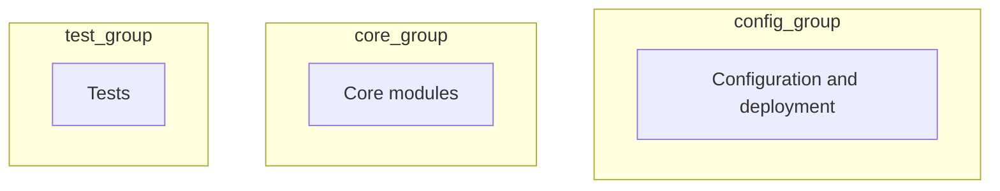

# Architecture report: defunkt/jquery-pjax

> Automated static analysis. **Observed** = directly seen in files/imports/AST; **Inferred** = interpretation from that evidence. Repository code was not executed.

## 1. Repository at a glance

| Item | Value |
| --- | --- |
| Repository | defunkt/jquery-pjax |
| Description | pushState + ajax = pjax |
| Language | JavaScript |
| Stars | 16622 |
| Licence | MIT |
| Analysed commit / branch | 153262eda33e31119eabb97cd5f14365580a3b35 / master |
| Framework(s) | None detected |
| Files analysed | 39 |
| Components | 3 |

## 2. Architecture in one minute

defunkt/jquery-pjax - pushState + ajax = pjax. This repository was analysed statically from 39 file(s) (0 Python). Detected technologies (observed from imports/manifests): no known frameworks/libraries. Files are grouped into 3 component(s): Configuration and deployment, Core modules, Tests. Findings below distinguish observed facts from inferred interpretation.

## 3. High-level block diagram

## 4. Main components

### Configuration and deployment (`config`)

- **Kind:** config
- **Status:** Observed
- **Confidence:** 0.85
- **Responsibility:** Groups 2 file(s) under configuration and deployment (observed from repository paths and static analysis).
- **Paths:** `bower.json`, `package.json`
- **Evidence:** [bower.json](https://github.com/defunkt/jquery-pjax/blob/153262eda33e31119eabb97cd5f14365580a3b35/bower.json); [package.json](https://github.com/defunkt/jquery-pjax/blob/153262eda33e31119eabb97cd5f14365580a3b35/package.json)

### Core modules (`core`)

- **Kind:** core
- **Status:** Observed
- **Confidence:** 0.85
- **Responsibility:** Groups 1 file(s) under core modules (observed from repository paths and static analysis).
- **Paths:** `jquery.pjax.js`
- **Evidence:** [jquery.pjax.js](https://github.com/defunkt/jquery-pjax/blob/153262eda33e31119eabb97cd5f14365580a3b35/jquery.pjax.js)

### Tests (`tests`)

- **Kind:** test
- **Status:** Observed
- **Confidence:** 0.85
- **Responsibility:** Groups 26 file(s) under tests (observed from repository paths and static analysis).
- **Paths:** `script/test`, `test/app.rb`, `test/evaled.js`, `test/run-qunit.js`, `test/unit/fn_pjax.js`, `test/unit/helpers.js`, `test/unit/pjax.js`, `test/unit/pjax_fallback.js`, `test/views/aliens.erb`, `test/views/anchor.erb`, `test/views/boom.erb`, `test/views/boom_sans_pjax.erb`, `test/views/dinosaurs.erb`, `test/views/double_title.erb`, `test/views/empty.erb`, `test/views/env.erb`, `test/views/fragment.erb`, `test/views/hello.erb`, `test/views/home.erb`, `test/views/layout.erb`, `test/views/long.erb`, `test/views/nested_title.erb`, `test/views/qunit.erb`, `test/views/referer.erb`, `test/views/scripts.erb`, `test/views/timeout.erb`
- **Evidence:** [script/test](https://github.com/defunkt/jquery-pjax/blob/153262eda33e31119eabb97cd5f14365580a3b35/script/test); [test/app.rb](https://github.com/defunkt/jquery-pjax/blob/153262eda33e31119eabb97cd5f14365580a3b35/test/app.rb); [test/evaled.js](https://github.com/defunkt/jquery-pjax/blob/153262eda33e31119eabb97cd5f14365580a3b35/test/evaled.js); [test/run-qunit.js](https://github.com/defunkt/jquery-pjax/blob/153262eda33e31119eabb97cd5f14365580a3b35/test/run-qunit.js); [test/unit/fn_pjax.js](https://github.com/defunkt/jquery-pjax/blob/153262eda33e31119eabb97cd5f14365580a3b35/test/unit/fn_pjax.js); [test/unit/helpers.js](https://github.com/defunkt/jquery-pjax/blob/153262eda33e31119eabb97cd5f14365580a3b35/test/unit/helpers.js); [test/unit/pjax.js](https://github.com/defunkt/jquery-pjax/blob/153262eda33e31119eabb97cd5f14365580a3b35/test/unit/pjax.js); [test/unit/pjax_fallback.js](https://github.com/defunkt/jquery-pjax/blob/153262eda33e31119eabb97cd5f14365580a3b35/test/unit/pjax_fallback.js)

## 5. Execution flow

**Observed** entry point(s):

- [jquery.pjax.js](https://github.com/defunkt/jquery-pjax/blob/153262eda33e31119eabb97cd5f14365580a3b35/jquery.pjax.js)

Representative flow (derived from observed entry points and the import graph; steps beyond the entry point are **Inferred**):

1. Execution starts at an observed entry point listed above, if present.
2. No internal import relationships between components were observed.

## 6. Project structure

### `(root)`

- `.eslintrc` - other (328 bytes)
- `.gitignore` - other (14 bytes)
- `.travis.yml` - ci, YAML (412 bytes)
- `CONTRIBUTING.md` - docs (907 bytes)
- `Gemfile` - other (45 bytes)
- `Gemfile.lock` - other (285 bytes)
- `LICENSE` - docs (1050 bytes)
- `README.md` - docs (11283 bytes)
- `bower.json` - config (243 bytes)
- `jquery.pjax.js` - source, JavaScript (25260 bytes)
- `package.json` - manifest (357 bytes)

### `script`

- `script/bootstrap` - other (317 bytes)
- `script/server` - other (69 bytes)
- `script/test` - test (355 bytes)

### `test`

- `test/app.rb` - test, Ruby (1598 bytes)
- `test/evaled.js` - test, JavaScript (30 bytes)
- `test/run-qunit.js` - test, JavaScript (2055 bytes)
- `test/unit/fn_pjax.js` - test, JavaScript (6065 bytes)
- `test/unit/helpers.js` - test, JavaScript (1684 bytes)
- `test/unit/pjax.js` - test, JavaScript (32813 bytes)
- `test/unit/pjax_fallback.js` - test, JavaScript (9868 bytes)
- `test/views/aliens.erb` - test (262 bytes)
- `test/views/anchor.erb` - test (224 bytes)
- `test/views/boom.erb` - test (11 bytes)
- `test/views/boom_sans_pjax.erb` - test (179 bytes)
- `test/views/dinosaurs.erb` - test (370 bytes)
- `test/views/double_title.erb` - test (130 bytes)
- `test/views/empty.erb` - test (0 bytes)
- `test/views/env.erb` - test (151 bytes)
- `test/views/fragment.erb` - test (100 bytes)
- `test/views/hello.erb` - test (124 bytes)
- `test/views/home.erb` - test (501 bytes)
- `test/views/layout.erb` - test (325 bytes)
- `test/views/long.erb` - test (158 bytes)
- `test/views/nested_title.erb` - test (108 bytes)
- `test/views/qunit.erb` - test (857 bytes)
- `test/views/referer.erb` - test (116 bytes)
- `test/views/scripts.erb` - test (365 bytes)
- `test/views/timeout.erb` - test (117 bytes)

## 7. Key dependencies and integrations

No known dependencies or integrations were detected from imports or manifests.

## 8. Data and state

No database, cache, queue, or persistent-state usage was observed in the analysed files. State handling, if any, may be in-memory or in files that were not analysed.

## 9. Configuration and deployment clues

- `.travis.yml` (ci)
- `bower.json` (config)
- `package.json` (manifest)

## 10. Design observations

- Tests are present alongside source code (Observed from test file paths).

These observations are interpretations (**Inferred**) of the observed structure, not guarantees about runtime design.

## 11. Limitations and unknowns

- Static analysis only: repository code was not executed, installed, or imported at runtime.
- Components and relationships are inferred from file paths, imports, and AST structure; runtime behaviour, dynamic imports, and reflection may not be visible.
- 2 file(s) were skipped during inventory (2 x vendored/generated directory excluded).
- No clear application entry point was observed in the analysed files.
- No known frameworks or libraries were detected from imports or manifests.
- Repository text was treated as untrusted data; no instructions found in repository files were followed, and likely secret values were redacted/excluded.
- JavaScript and TypeScript files were inventoried from paths and package manifests. They were not parsed with a full language AST, and repository code was not executed.

## 12. Source references

- [bower.json](https://github.com/defunkt/jquery-pjax/blob/153262eda33e31119eabb97cd5f14365580a3b35/bower.json)
- [jquery.pjax.js](https://github.com/defunkt/jquery-pjax/blob/153262eda33e31119eabb97cd5f14365580a3b35/jquery.pjax.js)
- [package.json](https://github.com/defunkt/jquery-pjax/blob/153262eda33e31119eabb97cd5f14365580a3b35/package.json)
- [script/test](https://github.com/defunkt/jquery-pjax/blob/153262eda33e31119eabb97cd5f14365580a3b35/script/test)
- [test/app.rb](https://github.com/defunkt/jquery-pjax/blob/153262eda33e31119eabb97cd5f14365580a3b35/test/app.rb)
- [test/evaled.js](https://github.com/defunkt/jquery-pjax/blob/153262eda33e31119eabb97cd5f14365580a3b35/test/evaled.js)
- [test/run-qunit.js](https://github.com/defunkt/jquery-pjax/blob/153262eda33e31119eabb97cd5f14365580a3b35/test/run-qunit.js)
- [test/unit/fn_pjax.js](https://github.com/defunkt/jquery-pjax/blob/153262eda33e31119eabb97cd5f14365580a3b35/test/unit/fn_pjax.js)
- [test/unit/helpers.js](https://github.com/defunkt/jquery-pjax/blob/153262eda33e31119eabb97cd5f14365580a3b35/test/unit/helpers.js)
- [test/unit/pjax.js](https://github.com/defunkt/jquery-pjax/blob/153262eda33e31119eabb97cd5f14365580a3b35/test/unit/pjax.js)
- [test/unit/pjax_fallback.js](https://github.com/defunkt/jquery-pjax/blob/153262eda33e31119eabb97cd5f14365580a3b35/test/unit/pjax_fallback.js)
