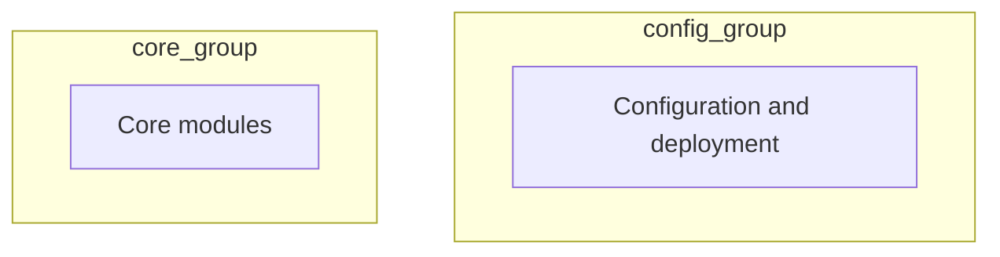

# Architecture report: denysdovhan/wtfjs

> Automated static analysis. **Observed** = directly seen in files/imports/AST; **Inferred** = interpretation from that evidence. Repository code was not executed.

## 1. Repository at a glance

| Item | Value |
| --- | --- |
| Repository | denysdovhan/wtfjs |
| Description | 🤪 A list of funny and tricky JavaScript examples |
| Language | JavaScript |
| Stars | 37693 |
| Licence | WTFPL |
| Analysed commit / branch | a2c83226a15890004758971264211f116fff367a / master |
| Framework(s) | None detected |
| Files analysed | 22 |
| Components | 2 |

## 2. Architecture in one minute

denysdovhan/wtfjs - 🤪 A list of funny and tricky JavaScript examples. This repository was analysed statically from 22 file(s) (0 Python). Detected technologies (observed from imports/manifests): GitHub Actions. Files are grouped into 2 component(s): Configuration and deployment, Core modules. Findings below distinguish observed facts from inferred interpretation.

## 3. High-level block diagram

## 4. Main components

### Configuration and deployment (`config`)

- **Kind:** config
- **Status:** Observed
- **Confidence:** 0.85
- **Responsibility:** Groups 1 file(s) under configuration and deployment (observed from repository paths and static analysis).
- **Paths:** `package.json`
- **Evidence:** [package.json](https://github.com/denysdovhan/wtfjs/blob/a2c83226a15890004758971264211f116fff367a/package.json)

### Core modules (`core`)

- **Kind:** core
- **Status:** Observed
- **Confidence:** 0.85
- **Responsibility:** Groups 1 file(s) under core modules (observed from repository paths and static analysis).
- **Paths:** `wtfjs.js`
- **Evidence:** [wtfjs.js](https://github.com/denysdovhan/wtfjs/blob/a2c83226a15890004758971264211f116fff367a/wtfjs.js)

## 5. Execution flow

**Observed** entry point(s):

- [wtfjs.js](https://github.com/denysdovhan/wtfjs/blob/a2c83226a15890004758971264211f116fff367a/wtfjs.js)

Representative flow (derived from observed entry points and the import graph; steps beyond the entry point are **Inferred**):

1. Execution starts at an observed entry point listed above, if present.
2. No internal import relationships between components were observed.

## 6. Project structure

### `(root)`

- `.editorconfig` - config (203 bytes)
- `.gitignore` - other (37 bytes)
- `CONTRIBUTING.md` - docs (1084 bytes)
- `LICENSE` - docs (460 bytes)
- `README-fr-fr.md` - docs (59671 bytes)
- `README-hi.md` - docs (96630 bytes)
- `README-it-it.md` - docs (58697 bytes)
- `README-kr.md` - docs (62277 bytes)
- `README-pl-pl.md` - docs (56750 bytes)
- `README-pt-br.md` - docs (56833 bytes)
- `README-zh-cn.md` - docs (73554 bytes)
- `README.md` - docs (72533 bytes)
- `package.json` - manifest (2003 bytes)
- `wtfjs.js` - source, JavaScript (2146 bytes)

### `.github`

- `.github/FUNDING.yml` - config (80 bytes)
- `.github/ISSUE_TEMPLATE/new-example.md` - docs (487 bytes)
- `.github/PULL_REQUEST_TEMPLATE/new_example.md` - docs (373 bytes)
- `.github/PULL_REQUEST_TEMPLATE/translation.md` - docs (404 bytes)
- `.github/dependabot.yml` - config (320 bytes)
- `.github/workflows/release.yml` - ci, YAML (777 bytes)
- `.github/workflows/validate.yml` - ci, YAML (527 bytes)

### `.husky`

- `.husky/pre-commit` - other (58 bytes)

## 7. Key dependencies and integrations

| Name | Category | Status | Confidence | Evidence |
| --- | --- | --- | --- | --- |
| GitHub Actions | ci | Observed | 0.90 | [.github/workflows/release.yml](https://github.com/denysdovhan/wtfjs/blob/a2c83226a15890004758971264211f116fff367a/.github/workflows/release.yml); [.github/workflows/validate.yml](https://github.com/denysdovhan/wtfjs/blob/a2c83226a15890004758971264211f116fff367a/.github/workflows/validate.yml) |

## 8. Data and state

No database, cache, queue, or persistent-state usage was observed in the analysed files. State handling, if any, may be in-memory or in files that were not analysed.

## 9. Configuration and deployment clues

- `.editorconfig` (config)
- `.github/FUNDING.yml` (config)
- `.github/dependabot.yml` (config)
- `.github/workflows/release.yml` (ci)
- `.github/workflows/validate.yml` (ci)
- `package.json` (manifest)

## 10. Design observations

- No strong design patterns could be established from the available evidence.

These observations are interpretations (**Inferred**) of the observed structure, not guarantees about runtime design.

## 11. Limitations and unknowns

- Static analysis only: repository code was not executed, installed, or imported at runtime.
- Components and relationships are inferred from file paths, imports, and AST structure; runtime behaviour, dynamic imports, and reflection may not be visible.
- No clear application entry point was observed in the analysed files.
- Repository text was treated as untrusted data; no instructions found in repository files were followed, and likely secret values were redacted/excluded.
- JavaScript and TypeScript files were inventoried from paths and package manifests. They were not parsed with a full language AST, and repository code was not executed.

## 12. Source references

- [.github/workflows/release.yml](https://github.com/denysdovhan/wtfjs/blob/a2c83226a15890004758971264211f116fff367a/.github/workflows/release.yml)
- [.github/workflows/validate.yml](https://github.com/denysdovhan/wtfjs/blob/a2c83226a15890004758971264211f116fff367a/.github/workflows/validate.yml)
- [package.json](https://github.com/denysdovhan/wtfjs/blob/a2c83226a15890004758971264211f116fff367a/package.json)
- [wtfjs.js](https://github.com/denysdovhan/wtfjs/blob/a2c83226a15890004758971264211f116fff367a/wtfjs.js)
