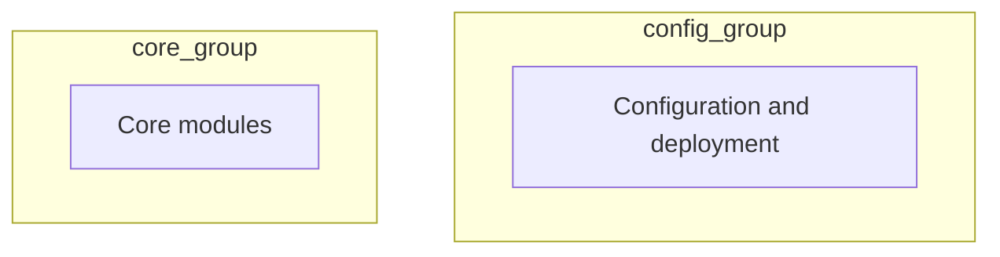

# Architecture report: designmodo/Flat-UI

> Automated static analysis. **Observed** = directly seen in files/imports/AST; **Inferred** = interpretation from that evidence. Repository code was not executed.

## 1. Repository at a glance

| Item | Value |
| --- | --- |
| Repository | designmodo/Flat-UI |
| Description | Flat UI Free - Design Framework (html/css3/less/js). Flat UI is based on Bootstrap, a comfortable, responsive, and functional framework that simplifies the development of websites. |
| Language | JavaScript |
| Stars | 15276 |
| Licence | MIT |
| Analysed commit / branch | cead40a83b12b678e278fd63dcbb06eb0a6520f4 / master |
| Framework(s) | None detected |
| Files analysed | 304 |
| Components | 2 |

## 2. Architecture in one minute

designmodo/Flat-UI - Flat UI Free - Design Framework (html/css3/less/js). Flat UI is based on Bootstrap, a comfortable, responsive, and functional framework that simplifies the development of websites.. This repository was analysed statically from 304 file(s) (0 Python). Detected technologies (observed from imports/manifests): no known frameworks/libraries. Files are grouped into 2 component(s): Configuration and deployment, Core modules. Findings below distinguish observed facts from inferred interpretation.

## 3. High-level block diagram

## 4. Main components

### Configuration and deployment (`config`)

- **Kind:** config
- **Status:** Observed
- **Confidence:** 0.85
- **Responsibility:** Groups 3 file(s) under configuration and deployment (observed from repository paths and static analysis).
- **Paths:** `app/fonts/glyphicons/selection.json`, `bower.json`, `package.json`
- **Evidence:** [app/fonts/glyphicons/selection.json](https://github.com/designmodo/Flat-UI/blob/cead40a83b12b678e278fd63dcbb06eb0a6520f4/app/fonts/glyphicons/selection.json); [bower.json](https://github.com/designmodo/Flat-UI/blob/cead40a83b12b678e278fd63dcbb06eb0a6520f4/bower.json); [package.json](https://github.com/designmodo/Flat-UI/blob/cead40a83b12b678e278fd63dcbb06eb0a6520f4/package.json)

### Core modules (`core`)

- **Kind:** core
- **Status:** Observed
- **Confidence:** 0.85
- **Responsibility:** Groups 1 file(s) under core modules (observed from repository paths and static analysis).
- **Paths:** `gulpfile.js`
- **Evidence:** [gulpfile.js](https://github.com/designmodo/Flat-UI/blob/cead40a83b12b678e278fd63dcbb06eb0a6520f4/gulpfile.js)

## 5. Execution flow

No entry point was observed; the startup flow below is therefore limited.

Representative flow (derived from observed entry points and the import graph; steps beyond the entry point are **Inferred**):

1. Execution starts at an observed entry point listed above, if present.
2. No internal import relationships between components were observed.

## 6. Project structure

### `(root)`

- `.editorconfig` - config (190 bytes)
- `.gitignore` - other (501 bytes)
- `CHANGELOG.md` - docs (8278 bytes)
- `LICENSE` - docs (1059 bytes)
- `README.md` - docs (4313 bytes)
- `bower.json` - config (193 bytes)
- `gulpfile.js` - source, JavaScript (3415 bytes)
- `index.html` - other (37146 bytes)
- `package.json` - manifest (1371 bytes)
- `readme license.txt` - docs (411 bytes)

### `app`

- `app/css/docs.css` - other (7838 bytes)
- `app/fonts/glyphicons/flat-ui-pro-icons-regular.svg` - other (57158 bytes)
- `app/fonts/glyphicons/selection.json` - config (81617 bytes)
- `app/images/icons/android.svg` - other (387 bytes)
- `app/images/icons/android1.svg` - other (597 bytes)
- `app/images/icons/app-store.svg` - other (1683 bytes)
- `app/images/icons/arrow.svg` - other (614 bytes)
- `app/images/icons/art.svg` - other (2200 bytes)
- `app/images/icons/bag.svg` - other (2367 bytes)
- `app/images/icons/basket.svg` - other (4294 bytes)
- `app/images/icons/book.svg` - other (1410 bytes)
- `app/images/icons/bowling.svg` - other (2897 bytes)
- `app/images/icons/box.svg` - other (840 bytes)
- `app/images/icons/brush.svg` - other (2211 bytes)
- `app/images/icons/building.svg` - other (3377 bytes)
- `app/images/icons/bulb.svg` - other (1757 bytes)
- `app/images/icons/button.svg` - other (4633 bytes)
- `app/images/icons/calculator.svg` - other (3984 bytes)
- `app/images/icons/calendar.svg` - other (4353 bytes)
- `app/images/icons/camera.svg` - other (894 bytes)
- `app/images/icons/car.svg` - other (3355 bytes)
- `app/images/icons/card.svg` - other (883 bytes)
- `app/images/icons/chair.svg` - other (1330 bytes)
- `app/images/icons/chat.svg` - other (1252 bytes)
- `app/images/icons/clipboard.svg` - other (1899 bytes)
- `app/images/icons/clocks.svg` - other (1155 bytes)
- `app/images/icons/compas.svg` - other (2968 bytes)
- `app/images/icons/converse.svg` - other (1700 bytes)
- `app/images/icons/cup.svg` - other (2134 bytes)
- `app/images/icons/dj.svg` - other (2506 bytes)
- `app/images/icons/donut.svg` - other (5539 bytes)
- `app/images/icons/dude.svg` - other (1335 bytes)
- `app/images/icons/dynamite.svg` - other (3295 bytes)
- `app/images/icons/earth.svg` - other (2417 bytes)
- `app/images/icons/egg.svg` - other (662 bytes)
- `app/images/icons/eye.svg` - other (1275 bytes)
- `app/images/icons/file.svg` - other (565 bytes)
- `app/images/icons/fit.svg` - other (1043 bytes)
- `app/images/icons/flag.svg` - other (873 bytes)
- `app/images/icons/flask.svg` - other (3023 bytes)
- `app/images/icons/flower.svg` - other (1083 bytes)
- `app/images/icons/games.svg` - other (4521 bytes)
- `app/images/icons/gift-box.svg` - other (4449 bytes)
- `app/images/icons/girl.svg` - other (1472 bytes)
- `app/images/icons/goal.svg` - other (1366 bytes)
- `app/images/icons/google.svg` - other (655 bytes)
- `app/images/icons/graph.svg` - other (676 bytes)
- `app/images/icons/icecream.svg` - other (851 bytes)
- `app/images/icons/imac.svg` - other (702 bytes)
- `app/images/icons/ipad.svg` - other (393 bytes)
- `app/images/icons/iphone.svg` - other (480 bytes)
- `app/images/icons/key.svg` - other (2053 bytes)
- `app/images/icons/lettersymbol.svg` - other (2791 bytes)
- `app/images/icons/lock.svg` - other (1407 bytes)
- `app/images/icons/loop.svg` - other (657 bytes)
- `app/images/icons/macbook.svg` - other (551 bytes)
- `app/images/icons/magic.svg` - other (1297 bytes)
- `app/images/icons/magicmouse.svg` - other (398 bytes)
- `app/images/icons/mail.svg` - other (1223 bytes)
- `app/images/icons/map.svg` - other (1423 bytes)
- `app/images/icons/medal.svg` - other (987 bytes)
- `app/images/icons/mic.svg` - other (3195 bytes)
- `app/images/icons/money.svg` - other (5077 bytes)
- `app/images/icons/mortarboard.svg` - other (2094 bytes)
- `app/images/icons/mountain.svg` - other (2098 bytes)
- `app/images/icons/news.svg` - other (2243 bytes)
- `app/images/icons/paper-bag.svg` - other (682 bytes)
- `app/images/icons/pc.svg` - other (738 bytes)
- `app/images/icons/pencil.svg` - other (1280 bytes)
- `app/images/icons/pencils.svg` - other (2194 bytes)
- `app/images/icons/picture.svg` - other (2514 bytes)
- `app/images/icons/pig.svg` - other (3509 bytes)
- `app/images/icons/pills.svg` - other (1069 bytes)
- `app/images/icons/play.svg` - other (3555 bytes)
- `app/images/icons/printer.svg` - other (890 bytes)
- `app/images/icons/responsive.svg` - other (1500 bytes)
- `app/images/icons/retina.svg` - other (1745 bytes)
- `app/images/icons/ribbon.svg` - other (3932 bytes)
- `app/images/icons/ring.svg` - other (1510 bytes)
- `app/images/icons/rocket.svg` - other (2563 bytes)
- `app/images/icons/rss.svg` - other (2571 bytes)
- `app/images/icons/safe.svg` - other (2299 bytes)
- `app/images/icons/save.svg` - other (1451 bytes)
- `app/images/icons/search.svg` - other (1271 bytes)
- `app/images/icons/settings.svg` - other (1935 bytes)
- `app/images/icons/shield.svg` - other (1028 bytes)
- `app/images/icons/shirt.svg` - other (1574 bytes)
- `app/images/icons/skateboard.svg` - other (2079 bytes)
- `app/images/icons/spray.svg` - other (1564 bytes)
- `app/images/icons/storage.svg` - other (1183 bytes)
- `app/images/icons/support.svg` - other (2732 bytes)
- `app/images/icons/ticket.svg` - other (9364 bytes)
- `app/images/icons/toilet-paper.svg` - other (1279 bytes)
- `app/images/icons/touch.svg` - other (1175 bytes)
- `app/images/icons/trash.svg` - other (2673 bytes)
- `app/images/icons/trip-bag.svg` - other (3216 bytes)
- `app/images/icons/trunk.svg` - other (3373 bytes)
- `app/images/icons/ubmrella.svg` - other (1470 bytes)
- `app/images/icons/user-interface.svg` - other (819 bytes)
- `app/images/icons/video.svg` - other (1930 bytes)
- `app/images/icons/weather.svg` - other (3734 bytes)
- `app/images/icons/wi-fi.svg` - other (2579 bytes)
- `app/images/icons/wine.svg` - other (1887 bytes)
- `app/images/icons/yinyang.svg` - other (459 bytes)
- `app/index.html` - other (968 bytes)
- `app/styles/_mixins.scss` - other (1010 bytes)
- `app/styles/_variables.scss` - other (35650 bytes)
- `app/styles/flat-ui.scss` - other (1293 bytes)
- `app/styles/mixins/background-clip.scss` - other (166 bytes)
- `app/styles/mixins/background-variant.scss` - other (158 bytes)
- `app/styles/mixins/border-radius.scss` - other (492 bytes)
- `app/styles/mixins/breakpoints.scss` - other (4468 bytes)
- `app/styles/mixins/buttons.scss` - other (1410 bytes)
- `app/styles/mixins/center-block.scss` - other (126 bytes)
- `app/styles/mixins/clearfix.scss` - other (611 bytes)
- `app/styles/mixins/forms.scss` - other (3063 bytes)
- `app/styles/mixins/gradients.scss` - other (4428 bytes)
- `app/styles/mixins/grid.scss` - other (3024 bytes)
- `app/styles/mixins/hide-text.scss` - other (598 bytes)
- `app/styles/mixins/image.scss` - other (1076 bytes)
- `app/styles/mixins/nav-divider.scss` - other (208 bytes)
- `app/styles/mixins/navbar-vertical-align.scss` - other (435 bytes)
- `app/styles/mixins/opacity.scss` - other (154 bytes)
- `app/styles/mixins/pagination.scss` - other (555 bytes)
- `app/styles/mixins/palette.scss` - other (241 bytes)
- `app/styles/mixins/reset-filter.scss` - other (254 bytes)
- `app/styles/mixins/resize.scss` - other (146 bytes)
- `app/styles/mixins/responsive-visibility.scss` - other (367 bytes)
- `app/styles/mixins/select.scss` - other (1757 bytes)
- `app/styles/mixins/size.scss` - other (148 bytes)
- `app/styles/mixins/switches.scss` - other (905 bytes)
- `app/styles/mixins/tab-focus.scss` - other (165 bytes)
- `app/styles/mixins/text-emphasis.scss` - other (145 bytes)
- `app/styles/mixins/text-overflow.scss` - other (168 bytes)
- `app/styles/mixins/vendor-prefixes.scss` - other (6674 bytes)
- `app/styles/modules/button-groups.scss` - other (2137 bytes)
- `app/styles/modules/buttons.scss` - other (4478 bytes)
- `app/styles/modules/code.scss` - other (981 bytes)
- `app/styles/modules/dropdowns.scss` - other (5331 bytes)
- `app/styles/modules/footer.scss` - other (1226 bytes)
- `app/styles/modules/forms.scss` - other (6829 bytes)
- `app/styles/modules/glyphicons.scss` - other (5157 bytes)
- `app/styles/modules/input-groups.scss` - other (3542 bytes)
- `app/styles/modules/local-fonts.scss` - other (3152 bytes)
- `app/styles/modules/login.scss` - other (2090 bytes)
- `app/styles/modules/navbar.scss` - other (19388 bytes)
- `app/styles/modules/pager.scss` - other (1208 bytes)
- `app/styles/modules/pagination.scss` - other (12320 bytes)
- `app/styles/modules/palette.scss` - other (1957 bytes)
- `app/styles/modules/print.scss` - other (1433 bytes)
- `app/styles/modules/progress-bars.scss` - other (633 bytes)
- `app/styles/modules/radiocheck.scss` - other (4237 bytes)
- `app/styles/modules/scaffolding.scss` - other (1277 bytes)
- `app/styles/modules/select.scss` - other (13043 bytes)
- `app/styles/modules/share.scss` - other (702 bytes)
- `app/styles/modules/slider.scss` - other (1741 bytes)
- `app/styles/modules/spaces.scss` - other (2871 bytes)
- `app/styles/modules/switch.scss` - other (6256 bytes)
- `app/styles/modules/tagsinput.scss` - other (3263 bytes)
- `app/styles/modules/thumbnails.scss` - other (752 bytes)
- `app/styles/modules/tiles.scss` - other (625 bytes)
- `app/styles/modules/todo-list.scss` - other (2631 bytes)
- `app/styles/modules/tooltip.scss` - other (1588 bytes)
- `app/styles/modules/type.scss` - other (4270 bytes)
- `app/styles/modules/typeahead.scss` - other (741 bytes)
- `app/styles/modules/video.scss` - other (35488 bytes)

### `docs`

- `docs/assets/css/demo.css` - docs (6689 bytes)
- `docs/assets/css/docs.css` - docs (7838 bytes)
- `docs/assets/css/src/docs.less` - docs (7017 bytes)
- `docs/assets/css/src/prettyprint.less` - docs (1270 bytes)
- `docs/assets/images/icons/android.svg` - docs (387 bytes)
- `docs/assets/images/icons/android1.svg` - docs (597 bytes)
- `docs/assets/images/icons/app-store.svg` - docs (1683 bytes)
- `docs/assets/images/icons/arrow.svg` - docs (614 bytes)
- `docs/assets/images/icons/art.svg` - docs (2200 bytes)
- `docs/assets/images/icons/bag.svg` - docs (2367 bytes)
- `docs/assets/images/icons/basket.svg` - docs (4294 bytes)
- `docs/assets/images/icons/book.svg` - docs (1410 bytes)
- `docs/assets/images/icons/bowling.svg` - docs (2897 bytes)
- `docs/assets/images/icons/box.svg` - docs (840 bytes)
- `docs/assets/images/icons/brush.svg` - docs (2211 bytes)
- `docs/assets/images/icons/building.svg` - docs (3377 bytes)
- `docs/assets/images/icons/bulb.svg` - docs (1757 bytes)
- `docs/assets/images/icons/button.svg` - docs (4633 bytes)
- `docs/assets/images/icons/calculator.svg` - docs (3984 bytes)
- `docs/assets/images/icons/calendar.svg` - docs (4353 bytes)
- `docs/assets/images/icons/camera.svg` - docs (894 bytes)
- `docs/assets/images/icons/car.svg` - docs (3355 bytes)
- `docs/assets/images/icons/card.svg` - docs (883 bytes)
- `docs/assets/images/icons/chair.svg` - docs (1330 bytes)
- `docs/assets/images/icons/chat.svg` - docs (1252 bytes)
- `docs/assets/images/icons/clipboard.svg` - docs (1899 bytes)
- `docs/assets/images/icons/clocks.svg` - docs (1155 bytes)
- `docs/assets/images/icons/compas.svg` - docs (2968 bytes)
- `docs/assets/images/icons/converse.svg` - docs (1700 bytes)
- `docs/assets/images/icons/cup.svg` - docs (2134 bytes)
- `docs/assets/images/icons/dj.svg` - docs (2506 bytes)
- `docs/assets/images/icons/donut.svg` - docs (5539 bytes)
- `docs/assets/images/icons/dude.svg` - docs (1335 bytes)
- `docs/assets/images/icons/dynamite.svg` - docs (3295 bytes)
- `docs/assets/images/icons/earth.svg` - docs (2417 bytes)
- `docs/assets/images/icons/egg.svg` - docs (662 bytes)
- `docs/assets/images/icons/eye.svg` - docs (1275 bytes)
- `docs/assets/images/icons/file.svg` - docs (565 bytes)
- `docs/assets/images/icons/fit.svg` - docs (1043 bytes)
- `docs/assets/images/icons/flag.svg` - docs (873 bytes)
- `docs/assets/images/icons/flask.svg` - docs (3023 bytes)
- `docs/assets/images/icons/flower.svg` - docs (1083 bytes)
- `docs/assets/images/icons/games.svg` - docs (4521 bytes)
- `docs/assets/images/icons/gift-box.svg` - docs (4449 bytes)
- `docs/assets/images/icons/girl.svg` - docs (1472 bytes)
- `docs/assets/images/icons/goal.svg` - docs (1366 bytes)
- `docs/assets/images/icons/google.svg` - docs (655 bytes)
- `docs/assets/images/icons/graph.svg` - docs (676 bytes)
- `docs/assets/images/icons/icecream.svg` - docs (851 bytes)
- `docs/assets/images/icons/imac.svg` - docs (702 bytes)
- `docs/assets/images/icons/ipad.svg` - docs (393 bytes)
- `docs/assets/images/icons/iphone.svg` - docs (480 bytes)
- `docs/assets/images/icons/key.svg` - docs (2053 bytes)
- `docs/assets/images/icons/lettersymbol.svg` - docs (2791 bytes)
- `docs/assets/images/icons/lock.svg` - docs (1407 bytes)
- `docs/assets/images/icons/loop.svg` - docs (657 bytes)
- `docs/assets/images/icons/macbook.svg` - docs (551 bytes)
- `docs/assets/images/icons/magic.svg` - docs (1297 bytes)
- `docs/assets/images/icons/magicmouse.svg` - docs (398 bytes)
- `docs/assets/images/icons/mail.svg` - docs (1223 bytes)
- `docs/assets/images/icons/map.svg` - docs (1423 bytes)
- `docs/assets/images/icons/medal.svg` - docs (987 bytes)
- `docs/assets/images/icons/mic.svg` - docs (3195 bytes)
- `docs/assets/images/icons/money.svg` - docs (5077 bytes)
- `docs/assets/images/icons/mortarboard.svg` - docs (2094 bytes)
- `docs/assets/images/icons/mountain.svg` - docs (2098 bytes)
- `docs/assets/images/icons/news.svg` - docs (2243 bytes)
- `docs/assets/images/icons/paper-bag.svg` - docs (682 bytes)
- `docs/assets/images/icons/pc.svg` - docs (738 bytes)
- `docs/assets/images/icons/pencil.svg` - docs (1280 bytes)
- `docs/assets/images/icons/pencils.svg` - docs (2194 bytes)
- `docs/assets/images/icons/picture.svg` - docs (2514 bytes)
- `docs/assets/images/icons/pig.svg` - docs (3509 bytes)
- `docs/assets/images/icons/pills.svg` - docs (1069 bytes)
- `docs/assets/images/icons/play.svg` - docs (3555 bytes)
- `docs/assets/images/icons/printer.svg` - docs (890 bytes)
- `docs/assets/images/icons/responsive.svg` - docs (1500 bytes)
- `docs/assets/images/icons/retina.svg` - docs (1745 bytes)
- `docs/assets/images/icons/ribbon.svg` - docs (3932 bytes)
- `docs/assets/images/icons/ring.svg` - docs (1510 bytes)
- `docs/assets/images/icons/rocket.svg` - docs (2563 bytes)
- `docs/assets/images/icons/rss.svg` - docs (2571 bytes)
- `docs/assets/images/icons/safe.svg` - docs (2299 bytes)
- `docs/assets/images/icons/save.svg` - docs (1451 bytes)
- `docs/assets/images/icons/search.svg` - docs (1271 bytes)
- `docs/assets/images/icons/settings.svg` - docs (1935 bytes)
- `docs/assets/images/icons/shield.svg` - docs (1028 bytes)
- `docs/assets/images/icons/shirt.svg` - docs (1574 bytes)
- `docs/assets/images/icons/skateboard.svg` - docs (2079 bytes)
- `docs/assets/images/icons/spray.svg` - docs (1564 bytes)
- `docs/assets/images/icons/storage.svg` - docs (1183 bytes)
- `docs/assets/images/icons/support.svg` - docs (2732 bytes)
- `docs/assets/images/icons/ticket.svg` - docs (9364 bytes)
- `docs/assets/images/icons/toilet-paper.svg` - docs (1279 bytes)
- `docs/assets/images/icons/touch.svg` - docs (1175 bytes)
- `docs/assets/images/icons/trash.svg` - docs (2673 bytes)
- `docs/assets/images/icons/trip-bag.svg` - docs (3216 bytes)
- `docs/assets/images/icons/trunk.svg` - docs (3373 bytes)
- `docs/assets/images/icons/ubmrella.svg` - docs (1470 bytes)
- `docs/assets/images/icons/user-interface.svg` - docs (819 bytes)
- `docs/assets/images/icons/video.svg` - docs (1930 bytes)
- `docs/assets/images/icons/weather.svg` - docs (3734 bytes)
- `docs/assets/images/icons/wi-fi.svg` - docs (2579 bytes)
- `docs/assets/images/icons/wine.svg` - docs (1887 bytes)
- `docs/assets/images/icons/yinyang.svg` - docs (459 bytes)
- `docs/assets/js/application.js` - docs (6745 bytes)
- `docs/assets/js/prettify.js` - docs (63320 bytes)
- `docs/components.html` - docs (65909 bytes)
- `docs/examples/buttons.html` - docs (23280 bytes)
- `docs/examples/dropdowns.html` - docs (29378 bytes)
- `docs/examples/fileinput.html` - docs (14288 bytes)
- `docs/examples/forms.html` - docs (23584 bytes)
- `docs/examples/navbar-fixed-top.html` - docs (3599 bytes)
- `docs/examples/navbar-static-top.html` - docs (3638 bytes)
- `docs/examples/navbars-with-elements.html` - docs (17624 bytes)
- `docs/examples/pagination.html` - docs (8673 bytes)
- `docs/examples/radiocheck.html` - docs (14290 bytes)
- `docs/examples/select.html` - docs (13580 bytes)
- `docs/examples/switches.html` - docs (3406 bytes)
- `docs/examples/tagsinput.html` - docs (3917 bytes)
- `docs/examples/thumbnails.html` - docs (4239 bytes)
- `docs/examples/tiles.html` - docs (3434 bytes)
- `docs/examples/timepicker.html` - docs (1896 bytes)
- `docs/examples/todo-list.html` - docs (2968 bytes)
- `docs/examples/typography.html` - docs (6574 bytes)
- `docs/examples/vertical-slider.html` - docs (1501 bytes)
- `docs/getting-started.html` - docs (7708 bytes)
- `docs/template.html` - docs (993 bytes)

## 7. Key dependencies and integrations

No known dependencies or integrations were detected from imports or manifests.

## 8. Data and state

No database, cache, queue, or persistent-state usage was observed in the analysed files. State handling, if any, may be in-memory or in files that were not analysed.

## 9. Configuration and deployment clues

- `.editorconfig` (config)
- `app/fonts/glyphicons/selection.json` (config)
- `bower.json` (config)
- `package.json` (manifest)

## 10. Design observations

- No strong design patterns could be established from the available evidence.

These observations are interpretations (**Inferred**) of the observed structure, not guarantees about runtime design.

## 11. Limitations and unknowns

- Static analysis only: repository code was not executed, installed, or imported at runtime.
- Components and relationships are inferred from file paths, imports, and AST structure; runtime behaviour, dynamic imports, and reflection may not be visible.
- 109 file(s) were skipped during inventory (109 x vendored/generated directory excluded).
- No clear application entry point was observed in the analysed files.
- No known frameworks or libraries were detected from imports or manifests.
- Repository text was treated as untrusted data; no instructions found in repository files were followed, and likely secret values were redacted/excluded.
- JavaScript and TypeScript files were inventoried from paths and package manifests. They were not parsed with a full language AST, and repository code was not executed.

## 12. Source references

- [app/fonts/glyphicons/selection.json](https://github.com/designmodo/Flat-UI/blob/cead40a83b12b678e278fd63dcbb06eb0a6520f4/app/fonts/glyphicons/selection.json)
- [bower.json](https://github.com/designmodo/Flat-UI/blob/cead40a83b12b678e278fd63dcbb06eb0a6520f4/bower.json)
- [gulpfile.js](https://github.com/designmodo/Flat-UI/blob/cead40a83b12b678e278fd63dcbb06eb0a6520f4/gulpfile.js)
- [package.json](https://github.com/designmodo/Flat-UI/blob/cead40a83b12b678e278fd63dcbb06eb0a6520f4/package.json)
