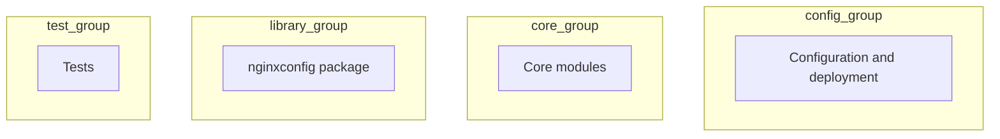

# Architecture report: digitalocean/nginxconfig.io

> Automated static analysis. **Observed** = directly seen in files/imports/AST; **Inferred** = interpretation from that evidence. Repository code was not executed.

## 1. Repository at a glance

| Item | Value |
| --- | --- |
| Repository | digitalocean/nginxconfig.io |
| Description | ⚙️ NGINX config generator on steroids 💉 |
| Language | JavaScript |
| Stars | 28244 |
| Licence | MIT |
| Analysed commit / branch | dd290c0b706b8a8c2f86cfbffaae9c17715b431d / master |
| Framework(s) | Vue |
| Files analysed | 515 |
| Components | 4 |

## 2. Architecture in one minute

digitalocean/nginxconfig.io - ⚙️ NGINX config generator on steroids 💉. This repository was analysed statically from 515 file(s) (0 Python). Detected technologies (observed from imports/manifests): GitHub Actions, Vue, Jest, webpack. Files are grouped into 4 component(s): Configuration and deployment, Core modules, nginxconfig package, Tests. Findings below distinguish observed facts from inferred interpretation.

## 3. High-level block diagram

## 4. Main components

### Configuration and deployment (`config`)

- **Kind:** config
- **Status:** Observed
- **Confidence:** 0.85
- **Responsibility:** Groups 13 file(s) under configuration and deployment (observed from repository paths and static analysis).
- **Paths:** `package.json`, `src/nginxconfig/generators/conf/drupal.conf.js`, `src/nginxconfig/generators/conf/general.conf.js`, `src/nginxconfig/generators/conf/joomla.conf.js`, `src/nginxconfig/generators/conf/letsencrypt.conf.js`, `src/nginxconfig/generators/conf/magento.conf.js`, `src/nginxconfig/generators/conf/nginx.conf.js`, `src/nginxconfig/generators/conf/php_fastcgi.conf.js`, `src/nginxconfig/generators/conf/proxy.conf.js`, `src/nginxconfig/generators/conf/python_uwsgi.conf.js`, `src/nginxconfig/generators/conf/security.conf.js`, `src/nginxconfig/generators/conf/website.conf.js`, `src/nginxconfig/generators/conf/wordpress.conf.js`
- **Evidence:** [package.json](https://github.com/digitalocean/nginxconfig.io/blob/dd290c0b706b8a8c2f86cfbffaae9c17715b431d/package.json); [src/nginxconfig/generators/conf/drupal.conf.js](https://github.com/digitalocean/nginxconfig.io/blob/dd290c0b706b8a8c2f86cfbffaae9c17715b431d/src/nginxconfig/generators/conf/drupal.conf.js); [src/nginxconfig/generators/conf/general.conf.js](https://github.com/digitalocean/nginxconfig.io/blob/dd290c0b706b8a8c2f86cfbffaae9c17715b431d/src/nginxconfig/generators/conf/general.conf.js); [src/nginxconfig/generators/conf/joomla.conf.js](https://github.com/digitalocean/nginxconfig.io/blob/dd290c0b706b8a8c2f86cfbffaae9c17715b431d/src/nginxconfig/generators/conf/joomla.conf.js); [src/nginxconfig/generators/conf/letsencrypt.conf.js](https://github.com/digitalocean/nginxconfig.io/blob/dd290c0b706b8a8c2f86cfbffaae9c17715b431d/src/nginxconfig/generators/conf/letsencrypt.conf.js); [src/nginxconfig/generators/conf/magento.conf.js](https://github.com/digitalocean/nginxconfig.io/blob/dd290c0b706b8a8c2f86cfbffaae9c17715b431d/src/nginxconfig/generators/conf/magento.conf.js); [src/nginxconfig/generators/conf/nginx.conf.js](https://github.com/digitalocean/nginxconfig.io/blob/dd290c0b706b8a8c2f86cfbffaae9c17715b431d/src/nginxconfig/generators/conf/nginx.conf.js); [src/nginxconfig/generators/conf/php_fastcgi.conf.js](https://github.com/digitalocean/nginxconfig.io/blob/dd290c0b706b8a8c2f86cfbffaae9c17715b431d/src/nginxconfig/generators/conf/php_fastcgi.conf.js)

### Core modules (`core`)

- **Kind:** core
- **Status:** Observed
- **Confidence:** 0.85
- **Responsibility:** Groups 1 file(s) under core modules (observed from repository paths and static analysis).
- **Paths:** `vue.config.js`
- **Evidence:** [vue.config.js](https://github.com/digitalocean/nginxconfig.io/blob/dd290c0b706b8a8c2f86cfbffaae9c17715b431d/vue.config.js)

### nginxconfig package (`nginxconfig`)

- **Kind:** library
- **Status:** Observed
- **Confidence:** 0.85
- **Responsibility:** Groups 468 file(s) under nginxconfig package (observed from repository paths and static analysis).
- **Paths:** `src/nginxconfig/generators/ext/docker.js`, `src/nginxconfig/generators/index.js`, `src/nginxconfig/generators/to_conf.js`, `src/nginxconfig/generators/to_yaml.js`, `src/nginxconfig/generators/yaml/dockerCompose.yaml.js`, `src/nginxconfig/i18n/de/common.js`, `src/nginxconfig/i18n/de/index.js`, `src/nginxconfig/i18n/de/languages.js`, `src/nginxconfig/i18n/de/templates/app.js`, `src/nginxconfig/i18n/de/templates/callouts/contribute.js`, `src/nginxconfig/i18n/de/templates/callouts/droplet.js`, `src/nginxconfig/i18n/de/templates/callouts/index.js`, `src/nginxconfig/i18n/de/templates/domain_sections/https.js`, `src/nginxconfig/i18n/de/templates/domain_sections/index.js`, `src/nginxconfig/i18n/de/templates/domain_sections/logging.js`, `src/nginxconfig/i18n/de/templates/domain_sections/onion.js`, `src/nginxconfig/i18n/de/templates/domain_sections/php.js`, `src/nginxconfig/i18n/de/templates/domain_sections/presets.js`, `src/nginxconfig/i18n/de/templates/domain_sections/python.js`, `src/nginxconfig/i18n/de/templates/domain_sections/restrict.js`, `src/nginxconfig/i18n/de/templates/domain_sections/reverse_proxy.js`, `src/nginxconfig/i18n/de/templates/domain_sections/routing.js`, `src/nginxconfig/i18n/de/templates/domain_sections/server.js`, `src/nginxconfig/i18n/de/templates/footer.js`, `src/nginxconfig/i18n/de/templates/global_sections/docker.js`, `src/nginxconfig/i18n/de/templates/global_sections/https.js`, `src/nginxconfig/i18n/de/templates/global_sections/index.js`, `src/nginxconfig/i18n/de/templates/global_sections/logging.js`, `src/nginxconfig/i18n/de/templates/global_sections/nginx.js`, `src/nginxconfig/i18n/de/templates/global_sections/performance.js`, `src/nginxconfig/i18n/de/templates/global_sections/python.js`, `src/nginxconfig/i18n/de/templates/global_sections/reverse_proxy.js`, `src/nginxconfig/i18n/de/templates/global_sections/security.js`, `src/nginxconfig/i18n/de/templates/global_sections/tools.js`, `src/nginxconfig/i18n/de/templates/index.js`, `src/nginxconfig/i18n/de/templates/setup.js`, `src/nginxconfig/i18n/de/templates/setup_sections/certbot.js`, `src/nginxconfig/i18n/de/templates/setup_sections/download.js`, `src/nginxconfig/i18n/de/templates/setup_sections/go_live.js`, `src/nginxconfig/i18n/de/templates/setup_sections/index.js`, `src/nginxconfig/i18n/de/templates/setup_sections/ssl.js`, `src/nginxconfig/i18n/en/common.js`, `src/nginxconfig/i18n/en/index.js`, `src/nginxconfig/i18n/en/languages.js`, `src/nginxconfig/i18n/en/templates/app.js`, `src/nginxconfig/i18n/en/templates/callouts/contribute.js`, `src/nginxconfig/i18n/en/templates/callouts/droplet.js`, `src/nginxconfig/i18n/en/templates/callouts/index.js`, `src/nginxconfig/i18n/en/templates/domain_sections/https.js`, `src/nginxconfig/i18n/en/templates/domain_sections/index.js`, `src/nginxconfig/i18n/en/templates/domain_sections/logging.js`, `src/nginxconfig/i18n/en/templates/domain_sections/onion.js`, `src/nginxconfig/i18n/en/templates/domain_sections/php.js`, `src/nginxconfig/i18n/en/templates/domain_sections/presets.js`, `src/nginxconfig/i18n/en/templates/domain_sections/python.js`, `src/nginxconfig/i18n/en/templates/domain_sections/restrict.js`, `src/nginxconfig/i18n/en/templates/domain_sections/reverse_proxy.js`, `src/nginxconfig/i18n/en/templates/domain_sections/routing.js`, `src/nginxconfig/i18n/en/templates/domain_sections/server.js`, `src/nginxconfig/i18n/en/templates/footer.js`, `src/nginxconfig/i18n/en/templates/global_sections/docker.js`, `src/nginxconfig/i18n/en/templates/global_sections/https.js`, `src/nginxconfig/i18n/en/templates/global_sections/index.js`, `src/nginxconfig/i18n/en/templates/global_sections/logging.js`, `src/nginxconfig/i18n/en/templates/global_sections/nginx.js`, `src/nginxconfig/i18n/en/templates/global_sections/performance.js`, `src/nginxconfig/i18n/en/templates/global_sections/python.js`, `src/nginxconfig/i18n/en/templates/global_sections/reverse_proxy.js`, `src/nginxconfig/i18n/en/templates/global_sections/security.js`, `src/nginxconfig/i18n/en/templates/global_sections/tools.js`, `src/nginxconfig/i18n/en/templates/index.js`, `src/nginxconfig/i18n/en/templates/setup.js`, `src/nginxconfig/i18n/en/templates/setup_sections/certbot.js`, `src/nginxconfig/i18n/en/templates/setup_sections/download.js`, `src/nginxconfig/i18n/en/templates/setup_sections/go_live.js`, `src/nginxconfig/i18n/en/templates/setup_sections/index.js`, `src/nginxconfig/i18n/en/templates/setup_sections/ssl.js`, `src/nginxconfig/i18n/es/common.js`, `src/nginxconfig/i18n/es/index.js`, `src/nginxconfig/i18n/es/languages.js`, `src/nginxconfig/i18n/es/templates/app.js`, `src/nginxconfig/i18n/es/templates/callouts/contribute.js`, `src/nginxconfig/i18n/es/templates/callouts/droplet.js`, `src/nginxconfig/i18n/es/templates/callouts/index.js`, `src/nginxconfig/i18n/es/templates/domain_sections/https.js`, `src/nginxconfig/i18n/es/templates/domain_sections/index.js`, `src/nginxconfig/i18n/es/templates/domain_sections/logging.js`, `src/nginxconfig/i18n/es/templates/domain_sections/onion.js`, `src/nginxconfig/i18n/es/templates/domain_sections/php.js`, `src/nginxconfig/i18n/es/templates/domain_sections/presets.js`, `src/nginxconfig/i18n/es/templates/domain_sections/python.js`, `src/nginxconfig/i18n/es/templates/domain_sections/restrict.js`, `src/nginxconfig/i18n/es/templates/domain_sections/reverse_proxy.js`, `src/nginxconfig/i18n/es/templates/domain_sections/routing.js`, `src/nginxconfig/i18n/es/templates/domain_sections/server.js`, `src/nginxconfig/i18n/es/templates/footer.js`, `src/nginxconfig/i18n/es/templates/global_sections/docker.js`, `src/nginxconfig/i18n/es/templates/global_sections/https.js`, `src/nginxconfig/i18n/es/templates/global_sections/index.js`, `src/nginxconfig/i18n/es/templates/global_sections/logging.js`, `src/nginxconfig/i18n/es/templates/global_sections/nginx.js`, `src/nginxconfig/i18n/es/templates/global_sections/performance.js`, `src/nginxconfig/i18n/es/templates/global_sections/python.js`, `src/nginxconfig/i18n/es/templates/global_sections/reverse_proxy.js`, `src/nginxconfig/i18n/es/templates/global_sections/security.js`, `src/nginxconfig/i18n/es/templates/global_sections/tools.js`, `src/nginxconfig/i18n/es/templates/index.js`, `src/nginxconfig/i18n/es/templates/setup.js`, `src/nginxconfig/i18n/es/templates/setup_sections/certbot.js`, `src/nginxconfig/i18n/es/templates/setup_sections/download.js`, `src/nginxconfig/i18n/es/templates/setup_sections/go_live.js`, `src/nginxconfig/i18n/es/templates/setup_sections/index.js`, `src/nginxconfig/i18n/es/templates/setup_sections/ssl.js`, `src/nginxconfig/i18n/fa/common.js`, `src/nginxconfig/i18n/fa/index.js`, `src/nginxconfig/i18n/fa/languages.js`, `src/nginxconfig/i18n/fa/templates/app.js`, `src/nginxconfig/i18n/fa/templates/callouts/contribute.js`, `src/nginxconfig/i18n/fa/templates/callouts/droplet.js`, `src/nginxconfig/i18n/fa/templates/callouts/index.js`, `src/nginxconfig/i18n/fa/templates/domain_sections/https.js`, `src/nginxconfig/i18n/fa/templates/domain_sections/index.js`, `src/nginxconfig/i18n/fa/templates/domain_sections/logging.js`, `src/nginxconfig/i18n/fa/templates/domain_sections/onion.js`, `src/nginxconfig/i18n/fa/templates/domain_sections/php.js`, `src/nginxconfig/i18n/fa/templates/domain_sections/presets.js`, `src/nginxconfig/i18n/fa/templates/domain_sections/python.js`, `src/nginxconfig/i18n/fa/templates/domain_sections/restrict.js`, `src/nginxconfig/i18n/fa/templates/domain_sections/reverse_proxy.js`, `src/nginxconfig/i18n/fa/templates/domain_sections/routing.js`, `src/nginxconfig/i18n/fa/templates/domain_sections/server.js`, `src/nginxconfig/i18n/fa/templates/footer.js`, `src/nginxconfig/i18n/fa/templates/global_sections/docker.js`, `src/nginxconfig/i18n/fa/templates/global_sections/https.js`, `src/nginxconfig/i18n/fa/templates/global_sections/index.js`, `src/nginxconfig/i18n/fa/templates/global_sections/logging.js`, `src/nginxconfig/i18n/fa/templates/global_sections/nginx.js`, `src/nginxconfig/i18n/fa/templates/global_sections/performance.js`, `src/nginxconfig/i18n/fa/templates/global_sections/python.js`, `src/nginxconfig/i18n/fa/templates/global_sections/reverse_proxy.js`, `src/nginxconfig/i18n/fa/templates/global_sections/security.js`, `src/nginxconfig/i18n/fa/templates/global_sections/tools.js`, `src/nginxconfig/i18n/fa/templates/index.js`, `src/nginxconfig/i18n/fa/templates/setup.js`, `src/nginxconfig/i18n/fa/templates/setup_sections/certbot.js`, `src/nginxconfig/i18n/fa/templates/setup_sections/download.js`, `src/nginxconfig/i18n/fa/templates/setup_sections/go_live.js`, `src/nginxconfig/i18n/fa/templates/setup_sections/index.js`, `src/nginxconfig/i18n/fa/templates/setup_sections/ssl.js`, `src/nginxconfig/i18n/fr/common.js`, `src/nginxconfig/i18n/fr/index.js`, `src/nginxconfig/i18n/fr/languages.js`, `src/nginxconfig/i18n/fr/templates/app.js`, `src/nginxconfig/i18n/fr/templates/callouts/contribute.js`, `src/nginxconfig/i18n/fr/templates/callouts/droplet.js`, `src/nginxconfig/i18n/fr/templates/callouts/index.js`, `src/nginxconfig/i18n/fr/templates/domain_sections/https.js`, `src/nginxconfig/i18n/fr/templates/domain_sections/index.js`, `src/nginxconfig/i18n/fr/templates/domain_sections/logging.js`, `src/nginxconfig/i18n/fr/templates/domain_sections/onion.js`, `src/nginxconfig/i18n/fr/templates/domain_sections/php.js`, `src/nginxconfig/i18n/fr/templates/domain_sections/presets.js`, `src/nginxconfig/i18n/fr/templates/domain_sections/python.js`, `src/nginxconfig/i18n/fr/templates/domain_sections/restrict.js`, `src/nginxconfig/i18n/fr/templates/domain_sections/reverse_proxy.js`, `src/nginxconfig/i18n/fr/templates/domain_sections/routing.js`, `src/nginxconfig/i18n/fr/templates/domain_sections/server.js`, `src/nginxconfig/i18n/fr/templates/footer.js`, `src/nginxconfig/i18n/fr/templates/global_sections/docker.js`, `src/nginxconfig/i18n/fr/templates/global_sections/https.js`, `src/nginxconfig/i18n/fr/templates/global_sections/index.js`, `src/nginxconfig/i18n/fr/templates/global_sections/logging.js`, `src/nginxconfig/i18n/fr/templates/global_sections/nginx.js`, `src/nginxconfig/i18n/fr/templates/global_sections/performance.js`, `src/nginxconfig/i18n/fr/templates/global_sections/python.js`, `src/nginxconfig/i18n/fr/templates/global_sections/reverse_proxy.js`, `src/nginxconfig/i18n/fr/templates/global_sections/security.js`, `src/nginxconfig/i18n/fr/templates/global_sections/tools.js`, `src/nginxconfig/i18n/fr/templates/index.js`, `src/nginxconfig/i18n/fr/templates/setup.js`, `src/nginxconfig/i18n/fr/templates/setup_sections/certbot.js`, `src/nginxconfig/i18n/fr/templates/setup_sections/download.js`, `src/nginxconfig/i18n/fr/templates/setup_sections/go_live.js`, `src/nginxconfig/i18n/fr/templates/setup_sections/index.js`, `src/nginxconfig/i18n/fr/templates/setup_sections/ssl.js`, `src/nginxconfig/i18n/ja/common.js`, `src/nginxconfig/i18n/ja/index.js`, `src/nginxconfig/i18n/ja/languages.js`, `src/nginxconfig/i18n/ja/templates/app.js`, `src/nginxconfig/i18n/ja/templates/callouts/contribute.js`, `src/nginxconfig/i18n/ja/templates/callouts/droplet.js`, `src/nginxconfig/i18n/ja/templates/callouts/index.js`, `src/nginxconfig/i18n/ja/templates/domain_sections/https.js`, `src/nginxconfig/i18n/ja/templates/domain_sections/index.js`, `src/nginxconfig/i18n/ja/templates/domain_sections/logging.js`, `src/nginxconfig/i18n/ja/templates/domain_sections/onion.js`, `src/nginxconfig/i18n/ja/templates/domain_sections/php.js`, `src/nginxconfig/i18n/ja/templates/domain_sections/presets.js`, `src/nginxconfig/i18n/ja/templates/domain_sections/python.js`, `src/nginxconfig/i18n/ja/templates/domain_sections/restrict.js`, `src/nginxconfig/i18n/ja/templates/domain_sections/reverse_proxy.js`, `src/nginxconfig/i18n/ja/templates/domain_sections/routing.js`, `src/nginxconfig/i18n/ja/templates/domain_sections/server.js`, `src/nginxconfig/i18n/ja/templates/footer.js`, `src/nginxconfig/i18n/ja/templates/global_sections/docker.js`, `src/nginxconfig/i18n/ja/templates/global_sections/https.js`, `src/nginxconfig/i18n/ja/templates/global_sections/index.js`, `src/nginxconfig/i18n/ja/templates/global_sections/logging.js`, `src/nginxconfig/i18n/ja/templates/global_sections/nginx.js`, `src/nginxconfig/i18n/ja/templates/global_sections/performance.js`, `src/nginxconfig/i18n/ja/templates/global_sections/python.js`, `src/nginxconfig/i18n/ja/templates/global_sections/reverse_proxy.js`, `src/nginxconfig/i18n/ja/templates/global_sections/security.js`, `src/nginxconfig/i18n/ja/templates/global_sections/tools.js`, `src/nginxconfig/i18n/ja/templates/index.js`, `src/nginxconfig/i18n/ja/templates/setup.js`, `src/nginxconfig/i18n/ja/templates/setup_sections/certbot.js`, `src/nginxconfig/i18n/ja/templates/setup_sections/download.js`, `src/nginxconfig/i18n/ja/templates/setup_sections/go_live.js`, `src/nginxconfig/i18n/ja/templates/setup_sections/index.js`, `src/nginxconfig/i18n/ja/templates/setup_sections/ssl.js`, `src/nginxconfig/i18n/pl/common.js`, `src/nginxconfig/i18n/pl/index.js`, `src/nginxconfig/i18n/pl/languages.js`, `src/nginxconfig/i18n/pl/templates/app.js`, `src/nginxconfig/i18n/pl/templates/callouts/contribute.js`, `src/nginxconfig/i18n/pl/templates/callouts/droplet.js`, `src/nginxconfig/i18n/pl/templates/callouts/index.js`, `src/nginxconfig/i18n/pl/templates/domain_sections/https.js`, `src/nginxconfig/i18n/pl/templates/domain_sections/index.js`, `src/nginxconfig/i18n/pl/templates/domain_sections/logging.js`, `src/nginxconfig/i18n/pl/templates/domain_sections/onion.js`, `src/nginxconfig/i18n/pl/templates/domain_sections/php.js`, `src/nginxconfig/i18n/pl/templates/domain_sections/presets.js`, `src/nginxconfig/i18n/pl/templates/domain_sections/python.js`, `src/nginxconfig/i18n/pl/templates/domain_sections/restrict.js`, `src/nginxconfig/i18n/pl/templates/domain_sections/reverse_proxy.js`, `src/nginxconfig/i18n/pl/templates/domain_sections/routing.js`, `src/nginxconfig/i18n/pl/templates/domain_sections/server.js`, `src/nginxconfig/i18n/pl/templates/footer.js`, `src/nginxconfig/i18n/pl/templates/global_sections/docker.js`, `src/nginxconfig/i18n/pl/templates/global_sections/https.js`, `src/nginxconfig/i18n/pl/templates/global_sections/index.js`, `src/nginxconfig/i18n/pl/templates/global_sections/logging.js`, `src/nginxconfig/i18n/pl/templates/global_sections/nginx.js`, `src/nginxconfig/i18n/pl/templates/global_sections/performance.js`, `src/nginxconfig/i18n/pl/templates/global_sections/python.js`, `src/nginxconfig/i18n/pl/templates/global_sections/reverse_proxy.js`, `src/nginxconfig/i18n/pl/templates/global_sections/security.js`, `src/nginxconfig/i18n/pl/templates/global_sections/tools.js`, `src/nginxconfig/i18n/pl/templates/index.js`, `src/nginxconfig/i18n/pl/templates/setup.js`, `src/nginxconfig/i18n/pl/templates/setup_sections/certbot.js`, `src/nginxconfig/i18n/pl/templates/setup_sections/download.js`, `src/nginxconfig/i18n/pl/templates/setup_sections/go_live.js`, `src/nginxconfig/i18n/pl/templates/setup_sections/index.js`, `src/nginxconfig/i18n/pl/templates/setup_sections/ssl.js`, `src/nginxconfig/i18n/pt-br/common.js`, `src/nginxconfig/i18n/pt-br/index.js`, `src/nginxconfig/i18n/pt-br/languages.js`, `src/nginxconfig/i18n/pt-br/templates/app.js`, `src/nginxconfig/i18n/pt-br/templates/callouts/contribute.js`, `src/nginxconfig/i18n/pt-br/templates/callouts/droplet.js`, `src/nginxconfig/i18n/pt-br/templates/callouts/index.js`, `src/nginxconfig/i18n/pt-br/templates/domain_sections/https.js`, `src/nginxconfig/i18n/pt-br/templates/domain_sections/index.js`, `src/nginxconfig/i18n/pt-br/templates/domain_sections/logging.js`, `src/nginxconfig/i18n/pt-br/templates/domain_sections/onion.js`, `src/nginxconfig/i18n/pt-br/templates/domain_sections/php.js`, `src/nginxconfig/i18n/pt-br/templates/domain_sections/presets.js`, `src/nginxconfig/i18n/pt-br/templates/domain_sections/python.js`, `src/nginxconfig/i18n/pt-br/templates/domain_sections/restrict.js`, `src/nginxconfig/i18n/pt-br/templates/domain_sections/reverse_proxy.js`, `src/nginxconfig/i18n/pt-br/templates/domain_sections/routing.js`, `src/nginxconfig/i18n/pt-br/templates/domain_sections/server.js`, `src/nginxconfig/i18n/pt-br/templates/footer.js`, `src/nginxconfig/i18n/pt-br/templates/global_sections/docker.js`, `src/nginxconfig/i18n/pt-br/templates/global_sections/https.js`, `src/nginxconfig/i18n/pt-br/templates/global_sections/index.js`, `src/nginxconfig/i18n/pt-br/templates/global_sections/logging.js`, `src/nginxconfig/i18n/pt-br/templates/global_sections/nginx.js`, `src/nginxconfig/i18n/pt-br/templates/global_sections/performance.js`, `src/nginxconfig/i18n/pt-br/templates/global_sections/python.js`, `src/nginxconfig/i18n/pt-br/templates/global_sections/reverse_proxy.js`, `src/nginxconfig/i18n/pt-br/templates/global_sections/security.js`, `src/nginxconfig/i18n/pt-br/templates/global_sections/tools.js`, `src/nginxconfig/i18n/pt-br/templates/index.js`, `src/nginxconfig/i18n/pt-br/templates/setup.js`, `src/nginxconfig/i18n/pt-br/templates/setup_sections/certbot.js`, `src/nginxconfig/i18n/pt-br/templates/setup_sections/download.js`, `src/nginxconfig/i18n/pt-br/templates/setup_sections/go_live.js`, `src/nginxconfig/i18n/pt-br/templates/setup_sections/index.js`, `src/nginxconfig/i18n/pt-br/templates/setup_sections/ssl.js`, `src/nginxconfig/i18n/ru/common.js`, `src/nginxconfig/i18n/ru/index.js`, `src/nginxconfig/i18n/ru/languages.js`, `src/nginxconfig/i18n/ru/templates/app.js`, `src/nginxconfig/i18n/ru/templates/callouts/contribute.js`, `src/nginxconfig/i18n/ru/templates/callouts/droplet.js`, `src/nginxconfig/i18n/ru/templates/callouts/index.js`, `src/nginxconfig/i18n/ru/templates/domain_sections/https.js`, `src/nginxconfig/i18n/ru/templates/domain_sections/index.js`, `src/nginxconfig/i18n/ru/templates/domain_sections/logging.js`, `src/nginxconfig/i18n/ru/templates/domain_sections/onion.js`, `src/nginxconfig/i18n/ru/templates/domain_sections/php.js`, `src/nginxconfig/i18n/ru/templates/domain_sections/presets.js`, `src/nginxconfig/i18n/ru/templates/domain_sections/python.js`, `src/nginxconfig/i18n/ru/templates/domain_sections/restrict.js`, `src/nginxconfig/i18n/ru/templates/domain_sections/reverse_proxy.js`, `src/nginxconfig/i18n/ru/templates/domain_sections/routing.js`, `src/nginxconfig/i18n/ru/templates/domain_sections/server.js`, `src/nginxconfig/i18n/ru/templates/footer.js`, `src/nginxconfig/i18n/ru/templates/global_sections/docker.js`, `src/nginxconfig/i18n/ru/templates/global_sections/https.js`, `src/nginxconfig/i18n/ru/templates/global_sections/index.js`, `src/nginxconfig/i18n/ru/templates/global_sections/logging.js`, `src/nginxconfig/i18n/ru/templates/global_sections/nginx.js`, `src/nginxconfig/i18n/ru/templates/global_sections/performance.js`, `src/nginxconfig/i18n/ru/templates/global_sections/python.js`, `src/nginxconfig/i18n/ru/templates/global_sections/reverse_proxy.js`, `src/nginxconfig/i18n/ru/templates/global_sections/security.js`, `src/nginxconfig/i18n/ru/templates/global_sections/tools.js`, `src/nginxconfig/i18n/ru/templates/index.js`, `src/nginxconfig/i18n/ru/templates/setup.js`, `src/nginxconfig/i18n/ru/templates/setup_sections/certbot.js`, `src/nginxconfig/i18n/ru/templates/setup_sections/download.js`, `src/nginxconfig/i18n/ru/templates/setup_sections/go_live.js`, `src/nginxconfig/i18n/ru/templates/setup_sections/index.js`, `src/nginxconfig/i18n/ru/templates/setup_sections/ssl.js`, `src/nginxconfig/i18n/setup.js`, `src/nginxconfig/i18n/verify.js`, `src/nginxconfig/i18n/zh-cn/common.js`, `src/nginxconfig/i18n/zh-cn/index.js`, `src/nginxconfig/i18n/zh-cn/languages.js`, `src/nginxconfig/i18n/zh-cn/templates/app.js`, `src/nginxconfig/i18n/zh-cn/templates/callouts/contribute.js`, `src/nginxconfig/i18n/zh-cn/templates/callouts/droplet.js`, `src/nginxconfig/i18n/zh-cn/templates/callouts/index.js`, `src/nginxconfig/i18n/zh-cn/templates/domain_sections/https.js`, `src/nginxconfig/i18n/zh-cn/templates/domain_sections/index.js`, `src/nginxconfig/i18n/zh-cn/templates/domain_sections/logging.js`, `src/nginxconfig/i18n/zh-cn/templates/domain_sections/onion.js`, `src/nginxconfig/i18n/zh-cn/templates/domain_sections/php.js`, `src/nginxconfig/i18n/zh-cn/templates/domain_sections/presets.js`, `src/nginxconfig/i18n/zh-cn/templates/domain_sections/python.js`, `src/nginxconfig/i18n/zh-cn/templates/domain_sections/restrict.js`, `src/nginxconfig/i18n/zh-cn/templates/domain_sections/reverse_proxy.js`, `src/nginxconfig/i18n/zh-cn/templates/domain_sections/routing.js`, `src/nginxconfig/i18n/zh-cn/templates/domain_sections/server.js`, `src/nginxconfig/i18n/zh-cn/templates/footer.js`, `src/nginxconfig/i18n/zh-cn/templates/global_sections/docker.js`, `src/nginxconfig/i18n/zh-cn/templates/global_sections/https.js`, `src/nginxconfig/i18n/zh-cn/templates/global_sections/index.js`, `src/nginxconfig/i18n/zh-cn/templates/global_sections/logging.js`, `src/nginxconfig/i18n/zh-cn/templates/global_sections/nginx.js`, `src/nginxconfig/i18n/zh-cn/templates/global_sections/performance.js`, `src/nginxconfig/i18n/zh-cn/templates/global_sections/python.js`, `src/nginxconfig/i18n/zh-cn/templates/global_sections/reverse_proxy.js`, `src/nginxconfig/i18n/zh-cn/templates/global_sections/security.js`, `src/nginxconfig/i18n/zh-cn/templates/global_sections/tools.js`, `src/nginxconfig/i18n/zh-cn/templates/index.js`, `src/nginxconfig/i18n/zh-cn/templates/setup.js`, `src/nginxconfig/i18n/zh-cn/templates/setup_sections/certbot.js`, `src/nginxconfig/i18n/zh-cn/templates/setup_sections/download.js`, `src/nginxconfig/i18n/zh-cn/templates/setup_sections/go_live.js`, `src/nginxconfig/i18n/zh-cn/templates/setup_sections/index.js`, `src/nginxconfig/i18n/zh-cn/templates/setup_sections/ssl.js`, `src/nginxconfig/i18n/zh-tw/common.js`, `src/nginxconfig/i18n/zh-tw/index.js`, `src/nginxconfig/i18n/zh-tw/languages.js`, `src/nginxconfig/i18n/zh-tw/templates/app.js`, `src/nginxconfig/i18n/zh-tw/templates/callouts/contribute.js`, `src/nginxconfig/i18n/zh-tw/templates/callouts/droplet.js`, `src/nginxconfig/i18n/zh-tw/templates/callouts/index.js`, `src/nginxconfig/i18n/zh-tw/templates/domain_sections/https.js`, `src/nginxconfig/i18n/zh-tw/templates/domain_sections/index.js`, `src/nginxconfig/i18n/zh-tw/templates/domain_sections/logging.js`, `src/nginxconfig/i18n/zh-tw/templates/domain_sections/onion.js`, `src/nginxconfig/i18n/zh-tw/templates/domain_sections/php.js`, `src/nginxconfig/i18n/zh-tw/templates/domain_sections/presets.js`, `src/nginxconfig/i18n/zh-tw/templates/domain_sections/python.js`, `src/nginxconfig/i18n/zh-tw/templates/domain_sections/restrict.js`, `src/nginxconfig/i18n/zh-tw/templates/domain_sections/reverse_proxy.js`, `src/nginxconfig/i18n/zh-tw/templates/domain_sections/routing.js`, `src/nginxconfig/i18n/zh-tw/templates/domain_sections/server.js`, `src/nginxconfig/i18n/zh-tw/templates/footer.js`, `src/nginxconfig/i18n/zh-tw/templates/global_sections/docker.js`, `src/nginxconfig/i18n/zh-tw/templates/global_sections/https.js`, `src/nginxconfig/i18n/zh-tw/templates/global_sections/index.js`, `src/nginxconfig/i18n/zh-tw/templates/global_sections/logging.js`, `src/nginxconfig/i18n/zh-tw/templates/global_sections/nginx.js`, `src/nginxconfig/i18n/zh-tw/templates/global_sections/performance.js`, `src/nginxconfig/i18n/zh-tw/templates/global_sections/python.js`, `src/nginxconfig/i18n/zh-tw/templates/global_sections/reverse_proxy.js`, `src/nginxconfig/i18n/zh-tw/templates/global_sections/security.js`, `src/nginxconfig/i18n/zh-tw/templates/global_sections/tools.js`, `src/nginxconfig/i18n/zh-tw/templates/index.js`, `src/nginxconfig/i18n/zh-tw/templates/setup.js`, `src/nginxconfig/i18n/zh-tw/templates/setup_sections/certbot.js`, `src/nginxconfig/i18n/zh-tw/templates/setup_sections/download.js`, `src/nginxconfig/i18n/zh-tw/templates/setup_sections/go_live.js`, `src/nginxconfig/i18n/zh-tw/templates/setup_sections/index.js`, `src/nginxconfig/i18n/zh-tw/templates/setup_sections/ssl.js`, `src/nginxconfig/mount.js`, `src/nginxconfig/templates/app.vue`, `src/nginxconfig/templates/callouts/contribute.vue`, `src/nginxconfig/templates/callouts/droplet.vue`, `src/nginxconfig/templates/domain.vue`, `src/nginxconfig/templates/domain_sections/https.vue`, `src/nginxconfig/templates/domain_sections/index.js`, `src/nginxconfig/templates/domain_sections/logging.vue`, `src/nginxconfig/templates/domain_sections/onion.vue`, `src/nginxconfig/templates/domain_sections/php.vue`, `src/nginxconfig/templates/domain_sections/presets.vue`, `src/nginxconfig/templates/domain_sections/python.vue`, `src/nginxconfig/templates/domain_sections/restrict.vue`, `src/nginxconfig/templates/domain_sections/reverse_proxy.vue`, `src/nginxconfig/templates/domain_sections/routing.vue`, `src/nginxconfig/templates/domain_sections/server.vue`, `src/nginxconfig/templates/footer.vue`, `src/nginxconfig/templates/global.vue`, `src/nginxconfig/templates/global_sections/docker.vue`, `src/nginxconfig/templates/global_sections/https.vue`, `src/nginxconfig/templates/global_sections/index.js`, `src/nginxconfig/templates/global_sections/logging.vue`, `src/nginxconfig/templates/global_sections/nginx.vue`, `src/nginxconfig/templates/global_sections/performance.vue`, `src/nginxconfig/templates/global_sections/python.vue`, `src/nginxconfig/templates/global_sections/reverse_proxy.vue`, `src/nginxconfig/templates/global_sections/security.vue`, `src/nginxconfig/templates/global_sections/tools.vue`, `src/nginxconfig/templates/inputs/checkbox.vue`, `src/nginxconfig/templates/inputs/radio.vue`, `src/nginxconfig/templates/prism/bash.vue`, `src/nginxconfig/templates/prism/docker.vue`, `src/nginxconfig/templates/prism/nginx.vue`, `src/nginxconfig/templates/prism/yaml.vue`, `src/nginxconfig/templates/setup.vue`, `src/nginxconfig/templates/setup_sections/certbot.vue`, `src/nginxconfig/templates/setup_sections/download.vue`, `src/nginxconfig/templates/setup_sections/go_live.vue`, `src/nginxconfig/templates/setup_sections/index.js`, `src/nginxconfig/templates/setup_sections/ssl.vue`, `src/nginxconfig/util/analytics.js`, `src/nginxconfig/util/angular_backwards_compatibility.js`, `src/nginxconfig/util/browser_language.js`, `src/nginxconfig/util/camel_to_snake.js`, `src/nginxconfig/util/common_hsts.js`, `src/nginxconfig/util/computed_from_defaults.js`, `src/nginxconfig/util/deep_merge.js`, `src/nginxconfig/util/defaults.js`, `src/nginxconfig/util/delegated_from_defaults.js`, `src/nginxconfig/util/export_data.js`, `src/nginxconfig/util/get_ssl_certificate.js`, `src/nginxconfig/util/import_data.js`, `src/nginxconfig/util/is_changed.js`, `src/nginxconfig/util/is_object.js`, `src/nginxconfig/util/language_packs.js`, `src/nginxconfig/util/log.js`, `src/nginxconfig/util/logging.js`, `src/nginxconfig/util/php_path.js`, `src/nginxconfig/util/php_upstream.js`, `src/nginxconfig/util/prism_bundle.js`, `src/nginxconfig/util/share_query.js`, `src/nginxconfig/util/snake_to_camel.js`, `src/nginxconfig/util/ssl_profiles.js`, `src/nginxconfig/util/types_extensions.js`, `src/nginxconfig/util/vue_backwards_compatibility.js`
- **Evidence:** [src/nginxconfig/generators/ext/docker.js](https://github.com/digitalocean/nginxconfig.io/blob/dd290c0b706b8a8c2f86cfbffaae9c17715b431d/src/nginxconfig/generators/ext/docker.js); [src/nginxconfig/generators/index.js](https://github.com/digitalocean/nginxconfig.io/blob/dd290c0b706b8a8c2f86cfbffaae9c17715b431d/src/nginxconfig/generators/index.js); [src/nginxconfig/generators/to_conf.js](https://github.com/digitalocean/nginxconfig.io/blob/dd290c0b706b8a8c2f86cfbffaae9c17715b431d/src/nginxconfig/generators/to_conf.js); [src/nginxconfig/generators/to_yaml.js](https://github.com/digitalocean/nginxconfig.io/blob/dd290c0b706b8a8c2f86cfbffaae9c17715b431d/src/nginxconfig/generators/to_yaml.js); [src/nginxconfig/generators/yaml/dockerCompose.yaml.js](https://github.com/digitalocean/nginxconfig.io/blob/dd290c0b706b8a8c2f86cfbffaae9c17715b431d/src/nginxconfig/generators/yaml/dockerCompose.yaml.js); [src/nginxconfig/i18n/de/common.js](https://github.com/digitalocean/nginxconfig.io/blob/dd290c0b706b8a8c2f86cfbffaae9c17715b431d/src/nginxconfig/i18n/de/common.js); [src/nginxconfig/i18n/de/index.js](https://github.com/digitalocean/nginxconfig.io/blob/dd290c0b706b8a8c2f86cfbffaae9c17715b431d/src/nginxconfig/i18n/de/index.js); [src/nginxconfig/i18n/de/languages.js](https://github.com/digitalocean/nginxconfig.io/blob/dd290c0b706b8a8c2f86cfbffaae9c17715b431d/src/nginxconfig/i18n/de/languages.js)

### Tests (`tests`)

- **Kind:** test
- **Status:** Observed
- **Confidence:** 0.85
- **Responsibility:** Groups 1 file(s) under tests (observed from repository paths and static analysis).
- **Paths:** `test/testBrowserLanguage.js`
- **Evidence:** [test/testBrowserLanguage.js](https://github.com/digitalocean/nginxconfig.io/blob/dd290c0b706b8a8c2f86cfbffaae9c17715b431d/test/testBrowserLanguage.js)

## 5. Execution flow

**Observed** entry point(s):

- [src/nginxconfig/generators/index.js](https://github.com/digitalocean/nginxconfig.io/blob/dd290c0b706b8a8c2f86cfbffaae9c17715b431d/src/nginxconfig/generators/index.js)
- [src/nginxconfig/mount.js](https://github.com/digitalocean/nginxconfig.io/blob/dd290c0b706b8a8c2f86cfbffaae9c17715b431d/src/nginxconfig/mount.js)

Representative flow (derived from observed entry points and the import graph; steps beyond the entry point are **Inferred**):

1. Execution starts at an observed entry point listed above, if present.
2. No internal import relationships between components were observed.

## 6. Project structure

### `(root)`

- `.babelrc` - other (257 bytes)
- `.editorconfig` - config (176 bytes)
- `.eslintrc.cjs` - source, JavaScript (1390 bytes)
- `.gitignore` - other (80 bytes)
- `.lintstagedrc.json` - config (175 bytes)
- `.nvmrc` - other (8 bytes)
- `.prettierignore` - other (31 bytes)
- `.prettierrc.json` - config (214 bytes)
- `LICENSE` - docs (1069 bytes)
- `README.md` - docs (5964 bytes)
- `package.json` - manifest (3800 bytes)
- `vue.config.js` - source, JavaScript (3536 bytes)

### `.github`

- `.github/ISSUE_TEMPLATE/help.md` - docs (776 bytes)
- `.github/ISSUE_TEMPLATE/report-a-bug.md` - docs (1161 bytes)
- `.github/ISSUE_TEMPLATE/request-a-feature.md` - docs (1380 bytes)
- `.github/PULL_REQUEST_TEMPLATE.md` - docs (795 bytes)
- `.github/workflows/do-spaces-workflow.yml` - ci, YAML (1306 bytes)
- `.github/workflows/gh-pages-workflow.yml` - ci, YAML (827 bytes)
- `.github/workflows/test-workflow.yml` - ci, YAML (1546 bytes)

### `.husky`

- `.husky/pre-commit` - other (58 bytes)

### `src`

- `src/nginxconfig/generators/conf/drupal.conf.js` - source, JavaScript (2471 bytes)
- `src/nginxconfig/generators/conf/general.conf.js` - source, JavaScript (5198 bytes)
- `src/nginxconfig/generators/conf/joomla.conf.js` - source, JavaScript (1848 bytes)
- `src/nginxconfig/generators/conf/letsencrypt.conf.js` - source, JavaScript (1507 bytes)
- `src/nginxconfig/generators/conf/magento.conf.js` - source, JavaScript (3721 bytes)
- `src/nginxconfig/generators/conf/nginx.conf.js` - source, JavaScript (11377 bytes)
- `src/nginxconfig/generators/conf/php_fastcgi.conf.js` - source, JavaScript (2288 bytes)
- `src/nginxconfig/generators/conf/proxy.conf.js` - source, JavaScript (2694 bytes)
- `src/nginxconfig/generators/conf/python_uwsgi.conf.js` - source, JavaScript (1835 bytes)
- `src/nginxconfig/generators/conf/security.conf.js` - source, JavaScript (3352 bytes)
- `src/nginxconfig/generators/conf/website.conf.js` - source, JavaScript (21622 bytes)
- `src/nginxconfig/generators/conf/wordpress.conf.js` - source, JavaScript (3010 bytes)
- `src/nginxconfig/generators/ext/docker.js` - source, JavaScript (1320 bytes)
- `src/nginxconfig/generators/index.js` - source, JavaScript (4978 bytes)
- `src/nginxconfig/generators/to_conf.js` - source, JavaScript (5088 bytes)
- `src/nginxconfig/generators/to_yaml.js` - source, JavaScript (1354 bytes)
- `src/nginxconfig/generators/yaml/dockerCompose.yaml.js` - source, JavaScript (1503 bytes)
- `src/nginxconfig/i18n/de/common.js` - source, JavaScript (1742 bytes)
- `src/nginxconfig/i18n/de/index.js` - source, JavaScript (1412 bytes)
- `src/nginxconfig/i18n/de/languages.js` - source, JavaScript (1542 bytes)
- `src/nginxconfig/i18n/de/templates/app.js` - source, JavaScript (1759 bytes)
- `src/nginxconfig/i18n/de/templates/callouts/contribute.js` - source, JavaScript (1470 bytes)
- `src/nginxconfig/i18n/de/templates/callouts/droplet.js` - source, JavaScript (1443 bytes)
- `src/nginxconfig/i18n/de/templates/callouts/index.js` - source, JavaScript (1361 bytes)
- `src/nginxconfig/i18n/de/templates/domain_sections/https.js` - source, JavaScript (2523 bytes)
- `src/nginxconfig/i18n/de/templates/domain_sections/index.js` - source, JavaScript (1742 bytes)
- `src/nginxconfig/i18n/de/templates/domain_sections/logging.js` - source, JavaScript (1495 bytes)
- `src/nginxconfig/i18n/de/templates/domain_sections/onion.js` - source, JavaScript (1808 bytes)
- `src/nginxconfig/i18n/de/templates/domain_sections/php.js` - source, JavaScript (2637 bytes)
- `src/nginxconfig/i18n/de/templates/domain_sections/presets.js` - source, JavaScript (1627 bytes)
- `src/nginxconfig/i18n/de/templates/domain_sections/python.js` - source, JavaScript (1793 bytes)
- `src/nginxconfig/i18n/de/templates/domain_sections/restrict.js` - source, JavaScript (1361 bytes)
- `src/nginxconfig/i18n/de/templates/domain_sections/reverse_proxy.js` - source, JavaScript (1772 bytes)
- `src/nginxconfig/i18n/de/templates/domain_sections/routing.js` - source, JavaScript (1547 bytes)
- `src/nginxconfig/i18n/de/templates/domain_sections/server.js` - source, JavaScript (1697 bytes)
- `src/nginxconfig/i18n/de/templates/footer.js` - source, JavaScript (1695 bytes)
- `src/nginxconfig/i18n/de/templates/global_sections/docker.js` - source, JavaScript (2001 bytes)
- `src/nginxconfig/i18n/de/templates/global_sections/https.js` - source, JavaScript (2250 bytes)
- `src/nginxconfig/i18n/de/templates/global_sections/index.js` - source, JavaScript (1711 bytes)
- `src/nginxconfig/i18n/de/templates/global_sections/logging.js` - source, JavaScript (1824 bytes)
- `src/nginxconfig/i18n/de/templates/global_sections/nginx.js` - source, JavaScript (1386 bytes)
- `src/nginxconfig/i18n/de/templates/global_sections/performance.js` - source, JavaScript (2127 bytes)
- `src/nginxconfig/i18n/de/templates/global_sections/python.js` - source, JavaScript (1510 bytes)
- `src/nginxconfig/i18n/de/templates/global_sections/reverse_proxy.js` - source, JavaScript (1664 bytes)
- `src/nginxconfig/i18n/de/templates/global_sections/security.js` - source, JavaScript (1626 bytes)
- `src/nginxconfig/i18n/de/templates/global_sections/tools.js` - source, JavaScript (2709 bytes)
- `src/nginxconfig/i18n/de/templates/index.js` - source, JavaScript (1646 bytes)
- `src/nginxconfig/i18n/de/templates/setup.js` - source, JavaScript (1352 bytes)
- `src/nginxconfig/i18n/de/templates/setup_sections/certbot.js` - source, JavaScript (2424 bytes)
- `src/nginxconfig/i18n/de/templates/setup_sections/download.js` - source, JavaScript (2206 bytes)
- `src/nginxconfig/i18n/de/templates/setup_sections/go_live.js` - source, JavaScript (1479 bytes)
- `src/nginxconfig/i18n/de/templates/setup_sections/index.js` - source, JavaScript (1431 bytes)
- `src/nginxconfig/i18n/de/templates/setup_sections/ssl.js` - source, JavaScript (1821 bytes)
- `src/nginxconfig/i18n/en/common.js` - source, JavaScript (1727 bytes)
- `src/nginxconfig/i18n/en/index.js` - source, JavaScript (1412 bytes)
- `src/nginxconfig/i18n/en/languages.js` - source, JavaScript (1517 bytes)
- `src/nginxconfig/i18n/en/templates/app.js` - source, JavaScript (1705 bytes)
- `src/nginxconfig/i18n/en/templates/callouts/contribute.js` - source, JavaScript (1451 bytes)
- `src/nginxconfig/i18n/en/templates/callouts/droplet.js` - source, JavaScript (1436 bytes)
- `src/nginxconfig/i18n/en/templates/callouts/index.js` - source, JavaScript (1361 bytes)
- `src/nginxconfig/i18n/en/templates/domain_sections/https.js` - source, JavaScript (2454 bytes)
- `src/nginxconfig/i18n/en/templates/domain_sections/index.js` - source, JavaScript (1742 bytes)
- `src/nginxconfig/i18n/en/templates/domain_sections/logging.js` - source, JavaScript (1480 bytes)
- `src/nginxconfig/i18n/en/templates/domain_sections/onion.js` - source, JavaScript (1804 bytes)
- `src/nginxconfig/i18n/en/templates/domain_sections/php.js` - source, JavaScript (2567 bytes)
- `src/nginxconfig/i18n/en/templates/domain_sections/presets.js` - source, JavaScript (1593 bytes)
- `src/nginxconfig/i18n/en/templates/domain_sections/python.js` - source, JavaScript (1752 bytes)
- `src/nginxconfig/i18n/en/templates/domain_sections/restrict.js` - source, JavaScript (1350 bytes)
- `src/nginxconfig/i18n/en/templates/domain_sections/reverse_proxy.js` - source, JavaScript (1722 bytes)
- `src/nginxconfig/i18n/en/templates/domain_sections/routing.js` - source, JavaScript (1547 bytes)
- `src/nginxconfig/i18n/en/templates/domain_sections/server.js` - source, JavaScript (1658 bytes)
- `src/nginxconfig/i18n/en/templates/footer.js` - source, JavaScript (1681 bytes)
- `src/nginxconfig/i18n/en/templates/global_sections/docker.js` - source, JavaScript (1928 bytes)
- `src/nginxconfig/i18n/en/templates/global_sections/https.js` - source, JavaScript (2226 bytes)
- `src/nginxconfig/i18n/en/templates/global_sections/index.js` - source, JavaScript (1711 bytes)
- `src/nginxconfig/i18n/en/templates/global_sections/logging.js` - source, JavaScript (1792 bytes)
- `src/nginxconfig/i18n/en/templates/global_sections/nginx.js` - source, JavaScript (1377 bytes)
- `src/nginxconfig/i18n/en/templates/global_sections/performance.js` - source, JavaScript (2070 bytes)
- `src/nginxconfig/i18n/en/templates/global_sections/python.js` - source, JavaScript (1484 bytes)
- `src/nginxconfig/i18n/en/templates/global_sections/reverse_proxy.js` - source, JavaScript (1641 bytes)
- `src/nginxconfig/i18n/en/templates/global_sections/security.js` - source, JavaScript (1603 bytes)
- `src/nginxconfig/i18n/en/templates/global_sections/tools.js` - source, JavaScript (2574 bytes)
- `src/nginxconfig/i18n/en/templates/index.js` - source, JavaScript (1646 bytes)
- `src/nginxconfig/i18n/en/templates/setup.js` - source, JavaScript (1332 bytes)
- `src/nginxconfig/i18n/en/templates/setup_sections/certbot.js` - source, JavaScript (2341 bytes)
- `src/nginxconfig/i18n/en/templates/setup_sections/download.js` - source, JavaScript (2120 bytes)
- `src/nginxconfig/i18n/en/templates/setup_sections/go_live.js` - source, JavaScript (1465 bytes)
- `src/nginxconfig/i18n/en/templates/setup_sections/index.js` - source, JavaScript (1431 bytes)
- `src/nginxconfig/i18n/en/templates/setup_sections/ssl.js` - source, JavaScript (1776 bytes)
- `src/nginxconfig/i18n/es/common.js` - source, JavaScript (1740 bytes)
- `src/nginxconfig/i18n/es/index.js` - source, JavaScript (1412 bytes)
- `src/nginxconfig/i18n/es/languages.js` - source, JavaScript (1514 bytes)
- `src/nginxconfig/i18n/es/templates/app.js` - source, JavaScript (1771 bytes)
- `src/nginxconfig/i18n/es/templates/callouts/contribute.js` - source, JavaScript (1463 bytes)
- `src/nginxconfig/i18n/es/templates/callouts/droplet.js` - source, JavaScript (1438 bytes)
- `src/nginxconfig/i18n/es/templates/callouts/index.js` - source, JavaScript (1361 bytes)
- `src/nginxconfig/i18n/es/templates/domain_sections/https.js` - source, JavaScript (2536 bytes)
- `src/nginxconfig/i18n/es/templates/domain_sections/index.js` - source, JavaScript (1742 bytes)
- `src/nginxconfig/i18n/es/templates/domain_sections/logging.js` - source, JavaScript (1541 bytes)
- `src/nginxconfig/i18n/es/templates/domain_sections/onion.js` - source, JavaScript (1902 bytes)
- `src/nginxconfig/i18n/es/templates/domain_sections/php.js` - source, JavaScript (2658 bytes)
- `src/nginxconfig/i18n/es/templates/domain_sections/presets.js` - source, JavaScript (1704 bytes)
- `src/nginxconfig/i18n/es/templates/domain_sections/python.js` - source, JavaScript (1791 bytes)
- `src/nginxconfig/i18n/es/templates/domain_sections/restrict.js` - source, JavaScript (1363 bytes)
- `src/nginxconfig/i18n/es/templates/domain_sections/reverse_proxy.js` - source, JavaScript (1770 bytes)
- `src/nginxconfig/i18n/es/templates/domain_sections/routing.js` - source, JavaScript (1588 bytes)
- `src/nginxconfig/i18n/es/templates/domain_sections/server.js` - source, JavaScript (1806 bytes)
- `src/nginxconfig/i18n/es/templates/footer.js` - source, JavaScript (1699 bytes)
- `src/nginxconfig/i18n/es/templates/global_sections/docker.js` - source, JavaScript (1952 bytes)
- `src/nginxconfig/i18n/es/templates/global_sections/https.js` - source, JavaScript (2361 bytes)
- `src/nginxconfig/i18n/es/templates/global_sections/index.js` - source, JavaScript (1711 bytes)
- `src/nginxconfig/i18n/es/templates/global_sections/logging.js` - source, JavaScript (1859 bytes)
- `src/nginxconfig/i18n/es/templates/global_sections/nginx.js` - source, JavaScript (1392 bytes)
- `src/nginxconfig/i18n/es/templates/global_sections/performance.js` - source, JavaScript (2140 bytes)
- `src/nginxconfig/i18n/es/templates/global_sections/python.js` - source, JavaScript (1508 bytes)
- `src/nginxconfig/i18n/es/templates/global_sections/reverse_proxy.js` - source, JavaScript (1660 bytes)
- `src/nginxconfig/i18n/es/templates/global_sections/security.js` - source, JavaScript (1630 bytes)
- `src/nginxconfig/i18n/es/templates/global_sections/tools.js` - source, JavaScript (2812 bytes)
- `src/nginxconfig/i18n/es/templates/index.js` - source, JavaScript (1646 bytes)
- `src/nginxconfig/i18n/es/templates/setup.js` - source, JavaScript (1343 bytes)
- `src/nginxconfig/i18n/es/templates/setup_sections/certbot.js` - source, JavaScript (2389 bytes)
- `src/nginxconfig/i18n/es/templates/setup_sections/download.js` - source, JavaScript (2330 bytes)
- `src/nginxconfig/i18n/es/templates/setup_sections/go_live.js` - source, JavaScript (1482 bytes)
- `src/nginxconfig/i18n/es/templates/setup_sections/index.js` - source, JavaScript (1431 bytes)
- `src/nginxconfig/i18n/es/templates/setup_sections/ssl.js` - source, JavaScript (1793 bytes)
- `src/nginxconfig/i18n/fa/common.js` - source, JavaScript (1795 bytes)
- `src/nginxconfig/i18n/fa/index.js` - source, JavaScript (1412 bytes)
- `src/nginxconfig/i18n/fa/languages.js` - source, JavaScript (1574 bytes)
- `src/nginxconfig/i18n/fa/templates/app.js` - source, JavaScript (1884 bytes)
- `src/nginxconfig/i18n/fa/templates/callouts/contribute.js` - source, JavaScript (1555 bytes)
- `src/nginxconfig/i18n/fa/templates/callouts/droplet.js` - source, JavaScript (1490 bytes)
- `src/nginxconfig/i18n/fa/templates/callouts/index.js` - source, JavaScript (1361 bytes)
- `src/nginxconfig/i18n/fa/templates/domain_sections/https.js` - source, JavaScript (2687 bytes)
- `src/nginxconfig/i18n/fa/templates/domain_sections/index.js` - source, JavaScript (1742 bytes)
- `src/nginxconfig/i18n/fa/templates/domain_sections/logging.js` - source, JavaScript (1537 bytes)
- `src/nginxconfig/i18n/fa/templates/domain_sections/onion.js` - source, JavaScript (2035 bytes)
- `src/nginxconfig/i18n/fa/templates/domain_sections/php.js` - source, JavaScript (2747 bytes)
- `src/nginxconfig/i18n/fa/templates/domain_sections/presets.js` - source, JavaScript (1789 bytes)
- `src/nginxconfig/i18n/fa/templates/domain_sections/python.js` - source, JavaScript (1852 bytes)
- `src/nginxconfig/i18n/fa/templates/domain_sections/restrict.js` - source, JavaScript (1377 bytes)
- `src/nginxconfig/i18n/fa/templates/domain_sections/reverse_proxy.js` - source, JavaScript (1819 bytes)
- `src/nginxconfig/i18n/fa/templates/domain_sections/routing.js` - source, JavaScript (1625 bytes)
- `src/nginxconfig/i18n/fa/templates/domain_sections/server.js` - source, JavaScript (1779 bytes)
- `src/nginxconfig/i18n/fa/templates/footer.js` - source, JavaScript (1757 bytes)
- `src/nginxconfig/i18n/fa/templates/global_sections/docker.js` - source, JavaScript (2052 bytes)
- `src/nginxconfig/i18n/fa/templates/global_sections/https.js` - source, JavaScript (2412 bytes)
- `src/nginxconfig/i18n/fa/templates/global_sections/index.js` - source, JavaScript (1711 bytes)
- `src/nginxconfig/i18n/fa/templates/global_sections/logging.js` - source, JavaScript (1860 bytes)
- `src/nginxconfig/i18n/fa/templates/global_sections/nginx.js` - source, JavaScript (1396 bytes)
- `src/nginxconfig/i18n/fa/templates/global_sections/performance.js` - source, JavaScript (2281 bytes)
- `src/nginxconfig/i18n/fa/templates/global_sections/python.js` - source, JavaScript (1544 bytes)
- `src/nginxconfig/i18n/fa/templates/global_sections/reverse_proxy.js` - source, JavaScript (1728 bytes)
- `src/nginxconfig/i18n/fa/templates/global_sections/security.js` - source, JavaScript (1682 bytes)
- `src/nginxconfig/i18n/fa/templates/global_sections/tools.js` - source, JavaScript (3171 bytes)
- `src/nginxconfig/i18n/fa/templates/index.js` - source, JavaScript (1646 bytes)
- `src/nginxconfig/i18n/fa/templates/setup.js` - source, JavaScript (1348 bytes)
- `src/nginxconfig/i18n/fa/templates/setup_sections/certbot.js` - source, JavaScript (2777 bytes)
- `src/nginxconfig/i18n/fa/templates/setup_sections/download.js` - source, JavaScript (2348 bytes)
- `src/nginxconfig/i18n/fa/templates/setup_sections/go_live.js` - source, JavaScript (1544 bytes)
- `src/nginxconfig/i18n/fa/templates/setup_sections/index.js` - source, JavaScript (1431 bytes)
- `src/nginxconfig/i18n/fa/templates/setup_sections/ssl.js` - source, JavaScript (1903 bytes)
- `src/nginxconfig/i18n/fr/common.js` - source, JavaScript (1740 bytes)
- `src/nginxconfig/i18n/fr/index.js` - source, JavaScript (1412 bytes)
- `src/nginxconfig/i18n/fr/languages.js` - source, JavaScript (1522 bytes)
- `src/nginxconfig/i18n/fr/templates/app.js` - source, JavaScript (1761 bytes)
- `src/nginxconfig/i18n/fr/templates/callouts/contribute.js` - source, JavaScript (1486 bytes)
- `src/nginxconfig/i18n/fr/templates/callouts/droplet.js` - source, JavaScript (1445 bytes)
- `src/nginxconfig/i18n/fr/templates/callouts/index.js` - source, JavaScript (1361 bytes)
- `src/nginxconfig/i18n/fr/templates/domain_sections/https.js` - source, JavaScript (2514 bytes)
- `src/nginxconfig/i18n/fr/templates/domain_sections/index.js` - source, JavaScript (1742 bytes)
- `src/nginxconfig/i18n/fr/templates/domain_sections/logging.js` - source, JavaScript (1539 bytes)
- `src/nginxconfig/i18n/fr/templates/domain_sections/onion.js` - source, JavaScript (1808 bytes)
- `src/nginxconfig/i18n/fr/templates/domain_sections/php.js` - source, JavaScript (2674 bytes)
- `src/nginxconfig/i18n/fr/templates/domain_sections/presets.js` - source, JavaScript (1634 bytes)
- `src/nginxconfig/i18n/fr/templates/domain_sections/python.js` - source, JavaScript (1805 bytes)
- `src/nginxconfig/i18n/fr/templates/domain_sections/restrict.js` - source, JavaScript (1357 bytes)
- `src/nginxconfig/i18n/fr/templates/domain_sections/reverse_proxy.js` - source, JavaScript (1790 bytes)
- `src/nginxconfig/i18n/fr/templates/domain_sections/routing.js` - source, JavaScript (1549 bytes)
- `src/nginxconfig/i18n/fr/templates/domain_sections/server.js` - source, JavaScript (1721 bytes)
- `src/nginxconfig/i18n/fr/templates/footer.js` - source, JavaScript (1695 bytes)
- `src/nginxconfig/i18n/fr/templates/global_sections/docker.js` - source, JavaScript (1961 bytes)
- `src/nginxconfig/i18n/fr/templates/global_sections/https.js` - source, JavaScript (2266 bytes)
- `src/nginxconfig/i18n/fr/templates/global_sections/index.js` - source, JavaScript (1711 bytes)
- `src/nginxconfig/i18n/fr/templates/global_sections/logging.js` - source, JavaScript (1863 bytes)
- `src/nginxconfig/i18n/fr/templates/global_sections/nginx.js` - source, JavaScript (1385 bytes)
- `src/nginxconfig/i18n/fr/templates/global_sections/performance.js` - source, JavaScript (2138 bytes)
- `src/nginxconfig/i18n/fr/templates/global_sections/python.js` - source, JavaScript (1502 bytes)
- `src/nginxconfig/i18n/fr/templates/global_sections/reverse_proxy.js` - source, JavaScript (1668 bytes)
- `src/nginxconfig/i18n/fr/templates/global_sections/security.js` - source, JavaScript (1652 bytes)
- `src/nginxconfig/i18n/fr/templates/global_sections/tools.js` - source, JavaScript (2756 bytes)
- `src/nginxconfig/i18n/fr/templates/index.js` - source, JavaScript (1646 bytes)
- `src/nginxconfig/i18n/fr/templates/setup.js` - source, JavaScript (1352 bytes)
- `src/nginxconfig/i18n/fr/templates/setup_sections/certbot.js` - source, JavaScript (2394 bytes)
- `src/nginxconfig/i18n/fr/templates/setup_sections/download.js` - source, JavaScript (2188 bytes)
- `src/nginxconfig/i18n/fr/templates/setup_sections/go_live.js` - source, JavaScript (1480 bytes)
- `src/nginxconfig/i18n/fr/templates/setup_sections/index.js` - source, JavaScript (1431 bytes)
- `src/nginxconfig/i18n/fr/templates/setup_sections/ssl.js` - source, JavaScript (1800 bytes)
- `src/nginxconfig/i18n/ja/common.js` - source, JavaScript (1761 bytes)
- `src/nginxconfig/i18n/ja/index.js` - source, JavaScript (1412 bytes)
- `src/nginxconfig/i18n/ja/languages.js` - source, JavaScript (1577 bytes)
- `src/nginxconfig/i18n/ja/templates/app.js` - source, JavaScript (1822 bytes)
- `src/nginxconfig/i18n/ja/templates/callouts/contribute.js` - source, JavaScript (1424 bytes)
- `src/nginxconfig/i18n/ja/templates/callouts/droplet.js` - source, JavaScript (1471 bytes)
- `src/nginxconfig/i18n/ja/templates/callouts/index.js` - source, JavaScript (1361 bytes)
- `src/nginxconfig/i18n/ja/templates/domain_sections/https.js` - source, JavaScript (2605 bytes)
- `src/nginxconfig/i18n/ja/templates/domain_sections/index.js` - source, JavaScript (1742 bytes)
- `src/nginxconfig/i18n/ja/templates/domain_sections/logging.js` - source, JavaScript (1553 bytes)
- `src/nginxconfig/i18n/ja/templates/domain_sections/onion.js` - source, JavaScript (1925 bytes)
- `src/nginxconfig/i18n/ja/templates/domain_sections/php.js` - source, JavaScript (2686 bytes)
- `src/nginxconfig/i18n/ja/templates/domain_sections/presets.js` - source, JavaScript (1710 bytes)
- `src/nginxconfig/i18n/ja/templates/domain_sections/python.js` - source, JavaScript (1837 bytes)
- `src/nginxconfig/i18n/ja/templates/domain_sections/restrict.js` - source, JavaScript (1374 bytes)
- `src/nginxconfig/i18n/ja/templates/domain_sections/reverse_proxy.js` - source, JavaScript (1817 bytes)
- `src/nginxconfig/i18n/ja/templates/domain_sections/routing.js` - source, JavaScript (1647 bytes)
- `src/nginxconfig/i18n/ja/templates/domain_sections/server.js` - source, JavaScript (1768 bytes)
- `src/nginxconfig/i18n/ja/templates/footer.js` - source, JavaScript (1777 bytes)
- `src/nginxconfig/i18n/ja/templates/global_sections/docker.js` - source, JavaScript (2044 bytes)
- `src/nginxconfig/i18n/ja/templates/global_sections/https.js` - source, JavaScript (2367 bytes)
- `src/nginxconfig/i18n/ja/templates/global_sections/index.js` - source, JavaScript (1711 bytes)
- `src/nginxconfig/i18n/ja/templates/global_sections/logging.js` - source, JavaScript (1864 bytes)
- `src/nginxconfig/i18n/ja/templates/global_sections/nginx.js` - source, JavaScript (1385 bytes)
- `src/nginxconfig/i18n/ja/templates/global_sections/performance.js` - source, JavaScript (2189 bytes)
- `src/nginxconfig/i18n/ja/templates/global_sections/python.js` - source, JavaScript (1553 bytes)
- `src/nginxconfig/i18n/ja/templates/global_sections/reverse_proxy.js` - source, JavaScript (1729 bytes)
- `src/nginxconfig/i18n/ja/templates/global_sections/security.js` - source, JavaScript (1686 bytes)
- `src/nginxconfig/i18n/ja/templates/global_sections/tools.js` - source, JavaScript (2845 bytes)
- `src/nginxconfig/i18n/ja/templates/index.js` - source, JavaScript (1646 bytes)
- `src/nginxconfig/i18n/ja/templates/setup.js` - source, JavaScript (1363 bytes)
- `src/nginxconfig/i18n/ja/templates/setup_sections/certbot.js` - source, JavaScript (2494 bytes)
- `src/nginxconfig/i18n/ja/templates/setup_sections/download.js` - source, JavaScript (2310 bytes)
- `src/nginxconfig/i18n/ja/templates/setup_sections/go_live.js` - source, JavaScript (1480 bytes)
- `src/nginxconfig/i18n/ja/templates/setup_sections/index.js` - source, JavaScript (1431 bytes)
- `src/nginxconfig/i18n/ja/templates/setup_sections/ssl.js` - source, JavaScript (1843 bytes)
- `src/nginxconfig/i18n/pl/common.js` - source, JavaScript (1733 bytes)
- `src/nginxconfig/i18n/pl/index.js` - source, JavaScript (1412 bytes)
- `src/nginxconfig/i18n/pl/languages.js` - source, JavaScript (1535 bytes)
- `src/nginxconfig/i18n/pl/templates/app.js` - source, JavaScript (1757 bytes)
- `src/nginxconfig/i18n/pl/templates/callouts/contribute.js` - source, JavaScript (1461 bytes)
- `src/nginxconfig/i18n/pl/templates/callouts/droplet.js` - source, JavaScript (1433 bytes)
- `src/nginxconfig/i18n/pl/templates/callouts/index.js` - source, JavaScript (1361 bytes)
- `src/nginxconfig/i18n/pl/templates/domain_sections/https.js` - source, JavaScript (2484 bytes)
- `src/nginxconfig/i18n/pl/templates/domain_sections/index.js` - source, JavaScript (1742 bytes)
- `src/nginxconfig/i18n/pl/templates/domain_sections/logging.js` - source, JavaScript (1536 bytes)
- `src/nginxconfig/i18n/pl/templates/domain_sections/onion.js` - source, JavaScript (1829 bytes)
- `src/nginxconfig/i18n/pl/templates/domain_sections/php.js` - source, JavaScript (2653 bytes)
- `src/nginxconfig/i18n/pl/templates/domain_sections/presets.js` - source, JavaScript (1638 bytes)
- `src/nginxconfig/i18n/pl/templates/domain_sections/python.js` - source, JavaScript (1798 bytes)
- `src/nginxconfig/i18n/pl/templates/domain_sections/restrict.js` - source, JavaScript (1351 bytes)
- `src/nginxconfig/i18n/pl/templates/domain_sections/reverse_proxy.js` - source, JavaScript (1780 bytes)
- `src/nginxconfig/i18n/pl/templates/domain_sections/routing.js` - source, JavaScript (1577 bytes)
- `src/nginxconfig/i18n/pl/templates/domain_sections/server.js` - source, JavaScript (1694 bytes)
- `src/nginxconfig/i18n/pl/templates/footer.js` - source, JavaScript (1703 bytes)
- `src/nginxconfig/i18n/pl/templates/global_sections/docker.js` - source, JavaScript (1959 bytes)
- `src/nginxconfig/i18n/pl/templates/global_sections/https.js` - source, JavaScript (2263 bytes)
- `src/nginxconfig/i18n/pl/templates/global_sections/index.js` - source, JavaScript (1711 bytes)
- `src/nginxconfig/i18n/pl/templates/global_sections/logging.js` - source, JavaScript (1839 bytes)
- `src/nginxconfig/i18n/pl/templates/global_sections/nginx.js` - source, JavaScript (1383 bytes)
- `src/nginxconfig/i18n/pl/templates/global_sections/performance.js` - source, JavaScript (2128 bytes)
- `src/nginxconfig/i18n/pl/templates/global_sections/python.js` - source, JavaScript (1517 bytes)
- `src/nginxconfig/i18n/pl/templates/global_sections/reverse_proxy.js` - source, JavaScript (1686 bytes)
- `src/nginxconfig/i18n/pl/templates/global_sections/security.js` - source, JavaScript (1612 bytes)
- `src/nginxconfig/i18n/pl/templates/global_sections/tools.js` - source, JavaScript (2646 bytes)
- `src/nginxconfig/i18n/pl/templates/index.js` - source, JavaScript (1646 bytes)
- `src/nginxconfig/i18n/pl/templates/setup.js` - source, JavaScript (1340 bytes)
- `src/nginxconfig/i18n/pl/templates/setup_sections/certbot.js` - source, JavaScript (2381 bytes)
- `src/nginxconfig/i18n/pl/templates/setup_sections/download.js` - source, JavaScript (2131 bytes)
- `src/nginxconfig/i18n/pl/templates/setup_sections/go_live.js` - source, JavaScript (1471 bytes)
- `src/nginxconfig/i18n/pl/templates/setup_sections/index.js` - source, JavaScript (1431 bytes)
- `src/nginxconfig/i18n/pl/templates/setup_sections/ssl.js` - source, JavaScript (1789 bytes)
- `src/nginxconfig/i18n/pt-br/common.js` - source, JavaScript (1738 bytes)
- `src/nginxconfig/i18n/pt-br/index.js` - source, JavaScript (1412 bytes)
- `src/nginxconfig/i18n/pt-br/languages.js` - source, JavaScript (1522 bytes)
- `src/nginxconfig/i18n/pt-br/templates/app.js` - source, JavaScript (1783 bytes)
- `src/nginxconfig/i18n/pt-br/templates/callouts/contribute.js` - source, JavaScript (1489 bytes)
- `src/nginxconfig/i18n/pt-br/templates/callouts/droplet.js` - source, JavaScript (1474 bytes)
- `src/nginxconfig/i18n/pt-br/templates/callouts/index.js` - source, JavaScript (1361 bytes)
- `src/nginxconfig/i18n/pt-br/templates/domain_sections/https.js` - source, JavaScript (2583 bytes)
- `src/nginxconfig/i18n/pt-br/templates/domain_sections/index.js` - source, JavaScript (1742 bytes)
- `src/nginxconfig/i18n/pt-br/templates/domain_sections/logging.js` - source, JavaScript (1543 bytes)
- `src/nginxconfig/i18n/pt-br/templates/domain_sections/onion.js` - source, JavaScript (1899 bytes)
- `src/nginxconfig/i18n/pt-br/templates/domain_sections/php.js` - source, JavaScript (2692 bytes)
- `src/nginxconfig/i18n/pt-br/templates/domain_sections/presets.js` - source, JavaScript (1635 bytes)
- `src/nginxconfig/i18n/pt-br/templates/domain_sections/python.js` - source, JavaScript (1811 bytes)
- `src/nginxconfig/i18n/pt-br/templates/domain_sections/restrict.js` - source, JavaScript (1363 bytes)
- `src/nginxconfig/i18n/pt-br/templates/domain_sections/reverse_proxy.js` - source, JavaScript (1792 bytes)
- `src/nginxconfig/i18n/pt-br/templates/domain_sections/routing.js` - source, JavaScript (1576 bytes)
- `src/nginxconfig/i18n/pt-br/templates/domain_sections/server.js` - source, JavaScript (1708 bytes)
- `src/nginxconfig/i18n/pt-br/templates/footer.js` - source, JavaScript (1700 bytes)
- `src/nginxconfig/i18n/pt-br/templates/global_sections/docker.js` - source, JavaScript (1968 bytes)
- `src/nginxconfig/i18n/pt-br/templates/global_sections/https.js` - source, JavaScript (2321 bytes)
- `src/nginxconfig/i18n/pt-br/templates/global_sections/index.js` - source, JavaScript (1711 bytes)
- `src/nginxconfig/i18n/pt-br/templates/global_sections/logging.js` - source, JavaScript (1845 bytes)
- `src/nginxconfig/i18n/pt-br/templates/global_sections/nginx.js` - source, JavaScript (1392 bytes)
- `src/nginxconfig/i18n/pt-br/templates/global_sections/performance.js` - source, JavaScript (2166 bytes)
- `src/nginxconfig/i18n/pt-br/templates/global_sections/python.js` - source, JavaScript (1509 bytes)
- `src/nginxconfig/i18n/pt-br/templates/global_sections/reverse_proxy.js` - source, JavaScript (1722 bytes)
- `src/nginxconfig/i18n/pt-br/templates/global_sections/security.js` - source, JavaScript (1646 bytes)
- `src/nginxconfig/i18n/pt-br/templates/global_sections/tools.js` - source, JavaScript (2773 bytes)
- `src/nginxconfig/i18n/pt-br/templates/index.js` - source, JavaScript (1646 bytes)
- `src/nginxconfig/i18n/pt-br/templates/setup.js` - source, JavaScript (1342 bytes)
- `src/nginxconfig/i18n/pt-br/templates/setup_sections/certbot.js` - source, JavaScript (2393 bytes)
- `src/nginxconfig/i18n/pt-br/templates/setup_sections/download.js` - source, JavaScript (2144 bytes)
- `src/nginxconfig/i18n/pt-br/templates/setup_sections/go_live.js` - source, JavaScript (1487 bytes)
- `src/nginxconfig/i18n/pt-br/templates/setup_sections/index.js` - source, JavaScript (1431 bytes)
- `src/nginxconfig/i18n/pt-br/templates/setup_sections/ssl.js` - source, JavaScript (1796 bytes)
- `src/nginxconfig/i18n/ru/common.js` - source, JavaScript (1814 bytes)
- `src/nginxconfig/i18n/ru/index.js` - source, JavaScript (1412 bytes)
- `src/nginxconfig/i18n/ru/languages.js` - source, JavaScript (1669 bytes)
- `src/nginxconfig/i18n/ru/templates/app.js` - source, JavaScript (1976 bytes)
- `src/nginxconfig/i18n/ru/templates/callouts/contribute.js` - source, JavaScript (1532 bytes)
- `src/nginxconfig/i18n/ru/templates/callouts/droplet.js` - source, JavaScript (1489 bytes)
- `src/nginxconfig/i18n/ru/templates/callouts/index.js` - source, JavaScript (1361 bytes)
- `src/nginxconfig/i18n/ru/templates/domain_sections/https.js` - source, JavaScript (2790 bytes)
- `src/nginxconfig/i18n/ru/templates/domain_sections/index.js` - source, JavaScript (1742 bytes)
- `src/nginxconfig/i18n/ru/templates/domain_sections/logging.js` - source, JavaScript (1560 bytes)
- `src/nginxconfig/i18n/ru/templates/domain_sections/onion.js` - source, JavaScript (1968 bytes)
- `src/nginxconfig/i18n/ru/templates/domain_sections/php.js` - source, JavaScript (2842 bytes)
- `src/nginxconfig/i18n/ru/templates/domain_sections/presets.js` - source, JavaScript (1779 bytes)
- `src/nginxconfig/i18n/ru/templates/domain_sections/python.js` - source, JavaScript (1859 bytes)
- `src/nginxconfig/i18n/ru/templates/domain_sections/restrict.js` - source, JavaScript (1382 bytes)
- `src/nginxconfig/i18n/ru/templates/domain_sections/reverse_proxy.js` - source, JavaScript (1806 bytes)
- `src/nginxconfig/i18n/ru/templates/domain_sections/routing.js` - source, JavaScript (1650 bytes)
- `src/nginxconfig/i18n/ru/templates/domain_sections/server.js` - source, JavaScript (1850 bytes)
- `src/nginxconfig/i18n/ru/templates/footer.js` - source, JavaScript (1842 bytes)
- `src/nginxconfig/i18n/ru/templates/global_sections/docker.js` - source, JavaScript (2082 bytes)
- `src/nginxconfig/i18n/ru/templates/global_sections/https.js` - source, JavaScript (2529 bytes)
- `src/nginxconfig/i18n/ru/templates/global_sections/index.js` - source, JavaScript (1711 bytes)
- `src/nginxconfig/i18n/ru/templates/global_sections/logging.js` - source, JavaScript (1947 bytes)
- `src/nginxconfig/i18n/ru/templates/global_sections/nginx.js` - source, JavaScript (1406 bytes)
- `src/nginxconfig/i18n/ru/templates/global_sections/performance.js` - source, JavaScript (2329 bytes)
- `src/nginxconfig/i18n/ru/templates/global_sections/python.js` - source, JavaScript (1595 bytes)
- `src/nginxconfig/i18n/ru/templates/global_sections/reverse_proxy.js` - source, JavaScript (1808 bytes)
- `src/nginxconfig/i18n/ru/templates/global_sections/security.js` - source, JavaScript (1700 bytes)
- `src/nginxconfig/i18n/ru/templates/global_sections/tools.js` - source, JavaScript (3180 bytes)
- `src/nginxconfig/i18n/ru/templates/index.js` - source, JavaScript (1646 bytes)
- `src/nginxconfig/i18n/ru/templates/setup.js` - source, JavaScript (1372 bytes)
- `src/nginxconfig/i18n/ru/templates/setup_sections/certbot.js` - source, JavaScript (2616 bytes)
- `src/nginxconfig/i18n/ru/templates/setup_sections/download.js` - source, JavaScript (2433 bytes)
- `src/nginxconfig/i18n/ru/templates/setup_sections/go_live.js` - source, JavaScript (1553 bytes)
- `src/nginxconfig/i18n/ru/templates/setup_sections/index.js` - source, JavaScript (1431 bytes)
- `src/nginxconfig/i18n/ru/templates/setup_sections/ssl.js` - source, JavaScript (1943 bytes)
- `src/nginxconfig/i18n/setup.js` - source, JavaScript (3343 bytes)
- `src/nginxconfig/i18n/verify.js` - source, JavaScript (7512 bytes)
- `src/nginxconfig/i18n/zh-cn/common.js` - source, JavaScript (1737 bytes)
- `src/nginxconfig/i18n/zh-cn/index.js` - source, JavaScript (1412 bytes)
- `src/nginxconfig/i18n/zh-cn/languages.js` - source, JavaScript (1505 bytes)
- `src/nginxconfig/i18n/zh-cn/templates/app.js` - source, JavaScript (1698 bytes)
- `src/nginxconfig/i18n/zh-cn/templates/callouts/contribute.js` - source, JavaScript (1451 bytes)
- `src/nginxconfig/i18n/zh-cn/templates/callouts/droplet.js` - source, JavaScript (1427 bytes)
- `src/nginxconfig/i18n/zh-cn/templates/callouts/index.js` - source, JavaScript (1361 bytes)
- `src/nginxconfig/i18n/zh-cn/templates/domain_sections/https.js` - source, JavaScript (2436 bytes)
- `src/nginxconfig/i18n/zh-cn/templates/domain_sections/index.js` - source, JavaScript (1742 bytes)
- `src/nginxconfig/i18n/zh-cn/templates/domain_sections/logging.js` - source, JavaScript (1483 bytes)
- `src/nginxconfig/i18n/zh-cn/templates/domain_sections/onion.js` - source, JavaScript (1777 bytes)
- `src/nginxconfig/i18n/zh-cn/templates/domain_sections/php.js` - source, JavaScript (2544 bytes)
- `src/nginxconfig/i18n/zh-cn/templates/domain_sections/presets.js` - source, JavaScript (1555 bytes)
- `src/nginxconfig/i18n/zh-cn/templates/domain_sections/python.js` - source, JavaScript (1732 bytes)
- `src/nginxconfig/i18n/zh-cn/templates/domain_sections/restrict.js` - source, JavaScript (1347 bytes)
- `src/nginxconfig/i18n/zh-cn/templates/domain_sections/reverse_proxy.js` - source, JavaScript (1718 bytes)
- `src/nginxconfig/i18n/zh-cn/templates/domain_sections/routing.js` - source, JavaScript (1538 bytes)
- `src/nginxconfig/i18n/zh-cn/templates/domain_sections/server.js` - source, JavaScript (1633 bytes)
- `src/nginxconfig/i18n/zh-cn/templates/footer.js` - source, JavaScript (1666 bytes)
- `src/nginxconfig/i18n/zh-cn/templates/global_sections/docker.js` - source, JavaScript (1911 bytes)
- `src/nginxconfig/i18n/zh-cn/templates/global_sections/https.js` - source, JavaScript (2222 bytes)
- `src/nginxconfig/i18n/zh-cn/templates/global_sections/index.js` - source, JavaScript (1711 bytes)
- `src/nginxconfig/i18n/zh-cn/templates/global_sections/logging.js` - source, JavaScript (1797 bytes)
- `src/nginxconfig/i18n/zh-cn/templates/global_sections/nginx.js` - source, JavaScript (1372 bytes)
- `src/nginxconfig/i18n/zh-cn/templates/global_sections/performance.js` - source, JavaScript (2030 bytes)
- `src/nginxconfig/i18n/zh-cn/templates/global_sections/python.js` - source, JavaScript (1479 bytes)
- `src/nginxconfig/i18n/zh-cn/templates/global_sections/reverse_proxy.js` - source, JavaScript (1622 bytes)
- `src/nginxconfig/i18n/zh-cn/templates/global_sections/security.js` - source, JavaScript (1588 bytes)
- `src/nginxconfig/i18n/zh-cn/templates/global_sections/tools.js` - source, JavaScript (2425 bytes)
- `src/nginxconfig/i18n/zh-cn/templates/index.js` - source, JavaScript (1646 bytes)
- `src/nginxconfig/i18n/zh-cn/templates/setup.js` - source, JavaScript (1330 bytes)
- `src/nginxconfig/i18n/zh-cn/templates/setup_sections/certbot.js` - source, JavaScript (2263 bytes)
- `src/nginxconfig/i18n/zh-cn/templates/setup_sections/download.js` - source, JavaScript (2023 bytes)
- `src/nginxconfig/i18n/zh-cn/templates/setup_sections/go_live.js` - source, JavaScript (1465 bytes)
- `src/nginxconfig/i18n/zh-cn/templates/setup_sections/index.js` - source, JavaScript (1431 bytes)
- `src/nginxconfig/i18n/zh-cn/templates/setup_sections/ssl.js` - source, JavaScript (1760 bytes)
- `src/nginxconfig/i18n/zh-tw/common.js` - source, JavaScript (1731 bytes)
- `src/nginxconfig/i18n/zh-tw/index.js` - source, JavaScript (1412 bytes)
- `src/nginxconfig/i18n/zh-tw/languages.js` - source, JavaScript (1508 bytes)
- `src/nginxconfig/i18n/zh-tw/templates/app.js` - source, JavaScript (1696 bytes)
- `src/nginxconfig/i18n/zh-tw/templates/callouts/contribute.js` - source, JavaScript (1436 bytes)
- `src/nginxconfig/i18n/zh-tw/templates/callouts/droplet.js` - source, JavaScript (1436 bytes)
- `src/nginxconfig/i18n/zh-tw/templates/callouts/index.js` - source, JavaScript (1361 bytes)
- `src/nginxconfig/i18n/zh-tw/templates/domain_sections/https.js` - source, JavaScript (2421 bytes)
- `src/nginxconfig/i18n/zh-tw/templates/domain_sections/index.js` - source, JavaScript (1742 bytes)
- `src/nginxconfig/i18n/zh-tw/templates/domain_sections/logging.js` - source, JavaScript (1536 bytes)
- `src/nginxconfig/i18n/zh-tw/templates/domain_sections/onion.js` - source, JavaScript (1779 bytes)
- `src/nginxconfig/i18n/zh-tw/templates/domain_sections/php.js` - source, JavaScript (2578 bytes)
- `src/nginxconfig/i18n/zh-tw/templates/domain_sections/presets.js` - source, JavaScript (1525 bytes)
- `src/nginxconfig/i18n/zh-tw/templates/domain_sections/python.js` - source, JavaScript (1733 bytes)
- `src/nginxconfig/i18n/zh-tw/templates/domain_sections/restrict.js` - source, JavaScript (1350 bytes)
- `src/nginxconfig/i18n/zh-tw/templates/domain_sections/reverse_proxy.js` - source, JavaScript (1724 bytes)
- `src/nginxconfig/i18n/zh-tw/templates/domain_sections/routing.js` - source, JavaScript (1542 bytes)
- `src/nginxconfig/i18n/zh-tw/templates/domain_sections/server.js` - source, JavaScript (1633 bytes)
- `src/nginxconfig/i18n/zh-tw/templates/footer.js` - source, JavaScript (1673 bytes)
- `src/nginxconfig/i18n/zh-tw/templates/global_sections/docker.js` - source, JavaScript (1939 bytes)
- `src/nginxconfig/i18n/zh-tw/templates/global_sections/https.js` - source, JavaScript (2233 bytes)
- `src/nginxconfig/i18n/zh-tw/templates/global_sections/index.js` - source, JavaScript (1711 bytes)
- `src/nginxconfig/i18n/zh-tw/templates/global_sections/logging.js` - source, JavaScript (1810 bytes)
- `src/nginxconfig/i18n/zh-tw/templates/global_sections/nginx.js` - source, JavaScript (1373 bytes)
- `src/nginxconfig/i18n/zh-tw/templates/global_sections/performance.js` - source, JavaScript (2080 bytes)
- `src/nginxconfig/i18n/zh-tw/templates/global_sections/python.js` - source, JavaScript (1483 bytes)
- `src/nginxconfig/i18n/zh-tw/templates/global_sections/reverse_proxy.js` - source, JavaScript (1619 bytes)
- `src/nginxconfig/i18n/zh-tw/templates/global_sections/security.js` - source, JavaScript (1571 bytes)
- `src/nginxconfig/i18n/zh-tw/templates/global_sections/tools.js` - source, JavaScript (2424 bytes)
- `src/nginxconfig/i18n/zh-tw/templates/index.js` - source, JavaScript (1646 bytes)
- `src/nginxconfig/i18n/zh-tw/templates/setup.js` - source, JavaScript (1331 bytes)
- `src/nginxconfig/i18n/zh-tw/templates/setup_sections/certbot.js` - source, JavaScript (2280 bytes)
- `src/nginxconfig/i18n/zh-tw/templates/setup_sections/download.js` - source, JavaScript (2032 bytes)
- `src/nginxconfig/i18n/zh-tw/templates/setup_sections/go_live.js` - source, JavaScript (1460 bytes)
- `src/nginxconfig/i18n/zh-tw/templates/setup_sections/index.js` - source, JavaScript (1431 bytes)
- `src/nginxconfig/i18n/zh-tw/templates/setup_sections/ssl.js` - source, JavaScript (1781 bytes)
- `src/nginxconfig/mount.js` - source, JavaScript (1627 bytes)
- `src/nginxconfig/scss/_callout.scss` - other (2513 bytes)
- `src/nginxconfig/scss/_code.scss` - other (2570 bytes)
- `src/nginxconfig/scss/_columns.scss` - other (1321 bytes)
- `src/nginxconfig/scss/_fields.scss` - other (4489 bytes)
- `src/nginxconfig/scss/_files.scss` - other (1295 bytes)
- `src/nginxconfig/scss/_footer.scss` - other (1458 bytes)
- `src/nginxconfig/scss/_header.scss` - other (1604 bytes)
- `src/nginxconfig/scss/_modals.scss` - other (1371 bytes)
- `src/nginxconfig/scss/_panel.scss` - other (2351 bytes)
- `src/nginxconfig/scss/_setup.scss` - other (1514 bytes)
- `src/nginxconfig/scss/_tabs.scss` - other (3074 bytes)
- `src/nginxconfig/scss/_vue-select.scss` - other (2886 bytes)
- `src/nginxconfig/scss/style.scss` - other (1871 bytes)
- `src/nginxconfig/templates/app.vue` - source, Vue (20971 bytes)
- `src/nginxconfig/templates/callouts/contribute.vue` - source, Vue (3560 bytes)
- `src/nginxconfig/templates/callouts/droplet.vue` - source, Vue (4184 bytes)
- `src/nginxconfig/templates/domain.vue` - source, Vue (6994 bytes)
- `src/nginxconfig/templates/domain_sections/https.vue` - source, Vue (21316 bytes)
- `src/nginxconfig/templates/domain_sections/index.js` - source, JavaScript (1663 bytes)
- `src/nginxconfig/templates/domain_sections/logging.vue` - source, Vue (11152 bytes)
- `src/nginxconfig/templates/domain_sections/onion.vue` - source, Vue (5864 bytes)
- `src/nginxconfig/templates/domain_sections/php.vue` - source, Vue (18873 bytes)
- `src/nginxconfig/templates/domain_sections/presets.vue` - source, Vue (12460 bytes)
- `src/nginxconfig/templates/domain_sections/python.vue` - source, Vue (6815 bytes)
- `src/nginxconfig/templates/domain_sections/restrict.vue` - source, Vue (15167 bytes)
- `src/nginxconfig/templates/domain_sections/reverse_proxy.vue` - source, Vue (9122 bytes)
- `src/nginxconfig/templates/domain_sections/routing.vue` - source, Vue (9964 bytes)
- `src/nginxconfig/templates/domain_sections/server.vue` - source, Vue (11933 bytes)
- `src/nginxconfig/templates/footer.vue` - source, Vue (3396 bytes)
- `src/nginxconfig/templates/global.vue` - source, Vue (6337 bytes)
- `src/nginxconfig/templates/global_sections/docker.vue` - source, Vue (6195 bytes)
- `src/nginxconfig/templates/global_sections/https.vue` - source, Vue (22200 bytes)
- `src/nginxconfig/templates/global_sections/index.js` - source, JavaScript (1681 bytes)
- `src/nginxconfig/templates/global_sections/logging.vue` - source, Vue (15960 bytes)
- `src/nginxconfig/templates/global_sections/nginx.vue` - source, Vue (10239 bytes)
- `src/nginxconfig/templates/global_sections/performance.vue` - source, Vue (10713 bytes)
- `src/nginxconfig/templates/global_sections/python.vue` - source, Vue (4532 bytes)
- `src/nginxconfig/templates/global_sections/reverse_proxy.vue` - source, Vue (12070 bytes)
- `src/nginxconfig/templates/global_sections/security.vue` - source, Vue (10288 bytes)
- `src/nginxconfig/templates/global_sections/tools.vue` - source, Vue (17751 bytes)
- `src/nginxconfig/templates/inputs/checkbox.vue` - source, Vue (1889 bytes)
- `src/nginxconfig/templates/inputs/radio.vue` - source, Vue (1889 bytes)
- `src/nginxconfig/templates/prism/bash.vue` - source, Vue (1816 bytes)
- `src/nginxconfig/templates/prism/docker.vue` - source, Vue (2062 bytes)
- `src/nginxconfig/templates/prism/nginx.vue` - source, Vue (2011 bytes)
- `src/nginxconfig/templates/prism/yaml.vue` - source, Vue (2056 bytes)
- `src/nginxconfig/templates/setup.vue` - source, Vue (8661 bytes)
- `src/nginxconfig/templates/setup_sections/certbot.vue` - source, Vue (8430 bytes)
- `src/nginxconfig/templates/setup_sections/download.vue` - source, Vue (5699 bytes)
- `src/nginxconfig/templates/setup_sections/go_live.vue` - source, Vue (2363 bytes)
- `src/nginxconfig/templates/setup_sections/index.js` - source, JavaScript (1433 bytes)
- `src/nginxconfig/templates/setup_sections/ssl.vue` - source, Vue (5381 bytes)
- `src/nginxconfig/util/analytics.js` - source, JavaScript (7087 bytes)
- `src/nginxconfig/util/angular_backwards_compatibility.js` - source, JavaScript (7121 bytes)
- `src/nginxconfig/util/browser_language.js` - source, JavaScript (2785 bytes)
- `src/nginxconfig/util/camel_to_snake.js` - source, JavaScript (1335 bytes)
- `src/nginxconfig/util/common_hsts.js` - source, JavaScript (1615 bytes)
- `src/nginxconfig/util/computed_from_defaults.js` - source, JavaScript (2613 bytes)
- `src/nginxconfig/util/deep_merge.js` - source, JavaScript (1629 bytes)
- `src/nginxconfig/util/defaults.js` - source, JavaScript (1292 bytes)
- `src/nginxconfig/util/delegated_from_defaults.js` - source, JavaScript (1516 bytes)
- `src/nginxconfig/util/export_data.js` - source, JavaScript (2756 bytes)
- `src/nginxconfig/util/get_ssl_certificate.js` - source, JavaScript (2242 bytes)
- `src/nginxconfig/util/import_data.js` - source, JavaScript (5275 bytes)
- `src/nginxconfig/util/is_changed.js` - source, JavaScript (1565 bytes)
- `src/nginxconfig/util/is_object.js` - source, JavaScript (1325 bytes)
- `src/nginxconfig/util/language_packs.js` - source, JavaScript (1868 bytes)
- `src/nginxconfig/util/log.js` - source, JavaScript (1537 bytes)
- `src/nginxconfig/util/logging.js` - source, JavaScript (2544 bytes)
- `src/nginxconfig/util/php_path.js` - source, JavaScript (1527 bytes)
- `src/nginxconfig/util/php_upstream.js` - source, JavaScript (1329 bytes)
- `src/nginxconfig/util/prism_bundle.js` - source, JavaScript (2918 bytes)
- `src/nginxconfig/util/share_query.js` - source, JavaScript (1535 bytes)
- `src/nginxconfig/util/snake_to_camel.js` - source, JavaScript (1349 bytes)
- `src/nginxconfig/util/ssl_profiles.js` - source, JavaScript (4441 bytes)
- `src/nginxconfig/util/types_extensions.js` - source, JavaScript (1822 bytes)
- `src/nginxconfig/util/vue_backwards_compatibility.js` - source, JavaScript (5929 bytes)
- `src/static/robots.txt` - docs (26 bytes)

### `test`

- `test/testBrowserLanguage.js` - test, JavaScript (6133 bytes)

## 7. Key dependencies and integrations

| Name | Category | Status | Confidence | Evidence |
| --- | --- | --- | --- | --- |
| GitHub Actions | ci | Observed | 0.90 | [.github/workflows/do-spaces-workflow.yml](https://github.com/digitalocean/nginxconfig.io/blob/dd290c0b706b8a8c2f86cfbffaae9c17715b431d/.github/workflows/do-spaces-workflow.yml); [.github/workflows/gh-pages-workflow.yml](https://github.com/digitalocean/nginxconfig.io/blob/dd290c0b706b8a8c2f86cfbffaae9c17715b431d/.github/workflows/gh-pages-workflow.yml); [.github/workflows/test-workflow.yml](https://github.com/digitalocean/nginxconfig.io/blob/dd290c0b706b8a8c2f86cfbffaae9c17715b431d/.github/workflows/test-workflow.yml) |
| Vue | framework | Observed | 0.85 | [package.json:14](https://github.com/digitalocean/nginxconfig.io/blob/dd290c0b706b8a8c2f86cfbffaae9c17715b431d/package.json#L14) |
| Jest | tooling | Observed | 0.85 | [package.json:22](https://github.com/digitalocean/nginxconfig.io/blob/dd290c0b706b8a8c2f86cfbffaae9c17715b431d/package.json#L22) |
| webpack | tooling | Observed | 0.85 | [package.json:64](https://github.com/digitalocean/nginxconfig.io/blob/dd290c0b706b8a8c2f86cfbffaae9c17715b431d/package.json#L64) |

## 8. Data and state

No database, cache, queue, or persistent-state usage was observed in the analysed files. State handling, if any, may be in-memory or in files that were not analysed.

## 9. Configuration and deployment clues

- `.editorconfig` (config)
- `.github/workflows/do-spaces-workflow.yml` (ci)
- `.github/workflows/gh-pages-workflow.yml` (ci)
- `.github/workflows/test-workflow.yml` (ci)
- `.lintstagedrc.json` (config)
- `.prettierrc.json` (config)
- `package.json` (manifest)

## 10. Design observations

- Tests are present alongside source code (Observed from test file paths).

These observations are interpretations (**Inferred**) of the observed structure, not guarantees about runtime design.

## 11. Limitations and unknowns

- Static analysis only: repository code was not executed, installed, or imported at runtime.
- Components and relationships are inferred from file paths, imports, and AST structure; runtime behaviour, dynamic imports, and reflection may not be visible.
- 3 file(s) were skipped during inventory (3 x vendored/generated directory excluded).
- No clear application entry point was observed in the analysed files.
- Repository text was treated as untrusted data; no instructions found in repository files were followed, and likely secret values were redacted/excluded.
- JavaScript and TypeScript files were inventoried from paths and package manifests. They were not parsed with a full language AST, and repository code was not executed.

## 12. Source references

- [.github/workflows/do-spaces-workflow.yml](https://github.com/digitalocean/nginxconfig.io/blob/dd290c0b706b8a8c2f86cfbffaae9c17715b431d/.github/workflows/do-spaces-workflow.yml)
- [.github/workflows/gh-pages-workflow.yml](https://github.com/digitalocean/nginxconfig.io/blob/dd290c0b706b8a8c2f86cfbffaae9c17715b431d/.github/workflows/gh-pages-workflow.yml)
- [.github/workflows/test-workflow.yml](https://github.com/digitalocean/nginxconfig.io/blob/dd290c0b706b8a8c2f86cfbffaae9c17715b431d/.github/workflows/test-workflow.yml)
- [package.json](https://github.com/digitalocean/nginxconfig.io/blob/dd290c0b706b8a8c2f86cfbffaae9c17715b431d/package.json)
- [package.json:14](https://github.com/digitalocean/nginxconfig.io/blob/dd290c0b706b8a8c2f86cfbffaae9c17715b431d/package.json#L14)
- [package.json:22](https://github.com/digitalocean/nginxconfig.io/blob/dd290c0b706b8a8c2f86cfbffaae9c17715b431d/package.json#L22)
- [package.json:64](https://github.com/digitalocean/nginxconfig.io/blob/dd290c0b706b8a8c2f86cfbffaae9c17715b431d/package.json#L64)
- [src/nginxconfig/generators/conf/drupal.conf.js](https://github.com/digitalocean/nginxconfig.io/blob/dd290c0b706b8a8c2f86cfbffaae9c17715b431d/src/nginxconfig/generators/conf/drupal.conf.js)
- [src/nginxconfig/generators/conf/general.conf.js](https://github.com/digitalocean/nginxconfig.io/blob/dd290c0b706b8a8c2f86cfbffaae9c17715b431d/src/nginxconfig/generators/conf/general.conf.js)
- [src/nginxconfig/generators/conf/joomla.conf.js](https://github.com/digitalocean/nginxconfig.io/blob/dd290c0b706b8a8c2f86cfbffaae9c17715b431d/src/nginxconfig/generators/conf/joomla.conf.js)
- [src/nginxconfig/generators/conf/letsencrypt.conf.js](https://github.com/digitalocean/nginxconfig.io/blob/dd290c0b706b8a8c2f86cfbffaae9c17715b431d/src/nginxconfig/generators/conf/letsencrypt.conf.js)
- [src/nginxconfig/generators/conf/magento.conf.js](https://github.com/digitalocean/nginxconfig.io/blob/dd290c0b706b8a8c2f86cfbffaae9c17715b431d/src/nginxconfig/generators/conf/magento.conf.js)
- [src/nginxconfig/generators/conf/nginx.conf.js](https://github.com/digitalocean/nginxconfig.io/blob/dd290c0b706b8a8c2f86cfbffaae9c17715b431d/src/nginxconfig/generators/conf/nginx.conf.js)
- [src/nginxconfig/generators/conf/php_fastcgi.conf.js](https://github.com/digitalocean/nginxconfig.io/blob/dd290c0b706b8a8c2f86cfbffaae9c17715b431d/src/nginxconfig/generators/conf/php_fastcgi.conf.js)
- [src/nginxconfig/generators/ext/docker.js](https://github.com/digitalocean/nginxconfig.io/blob/dd290c0b706b8a8c2f86cfbffaae9c17715b431d/src/nginxconfig/generators/ext/docker.js)
- [src/nginxconfig/generators/index.js](https://github.com/digitalocean/nginxconfig.io/blob/dd290c0b706b8a8c2f86cfbffaae9c17715b431d/src/nginxconfig/generators/index.js)
- [src/nginxconfig/generators/to_conf.js](https://github.com/digitalocean/nginxconfig.io/blob/dd290c0b706b8a8c2f86cfbffaae9c17715b431d/src/nginxconfig/generators/to_conf.js)
- [src/nginxconfig/generators/to_yaml.js](https://github.com/digitalocean/nginxconfig.io/blob/dd290c0b706b8a8c2f86cfbffaae9c17715b431d/src/nginxconfig/generators/to_yaml.js)
- [src/nginxconfig/generators/yaml/dockerCompose.yaml.js](https://github.com/digitalocean/nginxconfig.io/blob/dd290c0b706b8a8c2f86cfbffaae9c17715b431d/src/nginxconfig/generators/yaml/dockerCompose.yaml.js)
- [src/nginxconfig/i18n/de/common.js](https://github.com/digitalocean/nginxconfig.io/blob/dd290c0b706b8a8c2f86cfbffaae9c17715b431d/src/nginxconfig/i18n/de/common.js)
- [src/nginxconfig/i18n/de/index.js](https://github.com/digitalocean/nginxconfig.io/blob/dd290c0b706b8a8c2f86cfbffaae9c17715b431d/src/nginxconfig/i18n/de/index.js)
- [src/nginxconfig/i18n/de/languages.js](https://github.com/digitalocean/nginxconfig.io/blob/dd290c0b706b8a8c2f86cfbffaae9c17715b431d/src/nginxconfig/i18n/de/languages.js)
- [src/nginxconfig/mount.js](https://github.com/digitalocean/nginxconfig.io/blob/dd290c0b706b8a8c2f86cfbffaae9c17715b431d/src/nginxconfig/mount.js)
- [test/testBrowserLanguage.js](https://github.com/digitalocean/nginxconfig.io/blob/dd290c0b706b8a8c2f86cfbffaae9c17715b431d/test/testBrowserLanguage.js)
- [vue.config.js](https://github.com/digitalocean/nginxconfig.io/blob/dd290c0b706b8a8c2f86cfbffaae9c17715b431d/vue.config.js)
