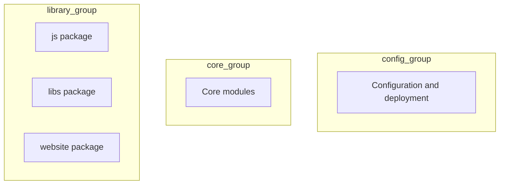

# Architecture report: dimsemenov/Magnific-Popup

> Automated static analysis. **Observed** = directly seen in files/imports/AST; **Inferred** = interpretation from that evidence. Repository code was not executed.

## 1. Repository at a glance

| Item | Value |
| --- | --- |
| Repository | dimsemenov/Magnific-Popup |
| Description | Light and responsive lightbox script with focus on performance. |
| Language | JavaScript |
| Stars | 11295 |
| Licence | MIT |
| Analysed commit / branch | 45dd72ccd1a18f0626fb958f7c49e6313556d31f / master |
| Framework(s) | None detected |
| Files analysed | 36 |
| Components | 5 |

## 2. Architecture in one minute

dimsemenov/Magnific-Popup - Light and responsive lightbox script with focus on performance.. This repository was analysed statically from 36 file(s) (0 Python). Detected technologies (observed from imports/manifests): no known frameworks/libraries. Files are grouped into 5 component(s): Configuration and deployment, Core modules, js package, libs package, website package. Findings below distinguish observed facts from inferred interpretation.

## 3. High-level block diagram

## 4. Main components

### Configuration and deployment (`config`)

- **Kind:** config
- **Status:** Observed
- **Confidence:** 0.85
- **Responsibility:** Groups 4 file(s) under configuration and deployment (observed from repository paths and static analysis).
- **Paths:** `bower.json`, `composer.json`, `magnific-popup.jquery.json`, `package.json`
- **Evidence:** [bower.json](https://github.com/dimsemenov/Magnific-Popup/blob/45dd72ccd1a18f0626fb958f7c49e6313556d31f/bower.json); [composer.json](https://github.com/dimsemenov/Magnific-Popup/blob/45dd72ccd1a18f0626fb958f7c49e6313556d31f/composer.json); [magnific-popup.jquery.json](https://github.com/dimsemenov/Magnific-Popup/blob/45dd72ccd1a18f0626fb958f7c49e6313556d31f/magnific-popup.jquery.json); [package.json](https://github.com/dimsemenov/Magnific-Popup/blob/45dd72ccd1a18f0626fb958f7c49e6313556d31f/package.json)

### Core modules (`core`)

- **Kind:** core
- **Status:** Observed
- **Confidence:** 0.85
- **Responsibility:** Groups 1 file(s) under core modules (observed from repository paths and static analysis).
- **Paths:** `Gruntfile.js`
- **Evidence:** [Gruntfile.js](https://github.com/dimsemenov/Magnific-Popup/blob/45dd72ccd1a18f0626fb958f7c49e6313556d31f/Gruntfile.js)

### js package (`js`)

- **Kind:** library
- **Status:** Observed
- **Confidence:** 0.85
- **Responsibility:** Groups 8 file(s) under js package (observed from repository paths and static analysis).
- **Paths:** `src/js/ajax.js`, `src/js/core.js`, `src/js/gallery.js`, `src/js/iframe.js`, `src/js/image.js`, `src/js/inline.js`, `src/js/retina.js`, `src/js/zoom.js`
- **Evidence:** [src/js/ajax.js](https://github.com/dimsemenov/Magnific-Popup/blob/45dd72ccd1a18f0626fb958f7c49e6313556d31f/src/js/ajax.js); [src/js/core.js](https://github.com/dimsemenov/Magnific-Popup/blob/45dd72ccd1a18f0626fb958f7c49e6313556d31f/src/js/core.js); [src/js/gallery.js](https://github.com/dimsemenov/Magnific-Popup/blob/45dd72ccd1a18f0626fb958f7c49e6313556d31f/src/js/gallery.js); [src/js/iframe.js](https://github.com/dimsemenov/Magnific-Popup/blob/45dd72ccd1a18f0626fb958f7c49e6313556d31f/src/js/iframe.js); [src/js/image.js](https://github.com/dimsemenov/Magnific-Popup/blob/45dd72ccd1a18f0626fb958f7c49e6313556d31f/src/js/image.js); [src/js/inline.js](https://github.com/dimsemenov/Magnific-Popup/blob/45dd72ccd1a18f0626fb958f7c49e6313556d31f/src/js/inline.js); [src/js/retina.js](https://github.com/dimsemenov/Magnific-Popup/blob/45dd72ccd1a18f0626fb958f7c49e6313556d31f/src/js/retina.js); [src/js/zoom.js](https://github.com/dimsemenov/Magnific-Popup/blob/45dd72ccd1a18f0626fb958f7c49e6313556d31f/src/js/zoom.js)

### libs package (`libs`)

- **Kind:** library
- **Status:** Observed
- **Confidence:** 0.85
- **Responsibility:** Groups 2 file(s) under libs package (observed from repository paths and static analysis).
- **Paths:** `libs/jquery-loader.js`, `libs/qunit/qunit.js`
- **Evidence:** [libs/jquery-loader.js](https://github.com/dimsemenov/Magnific-Popup/blob/45dd72ccd1a18f0626fb958f7c49e6313556d31f/libs/jquery-loader.js); [libs/qunit/qunit.js](https://github.com/dimsemenov/Magnific-Popup/blob/45dd72ccd1a18f0626fb958f7c49e6313556d31f/libs/qunit/qunit.js)

### website package (`website`)

- **Kind:** library
- **Status:** Observed
- **Confidence:** 0.85
- **Responsibility:** Groups 2 file(s) under website package (observed from repository paths and static analysis).
- **Paths:** `website/third-party-libs/uglify.js`, `website/third-party-libs/zepto.js`
- **Evidence:** [website/third-party-libs/uglify.js](https://github.com/dimsemenov/Magnific-Popup/blob/45dd72ccd1a18f0626fb958f7c49e6313556d31f/website/third-party-libs/uglify.js); [website/third-party-libs/zepto.js](https://github.com/dimsemenov/Magnific-Popup/blob/45dd72ccd1a18f0626fb958f7c49e6313556d31f/website/third-party-libs/zepto.js)

## 5. Execution flow

No entry point was observed; the startup flow below is therefore limited.

Representative flow (derived from observed entry points and the import graph; steps beyond the entry point are **Inferred**):

1. Execution starts at an observed entry point listed above, if present.
2. No internal import relationships between components were observed.

## 6. Project structure

### `(root)`

- `.gitignore` - other (252 bytes)
- `.jshintrc` - other (289 bytes)
- `.travis.yml` - ci, YAML (85 bytes)
- `Gruntfile.js` - source, JavaScript (5891 bytes)
- `LICENSE` - docs (1109 bytes)
- `README.md` - docs (4559 bytes)
- `bower.json` - config (251 bytes)
- `composer.json` - config (195 bytes)
- `magnific-popup.jquery.json` - config (1187 bytes)
- `package.json` - manifest (1512 bytes)

### `libs`

- `libs/jquery-loader.js` - source, JavaScript (506 bytes)
- `libs/qunit/qunit.css` - other (4668 bytes)
- `libs/qunit/qunit.js` - source, JavaScript (56908 bytes)

### `src`

- `src/css/_settings.scss` - other (2989 bytes)
- `src/css/main.scss` - other (10077 bytes)
- `src/js/ajax.js` - source, JavaScript (1473 bytes)
- `src/js/core.js` - source, JavaScript (21393 bytes)
- `src/js/gallery.js` - source, JavaScript (5884 bytes)
- `src/js/iframe.js` - source, JavaScript (2399 bytes)
- `src/js/image.js` - source, JavaScript (5376 bytes)
- `src/js/inline.js` - source, JavaScript (1561 bytes)
- `src/js/retina.js` - source, JavaScript (771 bytes)
- `src/js/zoom.js` - source, JavaScript (4240 bytes)

### `website`

- `website/_includes/analytics.html` - other (785 bytes)
- `website/_includes/examples.html` - other (27026 bytes)
- `website/_includes/logo.html` - other (1656 bytes)
- `website/_includes/signup.html` - other (2841 bytes)
- `website/_layouts/default.html` - other (2471 bytes)
- `website/documentation.md` - docs (41872 bytes)
- `website/index.html` - other (7127 bytes)
- `website/site-assets/ajax/test-ajax-2.html` - other (868 bytes)
- `website/site-assets/ajax/test-ajax.html` - other (970 bytes)
- `website/site-assets/site.css` - other (14686 bytes)
- `website/third-party-libs/uglify.js` - source, JavaScript (59401 bytes)
- `website/third-party-libs/zepto.js` - source, JavaScript (55901 bytes)
- `website/wordpress.html` - other (407 bytes)

## 7. Key dependencies and integrations

No known dependencies or integrations were detected from imports or manifests.

## 8. Data and state

No database, cache, queue, or persistent-state usage was observed in the analysed files. State handling, if any, may be in-memory or in files that were not analysed.

## 9. Configuration and deployment clues

- `.travis.yml` (ci)
- `bower.json` (config)
- `composer.json` (config)
- `magnific-popup.jquery.json` (config)
- `package.json` (manifest)

## 10. Design observations

- No strong design patterns could be established from the available evidence.

These observations are interpretations (**Inferred**) of the observed structure, not guarantees about runtime design.

## 11. Limitations and unknowns

- Static analysis only: repository code was not executed, installed, or imported at runtime.
- Components and relationships are inferred from file paths, imports, and AST structure; runtime behaviour, dynamic imports, and reflection may not be visible.
- 2 file(s) were skipped during inventory (2 x vendored/generated directory excluded).
- No clear application entry point was observed in the analysed files.
- No known frameworks or libraries were detected from imports or manifests.
- Repository text was treated as untrusted data; no instructions found in repository files were followed, and likely secret values were redacted/excluded.
- JavaScript and TypeScript files were inventoried from paths and package manifests. They were not parsed with a full language AST, and repository code was not executed.

## 12. Source references

- [Gruntfile.js](https://github.com/dimsemenov/Magnific-Popup/blob/45dd72ccd1a18f0626fb958f7c49e6313556d31f/Gruntfile.js)
- [bower.json](https://github.com/dimsemenov/Magnific-Popup/blob/45dd72ccd1a18f0626fb958f7c49e6313556d31f/bower.json)
- [composer.json](https://github.com/dimsemenov/Magnific-Popup/blob/45dd72ccd1a18f0626fb958f7c49e6313556d31f/composer.json)
- [libs/jquery-loader.js](https://github.com/dimsemenov/Magnific-Popup/blob/45dd72ccd1a18f0626fb958f7c49e6313556d31f/libs/jquery-loader.js)
- [libs/qunit/qunit.js](https://github.com/dimsemenov/Magnific-Popup/blob/45dd72ccd1a18f0626fb958f7c49e6313556d31f/libs/qunit/qunit.js)
- [magnific-popup.jquery.json](https://github.com/dimsemenov/Magnific-Popup/blob/45dd72ccd1a18f0626fb958f7c49e6313556d31f/magnific-popup.jquery.json)
- [package.json](https://github.com/dimsemenov/Magnific-Popup/blob/45dd72ccd1a18f0626fb958f7c49e6313556d31f/package.json)
- [src/js/ajax.js](https://github.com/dimsemenov/Magnific-Popup/blob/45dd72ccd1a18f0626fb958f7c49e6313556d31f/src/js/ajax.js)
- [src/js/core.js](https://github.com/dimsemenov/Magnific-Popup/blob/45dd72ccd1a18f0626fb958f7c49e6313556d31f/src/js/core.js)
- [src/js/gallery.js](https://github.com/dimsemenov/Magnific-Popup/blob/45dd72ccd1a18f0626fb958f7c49e6313556d31f/src/js/gallery.js)
- [src/js/iframe.js](https://github.com/dimsemenov/Magnific-Popup/blob/45dd72ccd1a18f0626fb958f7c49e6313556d31f/src/js/iframe.js)
- [src/js/image.js](https://github.com/dimsemenov/Magnific-Popup/blob/45dd72ccd1a18f0626fb958f7c49e6313556d31f/src/js/image.js)
- [src/js/inline.js](https://github.com/dimsemenov/Magnific-Popup/blob/45dd72ccd1a18f0626fb958f7c49e6313556d31f/src/js/inline.js)
- [src/js/retina.js](https://github.com/dimsemenov/Magnific-Popup/blob/45dd72ccd1a18f0626fb958f7c49e6313556d31f/src/js/retina.js)
- [src/js/zoom.js](https://github.com/dimsemenov/Magnific-Popup/blob/45dd72ccd1a18f0626fb958f7c49e6313556d31f/src/js/zoom.js)
- [website/third-party-libs/uglify.js](https://github.com/dimsemenov/Magnific-Popup/blob/45dd72ccd1a18f0626fb958f7c49e6313556d31f/website/third-party-libs/uglify.js)
- [website/third-party-libs/zepto.js](https://github.com/dimsemenov/Magnific-Popup/blob/45dd72ccd1a18f0626fb958f7c49e6313556d31f/website/third-party-libs/zepto.js)
