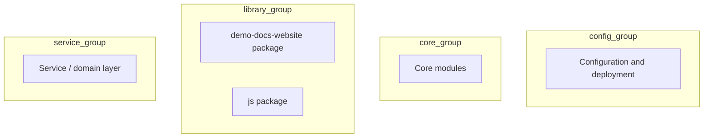

# Architecture report: dimsemenov/PhotoSwipe

> Automated static analysis. **Observed** = directly seen in files/imports/AST; **Inferred** = interpretation from that evidence. Repository code was not executed.

## 1. Repository at a glance

| Item | Value |
| --- | --- |
| Repository | dimsemenov/PhotoSwipe |
| Description | JavaScript image gallery for mobile and desktop, modular, framework independent |
| Language | JavaScript |
| Stars | 25302 |
| Licence | MIT |
| Analysed commit / branch | cd41cb587a460634e4cae53134f3d01d06e284a6 / master |
| Framework(s) | React |
| Files analysed | 118 |
| Components | 5 |

## 2. Architecture in one minute

dimsemenov/PhotoSwipe - JavaScript image gallery for mobile and desktop, modular, framework independent. This repository was analysed statically from 118 file(s) (0 Python). Detected technologies (observed from imports/manifests): GitHub Actions, React, TypeScript. Files are grouped into 5 component(s): Configuration and deployment, Core modules, demo-docs-website package, js package, Service / domain layer. Findings below distinguish observed facts from inferred interpretation.

## 3. High-level block diagram

## 4. Main components

### Configuration and deployment (`config`)

- **Kind:** config
- **Status:** Observed
- **Confidence:** 0.85
- **Responsibility:** Groups 4 file(s) under configuration and deployment (observed from repository paths and static analysis).
- **Paths:** `demo-docs-website/package.json`, `demo-docs-website/repo-data.json`, `package.json`, `tsconfig.json`
- **Evidence:** [demo-docs-website/package.json](https://github.com/dimsemenov/PhotoSwipe/blob/cd41cb587a460634e4cae53134f3d01d06e284a6/demo-docs-website/package.json); [demo-docs-website/repo-data.json](https://github.com/dimsemenov/PhotoSwipe/blob/cd41cb587a460634e4cae53134f3d01d06e284a6/demo-docs-website/repo-data.json); [package.json](https://github.com/dimsemenov/PhotoSwipe/blob/cd41cb587a460634e4cae53134f3d01d06e284a6/package.json); [tsconfig.json](https://github.com/dimsemenov/PhotoSwipe/blob/cd41cb587a460634e4cae53134f3d01d06e284a6/tsconfig.json)

### Core modules (`core`)

- **Kind:** core
- **Status:** Observed
- **Confidence:** 0.85
- **Responsibility:** Groups 1 file(s) under core modules (observed from repository paths and static analysis).
- **Paths:** `global.d.ts`
- **Evidence:** [global.d.ts](https://github.com/dimsemenov/PhotoSwipe/blob/cd41cb587a460634e4cae53134f3d01d06e284a6/global.d.ts)

### demo-docs-website package (`demo_docs_website`)

- **Kind:** library
- **Status:** Observed
- **Confidence:** 0.85
- **Responsibility:** Groups 31 file(s) under demo-docs-website package (observed from repository paths and static analysis).
- **Paths:** `demo-docs-website/babel.config.js`, `demo-docs-website/docusaurus.config.js`, `demo-docs-website/sidebars.js`, `demo-docs-website/src/components/HomepageFeatures/index.js`, `demo-docs-website/src/components/PswpCodePreview/demo-images.js`, `demo-docs-website/src/components/PswpCodePreview/gallery-templates/basic--badges.js`, `demo-docs-website/src/components/PswpCodePreview/gallery-templates/basic--cropped.js`, `demo-docs-website/src/components/PswpCodePreview/gallery-templates/basic.js`, `demo-docs-website/src/components/PswpCodePreview/gallery-templates/caption.js`, `demo-docs-website/src/components/PswpCodePreview/gallery-templates/content-types.js`, `demo-docs-website/src/components/PswpCodePreview/gallery-templates/custom-html-markup-data-source.js`, `demo-docs-website/src/components/PswpCodePreview/gallery-templates/getting-started.js`, `demo-docs-website/src/components/PswpCodePreview/gallery-templates/srcset-test.js`, `demo-docs-website/src/components/PswpCodePreview/index.js`, `demo-docs-website/src/pages/_index-deep-zoom-demo.js`, `demo-docs-website/src/pages/_index-gallery-header.js`, `demo-docs-website/src/pages/index.js`, `demo-docs-website/src/theme/CodeBlock/index.js`, `demo-docs-website/src/theme/DocItem/index.js`, `demo-docs-website/src/theme/DocItemFooter/index.js`, `demo-docs-website/src/theme/DocPage/index.js`, `demo-docs-website/src/theme/DocSidebar/index.js`, `demo-docs-website/src/theme/DocSidebar/is-same-path.ts`, `demo-docs-website/src/theme/EditThisPage/index.js`, `demo-docs-website/src/theme/Footer/index.js`, `demo-docs-website/src/theme/Logo/index.js`, `demo-docs-website/src/theme/MDXComponents/index.js`, `demo-docs-website/src/theme/Navbar/github-stars.js`, `demo-docs-website/src/theme/Navbar/index.js`, `demo-docs-website/static/photoswipe/photoswipe-lightbox.esm.js`, `demo-docs-website/static/photoswipe/photoswipe.esm.js`
- **Evidence:** [demo-docs-website/babel.config.js](https://github.com/dimsemenov/PhotoSwipe/blob/cd41cb587a460634e4cae53134f3d01d06e284a6/demo-docs-website/babel.config.js); [demo-docs-website/docusaurus.config.js](https://github.com/dimsemenov/PhotoSwipe/blob/cd41cb587a460634e4cae53134f3d01d06e284a6/demo-docs-website/docusaurus.config.js); [demo-docs-website/sidebars.js](https://github.com/dimsemenov/PhotoSwipe/blob/cd41cb587a460634e4cae53134f3d01d06e284a6/demo-docs-website/sidebars.js); [demo-docs-website/src/components/HomepageFeatures/index.js](https://github.com/dimsemenov/PhotoSwipe/blob/cd41cb587a460634e4cae53134f3d01d06e284a6/demo-docs-website/src/components/HomepageFeatures/index.js); [demo-docs-website/src/components/PswpCodePreview/demo-images.js](https://github.com/dimsemenov/PhotoSwipe/blob/cd41cb587a460634e4cae53134f3d01d06e284a6/demo-docs-website/src/components/PswpCodePreview/demo-images.js); [demo-docs-website/src/components/PswpCodePreview/gallery-templates/basic--badges.js](https://github.com/dimsemenov/PhotoSwipe/blob/cd41cb587a460634e4cae53134f3d01d06e284a6/demo-docs-website/src/components/PswpCodePreview/gallery-templates/basic--badges.js); [demo-docs-website/src/components/PswpCodePreview/gallery-templates/basic--cropped.js](https://github.com/dimsemenov/PhotoSwipe/blob/cd41cb587a460634e4cae53134f3d01d06e284a6/demo-docs-website/src/components/PswpCodePreview/gallery-templates/basic--cropped.js); [demo-docs-website/src/components/PswpCodePreview/gallery-templates/basic.js](https://github.com/dimsemenov/PhotoSwipe/blob/cd41cb587a460634e4cae53134f3d01d06e284a6/demo-docs-website/src/components/PswpCodePreview/gallery-templates/basic.js)

### js package (`js`)

- **Kind:** library
- **Status:** Observed
- **Confidence:** 0.85
- **Responsibility:** Groups 32 file(s) under js package (observed from repository paths and static analysis).
- **Paths:** `src/js/gestures/drag-handler.js`, `src/js/gestures/gestures.js`, `src/js/gestures/tap-handler.js`, `src/js/gestures/zoom-handler.js`, `src/js/keyboard.js`, `src/js/lightbox/lightbox.js`, `src/js/main-scroll.js`, `src/js/opener.js`, `src/js/photoswipe.js`, `src/js/scroll-wheel.js`, `src/js/slide/content.js`, `src/js/slide/get-thumb-bounds.js`, `src/js/slide/loader.js`, `src/js/slide/pan-bounds.js`, `src/js/slide/placeholder.js`, `src/js/slide/slide.js`, `src/js/slide/zoom-level.js`, `src/js/types.ts`, `src/js/ui/button-arrow.js`, `src/js/ui/button-close.js`, `src/js/ui/button-zoom.js`, `src/js/ui/counter-indicator.js`, `src/js/ui/loading-indicator.js`, `src/js/ui/ui-element.js`, `src/js/ui/ui.js`, `src/js/util/animations.js`, `src/js/util/css-animation.js`, `src/js/util/dom-events.js`, `src/js/util/spring-animation.js`, `src/js/util/spring-easer.js`, `src/js/util/util.js`, `src/js/util/viewport-size.js`
- **Evidence:** [src/js/gestures/drag-handler.js](https://github.com/dimsemenov/PhotoSwipe/blob/cd41cb587a460634e4cae53134f3d01d06e284a6/src/js/gestures/drag-handler.js); [src/js/gestures/gestures.js](https://github.com/dimsemenov/PhotoSwipe/blob/cd41cb587a460634e4cae53134f3d01d06e284a6/src/js/gestures/gestures.js); [src/js/gestures/tap-handler.js](https://github.com/dimsemenov/PhotoSwipe/blob/cd41cb587a460634e4cae53134f3d01d06e284a6/src/js/gestures/tap-handler.js); [src/js/gestures/zoom-handler.js](https://github.com/dimsemenov/PhotoSwipe/blob/cd41cb587a460634e4cae53134f3d01d06e284a6/src/js/gestures/zoom-handler.js); [src/js/keyboard.js](https://github.com/dimsemenov/PhotoSwipe/blob/cd41cb587a460634e4cae53134f3d01d06e284a6/src/js/keyboard.js); [src/js/lightbox/lightbox.js](https://github.com/dimsemenov/PhotoSwipe/blob/cd41cb587a460634e4cae53134f3d01d06e284a6/src/js/lightbox/lightbox.js); [src/js/main-scroll.js](https://github.com/dimsemenov/PhotoSwipe/blob/cd41cb587a460634e4cae53134f3d01d06e284a6/src/js/main-scroll.js); [src/js/opener.js](https://github.com/dimsemenov/PhotoSwipe/blob/cd41cb587a460634e4cae53134f3d01d06e284a6/src/js/opener.js)

### Service / domain layer (`service_layer`)

- **Kind:** service
- **Status:** Observed
- **Confidence:** 0.85
- **Responsibility:** Groups 2 file(s) under service / domain layer (observed from repository paths and static analysis).
- **Paths:** `src/js/core/base.js`, `src/js/core/eventable.js`
- **Evidence:** [src/js/core/base.js](https://github.com/dimsemenov/PhotoSwipe/blob/cd41cb587a460634e4cae53134f3d01d06e284a6/src/js/core/base.js); [src/js/core/eventable.js](https://github.com/dimsemenov/PhotoSwipe/blob/cd41cb587a460634e4cae53134f3d01d06e284a6/src/js/core/eventable.js)

## 5. Execution flow

**Observed** entry point(s):

- [demo-docs-website/src/pages/index.js](https://github.com/dimsemenov/PhotoSwipe/blob/cd41cb587a460634e4cae53134f3d01d06e284a6/demo-docs-website/src/pages/index.js)

Representative flow (derived from observed entry points and the import graph; steps beyond the entry point are **Inferred**):

1. Execution starts at an observed entry point listed above, if present.
2. No internal import relationships between components were observed.

## 6. Project structure

### `(root)`

- `.babelrc` - other (130 bytes)
- `.editorconfig` - config (129 bytes)
- `.eslintignore` - other (45 bytes)
- `.eslintrc.json` - config (1260 bytes)
- `.gitignore` - other (382 bytes)
- `LICENSE` - docs (1109 bytes)
- `README.md` - docs (1672 bytes)
- `global.d.ts` - source, TypeScript (107 bytes)
- `package.json` - manifest (2951 bytes)
- `tsconfig.json` - config (316 bytes)

### `.github`

- `.github/FUNDING.yml` - config (27 bytes)
- `.github/workflows/build.yml` - ci, YAML (981 bytes)

### `demo-docs-website`

- `demo-docs-website/.gitignore` - other (233 bytes)
- `demo-docs-website/babel.config.js` - source, JavaScript (89 bytes)
- `demo-docs-website/docusaurus.config.js` - source, JavaScript (2933 bytes)
- `demo-docs-website/package.json` - manifest (1242 bytes)
- `demo-docs-website/repo-data.json` - config (5727 bytes)
- `demo-docs-website/sidebars.js` - source, JavaScript (2298 bytes)
- `demo-docs-website/src/components/HomepageFeatures/index.js` - source, JavaScript (1692 bytes)
- `demo-docs-website/src/components/HomepageFeatures/styles.module.css` - other (138 bytes)
- `demo-docs-website/src/components/PswpCodePreview/demo-images.js` - source, JavaScript (5073 bytes)
- `demo-docs-website/src/components/PswpCodePreview/gallery-templates/basic--badges.js` - source, JavaScript (491 bytes)
- `demo-docs-website/src/components/PswpCodePreview/gallery-templates/basic--cropped.js` - source, JavaScript (444 bytes)
- `demo-docs-website/src/components/PswpCodePreview/gallery-templates/basic.js` - source, JavaScript (419 bytes)
- `demo-docs-website/src/components/PswpCodePreview/gallery-templates/caption.js` - source, JavaScript (1440 bytes)
- `demo-docs-website/src/components/PswpCodePreview/gallery-templates/content-types.js` - source, JavaScript (894 bytes)
- `demo-docs-website/src/components/PswpCodePreview/gallery-templates/custom-html-markup-data-source.js` - source, JavaScript (500 bytes)
- `demo-docs-website/src/components/PswpCodePreview/gallery-templates/getting-started.js` - source, JavaScript (1423 bytes)
- `demo-docs-website/src/components/PswpCodePreview/gallery-templates/srcset-test.js` - source, JavaScript (1207 bytes)
- `demo-docs-website/src/components/PswpCodePreview/index.js` - source, JavaScript (2220 bytes)
- `demo-docs-website/src/css/custom.css` - other (2852 bytes)
- `demo-docs-website/src/css/docs-page.css` - other (709 bytes)
- `demo-docs-website/src/css/example-code-block.css` - other (2474 bytes)
- `demo-docs-website/src/css/header.css` - other (1559 bytes)
- `demo-docs-website/src/css/home.css` - other (3770 bytes)
- `demo-docs-website/src/css/scrollbar.css` - other (710 bytes)
- `demo-docs-website/src/css/sidebar-menu.css` - other (1092 bytes)
- `demo-docs-website/src/pages/_index-deep-zoom-demo.js` - source, JavaScript (4615 bytes)
- `demo-docs-website/src/pages/_index-gallery-header.js` - source, JavaScript (13641 bytes)
- `demo-docs-website/src/pages/index.js` - source, JavaScript (5717 bytes)
- `demo-docs-website/src/pages/index.module.css` - other (102 bytes)
- `demo-docs-website/src/theme/CodeBlock/index.js` - source, JavaScript (6152 bytes)
- `demo-docs-website/src/theme/CodeBlock/styles.module.css` - other (1099 bytes)
- `demo-docs-website/src/theme/DocItem/index.js` - source, JavaScript (2624 bytes)
- `demo-docs-website/src/theme/DocItem/styles.module.css` - other (430 bytes)
- `demo-docs-website/src/theme/DocItemFooter/index.js` - source, JavaScript (2509 bytes)
- `demo-docs-website/src/theme/DocItemFooter/styles.module.css` - other (348 bytes)
- `demo-docs-website/src/theme/DocPage/index.js` - source, JavaScript (5077 bytes)
- `demo-docs-website/src/theme/DocPage/styles.module.css` - other (188 bytes)
- `demo-docs-website/src/theme/DocSidebar/index.js` - source, JavaScript (3409 bytes)
- `demo-docs-website/src/theme/DocSidebar/is-same-path.ts` - source, TypeScript (569 bytes)
- `demo-docs-website/src/theme/DocSidebar/styles.module.css` - other (2161 bytes)
- `demo-docs-website/src/theme/EditThisPage/index.js` - source, JavaScript (516 bytes)
- `demo-docs-website/src/theme/Footer/index.js` - source, JavaScript (1576 bytes)
- `demo-docs-website/src/theme/Footer/styles.module.css` - other (358 bytes)
- `demo-docs-website/src/theme/Logo/index.js` - source, JavaScript (1571 bytes)
- `demo-docs-website/src/theme/MDXComponents/index.js` - source, JavaScript (2774 bytes)
- `demo-docs-website/src/theme/MDXComponents/styles.css` - other (280 bytes)
- `demo-docs-website/src/theme/Navbar/github-stars.js` - source, JavaScript (1247 bytes)
- `demo-docs-website/src/theme/Navbar/index.js` - source, JavaScript (9082 bytes)
- `demo-docs-website/src/theme/Navbar/styles.module.css` - other (489 bytes)
- `demo-docs-website/static/.nojekyll` - other (0 bytes)
- `demo-docs-website/static/photoswipe/photoswipe-lightbox.esm.js` - source, JavaScript (54556 bytes)
- `demo-docs-website/static/photoswipe/photoswipe.css` - other (7003 bytes)
- `demo-docs-website/static/photoswipe/photoswipe.esm.js` - source, JavaScript (187718 bytes)

### `docs`

- `docs/adding-ui-elements.md` - docs (7582 bytes)
- `docs/adjusting-zoom-level.md` - docs (5801 bytes)
- `docs/caption.md` - docs (2419 bytes)
- `docs/click-and-tap-actions.md` - docs (2040 bytes)
- `docs/custom-content.md` - docs (6780 bytes)
- `docs/data-sources.md` - docs (11007 bytes)
- `docs/events.md` - docs (6310 bytes)
- `docs/filters.md` - docs (4850 bytes)
- `docs/getting-started.md` - docs (6715 bytes)
- `docs/methods.md` - docs (7257 bytes)
- `docs/native-fullscreen-on-open.md` - docs (5286 bytes)
- `docs/opening-or-closing-transition.md` - docs (6329 bytes)
- `docs/options.md` - docs (15793 bytes)
- `docs/properties.md` - docs (1145 bytes)
- `docs/react-image-gallery.md` - docs (823 bytes)
- `docs/styling.md` - docs (4272 bytes)
- `docs/svelte-image-gallery.md` - docs (648 bytes)
- `docs/vue-image-gallery.md` - docs (514 bytes)

### `src`

- `src/js/core/base.js` - source, JavaScript (5294 bytes)
- `src/js/core/eventable.js` - source, JavaScript (12240 bytes)
- `src/js/gestures/drag-handler.js` - source, JavaScript (11581 bytes)
- `src/js/gestures/gestures.js` - source, JavaScript (16827 bytes)
- `src/js/gestures/tap-handler.js` - source, JavaScript (3342 bytes)
- `src/js/gestures/zoom-handler.js` - source, JavaScript (7684 bytes)
- `src/js/keyboard.js` - source, JavaScript (4592 bytes)
- `src/js/lightbox/lightbox.js` - source, JavaScript (8924 bytes)
- `src/js/main-scroll.js` - source, JavaScript (9616 bytes)
- `src/js/opener.js` - source, JavaScript (12974 bytes)
- `src/js/photoswipe.js` - source, JavaScript (22447 bytes)
- `src/js/scroll-wheel.js` - source, JavaScript (1535 bytes)
- `src/js/slide/content.js` - source, JavaScript (13464 bytes)
- `src/js/slide/get-thumb-bounds.js` - source, JavaScript (3037 bytes)
- `src/js/slide/loader.js` - source, JavaScript (5577 bytes)
- `src/js/slide/pan-bounds.js` - source, JavaScript (2321 bytes)
- `src/js/slide/placeholder.js` - source, JavaScript (1566 bytes)
- `src/js/slide/slide.js` - source, JavaScript (13511 bytes)
- `src/js/slide/zoom-level.js` - source, JavaScript (4419 bytes)
- `src/js/types.ts` - source, TypeScript (242 bytes)
- `src/js/ui/button-arrow.js` - source, JavaScript (1670 bytes)
- `src/js/ui/button-close.js` - source, JavaScript (379 bytes)
- `src/js/ui/button-zoom.js` - source, JavaScript (608 bytes)
- `src/js/ui/counter-indicator.js` - source, JavaScript (394 bytes)
- `src/js/ui/loading-indicator.js` - source, JavaScript (1885 bytes)
- `src/js/ui/ui-element.js` - source, JavaScript (5243 bytes)
- `src/js/ui/ui.js` - source, JavaScript (3661 bytes)
- `src/js/util/animations.js` - source, JavaScript (2738 bytes)
- `src/js/util/css-animation.js` - source, JavaScript (3176 bytes)
- `src/js/util/dom-events.js` - source, JavaScript (3258 bytes)
- `src/js/util/spring-animation.js` - source, JavaScript (1833 bytes)
- `src/js/util/spring-easer.js` - source, JavaScript (3129 bytes)
- `src/js/util/util.js` - source, JavaScript (5191 bytes)
- `src/js/util/viewport-size.js` - source, JavaScript (2744 bytes)
- `src/photoswipe.css` - other (7003 bytes)

## 7. Key dependencies and integrations

| Name | Category | Status | Confidence | Evidence |
| --- | --- | --- | --- | --- |
| GitHub Actions | ci | Observed | 0.85 | [.github/workflows/build.yml](https://github.com/dimsemenov/PhotoSwipe/blob/cd41cb587a460634e4cae53134f3d01d06e284a6/.github/workflows/build.yml) |
| React | framework | Observed | 0.90 | [demo-docs-website/package.json:18](https://github.com/dimsemenov/PhotoSwipe/blob/cd41cb587a460634e4cae53134f3d01d06e284a6/demo-docs-website/package.json#L18); [demo-docs-website/package.json:29](https://github.com/dimsemenov/PhotoSwipe/blob/cd41cb587a460634e4cae53134f3d01d06e284a6/demo-docs-website/package.json#L29) |
| TypeScript | tooling | Observed | 0.85 | [package.json:68](https://github.com/dimsemenov/PhotoSwipe/blob/cd41cb587a460634e4cae53134f3d01d06e284a6/package.json#L68) |

## 8. Data and state

No database, cache, queue, or persistent-state usage was observed in the analysed files. State handling, if any, may be in-memory or in files that were not analysed.

## 9. Configuration and deployment clues

- `.editorconfig` (config)
- `.eslintrc.json` (config)
- `.github/FUNDING.yml` (config)
- `.github/workflows/build.yml` (ci)
- `demo-docs-website/package.json` (manifest)
- `demo-docs-website/repo-data.json` (config)
- `package.json` (manifest)
- `tsconfig.json` (config)

## 10. Design observations

- Service/domain code is distinct from entry and data code, suggesting layered separation (Inferred).

These observations are interpretations (**Inferred**) of the observed structure, not guarantees about runtime design.

## 11. Limitations and unknowns

- Static analysis only: repository code was not executed, installed, or imported at runtime.
- Components and relationships are inferred from file paths, imports, and AST structure; runtime behaviour, dynamic imports, and reflection may not be visible.
- 41 file(s) were skipped during inventory (41 x vendored/generated directory excluded).
- No clear application entry point was observed in the analysed files.
- Repository text was treated as untrusted data; no instructions found in repository files were followed, and likely secret values were redacted/excluded.
- JavaScript and TypeScript files were inventoried from paths and package manifests. They were not parsed with a full language AST, and repository code was not executed.

## 12. Source references

- [.github/workflows/build.yml](https://github.com/dimsemenov/PhotoSwipe/blob/cd41cb587a460634e4cae53134f3d01d06e284a6/.github/workflows/build.yml)
- [demo-docs-website/babel.config.js](https://github.com/dimsemenov/PhotoSwipe/blob/cd41cb587a460634e4cae53134f3d01d06e284a6/demo-docs-website/babel.config.js)
- [demo-docs-website/docusaurus.config.js](https://github.com/dimsemenov/PhotoSwipe/blob/cd41cb587a460634e4cae53134f3d01d06e284a6/demo-docs-website/docusaurus.config.js)
- [demo-docs-website/package.json](https://github.com/dimsemenov/PhotoSwipe/blob/cd41cb587a460634e4cae53134f3d01d06e284a6/demo-docs-website/package.json)
- [demo-docs-website/package.json:18](https://github.com/dimsemenov/PhotoSwipe/blob/cd41cb587a460634e4cae53134f3d01d06e284a6/demo-docs-website/package.json#L18)
- [demo-docs-website/package.json:29](https://github.com/dimsemenov/PhotoSwipe/blob/cd41cb587a460634e4cae53134f3d01d06e284a6/demo-docs-website/package.json#L29)
- [demo-docs-website/repo-data.json](https://github.com/dimsemenov/PhotoSwipe/blob/cd41cb587a460634e4cae53134f3d01d06e284a6/demo-docs-website/repo-data.json)
- [demo-docs-website/sidebars.js](https://github.com/dimsemenov/PhotoSwipe/blob/cd41cb587a460634e4cae53134f3d01d06e284a6/demo-docs-website/sidebars.js)
- [demo-docs-website/src/components/HomepageFeatures/index.js](https://github.com/dimsemenov/PhotoSwipe/blob/cd41cb587a460634e4cae53134f3d01d06e284a6/demo-docs-website/src/components/HomepageFeatures/index.js)
- [demo-docs-website/src/components/PswpCodePreview/demo-images.js](https://github.com/dimsemenov/PhotoSwipe/blob/cd41cb587a460634e4cae53134f3d01d06e284a6/demo-docs-website/src/components/PswpCodePreview/demo-images.js)
- [demo-docs-website/src/components/PswpCodePreview/gallery-templates/basic--badges.js](https://github.com/dimsemenov/PhotoSwipe/blob/cd41cb587a460634e4cae53134f3d01d06e284a6/demo-docs-website/src/components/PswpCodePreview/gallery-templates/basic--badges.js)
- [demo-docs-website/src/components/PswpCodePreview/gallery-templates/basic--cropped.js](https://github.com/dimsemenov/PhotoSwipe/blob/cd41cb587a460634e4cae53134f3d01d06e284a6/demo-docs-website/src/components/PswpCodePreview/gallery-templates/basic--cropped.js)
- [demo-docs-website/src/components/PswpCodePreview/gallery-templates/basic.js](https://github.com/dimsemenov/PhotoSwipe/blob/cd41cb587a460634e4cae53134f3d01d06e284a6/demo-docs-website/src/components/PswpCodePreview/gallery-templates/basic.js)
- [demo-docs-website/src/pages/index.js](https://github.com/dimsemenov/PhotoSwipe/blob/cd41cb587a460634e4cae53134f3d01d06e284a6/demo-docs-website/src/pages/index.js)
- [global.d.ts](https://github.com/dimsemenov/PhotoSwipe/blob/cd41cb587a460634e4cae53134f3d01d06e284a6/global.d.ts)
- [package.json](https://github.com/dimsemenov/PhotoSwipe/blob/cd41cb587a460634e4cae53134f3d01d06e284a6/package.json)
- [package.json:68](https://github.com/dimsemenov/PhotoSwipe/blob/cd41cb587a460634e4cae53134f3d01d06e284a6/package.json#L68)
- [src/js/core/base.js](https://github.com/dimsemenov/PhotoSwipe/blob/cd41cb587a460634e4cae53134f3d01d06e284a6/src/js/core/base.js)
- [src/js/core/eventable.js](https://github.com/dimsemenov/PhotoSwipe/blob/cd41cb587a460634e4cae53134f3d01d06e284a6/src/js/core/eventable.js)
- [src/js/gestures/drag-handler.js](https://github.com/dimsemenov/PhotoSwipe/blob/cd41cb587a460634e4cae53134f3d01d06e284a6/src/js/gestures/drag-handler.js)
- [src/js/gestures/gestures.js](https://github.com/dimsemenov/PhotoSwipe/blob/cd41cb587a460634e4cae53134f3d01d06e284a6/src/js/gestures/gestures.js)
- [src/js/gestures/tap-handler.js](https://github.com/dimsemenov/PhotoSwipe/blob/cd41cb587a460634e4cae53134f3d01d06e284a6/src/js/gestures/tap-handler.js)
- [src/js/gestures/zoom-handler.js](https://github.com/dimsemenov/PhotoSwipe/blob/cd41cb587a460634e4cae53134f3d01d06e284a6/src/js/gestures/zoom-handler.js)
- [src/js/keyboard.js](https://github.com/dimsemenov/PhotoSwipe/blob/cd41cb587a460634e4cae53134f3d01d06e284a6/src/js/keyboard.js)
- [src/js/lightbox/lightbox.js](https://github.com/dimsemenov/PhotoSwipe/blob/cd41cb587a460634e4cae53134f3d01d06e284a6/src/js/lightbox/lightbox.js)
- [src/js/main-scroll.js](https://github.com/dimsemenov/PhotoSwipe/blob/cd41cb587a460634e4cae53134f3d01d06e284a6/src/js/main-scroll.js)
- [src/js/opener.js](https://github.com/dimsemenov/PhotoSwipe/blob/cd41cb587a460634e4cae53134f3d01d06e284a6/src/js/opener.js)
- [tsconfig.json](https://github.com/dimsemenov/PhotoSwipe/blob/cd41cb587a460634e4cae53134f3d01d06e284a6/tsconfig.json)
