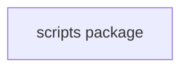

# Architecture report: dnshe/DNSHE-FreeDomains

> Automated static analysis. **Observed** = directly seen in files/imports/AST; **Inferred** = interpretation from that evidence. Repository code was not executed.

## 1. Repository at a glance

| Item | Value |
| --- | --- |
| Repository | dnshe/DNSHE-FreeDomains |
| Description | 🌐 DNSHE — Free subdomains for developers, with Anycast DNS, a REST API, and free renewal within 180 days before expiry. Available suffixes: us.ci, cc.cd, de5.net, ccwu.cc. |
| Language | JavaScript |
| Stars | 22850 |
| Licence | MIT |
| Analysed commit / branch | 19530755ffb9b5b99e0e71c9bd13494c54a56a37 / main |
| Framework(s) | None detected |
| Files analysed | 40 |
| Components | 1 |

## 2. Architecture in one minute

dnshe/DNSHE-FreeDomains - 🌐 DNSHE — Free subdomains for developers, with Anycast DNS, a REST API, and free renewal within 180 days before expiry. Available suffixes: us.ci, cc.cd, de5.net, ccwu.cc.. This repository was analysed statically from 40 file(s) (1 Python). Detected technologies (observed from imports/manifests): no known frameworks/libraries. Files are grouped into 1 component(s): scripts package. Findings below distinguish observed facts from inferred interpretation.

## 3. High-level block diagram

## 4. Main components

### scripts package (`scripts`)

- **Kind:** library
- **Status:** Observed
- **Confidence:** 0.85
- **Responsibility:** Groups 2 file(s) under scripts package (observed from repository paths and static analysis).
- **Paths:** `scripts/build-api-docs.cjs`, `scripts/check-api-docs.cjs`
- **Evidence:** [scripts/build-api-docs.cjs](https://github.com/dnshe/DNSHE-FreeDomains/blob/19530755ffb9b5b99e0e71c9bd13494c54a56a37/scripts/build-api-docs.cjs); [scripts/check-api-docs.cjs](https://github.com/dnshe/DNSHE-FreeDomains/blob/19530755ffb9b5b99e0e71c9bd13494c54a56a37/scripts/check-api-docs.cjs)

## 5. Execution flow

No entry point was observed; the startup flow below is therefore limited.

Representative flow (derived from observed entry points and the import graph; steps beyond the entry point are **Inferred**):

1. Execution starts at an observed entry point listed above, if present.
2. No internal import relationships between components were observed.

## 6. Project structure

### `(root)`

- `LICENSE` - docs (1074 bytes)
- `README.md` - docs (7956 bytes)
- `README_AR.md` - docs (11403 bytes)
- `README_DE.md` - docs (9199 bytes)
- `README_FR.md` - docs (9552 bytes)
- `README_ID.md` - docs (8381 bytes)
- `README_JA.md` - docs (10048 bytes)
- `README_KO.md` - docs (8960 bytes)
- `README_RU.md` - docs (14005 bytes)
- `README_ZH.md` - docs (7356 bytes)
- `README_ZH_TW.md` - docs (7441 bytes)

### `assets`

- `assets/README.md` - docs (925 bytes)
- `assets/sponsors/digitalocean.svg` - other (6413 bytes)

### `docs`

- `docs/MAINTAINING.md` - docs (1383 bytes)
- `docs/api-reference.json` - config (28941 bytes)
- `docs/api.md` - docs (35158 bytes)
- `docs/api_ar.md` - docs (49202 bytes)
- `docs/api_de.md` - docs (34630 bytes)
- `docs/api_fr.md` - docs (35009 bytes)
- `docs/api_id.md` - docs (33634 bytes)
- `docs/api_ja.md` - docs (37138 bytes)
- `docs/api_ko.md` - docs (35068 bytes)
- `docs/api_ru.md` - docs (43077 bytes)
- `docs/api_zh.md` - docs (33312 bytes)
- `docs/api_zh_tw.md` - docs (33333 bytes)
- `docs/i18n/ar.json` - config (16440 bytes)
- `docs/i18n/de.json` - config (13171 bytes)
- `docs/i18n/en.json` - config (13775 bytes)
- `docs/i18n/fr.json` - config (13102 bytes)
- `docs/i18n/id.json` - config (12317 bytes)
- `docs/i18n/ja.json` - config (15217 bytes)
- `docs/i18n/ko.json` - config (13775 bytes)
- `docs/i18n/ru.json` - config (18889 bytes)
- `docs/i18n/zh.json` - config (12395 bytes)
- `docs/i18n/zh_tw.json` - config (12416 bytes)

### `examples`

- `examples/client.cjs` - source, JavaScript (1837 bytes)
- `examples/client.php` - source, PHP (3094 bytes)
- `examples/client.py` - source, Python (2541 bytes)

### `scripts`

- `scripts/build-api-docs.cjs` - source, JavaScript (7462 bytes)
- `scripts/check-api-docs.cjs` - source, JavaScript (3317 bytes)

## 7. Key dependencies and integrations

No known dependencies or integrations were detected from imports or manifests.

## 8. Data and state

No database, cache, queue, or persistent-state usage was observed in the analysed files. State handling, if any, may be in-memory or in files that were not analysed.

## 9. Configuration and deployment clues

- `docs/api-reference.json` (config)
- `docs/i18n/ar.json` (config)
- `docs/i18n/de.json` (config)
- `docs/i18n/en.json` (config)
- `docs/i18n/fr.json` (config)
- `docs/i18n/id.json` (config)
- `docs/i18n/ja.json` (config)
- `docs/i18n/ko.json` (config)
- `docs/i18n/ru.json` (config)
- `docs/i18n/zh.json` (config)
- `docs/i18n/zh_tw.json` (config)

## 10. Design observations

- The analysed code appears small or monolithic; few component boundaries were observed.

These observations are interpretations (**Inferred**) of the observed structure, not guarantees about runtime design.

## 11. Limitations and unknowns

- Static analysis only: repository code was not executed, installed, or imported at runtime.
- Components and relationships are inferred from file paths, imports, and AST structure; runtime behaviour, dynamic imports, and reflection may not be visible.
- No clear application entry point was observed in the analysed files.
- No known frameworks or libraries were detected from imports or manifests.
- Repository text was treated as untrusted data; no instructions found in repository files were followed, and likely secret values were redacted/excluded.

## 12. Source references

- [scripts/build-api-docs.cjs](https://github.com/dnshe/DNSHE-FreeDomains/blob/19530755ffb9b5b99e0e71c9bd13494c54a56a37/scripts/build-api-docs.cjs)
- [scripts/check-api-docs.cjs](https://github.com/dnshe/DNSHE-FreeDomains/blob/19530755ffb9b5b99e0e71c9bd13494c54a56a37/scripts/check-api-docs.cjs)
