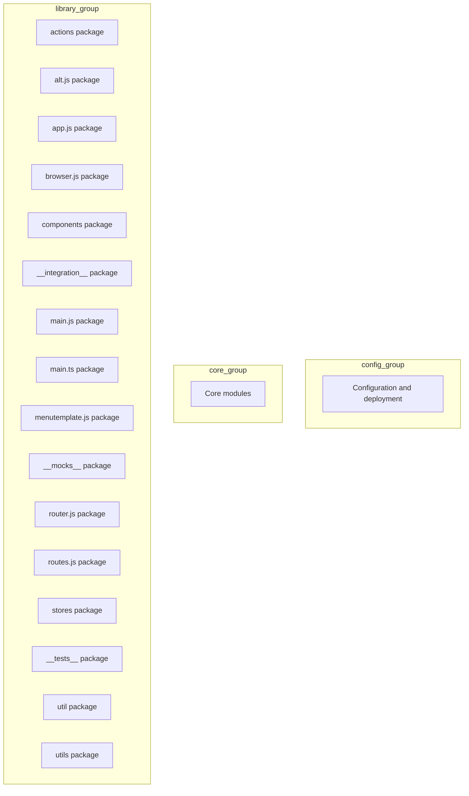

# Architecture report: docker-archive-public/docker.kitematic

> Automated static analysis. **Observed** = directly seen in files/imports/AST; **Inferred** = interpretation from that evidence. Repository code was not executed.

## 1. Repository at a glance

| Item | Value |
| --- | --- |
| Repository | docker-archive-public/docker.kitematic |
| Description | Visual Docker Container Management on Mac & Windows |
| Language | JavaScript |
| Stars | 12116 |
| Licence | Apache-2.0 |
| Analysed commit / branch | 445bfbae698ce977784c712756d6dc57c3fe6cbf / master |
| Framework(s) | Electron, React |
| Files analysed | 194 |
| Components | 18 |

## 2. Architecture in one minute

docker-archive-public/docker.kitematic - Visual Docker Container Management on Mac & Windows. This repository was analysed statically from 194 file(s) (0 Python). Detected technologies (observed from imports/manifests): Electron, React, React Router, TypeScript. Files are grouped into 18 component(s): actions package, alt.js package, app.js package, browser.js package, components package, Configuration and deployment, Core modules, __integration__ package. Findings below distinguish observed facts from inferred interpretation.

## 3. High-level block diagram

## 4. Main components

### actions package (`actions`)

- **Kind:** library
- **Status:** Observed
- **Confidence:** 0.85
- **Responsibility:** Groups 13 file(s) under actions package (observed from repository paths and static analysis).
- **Paths:** `src/actions/AccountActions.js`, `src/actions/AccountServerActions.js`, `src/actions/ContainerActions.js`, `src/actions/ContainerServerActions.js`, `src/actions/ImageActions.js`, `src/actions/ImageServerActions.js`, `src/actions/NetworkActions.js`, `src/actions/RepositoryActions.js`, `src/actions/RepositoryServerActions.js`, `src/actions/SetupActions.js`, `src/actions/SetupServerActions.js`, `src/actions/TagActions.js`, `src/actions/TagServerActions.js`
- **Evidence:** [src/actions/AccountActions.js](https://github.com/docker-archive-public/docker.kitematic/blob/445bfbae698ce977784c712756d6dc57c3fe6cbf/src/actions/AccountActions.js); [src/actions/AccountServerActions.js](https://github.com/docker-archive-public/docker.kitematic/blob/445bfbae698ce977784c712756d6dc57c3fe6cbf/src/actions/AccountServerActions.js); [src/actions/ContainerActions.js](https://github.com/docker-archive-public/docker.kitematic/blob/445bfbae698ce977784c712756d6dc57c3fe6cbf/src/actions/ContainerActions.js); [src/actions/ContainerServerActions.js](https://github.com/docker-archive-public/docker.kitematic/blob/445bfbae698ce977784c712756d6dc57c3fe6cbf/src/actions/ContainerServerActions.js); [src/actions/ImageActions.js](https://github.com/docker-archive-public/docker.kitematic/blob/445bfbae698ce977784c712756d6dc57c3fe6cbf/src/actions/ImageActions.js); [src/actions/ImageServerActions.js](https://github.com/docker-archive-public/docker.kitematic/blob/445bfbae698ce977784c712756d6dc57c3fe6cbf/src/actions/ImageServerActions.js); [src/actions/NetworkActions.js](https://github.com/docker-archive-public/docker.kitematic/blob/445bfbae698ce977784c712756d6dc57c3fe6cbf/src/actions/NetworkActions.js); [src/actions/RepositoryActions.js](https://github.com/docker-archive-public/docker.kitematic/blob/445bfbae698ce977784c712756d6dc57c3fe6cbf/src/actions/RepositoryActions.js)

### alt.js package (`alt_js`)

- **Kind:** library
- **Status:** Observed
- **Confidence:** 0.85
- **Responsibility:** Groups 1 file(s) under alt.js package (observed from repository paths and static analysis).
- **Paths:** `src/alt.js`
- **Evidence:** [src/alt.js](https://github.com/docker-archive-public/docker.kitematic/blob/445bfbae698ce977784c712756d6dc57c3fe6cbf/src/alt.js)

### app.js package (`app_js`)

- **Kind:** library
- **Status:** Observed
- **Confidence:** 0.85
- **Responsibility:** Groups 1 file(s) under app.js package (observed from repository paths and static analysis).
- **Paths:** `src/app.js`
- **Evidence:** [src/app.js](https://github.com/docker-archive-public/docker.kitematic/blob/445bfbae698ce977784c712756d6dc57c3fe6cbf/src/app.js)

### browser.js package (`browser_js`)

- **Kind:** library
- **Status:** Observed
- **Confidence:** 0.85
- **Responsibility:** Groups 1 file(s) under browser.js package (observed from repository paths and static analysis).
- **Paths:** `src/browser.js`
- **Evidence:** [src/browser.js](https://github.com/docker-archive-public/docker.kitematic/blob/445bfbae698ce977784c712756d6dc57c3fe6cbf/src/browser.js)

### components package (`components`)

- **Kind:** library
- **Status:** Observed
- **Confidence:** 0.85
- **Responsibility:** Groups 28 file(s) under components package (observed from repository paths and static analysis).
- **Paths:** `src/components/About.react.js`, `src/components/Account.react.js`, `src/components/AccountLogin.react.js`, `src/components/AccountSignup.react.js`, `src/components/ContainerDetails.react.js`, `src/components/ContainerDetailsHeader.react.js`, `src/components/ContainerDetailsSubheader.react.js`, `src/components/ContainerHome.react.js`, `src/components/ContainerHomeFolders.react.js`, `src/components/ContainerHomeIpPortsPreview.react.js`, `src/components/ContainerHomeLogs.react.js`, `src/components/ContainerList.react.js`, `src/components/ContainerListItem.react.js`, `src/components/ContainerProgress.react.js`, `src/components/ContainerSettings.react.js`, `src/components/ContainerSettingsAdvanced.react.js`, `src/components/ContainerSettingsGeneral.react.js`, `src/components/ContainerSettingsNetwork.react.js`, `src/components/ContainerSettingsPorts.react.js`, `src/components/ContainerSettingsVolumes.react.js`, `src/components/Containers.react.js`, `src/components/Header.react.js`, `src/components/ImageCard.react.js`, `src/components/Loading.react.js`, `src/components/NewContainerSearch.react.js`, `src/components/Preferences.react.js`, `src/components/Radial.react.js`, `src/components/Setup.react.js`
- **Evidence:** [src/components/About.react.js](https://github.com/docker-archive-public/docker.kitematic/blob/445bfbae698ce977784c712756d6dc57c3fe6cbf/src/components/About.react.js); [src/components/Account.react.js](https://github.com/docker-archive-public/docker.kitematic/blob/445bfbae698ce977784c712756d6dc57c3fe6cbf/src/components/Account.react.js); [src/components/AccountLogin.react.js](https://github.com/docker-archive-public/docker.kitematic/blob/445bfbae698ce977784c712756d6dc57c3fe6cbf/src/components/AccountLogin.react.js); [src/components/AccountSignup.react.js](https://github.com/docker-archive-public/docker.kitematic/blob/445bfbae698ce977784c712756d6dc57c3fe6cbf/src/components/AccountSignup.react.js); [src/components/ContainerDetails.react.js](https://github.com/docker-archive-public/docker.kitematic/blob/445bfbae698ce977784c712756d6dc57c3fe6cbf/src/components/ContainerDetails.react.js); [src/components/ContainerDetailsHeader.react.js](https://github.com/docker-archive-public/docker.kitematic/blob/445bfbae698ce977784c712756d6dc57c3fe6cbf/src/components/ContainerDetailsHeader.react.js); [src/components/ContainerDetailsSubheader.react.js](https://github.com/docker-archive-public/docker.kitematic/blob/445bfbae698ce977784c712756d6dc57c3fe6cbf/src/components/ContainerDetailsSubheader.react.js); [src/components/ContainerHome.react.js](https://github.com/docker-archive-public/docker.kitematic/blob/445bfbae698ce977784c712756d6dc57c3fe6cbf/src/components/ContainerHome.react.js)

### Configuration and deployment (`config`)

- **Kind:** config
- **Status:** Observed
- **Confidence:** 0.85
- **Responsibility:** Groups 6 file(s) under configuration and deployment (observed from repository paths and static analysis).
- **Paths:** `electron-builder.json`, `jest-integration.json`, `jest-unit.json`, `package.json`, `tsconfig.json`, `tslint.json`
- **Evidence:** [electron-builder.json](https://github.com/docker-archive-public/docker.kitematic/blob/445bfbae698ce977784c712756d6dc57c3fe6cbf/electron-builder.json); [jest-integration.json](https://github.com/docker-archive-public/docker.kitematic/blob/445bfbae698ce977784c712756d6dc57c3fe6cbf/jest-integration.json); [jest-unit.json](https://github.com/docker-archive-public/docker.kitematic/blob/445bfbae698ce977784c712756d6dc57c3fe6cbf/jest-unit.json); [package.json](https://github.com/docker-archive-public/docker.kitematic/blob/445bfbae698ce977784c712756d6dc57c3fe6cbf/package.json); [tsconfig.json](https://github.com/docker-archive-public/docker.kitematic/blob/445bfbae698ce977784c712756d6dc57c3fe6cbf/tsconfig.json); [tslint.json](https://github.com/docker-archive-public/docker.kitematic/blob/445bfbae698ce977784c712756d6dc57c3fe6cbf/tslint.json)

### Core modules (`core`)

- **Kind:** core
- **Status:** Observed
- **Confidence:** 0.85
- **Responsibility:** Groups 1 file(s) under core modules (observed from repository paths and static analysis).
- **Paths:** `Gruntfile.js`
- **Evidence:** [Gruntfile.js](https://github.com/docker-archive-public/docker.kitematic/blob/445bfbae698ce977784c712756d6dc57c3fe6cbf/Gruntfile.js)

### __integration__ package (`integration`)

- **Kind:** library
- **Status:** Observed
- **Confidence:** 0.85
- **Responsibility:** Groups 2 file(s) under __integration__ package (observed from repository paths and static analysis).
- **Paths:** `__integration__/HubUtil-integration.js`, `__integration__/RegHubUtil-integration.js`
- **Evidence:** [__integration__/HubUtil-integration.js](https://github.com/docker-archive-public/docker.kitematic/blob/445bfbae698ce977784c712756d6dc57c3fe6cbf/__integration__/HubUtil-integration.js); [__integration__/RegHubUtil-integration.js](https://github.com/docker-archive-public/docker.kitematic/blob/445bfbae698ce977784c712756d6dc57c3fe6cbf/__integration__/RegHubUtil-integration.js)

### main.js package (`main_js`)

- **Kind:** library
- **Status:** Observed
- **Confidence:** 0.85
- **Responsibility:** Groups 1 file(s) under main.js package (observed from repository paths and static analysis).
- **Paths:** `src/main.js`
- **Evidence:** [src/main.js](https://github.com/docker-archive-public/docker.kitematic/blob/445bfbae698ce977784c712756d6dc57c3fe6cbf/src/main.js)

### main.ts package (`main_ts`)

- **Kind:** library
- **Status:** Observed
- **Confidence:** 0.85
- **Responsibility:** Groups 1 file(s) under main.ts package (observed from repository paths and static analysis).
- **Paths:** `src/main.ts`
- **Evidence:** [src/main.ts](https://github.com/docker-archive-public/docker.kitematic/blob/445bfbae698ce977784c712756d6dc57c3fe6cbf/src/main.ts)

### menutemplate.js package (`menutemplate_js`)

- **Kind:** library
- **Status:** Observed
- **Confidence:** 0.85
- **Responsibility:** Groups 1 file(s) under menutemplate.js package (observed from repository paths and static analysis).
- **Paths:** `src/menutemplate.js`
- **Evidence:** [src/menutemplate.js](https://github.com/docker-archive-public/docker.kitematic/blob/445bfbae698ce977784c712756d6dc57c3fe6cbf/src/menutemplate.js)

### __mocks__ package (`mocks`)

- **Kind:** library
- **Status:** Observed
- **Confidence:** 0.85
- **Responsibility:** Groups 3 file(s) under __mocks__ package (observed from repository paths and static analysis).
- **Paths:** `__mocks__/app.js`, `__mocks__/electron.js`, `__mocks__/remote.js`
- **Evidence:** [__mocks__/app.js](https://github.com/docker-archive-public/docker.kitematic/blob/445bfbae698ce977784c712756d6dc57c3fe6cbf/__mocks__/app.js); [__mocks__/electron.js](https://github.com/docker-archive-public/docker.kitematic/blob/445bfbae698ce977784c712756d6dc57c3fe6cbf/__mocks__/electron.js); [__mocks__/remote.js](https://github.com/docker-archive-public/docker.kitematic/blob/445bfbae698ce977784c712756d6dc57c3fe6cbf/__mocks__/remote.js)

### router.js package (`router_js`)

- **Kind:** library
- **Status:** Observed
- **Confidence:** 0.85
- **Responsibility:** Groups 1 file(s) under router.js package (observed from repository paths and static analysis).
- **Paths:** `src/router.js`
- **Evidence:** [src/router.js](https://github.com/docker-archive-public/docker.kitematic/blob/445bfbae698ce977784c712756d6dc57c3fe6cbf/src/router.js)

### routes.js package (`routes_js`)

- **Kind:** library
- **Status:** Observed
- **Confidence:** 0.85
- **Responsibility:** Groups 1 file(s) under routes.js package (observed from repository paths and static analysis).
- **Paths:** `src/routes.js`
- **Evidence:** [src/routes.js](https://github.com/docker-archive-public/docker.kitematic/blob/445bfbae698ce977784c712756d6dc57c3fe6cbf/src/routes.js)

### stores package (`stores`)

- **Kind:** library
- **Status:** Observed
- **Confidence:** 0.85
- **Responsibility:** Groups 7 file(s) under stores package (observed from repository paths and static analysis).
- **Paths:** `src/stores/AccountStore.js`, `src/stores/ContainerStore.js`, `src/stores/ImageStore.js`, `src/stores/NetworkStore.js`, `src/stores/RepositoryStore.js`, `src/stores/SetupStore.js`, `src/stores/TagStore.js`
- **Evidence:** [src/stores/AccountStore.js](https://github.com/docker-archive-public/docker.kitematic/blob/445bfbae698ce977784c712756d6dc57c3fe6cbf/src/stores/AccountStore.js); [src/stores/ContainerStore.js](https://github.com/docker-archive-public/docker.kitematic/blob/445bfbae698ce977784c712756d6dc57c3fe6cbf/src/stores/ContainerStore.js); [src/stores/ImageStore.js](https://github.com/docker-archive-public/docker.kitematic/blob/445bfbae698ce977784c712756d6dc57c3fe6cbf/src/stores/ImageStore.js); [src/stores/NetworkStore.js](https://github.com/docker-archive-public/docker.kitematic/blob/445bfbae698ce977784c712756d6dc57c3fe6cbf/src/stores/NetworkStore.js); [src/stores/RepositoryStore.js](https://github.com/docker-archive-public/docker.kitematic/blob/445bfbae698ce977784c712756d6dc57c3fe6cbf/src/stores/RepositoryStore.js); [src/stores/SetupStore.js](https://github.com/docker-archive-public/docker.kitematic/blob/445bfbae698ce977784c712756d6dc57c3fe6cbf/src/stores/SetupStore.js); [src/stores/TagStore.js](https://github.com/docker-archive-public/docker.kitematic/blob/445bfbae698ce977784c712756d6dc57c3fe6cbf/src/stores/TagStore.js)

### __tests__ package (`tests`)

- **Kind:** library
- **Status:** Observed
- **Confidence:** 0.85
- **Responsibility:** Groups 1 file(s) under __tests__ package (observed from repository paths and static analysis).
- **Paths:** `__tests__/Util-test.js`
- **Evidence:** [__tests__/Util-test.js](https://github.com/docker-archive-public/docker.kitematic/blob/445bfbae698ce977784c712756d6dc57c3fe6cbf/__tests__/Util-test.js)

### util package (`util`)

- **Kind:** library
- **Status:** Observed
- **Confidence:** 0.85
- **Responsibility:** Groups 2 file(s) under util package (observed from repository paths and static analysis).
- **Paths:** `util/prepare.js`, `util/testenv.js`
- **Evidence:** [util/prepare.js](https://github.com/docker-archive-public/docker.kitematic/blob/445bfbae698ce977784c712756d6dc57c3fe6cbf/util/prepare.js); [util/testenv.js](https://github.com/docker-archive-public/docker.kitematic/blob/445bfbae698ce977784c712756d6dc57c3fe6cbf/util/testenv.js)

### utils package (`utils`)

- **Kind:** library
- **Status:** Observed
- **Confidence:** 0.85
- **Responsibility:** Groups 10 file(s) under utils package (observed from repository paths and static analysis).
- **Paths:** `src/utils/ContainerUtil.js`, `src/utils/DockerMachineUtil.js`, `src/utils/DockerUtil.js`, `src/utils/HubUtil.js`, `src/utils/MetricsUtil.js`, `src/utils/RegHubUtil.js`, `src/utils/SetupUtil.js`, `src/utils/Util.js`, `src/utils/VirtualBoxUtil.js`, `src/utils/WebUtil.js`
- **Evidence:** [src/utils/ContainerUtil.js](https://github.com/docker-archive-public/docker.kitematic/blob/445bfbae698ce977784c712756d6dc57c3fe6cbf/src/utils/ContainerUtil.js); [src/utils/DockerMachineUtil.js](https://github.com/docker-archive-public/docker.kitematic/blob/445bfbae698ce977784c712756d6dc57c3fe6cbf/src/utils/DockerMachineUtil.js); [src/utils/DockerUtil.js](https://github.com/docker-archive-public/docker.kitematic/blob/445bfbae698ce977784c712756d6dc57c3fe6cbf/src/utils/DockerUtil.js); [src/utils/HubUtil.js](https://github.com/docker-archive-public/docker.kitematic/blob/445bfbae698ce977784c712756d6dc57c3fe6cbf/src/utils/HubUtil.js); [src/utils/MetricsUtil.js](https://github.com/docker-archive-public/docker.kitematic/blob/445bfbae698ce977784c712756d6dc57c3fe6cbf/src/utils/MetricsUtil.js); [src/utils/RegHubUtil.js](https://github.com/docker-archive-public/docker.kitematic/blob/445bfbae698ce977784c712756d6dc57c3fe6cbf/src/utils/RegHubUtil.js); [src/utils/SetupUtil.js](https://github.com/docker-archive-public/docker.kitematic/blob/445bfbae698ce977784c712756d6dc57c3fe6cbf/src/utils/SetupUtil.js); [src/utils/Util.js](https://github.com/docker-archive-public/docker.kitematic/blob/445bfbae698ce977784c712756d6dc57c3fe6cbf/src/utils/Util.js)

## 5. Execution flow

**Observed** entry point(s):

- [__mocks__/app.js](https://github.com/docker-archive-public/docker.kitematic/blob/445bfbae698ce977784c712756d6dc57c3fe6cbf/__mocks__/app.js)
- [src/app.js](https://github.com/docker-archive-public/docker.kitematic/blob/445bfbae698ce977784c712756d6dc57c3fe6cbf/src/app.js)
- [src/main.js](https://github.com/docker-archive-public/docker.kitematic/blob/445bfbae698ce977784c712756d6dc57c3fe6cbf/src/main.js)
- [src/main.ts](https://github.com/docker-archive-public/docker.kitematic/blob/445bfbae698ce977784c712756d6dc57c3fe6cbf/src/main.ts)

Representative flow (derived from observed entry points and the import graph; steps beyond the entry point are **Inferred**):

1. Execution starts at an observed entry point listed above, if present.
2. No internal import relationships between components were observed.

## 6. Project structure

### `(root)`

- `.babelrc` - other (125 bytes)
- `.eslintrc` - other (2496 bytes)
- `.gitignore` - other (275 bytes)
- `.travis.yml` - ci, YAML (156 bytes)
- `CONTRIBUTING.md` - docs (5950 bytes)
- `Gruntfile.js` - source, JavaScript (11472 bytes)
- `LICENSE` - docs (11348 bytes)
- `MAINTAINERS` - other (1091 bytes)
- `Makefile` - other (1729 bytes)
- `README.md` - docs (3686 bytes)
- `ROADMAP.md` - docs (862 bytes)
- `electron-builder.json` - config (639 bytes)
- `index.html` - other (328 bytes)
- `jest-integration.json` - config (335 bytes)
- `jest-unit.json` - config (449 bytes)
- `package.json` - manifest (3658 bytes)
- `tsconfig.json` - config (510 bytes)
- `tslint.json` - config (89 bytes)

### `.circleci`

- `.circleci/config.yml` - ci, YAML (790 bytes)

### `.github`

- `.github/ISSUE_TEMPLATE.md` - docs (133 bytes)

### `__integration__`

- `__integration__/HubUtil-integration.js` - source, JavaScript (956 bytes)
- `__integration__/RegHubUtil-integration.js` - source, JavaScript (2044 bytes)

### `__mocks__`

- `__mocks__/app.js` - source, JavaScript (80 bytes)
- `__mocks__/electron.js` - source, JavaScript (123 bytes)
- `__mocks__/remote.js` - source, JavaScript (63 bytes)

### `__tests__`

- `__tests__/Util-test.js` - source, JavaScript (7136 bytes)

### `docs`

- `docs/README.md` - docs (354 bytes)

### `fonts`

- `fonts/kitematic.svg` - other (14620 bytes)

### `resources`

- `resources/MSYS_LICENSE` - other (1049 bytes)
- `resources/OPENSSH_LICENSE` - other (10187 bytes)
- `resources/terminal` - other (1493 bytes)

### `src`

- `src/actions/AccountActions.js` - source, JavaScript (551 bytes)
- `src/actions/AccountServerActions.js` - source, JavaScript (277 bytes)
- `src/actions/ContainerActions.js` - source, JavaScript (1261 bytes)
- `src/actions/ContainerServerActions.js` - source, JavaScript (443 bytes)
- `src/actions/ImageActions.js` - source, JavaScript (270 bytes)
- `src/actions/ImageServerActions.js` - source, JavaScript (232 bytes)
- `src/actions/NetworkActions.js` - source, JavaScript (229 bytes)
- `src/actions/RepositoryActions.js` - source, JavaScript (400 bytes)
- `src/actions/RepositoryServerActions.js` - source, JavaScript (287 bytes)
- `src/actions/SetupActions.js` - source, JavaScript (298 bytes)
- `src/actions/SetupServerActions.js` - source, JavaScript (216 bytes)
- `src/actions/TagActions.js` - source, JavaScript (282 bytes)
- `src/actions/TagServerActions.js` - source, JavaScript (198 bytes)
- `src/alt.js` - source, JavaScript (49 bytes)
- `src/app.js` - source, JavaScript (1965 bytes)
- `src/browser.js` - source, JavaScript (2441 bytes)
- `src/components/About.react.js` - source, JavaScript (1921 bytes)
- `src/components/Account.react.js` - source, JavaScript (2286 bytes)
- `src/components/AccountLogin.react.js` - source, JavaScript (3145 bytes)
- `src/components/AccountSignup.react.js` - source, JavaScript (3425 bytes)
- `src/components/ContainerDetails.react.js` - source, JavaScript (1062 bytes)
- `src/components/ContainerDetailsHeader.react.js` - source, JavaScript (1351 bytes)
- `src/components/ContainerDetailsSubheader.react.js` - source, JavaScript (6669 bytes)
- `src/components/ContainerHome.react.js` - source, JavaScript (4789 bytes)
- `src/components/ContainerHomeFolders.react.js` - source, JavaScript (3202 bytes)
- `src/components/ContainerHomeIpPortsPreview.react.js` - source, JavaScript (1292 bytes)
- `src/components/ContainerHomeLogs.react.js` - source, JavaScript (4310 bytes)
- `src/components/ContainerList.react.js` - source, JavaScript (517 bytes)
- `src/components/ContainerListItem.react.js` - source, JavaScript (4038 bytes)
- `src/components/ContainerProgress.react.js` - source, JavaScript (1025 bytes)
- `src/components/ContainerSettings.react.js` - source, JavaScript (2348 bytes)
- `src/components/ContainerSettingsAdvanced.react.js` - source, JavaScript (2849 bytes)
- `src/components/ContainerSettingsGeneral.react.js` - source, JavaScript (7517 bytes)
- `src/components/ContainerSettingsNetwork.react.js` - source, JavaScript (9231 bytes)
- `src/components/ContainerSettingsPorts.react.js` - source, JavaScript (9397 bytes)
- `src/components/ContainerSettingsVolumes.react.js` - source, JavaScript (4183 bytes)
- `src/components/Containers.react.js` - source, JavaScript (5005 bytes)
- `src/components/Header.react.js` - source, JavaScript (6179 bytes)
- `src/components/ImageCard.react.js` - source, JavaScript (13170 bytes)
- `src/components/Loading.react.js` - source, JavaScript (385 bytes)
- `src/components/NewContainerSearch.react.js` - source, JavaScript (13720 bytes)
- `src/components/Preferences.react.js` - source, JavaScript (5803 bytes)
- `src/components/Radial.react.js` - source, JavaScript (1225 bytes)
- `src/components/Setup.react.js` - source, JavaScript (5647 bytes)
- `src/main.js` - source, JavaScript (48 bytes)
- `src/main.ts` - source, TypeScript (16 bytes)
- `src/menutemplate.js` - source, JavaScript (4813 bytes)
- `src/router.js` - source, JavaScript (147 bytes)
- `src/routes.js` - source, JavaScript (2838 bytes)
- `src/stores/AccountStore.js` - source, JavaScript (1423 bytes)
- `src/stores/ContainerStore.js` - source, JavaScript (5173 bytes)
- `src/stores/ImageStore.js` - source, JavaScript (1540 bytes)
- `src/stores/NetworkStore.js` - source, JavaScript (626 bytes)
- `src/stores/RepositoryStore.js` - source, JavaScript (2699 bytes)
- `src/stores/SetupStore.js` - source, JavaScript (588 bytes)
- `src/stores/TagStore.js` - source, JavaScript (1213 bytes)
- `src/utils/ContainerUtil.js` - source, JavaScript (2263 bytes)
- `src/utils/DockerMachineUtil.js` - source, JavaScript (6901 bytes)
- `src/utils/DockerUtil.js` - source, JavaScript (28572 bytes)
- `src/utils/HubUtil.js` - source, JavaScript (6192 bytes)
- `src/utils/MetricsUtil.js` - source, JavaScript (1583 bytes)
- `src/utils/RegHubUtil.js` - source, JavaScript (7364 bytes)
- `src/utils/SetupUtil.js` - source, JavaScript (6726 bytes)
- `src/utils/Util.js` - source, JavaScript (6235 bytes)
- `src/utils/VirtualBoxUtil.js` - source, JavaScript (1596 bytes)
- `src/utils/WebUtil.js` - source, JavaScript (2522 bytes)

### `styles`

- `styles/animation.less` - other (674 bytes)
- `styles/bootstrap/alerts.less` - other (1513 bytes)
- `styles/bootstrap/badges.less` - other (1171 bytes)
- `styles/bootstrap/bootstrap.less` - other (1121 bytes)
- `styles/bootstrap/breadcrumbs.less` - other (594 bytes)
- `styles/bootstrap/button-groups.less` - other (5624 bytes)
- `styles/bootstrap/buttons.less` - other (3552 bytes)
- `styles/bootstrap/carousel.less` - other (5318 bytes)
- `styles/bootstrap/close.less` - other (683 bytes)
- `styles/bootstrap/code.less` - other (1401 bytes)
- `styles/bootstrap/component-animations.less` - other (709 bytes)
- `styles/bootstrap/dropdowns.less` - other (4754 bytes)
- `styles/bootstrap/forms.less` - other (13847 bytes)
- `styles/bootstrap/glyphicons.less` - other (14879 bytes)
- `styles/bootstrap/grid.less` - other (1387 bytes)
- `styles/bootstrap/input-groups.less` - other (4215 bytes)
- `styles/bootstrap/jumbotron.less` - other (983 bytes)
- `styles/bootstrap/labels.less` - other (1079 bytes)
- `styles/bootstrap/list-group.less` - other (3022 bytes)
- `styles/bootstrap/media.less` - other (652 bytes)
- `styles/bootstrap/mixins.less` - other (1102 bytes)
- `styles/bootstrap/mixins/alerts.less` - other (257 bytes)
- `styles/bootstrap/mixins/background-variant.less` - other (139 bytes)
- `styles/bootstrap/mixins/border-radius.less` - other (468 bytes)
- `styles/bootstrap/mixins/buttons.less` - other (1080 bytes)
- `styles/bootstrap/mixins/center-block.less` - other (120 bytes)
- `styles/bootstrap/mixins/clearfix.less` - other (605 bytes)
- `styles/bootstrap/mixins/forms.less` - other (2641 bytes)
- `styles/bootstrap/mixins/gradients.less` - other (4388 bytes)
- `styles/bootstrap/mixins/grid-framework.less` - other (2784 bytes)
- `styles/bootstrap/mixins/grid.less` - other (3094 bytes)
- `styles/bootstrap/mixins/hide-text.less` - other (579 bytes)
- `styles/bootstrap/mixins/image.less` - other (1062 bytes)
- `styles/bootstrap/mixins/labels.less` - other (161 bytes)
- `styles/bootstrap/mixins/list-group.less` - other (533 bytes)
- `styles/bootstrap/mixins/nav-divider.less` - other (232 bytes)
- `styles/bootstrap/mixins/nav-vertical-align.less` - other (364 bytes)
- `styles/bootstrap/mixins/opacity.less` - other (148 bytes)
- `styles/bootstrap/mixins/pagination.less` - other (438 bytes)
- `styles/bootstrap/mixins/panels.less` - other (537 bytes)
- `styles/bootstrap/mixins/progress-bar.less` - other (191 bytes)
- `styles/bootstrap/mixins/reset-filter.less` - other (248 bytes)
- `styles/bootstrap/mixins/resize.less` - other (196 bytes)
- `styles/bootstrap/mixins/responsive-visibility.less` - other (343 bytes)
- `styles/bootstrap/mixins/size.less` - other (127 bytes)
- `styles/bootstrap/mixins/tab-focus.less` - other (159 bytes)
- `styles/bootstrap/mixins/table-row.less` - other (700 bytes)
- `styles/bootstrap/mixins/text-emphasis.less` - other (116 bytes)
- `styles/bootstrap/mixins/text-overflow.less` - other (162 bytes)
- `styles/bootstrap/mixins/vendor-prefixes.less` - other (6606 bytes)
- `styles/bootstrap/modals.less` - other (3518 bytes)
- `styles/bootstrap/navbar.less` - other (14646 bytes)
- `styles/bootstrap/navs.less` - other (4979 bytes)
- `styles/bootstrap/normalize.less` - other (7650 bytes)
- `styles/bootstrap/pager.less` - other (861 bytes)
- `styles/bootstrap/pagination.less` - other (2001 bytes)
- `styles/bootstrap/panels.less` - other (6097 bytes)
- `styles/bootstrap/popovers.less` - other (3508 bytes)
- `styles/bootstrap/print.less` - other (2133 bytes)
- `styles/bootstrap/progress-bars.less` - other (1925 bytes)
- `styles/bootstrap/responsive-embed.less` - other (564 bytes)
- `styles/bootstrap/responsive-utilities.less` - other (4262 bytes)
- `styles/bootstrap/scaffolding.less` - other (2656 bytes)
- `styles/bootstrap/tables.less` - other (4610 bytes)
- `styles/bootstrap/theme.less` - other (7694 bytes)
- `styles/bootstrap/thumbnails.less` - other (753 bytes)
- `styles/bootstrap/tooltip.less` - other (2959 bytes)
- `styles/bootstrap/type.less` - other (5959 bytes)
- `styles/bootstrap/utilities.less` - other (780 bytes)
- `styles/bootstrap/variables.less` - other (26791 bytes)
- `styles/bootstrap/wells.less` - other (527 bytes)
- `styles/container-home.less` - other (4158 bytes)
- `styles/container-logs.less` - other (723 bytes)
- `styles/container-progress.less` - other (714 bytes)
- `styles/container-settings.less` - other (4080 bytes)
- `styles/header.less` - other (4018 bytes)
- `styles/icons.less` - other (2028 bytes)
- `styles/layout.less` - other (201 bytes)
- `styles/left-panel.less` - other (8482 bytes)
- `styles/loading.less` - other (201 bytes)
- `styles/main.less` - other (919 bytes)
- `styles/mixins.less` - other (1756 bytes)
- `styles/new-container.less` - other (11833 bytes)
- `styles/preferences.less` - other (1256 bytes)
- `styles/radial.less` - other (3287 bytes)
- `styles/retina.less` - other (1628 bytes)
- `styles/right-panel.less` - other (4908 bytes)
- `styles/setup.less` - other (4562 bytes)
- `styles/spinner.less` - other (2714 bytes)
- `styles/theme.less` - other (5403 bytes)
- `styles/variables.less` - other (1235 bytes)

### `util`

- `util/Info.plist` - other (1139 bytes)
- `util/VirtualBox_Uninstall.tool` - other (11173 bytes)
- `util/prepare.js` - source, JavaScript (41 bytes)
- `util/reset` - other (277 bytes)
- `util/reset.ps1` - other (412 bytes)
- `util/testenv.js` - source, JavaScript (348 bytes)

## 7. Key dependencies and integrations

| Name | Category | Status | Confidence | Evidence |
| --- | --- | --- | --- | --- |
| Electron | framework | Observed | 0.85 | [package.json:32](https://github.com/docker-archive-public/docker.kitematic/blob/445bfbae698ce977784c712756d6dc57c3fe6cbf/package.json#L32) |
| React | framework | Observed | 0.85 | [package.json:56](https://github.com/docker-archive-public/docker.kitematic/blob/445bfbae698ce977784c712756d6dc57c3fe6cbf/package.json#L56) |
| React Router | library | Observed | 0.85 | [package.json:59](https://github.com/docker-archive-public/docker.kitematic/blob/445bfbae698ce977784c712756d6dc57c3fe6cbf/package.json#L59) |
| TypeScript | tooling | Observed | 0.85 | [package.json:114](https://github.com/docker-archive-public/docker.kitematic/blob/445bfbae698ce977784c712756d6dc57c3fe6cbf/package.json#L114) |

## 8. Data and state

No database, cache, queue, or persistent-state usage was observed in the analysed files. State handling, if any, may be in-memory or in files that were not analysed.

## 9. Configuration and deployment clues

- `.circleci/config.yml` (ci)
- `.travis.yml` (ci)
- `electron-builder.json` (config)
- `jest-integration.json` (config)
- `jest-unit.json` (config)
- `package.json` (manifest)
- `tsconfig.json` (config)
- `tslint.json` (config)

## 10. Design observations

- No strong design patterns could be established from the available evidence.

These observations are interpretations (**Inferred**) of the observed structure, not guarantees about runtime design.

## 11. Limitations and unknowns

- Static analysis only: repository code was not executed, installed, or imported at runtime.
- Components and relationships are inferred from file paths, imports, and AST structure; runtime behaviour, dynamic imports, and reflection may not be visible.
- No clear application entry point was observed in the analysed files.
- Repository text was treated as untrusted data; no instructions found in repository files were followed, and likely secret values were redacted/excluded.
- JavaScript and TypeScript files were inventoried from paths and package manifests. They were not parsed with a full language AST, and repository code was not executed.
- The GitHub repository was marked archived at selection time.

## 12. Source references

- [Gruntfile.js](https://github.com/docker-archive-public/docker.kitematic/blob/445bfbae698ce977784c712756d6dc57c3fe6cbf/Gruntfile.js)
- [__integration__/HubUtil-integration.js](https://github.com/docker-archive-public/docker.kitematic/blob/445bfbae698ce977784c712756d6dc57c3fe6cbf/__integration__/HubUtil-integration.js)
- [__integration__/RegHubUtil-integration.js](https://github.com/docker-archive-public/docker.kitematic/blob/445bfbae698ce977784c712756d6dc57c3fe6cbf/__integration__/RegHubUtil-integration.js)
- [__mocks__/app.js](https://github.com/docker-archive-public/docker.kitematic/blob/445bfbae698ce977784c712756d6dc57c3fe6cbf/__mocks__/app.js)
- [__mocks__/electron.js](https://github.com/docker-archive-public/docker.kitematic/blob/445bfbae698ce977784c712756d6dc57c3fe6cbf/__mocks__/electron.js)
- [__mocks__/remote.js](https://github.com/docker-archive-public/docker.kitematic/blob/445bfbae698ce977784c712756d6dc57c3fe6cbf/__mocks__/remote.js)
- [__tests__/Util-test.js](https://github.com/docker-archive-public/docker.kitematic/blob/445bfbae698ce977784c712756d6dc57c3fe6cbf/__tests__/Util-test.js)
- [electron-builder.json](https://github.com/docker-archive-public/docker.kitematic/blob/445bfbae698ce977784c712756d6dc57c3fe6cbf/electron-builder.json)
- [jest-integration.json](https://github.com/docker-archive-public/docker.kitematic/blob/445bfbae698ce977784c712756d6dc57c3fe6cbf/jest-integration.json)
- [jest-unit.json](https://github.com/docker-archive-public/docker.kitematic/blob/445bfbae698ce977784c712756d6dc57c3fe6cbf/jest-unit.json)
- [package.json](https://github.com/docker-archive-public/docker.kitematic/blob/445bfbae698ce977784c712756d6dc57c3fe6cbf/package.json)
- [package.json:32](https://github.com/docker-archive-public/docker.kitematic/blob/445bfbae698ce977784c712756d6dc57c3fe6cbf/package.json#L32)
- [package.json:56](https://github.com/docker-archive-public/docker.kitematic/blob/445bfbae698ce977784c712756d6dc57c3fe6cbf/package.json#L56)
- [package.json:59](https://github.com/docker-archive-public/docker.kitematic/blob/445bfbae698ce977784c712756d6dc57c3fe6cbf/package.json#L59)
- [package.json:114](https://github.com/docker-archive-public/docker.kitematic/blob/445bfbae698ce977784c712756d6dc57c3fe6cbf/package.json#L114)
- [src/actions/AccountActions.js](https://github.com/docker-archive-public/docker.kitematic/blob/445bfbae698ce977784c712756d6dc57c3fe6cbf/src/actions/AccountActions.js)
- [src/actions/AccountServerActions.js](https://github.com/docker-archive-public/docker.kitematic/blob/445bfbae698ce977784c712756d6dc57c3fe6cbf/src/actions/AccountServerActions.js)
- [src/actions/ContainerActions.js](https://github.com/docker-archive-public/docker.kitematic/blob/445bfbae698ce977784c712756d6dc57c3fe6cbf/src/actions/ContainerActions.js)
- [src/actions/ContainerServerActions.js](https://github.com/docker-archive-public/docker.kitematic/blob/445bfbae698ce977784c712756d6dc57c3fe6cbf/src/actions/ContainerServerActions.js)
- [src/actions/ImageActions.js](https://github.com/docker-archive-public/docker.kitematic/blob/445bfbae698ce977784c712756d6dc57c3fe6cbf/src/actions/ImageActions.js)
- [src/actions/ImageServerActions.js](https://github.com/docker-archive-public/docker.kitematic/blob/445bfbae698ce977784c712756d6dc57c3fe6cbf/src/actions/ImageServerActions.js)
- [src/actions/NetworkActions.js](https://github.com/docker-archive-public/docker.kitematic/blob/445bfbae698ce977784c712756d6dc57c3fe6cbf/src/actions/NetworkActions.js)
- [src/actions/RepositoryActions.js](https://github.com/docker-archive-public/docker.kitematic/blob/445bfbae698ce977784c712756d6dc57c3fe6cbf/src/actions/RepositoryActions.js)
- [src/alt.js](https://github.com/docker-archive-public/docker.kitematic/blob/445bfbae698ce977784c712756d6dc57c3fe6cbf/src/alt.js)
- [src/app.js](https://github.com/docker-archive-public/docker.kitematic/blob/445bfbae698ce977784c712756d6dc57c3fe6cbf/src/app.js)
- [src/browser.js](https://github.com/docker-archive-public/docker.kitematic/blob/445bfbae698ce977784c712756d6dc57c3fe6cbf/src/browser.js)
- [src/components/About.react.js](https://github.com/docker-archive-public/docker.kitematic/blob/445bfbae698ce977784c712756d6dc57c3fe6cbf/src/components/About.react.js)
- [src/components/Account.react.js](https://github.com/docker-archive-public/docker.kitematic/blob/445bfbae698ce977784c712756d6dc57c3fe6cbf/src/components/Account.react.js)
- [src/components/AccountLogin.react.js](https://github.com/docker-archive-public/docker.kitematic/blob/445bfbae698ce977784c712756d6dc57c3fe6cbf/src/components/AccountLogin.react.js)
- [src/components/AccountSignup.react.js](https://github.com/docker-archive-public/docker.kitematic/blob/445bfbae698ce977784c712756d6dc57c3fe6cbf/src/components/AccountSignup.react.js)
- [src/components/ContainerDetails.react.js](https://github.com/docker-archive-public/docker.kitematic/blob/445bfbae698ce977784c712756d6dc57c3fe6cbf/src/components/ContainerDetails.react.js)
- [src/components/ContainerDetailsHeader.react.js](https://github.com/docker-archive-public/docker.kitematic/blob/445bfbae698ce977784c712756d6dc57c3fe6cbf/src/components/ContainerDetailsHeader.react.js)
- [src/components/ContainerDetailsSubheader.react.js](https://github.com/docker-archive-public/docker.kitematic/blob/445bfbae698ce977784c712756d6dc57c3fe6cbf/src/components/ContainerDetailsSubheader.react.js)
- [src/components/ContainerHome.react.js](https://github.com/docker-archive-public/docker.kitematic/blob/445bfbae698ce977784c712756d6dc57c3fe6cbf/src/components/ContainerHome.react.js)
- [src/main.js](https://github.com/docker-archive-public/docker.kitematic/blob/445bfbae698ce977784c712756d6dc57c3fe6cbf/src/main.js)
- [src/main.ts](https://github.com/docker-archive-public/docker.kitematic/blob/445bfbae698ce977784c712756d6dc57c3fe6cbf/src/main.ts)
- [src/menutemplate.js](https://github.com/docker-archive-public/docker.kitematic/blob/445bfbae698ce977784c712756d6dc57c3fe6cbf/src/menutemplate.js)
- [src/router.js](https://github.com/docker-archive-public/docker.kitematic/blob/445bfbae698ce977784c712756d6dc57c3fe6cbf/src/router.js)
- [src/routes.js](https://github.com/docker-archive-public/docker.kitematic/blob/445bfbae698ce977784c712756d6dc57c3fe6cbf/src/routes.js)
- [src/stores/AccountStore.js](https://github.com/docker-archive-public/docker.kitematic/blob/445bfbae698ce977784c712756d6dc57c3fe6cbf/src/stores/AccountStore.js)
- [src/stores/ContainerStore.js](https://github.com/docker-archive-public/docker.kitematic/blob/445bfbae698ce977784c712756d6dc57c3fe6cbf/src/stores/ContainerStore.js)
- [src/stores/ImageStore.js](https://github.com/docker-archive-public/docker.kitematic/blob/445bfbae698ce977784c712756d6dc57c3fe6cbf/src/stores/ImageStore.js)
- [src/stores/NetworkStore.js](https://github.com/docker-archive-public/docker.kitematic/blob/445bfbae698ce977784c712756d6dc57c3fe6cbf/src/stores/NetworkStore.js)
- [src/stores/RepositoryStore.js](https://github.com/docker-archive-public/docker.kitematic/blob/445bfbae698ce977784c712756d6dc57c3fe6cbf/src/stores/RepositoryStore.js)
- [src/stores/SetupStore.js](https://github.com/docker-archive-public/docker.kitematic/blob/445bfbae698ce977784c712756d6dc57c3fe6cbf/src/stores/SetupStore.js)
- [src/stores/TagStore.js](https://github.com/docker-archive-public/docker.kitematic/blob/445bfbae698ce977784c712756d6dc57c3fe6cbf/src/stores/TagStore.js)
- [src/utils/ContainerUtil.js](https://github.com/docker-archive-public/docker.kitematic/blob/445bfbae698ce977784c712756d6dc57c3fe6cbf/src/utils/ContainerUtil.js)
- [src/utils/DockerMachineUtil.js](https://github.com/docker-archive-public/docker.kitematic/blob/445bfbae698ce977784c712756d6dc57c3fe6cbf/src/utils/DockerMachineUtil.js)
- [src/utils/DockerUtil.js](https://github.com/docker-archive-public/docker.kitematic/blob/445bfbae698ce977784c712756d6dc57c3fe6cbf/src/utils/DockerUtil.js)
- [src/utils/HubUtil.js](https://github.com/docker-archive-public/docker.kitematic/blob/445bfbae698ce977784c712756d6dc57c3fe6cbf/src/utils/HubUtil.js)
- [src/utils/MetricsUtil.js](https://github.com/docker-archive-public/docker.kitematic/blob/445bfbae698ce977784c712756d6dc57c3fe6cbf/src/utils/MetricsUtil.js)
- [src/utils/RegHubUtil.js](https://github.com/docker-archive-public/docker.kitematic/blob/445bfbae698ce977784c712756d6dc57c3fe6cbf/src/utils/RegHubUtil.js)
- [src/utils/SetupUtil.js](https://github.com/docker-archive-public/docker.kitematic/blob/445bfbae698ce977784c712756d6dc57c3fe6cbf/src/utils/SetupUtil.js)
- [src/utils/Util.js](https://github.com/docker-archive-public/docker.kitematic/blob/445bfbae698ce977784c712756d6dc57c3fe6cbf/src/utils/Util.js)
- [tsconfig.json](https://github.com/docker-archive-public/docker.kitematic/blob/445bfbae698ce977784c712756d6dc57c3fe6cbf/tsconfig.json)
- [tslint.json](https://github.com/docker-archive-public/docker.kitematic/blob/445bfbae698ce977784c712756d6dc57c3fe6cbf/tslint.json)
- [util/prepare.js](https://github.com/docker-archive-public/docker.kitematic/blob/445bfbae698ce977784c712756d6dc57c3fe6cbf/util/prepare.js)
- [util/testenv.js](https://github.com/docker-archive-public/docker.kitematic/blob/445bfbae698ce977784c712756d6dc57c3fe6cbf/util/testenv.js)
