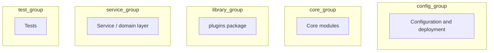

# Architecture report: docsifyjs/docsify

> Automated static analysis. **Observed** = directly seen in files/imports/AST; **Inferred** = interpretation from that evidence. Repository code was not executed.

## 1. Repository at a glance

| Item | Value |
| --- | --- |
| Repository | docsifyjs/docsify |
| Description | 🃏 A magical documentation site generator. |
| Language | JavaScript |
| Stars | 31590 |
| Licence | MIT |
| Analysed commit / branch | 0e0cd50b326042d37b1f613eb654434c5db0e2df / develop |
| Framework(s) | Vue |
| Files analysed | 198 |
| Components | 5 |

## 2. Architecture in one minute

docsifyjs/docsify - 🃏 A magical documentation site generator.. This repository was analysed statically from 198 file(s) (0 Python). Detected technologies (observed from imports/manifests): GitHub Actions, Vue, axios, Docker, Jest, TypeScript. Files are grouped into 5 component(s): Configuration and deployment, Core modules, plugins package, Service / domain layer, Tests. Findings below distinguish observed facts from inferred interpretation.

## 3. High-level block diagram

## 4. Main components

### Configuration and deployment (`config`)

- **Kind:** config
- **Status:** Observed
- **Confidence:** 0.85
- **Responsibility:** Groups 5 file(s) under configuration and deployment (observed from repository paths and static analysis).
- **Paths:** `Dockerfile`, `babel.config.json`, `package.json`, `tsconfig.json`, `vercel.json`
- **Evidence:** [Dockerfile](https://github.com/docsifyjs/docsify/blob/0e0cd50b326042d37b1f613eb654434c5db0e2df/Dockerfile); [babel.config.json](https://github.com/docsifyjs/docsify/blob/0e0cd50b326042d37b1f613eb654434c5db0e2df/babel.config.json); [package.json](https://github.com/docsifyjs/docsify/blob/0e0cd50b326042d37b1f613eb654434c5db0e2df/package.json); [tsconfig.json](https://github.com/docsifyjs/docsify/blob/0e0cd50b326042d37b1f613eb654434c5db0e2df/tsconfig.json); [vercel.json](https://github.com/docsifyjs/docsify/blob/0e0cd50b326042d37b1f613eb654434c5db0e2df/vercel.json)

### Core modules (`core`)

- **Kind:** core
- **Status:** Observed
- **Confidence:** 0.85
- **Responsibility:** Groups 8 file(s) under core modules (observed from repository paths and static analysis).
- **Paths:** `eslint.config.js`, `jest.config.js`, `middleware.js`, `playwright.config.js`, `postcss.config.cjs`, `rollup.config.js`, `server.configs.js`, `server.js`
- **Evidence:** [eslint.config.js](https://github.com/docsifyjs/docsify/blob/0e0cd50b326042d37b1f613eb654434c5db0e2df/eslint.config.js); [jest.config.js](https://github.com/docsifyjs/docsify/blob/0e0cd50b326042d37b1f613eb654434c5db0e2df/jest.config.js); [middleware.js](https://github.com/docsifyjs/docsify/blob/0e0cd50b326042d37b1f613eb654434c5db0e2df/middleware.js); [playwright.config.js](https://github.com/docsifyjs/docsify/blob/0e0cd50b326042d37b1f613eb654434c5db0e2df/playwright.config.js); [postcss.config.cjs](https://github.com/docsifyjs/docsify/blob/0e0cd50b326042d37b1f613eb654434c5db0e2df/postcss.config.cjs); [rollup.config.js](https://github.com/docsifyjs/docsify/blob/0e0cd50b326042d37b1f613eb654434c5db0e2df/rollup.config.js); [server.configs.js](https://github.com/docsifyjs/docsify/blob/0e0cd50b326042d37b1f613eb654434c5db0e2df/server.configs.js); [server.js](https://github.com/docsifyjs/docsify/blob/0e0cd50b326042d37b1f613eb654434c5db0e2df/server.js)

### plugins package (`plugins`)

- **Kind:** library
- **Status:** Observed
- **Confidence:** 0.85
- **Responsibility:** Groups 15 file(s) under plugins package (observed from repository paths and static analysis).
- **Paths:** `src/plugins/disqus.js`, `src/plugins/emoji.js`, `src/plugins/external-script.js`, `src/plugins/front-matter/index.js`, `src/plugins/front-matter/parser.js`, `src/plugins/front-matter/yaml.js`, `src/plugins/ga.js`, `src/plugins/gitalk.js`, `src/plugins/gtag.js`, `src/plugins/matomo.js`, `src/plugins/search/component.js`, `src/plugins/search/index.js`, `src/plugins/search/markdown-to-txt.js`, `src/plugins/search/search.js`, `src/plugins/zoom-image.js`
- **Evidence:** [src/plugins/disqus.js](https://github.com/docsifyjs/docsify/blob/0e0cd50b326042d37b1f613eb654434c5db0e2df/src/plugins/disqus.js); [src/plugins/emoji.js](https://github.com/docsifyjs/docsify/blob/0e0cd50b326042d37b1f613eb654434c5db0e2df/src/plugins/emoji.js); [src/plugins/external-script.js](https://github.com/docsifyjs/docsify/blob/0e0cd50b326042d37b1f613eb654434c5db0e2df/src/plugins/external-script.js); [src/plugins/front-matter/index.js](https://github.com/docsifyjs/docsify/blob/0e0cd50b326042d37b1f613eb654434c5db0e2df/src/plugins/front-matter/index.js); [src/plugins/front-matter/parser.js](https://github.com/docsifyjs/docsify/blob/0e0cd50b326042d37b1f613eb654434c5db0e2df/src/plugins/front-matter/parser.js); [src/plugins/front-matter/yaml.js](https://github.com/docsifyjs/docsify/blob/0e0cd50b326042d37b1f613eb654434c5db0e2df/src/plugins/front-matter/yaml.js); [src/plugins/ga.js](https://github.com/docsifyjs/docsify/blob/0e0cd50b326042d37b1f613eb654434c5db0e2df/src/plugins/ga.js); [src/plugins/gitalk.js](https://github.com/docsifyjs/docsify/blob/0e0cd50b326042d37b1f613eb654434c5db0e2df/src/plugins/gitalk.js)

### Service / domain layer (`service_layer`)

- **Kind:** service
- **Status:** Observed
- **Confidence:** 0.85
- **Responsibility:** Groups 44 file(s) under service / domain layer (observed from repository paths and static analysis).
- **Paths:** `src/core/Docsify.js`, `src/core/config.js`, `src/core/event/index.js`, `src/core/fetch/index.js`, `src/core/global-api.js`, `src/core/globals.ts`, `src/core/index.js`, `src/core/init/lifecycle.js`, `src/core/module.js`, `src/core/modules.ts`, `src/core/render/compiler.js`, `src/core/render/compiler/blockquote.js`, `src/core/render/compiler/code.js`, `src/core/render/compiler/heading.js`, `src/core/render/compiler/image.js`, `src/core/render/compiler/link.js`, `src/core/render/compiler/media.js`, `src/core/render/compiler/paragraph.js`, `src/core/render/compiler/tableCell.js`, `src/core/render/compiler/taskList.js`, `src/core/render/compiler/taskListItem.js`, `src/core/render/embed.js`, `src/core/render/emoji-data.js`, `src/core/render/emojify.js`, `src/core/render/gen-tree.js`, `src/core/render/index.js`, `src/core/render/progressbar.js`, `src/core/render/slugify.js`, `src/core/render/tpl.js`, `src/core/render/utils.js`, `src/core/router/history/base.js`, `src/core/router/history/hash.js`, `src/core/router/history/html5.js`, `src/core/router/index.js`, `src/core/router/util.js`, `src/core/util/ajax.js`, `src/core/util/core.js`, `src/core/util/dom.js`, `src/core/util/env.js`, `src/core/util/index.js`, `src/core/util/prism.js`, `src/core/virtual-routes/exact-match.js`, `src/core/virtual-routes/index.js`, `src/core/virtual-routes/next.js`
- **Evidence:** [src/core/Docsify.js](https://github.com/docsifyjs/docsify/blob/0e0cd50b326042d37b1f613eb654434c5db0e2df/src/core/Docsify.js); [src/core/config.js](https://github.com/docsifyjs/docsify/blob/0e0cd50b326042d37b1f613eb654434c5db0e2df/src/core/config.js); [src/core/event/index.js](https://github.com/docsifyjs/docsify/blob/0e0cd50b326042d37b1f613eb654434c5db0e2df/src/core/event/index.js); [src/core/fetch/index.js](https://github.com/docsifyjs/docsify/blob/0e0cd50b326042d37b1f613eb654434c5db0e2df/src/core/fetch/index.js); [src/core/global-api.js](https://github.com/docsifyjs/docsify/blob/0e0cd50b326042d37b1f613eb654434c5db0e2df/src/core/global-api.js); [src/core/globals.ts](https://github.com/docsifyjs/docsify/blob/0e0cd50b326042d37b1f613eb654434c5db0e2df/src/core/globals.ts); [src/core/index.js](https://github.com/docsifyjs/docsify/blob/0e0cd50b326042d37b1f613eb654434c5db0e2df/src/core/index.js); [src/core/init/lifecycle.js](https://github.com/docsifyjs/docsify/blob/0e0cd50b326042d37b1f613eb654434c5db0e2df/src/core/init/lifecycle.js)

### Tests (`tests`)

- **Kind:** test
- **Status:** Observed
- **Confidence:** 0.85
- **Responsibility:** Groups 49 file(s) under tests (observed from repository paths and static analysis).
- **Paths:** `test/README.md`, `test/config/jest.setup-tests.js`, `test/config/jest.setup.js`, `test/config/jest.teardown.js`, `test/config/playwright.setup.js`, `test/config/playwright.teardown.js`, `test/config/server.js`, `test/consume-types/README.md`, `test/consume-types/example.js`, `test/consume-types/index.html`, `test/consume-types/package.json`, `test/consume-types/prism.js`, `test/consume-types/register-sw.js`, `test/consume-types/sw.js`, `test/consume-types/tsconfig.json`, `test/e2e/anchor-scroll.test.js`, `test/e2e/configuration.test.js`, `test/e2e/embed.test.js`, `test/e2e/example.test.js`, `test/e2e/fixtures/docsify-init-fixture.js`, `test/e2e/gtag.test.js`, `test/e2e/index-file.test.js`, `test/e2e/module.test.js`, `test/e2e/plugins.test.js`, `test/e2e/search.test.js`, `test/e2e/security.test.js`, `test/e2e/sidebar.test.js`, `test/e2e/virtual-routes.test.js`, `test/e2e/vue.test.js`, `test/helpers/docsify-init.js`, `test/helpers/wait-for.js`, `test/integration/__snapshots__/docs.test.js.snap`, `test/integration/__snapshots__/emoji.test.js.snap`, `test/integration/callouts.test.js`, `test/integration/docs.test.js`, `test/integration/docsify.test.js`, `test/integration/embed.test.js`, `test/integration/emoji.test.js`, `test/integration/example.test.js`, `test/integration/global-apis.test.js`, `test/integration/render.test.js`, `test/integration/sidebar.test.js`, `test/unit/ajax.test.js`, `test/unit/core-util.test.js`, `test/unit/embed-cache.test.js`, `test/unit/render-util.test.js`, `test/unit/router-history-base.test.js`, `test/unit/router-util.test.js`, `test/unit/search-markdown-to-txt.test.js`
- **Evidence:** [test/README.md](https://github.com/docsifyjs/docsify/blob/0e0cd50b326042d37b1f613eb654434c5db0e2df/test/README.md); [test/config/jest.setup-tests.js](https://github.com/docsifyjs/docsify/blob/0e0cd50b326042d37b1f613eb654434c5db0e2df/test/config/jest.setup-tests.js); [test/config/jest.setup.js](https://github.com/docsifyjs/docsify/blob/0e0cd50b326042d37b1f613eb654434c5db0e2df/test/config/jest.setup.js); [test/config/jest.teardown.js](https://github.com/docsifyjs/docsify/blob/0e0cd50b326042d37b1f613eb654434c5db0e2df/test/config/jest.teardown.js); [test/config/playwright.setup.js](https://github.com/docsifyjs/docsify/blob/0e0cd50b326042d37b1f613eb654434c5db0e2df/test/config/playwright.setup.js); [test/config/playwright.teardown.js](https://github.com/docsifyjs/docsify/blob/0e0cd50b326042d37b1f613eb654434c5db0e2df/test/config/playwright.teardown.js); [test/config/server.js](https://github.com/docsifyjs/docsify/blob/0e0cd50b326042d37b1f613eb654434c5db0e2df/test/config/server.js); [test/consume-types/README.md](https://github.com/docsifyjs/docsify/blob/0e0cd50b326042d37b1f613eb654434c5db0e2df/test/consume-types/README.md)

## 5. Execution flow

**Observed** entry point(s):

- [server.js](https://github.com/docsifyjs/docsify/blob/0e0cd50b326042d37b1f613eb654434c5db0e2df/server.js)
- [src/core/event/index.js](https://github.com/docsifyjs/docsify/blob/0e0cd50b326042d37b1f613eb654434c5db0e2df/src/core/event/index.js)
- [src/core/fetch/index.js](https://github.com/docsifyjs/docsify/blob/0e0cd50b326042d37b1f613eb654434c5db0e2df/src/core/fetch/index.js)
- [src/core/index.js](https://github.com/docsifyjs/docsify/blob/0e0cd50b326042d37b1f613eb654434c5db0e2df/src/core/index.js)
- [src/core/render/index.js](https://github.com/docsifyjs/docsify/blob/0e0cd50b326042d37b1f613eb654434c5db0e2df/src/core/render/index.js)
- [src/core/router/index.js](https://github.com/docsifyjs/docsify/blob/0e0cd50b326042d37b1f613eb654434c5db0e2df/src/core/router/index.js)
- [src/core/util/index.js](https://github.com/docsifyjs/docsify/blob/0e0cd50b326042d37b1f613eb654434c5db0e2df/src/core/util/index.js)
- [src/core/virtual-routes/index.js](https://github.com/docsifyjs/docsify/blob/0e0cd50b326042d37b1f613eb654434c5db0e2df/src/core/virtual-routes/index.js)
- [src/plugins/front-matter/index.js](https://github.com/docsifyjs/docsify/blob/0e0cd50b326042d37b1f613eb654434c5db0e2df/src/plugins/front-matter/index.js)
- [src/plugins/search/index.js](https://github.com/docsifyjs/docsify/blob/0e0cd50b326042d37b1f613eb654434c5db0e2df/src/plugins/search/index.js)

Representative flow (derived from observed entry points and the import graph; steps beyond the entry point are **Inferred**):

1. Execution starts at an observed entry point listed above, if present.
2. No internal import relationships between components were observed.

## 6. Project structure

### `(root)`

- `.editorconfig` - config (174 bytes)
- `.gitattributes` - other (19 bytes)
- `.gitignore` - other (335 bytes)
- `.gitpod.yml` - config (250 bytes)
- `.npmignore` - other (33 bytes)
- `.prettierignore` - other (112 bytes)
- `.prettierrc.json` - config (52 bytes)
- `CHANGELOG.md` - docs (102507 bytes)
- `CONTRIBUTING.md` - docs (5423 bytes)
- `Dockerfile` - container (188 bytes)
- `LICENSE` - docs (1146 bytes)
- `README.md` - docs (3608 bytes)
- `babel.config.json` - config (108 bytes)
- `eslint.config.js` - source, JavaScript (1874 bytes)
- `jest.config.js` - source, JavaScript (1001 bytes)
- `middleware.js` - source, JavaScript (1703 bytes)
- `package.json` - manifest (5501 bytes)
- `playwright.config.js` - source, JavaScript (1679 bytes)
- `postcss.config.cjs` - source, JavaScript (228 bytes)
- `rollup.config.js` - source, JavaScript (3345 bytes)
- `server.configs.js` - source, JavaScript (1445 bytes)
- `server.js` - source, JavaScript (552 bytes)
- `tsconfig.json` - config (1307 bytes)
- `vercel.json` - config (352 bytes)

### `.github`

- `.github/ISSUE_TEMPLATE/bug_report.yml` - config (1798 bytes)
- `.github/ISSUE_TEMPLATE/config.yml` - config (179 bytes)
- `.github/ISSUE_TEMPLATE/feature_request.yml` - config (1059 bytes)
- `.github/PULL_REQUEST_TEMPLATE.md` - docs (923 bytes)
- `.github/crowdin/crowdin-push.yml` - config (216 bytes)
- `.github/dependabot.yml` - config (1208 bytes)
- `.github/workflows/crowdin.yml` - ci, YAML (860 bytes)
- `.github/workflows/emoji.yml` - ci, YAML (1234 bytes)
- `.github/workflows/test.yml` - ci, YAML (2936 bytes)

### `.husky`

- `.husky/install.mjs` - source, JavaScript (207 bytes)
- `.husky/pre-commit` - other (86 bytes)

### `.vscode`

- `.vscode/launch.json` - config (1885 bytes)
- `.vscode/settings.json` - config (143 bytes)

### `docs`

- `docs/.nojekyll` - docs (0 bytes)
- `docs/CNAME` - docs (14 bytes)
- `docs/README.md` - docs (1033 bytes)
- `docs/_coverpage.md` - docs (365 bytes)
- `docs/_media/example-with-yaml.md` - docs (85 bytes)
- `docs/_media/example.html` - docs (446 bytes)
- `docs/_media/example.js` - docs (314 bytes)
- `docs/_media/example.md` - docs (32 bytes)
- `docs/_media/icon.svg` - docs (3245 bytes)
- `docs/_media/moon.svg` - docs (487 bytes)
- `docs/_media/powered-by-vercel.svg` - docs (5336 bytes)
- `docs/_media/sun.svg` - docs (438 bytes)
- `docs/_media/vercel_logo.svg` - docs (1091 bytes)
- `docs/_navbar.md` - docs (106 bytes)
- `docs/_sidebar.md` - docs (773 bytes)
- `docs/adding-pages.md` - docs (4283 bytes)
- `docs/cdn.md` - docs (2256 bytes)
- `docs/configuration.md` - docs (27977 bytes)
- `docs/cover.md` - docs (1900 bytes)
- `docs/custom-navbar.md` - docs (2359 bytes)
- `docs/deploy.md` - docs (9466 bytes)
- `docs/embed-files.md` - docs (8520 bytes)
- `docs/emoji.md` - docs (57282 bytes)
- `docs/helpers.md` - docs (4316 bytes)
- `docs/index.html` - docs (7958 bytes)
- `docs/language-highlight.md` - docs (3858 bytes)
- `docs/markdown.md` - docs (1366 bytes)
- `docs/plugins.md` - docs (7689 bytes)
- `docs/pwa.md` - docs (3860 bytes)
- `docs/quickstart.md` - docs (4296 bytes)
- `docs/themes.md` - docs (12239 bytes)
- `docs/ui-kit.md` - docs (17339 bytes)
- `docs/v5-upgrade.md` - docs (4624 bytes)
- `docs/vue.md` - docs (8686 bytes)
- `docs/write-a-plugin.md` - docs (5498 bytes)

### `src`

- `src/core/Docsify.js` - source, JavaScript (1774 bytes)
- `src/core/config.js` - source, JavaScript (6585 bytes)
- `src/core/event/index.js` - source, JavaScript (27734 bytes)
- `src/core/fetch/index.js` - source, JavaScript (8659 bytes)
- `src/core/global-api.js` - source, JavaScript (507 bytes)
- `src/core/globals.ts` - source, TypeScript (1188 bytes)
- `src/core/index.js` - source, JavaScript (232 bytes)
- `src/core/init/lifecycle.js` - source, JavaScript (2866 bytes)
- `src/core/module.js` - source, JavaScript (30 bytes)
- `src/core/modules.ts` - source, TypeScript (78 bytes)
- `src/core/render/compiler.js` - source, JavaScript (8081 bytes)
- `src/core/render/compiler/blockquote.js` - source, JavaScript (1971 bytes)
- `src/core/render/compiler/code.js` - source, JavaScript (843 bytes)
- `src/core/render/compiler/heading.js` - source, JavaScript (1394 bytes)
- `src/core/render/compiler/image.js` - source, JavaScript (1308 bytes)
- `src/core/render/compiler/link.js` - source, JavaScript (1948 bytes)
- `src/core/render/compiler/media.js` - source, JavaScript (820 bytes)
- `src/core/render/compiler/paragraph.js` - source, JavaScript (1376 bytes)
- `src/core/render/compiler/tableCell.js` - source, JavaScript (961 bytes)
- `src/core/render/compiler/taskList.js` - source, JavaScript (702 bytes)
- `src/core/render/compiler/taskListItem.js` - source, JavaScript (1138 bytes)
- `src/core/render/embed.js` - source, JavaScript (9335 bytes)
- `src/core/render/emoji-data.js` - source, JavaScript (84876 bytes)
- `src/core/render/emojify.js` - source, JavaScript (1603 bytes)
- `src/core/render/gen-tree.js` - source, JavaScript (707 bytes)
- `src/core/render/index.js` - source, JavaScript (23518 bytes)
- `src/core/render/progressbar.js` - source, JavaScript (1204 bytes)
- `src/core/render/slugify.js` - source, JavaScript (813 bytes)
- `src/core/render/tpl.js` - source, JavaScript (4702 bytes)
- `src/core/render/utils.js` - source, JavaScript (3184 bytes)
- `src/core/router/history/base.js` - source, JavaScript (2876 bytes)
- `src/core/router/history/hash.js` - source, JavaScript (3686 bytes)
- `src/core/router/history/html5.js` - source, JavaScript (1804 bytes)
- `src/core/router/index.js` - source, JavaScript (1553 bytes)
- `src/core/router/util.js` - source, JavaScript (5330 bytes)
- `src/core/util/ajax.js` - source, JavaScript (2993 bytes)
- `src/core/util/core.js` - source, JavaScript (2000 bytes)
- `src/core/util/dom.js` - source, JavaScript (3940 bytes)
- `src/core/util/env.js` - source, JavaScript (274 bytes)
- `src/core/util/index.js` - source, JavaScript (88 bytes)
- `src/core/util/prism.js` - source, JavaScript (7669 bytes)
- `src/core/virtual-routes/exact-match.js` - source, JavaScript (527 bytes)
- `src/core/virtual-routes/index.js` - source, JavaScript (3444 bytes)
- `src/core/virtual-routes/next.js` - source, JavaScript (572 bytes)
- `src/plugins/disqus.js` - source, JavaScript (1528 bytes)
- `src/plugins/emoji.js` - source, JavaScript (486 bytes)
- `src/plugins/external-script.js` - source, JavaScript (760 bytes)
- `src/plugins/front-matter/index.js` - source, JavaScript (592 bytes)
- `src/plugins/front-matter/parser.js` - source, JavaScript (1138 bytes)
- `src/plugins/front-matter/yaml.js` - source, JavaScript (12123 bytes)
- `src/plugins/ga.js` - source, JavaScript (1029 bytes)
- `src/plugins/gitalk.js` - source, JavaScript (757 bytes)
- `src/plugins/gtag.js` - source, JavaScript (1690 bytes)
- `src/plugins/matomo.js` - source, JavaScript (1159 bytes)
- `src/plugins/search/component.js` - source, JavaScript (7248 bytes)
- `src/plugins/search/index.js` - source, JavaScript (2830 bytes)
- `src/plugins/search/markdown-to-txt.js` - source, JavaScript (4697 bytes)
- `src/plugins/search/search.js` - source, JavaScript (13319 bytes)
- `src/plugins/search/style.css` - other (4022 bytes)
- `src/plugins/zoom-image.js` - source, JavaScript (680 bytes)
- `src/themes/addons/core-dark.css` - other (1809 bytes)
- `src/themes/addons/vue.css` - other (1483 bytes)
- `src/themes/core.css` - other (30 bytes)
- `src/themes/shared/__index.css` - other (302 bytes)
- `src/themes/shared/_app.css` - other (2962 bytes)
- `src/themes/shared/_base.css` - other (1080 bytes)
- `src/themes/shared/_classes.css` - other (5890 bytes)
- `src/themes/shared/_coverpage.css` - other (1374 bytes)
- `src/themes/shared/_elements.css` - other (6663 bytes)
- `src/themes/shared/_markdown.css` - other (8713 bytes)
- `src/themes/shared/_mq.css` - other (1300 bytes)
- `src/themes/shared/_navbar.css` - other (2319 bytes)
- `src/themes/shared/_sidebar.css` - other (6787 bytes)
- `src/themes/shared/_syntax.css` - other (1235 bytes)
- `src/themes/shared/_util.css` - other (505 bytes)
- `src/themes/shared/_vars-advanced.css` - other (387 bytes)
- `src/themes/shared/_vars.css` - other (12746 bytes)

### `test`

- `test/README.md` - test (2097 bytes)
- `test/config/jest.setup-tests.js` - test, JavaScript (3264 bytes)
- `test/config/jest.setup.js` - test, JavaScript (99 bytes)
- `test/config/jest.teardown.js` - test, JavaScript (91 bytes)
- `test/config/playwright.setup.js` - test, JavaScript (103 bytes)
- `test/config/playwright.teardown.js` - test, JavaScript (95 bytes)
- `test/config/server.js` - test, JavaScript (841 bytes)
- `test/consume-types/README.md` - test (1239 bytes)
- `test/consume-types/example.js` - test, JavaScript (1898 bytes)
- `test/consume-types/index.html` - test (856 bytes)
- `test/consume-types/package.json` - test (389 bytes)
- `test/consume-types/prism.js` - test, JavaScript (870 bytes)
- `test/consume-types/register-sw.js` - test, JavaScript (2505 bytes)
- `test/consume-types/sw.js` - test, JavaScript (2911 bytes)
- `test/consume-types/tsconfig.json` - test (297 bytes)
- `test/e2e/anchor-scroll.test.js` - test, JavaScript (20534 bytes)
- `test/e2e/configuration.test.js` - test, JavaScript (8806 bytes)
- `test/e2e/embed.test.js` - test, JavaScript (1146 bytes)
- `test/e2e/example.test.js` - test, JavaScript (8639 bytes)
- `test/e2e/fixtures/docsify-init-fixture.js` - test, JavaScript (569 bytes)
- `test/e2e/gtag.test.js` - test, JavaScript (2166 bytes)
- `test/e2e/index-file.test.js` - test, JavaScript (878 bytes)
- `test/e2e/module.test.js` - test, JavaScript (599 bytes)
- `test/e2e/plugins.test.js` - test, JavaScript (9792 bytes)
- `test/e2e/search.test.js` - test, JavaScript (23063 bytes)
- `test/e2e/security.test.js` - test, JavaScript (1024 bytes)
- `test/e2e/sidebar.test.js` - test, JavaScript (30303 bytes)
- `test/e2e/virtual-routes.test.js` - test, JavaScript (7336 bytes)
- `test/e2e/vue.test.js` - test, JavaScript (6485 bytes)
- `test/helpers/docsify-init.js` - test, JavaScript (11220 bytes)
- `test/helpers/wait-for.js` - test, JavaScript (3640 bytes)
- `test/integration/__snapshots__/docs.test.js.snap` - test (3032 bytes)
- `test/integration/__snapshots__/emoji.test.js.snap` - test (4472 bytes)
- `test/integration/callouts.test.js` - test, JavaScript (1461 bytes)
- `test/integration/docs.test.js` - test, JavaScript (3715 bytes)
- `test/integration/docsify.test.js` - test, JavaScript (1554 bytes)
- `test/integration/embed.test.js` - test, JavaScript (11813 bytes)
- `test/integration/emoji.test.js` - test, JavaScript (4368 bytes)
- `test/integration/example.test.js` - test, JavaScript (4077 bytes)
- `test/integration/global-apis.test.js` - test, JavaScript (840 bytes)
- `test/integration/render.test.js` - test, JavaScript (14849 bytes)
- `test/integration/sidebar.test.js` - test, JavaScript (4402 bytes)
- `test/unit/ajax.test.js` - test, JavaScript (867 bytes)
- `test/unit/core-util.test.js` - test, JavaScript (2693 bytes)
- `test/unit/embed-cache.test.js` - test, JavaScript (960 bytes)
- `test/unit/render-util.test.js` - test, JavaScript (8044 bytes)
- `test/unit/router-history-base.test.js` - test, JavaScript (3067 bytes)
- `test/unit/router-util.test.js` - test, JavaScript (3484 bytes)
- `test/unit/search-markdown-to-txt.test.js` - test, JavaScript (482 bytes)

## 7. Key dependencies and integrations

| Name | Category | Status | Confidence | Evidence |
| --- | --- | --- | --- | --- |
| GitHub Actions | ci | Observed | 0.90 | [.github/workflows/crowdin.yml](https://github.com/docsifyjs/docsify/blob/0e0cd50b326042d37b1f613eb654434c5db0e2df/.github/workflows/crowdin.yml); [.github/workflows/emoji.yml](https://github.com/docsifyjs/docsify/blob/0e0cd50b326042d37b1f613eb654434c5db0e2df/.github/workflows/emoji.yml); [.github/workflows/test.yml](https://github.com/docsifyjs/docsify/blob/0e0cd50b326042d37b1f613eb654434c5db0e2df/.github/workflows/test.yml) |
| Vue | framework | Observed | 0.85 | [package.json:94](https://github.com/docsifyjs/docsify/blob/0e0cd50b326042d37b1f613eb654434c5db0e2df/package.json#L94) |
| axios | library | Observed | 0.85 | [package.json:69](https://github.com/docsifyjs/docsify/blob/0e0cd50b326042d37b1f613eb654434c5db0e2df/package.json#L69) |
| Docker | tooling | Observed | 0.85 | [Dockerfile](https://github.com/docsifyjs/docsify/blob/0e0cd50b326042d37b1f613eb654434c5db0e2df/Dockerfile) |
| Jest | tooling | Observed | 0.85 | [package.json:75](https://github.com/docsifyjs/docsify/blob/0e0cd50b326042d37b1f613eb654434c5db0e2df/package.json#L75) |
| TypeScript | tooling | Observed | 0.90 | [package.json:93](https://github.com/docsifyjs/docsify/blob/0e0cd50b326042d37b1f613eb654434c5db0e2df/package.json#L93); [test/consume-types/package.json:11](https://github.com/docsifyjs/docsify/blob/0e0cd50b326042d37b1f613eb654434c5db0e2df/test/consume-types/package.json#L11) |

## 8. Data and state

No database, cache, queue, or persistent-state usage was observed in the analysed files. State handling, if any, may be in-memory or in files that were not analysed.

## 9. Configuration and deployment clues

- `.editorconfig` (config)
- `.github/ISSUE_TEMPLATE/bug_report.yml` (config)
- `.github/ISSUE_TEMPLATE/config.yml` (config)
- `.github/ISSUE_TEMPLATE/feature_request.yml` (config)
- `.github/crowdin/crowdin-push.yml` (config)
- `.github/dependabot.yml` (config)
- `.github/workflows/crowdin.yml` (ci)
- `.github/workflows/emoji.yml` (ci)
- `.github/workflows/test.yml` (ci)
- `.gitpod.yml` (config)
- `.prettierrc.json` (config)
- `.vscode/launch.json` (config)
- `.vscode/settings.json` (config)
- `Dockerfile` (container)
- `babel.config.json` (config)
- `package.json` (manifest)
- `tsconfig.json` (config)
- `vercel.json` (config)

## 10. Design observations

- Service/domain code is distinct from entry and data code, suggesting layered separation (Inferred).
- Tests are present alongside source code (Observed from test file paths).

These observations are interpretations (**Inferred**) of the observed structure, not guarantees about runtime design.

## 11. Limitations and unknowns

- Static analysis only: repository code was not executed, installed, or imported at runtime.
- Components and relationships are inferred from file paths, imports, and AST structure; runtime behaviour, dynamic imports, and reflection may not be visible.
- 6 file(s) were skipped during inventory (1 x lockfile excluded; 5 x vendored/generated directory excluded).
- No clear application entry point was observed in the analysed files.
- Repository text was treated as untrusted data; no instructions found in repository files were followed, and likely secret values were redacted/excluded.
- JavaScript and TypeScript files were inventoried from paths and package manifests. They were not parsed with a full language AST, and repository code was not executed.

## 12. Source references

- [.github/workflows/crowdin.yml](https://github.com/docsifyjs/docsify/blob/0e0cd50b326042d37b1f613eb654434c5db0e2df/.github/workflows/crowdin.yml)
- [.github/workflows/emoji.yml](https://github.com/docsifyjs/docsify/blob/0e0cd50b326042d37b1f613eb654434c5db0e2df/.github/workflows/emoji.yml)
- [.github/workflows/test.yml](https://github.com/docsifyjs/docsify/blob/0e0cd50b326042d37b1f613eb654434c5db0e2df/.github/workflows/test.yml)
- [Dockerfile](https://github.com/docsifyjs/docsify/blob/0e0cd50b326042d37b1f613eb654434c5db0e2df/Dockerfile)
- [babel.config.json](https://github.com/docsifyjs/docsify/blob/0e0cd50b326042d37b1f613eb654434c5db0e2df/babel.config.json)
- [eslint.config.js](https://github.com/docsifyjs/docsify/blob/0e0cd50b326042d37b1f613eb654434c5db0e2df/eslint.config.js)
- [jest.config.js](https://github.com/docsifyjs/docsify/blob/0e0cd50b326042d37b1f613eb654434c5db0e2df/jest.config.js)
- [middleware.js](https://github.com/docsifyjs/docsify/blob/0e0cd50b326042d37b1f613eb654434c5db0e2df/middleware.js)
- [package.json](https://github.com/docsifyjs/docsify/blob/0e0cd50b326042d37b1f613eb654434c5db0e2df/package.json)
- [package.json:69](https://github.com/docsifyjs/docsify/blob/0e0cd50b326042d37b1f613eb654434c5db0e2df/package.json#L69)
- [package.json:75](https://github.com/docsifyjs/docsify/blob/0e0cd50b326042d37b1f613eb654434c5db0e2df/package.json#L75)
- [package.json:93](https://github.com/docsifyjs/docsify/blob/0e0cd50b326042d37b1f613eb654434c5db0e2df/package.json#L93)
- [package.json:94](https://github.com/docsifyjs/docsify/blob/0e0cd50b326042d37b1f613eb654434c5db0e2df/package.json#L94)
- [playwright.config.js](https://github.com/docsifyjs/docsify/blob/0e0cd50b326042d37b1f613eb654434c5db0e2df/playwright.config.js)
- [postcss.config.cjs](https://github.com/docsifyjs/docsify/blob/0e0cd50b326042d37b1f613eb654434c5db0e2df/postcss.config.cjs)
- [rollup.config.js](https://github.com/docsifyjs/docsify/blob/0e0cd50b326042d37b1f613eb654434c5db0e2df/rollup.config.js)
- [server.configs.js](https://github.com/docsifyjs/docsify/blob/0e0cd50b326042d37b1f613eb654434c5db0e2df/server.configs.js)
- [server.js](https://github.com/docsifyjs/docsify/blob/0e0cd50b326042d37b1f613eb654434c5db0e2df/server.js)
- [src/core/Docsify.js](https://github.com/docsifyjs/docsify/blob/0e0cd50b326042d37b1f613eb654434c5db0e2df/src/core/Docsify.js)
- [src/core/config.js](https://github.com/docsifyjs/docsify/blob/0e0cd50b326042d37b1f613eb654434c5db0e2df/src/core/config.js)
- [src/core/event/index.js](https://github.com/docsifyjs/docsify/blob/0e0cd50b326042d37b1f613eb654434c5db0e2df/src/core/event/index.js)
- [src/core/fetch/index.js](https://github.com/docsifyjs/docsify/blob/0e0cd50b326042d37b1f613eb654434c5db0e2df/src/core/fetch/index.js)
- [src/core/global-api.js](https://github.com/docsifyjs/docsify/blob/0e0cd50b326042d37b1f613eb654434c5db0e2df/src/core/global-api.js)
- [src/core/globals.ts](https://github.com/docsifyjs/docsify/blob/0e0cd50b326042d37b1f613eb654434c5db0e2df/src/core/globals.ts)
- [src/core/index.js](https://github.com/docsifyjs/docsify/blob/0e0cd50b326042d37b1f613eb654434c5db0e2df/src/core/index.js)
- [src/core/init/lifecycle.js](https://github.com/docsifyjs/docsify/blob/0e0cd50b326042d37b1f613eb654434c5db0e2df/src/core/init/lifecycle.js)
- [src/core/render/index.js](https://github.com/docsifyjs/docsify/blob/0e0cd50b326042d37b1f613eb654434c5db0e2df/src/core/render/index.js)
- [src/core/router/index.js](https://github.com/docsifyjs/docsify/blob/0e0cd50b326042d37b1f613eb654434c5db0e2df/src/core/router/index.js)
- [src/core/util/index.js](https://github.com/docsifyjs/docsify/blob/0e0cd50b326042d37b1f613eb654434c5db0e2df/src/core/util/index.js)
- [src/core/virtual-routes/index.js](https://github.com/docsifyjs/docsify/blob/0e0cd50b326042d37b1f613eb654434c5db0e2df/src/core/virtual-routes/index.js)
- [src/plugins/disqus.js](https://github.com/docsifyjs/docsify/blob/0e0cd50b326042d37b1f613eb654434c5db0e2df/src/plugins/disqus.js)
- [src/plugins/emoji.js](https://github.com/docsifyjs/docsify/blob/0e0cd50b326042d37b1f613eb654434c5db0e2df/src/plugins/emoji.js)
- [src/plugins/external-script.js](https://github.com/docsifyjs/docsify/blob/0e0cd50b326042d37b1f613eb654434c5db0e2df/src/plugins/external-script.js)
- [src/plugins/front-matter/index.js](https://github.com/docsifyjs/docsify/blob/0e0cd50b326042d37b1f613eb654434c5db0e2df/src/plugins/front-matter/index.js)
- [src/plugins/front-matter/parser.js](https://github.com/docsifyjs/docsify/blob/0e0cd50b326042d37b1f613eb654434c5db0e2df/src/plugins/front-matter/parser.js)
- [src/plugins/front-matter/yaml.js](https://github.com/docsifyjs/docsify/blob/0e0cd50b326042d37b1f613eb654434c5db0e2df/src/plugins/front-matter/yaml.js)
- [src/plugins/ga.js](https://github.com/docsifyjs/docsify/blob/0e0cd50b326042d37b1f613eb654434c5db0e2df/src/plugins/ga.js)
- [src/plugins/gitalk.js](https://github.com/docsifyjs/docsify/blob/0e0cd50b326042d37b1f613eb654434c5db0e2df/src/plugins/gitalk.js)
- [src/plugins/search/index.js](https://github.com/docsifyjs/docsify/blob/0e0cd50b326042d37b1f613eb654434c5db0e2df/src/plugins/search/index.js)
- [test/README.md](https://github.com/docsifyjs/docsify/blob/0e0cd50b326042d37b1f613eb654434c5db0e2df/test/README.md)
- [test/config/jest.setup-tests.js](https://github.com/docsifyjs/docsify/blob/0e0cd50b326042d37b1f613eb654434c5db0e2df/test/config/jest.setup-tests.js)
- [test/config/jest.setup.js](https://github.com/docsifyjs/docsify/blob/0e0cd50b326042d37b1f613eb654434c5db0e2df/test/config/jest.setup.js)
- [test/config/jest.teardown.js](https://github.com/docsifyjs/docsify/blob/0e0cd50b326042d37b1f613eb654434c5db0e2df/test/config/jest.teardown.js)
- [test/config/playwright.setup.js](https://github.com/docsifyjs/docsify/blob/0e0cd50b326042d37b1f613eb654434c5db0e2df/test/config/playwright.setup.js)
- [test/config/playwright.teardown.js](https://github.com/docsifyjs/docsify/blob/0e0cd50b326042d37b1f613eb654434c5db0e2df/test/config/playwright.teardown.js)
- [test/config/server.js](https://github.com/docsifyjs/docsify/blob/0e0cd50b326042d37b1f613eb654434c5db0e2df/test/config/server.js)
- [test/consume-types/README.md](https://github.com/docsifyjs/docsify/blob/0e0cd50b326042d37b1f613eb654434c5db0e2df/test/consume-types/README.md)
- [test/consume-types/package.json:11](https://github.com/docsifyjs/docsify/blob/0e0cd50b326042d37b1f613eb654434c5db0e2df/test/consume-types/package.json#L11)
- [tsconfig.json](https://github.com/docsifyjs/docsify/blob/0e0cd50b326042d37b1f613eb654434c5db0e2df/tsconfig.json)
- [vercel.json](https://github.com/docsifyjs/docsify/blob/0e0cd50b326042d37b1f613eb654434c5db0e2df/vercel.json)
