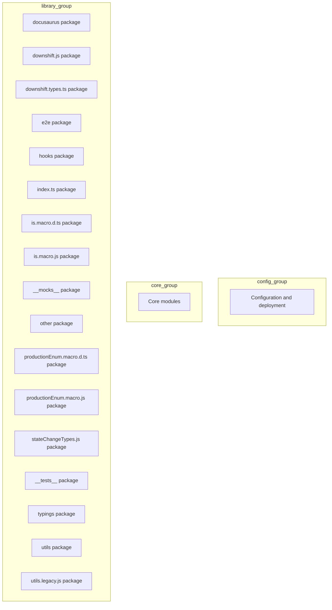

# Architecture report: downshift-js/downshift

> Automated static analysis. **Observed** = directly seen in files/imports/AST; **Inferred** = interpretation from that evidence. Repository code was not executed.

## 1. Repository at a glance

| Item | Value |
| --- | --- |
| Repository | downshift-js/downshift |
| Description | 🏎 A set of primitives to build simple, flexible, WAI-ARIA compliant React autocomplete, combobox or select dropdown components. |
| Language | JavaScript |
| Stars | 12301 |
| Licence | MIT |
| Analysed commit / branch | 5c968318273c0a3b54e00a586f622aedc1fffffb / master |
| Framework(s) | React |
| Files analysed | 290 |
| Components | 19 |

## 2. Architecture in one minute

downshift-js/downshift - 🏎 A set of primitives to build simple, flexible, WAI-ARIA compliant React autocomplete, combobox or select dropdown components.. This repository was analysed statically from 290 file(s) (0 Python). Detected technologies (observed from imports/manifests): GitHub Actions, React, TypeScript. Files are grouped into 19 component(s): Configuration and deployment, Core modules, docusaurus package, downshift.js package, downshift.types.ts package, e2e package, hooks package, index.ts package. Findings below distinguish observed facts from inferred interpretation.

## 3. High-level block diagram

## 4. Main components

### Configuration and deployment (`config`)

- **Kind:** config
- **Status:** Observed
- **Confidence:** 0.85
- **Responsibility:** Groups 6 file(s) under configuration and deployment (observed from repository paths and static analysis).
- **Paths:** `docusaurus/tsconfig.json`, `e2e/tsconfig.json`, `netlify.toml`, `package.json`, `tsconfig.json`, `tsconfig.preact.json`
- **Evidence:** [docusaurus/tsconfig.json](https://github.com/downshift-js/downshift/blob/5c968318273c0a3b54e00a586f622aedc1fffffb/docusaurus/tsconfig.json); [e2e/tsconfig.json](https://github.com/downshift-js/downshift/blob/5c968318273c0a3b54e00a586f622aedc1fffffb/e2e/tsconfig.json); [netlify.toml](https://github.com/downshift-js/downshift/blob/5c968318273c0a3b54e00a586f622aedc1fffffb/netlify.toml); [package.json](https://github.com/downshift-js/downshift/blob/5c968318273c0a3b54e00a586f622aedc1fffffb/package.json); [tsconfig.json](https://github.com/downshift-js/downshift/blob/5c968318273c0a3b54e00a586f622aedc1fffffb/tsconfig.json); [tsconfig.preact.json](https://github.com/downshift-js/downshift/blob/5c968318273c0a3b54e00a586f622aedc1fffffb/tsconfig.preact.json)

### Core modules (`core`)

- **Kind:** core
- **Status:** Observed
- **Confidence:** 0.85
- **Responsibility:** Groups 6 file(s) under core modules (observed from repository paths and static analysis).
- **Paths:** `babel.config.js`, `docusaurus.config.js`, `jest.config.js`, `playwright.config.ts`, `prettier.config.js`, `rollup.config.js`
- **Evidence:** [babel.config.js](https://github.com/downshift-js/downshift/blob/5c968318273c0a3b54e00a586f622aedc1fffffb/babel.config.js); [docusaurus.config.js](https://github.com/downshift-js/downshift/blob/5c968318273c0a3b54e00a586f622aedc1fffffb/docusaurus.config.js); [jest.config.js](https://github.com/downshift-js/downshift/blob/5c968318273c0a3b54e00a586f622aedc1fffffb/jest.config.js); [playwright.config.ts](https://github.com/downshift-js/downshift/blob/5c968318273c0a3b54e00a586f622aedc1fffffb/playwright.config.ts); [prettier.config.js](https://github.com/downshift-js/downshift/blob/5c968318273c0a3b54e00a586f622aedc1fffffb/prettier.config.js); [rollup.config.js](https://github.com/downshift-js/downshift/blob/5c968318273c0a3b54e00a586f622aedc1fffffb/rollup.config.js)

### docusaurus package (`docusaurus`)

- **Kind:** library
- **Status:** Observed
- **Confidence:** 0.85
- **Responsibility:** Groups 11 file(s) under docusaurus package (observed from repository paths and static analysis).
- **Paths:** `docusaurus/pages/combobox.tsx`, `docusaurus/pages/index.tsx`, `docusaurus/pages/useCombobox.tsx`, `docusaurus/pages/useCombobox_compiled.jsx`, `docusaurus/pages/useMultipleCombobox.tsx`, `docusaurus/pages/useMultipleSelect.tsx`, `docusaurus/pages/useSelect.tsx`, `docusaurus/pages/useTagGroup.tsx`, `docusaurus/pages/useTagGroupCombobox.tsx`, `docusaurus/plugins/webpack5polyfills.js`, `docusaurus/utils.ts`
- **Evidence:** [docusaurus/pages/combobox.tsx](https://github.com/downshift-js/downshift/blob/5c968318273c0a3b54e00a586f622aedc1fffffb/docusaurus/pages/combobox.tsx); [docusaurus/pages/index.tsx](https://github.com/downshift-js/downshift/blob/5c968318273c0a3b54e00a586f622aedc1fffffb/docusaurus/pages/index.tsx); [docusaurus/pages/useCombobox.tsx](https://github.com/downshift-js/downshift/blob/5c968318273c0a3b54e00a586f622aedc1fffffb/docusaurus/pages/useCombobox.tsx); [docusaurus/pages/useCombobox_compiled.jsx](https://github.com/downshift-js/downshift/blob/5c968318273c0a3b54e00a586f622aedc1fffffb/docusaurus/pages/useCombobox_compiled.jsx); [docusaurus/pages/useMultipleCombobox.tsx](https://github.com/downshift-js/downshift/blob/5c968318273c0a3b54e00a586f622aedc1fffffb/docusaurus/pages/useMultipleCombobox.tsx); [docusaurus/pages/useMultipleSelect.tsx](https://github.com/downshift-js/downshift/blob/5c968318273c0a3b54e00a586f622aedc1fffffb/docusaurus/pages/useMultipleSelect.tsx); [docusaurus/pages/useSelect.tsx](https://github.com/downshift-js/downshift/blob/5c968318273c0a3b54e00a586f622aedc1fffffb/docusaurus/pages/useSelect.tsx); [docusaurus/pages/useTagGroup.tsx](https://github.com/downshift-js/downshift/blob/5c968318273c0a3b54e00a586f622aedc1fffffb/docusaurus/pages/useTagGroup.tsx)

### downshift.js package (`downshift_js`)

- **Kind:** library
- **Status:** Observed
- **Confidence:** 0.85
- **Responsibility:** Groups 1 file(s) under downshift.js package (observed from repository paths and static analysis).
- **Paths:** `src/downshift.js`
- **Evidence:** [src/downshift.js](https://github.com/downshift-js/downshift/blob/5c968318273c0a3b54e00a586f622aedc1fffffb/src/downshift.js)

### downshift.types.ts package (`downshift_types_ts`)

- **Kind:** library
- **Status:** Observed
- **Confidence:** 0.85
- **Responsibility:** Groups 1 file(s) under downshift.types.ts package (observed from repository paths and static analysis).
- **Paths:** `src/downshift.types.ts`
- **Evidence:** [src/downshift.types.ts](https://github.com/downshift-js/downshift/blob/5c968318273c0a3b54e00a586f622aedc1fffffb/src/downshift.types.ts)

### e2e package (`e2e`)

- **Kind:** library
- **Status:** Observed
- **Confidence:** 0.85
- **Responsibility:** Groups 6 file(s) under e2e package (observed from repository paths and static analysis).
- **Paths:** `e2e/combobox.spec.ts`, `e2e/useCombobox.spec.ts`, `e2e/useMultipleCombobox.spec.ts`, `e2e/useMultipleSelect.spec.ts`, `e2e/useSelect.spec.ts`, `e2e/useTagGroup.spec.ts`
- **Evidence:** [e2e/combobox.spec.ts](https://github.com/downshift-js/downshift/blob/5c968318273c0a3b54e00a586f622aedc1fffffb/e2e/combobox.spec.ts); [e2e/useCombobox.spec.ts](https://github.com/downshift-js/downshift/blob/5c968318273c0a3b54e00a586f622aedc1fffffb/e2e/useCombobox.spec.ts); [e2e/useMultipleCombobox.spec.ts](https://github.com/downshift-js/downshift/blob/5c968318273c0a3b54e00a586f622aedc1fffffb/e2e/useMultipleCombobox.spec.ts); [e2e/useMultipleSelect.spec.ts](https://github.com/downshift-js/downshift/blob/5c968318273c0a3b54e00a586f622aedc1fffffb/e2e/useMultipleSelect.spec.ts); [e2e/useSelect.spec.ts](https://github.com/downshift-js/downshift/blob/5c968318273c0a3b54e00a586f622aedc1fffffb/e2e/useSelect.spec.ts); [e2e/useTagGroup.spec.ts](https://github.com/downshift-js/downshift/blob/5c968318273c0a3b54e00a586f622aedc1fffffb/e2e/useTagGroup.spec.ts)

### hooks package (`hooks`)

- **Kind:** library
- **Status:** Observed
- **Confidence:** 0.85
- **Responsibility:** Groups 133 file(s) under hooks package (observed from repository paths and static analysis).
- **Paths:** `src/hooks/index.ts`, `src/hooks/testUtils/MemoizedItem.tsx`, `src/hooks/testUtils/fixtures.ts`, `src/hooks/testUtils/index.ts`, `src/hooks/testUtils/interactions.ts`, `src/hooks/testUtils/testCases.ts`, `src/hooks/useCombobox/__tests__/getInputProps.test.js`, `src/hooks/useCombobox/__tests__/getItemProps.test.js`, `src/hooks/useCombobox/__tests__/getLabelProps.test.js`, `src/hooks/useCombobox/__tests__/getMenuProps.test.js`, `src/hooks/useCombobox/__tests__/getToggleButtonProps.test.js`, `src/hooks/useCombobox/__tests__/memo.test.js`, `src/hooks/useCombobox/__tests__/props.test.js`, `src/hooks/useCombobox/__tests__/returnProps.test.js`, `src/hooks/useCombobox/__tests__/utils.test.js`, `src/hooks/useCombobox/__tests__/utils/index.ts`, `src/hooks/useCombobox/__tests__/utils/interactions.ts`, `src/hooks/useCombobox/__tests__/utils/renderCombobox.tsx`, `src/hooks/useCombobox/__tests__/utils/renderUseCombobox.ts`, `src/hooks/useCombobox/index.ts`, `src/hooks/useCombobox/index.types.ts`, `src/hooks/useCombobox/reducer.ts`, `src/hooks/useCombobox/stateChangeTypes.ts`, `src/hooks/useCombobox/utils/__tests__/getInitialState.test.ts`, `src/hooks/useCombobox/utils/__tests__/useControlledReducer.test.ts`, `src/hooks/useCombobox/utils/getInitialState.ts`, `src/hooks/useCombobox/utils/index.ts`, `src/hooks/useCombobox/utils/propTypes.ts`, `src/hooks/useCombobox/utils/useControlledReducer.ts`, `src/hooks/useMultipleSelection/__tests__/getDropdownProps.test.js`, `src/hooks/useMultipleSelection/__tests__/getSelectedItemProps.test.js`, `src/hooks/useMultipleSelection/__tests__/memo.test.js`, `src/hooks/useMultipleSelection/__tests__/props.test.js`, `src/hooks/useMultipleSelection/__tests__/returnProps.test.js`, `src/hooks/useMultipleSelection/__tests__/utils.test.js`, `src/hooks/useMultipleSelection/index.js`, `src/hooks/useMultipleSelection/index.types.ts`, `src/hooks/useMultipleSelection/reducer.js`, `src/hooks/useMultipleSelection/stateChangeTypes.js`, `src/hooks/useMultipleSelection/testUtils.js`, `src/hooks/useMultipleSelection/utils.js`, `src/hooks/useSelect/__tests__/getItemProps.test.js`, `src/hooks/useSelect/__tests__/getLabelProps.test.js`, `src/hooks/useSelect/__tests__/getMenuProps.test.js`, `src/hooks/useSelect/__tests__/getToggleButtonProps.test.js`, `src/hooks/useSelect/__tests__/memo.test.js`, `src/hooks/useSelect/__tests__/props.test.js`, `src/hooks/useSelect/__tests__/returnProps.test.js`, `src/hooks/useSelect/__tests__/utils.test.ts`, `src/hooks/useSelect/__tests__/utils/getItemIndexByCharacter.ts`, `src/hooks/useSelect/__tests__/utils/index.ts`, `src/hooks/useSelect/__tests__/utils/renderSelect.tsx`, `src/hooks/useSelect/__tests__/utils/renderUseSelect.ts`, `src/hooks/useSelect/__tests__/utils/stateChangeTestCases.ts`, `src/hooks/useSelect/index.ts`, `src/hooks/useSelect/index.types.ts`, `src/hooks/useSelect/reducer.ts`, `src/hooks/useSelect/stateChangeTypes.ts`, `src/hooks/useSelect/utils/__tests__/getItemIndexByCharacterKey.test.ts`, `src/hooks/useSelect/utils/getItemIndexByCharacterKey.ts`, `src/hooks/useSelect/utils/index.ts`, `src/hooks/useSelect/utils/propTypes.ts`, `src/hooks/useTagGroup/__tests__/getTagGroupProps.test.ts`, `src/hooks/useTagGroup/__tests__/getTagProps.test.ts`, `src/hooks/useTagGroup/__tests__/getTagRemoveProps.test.ts`, `src/hooks/useTagGroup/__tests__/props.test.ts`, `src/hooks/useTagGroup/__tests__/reducer.test.ts`, `src/hooks/useTagGroup/__tests__/returnProps.test.ts`, `src/hooks/useTagGroup/__tests__/utils/defaultIds.ts`, `src/hooks/useTagGroup/__tests__/utils/defaultProps.ts`, `src/hooks/useTagGroup/__tests__/utils/index.ts`, `src/hooks/useTagGroup/__tests__/utils/renderTagGroup.tsx`, `src/hooks/useTagGroup/__tests__/utils/renderUseTagGroup.ts`, `src/hooks/useTagGroup/index.ts`, `src/hooks/useTagGroup/index.types.ts`, `src/hooks/useTagGroup/reducer.ts`, `src/hooks/useTagGroup/stateChangeTypes.ts`, `src/hooks/useTagGroup/utils/__tests__/useAccessibleDescription.test.ts`, `src/hooks/useTagGroup/utils/__tests__/useElementIds.legacy.test.ts`, `src/hooks/useTagGroup/utils/__tests__/useElementIds.r18.test.ts`, `src/hooks/useTagGroup/utils/getInitialState.ts`, `src/hooks/useTagGroup/utils/getMergedProps.ts`, `src/hooks/useTagGroup/utils/index.ts`, `src/hooks/useTagGroup/utils/isStateEqual.ts`, `src/hooks/useTagGroup/utils/useAccessibleDescription.ts`, `src/hooks/useTagGroup/utils/useElementIds.ts`, `src/hooks/useTagGroup/utils/useRovingTagFocus.ts`, `src/hooks/utils/__tests__/callOnChangeProps.test.ts`, `src/hooks/utils/__tests__/capitalizeString.test.ts`, `src/hooks/utils/__tests__/dropdownDefaultProps.test.ts`, `src/hooks/utils/__tests__/getChangesOnSelection.test.ts`, `src/hooks/utils/__tests__/getDefaultHighlightedIndex.test.ts`, `src/hooks/utils/__tests__/getDefaultValue.test.ts`, `src/hooks/utils/__tests__/getHighlightedIndexOnOpen.test.ts`, `src/hooks/utils/__tests__/getInitialValue.test.ts`, `src/hooks/utils/__tests__/getItemAndIndex.test.ts`, `src/hooks/utils/__tests__/isDropdownStateEqual.test.ts`, `src/hooks/utils/__tests__/useA11yMessageStatus.test.ts`, `src/hooks/utils/__tests__/useControlPropsValidator.test.ts`, `src/hooks/utils/__tests__/useControlledReducer.test.ts`, `src/hooks/utils/__tests__/useElementIds.legacy.test.ts`, `src/hooks/utils/__tests__/useElementIds.r18.test.ts`, `src/hooks/utils/__tests__/useEnhancedReducer.test.ts`, `src/hooks/utils/__tests__/useGetterPropsCalledChecker.test.ts`, `src/hooks/utils/__tests__/useIsInitialMount.test.ts`, `src/hooks/utils/__tests__/useMouseAndTouchTracker.test.ts`, `src/hooks/utils/__tests__/useScrollIntoView.test.ts`, `src/hooks/utils/callOnChangeProps.ts`, `src/hooks/utils/capitalizeString.ts`, `src/hooks/utils/dropdownDefaultProps.ts`, `src/hooks/utils/dropdownDefaultStateValues.ts`, `src/hooks/utils/dropdownPropTypes.ts`, `src/hooks/utils/getChangesOnSelection.ts`, `src/hooks/utils/getDefaultHighlightedIndex.ts`, `src/hooks/utils/getDefaultValue.ts`, `src/hooks/utils/getHighlightedIndexOnOpen.ts`, `src/hooks/utils/getInitialState.ts`, `src/hooks/utils/getInitialValue.ts`, `src/hooks/utils/getItemAndIndex.ts`, `src/hooks/utils/index.ts`, `src/hooks/utils/index.types.ts`, `src/hooks/utils/isDropdownStateEqual.ts`, `src/hooks/utils/propTypes.ts`, `src/hooks/utils/reducer.ts`, `src/hooks/utils/useA11yMessageStatus.ts`, `src/hooks/utils/useControlPropsValidator.ts`, `src/hooks/utils/useControlledReducer.ts`, `src/hooks/utils/useElementIds.ts`, `src/hooks/utils/useEnhancedReducer.ts`, `src/hooks/utils/useGetterPropsCalledChecker.ts`, `src/hooks/utils/useIsInitialMount.ts`, `src/hooks/utils/useMouseAndTouchTracker.ts`, `src/hooks/utils/useScrollIntoView.ts`
- **Evidence:** [src/hooks/index.ts](https://github.com/downshift-js/downshift/blob/5c968318273c0a3b54e00a586f622aedc1fffffb/src/hooks/index.ts); [src/hooks/testUtils/MemoizedItem.tsx](https://github.com/downshift-js/downshift/blob/5c968318273c0a3b54e00a586f622aedc1fffffb/src/hooks/testUtils/MemoizedItem.tsx); [src/hooks/testUtils/fixtures.ts](https://github.com/downshift-js/downshift/blob/5c968318273c0a3b54e00a586f622aedc1fffffb/src/hooks/testUtils/fixtures.ts); [src/hooks/testUtils/index.ts](https://github.com/downshift-js/downshift/blob/5c968318273c0a3b54e00a586f622aedc1fffffb/src/hooks/testUtils/index.ts); [src/hooks/testUtils/interactions.ts](https://github.com/downshift-js/downshift/blob/5c968318273c0a3b54e00a586f622aedc1fffffb/src/hooks/testUtils/interactions.ts); [src/hooks/testUtils/testCases.ts](https://github.com/downshift-js/downshift/blob/5c968318273c0a3b54e00a586f622aedc1fffffb/src/hooks/testUtils/testCases.ts); [src/hooks/useCombobox/__tests__/getInputProps.test.js](https://github.com/downshift-js/downshift/blob/5c968318273c0a3b54e00a586f622aedc1fffffb/src/hooks/useCombobox/__tests__/getInputProps.test.js); [src/hooks/useCombobox/__tests__/getItemProps.test.js](https://github.com/downshift-js/downshift/blob/5c968318273c0a3b54e00a586f622aedc1fffffb/src/hooks/useCombobox/__tests__/getItemProps.test.js)

### index.ts package (`index_ts`)

- **Kind:** library
- **Status:** Observed
- **Confidence:** 0.85
- **Responsibility:** Groups 1 file(s) under index.ts package (observed from repository paths and static analysis).
- **Paths:** `src/index.ts`
- **Evidence:** [src/index.ts](https://github.com/downshift-js/downshift/blob/5c968318273c0a3b54e00a586f622aedc1fffffb/src/index.ts)

### is.macro.d.ts package (`is_macro_d_ts`)

- **Kind:** library
- **Status:** Observed
- **Confidence:** 0.85
- **Responsibility:** Groups 1 file(s) under is.macro.d.ts package (observed from repository paths and static analysis).
- **Paths:** `src/is.macro.d.ts`
- **Evidence:** [src/is.macro.d.ts](https://github.com/downshift-js/downshift/blob/5c968318273c0a3b54e00a586f622aedc1fffffb/src/is.macro.d.ts)

### is.macro.js package (`is_macro_js`)

- **Kind:** library
- **Status:** Observed
- **Confidence:** 0.85
- **Responsibility:** Groups 1 file(s) under is.macro.js package (observed from repository paths and static analysis).
- **Paths:** `src/is.macro.js`
- **Evidence:** [src/is.macro.js](https://github.com/downshift-js/downshift/blob/5c968318273c0a3b54e00a586f622aedc1fffffb/src/is.macro.js)

### __mocks__ package (`mocks`)

- **Kind:** library
- **Status:** Observed
- **Confidence:** 0.85
- **Responsibility:** Groups 2 file(s) under __mocks__ package (observed from repository paths and static analysis).
- **Paths:** `src/__mocks__/set-a11y-status.js`, `src/__mocks__/utils.js`
- **Evidence:** [src/__mocks__/set-a11y-status.js](https://github.com/downshift-js/downshift/blob/5c968318273c0a3b54e00a586f622aedc1fffffb/src/__mocks__/set-a11y-status.js); [src/__mocks__/utils.js](https://github.com/downshift-js/downshift/blob/5c968318273c0a3b54e00a586f622aedc1fffffb/src/__mocks__/utils.js)

### other package (`other`)

- **Kind:** library
- **Status:** Observed
- **Confidence:** 0.85
- **Responsibility:** Groups 9 file(s) under other package (observed from repository paths and static analysis).
- **Paths:** `other/misc-tests/__tests__/build.js`, `other/misc-tests/__tests__/preact.js`, `other/misc-tests/jest.config.js`, `other/react-native/__tests__/onBlur-tests.js`, `other/react-native/__tests__/onChange-tests.js`, `other/react-native/__tests__/render-tests.js`, `other/react-native/jest.config.js`, `other/ssr/__tests__/index.js`, `other/ssr/jest.config.js`
- **Evidence:** [other/misc-tests/__tests__/build.js](https://github.com/downshift-js/downshift/blob/5c968318273c0a3b54e00a586f622aedc1fffffb/other/misc-tests/__tests__/build.js); [other/misc-tests/__tests__/preact.js](https://github.com/downshift-js/downshift/blob/5c968318273c0a3b54e00a586f622aedc1fffffb/other/misc-tests/__tests__/preact.js); [other/misc-tests/jest.config.js](https://github.com/downshift-js/downshift/blob/5c968318273c0a3b54e00a586f622aedc1fffffb/other/misc-tests/jest.config.js); [other/react-native/__tests__/onBlur-tests.js](https://github.com/downshift-js/downshift/blob/5c968318273c0a3b54e00a586f622aedc1fffffb/other/react-native/__tests__/onBlur-tests.js); [other/react-native/__tests__/onChange-tests.js](https://github.com/downshift-js/downshift/blob/5c968318273c0a3b54e00a586f622aedc1fffffb/other/react-native/__tests__/onChange-tests.js); [other/react-native/__tests__/render-tests.js](https://github.com/downshift-js/downshift/blob/5c968318273c0a3b54e00a586f622aedc1fffffb/other/react-native/__tests__/render-tests.js); [other/react-native/jest.config.js](https://github.com/downshift-js/downshift/blob/5c968318273c0a3b54e00a586f622aedc1fffffb/other/react-native/jest.config.js); [other/ssr/__tests__/index.js](https://github.com/downshift-js/downshift/blob/5c968318273c0a3b54e00a586f622aedc1fffffb/other/ssr/__tests__/index.js)

### productionEnum.macro.d.ts package (`productionenum_macro_d_ts`)

- **Kind:** library
- **Status:** Observed
- **Confidence:** 0.85
- **Responsibility:** Groups 1 file(s) under productionenum.macro.d.ts package (observed from repository paths and static analysis).
- **Paths:** `src/productionEnum.macro.d.ts`
- **Evidence:** [src/productionEnum.macro.d.ts](https://github.com/downshift-js/downshift/blob/5c968318273c0a3b54e00a586f622aedc1fffffb/src/productionEnum.macro.d.ts)

### productionEnum.macro.js package (`productionenum_macro_js`)

- **Kind:** library
- **Status:** Observed
- **Confidence:** 0.85
- **Responsibility:** Groups 1 file(s) under productionenum.macro.js package (observed from repository paths and static analysis).
- **Paths:** `src/productionEnum.macro.js`
- **Evidence:** [src/productionEnum.macro.js](https://github.com/downshift-js/downshift/blob/5c968318273c0a3b54e00a586f622aedc1fffffb/src/productionEnum.macro.js)

### stateChangeTypes.js package (`statechangetypes_js`)

- **Kind:** library
- **Status:** Observed
- **Confidence:** 0.85
- **Responsibility:** Groups 1 file(s) under statechangetypes.js package (observed from repository paths and static analysis).
- **Paths:** `src/stateChangeTypes.js`
- **Evidence:** [src/stateChangeTypes.js](https://github.com/downshift-js/downshift/blob/5c968318273c0a3b54e00a586f622aedc1fffffb/src/stateChangeTypes.js)

### __tests__ package (`tests`)

- **Kind:** library
- **Status:** Observed
- **Confidence:** 0.85
- **Responsibility:** Groups 33 file(s) under __tests__ package (observed from repository paths and static analysis).
- **Paths:** `src/__tests__/downshift.aria.js`, `src/__tests__/downshift.focus-restoration.js`, `src/__tests__/downshift.get-button-props.js`, `src/__tests__/downshift.get-input-props.js`, `src/__tests__/downshift.get-item-props.js`, `src/__tests__/downshift.get-label-props.js`, `src/__tests__/downshift.get-menu-props.js`, `src/__tests__/downshift.get-root-props.js`, `src/__tests__/downshift.lifecycle.js`, `src/__tests__/downshift.misc-with-utils-mocked.js`, `src/__tests__/downshift.misc.js`, `src/__tests__/downshift.props.js`, `src/__tests__/portal-support.js`, `src/__tests__/set-a11y-status.js`, `src/__tests__/utils.call-all-event-handlers.js`, `src/__tests__/utils.get-a11y-status-message.js`, `src/__tests__/utils.get-highlighted-index.js`, `src/__tests__/utils.handle-refs.js`, `src/__tests__/utils.pick-state.js`, `src/__tests__/utils.reset-id-counter.js`, `src/__tests__/utils.reset-id-counter.r18.js`, `src/__tests__/utils.scroll-into-view.js`, `test/basic.test.js`, `test/basic.test.tsx`, `test/custom.test.js`, `test/custom.test.tsx`, `test/downshift.test.tsx`, `test/setup.ts`, `test/tsconfig.json`, `test/useCombobox.test.tsx`, `test/useMultipleSelect.test.tsx`, `test/useSelect.test.tsx`, `test/useTagGroup.test.tsx`
- **Evidence:** [src/__tests__/downshift.aria.js](https://github.com/downshift-js/downshift/blob/5c968318273c0a3b54e00a586f622aedc1fffffb/src/__tests__/downshift.aria.js); [src/__tests__/downshift.focus-restoration.js](https://github.com/downshift-js/downshift/blob/5c968318273c0a3b54e00a586f622aedc1fffffb/src/__tests__/downshift.focus-restoration.js); [src/__tests__/downshift.get-button-props.js](https://github.com/downshift-js/downshift/blob/5c968318273c0a3b54e00a586f622aedc1fffffb/src/__tests__/downshift.get-button-props.js); [src/__tests__/downshift.get-input-props.js](https://github.com/downshift-js/downshift/blob/5c968318273c0a3b54e00a586f622aedc1fffffb/src/__tests__/downshift.get-input-props.js); [src/__tests__/downshift.get-item-props.js](https://github.com/downshift-js/downshift/blob/5c968318273c0a3b54e00a586f622aedc1fffffb/src/__tests__/downshift.get-item-props.js); [src/__tests__/downshift.get-label-props.js](https://github.com/downshift-js/downshift/blob/5c968318273c0a3b54e00a586f622aedc1fffffb/src/__tests__/downshift.get-label-props.js); [src/__tests__/downshift.get-menu-props.js](https://github.com/downshift-js/downshift/blob/5c968318273c0a3b54e00a586f622aedc1fffffb/src/__tests__/downshift.get-menu-props.js); [src/__tests__/downshift.get-root-props.js](https://github.com/downshift-js/downshift/blob/5c968318273c0a3b54e00a586f622aedc1fffffb/src/__tests__/downshift.get-root-props.js)

### typings package (`typings`)

- **Kind:** library
- **Status:** Observed
- **Confidence:** 0.85
- **Responsibility:** Groups 1 file(s) under typings package (observed from repository paths and static analysis).
- **Paths:** `typings/index.d.ts`
- **Evidence:** [typings/index.d.ts](https://github.com/downshift-js/downshift/blob/5c968318273c0a3b54e00a586f622aedc1fffffb/typings/index.d.ts)

### utils package (`utils`)

- **Kind:** library
- **Status:** Observed
- **Confidence:** 0.85
- **Responsibility:** Groups 32 file(s) under utils package (observed from repository paths and static analysis).
- **Paths:** `src/utils/__tests__/callAllEventHandlers.test.ts`, `src/utils/__tests__/debounce.test.ts`, `src/utils/__tests__/generateId.r18.test.ts`, `src/utils/__tests__/generateId.test.ts`, `src/utils/__tests__/getHighlightedIndex.test.ts`, `src/utils/__tests__/getNonDisabledIndex.test.ts`, `src/utils/__tests__/getState.test.ts`, `src/utils/__tests__/handleRefs.test.ts`, `src/utils/__tests__/normalizeArrowKey.test.ts`, `src/utils/__tests__/scrollIntoView.test.ts`, `src/utils/__tests__/setA11yStatus.test.ts`, `src/utils/__tests__/targetWithinDownshift.test.ts`, `src/utils/__tests__/useLatestRef.test.ts`, `src/utils/__tests__/validateControlledUnchanged.test.ts`, `src/utils/__tests__/validatePropTypes.test.ts`, `src/utils/callAllEventHandlers.ts`, `src/utils/debounce.ts`, `src/utils/generateId.ts`, `src/utils/getHighlightedIndex.ts`, `src/utils/getNonDisabledIndex.ts`, `src/utils/getState.ts`, `src/utils/handleRefs.ts`, `src/utils/index.ts`, `src/utils/noop.ts`, `src/utils/normalizeArrowKey.ts`, `src/utils/scrollIntoView.ts`, `src/utils/setA11yStatus.ts`, `src/utils/targetWithinDownshift.ts`, `src/utils/useIsomorphicLayoutEffect.ts`, `src/utils/useLatestRef.ts`, `src/utils/validateControlledUnchanged.ts`, `src/utils/validatePropTypes.ts`
- **Evidence:** [src/utils/__tests__/callAllEventHandlers.test.ts](https://github.com/downshift-js/downshift/blob/5c968318273c0a3b54e00a586f622aedc1fffffb/src/utils/__tests__/callAllEventHandlers.test.ts); [src/utils/__tests__/debounce.test.ts](https://github.com/downshift-js/downshift/blob/5c968318273c0a3b54e00a586f622aedc1fffffb/src/utils/__tests__/debounce.test.ts); [src/utils/__tests__/generateId.r18.test.ts](https://github.com/downshift-js/downshift/blob/5c968318273c0a3b54e00a586f622aedc1fffffb/src/utils/__tests__/generateId.r18.test.ts); [src/utils/__tests__/generateId.test.ts](https://github.com/downshift-js/downshift/blob/5c968318273c0a3b54e00a586f622aedc1fffffb/src/utils/__tests__/generateId.test.ts); [src/utils/__tests__/getHighlightedIndex.test.ts](https://github.com/downshift-js/downshift/blob/5c968318273c0a3b54e00a586f622aedc1fffffb/src/utils/__tests__/getHighlightedIndex.test.ts); [src/utils/__tests__/getNonDisabledIndex.test.ts](https://github.com/downshift-js/downshift/blob/5c968318273c0a3b54e00a586f622aedc1fffffb/src/utils/__tests__/getNonDisabledIndex.test.ts); [src/utils/__tests__/getState.test.ts](https://github.com/downshift-js/downshift/blob/5c968318273c0a3b54e00a586f622aedc1fffffb/src/utils/__tests__/getState.test.ts); [src/utils/__tests__/handleRefs.test.ts](https://github.com/downshift-js/downshift/blob/5c968318273c0a3b54e00a586f622aedc1fffffb/src/utils/__tests__/handleRefs.test.ts)

### utils.legacy.js package (`utils_legacy_js`)

- **Kind:** library
- **Status:** Observed
- **Confidence:** 0.85
- **Responsibility:** Groups 1 file(s) under utils.legacy.js package (observed from repository paths and static analysis).
- **Paths:** `src/utils.legacy.js`
- **Evidence:** [src/utils.legacy.js](https://github.com/downshift-js/downshift/blob/5c968318273c0a3b54e00a586f622aedc1fffffb/src/utils.legacy.js)

## 5. Execution flow

**Observed** entry point(s):

- [docusaurus/pages/index.tsx](https://github.com/downshift-js/downshift/blob/5c968318273c0a3b54e00a586f622aedc1fffffb/docusaurus/pages/index.tsx)
- [src/hooks/index.ts](https://github.com/downshift-js/downshift/blob/5c968318273c0a3b54e00a586f622aedc1fffffb/src/hooks/index.ts)
- [src/hooks/testUtils/index.ts](https://github.com/downshift-js/downshift/blob/5c968318273c0a3b54e00a586f622aedc1fffffb/src/hooks/testUtils/index.ts)
- [src/hooks/useCombobox/index.ts](https://github.com/downshift-js/downshift/blob/5c968318273c0a3b54e00a586f622aedc1fffffb/src/hooks/useCombobox/index.ts)
- [src/hooks/useMultipleSelection/index.js](https://github.com/downshift-js/downshift/blob/5c968318273c0a3b54e00a586f622aedc1fffffb/src/hooks/useMultipleSelection/index.js)
- [src/hooks/useSelect/index.ts](https://github.com/downshift-js/downshift/blob/5c968318273c0a3b54e00a586f622aedc1fffffb/src/hooks/useSelect/index.ts)
- [src/hooks/useTagGroup/index.ts](https://github.com/downshift-js/downshift/blob/5c968318273c0a3b54e00a586f622aedc1fffffb/src/hooks/useTagGroup/index.ts)
- [src/hooks/utils/index.ts](https://github.com/downshift-js/downshift/blob/5c968318273c0a3b54e00a586f622aedc1fffffb/src/hooks/utils/index.ts)
- [src/index.ts](https://github.com/downshift-js/downshift/blob/5c968318273c0a3b54e00a586f622aedc1fffffb/src/index.ts)
- [src/utils/index.ts](https://github.com/downshift-js/downshift/blob/5c968318273c0a3b54e00a586f622aedc1fffffb/src/utils/index.ts)

Representative flow (derived from observed entry points and the import graph; steps beyond the entry point are **Inferred**):

1. Execution starts at an observed entry point listed above, if present.
2. No internal import relationships between components were observed.

## 6. Project structure

### `(root)`

- `.all-contributorsrc` - other (34071 bytes)
- `.flowconfig` - other (82 bytes)
- `.gitattributes` - other (29 bytes)
- `.gitignore` - other (457 bytes)
- `.nvmrc` - other (8 bytes)
- `.prettierignore` - other (69 bytes)
- `CHANGELOG.md` - docs (187 bytes)
- `CODE_OF_CONDUCT.md` - docs (3676 bytes)
- `CONTRIBUTING.md` - docs (3119 bytes)
- `LICENSE` - docs (1072 bytes)
- `README.md` - docs (120826 bytes)
- `babel.config.js` - source, JavaScript (1183 bytes)
- `docusaurus.config.js` - source, JavaScript (1600 bytes)
- `jest.config.js` - source, JavaScript (363 bytes)
- `netlify.toml` - config (125 bytes)
- `package.json` - manifest (7069 bytes)
- `playwright.config.ts` - source, TypeScript (546 bytes)
- `prettier.config.js` - source, JavaScript (101 bytes)
- `rollup.config.js` - source, JavaScript (838 bytes)
- `tsconfig.json` - config (627 bytes)
- `tsconfig.preact.json` - config (91 bytes)

### `.github`

- `.github/ISSUE_TEMPLATE.md` - docs (971 bytes)
- `.github/PULL_REQUEST_TEMPLATE.md` - docs (1302 bytes)
- `.github/workflows/validate.yml` - ci, YAML (2685 bytes)

### `docusaurus`

- `docusaurus/pages/combobox.tsx` - source, TypeScript (2419 bytes)
- `docusaurus/pages/index.tsx` - source, TypeScript (760 bytes)
- `docusaurus/pages/shared.css` - other (3532 bytes)
- `docusaurus/pages/useCombobox.tsx` - source, TypeScript (2057 bytes)
- `docusaurus/pages/useCombobox_compiled.jsx` - source, JavaScript (6509 bytes)
- `docusaurus/pages/useMultipleCombobox.tsx` - source, TypeScript (4679 bytes)
- `docusaurus/pages/useMultipleSelect.tsx` - source, TypeScript (3870 bytes)
- `docusaurus/pages/useSelect.tsx` - source, TypeScript (1296 bytes)
- `docusaurus/pages/useTagGroup.tsx` - source, TypeScript (1529 bytes)
- `docusaurus/pages/useTagGroupCombobox.css` - other (1323 bytes)
- `docusaurus/pages/useTagGroupCombobox.tsx` - source, TypeScript (2958 bytes)
- `docusaurus/plugins/webpack5polyfills.js` - source, JavaScript (811 bytes)
- `docusaurus/tsconfig.json` - config (158 bytes)
- `docusaurus/utils.ts` - source, TypeScript (377 bytes)

### `e2e`

- `e2e/combobox.spec.ts` - source, TypeScript (5484 bytes)
- `e2e/tsconfig.json` - config (155 bytes)
- `e2e/useCombobox.spec.ts` - source, TypeScript (1472 bytes)
- `e2e/useMultipleCombobox.spec.ts` - source, TypeScript (717 bytes)
- `e2e/useMultipleSelect.spec.ts` - source, TypeScript (686 bytes)
- `e2e/useSelect.spec.ts` - source, TypeScript (524 bytes)
- `e2e/useTagGroup.spec.ts` - source, TypeScript (2883 bytes)

### `flow-typed`

- `flow-typed/npm/downshift_v2.x.x.js.flow` - other (8859 bytes)

### `other`

- `other/MAINTAINING.md` - docs (3663 bytes)
- `other/TYPESCRIPT_USAGE.md` - docs (396 bytes)
- `other/USERS.md` - docs (567 bytes)
- `other/manual-releases.md` - docs (1545 bytes)
- `other/misc-tests/__tests__/build.js` - source, JavaScript (6639 bytes)
- `other/misc-tests/__tests__/preact.js` - source, JavaScript (2983 bytes)
- `other/misc-tests/jest.config.js` - source, JavaScript (638 bytes)
- `other/public/logo/downshift.svg` - other (2454 bytes)
- `other/react-native/.babelrc` - other (34 bytes)
- `other/react-native/__tests__/__snapshots__/render-tests.js.snap` - other (1027 bytes)
- `other/react-native/__tests__/onBlur-tests.js` - source, JavaScript (1179 bytes)
- `other/react-native/__tests__/onChange-tests.js` - source, JavaScript (2249 bytes)
- `other/react-native/__tests__/render-tests.js` - source, JavaScript (1821 bytes)
- `other/react-native/jest.config.js` - source, JavaScript (308 bytes)
- `other/ssr/__tests__/index.js` - source, JavaScript (1201 bytes)
- `other/ssr/jest.config.js` - source, JavaScript (357 bytes)

### `src`

- `src/__mocks__/set-a11y-status.js` - source, JavaScript (69 bytes)
- `src/__mocks__/utils.js` - source, JavaScript (170 bytes)
- `src/__tests__/.eslintrc` - other (232 bytes)
- `src/__tests__/__snapshots__/downshift.aria.js.snap` - other (1641 bytes)
- `src/__tests__/__snapshots__/downshift.get-item-props.js.snap` - other (943 bytes)
- `src/__tests__/__snapshots__/downshift.get-menu-props.js.snap` - other (409 bytes)
- `src/__tests__/__snapshots__/downshift.get-root-props.js.snap` - other (789 bytes)
- `src/__tests__/__snapshots__/downshift.misc.js.snap` - other (1339 bytes)
- `src/__tests__/__snapshots__/set-a11y-status.js.snap` - other (1368 bytes)
- `src/__tests__/downshift.aria.js` - source, JavaScript (2446 bytes)
- `src/__tests__/downshift.focus-restoration.js` - source, JavaScript (1209 bytes)
- `src/__tests__/downshift.get-button-props.js` - source, JavaScript (4677 bytes)
- `src/__tests__/downshift.get-input-props.js` - source, JavaScript (23078 bytes)
- `src/__tests__/downshift.get-item-props.js` - source, JavaScript (11452 bytes)
- `src/__tests__/downshift.get-label-props.js` - source, JavaScript (1556 bytes)
- `src/__tests__/downshift.get-menu-props.js` - source, JavaScript (3775 bytes)
- `src/__tests__/downshift.get-root-props.js` - source, JavaScript (5079 bytes)
- `src/__tests__/downshift.lifecycle.js` - source, JavaScript (8551 bytes)
- `src/__tests__/downshift.misc-with-utils-mocked.js` - source, JavaScript (1700 bytes)
- `src/__tests__/downshift.misc.js` - source, JavaScript (6858 bytes)
- `src/__tests__/downshift.props.js` - source, JavaScript (6818 bytes)
- `src/__tests__/portal-support.js` - source, JavaScript (2518 bytes)
- `src/__tests__/set-a11y-status.js` - source, JavaScript (2452 bytes)
- `src/__tests__/utils.call-all-event-handlers.js` - source, JavaScript (820 bytes)
- `src/__tests__/utils.get-a11y-status-message.js` - source, JavaScript (1404 bytes)
- `src/__tests__/utils.get-highlighted-index.js` - source, JavaScript (5403 bytes)
- `src/__tests__/utils.handle-refs.js` - source, JavaScript (437 bytes)
- `src/__tests__/utils.pick-state.js` - source, JavaScript (462 bytes)
- `src/__tests__/utils.reset-id-counter.js` - source, JavaScript (2169 bytes)
- `src/__tests__/utils.reset-id-counter.r18.js` - source, JavaScript (1445 bytes)
- `src/__tests__/utils.scroll-into-view.js` - source, JavaScript (3206 bytes)
- `src/downshift.js` - source, JavaScript (39378 bytes)
- `src/downshift.types.ts` - source, TypeScript (9462 bytes)
- `src/hooks/MIGRATION_V7.md` - docs (10313 bytes)
- `src/hooks/MIGRATION_V8.md` - docs (5293 bytes)
- `src/hooks/MIGRATION_V9.md` - docs (3660 bytes)
- `src/hooks/README.md` - docs (2680 bytes)
- `src/hooks/index.ts` - source, TypeScript (226 bytes)
- `src/hooks/testUtils/MemoizedItem.tsx` - source, TypeScript (602 bytes)
- `src/hooks/testUtils/fixtures.ts` - source, TypeScript (949 bytes)
- `src/hooks/testUtils/index.ts` - source, TypeScript (490 bytes)
- `src/hooks/testUtils/interactions.ts` - source, TypeScript (1794 bytes)
- `src/hooks/testUtils/testCases.ts` - source, TypeScript (748 bytes)
- `src/hooks/useCombobox/README.md` - docs (43881 bytes)
- `src/hooks/useCombobox/__tests__/__snapshots__/getInputProps.test.js.snap` - other (879 bytes)
- `src/hooks/useCombobox/__tests__/getInputProps.test.js` - source, JavaScript (69956 bytes)
- `src/hooks/useCombobox/__tests__/getItemProps.test.js` - source, JavaScript (12854 bytes)
- `src/hooks/useCombobox/__tests__/getLabelProps.test.js` - source, JavaScript (1782 bytes)
- `src/hooks/useCombobox/__tests__/getMenuProps.test.js` - source, JavaScript (7555 bytes)
- `src/hooks/useCombobox/__tests__/getToggleButtonProps.test.js` - source, JavaScript (8727 bytes)
- `src/hooks/useCombobox/__tests__/memo.test.js` - source, JavaScript (2676 bytes)
- `src/hooks/useCombobox/__tests__/props.test.js` - source, JavaScript (43285 bytes)
- `src/hooks/useCombobox/__tests__/returnProps.test.js` - source, JavaScript (7117 bytes)
- `src/hooks/useCombobox/__tests__/utils.test.js` - source, JavaScript (269 bytes)
- `src/hooks/useCombobox/__tests__/utils/index.ts` - source, TypeScript (646 bytes)
- `src/hooks/useCombobox/__tests__/utils/interactions.ts` - source, TypeScript (606 bytes)
- `src/hooks/useCombobox/__tests__/utils/renderCombobox.tsx` - source, TypeScript (2680 bytes)
- `src/hooks/useCombobox/__tests__/utils/renderUseCombobox.ts` - source, TypeScript (314 bytes)
- `src/hooks/useCombobox/index.ts` - source, TypeScript (17563 bytes)
- `src/hooks/useCombobox/index.types.ts` - source, TypeScript (13758 bytes)
- `src/hooks/useCombobox/reducer.ts` - source, TypeScript (6378 bytes)
- `src/hooks/useCombobox/stateChangeTypes.ts` - source, TypeScript (3103 bytes)
- `src/hooks/useCombobox/utils/__tests__/getInitialState.test.ts` - source, TypeScript (3091 bytes)
- `src/hooks/useCombobox/utils/__tests__/useControlledReducer.test.ts` - source, TypeScript (4808 bytes)
- `src/hooks/useCombobox/utils/getInitialState.ts` - source, TypeScript (726 bytes)
- `src/hooks/useCombobox/utils/index.ts` - source, TypeScript (148 bytes)
- `src/hooks/useCombobox/utils/propTypes.ts` - source, TypeScript (383 bytes)
- `src/hooks/useCombobox/utils/useControlledReducer.ts` - source, TypeScript (2470 bytes)
- `src/hooks/useMultipleSelection/MIGRATION_GUIDE.md` - docs (13626 bytes)
- `src/hooks/useMultipleSelection/README.md` - docs (36570 bytes)
- `src/hooks/useMultipleSelection/__tests__/getDropdownProps.test.js` - source, JavaScript (9728 bytes)
- `src/hooks/useMultipleSelection/__tests__/getSelectedItemProps.test.js` - source, JavaScript (16049 bytes)
- `src/hooks/useMultipleSelection/__tests__/memo.test.js` - source, JavaScript (313 bytes)
- `src/hooks/useMultipleSelection/__tests__/props.test.js` - source, JavaScript (25983 bytes)
- `src/hooks/useMultipleSelection/__tests__/returnProps.test.js` - source, JavaScript (4745 bytes)
- `src/hooks/useMultipleSelection/__tests__/utils.test.js` - source, JavaScript (269 bytes)
- `src/hooks/useMultipleSelection/index.js` - source, JavaScript (7198 bytes)
- `src/hooks/useMultipleSelection/index.types.ts` - source, TypeScript (6221 bytes)
- `src/hooks/useMultipleSelection/reducer.js` - source, JavaScript (3594 bytes)
- `src/hooks/useMultipleSelection/stateChangeTypes.js` - source, JavaScript (1287 bytes)
- `src/hooks/useMultipleSelection/testUtils.js` - source, JavaScript (3262 bytes)
- `src/hooks/useMultipleSelection/utils.js` - source, JavaScript (3450 bytes)
- `src/hooks/useSelect/README.md` - docs (38672 bytes)
- `src/hooks/useSelect/__tests__/__snapshots__/getToggleButtonProps.test.js.snap` - other (903 bytes)
- `src/hooks/useSelect/__tests__/getItemProps.test.js` - source, JavaScript (13407 bytes)
- `src/hooks/useSelect/__tests__/getLabelProps.test.js` - source, JavaScript (3193 bytes)
- `src/hooks/useSelect/__tests__/getMenuProps.test.js` - source, JavaScript (8375 bytes)
- `src/hooks/useSelect/__tests__/getToggleButtonProps.test.js` - source, JavaScript (71856 bytes)
- `src/hooks/useSelect/__tests__/memo.test.js` - source, JavaScript (2615 bytes)
- `src/hooks/useSelect/__tests__/props.test.js` - source, JavaScript (27724 bytes)
- `src/hooks/useSelect/__tests__/returnProps.test.js` - source, JavaScript (6325 bytes)
- `src/hooks/useSelect/__tests__/utils.test.ts` - source, TypeScript (346 bytes)
- `src/hooks/useSelect/__tests__/utils/getItemIndexByCharacter.ts` - source, TypeScript (489 bytes)
- `src/hooks/useSelect/__tests__/utils/index.ts` - source, TypeScript (676 bytes)
- `src/hooks/useSelect/__tests__/utils/renderSelect.tsx` - source, TypeScript (2662 bytes)
- `src/hooks/useSelect/__tests__/utils/renderUseSelect.ts` - source, TypeScript (304 bytes)
- `src/hooks/useSelect/__tests__/utils/stateChangeTestCases.ts` - source, TypeScript (5391 bytes)
- `src/hooks/useSelect/index.ts` - source, TypeScript (15686 bytes)
- `src/hooks/useSelect/index.types.ts` - source, TypeScript (12655 bytes)
- `src/hooks/useSelect/reducer.ts` - source, TypeScript (6119 bytes)
- `src/hooks/useSelect/stateChangeTypes.ts` - source, TypeScript (3180 bytes)
- `src/hooks/useSelect/utils/__tests__/getItemIndexByCharacterKey.test.ts` - source, TypeScript (2571 bytes)
- `src/hooks/useSelect/utils/getItemIndexByCharacterKey.ts` - source, TypeScript (961 bytes)
- `src/hooks/useSelect/utils/index.ts` - source, TypeScript (110 bytes)
- `src/hooks/useSelect/utils/propTypes.ts` - source, TypeScript (206 bytes)
- `src/hooks/useTagGroup/README.md` - docs (25926 bytes)
- `src/hooks/useTagGroup/__tests__/getTagGroupProps.test.ts` - source, TypeScript (7541 bytes)
- `src/hooks/useTagGroup/__tests__/getTagProps.test.ts` - source, TypeScript (3051 bytes)
- `src/hooks/useTagGroup/__tests__/getTagRemoveProps.test.ts` - source, TypeScript (4073 bytes)
- `src/hooks/useTagGroup/__tests__/props.test.ts` - source, TypeScript (13637 bytes)
- `src/hooks/useTagGroup/__tests__/reducer.test.ts` - source, TypeScript (393 bytes)
- `src/hooks/useTagGroup/__tests__/returnProps.test.ts` - source, TypeScript (2264 bytes)
- `src/hooks/useTagGroup/__tests__/utils/defaultIds.ts` - source, TypeScript (140 bytes)
- `src/hooks/useTagGroup/__tests__/utils/defaultProps.ts` - source, TypeScript (246 bytes)
- `src/hooks/useTagGroup/__tests__/utils/index.ts` - source, TypeScript (234 bytes)
- `src/hooks/useTagGroup/__tests__/utils/renderTagGroup.tsx` - source, TypeScript (1855 bytes)
- `src/hooks/useTagGroup/__tests__/utils/renderUseTagGroup.ts` - source, TypeScript (496 bytes)
- `src/hooks/useTagGroup/index.ts` - source, TypeScript (5352 bytes)
- `src/hooks/useTagGroup/index.types.ts` - source, TypeScript (5416 bytes)
- `src/hooks/useTagGroup/reducer.ts` - source, TypeScript (2776 bytes)
- `src/hooks/useTagGroup/stateChangeTypes.ts` - source, TypeScript (1055 bytes)
- `src/hooks/useTagGroup/utils/__tests__/useAccessibleDescription.test.ts` - source, TypeScript (1713 bytes)
- `src/hooks/useTagGroup/utils/__tests__/useElementIds.legacy.test.ts` - source, TypeScript (2671 bytes)
- `src/hooks/useTagGroup/utils/__tests__/useElementIds.r18.test.ts` - source, TypeScript (2713 bytes)
- `src/hooks/useTagGroup/utils/getInitialState.ts` - source, TypeScript (373 bytes)
- `src/hooks/useTagGroup/utils/getMergedProps.ts` - source, TypeScript (536 bytes)
- `src/hooks/useTagGroup/utils/index.ts` - source, TypeScript (446 bytes)
- `src/hooks/useTagGroup/utils/isStateEqual.ts` - source, TypeScript (269 bytes)
- `src/hooks/useTagGroup/utils/useAccessibleDescription.ts` - source, TypeScript (706 bytes)
- `src/hooks/useTagGroup/utils/useElementIds.ts` - source, TypeScript (1466 bytes)
- `src/hooks/useTagGroup/utils/useRovingTagFocus.ts` - source, TypeScript (1013 bytes)
- `src/hooks/utils/__tests__/callOnChangeProps.test.ts` - source, TypeScript (4915 bytes)
- `src/hooks/utils/__tests__/capitalizeString.test.ts` - source, TypeScript (442 bytes)
- `src/hooks/utils/__tests__/dropdownDefaultProps.test.ts` - source, TypeScript (2088 bytes)
- `src/hooks/utils/__tests__/getChangesOnSelection.test.ts` - source, TypeScript (2354 bytes)
- `src/hooks/utils/__tests__/getDefaultHighlightedIndex.test.ts` - source, TypeScript (697 bytes)
- `src/hooks/utils/__tests__/getDefaultValue.test.ts` - source, TypeScript (902 bytes)
- `src/hooks/utils/__tests__/getHighlightedIndexOnOpen.test.ts` - source, TypeScript (9881 bytes)
- `src/hooks/utils/__tests__/getInitialValue.test.ts` - source, TypeScript (1931 bytes)
- `src/hooks/utils/__tests__/getItemAndIndex.test.ts` - source, TypeScript (1858 bytes)
- `src/hooks/utils/__tests__/isDropdownStateEqual.test.ts` - source, TypeScript (2464 bytes)
- `src/hooks/utils/__tests__/useA11yMessageStatus.test.ts` - source, TypeScript (2942 bytes)
- `src/hooks/utils/__tests__/useControlPropsValidator.test.ts` - source, TypeScript (1798 bytes)
- `src/hooks/utils/__tests__/useControlledReducer.test.ts` - source, TypeScript (986 bytes)
- `src/hooks/utils/__tests__/useElementIds.legacy.test.ts` - source, TypeScript (3985 bytes)
- `src/hooks/utils/__tests__/useElementIds.r18.test.ts` - source, TypeScript (4051 bytes)
- `src/hooks/utils/__tests__/useEnhancedReducer.test.ts` - source, TypeScript (11598 bytes)
- `src/hooks/utils/__tests__/useGetterPropsCalledChecker.test.ts` - source, TypeScript (2421 bytes)
- `src/hooks/utils/__tests__/useIsInitialMount.test.ts` - source, TypeScript (1005 bytes)
- `src/hooks/utils/__tests__/useMouseAndTouchTracker.test.ts` - source, TypeScript (7918 bytes)
- `src/hooks/utils/__tests__/useScrollIntoView.test.ts` - source, TypeScript (2524 bytes)
- `src/hooks/utils/callOnChangeProps.ts` - source, TypeScript (1178 bytes)
- `src/hooks/utils/capitalizeString.ts` - source, TypeScript (126 bytes)
- `src/hooks/utils/dropdownDefaultProps.ts` - source, TypeScript (672 bytes)
- `src/hooks/utils/dropdownDefaultStateValues.ts` - source, TypeScript (127 bytes)
- `src/hooks/utils/dropdownPropTypes.ts` - source, TypeScript (904 bytes)
- `src/hooks/utils/getChangesOnSelection.ts` - source, TypeScript (1447 bytes)
- `src/hooks/utils/getDefaultHighlightedIndex.ts` - source, TypeScript (756 bytes)
- `src/hooks/utils/getDefaultValue.ts` - source, TypeScript (395 bytes)
- `src/hooks/utils/getHighlightedIndexOnOpen.ts` - source, TypeScript (2306 bytes)
- `src/hooks/utils/getInitialState.ts` - source, TypeScript (2173 bytes)
- `src/hooks/utils/getInitialValue.ts` - source, TypeScript (969 bytes)
- `src/hooks/utils/getItemAndIndex.ts` - source, TypeScript (1057 bytes)
- `src/hooks/utils/index.ts` - source, TypeScript (1443 bytes)
- `src/hooks/utils/index.types.ts` - source, TypeScript (723 bytes)
- `src/hooks/utils/isDropdownStateEqual.ts` - source, TypeScript (774 bytes)
- `src/hooks/utils/propTypes.ts` - source, TypeScript (567 bytes)
- `src/hooks/utils/reducer.ts` - source, TypeScript (3669 bytes)
- `src/hooks/utils/useA11yMessageStatus.ts` - source, TypeScript (1656 bytes)
- `src/hooks/utils/useControlPropsValidator.ts` - source, TypeScript (988 bytes)
- `src/hooks/utils/useControlledReducer.ts` - source, TypeScript (1041 bytes)
- `src/hooks/utils/useElementIds.ts` - source, TypeScript (1914 bytes)
- `src/hooks/utils/useEnhancedReducer.ts` - source, TypeScript (2286 bytes)
- `src/hooks/utils/useGetterPropsCalledChecker.ts` - source, TypeScript (2341 bytes)
- `src/hooks/utils/useIsInitialMount.ts` - source, TypeScript (394 bytes)
- `src/hooks/utils/useMouseAndTouchTracker.ts` - source, TypeScript (3077 bytes)
- `src/hooks/utils/useScrollIntoView.ts` - source, TypeScript (1788 bytes)
- `src/index.ts` - source, TypeScript (392 bytes)
- `src/is.macro.d.ts` - source, TypeScript (94 bytes)
- `src/is.macro.js` - source, JavaScript (988 bytes)
- `src/productionEnum.macro.d.ts` - source, TypeScript (94 bytes)
- `src/productionEnum.macro.js` - source, JavaScript (939 bytes)
- `src/stateChangeTypes.js` - source, JavaScript (1403 bytes)
- `src/utils.legacy.js` - source, JavaScript (3402 bytes)
- `src/utils/__tests__/callAllEventHandlers.test.ts` - source, TypeScript (1936 bytes)
- `src/utils/__tests__/debounce.test.ts` - source, TypeScript (1402 bytes)
- `src/utils/__tests__/generateId.r18.test.ts` - source, TypeScript (335 bytes)
- `src/utils/__tests__/generateId.test.ts` - source, TypeScript (817 bytes)
- `src/utils/__tests__/getHighlightedIndex.test.ts` - source, TypeScript (3259 bytes)
- `src/utils/__tests__/getNonDisabledIndex.test.ts` - source, TypeScript (2335 bytes)
- `src/utils/__tests__/getState.test.ts` - source, TypeScript (342 bytes)
- `src/utils/__tests__/handleRefs.test.ts` - source, TypeScript (553 bytes)
- `src/utils/__tests__/normalizeArrowKey.test.ts` - source, TypeScript (716 bytes)
- `src/utils/__tests__/scrollIntoView.test.ts` - source, TypeScript (878 bytes)
- `src/utils/__tests__/setA11yStatus.test.ts` - source, TypeScript (2159 bytes)
- `src/utils/__tests__/targetWithinDownshift.test.ts` - source, TypeScript (2470 bytes)
- `src/utils/__tests__/useLatestRef.test.ts` - source, TypeScript (353 bytes)
- `src/utils/__tests__/validateControlledUnchanged.test.ts` - source, TypeScript (2461 bytes)
- `src/utils/__tests__/validatePropTypes.test.ts` - source, TypeScript (823 bytes)
- `src/utils/callAllEventHandlers.ts` - source, TypeScript (752 bytes)
- `src/utils/debounce.ts` - source, TypeScript (564 bytes)
- `src/utils/generateId.ts` - source, TypeScript (657 bytes)
- `src/utils/getHighlightedIndex.ts` - source, TypeScript (1334 bytes)
- `src/utils/getNonDisabledIndex.ts` - source, TypeScript (1133 bytes)
- `src/utils/getState.ts` - source, TypeScript (966 bytes)
- `src/utils/handleRefs.ts` - source, TypeScript (345 bytes)
- `src/utils/index.ts` - source, TypeScript (852 bytes)
- `src/utils/noop.ts` - source, TypeScript (26 bytes)
- `src/utils/normalizeArrowKey.ts` - source, TypeScript (377 bytes)
- `src/utils/scrollIntoView.ts` - source, TypeScript (580 bytes)
- `src/utils/setA11yStatus.ts` - source, TypeScript (1418 bytes)
- `src/utils/targetWithinDownshift.ts` - source, TypeScript (1492 bytes)
- `src/utils/useIsomorphicLayoutEffect.ts` - source, TypeScript (463 bytes)
- `src/utils/useLatestRef.ts` - source, TypeScript (299 bytes)
- `src/utils/validateControlledUnchanged.ts` - source, TypeScript (1488 bytes)
- `src/utils/validatePropTypes.ts` - source, TypeScript (560 bytes)

### `test`

- `test/basic.test.js` - test, JavaScript (2272 bytes)
- `test/basic.test.tsx` - test, TypeScript (2251 bytes)
- `test/custom.test.js` - test, JavaScript (1980 bytes)
- `test/custom.test.tsx` - test, TypeScript (1707 bytes)
- `test/downshift.test.tsx` - test, TypeScript (1894 bytes)
- `test/setup.ts` - test, TypeScript (35 bytes)
- `test/tsconfig.json` - test (123 bytes)
- `test/useCombobox.test.tsx` - test, TypeScript (2048 bytes)
- `test/useMultipleSelect.test.tsx` - test, TypeScript (3508 bytes)
- `test/useSelect.test.tsx` - test, TypeScript (1253 bytes)
- `test/useTagGroup.test.tsx` - test, TypeScript (1747 bytes)

### `typings`

- `typings/index.d.ts` - source, TypeScript (420 bytes)

## 7. Key dependencies and integrations

| Name | Category | Status | Confidence | Evidence |
| --- | --- | --- | --- | --- |
| GitHub Actions | ci | Observed | 0.85 | [.github/workflows/validate.yml](https://github.com/downshift-js/downshift/blob/5c968318273c0a3b54e00a586f622aedc1fffffb/.github/workflows/validate.yml) |
| React | framework | Observed | 0.90 | [package.json:4](https://github.com/downshift-js/downshift/blob/5c968318273c0a3b54e00a586f622aedc1fffffb/package.json#L4); [package.json:136](https://github.com/downshift-js/downshift/blob/5c968318273c0a3b54e00a586f622aedc1fffffb/package.json#L136) |
| TypeScript | tooling | Observed | 0.85 | [package.json:115](https://github.com/downshift-js/downshift/blob/5c968318273c0a3b54e00a586f622aedc1fffffb/package.json#L115) |

## 8. Data and state

No database, cache, queue, or persistent-state usage was observed in the analysed files. State handling, if any, may be in-memory or in files that were not analysed.

## 9. Configuration and deployment clues

- `.github/workflows/validate.yml` (ci)
- `docusaurus/tsconfig.json` (config)
- `e2e/tsconfig.json` (config)
- `netlify.toml` (config)
- `package.json` (manifest)
- `tsconfig.json` (config)
- `tsconfig.preact.json` (config)

## 10. Design observations

- No strong design patterns could be established from the available evidence.

These observations are interpretations (**Inferred**) of the observed structure, not guarantees about runtime design.

## 11. Limitations and unknowns

- Static analysis only: repository code was not executed, installed, or imported at runtime.
- Components and relationships are inferred from file paths, imports, and AST structure; runtime behaviour, dynamic imports, and reflection may not be visible.
- 1 file(s) were skipped during inventory (1 x likely secret file excluded).
- No clear application entry point was observed in the analysed files.
- Repository text was treated as untrusted data; no instructions found in repository files were followed, and likely secret values were redacted/excluded.
- JavaScript and TypeScript files were inventoried from paths and package manifests. They were not parsed with a full language AST, and repository code was not executed.

## 12. Source references

- [.github/workflows/validate.yml](https://github.com/downshift-js/downshift/blob/5c968318273c0a3b54e00a586f622aedc1fffffb/.github/workflows/validate.yml)
- [babel.config.js](https://github.com/downshift-js/downshift/blob/5c968318273c0a3b54e00a586f622aedc1fffffb/babel.config.js)
- [docusaurus.config.js](https://github.com/downshift-js/downshift/blob/5c968318273c0a3b54e00a586f622aedc1fffffb/docusaurus.config.js)
- [docusaurus/pages/combobox.tsx](https://github.com/downshift-js/downshift/blob/5c968318273c0a3b54e00a586f622aedc1fffffb/docusaurus/pages/combobox.tsx)
- [docusaurus/pages/index.tsx](https://github.com/downshift-js/downshift/blob/5c968318273c0a3b54e00a586f622aedc1fffffb/docusaurus/pages/index.tsx)
- [docusaurus/pages/useCombobox.tsx](https://github.com/downshift-js/downshift/blob/5c968318273c0a3b54e00a586f622aedc1fffffb/docusaurus/pages/useCombobox.tsx)
- [docusaurus/pages/useCombobox_compiled.jsx](https://github.com/downshift-js/downshift/blob/5c968318273c0a3b54e00a586f622aedc1fffffb/docusaurus/pages/useCombobox_compiled.jsx)
- [docusaurus/pages/useMultipleCombobox.tsx](https://github.com/downshift-js/downshift/blob/5c968318273c0a3b54e00a586f622aedc1fffffb/docusaurus/pages/useMultipleCombobox.tsx)
- [docusaurus/pages/useMultipleSelect.tsx](https://github.com/downshift-js/downshift/blob/5c968318273c0a3b54e00a586f622aedc1fffffb/docusaurus/pages/useMultipleSelect.tsx)
- [docusaurus/pages/useSelect.tsx](https://github.com/downshift-js/downshift/blob/5c968318273c0a3b54e00a586f622aedc1fffffb/docusaurus/pages/useSelect.tsx)
- [docusaurus/pages/useTagGroup.tsx](https://github.com/downshift-js/downshift/blob/5c968318273c0a3b54e00a586f622aedc1fffffb/docusaurus/pages/useTagGroup.tsx)
- [docusaurus/tsconfig.json](https://github.com/downshift-js/downshift/blob/5c968318273c0a3b54e00a586f622aedc1fffffb/docusaurus/tsconfig.json)
- [e2e/combobox.spec.ts](https://github.com/downshift-js/downshift/blob/5c968318273c0a3b54e00a586f622aedc1fffffb/e2e/combobox.spec.ts)
- [e2e/tsconfig.json](https://github.com/downshift-js/downshift/blob/5c968318273c0a3b54e00a586f622aedc1fffffb/e2e/tsconfig.json)
- [e2e/useCombobox.spec.ts](https://github.com/downshift-js/downshift/blob/5c968318273c0a3b54e00a586f622aedc1fffffb/e2e/useCombobox.spec.ts)
- [e2e/useMultipleCombobox.spec.ts](https://github.com/downshift-js/downshift/blob/5c968318273c0a3b54e00a586f622aedc1fffffb/e2e/useMultipleCombobox.spec.ts)
- [e2e/useMultipleSelect.spec.ts](https://github.com/downshift-js/downshift/blob/5c968318273c0a3b54e00a586f622aedc1fffffb/e2e/useMultipleSelect.spec.ts)
- [e2e/useSelect.spec.ts](https://github.com/downshift-js/downshift/blob/5c968318273c0a3b54e00a586f622aedc1fffffb/e2e/useSelect.spec.ts)
- [e2e/useTagGroup.spec.ts](https://github.com/downshift-js/downshift/blob/5c968318273c0a3b54e00a586f622aedc1fffffb/e2e/useTagGroup.spec.ts)
- [jest.config.js](https://github.com/downshift-js/downshift/blob/5c968318273c0a3b54e00a586f622aedc1fffffb/jest.config.js)
- [netlify.toml](https://github.com/downshift-js/downshift/blob/5c968318273c0a3b54e00a586f622aedc1fffffb/netlify.toml)
- [other/misc-tests/__tests__/build.js](https://github.com/downshift-js/downshift/blob/5c968318273c0a3b54e00a586f622aedc1fffffb/other/misc-tests/__tests__/build.js)
- [other/misc-tests/__tests__/preact.js](https://github.com/downshift-js/downshift/blob/5c968318273c0a3b54e00a586f622aedc1fffffb/other/misc-tests/__tests__/preact.js)
- [other/misc-tests/jest.config.js](https://github.com/downshift-js/downshift/blob/5c968318273c0a3b54e00a586f622aedc1fffffb/other/misc-tests/jest.config.js)
- [other/react-native/__tests__/onBlur-tests.js](https://github.com/downshift-js/downshift/blob/5c968318273c0a3b54e00a586f622aedc1fffffb/other/react-native/__tests__/onBlur-tests.js)
- [other/react-native/__tests__/onChange-tests.js](https://github.com/downshift-js/downshift/blob/5c968318273c0a3b54e00a586f622aedc1fffffb/other/react-native/__tests__/onChange-tests.js)
- [other/react-native/__tests__/render-tests.js](https://github.com/downshift-js/downshift/blob/5c968318273c0a3b54e00a586f622aedc1fffffb/other/react-native/__tests__/render-tests.js)
- [other/react-native/jest.config.js](https://github.com/downshift-js/downshift/blob/5c968318273c0a3b54e00a586f622aedc1fffffb/other/react-native/jest.config.js)
- [other/ssr/__tests__/index.js](https://github.com/downshift-js/downshift/blob/5c968318273c0a3b54e00a586f622aedc1fffffb/other/ssr/__tests__/index.js)
- [package.json](https://github.com/downshift-js/downshift/blob/5c968318273c0a3b54e00a586f622aedc1fffffb/package.json)
- [package.json:4](https://github.com/downshift-js/downshift/blob/5c968318273c0a3b54e00a586f622aedc1fffffb/package.json#L4)
- [package.json:115](https://github.com/downshift-js/downshift/blob/5c968318273c0a3b54e00a586f622aedc1fffffb/package.json#L115)
- [package.json:136](https://github.com/downshift-js/downshift/blob/5c968318273c0a3b54e00a586f622aedc1fffffb/package.json#L136)
- [playwright.config.ts](https://github.com/downshift-js/downshift/blob/5c968318273c0a3b54e00a586f622aedc1fffffb/playwright.config.ts)
- [prettier.config.js](https://github.com/downshift-js/downshift/blob/5c968318273c0a3b54e00a586f622aedc1fffffb/prettier.config.js)
- [rollup.config.js](https://github.com/downshift-js/downshift/blob/5c968318273c0a3b54e00a586f622aedc1fffffb/rollup.config.js)
- [src/__mocks__/set-a11y-status.js](https://github.com/downshift-js/downshift/blob/5c968318273c0a3b54e00a586f622aedc1fffffb/src/__mocks__/set-a11y-status.js)
- [src/__mocks__/utils.js](https://github.com/downshift-js/downshift/blob/5c968318273c0a3b54e00a586f622aedc1fffffb/src/__mocks__/utils.js)
- [src/__tests__/downshift.aria.js](https://github.com/downshift-js/downshift/blob/5c968318273c0a3b54e00a586f622aedc1fffffb/src/__tests__/downshift.aria.js)
- [src/__tests__/downshift.focus-restoration.js](https://github.com/downshift-js/downshift/blob/5c968318273c0a3b54e00a586f622aedc1fffffb/src/__tests__/downshift.focus-restoration.js)
- [src/__tests__/downshift.get-button-props.js](https://github.com/downshift-js/downshift/blob/5c968318273c0a3b54e00a586f622aedc1fffffb/src/__tests__/downshift.get-button-props.js)
- [src/__tests__/downshift.get-input-props.js](https://github.com/downshift-js/downshift/blob/5c968318273c0a3b54e00a586f622aedc1fffffb/src/__tests__/downshift.get-input-props.js)
- [src/__tests__/downshift.get-item-props.js](https://github.com/downshift-js/downshift/blob/5c968318273c0a3b54e00a586f622aedc1fffffb/src/__tests__/downshift.get-item-props.js)
- [src/__tests__/downshift.get-label-props.js](https://github.com/downshift-js/downshift/blob/5c968318273c0a3b54e00a586f622aedc1fffffb/src/__tests__/downshift.get-label-props.js)
- [src/__tests__/downshift.get-menu-props.js](https://github.com/downshift-js/downshift/blob/5c968318273c0a3b54e00a586f622aedc1fffffb/src/__tests__/downshift.get-menu-props.js)
- [src/__tests__/downshift.get-root-props.js](https://github.com/downshift-js/downshift/blob/5c968318273c0a3b54e00a586f622aedc1fffffb/src/__tests__/downshift.get-root-props.js)
- [src/downshift.js](https://github.com/downshift-js/downshift/blob/5c968318273c0a3b54e00a586f622aedc1fffffb/src/downshift.js)
- [src/downshift.types.ts](https://github.com/downshift-js/downshift/blob/5c968318273c0a3b54e00a586f622aedc1fffffb/src/downshift.types.ts)
- [src/hooks/index.ts](https://github.com/downshift-js/downshift/blob/5c968318273c0a3b54e00a586f622aedc1fffffb/src/hooks/index.ts)
- [src/hooks/testUtils/MemoizedItem.tsx](https://github.com/downshift-js/downshift/blob/5c968318273c0a3b54e00a586f622aedc1fffffb/src/hooks/testUtils/MemoizedItem.tsx)
- [src/hooks/testUtils/fixtures.ts](https://github.com/downshift-js/downshift/blob/5c968318273c0a3b54e00a586f622aedc1fffffb/src/hooks/testUtils/fixtures.ts)
- [src/hooks/testUtils/index.ts](https://github.com/downshift-js/downshift/blob/5c968318273c0a3b54e00a586f622aedc1fffffb/src/hooks/testUtils/index.ts)
- [src/hooks/testUtils/interactions.ts](https://github.com/downshift-js/downshift/blob/5c968318273c0a3b54e00a586f622aedc1fffffb/src/hooks/testUtils/interactions.ts)
- [src/hooks/testUtils/testCases.ts](https://github.com/downshift-js/downshift/blob/5c968318273c0a3b54e00a586f622aedc1fffffb/src/hooks/testUtils/testCases.ts)
- [src/hooks/useCombobox/__tests__/getInputProps.test.js](https://github.com/downshift-js/downshift/blob/5c968318273c0a3b54e00a586f622aedc1fffffb/src/hooks/useCombobox/__tests__/getInputProps.test.js)
- [src/hooks/useCombobox/__tests__/getItemProps.test.js](https://github.com/downshift-js/downshift/blob/5c968318273c0a3b54e00a586f622aedc1fffffb/src/hooks/useCombobox/__tests__/getItemProps.test.js)
- [src/hooks/useCombobox/index.ts](https://github.com/downshift-js/downshift/blob/5c968318273c0a3b54e00a586f622aedc1fffffb/src/hooks/useCombobox/index.ts)
- [src/hooks/useMultipleSelection/index.js](https://github.com/downshift-js/downshift/blob/5c968318273c0a3b54e00a586f622aedc1fffffb/src/hooks/useMultipleSelection/index.js)
- [src/hooks/useSelect/index.ts](https://github.com/downshift-js/downshift/blob/5c968318273c0a3b54e00a586f622aedc1fffffb/src/hooks/useSelect/index.ts)
- [src/hooks/useTagGroup/index.ts](https://github.com/downshift-js/downshift/blob/5c968318273c0a3b54e00a586f622aedc1fffffb/src/hooks/useTagGroup/index.ts)
- [src/hooks/utils/index.ts](https://github.com/downshift-js/downshift/blob/5c968318273c0a3b54e00a586f622aedc1fffffb/src/hooks/utils/index.ts)
- [src/index.ts](https://github.com/downshift-js/downshift/blob/5c968318273c0a3b54e00a586f622aedc1fffffb/src/index.ts)
- [src/is.macro.d.ts](https://github.com/downshift-js/downshift/blob/5c968318273c0a3b54e00a586f622aedc1fffffb/src/is.macro.d.ts)
- [src/is.macro.js](https://github.com/downshift-js/downshift/blob/5c968318273c0a3b54e00a586f622aedc1fffffb/src/is.macro.js)
- [src/productionEnum.macro.d.ts](https://github.com/downshift-js/downshift/blob/5c968318273c0a3b54e00a586f622aedc1fffffb/src/productionEnum.macro.d.ts)
- [src/productionEnum.macro.js](https://github.com/downshift-js/downshift/blob/5c968318273c0a3b54e00a586f622aedc1fffffb/src/productionEnum.macro.js)
- [src/stateChangeTypes.js](https://github.com/downshift-js/downshift/blob/5c968318273c0a3b54e00a586f622aedc1fffffb/src/stateChangeTypes.js)
- [src/utils.legacy.js](https://github.com/downshift-js/downshift/blob/5c968318273c0a3b54e00a586f622aedc1fffffb/src/utils.legacy.js)
- [src/utils/__tests__/callAllEventHandlers.test.ts](https://github.com/downshift-js/downshift/blob/5c968318273c0a3b54e00a586f622aedc1fffffb/src/utils/__tests__/callAllEventHandlers.test.ts)
- [src/utils/__tests__/debounce.test.ts](https://github.com/downshift-js/downshift/blob/5c968318273c0a3b54e00a586f622aedc1fffffb/src/utils/__tests__/debounce.test.ts)
- [src/utils/__tests__/generateId.r18.test.ts](https://github.com/downshift-js/downshift/blob/5c968318273c0a3b54e00a586f622aedc1fffffb/src/utils/__tests__/generateId.r18.test.ts)
- [src/utils/__tests__/generateId.test.ts](https://github.com/downshift-js/downshift/blob/5c968318273c0a3b54e00a586f622aedc1fffffb/src/utils/__tests__/generateId.test.ts)
- [src/utils/__tests__/getHighlightedIndex.test.ts](https://github.com/downshift-js/downshift/blob/5c968318273c0a3b54e00a586f622aedc1fffffb/src/utils/__tests__/getHighlightedIndex.test.ts)
- [src/utils/__tests__/getNonDisabledIndex.test.ts](https://github.com/downshift-js/downshift/blob/5c968318273c0a3b54e00a586f622aedc1fffffb/src/utils/__tests__/getNonDisabledIndex.test.ts)
- [src/utils/__tests__/getState.test.ts](https://github.com/downshift-js/downshift/blob/5c968318273c0a3b54e00a586f622aedc1fffffb/src/utils/__tests__/getState.test.ts)
- [src/utils/__tests__/handleRefs.test.ts](https://github.com/downshift-js/downshift/blob/5c968318273c0a3b54e00a586f622aedc1fffffb/src/utils/__tests__/handleRefs.test.ts)
- [src/utils/index.ts](https://github.com/downshift-js/downshift/blob/5c968318273c0a3b54e00a586f622aedc1fffffb/src/utils/index.ts)
- [tsconfig.json](https://github.com/downshift-js/downshift/blob/5c968318273c0a3b54e00a586f622aedc1fffffb/tsconfig.json)
- [tsconfig.preact.json](https://github.com/downshift-js/downshift/blob/5c968318273c0a3b54e00a586f622aedc1fffffb/tsconfig.preact.json)
- [typings/index.d.ts](https://github.com/downshift-js/downshift/blob/5c968318273c0a3b54e00a586f622aedc1fffffb/typings/index.d.ts)
