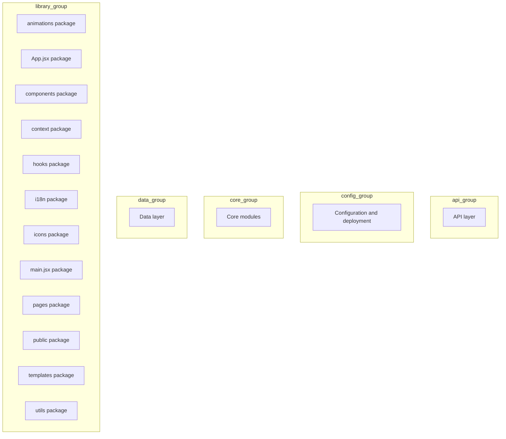

# Architecture report: drawdb-io/drawdb

> Automated static analysis. **Observed** = directly seen in files/imports/AST; **Inferred** = interpretation from that evidence. Repository code was not executed.

## 1. Repository at a glance

| Item | Value |
| --- | --- |
| Repository | drawdb-io/drawdb |
| Description | Free, simple, and intuitive online database diagram editor and SQL generator. |
| Language | JavaScript |
| Stars | 40327 |
| Licence | AGPL-3.0 |
| Analysed commit / branch | af09640e1238c36e11f3c9b582bf1f88e89c46cf / main |
| Framework(s) | React |
| Files analysed | 284 |
| Components | 16 |

## 2. Architecture in one minute

drawdb-io/drawdb - Free, simple, and intuitive online database diagram editor and SQL generator.. This repository was analysed statically from 284 file(s) (0 Python). Detected technologies (observed from imports/manifests): GitHub Actions, React, axios, React Router, Tailwind CSS, Docker. Files are grouped into 16 component(s): animations package, API layer, App.jsx package, components package, Configuration and deployment, context package, Core modules, Data layer. Findings below distinguish observed facts from inferred interpretation.

## 3. High-level block diagram

## 4. Main components

### animations package (`animations`)

- **Kind:** library
- **Status:** Observed
- **Confidence:** 0.85
- **Responsibility:** Groups 2 file(s) under animations package (observed from repository paths and static analysis).
- **Paths:** `src/animations/FadeIn.jsx`, `src/animations/SlideIn.jsx`
- **Evidence:** [src/animations/FadeIn.jsx](https://github.com/drawdb-io/drawdb/blob/af09640e1238c36e11f3c9b582bf1f88e89c46cf/src/animations/FadeIn.jsx); [src/animations/SlideIn.jsx](https://github.com/drawdb-io/drawdb/blob/af09640e1238c36e11f3c9b582bf1f88e89c46cf/src/animations/SlideIn.jsx)

### API layer (`api_layer`)

- **Kind:** api
- **Status:** Observed
- **Confidence:** 0.85
- **Responsibility:** Groups 2 file(s) under api layer (observed from repository paths and static analysis).
- **Paths:** `src/api/email.js`, `src/api/gists.js`
- **Evidence:** [src/api/email.js](https://github.com/drawdb-io/drawdb/blob/af09640e1238c36e11f3c9b582bf1f88e89c46cf/src/api/email.js); [src/api/gists.js](https://github.com/drawdb-io/drawdb/blob/af09640e1238c36e11f3c9b582bf1f88e89c46cf/src/api/gists.js)

### App.jsx package (`app_jsx`)

- **Kind:** library
- **Status:** Observed
- **Confidence:** 0.85
- **Responsibility:** Groups 1 file(s) under app.jsx package (observed from repository paths and static analysis).
- **Paths:** `src/App.jsx`
- **Evidence:** [src/App.jsx](https://github.com/drawdb-io/drawdb/blob/af09640e1238c36e11f3c9b582bf1f88e89c46cf/src/App.jsx)

### components package (`components`)

- **Kind:** library
- **Status:** Observed
- **Confidence:** 0.85
- **Responsibility:** Groups 82 file(s) under components package (observed from repository paths and static analysis).
- **Paths:** `src/components/CodeEditor/index.jsx`, `src/components/CodeEditor/setUpDBML.js`, `src/components/EditorCanvas/Area.jsx`, `src/components/EditorCanvas/Canvas.jsx`, `src/components/EditorCanvas/Note.jsx`, `src/components/EditorCanvas/Relationship.jsx`, `src/components/EditorCanvas/ResizeHandles.jsx`, `src/components/EditorCanvas/Table.jsx`, `src/components/EditorCanvas/View.jsx`, `src/components/EditorHeader/ConfigureCustomTypes/components/TypeRow.jsx`, `src/components/EditorHeader/ConfigureCustomTypes/index.jsx`, `src/components/EditorHeader/ControlPanel.jsx`, `src/components/EditorHeader/LayoutDropdown.jsx`, `src/components/EditorHeader/Modal/ImportDatabase.jsx`, `src/components/EditorHeader/Modal/ImportDiagram.jsx`, `src/components/EditorHeader/Modal/ImportSource.jsx`, `src/components/EditorHeader/Modal/ImportWithAiButton.jsx`, `src/components/EditorHeader/Modal/Language.jsx`, `src/components/EditorHeader/Modal/Modal.jsx`, `src/components/EditorHeader/Modal/New.jsx`, `src/components/EditorHeader/Modal/Open/components/DiagramFilters.jsx`, `src/components/EditorHeader/Modal/Open/components/DiagramTable.jsx`, `src/components/EditorHeader/Modal/Open/components/SortableHeader.jsx`, `src/components/EditorHeader/Modal/Open/diagram.js`, `src/components/EditorHeader/Modal/Open/hooks/useDiagramList.js`, `src/components/EditorHeader/Modal/Open/index.jsx`, `src/components/EditorHeader/Modal/Rename.jsx`, `src/components/EditorHeader/Modal/Share.jsx`, `src/components/EditorHeader/SideSheet/Migration.jsx`, `src/components/EditorHeader/SideSheet/Sidesheet.jsx`, `src/components/EditorHeader/SideSheet/Timeline.jsx`, `src/components/EditorHeader/SideSheet/Versions.jsx`, `src/components/EditorSidePanel/AreasTab/AreaDetails.jsx`, `src/components/EditorSidePanel/AreasTab/AreasTab.jsx`, `src/components/EditorSidePanel/AreasTab/SearchBar.jsx`, `src/components/EditorSidePanel/ColorPicker.jsx`, `src/components/EditorSidePanel/DBMLEditor.jsx`, `src/components/EditorSidePanel/Empty.jsx`, `src/components/EditorSidePanel/EnumsTab/EnumDetails.jsx`, `src/components/EditorSidePanel/EnumsTab/EnumsTab.jsx`, `src/components/EditorSidePanel/EnumsTab/SearchBar.jsx`, `src/components/EditorSidePanel/Issues.jsx`, `src/components/EditorSidePanel/NotesTab/NoteInfo.jsx`, `src/components/EditorSidePanel/NotesTab/NotesTab.jsx`, `src/components/EditorSidePanel/NotesTab/SearchBar.jsx`, `src/components/EditorSidePanel/RelationshipsTab/RelationshipInfo.jsx`, `src/components/EditorSidePanel/RelationshipsTab/RelationshipsTab.jsx`, `src/components/EditorSidePanel/RelationshipsTab/SearchBar.jsx`, `src/components/EditorSidePanel/SidePanel.jsx`, `src/components/EditorSidePanel/SqlHeaderTab.jsx`, `src/components/EditorSidePanel/TablesTab/FieldDetails.jsx`, `src/components/EditorSidePanel/TablesTab/IndexDetails.jsx`, `src/components/EditorSidePanel/TablesTab/SearchBar.jsx`, `src/components/EditorSidePanel/TablesTab/TableField.jsx`, `src/components/EditorSidePanel/TablesTab/TableInfo.jsx`, `src/components/EditorSidePanel/TablesTab/TablesTab.jsx`, `src/components/EditorSidePanel/TablesTab/UniqueConstraintDetails.jsx`, `src/components/EditorSidePanel/TypesTab/SearchBar.jsx`, `src/components/EditorSidePanel/TypesTab/TypeField.jsx`, `src/components/EditorSidePanel/TypesTab/TypeInfo.jsx`, `src/components/EditorSidePanel/TypesTab/TypesTab.jsx`, `src/components/EditorSidePanel/ViewsTab/SearchBar.jsx`, `src/components/EditorSidePanel/ViewsTab/ViewCondition.jsx`, `src/components/EditorSidePanel/ViewsTab/ViewInfo.jsx`, `src/components/EditorSidePanel/ViewsTab/ViewJoin.jsx`, `src/components/EditorSidePanel/ViewsTab/ViewOutputColumn.jsx`, `src/components/EditorSidePanel/ViewsTab/ViewsTab.jsx`, `src/components/FloatingControls.jsx`, `src/components/LexicalEditor/AutoLinkPlugin.jsx`, `src/components/LexicalEditor/CodeHighlightPlugin.jsx`, `src/components/LexicalEditor/ListMaxIndentLevelPlugin.jsx`, `src/components/LexicalEditor/RichEditor.jsx`, `src/components/LexicalEditor/ToolbarPlugin.jsx`, `src/components/MigrationBanner.jsx`, `src/components/Navbar.jsx`, `src/components/SimpleCanvas.jsx`, `src/components/SortableList/DragHandle.jsx`, `src/components/SortableList/SortableItem.jsx`, `src/components/SortableList/SortableList.jsx`, `src/components/StartModal.jsx`, `src/components/Thumbnail.jsx`, `src/components/Workspace.jsx`
- **Evidence:** [src/components/CodeEditor/index.jsx](https://github.com/drawdb-io/drawdb/blob/af09640e1238c36e11f3c9b582bf1f88e89c46cf/src/components/CodeEditor/index.jsx); [src/components/CodeEditor/setUpDBML.js](https://github.com/drawdb-io/drawdb/blob/af09640e1238c36e11f3c9b582bf1f88e89c46cf/src/components/CodeEditor/setUpDBML.js); [src/components/EditorCanvas/Area.jsx](https://github.com/drawdb-io/drawdb/blob/af09640e1238c36e11f3c9b582bf1f88e89c46cf/src/components/EditorCanvas/Area.jsx); [src/components/EditorCanvas/Canvas.jsx](https://github.com/drawdb-io/drawdb/blob/af09640e1238c36e11f3c9b582bf1f88e89c46cf/src/components/EditorCanvas/Canvas.jsx); [src/components/EditorCanvas/Note.jsx](https://github.com/drawdb-io/drawdb/blob/af09640e1238c36e11f3c9b582bf1f88e89c46cf/src/components/EditorCanvas/Note.jsx); [src/components/EditorCanvas/Relationship.jsx](https://github.com/drawdb-io/drawdb/blob/af09640e1238c36e11f3c9b582bf1f88e89c46cf/src/components/EditorCanvas/Relationship.jsx); [src/components/EditorCanvas/ResizeHandles.jsx](https://github.com/drawdb-io/drawdb/blob/af09640e1238c36e11f3c9b582bf1f88e89c46cf/src/components/EditorCanvas/ResizeHandles.jsx); [src/components/EditorCanvas/Table.jsx](https://github.com/drawdb-io/drawdb/blob/af09640e1238c36e11f3c9b582bf1f88e89c46cf/src/components/EditorCanvas/Table.jsx)

### Configuration and deployment (`config`)

- **Kind:** config
- **Status:** Observed
- **Confidence:** 0.85
- **Responsibility:** Groups 5 file(s) under configuration and deployment (observed from repository paths and static analysis).
- **Paths:** `Dockerfile`, `compose.yml`, `package.json`, `src/config/index.js`, `vercel.json`
- **Evidence:** [Dockerfile](https://github.com/drawdb-io/drawdb/blob/af09640e1238c36e11f3c9b582bf1f88e89c46cf/Dockerfile); [compose.yml](https://github.com/drawdb-io/drawdb/blob/af09640e1238c36e11f3c9b582bf1f88e89c46cf/compose.yml); [package.json](https://github.com/drawdb-io/drawdb/blob/af09640e1238c36e11f3c9b582bf1f88e89c46cf/package.json); [src/config/index.js](https://github.com/drawdb-io/drawdb/blob/af09640e1238c36e11f3c9b582bf1f88e89c46cf/src/config/index.js); [vercel.json](https://github.com/drawdb-io/drawdb/blob/af09640e1238c36e11f3c9b582bf1f88e89c46cf/vercel.json)

### context package (`context`)

- **Kind:** library
- **Status:** Observed
- **Confidence:** 0.85
- **Responsibility:** Groups 15 file(s) under context package (observed from repository paths and static analysis).
- **Paths:** `src/context/AreasContext.jsx`, `src/context/CanvasContext.jsx`, `src/context/CollabContext.jsx`, `src/context/DiagramContext.jsx`, `src/context/EnumsContext.jsx`, `src/context/ExtensionsContext.jsx`, `src/context/LayoutContext.jsx`, `src/context/NotesContext.jsx`, `src/context/SaveStateContext.jsx`, `src/context/SelectContext.jsx`, `src/context/SettingsContext.jsx`, `src/context/TransformContext.jsx`, `src/context/TypesContext.jsx`, `src/context/UndoRedoContext.jsx`, `src/context/ViewsContext.jsx`
- **Evidence:** [src/context/AreasContext.jsx](https://github.com/drawdb-io/drawdb/blob/af09640e1238c36e11f3c9b582bf1f88e89c46cf/src/context/AreasContext.jsx); [src/context/CanvasContext.jsx](https://github.com/drawdb-io/drawdb/blob/af09640e1238c36e11f3c9b582bf1f88e89c46cf/src/context/CanvasContext.jsx); [src/context/CollabContext.jsx](https://github.com/drawdb-io/drawdb/blob/af09640e1238c36e11f3c9b582bf1f88e89c46cf/src/context/CollabContext.jsx); [src/context/DiagramContext.jsx](https://github.com/drawdb-io/drawdb/blob/af09640e1238c36e11f3c9b582bf1f88e89c46cf/src/context/DiagramContext.jsx); [src/context/EnumsContext.jsx](https://github.com/drawdb-io/drawdb/blob/af09640e1238c36e11f3c9b582bf1f88e89c46cf/src/context/EnumsContext.jsx); [src/context/ExtensionsContext.jsx](https://github.com/drawdb-io/drawdb/blob/af09640e1238c36e11f3c9b582bf1f88e89c46cf/src/context/ExtensionsContext.jsx); [src/context/LayoutContext.jsx](https://github.com/drawdb-io/drawdb/blob/af09640e1238c36e11f3c9b582bf1f88e89c46cf/src/context/LayoutContext.jsx); [src/context/NotesContext.jsx](https://github.com/drawdb-io/drawdb/blob/af09640e1238c36e11f3c9b582bf1f88e89c46cf/src/context/NotesContext.jsx)

### Core modules (`core`)

- **Kind:** core
- **Status:** Observed
- **Confidence:** 0.85
- **Responsibility:** Groups 3 file(s) under core modules (observed from repository paths and static analysis).
- **Paths:** `postcss.config.js`, `tailwind.config.js`, `vite.config.js`
- **Evidence:** [postcss.config.js](https://github.com/drawdb-io/drawdb/blob/af09640e1238c36e11f3c9b582bf1f88e89c46cf/postcss.config.js); [tailwind.config.js](https://github.com/drawdb-io/drawdb/blob/af09640e1238c36e11f3c9b582bf1f88e89c46cf/tailwind.config.js); [vite.config.js](https://github.com/drawdb-io/drawdb/blob/af09640e1238c36e11f3c9b582bf1f88e89c46cf/vite.config.js)

### Data layer (`data_layer`)

- **Kind:** data
- **Status:** Observed
- **Confidence:** 0.85
- **Responsibility:** Groups 10 file(s) under data layer (observed from repository paths and static analysis).
- **Paths:** `src/data/constants.js`, `src/data/databases.js`, `src/data/datatypes.js`, `src/data/db.js`, `src/data/editorConfig.js`, `src/data/heroDiagram.js`, `src/data/schemas.js`, `src/data/seeds.js`, `src/data/socials.js`, `src/data/surveyQuestions.js`
- **Evidence:** [src/data/constants.js](https://github.com/drawdb-io/drawdb/blob/af09640e1238c36e11f3c9b582bf1f88e89c46cf/src/data/constants.js); [src/data/databases.js](https://github.com/drawdb-io/drawdb/blob/af09640e1238c36e11f3c9b582bf1f88e89c46cf/src/data/databases.js); [src/data/datatypes.js](https://github.com/drawdb-io/drawdb/blob/af09640e1238c36e11f3c9b582bf1f88e89c46cf/src/data/datatypes.js); [src/data/db.js](https://github.com/drawdb-io/drawdb/blob/af09640e1238c36e11f3c9b582bf1f88e89c46cf/src/data/db.js); [src/data/editorConfig.js](https://github.com/drawdb-io/drawdb/blob/af09640e1238c36e11f3c9b582bf1f88e89c46cf/src/data/editorConfig.js); [src/data/heroDiagram.js](https://github.com/drawdb-io/drawdb/blob/af09640e1238c36e11f3c9b582bf1f88e89c46cf/src/data/heroDiagram.js); [src/data/schemas.js](https://github.com/drawdb-io/drawdb/blob/af09640e1238c36e11f3c9b582bf1f88e89c46cf/src/data/schemas.js); [src/data/seeds.js](https://github.com/drawdb-io/drawdb/blob/af09640e1238c36e11f3c9b582bf1f88e89c46cf/src/data/seeds.js)

### hooks package (`hooks`)

- **Kind:** library
- **Status:** Observed
- **Confidence:** 0.85
- **Responsibility:** Groups 19 file(s) under hooks package (observed from repository paths and static analysis).
- **Paths:** `src/hooks/index.js`, `src/hooks/useAreaMembership.js`, `src/hooks/useAreas.js`, `src/hooks/useCanvas.js`, `src/hooks/useCollab.js`, `src/hooks/useDiagram.js`, `src/hooks/useEnums.js`, `src/hooks/useFullscreen.js`, `src/hooks/useLayout.js`, `src/hooks/useNavigateWithParams.js`, `src/hooks/useNotes.js`, `src/hooks/useSaveState.js`, `src/hooks/useSelect.js`, `src/hooks/useSettings.js`, `src/hooks/useThemedPage.js`, `src/hooks/useTransform.js`, `src/hooks/useTypes.js`, `src/hooks/useUndoRedo.js`, `src/hooks/useViews.js`
- **Evidence:** [src/hooks/index.js](https://github.com/drawdb-io/drawdb/blob/af09640e1238c36e11f3c9b582bf1f88e89c46cf/src/hooks/index.js); [src/hooks/useAreaMembership.js](https://github.com/drawdb-io/drawdb/blob/af09640e1238c36e11f3c9b582bf1f88e89c46cf/src/hooks/useAreaMembership.js); [src/hooks/useAreas.js](https://github.com/drawdb-io/drawdb/blob/af09640e1238c36e11f3c9b582bf1f88e89c46cf/src/hooks/useAreas.js); [src/hooks/useCanvas.js](https://github.com/drawdb-io/drawdb/blob/af09640e1238c36e11f3c9b582bf1f88e89c46cf/src/hooks/useCanvas.js); [src/hooks/useCollab.js](https://github.com/drawdb-io/drawdb/blob/af09640e1238c36e11f3c9b582bf1f88e89c46cf/src/hooks/useCollab.js); [src/hooks/useDiagram.js](https://github.com/drawdb-io/drawdb/blob/af09640e1238c36e11f3c9b582bf1f88e89c46cf/src/hooks/useDiagram.js); [src/hooks/useEnums.js](https://github.com/drawdb-io/drawdb/blob/af09640e1238c36e11f3c9b582bf1f88e89c46cf/src/hooks/useEnums.js); [src/hooks/useFullscreen.js](https://github.com/drawdb-io/drawdb/blob/af09640e1238c36e11f3c9b582bf1f88e89c46cf/src/hooks/useFullscreen.js)

### i18n package (`i18n`)

- **Kind:** library
- **Status:** Observed
- **Confidence:** 0.85
- **Responsibility:** Groups 53 file(s) under i18n package (observed from repository paths and static analysis).
- **Paths:** `src/i18n/i18n.js`, `src/i18n/locales/ar.js`, `src/i18n/locales/as.js`, `src/i18n/locales/bg.js`, `src/i18n/locales/bn.js`, `src/i18n/locales/cz.js`, `src/i18n/locales/da.js`, `src/i18n/locales/de.js`, `src/i18n/locales/el.js`, `src/i18n/locales/en.js`, `src/i18n/locales/es.js`, `src/i18n/locales/fa.js`, `src/i18n/locales/fi.js`, `src/i18n/locales/fr.js`, `src/i18n/locales/gu.js`, `src/i18n/locales/he.js`, `src/i18n/locales/hi.js`, `src/i18n/locales/hu.js`, `src/i18n/locales/hy.js`, `src/i18n/locales/id.js`, `src/i18n/locales/it.js`, `src/i18n/locales/jp.js`, `src/i18n/locales/ka.js`, `src/i18n/locales/ko.js`, `src/i18n/locales/ml.js`, `src/i18n/locales/mn.js`, `src/i18n/locales/mr.js`, `src/i18n/locales/ms.js`, `src/i18n/locales/ne.js`, `src/i18n/locales/nl.js`, `src/i18n/locales/no.js`, `src/i18n/locales/od.js`, `src/i18n/locales/pa-pk.js`, `src/i18n/locales/pa.js`, `src/i18n/locales/pl.js`, `src/i18n/locales/pt-br.js`, `src/i18n/locales/ro.js`, `src/i18n/locales/ru.js`, `src/i18n/locales/sd.js`, `src/i18n/locales/sv-se.js`, `src/i18n/locales/sw.js`, `src/i18n/locales/te.js`, `src/i18n/locales/th.js`, `src/i18n/locales/tl.js`, `src/i18n/locales/tm.js`, `src/i18n/locales/tr.js`, `src/i18n/locales/ug.js`, `src/i18n/locales/uk.js`, `src/i18n/locales/ur.js`, `src/i18n/locales/vi.js`, `src/i18n/locales/zh-tw.js`, `src/i18n/locales/zh.js`, `src/i18n/utils/rtl.js`
- **Evidence:** [src/i18n/i18n.js](https://github.com/drawdb-io/drawdb/blob/af09640e1238c36e11f3c9b582bf1f88e89c46cf/src/i18n/i18n.js); [src/i18n/locales/ar.js](https://github.com/drawdb-io/drawdb/blob/af09640e1238c36e11f3c9b582bf1f88e89c46cf/src/i18n/locales/ar.js); [src/i18n/locales/as.js](https://github.com/drawdb-io/drawdb/blob/af09640e1238c36e11f3c9b582bf1f88e89c46cf/src/i18n/locales/as.js); [src/i18n/locales/bg.js](https://github.com/drawdb-io/drawdb/blob/af09640e1238c36e11f3c9b582bf1f88e89c46cf/src/i18n/locales/bg.js); [src/i18n/locales/bn.js](https://github.com/drawdb-io/drawdb/blob/af09640e1238c36e11f3c9b582bf1f88e89c46cf/src/i18n/locales/bn.js); [src/i18n/locales/cz.js](https://github.com/drawdb-io/drawdb/blob/af09640e1238c36e11f3c9b582bf1f88e89c46cf/src/i18n/locales/cz.js); [src/i18n/locales/da.js](https://github.com/drawdb-io/drawdb/blob/af09640e1238c36e11f3c9b582bf1f88e89c46cf/src/i18n/locales/da.js); [src/i18n/locales/de.js](https://github.com/drawdb-io/drawdb/blob/af09640e1238c36e11f3c9b582bf1f88e89c46cf/src/i18n/locales/de.js)

### icons package (`icons`)

- **Kind:** library
- **Status:** Observed
- **Confidence:** 0.85
- **Responsibility:** Groups 8 file(s) under icons package (observed from repository paths and static analysis).
- **Paths:** `src/icons/IconAddArea.jsx`, `src/icons/IconAddNote.jsx`, `src/icons/IconAddTable.jsx`, `src/icons/IconAddView.jsx`, `src/icons/IconRelationship.jsx`, `src/icons/IconSparkles.jsx`, `src/icons/IconTable.jsx`, `src/icons/index.js`
- **Evidence:** [src/icons/IconAddArea.jsx](https://github.com/drawdb-io/drawdb/blob/af09640e1238c36e11f3c9b582bf1f88e89c46cf/src/icons/IconAddArea.jsx); [src/icons/IconAddNote.jsx](https://github.com/drawdb-io/drawdb/blob/af09640e1238c36e11f3c9b582bf1f88e89c46cf/src/icons/IconAddNote.jsx); [src/icons/IconAddTable.jsx](https://github.com/drawdb-io/drawdb/blob/af09640e1238c36e11f3c9b582bf1f88e89c46cf/src/icons/IconAddTable.jsx); [src/icons/IconAddView.jsx](https://github.com/drawdb-io/drawdb/blob/af09640e1238c36e11f3c9b582bf1f88e89c46cf/src/icons/IconAddView.jsx); [src/icons/IconRelationship.jsx](https://github.com/drawdb-io/drawdb/blob/af09640e1238c36e11f3c9b582bf1f88e89c46cf/src/icons/IconRelationship.jsx); [src/icons/IconSparkles.jsx](https://github.com/drawdb-io/drawdb/blob/af09640e1238c36e11f3c9b582bf1f88e89c46cf/src/icons/IconSparkles.jsx); [src/icons/IconTable.jsx](https://github.com/drawdb-io/drawdb/blob/af09640e1238c36e11f3c9b582bf1f88e89c46cf/src/icons/IconTable.jsx); [src/icons/index.js](https://github.com/drawdb-io/drawdb/blob/af09640e1238c36e11f3c9b582bf1f88e89c46cf/src/icons/index.js)

### main.jsx package (`main_jsx`)

- **Kind:** library
- **Status:** Observed
- **Confidence:** 0.85
- **Responsibility:** Groups 1 file(s) under main.jsx package (observed from repository paths and static analysis).
- **Paths:** `src/main.jsx`
- **Evidence:** [src/main.jsx](https://github.com/drawdb-io/drawdb/blob/af09640e1238c36e11f3c9b582bf1f88e89c46cf/src/main.jsx)

### pages package (`pages`)

- **Kind:** library
- **Status:** Observed
- **Confidence:** 0.85
- **Responsibility:** Groups 5 file(s) under pages package (observed from repository paths and static analysis).
- **Paths:** `src/pages/BugReport.jsx`, `src/pages/Editor.jsx`, `src/pages/LandingPage.jsx`, `src/pages/NotFound.jsx`, `src/pages/Templates.jsx`
- **Evidence:** [src/pages/BugReport.jsx](https://github.com/drawdb-io/drawdb/blob/af09640e1238c36e11f3c9b582bf1f88e89c46cf/src/pages/BugReport.jsx); [src/pages/Editor.jsx](https://github.com/drawdb-io/drawdb/blob/af09640e1238c36e11f3c9b582bf1f88e89c46cf/src/pages/Editor.jsx); [src/pages/LandingPage.jsx](https://github.com/drawdb-io/drawdb/blob/af09640e1238c36e11f3c9b582bf1f88e89c46cf/src/pages/LandingPage.jsx); [src/pages/NotFound.jsx](https://github.com/drawdb-io/drawdb/blob/af09640e1238c36e11f3c9b582bf1f88e89c46cf/src/pages/NotFound.jsx); [src/pages/Templates.jsx](https://github.com/drawdb-io/drawdb/blob/af09640e1238c36e11f3c9b582bf1f88e89c46cf/src/pages/Templates.jsx)

### public package (`public`)

- **Kind:** library
- **Status:** Observed
- **Confidence:** 0.85
- **Responsibility:** Groups 1 file(s) under public package (observed from repository paths and static analysis).
- **Paths:** `public/config.js`
- **Evidence:** [public/config.js](https://github.com/drawdb-io/drawdb/blob/af09640e1238c36e11f3c9b582bf1f88e89c46cf/public/config.js)

### templates package (`templates`)

- **Kind:** library
- **Status:** Observed
- **Confidence:** 0.85
- **Responsibility:** Groups 6 file(s) under templates package (observed from repository paths and static analysis).
- **Paths:** `src/templates/template1.js`, `src/templates/template2.js`, `src/templates/template3.js`, `src/templates/template4.js`, `src/templates/template5.js`, `src/templates/template6.js`
- **Evidence:** [src/templates/template1.js](https://github.com/drawdb-io/drawdb/blob/af09640e1238c36e11f3c9b582bf1f88e89c46cf/src/templates/template1.js); [src/templates/template2.js](https://github.com/drawdb-io/drawdb/blob/af09640e1238c36e11f3c9b582bf1f88e89c46cf/src/templates/template2.js); [src/templates/template3.js](https://github.com/drawdb-io/drawdb/blob/af09640e1238c36e11f3c9b582bf1f88e89c46cf/src/templates/template3.js); [src/templates/template4.js](https://github.com/drawdb-io/drawdb/blob/af09640e1238c36e11f3c9b582bf1f88e89c46cf/src/templates/template4.js); [src/templates/template5.js](https://github.com/drawdb-io/drawdb/blob/af09640e1238c36e11f3c9b582bf1f88e89c46cf/src/templates/template5.js); [src/templates/template6.js](https://github.com/drawdb-io/drawdb/blob/af09640e1238c36e11f3c9b582bf1f88e89c46cf/src/templates/template6.js)

### utils package (`utils`)

- **Kind:** library
- **Status:** Observed
- **Confidence:** 0.85
- **Responsibility:** Groups 53 file(s) under utils package (observed from repository paths and static analysis).
- **Paths:** `src/utils/arrangeTables.js`, `src/utils/autoArrange.js`, `src/utils/autoRelationships.js`, `src/utils/cache.js`, `src/utils/calcPath.js`, `src/utils/customTypes.js`, `src/utils/dbml/applyPlan.js`, `src/utils/dbml/diff.js`, `src/utils/dbml/parse.js`, `src/utils/dbml/reconcile.js`, `src/utils/dbml/types.js`, `src/utils/diff.js`, `src/utils/dismissedBanners.js`, `src/utils/exportAs/dbml.js`, `src/utils/exportAs/documentation.js`, `src/utils/exportAs/mermaid.js`, `src/utils/exportSQL/generic.js`, `src/utils/exportSQL/index.js`, `src/utils/exportSQL/mariadb.js`, `src/utils/exportSQL/mssql.js`, `src/utils/exportSQL/mysql.js`, `src/utils/exportSQL/oraclesql.js`, `src/utils/exportSQL/postgres.js`, `src/utils/exportSQL/shared.js`, `src/utils/exportSQL/sqlite.js`, `src/utils/exportSavedData.js`, `src/utils/fullscreen.js`, `src/utils/importAiDiagram.js`, `src/utils/importFrom/dbml.js`, `src/utils/importFrom/schemaQuery/index.js`, `src/utils/importFrom/schemaQuery/mariadb.js`, `src/utils/importFrom/schemaQuery/mssql.js`, `src/utils/importFrom/schemaQuery/mysql.js`, `src/utils/importFrom/schemaQuery/oraclesql.js`, `src/utils/importFrom/schemaQuery/postgres.js`, `src/utils/importFrom/schemaQuery/sqlite.js`, `src/utils/importSQL/index.js`, `src/utils/importSQL/mariadb.js`, `src/utils/importSQL/mssql.js`, `src/utils/importSQL/mysql.js`, `src/utils/importSQL/oraclesql.js`, `src/utils/importSQL/postgres.js`, `src/utils/importSQL/shared.js`, `src/utils/importSQL/sqlite.js`, `src/utils/issues.js`, `src/utils/layout.js`, `src/utils/migrations/diffToSQL.js`, `src/utils/modalData.js`, `src/utils/queryConfig.js`, `src/utils/rect.js`, `src/utils/utils.js`, `src/utils/validateSchema.js`, `src/utils/views.js`
- **Evidence:** [src/utils/arrangeTables.js](https://github.com/drawdb-io/drawdb/blob/af09640e1238c36e11f3c9b582bf1f88e89c46cf/src/utils/arrangeTables.js); [src/utils/autoArrange.js](https://github.com/drawdb-io/drawdb/blob/af09640e1238c36e11f3c9b582bf1f88e89c46cf/src/utils/autoArrange.js); [src/utils/autoRelationships.js](https://github.com/drawdb-io/drawdb/blob/af09640e1238c36e11f3c9b582bf1f88e89c46cf/src/utils/autoRelationships.js); [src/utils/cache.js](https://github.com/drawdb-io/drawdb/blob/af09640e1238c36e11f3c9b582bf1f88e89c46cf/src/utils/cache.js); [src/utils/calcPath.js](https://github.com/drawdb-io/drawdb/blob/af09640e1238c36e11f3c9b582bf1f88e89c46cf/src/utils/calcPath.js); [src/utils/customTypes.js](https://github.com/drawdb-io/drawdb/blob/af09640e1238c36e11f3c9b582bf1f88e89c46cf/src/utils/customTypes.js); [src/utils/dbml/applyPlan.js](https://github.com/drawdb-io/drawdb/blob/af09640e1238c36e11f3c9b582bf1f88e89c46cf/src/utils/dbml/applyPlan.js); [src/utils/dbml/diff.js](https://github.com/drawdb-io/drawdb/blob/af09640e1238c36e11f3c9b582bf1f88e89c46cf/src/utils/dbml/diff.js)

## 5. Execution flow

**Observed** entry point(s):

- [src/App.jsx](https://github.com/drawdb-io/drawdb/blob/af09640e1238c36e11f3c9b582bf1f88e89c46cf/src/App.jsx)
- [src/components/CodeEditor/index.jsx](https://github.com/drawdb-io/drawdb/blob/af09640e1238c36e11f3c9b582bf1f88e89c46cf/src/components/CodeEditor/index.jsx)
- [src/config/index.js](https://github.com/drawdb-io/drawdb/blob/af09640e1238c36e11f3c9b582bf1f88e89c46cf/src/config/index.js)
- [src/hooks/index.js](https://github.com/drawdb-io/drawdb/blob/af09640e1238c36e11f3c9b582bf1f88e89c46cf/src/hooks/index.js)
- [src/icons/index.js](https://github.com/drawdb-io/drawdb/blob/af09640e1238c36e11f3c9b582bf1f88e89c46cf/src/icons/index.js)
- [src/main.jsx](https://github.com/drawdb-io/drawdb/blob/af09640e1238c36e11f3c9b582bf1f88e89c46cf/src/main.jsx)
- [src/utils/exportSQL/index.js](https://github.com/drawdb-io/drawdb/blob/af09640e1238c36e11f3c9b582bf1f88e89c46cf/src/utils/exportSQL/index.js)
- [src/utils/importSQL/index.js](https://github.com/drawdb-io/drawdb/blob/af09640e1238c36e11f3c9b582bf1f88e89c46cf/src/utils/importSQL/index.js)

Representative flow (derived from observed entry points and the import graph; steps beyond the entry point are **Inferred**):

1. Execution starts at an observed entry point listed above, if present.
2. No internal import relationships between components were observed.

## 6. Project structure

### `(root)`

- `.dockerignore` - container (423 bytes)
- `.env.sample` - config (35 bytes)
- `.eslintrc.cjs` - source, JavaScript (621 bytes)
- `.gitignore` - other (258 bytes)
- `.prettierrc.json` - config (113 bytes)
- `CONTRIBUTING.md` - docs (3696 bytes)
- `Dockerfile` - container (854 bytes)
- `LICENSE` - docs (34523 bytes)
- `README.md` - docs (2239 bytes)
- `compose.yml` - container (300 bytes)
- `index.html` - other (2194 bytes)
- `package.json` - manifest (2058 bytes)
- `postcss.config.js` - source, JavaScript (69 bytes)
- `tailwind.config.js` - source, JavaScript (369 bytes)
- `vercel.json` - config (75 bytes)
- `vite.config.js` - source, JavaScript (163 bytes)

### `.github`

- `.github/FUNDING.yml` - config (14 bytes)
- `.github/ISSUE_TEMPLATE/bug_report.md` - docs (724 bytes)
- `.github/ISSUE_TEMPLATE/feature_request.md` - docs (467 bytes)
- `.github/workflows/build.yml` - ci, YAML (578 bytes)
- `.github/workflows/docker.yml` - ci, YAML (796 bytes)

### `.husky`

- `.husky/pre-commit` - other (16 bytes)

### `public`

- `public/config.js` - source, JavaScript (31 bytes)
- `public/robots.txt` - docs (121 bytes)

### `src`

- `src/App.jsx` - source, JavaScript (1491 bytes)
- `src/animations/FadeIn.jsx` - source, JavaScript (704 bytes)
- `src/animations/SlideIn.jsx` - source, JavaScript (793 bytes)
- `src/api/email.js` - source, JavaScript (235 bytes)
- `src/api/gists.js` - source, JavaScript (1663 bytes)
- `src/components/CodeEditor/index.jsx` - source, JavaScript (2361 bytes)
- `src/components/CodeEditor/setUpDBML.js` - source, JavaScript (3336 bytes)
- `src/components/EditorCanvas/Area.jsx` - source, JavaScript (11584 bytes)
- `src/components/EditorCanvas/Canvas.jsx` - source, JavaScript (33915 bytes)
- `src/components/EditorCanvas/Note.jsx` - source, JavaScript (17854 bytes)
- `src/components/EditorCanvas/Relationship.jsx` - source, JavaScript (8844 bytes)
- `src/components/EditorCanvas/ResizeHandles.jsx` - source, JavaScript (3457 bytes)
- `src/components/EditorCanvas/Table.jsx` - source, JavaScript (21341 bytes)
- `src/components/EditorCanvas/View.jsx` - source, JavaScript (12064 bytes)
- `src/components/EditorHeader/ConfigureCustomTypes/components/TypeRow.jsx` - source, JavaScript (1578 bytes)
- `src/components/EditorHeader/ConfigureCustomTypes/index.jsx` - source, JavaScript (6829 bytes)
- `src/components/EditorHeader/ControlPanel.jsx` - source, JavaScript (88737 bytes)
- `src/components/EditorHeader/LayoutDropdown.jsx` - source, JavaScript (2361 bytes)
- `src/components/EditorHeader/Modal/ImportDatabase.jsx` - source, JavaScript (6667 bytes)
- `src/components/EditorHeader/Modal/ImportDiagram.jsx` - source, JavaScript (5800 bytes)
- `src/components/EditorHeader/Modal/ImportSource.jsx` - source, JavaScript (3164 bytes)
- `src/components/EditorHeader/Modal/ImportWithAiButton.jsx` - source, JavaScript (1101 bytes)
- `src/components/EditorHeader/Modal/Language.jsx` - source, JavaScript (1001 bytes)
- `src/components/EditorHeader/Modal/Modal.jsx` - source, JavaScript (16419 bytes)
- `src/components/EditorHeader/Modal/New.jsx` - source, JavaScript (1078 bytes)
- `src/components/EditorHeader/Modal/Open/components/DiagramFilters.jsx` - source, JavaScript (1412 bytes)
- `src/components/EditorHeader/Modal/Open/components/DiagramTable.jsx` - source, JavaScript (3465 bytes)
- `src/components/EditorHeader/Modal/Open/components/SortableHeader.jsx` - source, JavaScript (632 bytes)
- `src/components/EditorHeader/Modal/Open/diagram.js` - source, JavaScript (2937 bytes)
- `src/components/EditorHeader/Modal/Open/hooks/useDiagramList.js` - source, JavaScript (1632 bytes)
- `src/components/EditorHeader/Modal/Open/index.jsx` - source, JavaScript (3028 bytes)
- `src/components/EditorHeader/Modal/Rename.jsx` - source, JavaScript (421 bytes)
- `src/components/EditorHeader/Modal/Share.jsx` - source, JavaScript (8178 bytes)
- `src/components/EditorHeader/SideSheet/Migration.jsx` - source, JavaScript (5529 bytes)
- `src/components/EditorHeader/SideSheet/Sidesheet.jsx` - source, JavaScript (1426 bytes)
- `src/components/EditorHeader/SideSheet/Timeline.jsx` - source, JavaScript (821 bytes)
- `src/components/EditorHeader/SideSheet/Versions.jsx` - source, JavaScript (10706 bytes)
- `src/components/EditorSidePanel/AreasTab/AreaDetails.jsx` - source, JavaScript (3295 bytes)
- `src/components/EditorSidePanel/AreasTab/AreasTab.jsx` - source, JavaScript (1496 bytes)
- `src/components/EditorSidePanel/AreasTab/SearchBar.jsx` - source, JavaScript (1189 bytes)
- `src/components/EditorSidePanel/ColorPicker.jsx` - source, JavaScript (909 bytes)
- `src/components/EditorSidePanel/DBMLEditor.jsx` - source, JavaScript (6946 bytes)
- `src/components/EditorSidePanel/Empty.jsx` - source, JavaScript (543 bytes)
- `src/components/EditorSidePanel/EnumsTab/EnumDetails.jsx` - source, JavaScript (3672 bytes)
- `src/components/EditorSidePanel/EnumsTab/EnumsTab.jsx` - source, JavaScript (1400 bytes)
- `src/components/EditorSidePanel/EnumsTab/SearchBar.jsx` - source, JavaScript (1166 bytes)
- `src/components/EditorSidePanel/Issues.jsx` - source, JavaScript (2607 bytes)
- `src/components/EditorSidePanel/NotesTab/NoteInfo.jsx` - source, JavaScript (4617 bytes)
- `src/components/EditorSidePanel/NotesTab/NotesTab.jsx` - source, JavaScript (1648 bytes)
- `src/components/EditorSidePanel/NotesTab/SearchBar.jsx` - source, JavaScript (1239 bytes)
- `src/components/EditorSidePanel/RelationshipsTab/RelationshipInfo.jsx` - source, JavaScript (13452 bytes)
- `src/components/EditorSidePanel/RelationshipsTab/RelationshipsTab.jsx` - source, JavaScript (2607 bytes)
- `src/components/EditorSidePanel/RelationshipsTab/SearchBar.jsx` - source, JavaScript (1491 bytes)
- `src/components/EditorSidePanel/SidePanel.jsx` - source, JavaScript (6901 bytes)
- `src/components/EditorSidePanel/SqlHeaderTab.jsx` - source, JavaScript (1718 bytes)
- `src/components/EditorSidePanel/TablesTab/FieldDetails.jsx` - source, JavaScript (13234 bytes)
- `src/components/EditorSidePanel/TablesTab/IndexDetails.jsx` - source, JavaScript (6560 bytes)
- `src/components/EditorSidePanel/TablesTab/SearchBar.jsx` - source, JavaScript (1741 bytes)
- `src/components/EditorSidePanel/TablesTab/TableField.jsx` - source, JavaScript (7390 bytes)
- `src/components/EditorSidePanel/TablesTab/TableInfo.jsx` - source, JavaScript (13061 bytes)
- `src/components/EditorSidePanel/TablesTab/TablesTab.jsx` - source, JavaScript (5145 bytes)
- `src/components/EditorSidePanel/TablesTab/UniqueConstraintDetails.jsx` - source, JavaScript (5104 bytes)
- `src/components/EditorSidePanel/TypesTab/SearchBar.jsx` - source, JavaScript (1426 bytes)
- `src/components/EditorSidePanel/TypesTab/TypeField.jsx` - source, JavaScript (11642 bytes)
- `src/components/EditorSidePanel/TypesTab/TypeInfo.jsx` - source, JavaScript (6227 bytes)
- `src/components/EditorSidePanel/TypesTab/TypesTab.jsx` - source, JavaScript (2254 bytes)
- `src/components/EditorSidePanel/ViewsTab/SearchBar.jsx` - source, JavaScript (1173 bytes)
- `src/components/EditorSidePanel/ViewsTab/ViewCondition.jsx` - source, JavaScript (2826 bytes)
- `src/components/EditorSidePanel/ViewsTab/ViewInfo.jsx` - source, JavaScript (11737 bytes)
- `src/components/EditorSidePanel/ViewsTab/ViewJoin.jsx` - source, JavaScript (5484 bytes)
- `src/components/EditorSidePanel/ViewsTab/ViewOutputColumn.jsx` - source, JavaScript (1681 bytes)
- `src/components/EditorSidePanel/ViewsTab/ViewsTab.jsx` - source, JavaScript (3724 bytes)
- `src/components/FloatingControls.jsx` - source, JavaScript (1676 bytes)
- `src/components/LexicalEditor/AutoLinkPlugin.jsx` - source, JavaScript (1066 bytes)
- `src/components/LexicalEditor/CodeHighlightPlugin.jsx` - source, JavaScript (488 bytes)
- `src/components/LexicalEditor/ListMaxIndentLevelPlugin.jsx` - source, JavaScript (1935 bytes)
- `src/components/LexicalEditor/RichEditor.jsx` - source, JavaScript (1778 bytes)
- `src/components/LexicalEditor/ToolbarPlugin.jsx` - source, JavaScript (18078 bytes)
- `src/components/LexicalEditor/styles/index.css` - other (6852 bytes)
- `src/components/MigrationBanner.jsx` - source, JavaScript (3760 bytes)
- `src/components/Navbar.jsx` - source, JavaScript (4784 bytes)
- `src/components/SimpleCanvas.jsx` - source, JavaScript (6820 bytes)
- `src/components/SortableList/DragHandle.jsx` - source, JavaScript (384 bytes)
- `src/components/SortableList/SortableItem.jsx` - source, JavaScript (422 bytes)
- `src/components/SortableList/SortableList.jsx` - source, JavaScript (1703 bytes)
- `src/components/StartModal.jsx` - source, JavaScript (7425 bytes)
- `src/components/Thumbnail.jsx` - source, JavaScript (5456 bytes)
- `src/components/Workspace.jsx` - source, JavaScript (20449 bytes)
- `src/config/index.js` - source, JavaScript (485 bytes)
- `src/context/AreasContext.jsx` - source, JavaScript (3505 bytes)
- `src/context/CanvasContext.jsx` - source, JavaScript (3837 bytes)
- `src/context/CollabContext.jsx` - source, JavaScript (547 bytes)
- `src/context/DiagramContext.jsx` - source, JavaScript (10601 bytes)
- `src/context/EnumsContext.jsx` - source, JavaScript (2687 bytes)
- `src/context/ExtensionsContext.jsx` - source, JavaScript (318 bytes)
- `src/context/LayoutContext.jsx` - source, JavaScript (1586 bytes)
- `src/context/NotesContext.jsx` - source, JavaScript (3560 bytes)
- `src/context/SaveStateContext.jsx` - source, JavaScript (413 bytes)
- `src/context/SelectContext.jsx` - source, JavaScript (1152 bytes)
- `src/context/SettingsContext.jsx` - source, JavaScript (1437 bytes)
- `src/context/TransformContext.jsx` - source, JavaScript (1520 bytes)
- `src/context/TypesContext.jsx` - source, JavaScript (3078 bytes)
- `src/context/UndoRedoContext.jsx` - source, JavaScript (874 bytes)
- `src/context/ViewsContext.jsx` - source, JavaScript (3427 bytes)
- `src/data/constants.js` - source, JavaScript (2517 bytes)
- `src/data/databases.js` - source, JavaScript (1761 bytes)
- `src/data/datatypes.js` - source, JavaScript (51631 bytes)
- `src/data/db.js` - source, JavaScript (734 bytes)
- `src/data/editorConfig.js` - source, JavaScript (2609 bytes)
- `src/data/heroDiagram.js` - source, JavaScript (2724 bytes)
- `src/data/schemas.js` - source, JavaScript (7632 bytes)
- `src/data/seeds.js` - source, JavaScript (445 bytes)
- `src/data/socials.js` - source, JavaScript (249 bytes)
- `src/data/surveyQuestions.js` - source, JavaScript (498 bytes)
- `src/hooks/index.js` - source, JavaScript (1004 bytes)
- `src/hooks/useAreaMembership.js` - source, JavaScript (2606 bytes)
- `src/hooks/useAreas.js` - source, JavaScript (167 bytes)
- `src/hooks/useCanvas.js` - source, JavaScript (171 bytes)
- `src/hooks/useCollab.js` - source, JavaScript (171 bytes)
- `src/hooks/useDiagram.js` - source, JavaScript (175 bytes)
- `src/hooks/useEnums.js` - source, JavaScript (167 bytes)
- `src/hooks/useFullscreen.js` - source, JavaScript (452 bytes)
- `src/hooks/useLayout.js` - source, JavaScript (171 bytes)
- `src/hooks/useNavigateWithParams.js` - source, JavaScript (305 bytes)
- `src/hooks/useNotes.js` - source, JavaScript (167 bytes)
- `src/hooks/useSaveState.js` - source, JavaScript (183 bytes)
- `src/hooks/useSelect.js` - source, JavaScript (171 bytes)
- `src/hooks/useSettings.js` - source, JavaScript (179 bytes)
- `src/hooks/useThemedPage.js` - source, JavaScript (357 bytes)
- `src/hooks/useTransform.js` - source, JavaScript (183 bytes)
- `src/hooks/useTypes.js` - source, JavaScript (167 bytes)
- `src/hooks/useUndoRedo.js` - source, JavaScript (179 bytes)
- `src/hooks/useViews.js` - source, JavaScript (167 bytes)
- `src/i18n/i18n.js` - source, JavaScript (3813 bytes)
- `src/i18n/locales/ar.js` - source, JavaScript (21223 bytes)
- `src/i18n/locales/as.js` - source, JavaScript (30654 bytes)
- `src/i18n/locales/bg.js` - source, JavaScript (25660 bytes)
- `src/i18n/locales/bn.js` - source, JavaScript (30534 bytes)
- `src/i18n/locales/cz.js` - source, JavaScript (17744 bytes)
- `src/i18n/locales/da.js` - source, JavaScript (17023 bytes)
- `src/i18n/locales/de.js` - source, JavaScript (18437 bytes)
- `src/i18n/locales/el.js` - source, JavaScript (25380 bytes)
- `src/i18n/locales/en.js` - source, JavaScript (19149 bytes)
- `src/i18n/locales/es.js` - source, JavaScript (17967 bytes)
- `src/i18n/locales/fa.js` - source, JavaScript (22166 bytes)
- `src/i18n/locales/fi.js` - source, JavaScript (17520 bytes)
- `src/i18n/locales/fr.js` - source, JavaScript (18970 bytes)
- `src/i18n/locales/gu.js` - source, JavaScript (28751 bytes)
- `src/i18n/locales/he.js` - source, JavaScript (19481 bytes)
- `src/i18n/locales/hi.js` - source, JavaScript (29625 bytes)
- `src/i18n/locales/hu.js` - source, JavaScript (18689 bytes)
- `src/i18n/locales/hy.js` - source, JavaScript (24634 bytes)
- `src/i18n/locales/id.js` - source, JavaScript (17184 bytes)
- `src/i18n/locales/it.js` - source, JavaScript (17701 bytes)
- `src/i18n/locales/jp.js` - source, JavaScript (20997 bytes)
- `src/i18n/locales/ka.js` - source, JavaScript (32548 bytes)
- `src/i18n/locales/ko.js` - source, JavaScript (22209 bytes)
- `src/i18n/locales/ml.js` - source, JavaScript (35663 bytes)
- `src/i18n/locales/mn.js` - source, JavaScript (23435 bytes)
- `src/i18n/locales/mr.js` - source, JavaScript (29174 bytes)
- `src/i18n/locales/ms.js` - source, JavaScript (17025 bytes)
- `src/i18n/locales/ne.js` - source, JavaScript (31653 bytes)
- `src/i18n/locales/nl.js` - source, JavaScript (17629 bytes)
- `src/i18n/locales/no.js` - source, JavaScript (17031 bytes)
- `src/i18n/locales/od.js` - source, JavaScript (31308 bytes)
- `src/i18n/locales/pa-pk.js` - source, JavaScript (21731 bytes)
- `src/i18n/locales/pa.js` - source, JavaScript (29028 bytes)
- `src/i18n/locales/pl.js` - source, JavaScript (17644 bytes)
- `src/i18n/locales/pt-br.js` - source, JavaScript (17851 bytes)
- `src/i18n/locales/ro.js` - source, JavaScript (18097 bytes)
- `src/i18n/locales/ru.js` - source, JavaScript (25096 bytes)
- `src/i18n/locales/sd.js` - source, JavaScript (21827 bytes)
- `src/i18n/locales/sv-se.js` - source, JavaScript (17225 bytes)
- `src/i18n/locales/sw.js` - source, JavaScript (17564 bytes)
- `src/i18n/locales/te.js` - source, JavaScript (31602 bytes)
- `src/i18n/locales/th.js` - source, JavaScript (27989 bytes)
- `src/i18n/locales/tl.js` - source, JavaScript (18750 bytes)
- `src/i18n/locales/tm.js` - source, JavaScript (32557 bytes)
- `src/i18n/locales/tr.js` - source, JavaScript (17772 bytes)
- `src/i18n/locales/ug.js` - source, JavaScript (23783 bytes)
- `src/i18n/locales/uk.js` - source, JavaScript (24258 bytes)
- `src/i18n/locales/ur.js` - source, JavaScript (22814 bytes)
- `src/i18n/locales/vi.js` - source, JavaScript (19136 bytes)
- `src/i18n/locales/zh-tw.js` - source, JavaScript (16465 bytes)
- `src/i18n/locales/zh.js` - source, JavaScript (16024 bytes)
- `src/i18n/utils/rtl.js` - source, JavaScript (121 bytes)
- `src/icons/IconAddArea.jsx` - source, JavaScript (320 bytes)
- `src/icons/IconAddNote.jsx` - source, JavaScript (347 bytes)
- `src/icons/IconAddTable.jsx` - source, JavaScript (332 bytes)
- `src/icons/IconAddView.jsx` - source, JavaScript (468 bytes)
- `src/icons/IconRelationship.jsx` - source, JavaScript (406 bytes)
- `src/icons/IconSparkles.jsx` - source, JavaScript (247 bytes)
- `src/icons/IconTable.jsx` - source, JavaScript (333 bytes)
- `src/icons/index.js` - source, JavaScript (402 bytes)
- `src/index.css` - other (4647 bytes)
- `src/main.jsx` - source, JavaScript (457 bytes)
- `src/pages/BugReport.jsx` - source, JavaScript (8070 bytes)
- `src/pages/Editor.jsx` - source, JavaScript (1920 bytes)
- `src/pages/LandingPage.jsx` - source, JavaScript (14778 bytes)
- `src/pages/NotFound.jsx` - source, JavaScript (943 bytes)
- `src/pages/Templates.jsx` - source, JavaScript (7590 bytes)
- `src/templates/template1.js` - source, JavaScript (7607 bytes)
- `src/templates/template2.js` - source, JavaScript (7539 bytes)
- `src/templates/template3.js` - source, JavaScript (9146 bytes)
- `src/templates/template4.js` - source, JavaScript (7742 bytes)
- `src/templates/template5.js` - source, JavaScript (13660 bytes)
- `src/templates/template6.js` - source, JavaScript (9806 bytes)
- `src/utils/arrangeTables.js` - source, JavaScript (733 bytes)
- `src/utils/autoArrange.js` - source, JavaScript (6054 bytes)
- `src/utils/autoRelationships.js` - source, JavaScript (3518 bytes)
- `src/utils/cache.js` - source, JavaScript (451 bytes)
- `src/utils/calcPath.js` - source, JavaScript (8830 bytes)
- `src/utils/customTypes.js` - source, JavaScript (3270 bytes)
- `src/utils/dbml/applyPlan.js` - source, JavaScript (860 bytes)
- `src/utils/dbml/diff.js` - source, JavaScript (4202 bytes)
- `src/utils/dbml/parse.js` - source, JavaScript (3834 bytes)
- `src/utils/dbml/reconcile.js` - source, JavaScript (10627 bytes)
- `src/utils/dbml/types.js` - source, JavaScript (1309 bytes)
- `src/utils/diff.js` - source, JavaScript (2481 bytes)
- `src/utils/dismissedBanners.js` - source, JavaScript (424 bytes)
- `src/utils/exportAs/dbml.js` - source, JavaScript (6038 bytes)
- `src/utils/exportAs/documentation.js` - source, JavaScript (6053 bytes)
- `src/utils/exportAs/mermaid.js` - source, JavaScript (1728 bytes)
- `src/utils/exportSQL/generic.js` - source, JavaScript (22783 bytes)
- `src/utils/exportSQL/index.js` - source, JavaScript (855 bytes)
- `src/utils/exportSQL/mariadb.js` - source, JavaScript (3131 bytes)
- `src/utils/exportSQL/mssql.js` - source, JavaScript (4055 bytes)
- `src/utils/exportSQL/mysql.js` - source, JavaScript (3237 bytes)
- `src/utils/exportSQL/oraclesql.js` - source, JavaScript (2918 bytes)
- `src/utils/exportSQL/postgres.js` - source, JavaScript (4307 bytes)
- `src/utils/exportSQL/shared.js` - source, JavaScript (2331 bytes)
- `src/utils/exportSQL/sqlite.js` - source, JavaScript (1758 bytes)
- `src/utils/exportSavedData.js` - source, JavaScript (1189 bytes)
- `src/utils/fullscreen.js` - source, JavaScript (746 bytes)
- `src/utils/importAiDiagram.js` - source, JavaScript (3603 bytes)
- `src/utils/importFrom/dbml.js` - source, JavaScript (220 bytes)
- `src/utils/importFrom/schemaQuery/index.js` - source, JavaScript (2340 bytes)
- `src/utils/importFrom/schemaQuery/mariadb.js` - source, JavaScript (5772 bytes)
- `src/utils/importFrom/schemaQuery/mssql.js` - source, JavaScript (7748 bytes)
- `src/utils/importFrom/schemaQuery/mysql.js` - source, JavaScript (4989 bytes)
- `src/utils/importFrom/schemaQuery/oraclesql.js` - source, JavaScript (6174 bytes)
- `src/utils/importFrom/schemaQuery/postgres.js` - source, JavaScript (6357 bytes)
- `src/utils/importFrom/schemaQuery/sqlite.js` - source, JavaScript (6064 bytes)
- `src/utils/importSQL/index.js` - source, JavaScript (1042 bytes)
- `src/utils/importSQL/mariadb.js` - source, JavaScript (11267 bytes)
- `src/utils/importSQL/mssql.js` - source, JavaScript (11554 bytes)
- `src/utils/importSQL/mysql.js` - source, JavaScript (11271 bytes)
- `src/utils/importSQL/oraclesql.js` - source, JavaScript (5578 bytes)
- `src/utils/importSQL/postgres.js` - source, JavaScript (16146 bytes)
- `src/utils/importSQL/shared.js` - source, JavaScript (1539 bytes)
- `src/utils/importSQL/sqlite.js` - source, JavaScript (8034 bytes)
- `src/utils/issues.js` - source, JavaScript (9184 bytes)
- `src/utils/layout.js` - source, JavaScript (14081 bytes)
- `src/utils/migrations/diffToSQL.js` - source, JavaScript (38979 bytes)
- `src/utils/modalData.js` - source, JavaScript (1502 bytes)
- `src/utils/queryConfig.js` - source, JavaScript (1231 bytes)
- `src/utils/rect.js` - source, JavaScript (1180 bytes)
- `src/utils/utils.js` - source, JavaScript (7252 bytes)
- `src/utils/validateSchema.js` - source, JavaScript (301 bytes)
- `src/utils/views.js` - source, JavaScript (8331 bytes)

## 7. Key dependencies and integrations

| Name | Category | Status | Confidence | Evidence |
| --- | --- | --- | --- | --- |
| GitHub Actions | ci | Observed | 0.90 | [.github/workflows/build.yml](https://github.com/drawdb-io/drawdb/blob/af09640e1238c36e11f3c9b582bf1f88e89c46cf/.github/workflows/build.yml); [.github/workflows/docker.yml](https://github.com/drawdb-io/drawdb/blob/af09640e1238c36e11f3c9b582bf1f88e89c46cf/.github/workflows/docker.yml) |
| React | framework | Observed | 0.90 | [package.json:20](https://github.com/drawdb-io/drawdb/blob/af09640e1238c36e11f3c9b582bf1f88e89c46cf/package.json#L20); [package.json:42](https://github.com/drawdb-io/drawdb/blob/af09640e1238c36e11f3c9b582bf1f88e89c46cf/package.json#L42) |
| axios | library | Observed | 0.85 | [package.json:23](https://github.com/drawdb-io/drawdb/blob/af09640e1238c36e11f3c9b582bf1f88e89c46cf/package.json#L23) |
| React Router | library | Observed | 0.85 | [package.json:45](https://github.com/drawdb-io/drawdb/blob/af09640e1238c36e11f3c9b582bf1f88e89c46cf/package.json#L45) |
| Tailwind CSS | library | Observed | 0.85 | [package.json:51](https://github.com/drawdb-io/drawdb/blob/af09640e1238c36e11f3c9b582bf1f88e89c46cf/package.json#L51) |
| Docker | tooling | Observed | 0.90 | [.github/workflows/docker.yml:1](https://github.com/drawdb-io/drawdb/blob/af09640e1238c36e11f3c9b582bf1f88e89c46cf/.github/workflows/docker.yml#L1); [Dockerfile](https://github.com/drawdb-io/drawdb/blob/af09640e1238c36e11f3c9b582bf1f88e89c46cf/Dockerfile) |
| Docker Compose | tooling | Observed | 0.85 | [compose.yml](https://github.com/drawdb-io/drawdb/blob/af09640e1238c36e11f3c9b582bf1f88e89c46cf/compose.yml) |
| Vite | tooling | Observed | 0.85 | [package.json:7](https://github.com/drawdb-io/drawdb/blob/af09640e1238c36e11f3c9b582bf1f88e89c46cf/package.json#L7) |

## 8. Data and state

- Data component `data_layer` (Observed): Groups 10 file(s) under data layer (observed from repository paths and static analysis).

## 9. Configuration and deployment clues

- `.dockerignore` (container)
- `.env.sample` (config)
- `.github/FUNDING.yml` (config)
- `.github/workflows/build.yml` (ci)
- `.github/workflows/docker.yml` (ci)
- `.prettierrc.json` (config)
- `Dockerfile` (container)
- `compose.yml` (container)
- `package.json` (manifest)
- `vercel.json` (config)

Environment variable *names* seen in example env files (values never recorded):

- `.env.sample`: `VITE_BACKEND_URL`

## 10. Design observations

- An entry/API layer is separated from other code (Inferred from paths and decorators).
- Data-related code is grouped separately, suggesting a data-layer boundary (Inferred).

These observations are interpretations (**Inferred**) of the observed structure, not guarantees about runtime design.

## 11. Limitations and unknowns

- Static analysis only: repository code was not executed, installed, or imported at runtime.
- Components and relationships are inferred from file paths, imports, and AST structure; runtime behaviour, dynamic imports, and reflection may not be visible.
- No clear application entry point was observed in the analysed files.
- Repository text was treated as untrusted data; no instructions found in repository files were followed, and likely secret values were redacted/excluded.
- JavaScript and TypeScript files were inventoried from paths and package manifests. They were not parsed with a full language AST, and repository code was not executed.

## 12. Source references

- [.github/workflows/build.yml](https://github.com/drawdb-io/drawdb/blob/af09640e1238c36e11f3c9b582bf1f88e89c46cf/.github/workflows/build.yml)
- [.github/workflows/docker.yml](https://github.com/drawdb-io/drawdb/blob/af09640e1238c36e11f3c9b582bf1f88e89c46cf/.github/workflows/docker.yml)
- [.github/workflows/docker.yml:1](https://github.com/drawdb-io/drawdb/blob/af09640e1238c36e11f3c9b582bf1f88e89c46cf/.github/workflows/docker.yml#L1)
- [Dockerfile](https://github.com/drawdb-io/drawdb/blob/af09640e1238c36e11f3c9b582bf1f88e89c46cf/Dockerfile)
- [compose.yml](https://github.com/drawdb-io/drawdb/blob/af09640e1238c36e11f3c9b582bf1f88e89c46cf/compose.yml)
- [package.json](https://github.com/drawdb-io/drawdb/blob/af09640e1238c36e11f3c9b582bf1f88e89c46cf/package.json)
- [package.json:7](https://github.com/drawdb-io/drawdb/blob/af09640e1238c36e11f3c9b582bf1f88e89c46cf/package.json#L7)
- [package.json:20](https://github.com/drawdb-io/drawdb/blob/af09640e1238c36e11f3c9b582bf1f88e89c46cf/package.json#L20)
- [package.json:23](https://github.com/drawdb-io/drawdb/blob/af09640e1238c36e11f3c9b582bf1f88e89c46cf/package.json#L23)
- [package.json:42](https://github.com/drawdb-io/drawdb/blob/af09640e1238c36e11f3c9b582bf1f88e89c46cf/package.json#L42)
- [package.json:45](https://github.com/drawdb-io/drawdb/blob/af09640e1238c36e11f3c9b582bf1f88e89c46cf/package.json#L45)
- [package.json:51](https://github.com/drawdb-io/drawdb/blob/af09640e1238c36e11f3c9b582bf1f88e89c46cf/package.json#L51)
- [postcss.config.js](https://github.com/drawdb-io/drawdb/blob/af09640e1238c36e11f3c9b582bf1f88e89c46cf/postcss.config.js)
- [public/config.js](https://github.com/drawdb-io/drawdb/blob/af09640e1238c36e11f3c9b582bf1f88e89c46cf/public/config.js)
- [src/App.jsx](https://github.com/drawdb-io/drawdb/blob/af09640e1238c36e11f3c9b582bf1f88e89c46cf/src/App.jsx)
- [src/animations/FadeIn.jsx](https://github.com/drawdb-io/drawdb/blob/af09640e1238c36e11f3c9b582bf1f88e89c46cf/src/animations/FadeIn.jsx)
- [src/animations/SlideIn.jsx](https://github.com/drawdb-io/drawdb/blob/af09640e1238c36e11f3c9b582bf1f88e89c46cf/src/animations/SlideIn.jsx)
- [src/api/email.js](https://github.com/drawdb-io/drawdb/blob/af09640e1238c36e11f3c9b582bf1f88e89c46cf/src/api/email.js)
- [src/api/gists.js](https://github.com/drawdb-io/drawdb/blob/af09640e1238c36e11f3c9b582bf1f88e89c46cf/src/api/gists.js)
- [src/components/CodeEditor/index.jsx](https://github.com/drawdb-io/drawdb/blob/af09640e1238c36e11f3c9b582bf1f88e89c46cf/src/components/CodeEditor/index.jsx)
- [src/components/CodeEditor/setUpDBML.js](https://github.com/drawdb-io/drawdb/blob/af09640e1238c36e11f3c9b582bf1f88e89c46cf/src/components/CodeEditor/setUpDBML.js)
- [src/components/EditorCanvas/Area.jsx](https://github.com/drawdb-io/drawdb/blob/af09640e1238c36e11f3c9b582bf1f88e89c46cf/src/components/EditorCanvas/Area.jsx)
- [src/components/EditorCanvas/Canvas.jsx](https://github.com/drawdb-io/drawdb/blob/af09640e1238c36e11f3c9b582bf1f88e89c46cf/src/components/EditorCanvas/Canvas.jsx)
- [src/components/EditorCanvas/Note.jsx](https://github.com/drawdb-io/drawdb/blob/af09640e1238c36e11f3c9b582bf1f88e89c46cf/src/components/EditorCanvas/Note.jsx)
- [src/components/EditorCanvas/Relationship.jsx](https://github.com/drawdb-io/drawdb/blob/af09640e1238c36e11f3c9b582bf1f88e89c46cf/src/components/EditorCanvas/Relationship.jsx)
- [src/components/EditorCanvas/ResizeHandles.jsx](https://github.com/drawdb-io/drawdb/blob/af09640e1238c36e11f3c9b582bf1f88e89c46cf/src/components/EditorCanvas/ResizeHandles.jsx)
- [src/components/EditorCanvas/Table.jsx](https://github.com/drawdb-io/drawdb/blob/af09640e1238c36e11f3c9b582bf1f88e89c46cf/src/components/EditorCanvas/Table.jsx)
- [src/config/index.js](https://github.com/drawdb-io/drawdb/blob/af09640e1238c36e11f3c9b582bf1f88e89c46cf/src/config/index.js)
- [src/context/AreasContext.jsx](https://github.com/drawdb-io/drawdb/blob/af09640e1238c36e11f3c9b582bf1f88e89c46cf/src/context/AreasContext.jsx)
- [src/context/CanvasContext.jsx](https://github.com/drawdb-io/drawdb/blob/af09640e1238c36e11f3c9b582bf1f88e89c46cf/src/context/CanvasContext.jsx)
- [src/context/CollabContext.jsx](https://github.com/drawdb-io/drawdb/blob/af09640e1238c36e11f3c9b582bf1f88e89c46cf/src/context/CollabContext.jsx)
- [src/context/DiagramContext.jsx](https://github.com/drawdb-io/drawdb/blob/af09640e1238c36e11f3c9b582bf1f88e89c46cf/src/context/DiagramContext.jsx)
- [src/context/EnumsContext.jsx](https://github.com/drawdb-io/drawdb/blob/af09640e1238c36e11f3c9b582bf1f88e89c46cf/src/context/EnumsContext.jsx)
- [src/context/ExtensionsContext.jsx](https://github.com/drawdb-io/drawdb/blob/af09640e1238c36e11f3c9b582bf1f88e89c46cf/src/context/ExtensionsContext.jsx)
- [src/context/LayoutContext.jsx](https://github.com/drawdb-io/drawdb/blob/af09640e1238c36e11f3c9b582bf1f88e89c46cf/src/context/LayoutContext.jsx)
- [src/context/NotesContext.jsx](https://github.com/drawdb-io/drawdb/blob/af09640e1238c36e11f3c9b582bf1f88e89c46cf/src/context/NotesContext.jsx)
- [src/data/constants.js](https://github.com/drawdb-io/drawdb/blob/af09640e1238c36e11f3c9b582bf1f88e89c46cf/src/data/constants.js)
- [src/data/databases.js](https://github.com/drawdb-io/drawdb/blob/af09640e1238c36e11f3c9b582bf1f88e89c46cf/src/data/databases.js)
- [src/data/datatypes.js](https://github.com/drawdb-io/drawdb/blob/af09640e1238c36e11f3c9b582bf1f88e89c46cf/src/data/datatypes.js)
- [src/data/db.js](https://github.com/drawdb-io/drawdb/blob/af09640e1238c36e11f3c9b582bf1f88e89c46cf/src/data/db.js)
- [src/data/editorConfig.js](https://github.com/drawdb-io/drawdb/blob/af09640e1238c36e11f3c9b582bf1f88e89c46cf/src/data/editorConfig.js)
- [src/data/heroDiagram.js](https://github.com/drawdb-io/drawdb/blob/af09640e1238c36e11f3c9b582bf1f88e89c46cf/src/data/heroDiagram.js)
- [src/data/schemas.js](https://github.com/drawdb-io/drawdb/blob/af09640e1238c36e11f3c9b582bf1f88e89c46cf/src/data/schemas.js)
- [src/data/seeds.js](https://github.com/drawdb-io/drawdb/blob/af09640e1238c36e11f3c9b582bf1f88e89c46cf/src/data/seeds.js)
- [src/hooks/index.js](https://github.com/drawdb-io/drawdb/blob/af09640e1238c36e11f3c9b582bf1f88e89c46cf/src/hooks/index.js)
- [src/hooks/useAreaMembership.js](https://github.com/drawdb-io/drawdb/blob/af09640e1238c36e11f3c9b582bf1f88e89c46cf/src/hooks/useAreaMembership.js)
- [src/hooks/useAreas.js](https://github.com/drawdb-io/drawdb/blob/af09640e1238c36e11f3c9b582bf1f88e89c46cf/src/hooks/useAreas.js)
- [src/hooks/useCanvas.js](https://github.com/drawdb-io/drawdb/blob/af09640e1238c36e11f3c9b582bf1f88e89c46cf/src/hooks/useCanvas.js)
- [src/hooks/useCollab.js](https://github.com/drawdb-io/drawdb/blob/af09640e1238c36e11f3c9b582bf1f88e89c46cf/src/hooks/useCollab.js)
- [src/hooks/useDiagram.js](https://github.com/drawdb-io/drawdb/blob/af09640e1238c36e11f3c9b582bf1f88e89c46cf/src/hooks/useDiagram.js)
- [src/hooks/useEnums.js](https://github.com/drawdb-io/drawdb/blob/af09640e1238c36e11f3c9b582bf1f88e89c46cf/src/hooks/useEnums.js)
- [src/hooks/useFullscreen.js](https://github.com/drawdb-io/drawdb/blob/af09640e1238c36e11f3c9b582bf1f88e89c46cf/src/hooks/useFullscreen.js)
- [src/i18n/i18n.js](https://github.com/drawdb-io/drawdb/blob/af09640e1238c36e11f3c9b582bf1f88e89c46cf/src/i18n/i18n.js)
- [src/i18n/locales/ar.js](https://github.com/drawdb-io/drawdb/blob/af09640e1238c36e11f3c9b582bf1f88e89c46cf/src/i18n/locales/ar.js)
- [src/i18n/locales/as.js](https://github.com/drawdb-io/drawdb/blob/af09640e1238c36e11f3c9b582bf1f88e89c46cf/src/i18n/locales/as.js)
- [src/i18n/locales/bg.js](https://github.com/drawdb-io/drawdb/blob/af09640e1238c36e11f3c9b582bf1f88e89c46cf/src/i18n/locales/bg.js)
- [src/i18n/locales/bn.js](https://github.com/drawdb-io/drawdb/blob/af09640e1238c36e11f3c9b582bf1f88e89c46cf/src/i18n/locales/bn.js)
- [src/i18n/locales/cz.js](https://github.com/drawdb-io/drawdb/blob/af09640e1238c36e11f3c9b582bf1f88e89c46cf/src/i18n/locales/cz.js)
- [src/i18n/locales/da.js](https://github.com/drawdb-io/drawdb/blob/af09640e1238c36e11f3c9b582bf1f88e89c46cf/src/i18n/locales/da.js)
- [src/i18n/locales/de.js](https://github.com/drawdb-io/drawdb/blob/af09640e1238c36e11f3c9b582bf1f88e89c46cf/src/i18n/locales/de.js)
- [src/icons/IconAddArea.jsx](https://github.com/drawdb-io/drawdb/blob/af09640e1238c36e11f3c9b582bf1f88e89c46cf/src/icons/IconAddArea.jsx)
- [src/icons/IconAddNote.jsx](https://github.com/drawdb-io/drawdb/blob/af09640e1238c36e11f3c9b582bf1f88e89c46cf/src/icons/IconAddNote.jsx)
- [src/icons/IconAddTable.jsx](https://github.com/drawdb-io/drawdb/blob/af09640e1238c36e11f3c9b582bf1f88e89c46cf/src/icons/IconAddTable.jsx)
- [src/icons/IconAddView.jsx](https://github.com/drawdb-io/drawdb/blob/af09640e1238c36e11f3c9b582bf1f88e89c46cf/src/icons/IconAddView.jsx)
- [src/icons/IconRelationship.jsx](https://github.com/drawdb-io/drawdb/blob/af09640e1238c36e11f3c9b582bf1f88e89c46cf/src/icons/IconRelationship.jsx)
- [src/icons/IconSparkles.jsx](https://github.com/drawdb-io/drawdb/blob/af09640e1238c36e11f3c9b582bf1f88e89c46cf/src/icons/IconSparkles.jsx)
- [src/icons/IconTable.jsx](https://github.com/drawdb-io/drawdb/blob/af09640e1238c36e11f3c9b582bf1f88e89c46cf/src/icons/IconTable.jsx)
- [src/icons/index.js](https://github.com/drawdb-io/drawdb/blob/af09640e1238c36e11f3c9b582bf1f88e89c46cf/src/icons/index.js)
- [src/main.jsx](https://github.com/drawdb-io/drawdb/blob/af09640e1238c36e11f3c9b582bf1f88e89c46cf/src/main.jsx)
- [src/pages/BugReport.jsx](https://github.com/drawdb-io/drawdb/blob/af09640e1238c36e11f3c9b582bf1f88e89c46cf/src/pages/BugReport.jsx)
- [src/pages/Editor.jsx](https://github.com/drawdb-io/drawdb/blob/af09640e1238c36e11f3c9b582bf1f88e89c46cf/src/pages/Editor.jsx)
- [src/pages/LandingPage.jsx](https://github.com/drawdb-io/drawdb/blob/af09640e1238c36e11f3c9b582bf1f88e89c46cf/src/pages/LandingPage.jsx)
- [src/pages/NotFound.jsx](https://github.com/drawdb-io/drawdb/blob/af09640e1238c36e11f3c9b582bf1f88e89c46cf/src/pages/NotFound.jsx)
- [src/pages/Templates.jsx](https://github.com/drawdb-io/drawdb/blob/af09640e1238c36e11f3c9b582bf1f88e89c46cf/src/pages/Templates.jsx)
- [src/templates/template1.js](https://github.com/drawdb-io/drawdb/blob/af09640e1238c36e11f3c9b582bf1f88e89c46cf/src/templates/template1.js)
- [src/templates/template2.js](https://github.com/drawdb-io/drawdb/blob/af09640e1238c36e11f3c9b582bf1f88e89c46cf/src/templates/template2.js)
- [src/templates/template3.js](https://github.com/drawdb-io/drawdb/blob/af09640e1238c36e11f3c9b582bf1f88e89c46cf/src/templates/template3.js)
- [src/templates/template4.js](https://github.com/drawdb-io/drawdb/blob/af09640e1238c36e11f3c9b582bf1f88e89c46cf/src/templates/template4.js)
- [src/templates/template5.js](https://github.com/drawdb-io/drawdb/blob/af09640e1238c36e11f3c9b582bf1f88e89c46cf/src/templates/template5.js)
- [src/templates/template6.js](https://github.com/drawdb-io/drawdb/blob/af09640e1238c36e11f3c9b582bf1f88e89c46cf/src/templates/template6.js)
- [src/utils/arrangeTables.js](https://github.com/drawdb-io/drawdb/blob/af09640e1238c36e11f3c9b582bf1f88e89c46cf/src/utils/arrangeTables.js)
- [src/utils/autoArrange.js](https://github.com/drawdb-io/drawdb/blob/af09640e1238c36e11f3c9b582bf1f88e89c46cf/src/utils/autoArrange.js)
- [src/utils/autoRelationships.js](https://github.com/drawdb-io/drawdb/blob/af09640e1238c36e11f3c9b582bf1f88e89c46cf/src/utils/autoRelationships.js)
- [src/utils/cache.js](https://github.com/drawdb-io/drawdb/blob/af09640e1238c36e11f3c9b582bf1f88e89c46cf/src/utils/cache.js)
- [src/utils/calcPath.js](https://github.com/drawdb-io/drawdb/blob/af09640e1238c36e11f3c9b582bf1f88e89c46cf/src/utils/calcPath.js)
- [src/utils/customTypes.js](https://github.com/drawdb-io/drawdb/blob/af09640e1238c36e11f3c9b582bf1f88e89c46cf/src/utils/customTypes.js)
- [src/utils/dbml/applyPlan.js](https://github.com/drawdb-io/drawdb/blob/af09640e1238c36e11f3c9b582bf1f88e89c46cf/src/utils/dbml/applyPlan.js)
- [src/utils/dbml/diff.js](https://github.com/drawdb-io/drawdb/blob/af09640e1238c36e11f3c9b582bf1f88e89c46cf/src/utils/dbml/diff.js)
- [src/utils/exportSQL/index.js](https://github.com/drawdb-io/drawdb/blob/af09640e1238c36e11f3c9b582bf1f88e89c46cf/src/utils/exportSQL/index.js)
- [src/utils/importSQL/index.js](https://github.com/drawdb-io/drawdb/blob/af09640e1238c36e11f3c9b582bf1f88e89c46cf/src/utils/importSQL/index.js)
- [tailwind.config.js](https://github.com/drawdb-io/drawdb/blob/af09640e1238c36e11f3c9b582bf1f88e89c46cf/tailwind.config.js)
- [vercel.json](https://github.com/drawdb-io/drawdb/blob/af09640e1238c36e11f3c9b582bf1f88e89c46cf/vercel.json)
- [vite.config.js](https://github.com/drawdb-io/drawdb/blob/af09640e1238c36e11f3c9b582bf1f88e89c46cf/vite.config.js)
