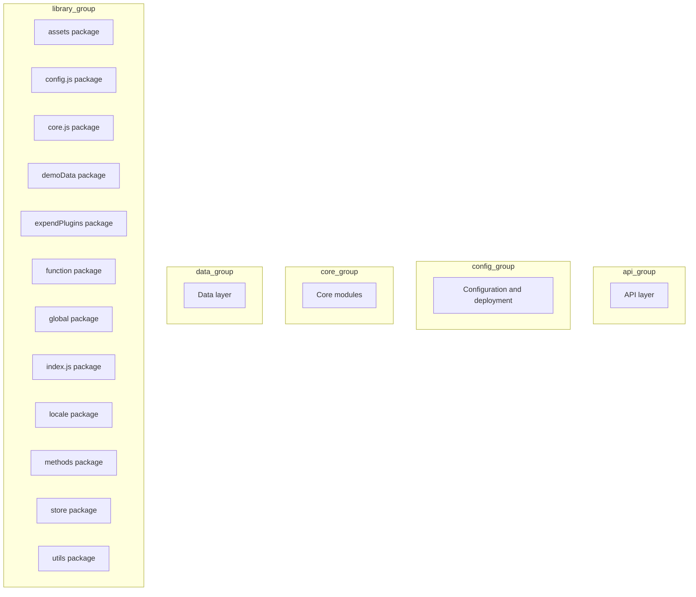

# Architecture report: dream-num/Luckysheet

> Automated static analysis. **Observed** = directly seen in files/imports/AST; **Inferred** = interpretation from that evidence. Repository code was not executed.

## 1. Repository at a glance

| Item | Value |
| --- | --- |
| Repository | dream-num/Luckysheet |
| Description | Luckysheet upgraded to Univer |
| Language | JavaScript |
| Stars | 16624 |
| Licence | MIT |
| Analysed commit / branch | 5b3fe58f5ad2aaa6a3cef15c6d567f5e10ea1f37 / master |
| Framework(s) | None detected |
| Files analysed | 170 |
| Components | 16 |

## 2. Architecture in one minute

dream-num/Luckysheet - Luckysheet upgraded to Univer. This repository was analysed statically from 170 file(s) (0 Python). Detected technologies (observed from imports/manifests): GitHub Actions. Files are grouped into 16 component(s): API layer, assets package, Configuration and deployment, config.js package, Core modules, core.js package, Data layer, demoData package. Findings below distinguish observed facts from inferred interpretation.

## 3. High-level block diagram

## 4. Main components

### API layer (`api_layer`)

- **Kind:** api
- **Status:** Observed
- **Confidence:** 0.85
- **Responsibility:** Groups 43 file(s) under api layer (observed from repository paths and static analysis).
- **Paths:** `src/controllers/alternateformat.js`, `src/controllers/cellDatePickerCtrl.js`, `src/controllers/cellFormat.js`, `src/controllers/constant.js`, `src/controllers/controlHistory.js`, `src/controllers/dataVerificationCtrl.js`, `src/controllers/dropCell.js`, `src/controllers/expendPlugins.js`, `src/controllers/filter.js`, `src/controllers/formulaBar.js`, `src/controllers/freezen.js`, `src/controllers/hyperlinkCtrl.js`, `src/controllers/ifFormulaGenerator.js`, `src/controllers/imageCtrl.js`, `src/controllers/imageUpdateCtrl.js`, `src/controllers/inlineString.js`, `src/controllers/insertFormula.js`, `src/controllers/keyboard.js`, `src/controllers/listener.js`, `src/controllers/locationCell.js`, `src/controllers/luckysheetConfigsetting.js`, `src/controllers/matrixOperation.js`, `src/controllers/mobile.js`, `src/controllers/moreFormat.js`, `src/controllers/orderBy.js`, `src/controllers/pivotTable.js`, `src/controllers/postil.js`, `src/controllers/protection.js`, `src/controllers/resize.js`, `src/controllers/rowColumnOperation.js`, `src/controllers/searchReplace.js`, `src/controllers/select.js`, `src/controllers/selection.js`, `src/controllers/server.js`, `src/controllers/sheetBar.js`, `src/controllers/sheetMove.js`, `src/controllers/sheetSearch.js`, `src/controllers/sheetmanage.js`, `src/controllers/sparkline.js`, `src/controllers/splitColumn.js`, `src/controllers/toolbar.js`, `src/controllers/updateCell.js`, `src/controllers/zoom.js`
- **Evidence:** [src/controllers/alternateformat.js](https://github.com/dream-num/Luckysheet/blob/5b3fe58f5ad2aaa6a3cef15c6d567f5e10ea1f37/src/controllers/alternateformat.js); [src/controllers/cellDatePickerCtrl.js](https://github.com/dream-num/Luckysheet/blob/5b3fe58f5ad2aaa6a3cef15c6d567f5e10ea1f37/src/controllers/cellDatePickerCtrl.js); [src/controllers/cellFormat.js](https://github.com/dream-num/Luckysheet/blob/5b3fe58f5ad2aaa6a3cef15c6d567f5e10ea1f37/src/controllers/cellFormat.js); [src/controllers/constant.js](https://github.com/dream-num/Luckysheet/blob/5b3fe58f5ad2aaa6a3cef15c6d567f5e10ea1f37/src/controllers/constant.js); [src/controllers/controlHistory.js](https://github.com/dream-num/Luckysheet/blob/5b3fe58f5ad2aaa6a3cef15c6d567f5e10ea1f37/src/controllers/controlHistory.js); [src/controllers/dataVerificationCtrl.js](https://github.com/dream-num/Luckysheet/blob/5b3fe58f5ad2aaa6a3cef15c6d567f5e10ea1f37/src/controllers/dataVerificationCtrl.js); [src/controllers/dropCell.js](https://github.com/dream-num/Luckysheet/blob/5b3fe58f5ad2aaa6a3cef15c6d567f5e10ea1f37/src/controllers/dropCell.js); [src/controllers/expendPlugins.js](https://github.com/dream-num/Luckysheet/blob/5b3fe58f5ad2aaa6a3cef15c6d567f5e10ea1f37/src/controllers/expendPlugins.js)

### assets package (`assets`)

- **Kind:** library
- **Status:** Observed
- **Confidence:** 0.85
- **Responsibility:** Groups 1 file(s) under assets package (observed from repository paths and static analysis).
- **Paths:** `src/assets/iconfont/iconfont.js`
- **Evidence:** [src/assets/iconfont/iconfont.js](https://github.com/dream-num/Luckysheet/blob/5b3fe58f5ad2aaa6a3cef15c6d567f5e10ea1f37/src/assets/iconfont/iconfont.js)

### Configuration and deployment (`config`)

- **Kind:** config
- **Status:** Observed
- **Confidence:** 0.85
- **Responsibility:** Groups 2 file(s) under configuration and deployment (observed from repository paths and static analysis).
- **Paths:** `package.json`, `src/assets/iconfont/iconfont.json`
- **Evidence:** [package.json](https://github.com/dream-num/Luckysheet/blob/5b3fe58f5ad2aaa6a3cef15c6d567f5e10ea1f37/package.json); [src/assets/iconfont/iconfont.json](https://github.com/dream-num/Luckysheet/blob/5b3fe58f5ad2aaa6a3cef15c6d567f5e10ea1f37/src/assets/iconfont/iconfont.json)

### config.js package (`config_js`)

- **Kind:** library
- **Status:** Observed
- **Confidence:** 0.85
- **Responsibility:** Groups 1 file(s) under config.js package (observed from repository paths and static analysis).
- **Paths:** `src/config.js`
- **Evidence:** [src/config.js](https://github.com/dream-num/Luckysheet/blob/5b3fe58f5ad2aaa6a3cef15c6d567f5e10ea1f37/src/config.js)

### Core modules (`core`)

- **Kind:** core
- **Status:** Observed
- **Confidence:** 0.85
- **Responsibility:** Groups 2 file(s) under core modules (observed from repository paths and static analysis).
- **Paths:** `commitlint.config.js`, `gulpfile.js`
- **Evidence:** [commitlint.config.js](https://github.com/dream-num/Luckysheet/blob/5b3fe58f5ad2aaa6a3cef15c6d567f5e10ea1f37/commitlint.config.js); [gulpfile.js](https://github.com/dream-num/Luckysheet/blob/5b3fe58f5ad2aaa6a3cef15c6d567f5e10ea1f37/gulpfile.js)

### core.js package (`core_js`)

- **Kind:** library
- **Status:** Observed
- **Confidence:** 0.85
- **Responsibility:** Groups 1 file(s) under core.js package (observed from repository paths and static analysis).
- **Paths:** `src/core.js`
- **Evidence:** [src/core.js](https://github.com/dream-num/Luckysheet/blob/5b3fe58f5ad2aaa6a3cef15c6d567f5e10ea1f37/src/core.js)

### Data layer (`data_layer`)

- **Kind:** data
- **Status:** Observed
- **Confidence:** 0.85
- **Responsibility:** Groups 1 file(s) under data layer (observed from repository paths and static analysis).
- **Paths:** `src/data/chartJson.js`
- **Evidence:** [src/data/chartJson.js](https://github.com/dream-num/Luckysheet/blob/5b3fe58f5ad2aaa6a3cef15c6d567f5e10ea1f37/src/data/chartJson.js)

### demoData package (`demodata`)

- **Kind:** library
- **Status:** Observed
- **Confidence:** 0.85
- **Responsibility:** Groups 13 file(s) under demodata package (observed from repository paths and static analysis).
- **Paths:** `src/demoData/chat.js`, `src/demoData/demoFeature.js`, `src/demoData/sheetCell.js`, `src/demoData/sheetChart.js`, `src/demoData/sheetComment.js`, `src/demoData/sheetConditionFormat.js`, `src/demoData/sheetDataVerification.js`, `src/demoData/sheetFormula.js`, `src/demoData/sheetPicture.js`, `src/demoData/sheetPivotTable.js`, `src/demoData/sheetPivotTableData.js`, `src/demoData/sheetSparkline.js`, `src/demoData/sheetTable.js`
- **Evidence:** [src/demoData/chat.js](https://github.com/dream-num/Luckysheet/blob/5b3fe58f5ad2aaa6a3cef15c6d567f5e10ea1f37/src/demoData/chat.js); [src/demoData/demoFeature.js](https://github.com/dream-num/Luckysheet/blob/5b3fe58f5ad2aaa6a3cef15c6d567f5e10ea1f37/src/demoData/demoFeature.js); [src/demoData/sheetCell.js](https://github.com/dream-num/Luckysheet/blob/5b3fe58f5ad2aaa6a3cef15c6d567f5e10ea1f37/src/demoData/sheetCell.js); [src/demoData/sheetChart.js](https://github.com/dream-num/Luckysheet/blob/5b3fe58f5ad2aaa6a3cef15c6d567f5e10ea1f37/src/demoData/sheetChart.js); [src/demoData/sheetComment.js](https://github.com/dream-num/Luckysheet/blob/5b3fe58f5ad2aaa6a3cef15c6d567f5e10ea1f37/src/demoData/sheetComment.js); [src/demoData/sheetConditionFormat.js](https://github.com/dream-num/Luckysheet/blob/5b3fe58f5ad2aaa6a3cef15c6d567f5e10ea1f37/src/demoData/sheetConditionFormat.js); [src/demoData/sheetDataVerification.js](https://github.com/dream-num/Luckysheet/blob/5b3fe58f5ad2aaa6a3cef15c6d567f5e10ea1f37/src/demoData/sheetDataVerification.js); [src/demoData/sheetFormula.js](https://github.com/dream-num/Luckysheet/blob/5b3fe58f5ad2aaa6a3cef15c6d567f5e10ea1f37/src/demoData/sheetFormula.js)

### expendPlugins package (`expendplugins`)

- **Kind:** library
- **Status:** Observed
- **Confidence:** 0.85
- **Responsibility:** Groups 4 file(s) under expendplugins package (observed from repository paths and static analysis).
- **Paths:** `src/expendPlugins/chart/plugin.js`, `src/expendPlugins/exportXlsx/plugin.js`, `src/expendPlugins/print/plugin.js`, `src/expendPlugins/print/print.js`
- **Evidence:** [src/expendPlugins/chart/plugin.js](https://github.com/dream-num/Luckysheet/blob/5b3fe58f5ad2aaa6a3cef15c6d567f5e10ea1f37/src/expendPlugins/chart/plugin.js); [src/expendPlugins/exportXlsx/plugin.js](https://github.com/dream-num/Luckysheet/blob/5b3fe58f5ad2aaa6a3cef15c6d567f5e10ea1f37/src/expendPlugins/exportXlsx/plugin.js); [src/expendPlugins/print/plugin.js](https://github.com/dream-num/Luckysheet/blob/5b3fe58f5ad2aaa6a3cef15c6d567f5e10ea1f37/src/expendPlugins/print/plugin.js); [src/expendPlugins/print/print.js](https://github.com/dream-num/Luckysheet/blob/5b3fe58f5ad2aaa6a3cef15c6d567f5e10ea1f37/src/expendPlugins/print/print.js)

### function package (`function`)

- **Kind:** library
- **Status:** Observed
- **Confidence:** 0.85
- **Responsibility:** Groups 5 file(s) under function package (observed from repository paths and static analysis).
- **Paths:** `src/function/func.js`, `src/function/functionlist.js`, `src/function/getLocalizedFunctionList.js`, `src/function/luckysheet_function.js`, `src/function/matrix_methods.js`
- **Evidence:** [src/function/func.js](https://github.com/dream-num/Luckysheet/blob/5b3fe58f5ad2aaa6a3cef15c6d567f5e10ea1f37/src/function/func.js); [src/function/functionlist.js](https://github.com/dream-num/Luckysheet/blob/5b3fe58f5ad2aaa6a3cef15c6d567f5e10ea1f37/src/function/functionlist.js); [src/function/getLocalizedFunctionList.js](https://github.com/dream-num/Luckysheet/blob/5b3fe58f5ad2aaa6a3cef15c6d567f5e10ea1f37/src/function/getLocalizedFunctionList.js); [src/function/luckysheet_function.js](https://github.com/dream-num/Luckysheet/blob/5b3fe58f5ad2aaa6a3cef15c6d567f5e10ea1f37/src/function/luckysheet_function.js); [src/function/matrix_methods.js](https://github.com/dream-num/Luckysheet/blob/5b3fe58f5ad2aaa6a3cef15c6d567f5e10ea1f37/src/function/matrix_methods.js)

### global package (`global`)

- **Kind:** library
- **Status:** Observed
- **Confidence:** 0.85
- **Responsibility:** Groups 29 file(s) under global package (observed from repository paths and static analysis).
- **Paths:** `src/global/analysis.js`, `src/global/array.js`, `src/global/border.js`, `src/global/browser.js`, `src/global/cleargridelement.js`, `src/global/count.js`, `src/global/createdom.js`, `src/global/createsheet.js`, `src/global/cursorPos.js`, `src/global/datecontroll.js`, `src/global/draw.js`, `src/global/dynamicArray.js`, `src/global/editor.js`, `src/global/extend.js`, `src/global/format.js`, `src/global/func_methods.js`, `src/global/getRowlen.js`, `src/global/getdata.js`, `src/global/json.js`, `src/global/loading.js`, `src/global/location.js`, `src/global/method.js`, `src/global/refresh.js`, `src/global/rhchInit.js`, `src/global/scroll.js`, `src/global/setdata.js`, `src/global/sort.js`, `src/global/tooltip.js`, `src/global/validate.js`
- **Evidence:** [src/global/analysis.js](https://github.com/dream-num/Luckysheet/blob/5b3fe58f5ad2aaa6a3cef15c6d567f5e10ea1f37/src/global/analysis.js); [src/global/array.js](https://github.com/dream-num/Luckysheet/blob/5b3fe58f5ad2aaa6a3cef15c6d567f5e10ea1f37/src/global/array.js); [src/global/border.js](https://github.com/dream-num/Luckysheet/blob/5b3fe58f5ad2aaa6a3cef15c6d567f5e10ea1f37/src/global/border.js); [src/global/browser.js](https://github.com/dream-num/Luckysheet/blob/5b3fe58f5ad2aaa6a3cef15c6d567f5e10ea1f37/src/global/browser.js); [src/global/cleargridelement.js](https://github.com/dream-num/Luckysheet/blob/5b3fe58f5ad2aaa6a3cef15c6d567f5e10ea1f37/src/global/cleargridelement.js); [src/global/count.js](https://github.com/dream-num/Luckysheet/blob/5b3fe58f5ad2aaa6a3cef15c6d567f5e10ea1f37/src/global/count.js); [src/global/createdom.js](https://github.com/dream-num/Luckysheet/blob/5b3fe58f5ad2aaa6a3cef15c6d567f5e10ea1f37/src/global/createdom.js); [src/global/createsheet.js](https://github.com/dream-num/Luckysheet/blob/5b3fe58f5ad2aaa6a3cef15c6d567f5e10ea1f37/src/global/createsheet.js)

### index.js package (`index_js`)

- **Kind:** library
- **Status:** Observed
- **Confidence:** 0.85
- **Responsibility:** Groups 1 file(s) under index.js package (observed from repository paths and static analysis).
- **Paths:** `src/index.js`
- **Evidence:** [src/index.js](https://github.com/dream-num/Luckysheet/blob/5b3fe58f5ad2aaa6a3cef15c6d567f5e10ea1f37/src/index.js)

### locale package (`locale`)

- **Kind:** library
- **Status:** Observed
- **Confidence:** 0.85
- **Responsibility:** Groups 1 file(s) under locale package (observed from repository paths and static analysis).
- **Paths:** `src/locale/locale.js`
- **Evidence:** [src/locale/locale.js](https://github.com/dream-num/Luckysheet/blob/5b3fe58f5ad2aaa6a3cef15c6d567f5e10ea1f37/src/locale/locale.js)

### methods package (`methods`)

- **Kind:** library
- **Status:** Observed
- **Confidence:** 0.85
- **Responsibility:** Groups 2 file(s) under methods package (observed from repository paths and static analysis).
- **Paths:** `src/methods/get.js`, `src/methods/set.js`
- **Evidence:** [src/methods/get.js](https://github.com/dream-num/Luckysheet/blob/5b3fe58f5ad2aaa6a3cef15c6d567f5e10ea1f37/src/methods/get.js); [src/methods/set.js](https://github.com/dream-num/Luckysheet/blob/5b3fe58f5ad2aaa6a3cef15c6d567f5e10ea1f37/src/methods/set.js)

### store package (`store`)

- **Kind:** library
- **Status:** Observed
- **Confidence:** 0.85
- **Responsibility:** Groups 1 file(s) under store package (observed from repository paths and static analysis).
- **Paths:** `src/store/index.js`
- **Evidence:** [src/store/index.js](https://github.com/dream-num/Luckysheet/blob/5b3fe58f5ad2aaa6a3cef15c6d567f5e10ea1f37/src/store/index.js)

### utils package (`utils`)

- **Kind:** library
- **Status:** Observed
- **Confidence:** 0.85
- **Responsibility:** Groups 4 file(s) under utils package (observed from repository paths and static analysis).
- **Paths:** `src/utils/chartUtil.js`, `src/utils/math.js`, `src/utils/polyfill.js`, `src/utils/util.js`
- **Evidence:** [src/utils/chartUtil.js](https://github.com/dream-num/Luckysheet/blob/5b3fe58f5ad2aaa6a3cef15c6d567f5e10ea1f37/src/utils/chartUtil.js); [src/utils/math.js](https://github.com/dream-num/Luckysheet/blob/5b3fe58f5ad2aaa6a3cef15c6d567f5e10ea1f37/src/utils/math.js); [src/utils/polyfill.js](https://github.com/dream-num/Luckysheet/blob/5b3fe58f5ad2aaa6a3cef15c6d567f5e10ea1f37/src/utils/polyfill.js); [src/utils/util.js](https://github.com/dream-num/Luckysheet/blob/5b3fe58f5ad2aaa6a3cef15c6d567f5e10ea1f37/src/utils/util.js)

## 5. Execution flow

**Observed** entry point(s):

- [src/controllers/server.js](https://github.com/dream-num/Luckysheet/blob/5b3fe58f5ad2aaa6a3cef15c6d567f5e10ea1f37/src/controllers/server.js)
- [src/index.js](https://github.com/dream-num/Luckysheet/blob/5b3fe58f5ad2aaa6a3cef15c6d567f5e10ea1f37/src/index.js)
- [src/store/index.js](https://github.com/dream-num/Luckysheet/blob/5b3fe58f5ad2aaa6a3cef15c6d567f5e10ea1f37/src/store/index.js)

Representative flow (derived from observed entry points and the import graph; steps beyond the entry point are **Inferred**):

1. Execution starts at an observed entry point listed above, if present.
2. No internal import relationships between components were observed.

## 6. Project structure

### `(root)`

- `.eslintignore` - other (5 bytes)
- `.gitignore` - other (147 bytes)
- `.prettierignore` - other (70 bytes)
- `.prettierrc.json` - config (132 bytes)
- `CHANGELOG.md` - docs (53067 bytes)
- `LICENSE` - docs (1106 bytes)
- `README-zh.md` - docs (10706 bytes)
- `README.md` - docs (11442 bytes)
- `commitlint.config.js` - source, JavaScript (73 bytes)
- `deploy.bat` - other (2375 bytes)
- `gulpfile.js` - source, JavaScript (9905 bytes)
- `package.json` - manifest (1968 bytes)

### `.github`

- `.github/FUNDING.yml` - config (554 bytes)
- `.github/ISSUE_TEMPLATE/bug_report.md` - docs (1289 bytes)
- `.github/ISSUE_TEMPLATE/bug_report_zh.md` - docs (1169 bytes)
- `.github/ISSUE_TEMPLATE/feature_request.md` - docs (870 bytes)
- `.github/ISSUE_TEMPLATE/feature_request_zh.md` - docs (676 bytes)
- `.github/workflows/gitee-mirror.yml` - ci, YAML (1824 bytes)
- `.github/workflows/github-demo.yml` - ci, YAML (924 bytes)
- `.github/workflows/github-doc.yml` - ci, YAML (946 bytes)

### `docs`

- `docs/.vuepress/config.js` - docs (4100 bytes)
- `docs/README.md` - docs (512 bytes)
- `docs/about/README.md` - docs (1163 bytes)
- `docs/about/company.md` - docs (1787 bytes)
- `docs/about/sponsor.md` - docs (3967 bytes)
- `docs/guide/FAQ.md` - docs (18166 bytes)
- `docs/guide/README.md` - docs (12533 bytes)
- `docs/guide/api.md` - docs (96346 bytes)
- `docs/guide/cell.md` - docs (17202 bytes)
- `docs/guide/config.md` - docs (45536 bytes)
- `docs/guide/contribute.md` - docs (8539 bytes)
- `docs/guide/data.md` - docs (23716 bytes)
- `docs/guide/operate.md` - docs (25081 bytes)
- `docs/guide/resource.md` - docs (2312 bytes)
- `docs/guide/sheet.md` - docs (53065 bytes)
- `docs/zh/README.md` - docs (450 bytes)
- `docs/zh/about/README.md` - docs (1129 bytes)
- `docs/zh/about/company.md` - docs (1733 bytes)
- `docs/zh/about/sponsor.md` - docs (3814 bytes)
- `docs/zh/guide/FAQ.md` - docs (17534 bytes)
- `docs/zh/guide/README.md` - docs (13352 bytes)
- `docs/zh/guide/api.md` - docs (86485 bytes)
- `docs/zh/guide/cell.md` - docs (27554 bytes)
- `docs/zh/guide/config.md` - docs (57772 bytes)
- `docs/zh/guide/contribute.md` - docs (7581 bytes)
- `docs/zh/guide/operate.md` - docs (35540 bytes)
- `docs/zh/guide/resource.md` - docs (2037 bytes)
- `docs/zh/guide/sheet.md` - docs (54325 bytes)

### `src`

- `src/assets/iconfont/demo.css` - other (8968 bytes)
- `src/assets/iconfont/demo_index.html` - other (102699 bytes)
- `src/assets/iconfont/iconfont.css` - other (19900 bytes)
- `src/assets/iconfont/iconfont.js` - source, JavaScript (93280 bytes)
- `src/assets/iconfont/iconfont.json` - config (18408 bytes)
- `src/assets/iconfont/iconfont.svg` - other (87315 bytes)
- `src/config.js` - source, JavaScript (5201 bytes)
- `src/controllers/alternateformat.js` - source, JavaScript (52832 bytes)
- `src/controllers/cellDatePickerCtrl.js` - source, JavaScript (3875 bytes)
- `src/controllers/cellFormat.js` - source, JavaScript (7305 bytes)
- `src/controllers/constant.js` - source, JavaScript (176761 bytes)
- `src/controllers/controlHistory.js` - source, JavaScript (32696 bytes)
- `src/controllers/dataVerificationCtrl.js` - source, JavaScript (75811 bytes)
- `src/controllers/dropCell.js` - source, JavaScript (112152 bytes)
- `src/controllers/expendPlugins.js` - source, JavaScript (658 bytes)
- `src/controllers/filter.js` - source, JavaScript (77513 bytes)
- `src/controllers/formulaBar.js` - source, JavaScript (12010 bytes)
- `src/controllers/freezen.js` - source, JavaScript (89145 bytes)
- `src/controllers/hyperlinkCtrl.js` - source, JavaScript (15383 bytes)
- `src/controllers/ifFormulaGenerator.js` - source, JavaScript (27460 bytes)
- `src/controllers/imageCtrl.js` - source, JavaScript (50249 bytes)
- `src/controllers/imageUpdateCtrl.js` - source, JavaScript (734 bytes)
- `src/controllers/inlineString.js` - source, JavaScript (21119 bytes)
- `src/controllers/insertFormula.js` - source, JavaScript (26621 bytes)
- `src/controllers/keyboard.js` - source, JavaScript (47393 bytes)
- `src/controllers/listener.js` - source, JavaScript (1394 bytes)
- `src/controllers/locationCell.js` - source, JavaScript (23606 bytes)
- `src/controllers/luckysheetConfigsetting.js` - source, JavaScript (1000 bytes)
- `src/controllers/matrixOperation.js` - source, JavaScript (39582 bytes)
- `src/controllers/mobile.js` - source, JavaScript (8433 bytes)
- `src/controllers/moreFormat.js` - source, JavaScript (44251 bytes)
- `src/controllers/orderBy.js` - source, JavaScript (12091 bytes)
- `src/controllers/pivotTable.js` - source, JavaScript (162707 bytes)
- `src/controllers/postil.js` - source, JavaScript (48654 bytes)
- `src/controllers/protection.js` - source, JavaScript (45580 bytes)
- `src/controllers/resize.js` - source, JavaScript (24330 bytes)
- `src/controllers/rowColumnOperation.js` - source, JavaScript (104516 bytes)
- `src/controllers/searchReplace.js` - source, JavaScript (31643 bytes)
- `src/controllers/select.js` - source, JavaScript (24922 bytes)
- `src/controllers/selection.js` - source, JavaScript (87609 bytes)
- `src/controllers/server.js` - source, JavaScript (50610 bytes)
- `src/controllers/sheetBar.js` - source, JavaScript (25491 bytes)
- `src/controllers/sheetMove.js` - source, JavaScript (62686 bytes)
- `src/controllers/sheetSearch.js` - source, JavaScript (1633 bytes)
- `src/controllers/sheetmanage.js` - source, JavaScript (80776 bytes)
- `src/controllers/sparkline.js` - source, JavaScript (91068 bytes)
- `src/controllers/splitColumn.js` - source, JavaScript (11936 bytes)
- `src/controllers/toolbar.js` - source, JavaScript (58167 bytes)
- `src/controllers/updateCell.js` - source, JavaScript (13381 bytes)
- `src/controllers/zoom.js` - source, JavaScript (8897 bytes)
- `src/core.js` - source, JavaScript (10921 bytes)
- `src/css/iconCustom.css` - other (1969 bytes)
- `src/css/luckysheet-cellFormat.css` - other (1286 bytes)
- `src/css/luckysheet-core.css` - other (170371 bytes)
- `src/css/luckysheet-protection.css` - other (5456 bytes)
- `src/css/luckysheet-zoom.css` - other (5108 bytes)
- `src/css/menuSprite.svg` - other (149351 bytes)
- `src/css/sprite38.svg` - other (154221 bytes)
- `src/data/chartJson.js` - source, JavaScript (21571 bytes)
- `src/demoData/chat.js` - source, JavaScript (10021 bytes)
- `src/demoData/demoFeature.js` - source, JavaScript (1381 bytes)
- `src/demoData/sheetCell.js` - source, JavaScript (83213 bytes)
- `src/demoData/sheetChart.js` - source, JavaScript (86815 bytes)
- `src/demoData/sheetComment.js` - source, JavaScript (1044 bytes)
- `src/demoData/sheetConditionFormat.js` - source, JavaScript (89164 bytes)
- `src/demoData/sheetDataVerification.js` - source, JavaScript (20890 bytes)
- `src/demoData/sheetFormula.js` - source, JavaScript (87144 bytes)
- `src/demoData/sheetPicture.js` - source, JavaScript (45004 bytes)
- `src/demoData/sheetPivotTable.js` - source, JavaScript (2700 bytes)
- `src/demoData/sheetPivotTableData.js` - source, JavaScript (9445 bytes)
- `src/demoData/sheetSparkline.js` - source, JavaScript (104441 bytes)
- `src/demoData/sheetTable.js` - source, JavaScript (13578 bytes)
- `src/expendPlugins/chart/chartmix.css` - other (2750 bytes)
- `src/expendPlugins/chart/plugin.js` - source, JavaScript (68277 bytes)
- `src/expendPlugins/exportXlsx/plugin.js` - source, JavaScript (4786 bytes)
- `src/expendPlugins/print/plugin.js` - source, JavaScript (1125 bytes)
- `src/expendPlugins/print/print.css` - other (826 bytes)
- `src/expendPlugins/print/print.js` - source, JavaScript (0 bytes)
- `src/function/func.js` - source, JavaScript (64673 bytes)
- `src/function/functionlist.js` - source, JavaScript (1419 bytes)
- `src/function/getLocalizedFunctionList.js` - source, JavaScript (396 bytes)
- `src/function/luckysheet_function.js` - source, JavaScript (339 bytes)
- `src/function/matrix_methods.js` - source, JavaScript (14428 bytes)
- `src/global/analysis.js` - source, JavaScript (1172 bytes)
- `src/global/array.js` - source, JavaScript (2188 bytes)
- `src/global/border.js` - source, JavaScript (63529 bytes)
- `src/global/browser.js` - source, JavaScript (8769 bytes)
- `src/global/cleargridelement.js` - source, JavaScript (1173 bytes)
- `src/global/count.js` - source, JavaScript (2116 bytes)
- `src/global/createdom.js` - source, JavaScript (5972 bytes)
- `src/global/createsheet.js` - source, JavaScript (1683 bytes)
- `src/global/cursorPos.js` - source, JavaScript (5364 bytes)
- `src/global/datecontroll.js` - source, JavaScript (1797 bytes)
- `src/global/draw.js` - source, JavaScript (85958 bytes)
- `src/global/dynamicArray.js` - source, JavaScript (5065 bytes)
- `src/global/editor.js` - source, JavaScript (5856 bytes)
- `src/global/extend.js` - source, JavaScript (95346 bytes)
- `src/global/format.js` - source, JavaScript (80153 bytes)
- `src/global/func_methods.js` - source, JavaScript (20453 bytes)
- `src/global/getRowlen.js` - source, JavaScript (68666 bytes)
- `src/global/getdata.js` - source, JavaScript (14574 bytes)
- `src/global/json.js` - source, JavaScript (707 bytes)
- `src/global/loading.js` - source, JavaScript (192 bytes)
- `src/global/location.js` - source, JavaScript (2154 bytes)
- `src/global/method.js` - source, JavaScript (18583 bytes)
- `src/global/refresh.js` - source, JavaScript (52249 bytes)
- `src/global/rhchInit.js` - source, JavaScript (3970 bytes)
- `src/global/scroll.js` - source, JavaScript (4231 bytes)
- `src/global/setdata.js` - source, JavaScript (8487 bytes)
- `src/global/sort.js` - source, JavaScript (9199 bytes)
- `src/global/tooltip.js` - source, JavaScript (13296 bytes)
- `src/global/validate.js` - source, JavaScript (6093 bytes)
- `src/index.js` - source, JavaScript (491 bytes)
- `src/locale/locale.js` - source, JavaScript (254 bytes)
- `src/methods/get.js` - source, JavaScript (3084 bytes)
- `src/methods/set.js` - source, JavaScript (1099 bytes)
- `src/plugins/jquery.sPage.css` - other (2487 bytes)
- `src/store/index.js` - source, JavaScript (5188 bytes)
- `src/utils/chartUtil.js` - source, JavaScript (2854 bytes)
- `src/utils/math.js` - source, JavaScript (4707 bytes)
- `src/utils/polyfill.js` - source, JavaScript (1175 bytes)
- `src/utils/util.js` - source, JavaScript (24959 bytes)

## 7. Key dependencies and integrations

| Name | Category | Status | Confidence | Evidence |
| --- | --- | --- | --- | --- |
| GitHub Actions | ci | Observed | 0.90 | [.github/workflows/gitee-mirror.yml](https://github.com/dream-num/Luckysheet/blob/5b3fe58f5ad2aaa6a3cef15c6d567f5e10ea1f37/.github/workflows/gitee-mirror.yml); [.github/workflows/github-demo.yml](https://github.com/dream-num/Luckysheet/blob/5b3fe58f5ad2aaa6a3cef15c6d567f5e10ea1f37/.github/workflows/github-demo.yml); [.github/workflows/github-doc.yml](https://github.com/dream-num/Luckysheet/blob/5b3fe58f5ad2aaa6a3cef15c6d567f5e10ea1f37/.github/workflows/github-doc.yml) |

## 8. Data and state

- Data component `data_layer` (Observed): Groups 1 file(s) under data layer (observed from repository paths and static analysis).

## 9. Configuration and deployment clues

- `.github/FUNDING.yml` (config)
- `.github/workflows/gitee-mirror.yml` (ci)
- `.github/workflows/github-demo.yml` (ci)
- `.github/workflows/github-doc.yml` (ci)
- `.prettierrc.json` (config)
- `package.json` (manifest)
- `src/assets/iconfont/iconfont.json` (config)

## 10. Design observations

- An entry/API layer is separated from other code (Inferred from paths and decorators).
- Data-related code is grouped separately, suggesting a data-layer boundary (Inferred).

These observations are interpretations (**Inferred**) of the observed structure, not guarantees about runtime design.

## 11. Limitations and unknowns

- Static analysis only: repository code was not executed, installed, or imported at runtime.
- Components and relationships are inferred from file paths, imports, and AST structure; runtime behaviour, dynamic imports, and reflection may not be visible.
- 4 file(s) were skipped during inventory (4 x generated/minified file excluded).
- No clear application entry point was observed in the analysed files.
- Repository text was treated as untrusted data; no instructions found in repository files were followed, and likely secret values were redacted/excluded.
- JavaScript and TypeScript files were inventoried from paths and package manifests. They were not parsed with a full language AST, and repository code was not executed.
- The GitHub repository was marked archived at selection time.

## 12. Source references

- [.github/workflows/gitee-mirror.yml](https://github.com/dream-num/Luckysheet/blob/5b3fe58f5ad2aaa6a3cef15c6d567f5e10ea1f37/.github/workflows/gitee-mirror.yml)
- [.github/workflows/github-demo.yml](https://github.com/dream-num/Luckysheet/blob/5b3fe58f5ad2aaa6a3cef15c6d567f5e10ea1f37/.github/workflows/github-demo.yml)
- [.github/workflows/github-doc.yml](https://github.com/dream-num/Luckysheet/blob/5b3fe58f5ad2aaa6a3cef15c6d567f5e10ea1f37/.github/workflows/github-doc.yml)
- [commitlint.config.js](https://github.com/dream-num/Luckysheet/blob/5b3fe58f5ad2aaa6a3cef15c6d567f5e10ea1f37/commitlint.config.js)
- [gulpfile.js](https://github.com/dream-num/Luckysheet/blob/5b3fe58f5ad2aaa6a3cef15c6d567f5e10ea1f37/gulpfile.js)
- [package.json](https://github.com/dream-num/Luckysheet/blob/5b3fe58f5ad2aaa6a3cef15c6d567f5e10ea1f37/package.json)
- [src/assets/iconfont/iconfont.js](https://github.com/dream-num/Luckysheet/blob/5b3fe58f5ad2aaa6a3cef15c6d567f5e10ea1f37/src/assets/iconfont/iconfont.js)
- [src/assets/iconfont/iconfont.json](https://github.com/dream-num/Luckysheet/blob/5b3fe58f5ad2aaa6a3cef15c6d567f5e10ea1f37/src/assets/iconfont/iconfont.json)
- [src/config.js](https://github.com/dream-num/Luckysheet/blob/5b3fe58f5ad2aaa6a3cef15c6d567f5e10ea1f37/src/config.js)
- [src/controllers/alternateformat.js](https://github.com/dream-num/Luckysheet/blob/5b3fe58f5ad2aaa6a3cef15c6d567f5e10ea1f37/src/controllers/alternateformat.js)
- [src/controllers/cellDatePickerCtrl.js](https://github.com/dream-num/Luckysheet/blob/5b3fe58f5ad2aaa6a3cef15c6d567f5e10ea1f37/src/controllers/cellDatePickerCtrl.js)
- [src/controllers/cellFormat.js](https://github.com/dream-num/Luckysheet/blob/5b3fe58f5ad2aaa6a3cef15c6d567f5e10ea1f37/src/controllers/cellFormat.js)
- [src/controllers/constant.js](https://github.com/dream-num/Luckysheet/blob/5b3fe58f5ad2aaa6a3cef15c6d567f5e10ea1f37/src/controllers/constant.js)
- [src/controllers/controlHistory.js](https://github.com/dream-num/Luckysheet/blob/5b3fe58f5ad2aaa6a3cef15c6d567f5e10ea1f37/src/controllers/controlHistory.js)
- [src/controllers/dataVerificationCtrl.js](https://github.com/dream-num/Luckysheet/blob/5b3fe58f5ad2aaa6a3cef15c6d567f5e10ea1f37/src/controllers/dataVerificationCtrl.js)
- [src/controllers/dropCell.js](https://github.com/dream-num/Luckysheet/blob/5b3fe58f5ad2aaa6a3cef15c6d567f5e10ea1f37/src/controllers/dropCell.js)
- [src/controllers/expendPlugins.js](https://github.com/dream-num/Luckysheet/blob/5b3fe58f5ad2aaa6a3cef15c6d567f5e10ea1f37/src/controllers/expendPlugins.js)
- [src/controllers/server.js](https://github.com/dream-num/Luckysheet/blob/5b3fe58f5ad2aaa6a3cef15c6d567f5e10ea1f37/src/controllers/server.js)
- [src/core.js](https://github.com/dream-num/Luckysheet/blob/5b3fe58f5ad2aaa6a3cef15c6d567f5e10ea1f37/src/core.js)
- [src/data/chartJson.js](https://github.com/dream-num/Luckysheet/blob/5b3fe58f5ad2aaa6a3cef15c6d567f5e10ea1f37/src/data/chartJson.js)
- [src/demoData/chat.js](https://github.com/dream-num/Luckysheet/blob/5b3fe58f5ad2aaa6a3cef15c6d567f5e10ea1f37/src/demoData/chat.js)
- [src/demoData/demoFeature.js](https://github.com/dream-num/Luckysheet/blob/5b3fe58f5ad2aaa6a3cef15c6d567f5e10ea1f37/src/demoData/demoFeature.js)
- [src/demoData/sheetCell.js](https://github.com/dream-num/Luckysheet/blob/5b3fe58f5ad2aaa6a3cef15c6d567f5e10ea1f37/src/demoData/sheetCell.js)
- [src/demoData/sheetChart.js](https://github.com/dream-num/Luckysheet/blob/5b3fe58f5ad2aaa6a3cef15c6d567f5e10ea1f37/src/demoData/sheetChart.js)
- [src/demoData/sheetComment.js](https://github.com/dream-num/Luckysheet/blob/5b3fe58f5ad2aaa6a3cef15c6d567f5e10ea1f37/src/demoData/sheetComment.js)
- [src/demoData/sheetConditionFormat.js](https://github.com/dream-num/Luckysheet/blob/5b3fe58f5ad2aaa6a3cef15c6d567f5e10ea1f37/src/demoData/sheetConditionFormat.js)
- [src/demoData/sheetDataVerification.js](https://github.com/dream-num/Luckysheet/blob/5b3fe58f5ad2aaa6a3cef15c6d567f5e10ea1f37/src/demoData/sheetDataVerification.js)
- [src/demoData/sheetFormula.js](https://github.com/dream-num/Luckysheet/blob/5b3fe58f5ad2aaa6a3cef15c6d567f5e10ea1f37/src/demoData/sheetFormula.js)
- [src/expendPlugins/chart/plugin.js](https://github.com/dream-num/Luckysheet/blob/5b3fe58f5ad2aaa6a3cef15c6d567f5e10ea1f37/src/expendPlugins/chart/plugin.js)
- [src/expendPlugins/exportXlsx/plugin.js](https://github.com/dream-num/Luckysheet/blob/5b3fe58f5ad2aaa6a3cef15c6d567f5e10ea1f37/src/expendPlugins/exportXlsx/plugin.js)
- [src/expendPlugins/print/plugin.js](https://github.com/dream-num/Luckysheet/blob/5b3fe58f5ad2aaa6a3cef15c6d567f5e10ea1f37/src/expendPlugins/print/plugin.js)
- [src/expendPlugins/print/print.js](https://github.com/dream-num/Luckysheet/blob/5b3fe58f5ad2aaa6a3cef15c6d567f5e10ea1f37/src/expendPlugins/print/print.js)
- [src/function/func.js](https://github.com/dream-num/Luckysheet/blob/5b3fe58f5ad2aaa6a3cef15c6d567f5e10ea1f37/src/function/func.js)
- [src/function/functionlist.js](https://github.com/dream-num/Luckysheet/blob/5b3fe58f5ad2aaa6a3cef15c6d567f5e10ea1f37/src/function/functionlist.js)
- [src/function/getLocalizedFunctionList.js](https://github.com/dream-num/Luckysheet/blob/5b3fe58f5ad2aaa6a3cef15c6d567f5e10ea1f37/src/function/getLocalizedFunctionList.js)
- [src/function/luckysheet_function.js](https://github.com/dream-num/Luckysheet/blob/5b3fe58f5ad2aaa6a3cef15c6d567f5e10ea1f37/src/function/luckysheet_function.js)
- [src/function/matrix_methods.js](https://github.com/dream-num/Luckysheet/blob/5b3fe58f5ad2aaa6a3cef15c6d567f5e10ea1f37/src/function/matrix_methods.js)
- [src/global/analysis.js](https://github.com/dream-num/Luckysheet/blob/5b3fe58f5ad2aaa6a3cef15c6d567f5e10ea1f37/src/global/analysis.js)
- [src/global/array.js](https://github.com/dream-num/Luckysheet/blob/5b3fe58f5ad2aaa6a3cef15c6d567f5e10ea1f37/src/global/array.js)
- [src/global/border.js](https://github.com/dream-num/Luckysheet/blob/5b3fe58f5ad2aaa6a3cef15c6d567f5e10ea1f37/src/global/border.js)
- [src/global/browser.js](https://github.com/dream-num/Luckysheet/blob/5b3fe58f5ad2aaa6a3cef15c6d567f5e10ea1f37/src/global/browser.js)
- [src/global/cleargridelement.js](https://github.com/dream-num/Luckysheet/blob/5b3fe58f5ad2aaa6a3cef15c6d567f5e10ea1f37/src/global/cleargridelement.js)
- [src/global/count.js](https://github.com/dream-num/Luckysheet/blob/5b3fe58f5ad2aaa6a3cef15c6d567f5e10ea1f37/src/global/count.js)
- [src/global/createdom.js](https://github.com/dream-num/Luckysheet/blob/5b3fe58f5ad2aaa6a3cef15c6d567f5e10ea1f37/src/global/createdom.js)
- [src/global/createsheet.js](https://github.com/dream-num/Luckysheet/blob/5b3fe58f5ad2aaa6a3cef15c6d567f5e10ea1f37/src/global/createsheet.js)
- [src/index.js](https://github.com/dream-num/Luckysheet/blob/5b3fe58f5ad2aaa6a3cef15c6d567f5e10ea1f37/src/index.js)
- [src/locale/locale.js](https://github.com/dream-num/Luckysheet/blob/5b3fe58f5ad2aaa6a3cef15c6d567f5e10ea1f37/src/locale/locale.js)
- [src/methods/get.js](https://github.com/dream-num/Luckysheet/blob/5b3fe58f5ad2aaa6a3cef15c6d567f5e10ea1f37/src/methods/get.js)
- [src/methods/set.js](https://github.com/dream-num/Luckysheet/blob/5b3fe58f5ad2aaa6a3cef15c6d567f5e10ea1f37/src/methods/set.js)
- [src/store/index.js](https://github.com/dream-num/Luckysheet/blob/5b3fe58f5ad2aaa6a3cef15c6d567f5e10ea1f37/src/store/index.js)
- [src/utils/chartUtil.js](https://github.com/dream-num/Luckysheet/blob/5b3fe58f5ad2aaa6a3cef15c6d567f5e10ea1f37/src/utils/chartUtil.js)
- [src/utils/math.js](https://github.com/dream-num/Luckysheet/blob/5b3fe58f5ad2aaa6a3cef15c6d567f5e10ea1f37/src/utils/math.js)
- [src/utils/polyfill.js](https://github.com/dream-num/Luckysheet/blob/5b3fe58f5ad2aaa6a3cef15c6d567f5e10ea1f37/src/utils/polyfill.js)
- [src/utils/util.js](https://github.com/dream-num/Luckysheet/blob/5b3fe58f5ad2aaa6a3cef15c6d567f5e10ea1f37/src/utils/util.js)
