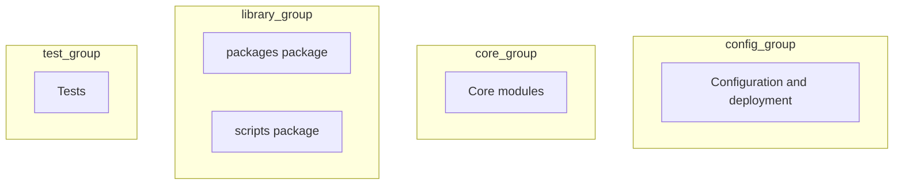

# Architecture report: dvajs/dva

> Automated static analysis. **Observed** = directly seen in files/imports/AST; **Inferred** = interpretation from that evidence. Repository code was not executed.

## 1. Repository at a glance

| Item | Value |
| --- | --- |
| Repository | dvajs/dva |
| Description | 🌱 React and redux based, lightweight and elm-style framework. (Inspired by elm and choo) |
| Language | JavaScript |
| Stars | 16124 |
| Licence | MIT |
| Analysed commit / branch | b60e6c0baf59450ac9cba5a3100fd2c17a6851fa / master |
| Framework(s) | Next.js, React |
| Files analysed | 173 |
| Components | 5 |

## 2. Architecture in one minute

dvajs/dva - 🌱 React and redux based, lightweight and elm-style framework. (Inspired by elm and choo). This repository was analysed statically from 173 file(s) (0 Python). Detected technologies (observed from imports/manifests): GitHub Actions, Next.js, React, React Router, Redux. Files are grouped into 5 component(s): Configuration and deployment, Core modules, packages package, scripts package, Tests. Findings below distinguish observed facts from inferred interpretation.

## 3. High-level block diagram

## 4. Main components

### Configuration and deployment (`config`)

- **Kind:** config
- **Status:** Observed
- **Confidence:** 0.85
- **Responsibility:** Groups 8 file(s) under configuration and deployment (observed from repository paths and static analysis).
- **Paths:** `lerna.json`, `package.json`, `packages/dva-core/package.json`, `packages/dva-immer/package.json`, `packages/dva-loading/package.json`, `packages/dva/package.json`, `website/now.json`, `website/package.json`
- **Evidence:** [lerna.json](https://github.com/dvajs/dva/blob/b60e6c0baf59450ac9cba5a3100fd2c17a6851fa/lerna.json); [package.json](https://github.com/dvajs/dva/blob/b60e6c0baf59450ac9cba5a3100fd2c17a6851fa/package.json); [packages/dva-core/package.json](https://github.com/dvajs/dva/blob/b60e6c0baf59450ac9cba5a3100fd2c17a6851fa/packages/dva-core/package.json); [packages/dva-immer/package.json](https://github.com/dvajs/dva/blob/b60e6c0baf59450ac9cba5a3100fd2c17a6851fa/packages/dva-immer/package.json); [packages/dva-loading/package.json](https://github.com/dvajs/dva/blob/b60e6c0baf59450ac9cba5a3100fd2c17a6851fa/packages/dva-loading/package.json); [packages/dva/package.json](https://github.com/dvajs/dva/blob/b60e6c0baf59450ac9cba5a3100fd2c17a6851fa/packages/dva/package.json); [website/now.json](https://github.com/dvajs/dva/blob/b60e6c0baf59450ac9cba5a3100fd2c17a6851fa/website/now.json); [website/package.json](https://github.com/dvajs/dva/blob/b60e6c0baf59450ac9cba5a3100fd2c17a6851fa/website/package.json)

### Core modules (`core`)

- **Kind:** core
- **Status:** Observed
- **Confidence:** 0.85
- **Responsibility:** Groups 1 file(s) under core modules (observed from repository paths and static analysis).
- **Paths:** `jest.config.js`
- **Evidence:** [jest.config.js](https://github.com/dvajs/dva/blob/b60e6c0baf59450ac9cba5a3100fd2c17a6851fa/jest.config.js)

### packages package (`packages`)

- **Kind:** library
- **Status:** Observed
- **Confidence:** 0.85
- **Responsibility:** Groups 33 file(s) under packages package (observed from repository paths and static analysis).
- **Paths:** `packages/dva-core/.fatherrc.js`, `packages/dva-core/saga.js`, `packages/dva-core/src/Plugin.js`, `packages/dva-core/src/checkModel.js`, `packages/dva-core/src/constants.js`, `packages/dva-core/src/createPromiseMiddleware.js`, `packages/dva-core/src/createStore.js`, `packages/dva-core/src/getReducer.js`, `packages/dva-core/src/getSaga.js`, `packages/dva-core/src/handleActions.js`, `packages/dva-core/src/index.js`, `packages/dva-core/src/prefixNamespace.js`, `packages/dva-core/src/prefixType.js`, `packages/dva-core/src/prefixedDispatch.js`, `packages/dva-core/src/subscription.js`, `packages/dva-core/src/utils.js`, `packages/dva-immer/.fatherrc.js`, `packages/dva-immer/src/index.js`, `packages/dva-loading/.fatherrc.js`, `packages/dva-loading/index.d.ts`, `packages/dva-loading/src/index.js`, `packages/dva/.fatherrc.js`, `packages/dva/dynamic.d.ts`, `packages/dva/dynamic.js`, `packages/dva/fetch.d.ts`, `packages/dva/fetch.js`, `packages/dva/index.d.ts`, `packages/dva/router.d.ts`, `packages/dva/router.js`, `packages/dva/saga.js`, `packages/dva/src/dynamic.js`, `packages/dva/src/index.js`, `packages/dva/warnAboutDeprecatedCJSRequire.js`
- **Evidence:** [packages/dva-core/.fatherrc.js](https://github.com/dvajs/dva/blob/b60e6c0baf59450ac9cba5a3100fd2c17a6851fa/packages/dva-core/.fatherrc.js); [packages/dva-core/saga.js](https://github.com/dvajs/dva/blob/b60e6c0baf59450ac9cba5a3100fd2c17a6851fa/packages/dva-core/saga.js); [packages/dva-core/src/Plugin.js](https://github.com/dvajs/dva/blob/b60e6c0baf59450ac9cba5a3100fd2c17a6851fa/packages/dva-core/src/Plugin.js); [packages/dva-core/src/checkModel.js](https://github.com/dvajs/dva/blob/b60e6c0baf59450ac9cba5a3100fd2c17a6851fa/packages/dva-core/src/checkModel.js); [packages/dva-core/src/constants.js](https://github.com/dvajs/dva/blob/b60e6c0baf59450ac9cba5a3100fd2c17a6851fa/packages/dva-core/src/constants.js); [packages/dva-core/src/createPromiseMiddleware.js](https://github.com/dvajs/dva/blob/b60e6c0baf59450ac9cba5a3100fd2c17a6851fa/packages/dva-core/src/createPromiseMiddleware.js); [packages/dva-core/src/createStore.js](https://github.com/dvajs/dva/blob/b60e6c0baf59450ac9cba5a3100fd2c17a6851fa/packages/dva-core/src/createStore.js); [packages/dva-core/src/getReducer.js](https://github.com/dvajs/dva/blob/b60e6c0baf59450ac9cba5a3100fd2c17a6851fa/packages/dva-core/src/getReducer.js)

### scripts package (`scripts`)

- **Kind:** library
- **Status:** Observed
- **Confidence:** 0.85
- **Responsibility:** Groups 1 file(s) under scripts package (observed from repository paths and static analysis).
- **Paths:** `scripts/publish.js`
- **Evidence:** [scripts/publish.js](https://github.com/dvajs/dva/blob/b60e6c0baf59450ac9cba5a3100fd2c17a6851fa/scripts/publish.js)

### Tests (`tests`)

- **Kind:** test
- **Status:** Observed
- **Confidence:** 0.85
- **Responsibility:** Groups 15 file(s) under tests (observed from repository paths and static analysis).
- **Paths:** `packages/dva-core/test/checkModel.test.js`, `packages/dva-core/test/effects.test.js`, `packages/dva-core/test/handleActions.test.js`, `packages/dva-core/test/model.test.js`, `packages/dva-core/test/optsAndHooks.test.js`, `packages/dva-core/test/plugin.test.js`, `packages/dva-core/test/reducers.test.js`, `packages/dva-core/test/repalceModel.test.js`, `packages/dva-core/test/subscriptions.test.js`, `packages/dva-core/test/utils.test.js`, `packages/dva-immer/test/index.test.js`, `packages/dva-loading/test/core.test.js`, `packages/dva-loading/test/index.test.js`, `packages/dva/test/index.e2e.js`, `packages/dva/test/index.test.js`
- **Evidence:** [packages/dva-core/test/checkModel.test.js](https://github.com/dvajs/dva/blob/b60e6c0baf59450ac9cba5a3100fd2c17a6851fa/packages/dva-core/test/checkModel.test.js); [packages/dva-core/test/effects.test.js](https://github.com/dvajs/dva/blob/b60e6c0baf59450ac9cba5a3100fd2c17a6851fa/packages/dva-core/test/effects.test.js); [packages/dva-core/test/handleActions.test.js](https://github.com/dvajs/dva/blob/b60e6c0baf59450ac9cba5a3100fd2c17a6851fa/packages/dva-core/test/handleActions.test.js); [packages/dva-core/test/model.test.js](https://github.com/dvajs/dva/blob/b60e6c0baf59450ac9cba5a3100fd2c17a6851fa/packages/dva-core/test/model.test.js); [packages/dva-core/test/optsAndHooks.test.js](https://github.com/dvajs/dva/blob/b60e6c0baf59450ac9cba5a3100fd2c17a6851fa/packages/dva-core/test/optsAndHooks.test.js); [packages/dva-core/test/plugin.test.js](https://github.com/dvajs/dva/blob/b60e6c0baf59450ac9cba5a3100fd2c17a6851fa/packages/dva-core/test/plugin.test.js); [packages/dva-core/test/reducers.test.js](https://github.com/dvajs/dva/blob/b60e6c0baf59450ac9cba5a3100fd2c17a6851fa/packages/dva-core/test/reducers.test.js); [packages/dva-core/test/repalceModel.test.js](https://github.com/dvajs/dva/blob/b60e6c0baf59450ac9cba5a3100fd2c17a6851fa/packages/dva-core/test/repalceModel.test.js)

## 5. Execution flow

**Observed** entry point(s):

- [packages/dva-core/src/index.js](https://github.com/dvajs/dva/blob/b60e6c0baf59450ac9cba5a3100fd2c17a6851fa/packages/dva-core/src/index.js)
- [packages/dva-immer/src/index.js](https://github.com/dvajs/dva/blob/b60e6c0baf59450ac9cba5a3100fd2c17a6851fa/packages/dva-immer/src/index.js)
- [packages/dva-loading/src/index.js](https://github.com/dvajs/dva/blob/b60e6c0baf59450ac9cba5a3100fd2c17a6851fa/packages/dva-loading/src/index.js)
- [packages/dva/src/index.js](https://github.com/dvajs/dva/blob/b60e6c0baf59450ac9cba5a3100fd2c17a6851fa/packages/dva/src/index.js)

Representative flow (derived from observed entry points and the import graph; steps beyond the entry point are **Inferred**):

1. Execution starts at an observed entry point listed above, if present.
2. No internal import relationships between components were observed.

## 6. Project structure

### `(root)`

- `.editorconfig` - config (245 bytes)
- `.eslintignore` - other (243 bytes)
- `.eslintrc` - other (2448 bytes)
- `.gitignore` - other (169 bytes)
- `.prettierrc` - other (73 bytes)
- `LICENSE` - docs (1104 bytes)
- `README.md` - docs (5475 bytes)
- `README_zh-CN.md` - docs (5630 bytes)
- `jest.config.js` - source, JavaScript (84 bytes)
- `lerna.json` - config (479 bytes)
- `package.json` - manifest (1364 bytes)

### `.circleci`

- `.circleci/config.yml` - ci, YAML (1399 bytes)

### `.github`

- `.github/ISSUE_TEMPLATE/bug_report.md` - docs (570 bytes)
- `.github/ISSUE_TEMPLATE/bug_report_cn.md` - docs (745 bytes)
- `.github/ISSUE_TEMPLATE/feature_request.md` - docs (427 bytes)
- `.github/ISSUE_TEMPLATE/rfc_cn.md` - docs (354 bytes)
- `.github/PULL_REQUEST_TEMPLATE.md` - docs (788 bytes)
- `.github/stale.yml` - config (684 bytes)
- `.github/workflows/ci.yml` - ci, YAML (615 bytes)

### `docs`

- `docs/.vuepress/config.js` - docs (1035 bytes)
- `docs/.vuepress/override.styl` - docs (90 bytes)
- `docs/API.md` - docs (8181 bytes)
- `docs/Concepts.md` - docs (4343 bytes)
- `docs/GettingStarted.md` - docs (13009 bytes)
- `docs/README.md` - docs (1559 bytes)
- `docs/api/README.md` - docs (9112 bytes)
- `docs/guide/README.md` - docs (1645 bytes)
- `docs/guide/concepts.md` - docs (6646 bytes)
- `docs/guide/develop-complex-spa.md` - docs (14293 bytes)
- `docs/guide/examples-and-boilerplates.md` - docs (1207 bytes)
- `docs/guide/fig-show.md` - docs (3783 bytes)
- `docs/guide/getting-started.md` - docs (5980 bytes)
- `docs/guide/introduce-class.md` - docs (7368 bytes)
- `docs/guide/source-code-explore.md` - docs (41874 bytes)
- `docs/knowledgemap/README.md` - docs (16872 bytes)

### `examples`

- `examples/func-test/.eslintrc` - other (897 bytes)
- `examples/func-test/.roadhogrc` - other (249 bytes)
- `examples/func-test/.roadhogrc.mock.js` - source, JavaScript (19 bytes)
- `examples/func-test/package.json` - manifest (791 bytes)
- `examples/func-test/src/components/Example.js` - source, JavaScript (134 bytes)
- `examples/func-test/src/index.css` - other (49 bytes)
- `examples/func-test/src/index.ejs` - other (296 bytes)
- `examples/func-test/src/index.js` - source, JavaScript (246 bytes)
- `examples/func-test/src/models/example.js` - source, JavaScript (463 bytes)
- `examples/func-test/src/router.js` - source, JavaScript (372 bytes)
- `examples/func-test/src/routes/IndexPage.css` - other (423 bytes)
- `examples/func-test/src/routes/IndexPage.js` - source, JavaScript (668 bytes)
- `examples/func-test/src/services/example.js` - source, JavaScript (107 bytes)
- `examples/func-test/src/utils/request.js` - source, JavaScript (737 bytes)
- `examples/user-dashboard/.editorconfig` - config (245 bytes)
- `examples/user-dashboard/.eslintrc` - other (22 bytes)
- `examples/user-dashboard/.gitignore` - other (36 bytes)
- `examples/user-dashboard/.umirc.js` - source, JavaScript (51 bytes)
- `examples/user-dashboard/.webpackrc` - other (340 bytes)
- `examples/user-dashboard/README.md` - docs (449 bytes)
- `examples/user-dashboard/package.json` - manifest (575 bytes)
- `examples/user-dashboard/src/constants.js` - source, JavaScript (28 bytes)
- `examples/user-dashboard/src/global.css` - other (48 bytes)
- `examples/user-dashboard/src/layouts/Header.js` - source, JavaScript (805 bytes)
- `examples/user-dashboard/src/layouts/index.css` - other (161 bytes)
- `examples/user-dashboard/src/layouts/index.js` - source, JavaScript (375 bytes)
- `examples/user-dashboard/src/pages/.umi/DvaContainer.js` - source, JavaScript (428 bytes)
- `examples/user-dashboard/src/pages/.umi/registerServiceWorker.js` - source, JavaScript (226 bytes)
- `examples/user-dashboard/src/pages/.umi/router.js` - source, JavaScript (768 bytes)
- `examples/user-dashboard/src/pages/.umi/umi.js` - source, JavaScript (1053 bytes)
- `examples/user-dashboard/src/pages/index.css` - other (423 bytes)
- `examples/user-dashboard/src/pages/index.js` - source, JavaScript (595 bytes)
- `examples/user-dashboard/src/pages/users/components/Users/UserModal.js` - source, JavaScript (1912 bytes)
- `examples/user-dashboard/src/pages/users/components/Users/Users.css` - other (86 bytes)
- `examples/user-dashboard/src/pages/users/components/Users/Users.js` - source, JavaScript (2536 bytes)
- `examples/user-dashboard/src/pages/users/models/users.js` - source, JavaScript (1451 bytes)
- `examples/user-dashboard/src/pages/users/page.css` - other (51 bytes)
- `examples/user-dashboard/src/pages/users/page.js` - source, JavaScript (248 bytes)
- `examples/user-dashboard/src/pages/users/services/users.js` - source, JavaScript (564 bytes)
- `examples/user-dashboard/src/plugins/onError.js` - source, JavaScript (163 bytes)
- `examples/user-dashboard/src/utils/request.js` - source, JavaScript (861 bytes)
- `examples/with-immer/.umirc.js` - source, JavaScript (51 bytes)
- `examples/with-immer/dva.js` - source, JavaScript (99 bytes)
- `examples/with-immer/model.js` - source, JavaScript (279 bytes)
- `examples/with-immer/package.json` - manifest (92 bytes)
- `examples/with-immer/pages/index.js` - source, JavaScript (730 bytes)
- `examples/with-nextjs/.babelrc` - other (170 bytes)
- `examples/with-nextjs/.eslintignore` - other (25 bytes)
- `examples/with-nextjs/.eslintrc` - other (1230 bytes)
- `examples/with-nextjs/.gitignore` - other (22 bytes)
- `examples/with-nextjs/README.md` - docs (99 bytes)
- `examples/with-nextjs/model/homepage.js` - source, JavaScript (515 bytes)
- `examples/with-nextjs/model/index.js` - source, JavaScript (90 bytes)
- `examples/with-nextjs/package.json` - manifest (722 bytes)
- `examples/with-nextjs/pages/index.js` - source, JavaScript (1374 bytes)
- `examples/with-nextjs/pages/users.js` - source, JavaScript (201 bytes)
- `examples/with-nextjs/utils/store.js` - source, JavaScript (2392 bytes)
- `examples/with-react-router-3/.eslintrc` - other (897 bytes)
- `examples/with-react-router-3/.roadhogrc` - other (479 bytes)
- `examples/with-react-router-3/.roadhogrc.mock.js` - source, JavaScript (19 bytes)
- `examples/with-react-router-3/package.json` - manifest (822 bytes)
- `examples/with-react-router-3/src/components/Example.js` - source, JavaScript (134 bytes)
- `examples/with-react-router-3/src/index.css` - other (49 bytes)
- `examples/with-react-router-3/src/index.ejs` - other (217 bytes)
- `examples/with-react-router-3/src/index.js` - source, JavaScript (246 bytes)
- `examples/with-react-router-3/src/models/example.js` - source, JavaScript (384 bytes)
- `examples/with-react-router-3/src/router.js` - source, JavaScript (293 bytes)
- `examples/with-react-router-3/src/routes/IndexPage.css` - other (423 bytes)
- `examples/with-react-router-3/src/routes/IndexPage.js` - source, JavaScript (668 bytes)
- `examples/with-react-router-3/src/services/example.js` - source, JavaScript (107 bytes)
- `examples/with-react-router-3/src/utils/request.js` - source, JavaScript (737 bytes)
- `examples/with-redux-undo/.babelrc` - other (81 bytes)
- `examples/with-redux-undo/.gitignore` - other (318 bytes)
- `examples/with-redux-undo/README.md` - docs (179 bytes)
- `examples/with-redux-undo/package.json` - manifest (497 bytes)
- `examples/with-redux-undo/src/index.html` - other (263 bytes)
- `examples/with-redux-undo/src/index.js` - source, JavaScript (1228 bytes)
- `examples/with-redux-undo/src/models/counter.js` - source, JavaScript (173 bytes)

### `packages`

- `packages/dva-core/.fatherrc.js` - source, JavaScript (78 bytes)
- `packages/dva-core/README.md` - docs (660 bytes)
- `packages/dva-core/package.json` - manifest (1061 bytes)
- `packages/dva-core/saga.js` - source, JavaScript (40 bytes)
- `packages/dva-core/src/Plugin.js` - source, JavaScript (2239 bytes)
- `packages/dva-core/src/checkModel.js` - source, JavaScript (1774 bytes)
- `packages/dva-core/src/constants.js` - source, JavaScript (34 bytes)
- `packages/dva-core/src/createPromiseMiddleware.js` - source, JavaScript (751 bytes)
- `packages/dva-core/src/createStore.js` - source, JavaScript (1115 bytes)
- `packages/dva-core/src/getReducer.js` - source, JavaScript (407 bytes)
- `packages/dva-core/src/getSaga.js` - source, JavaScript (5144 bytes)
- `packages/dva-core/src/handleActions.js` - source, JavaScript (785 bytes)
- `packages/dva-core/src/index.js` - source, JavaScript (6868 bytes)
- `packages/dva-core/src/prefixNamespace.js` - source, JavaScript (1052 bytes)
- `packages/dva-core/src/prefixType.js` - source, JavaScript (498 bytes)
- `packages/dva-core/src/prefixedDispatch.js` - source, JavaScript (579 bytes)
- `packages/dva-core/src/subscription.js` - source, JavaScript (1079 bytes)
- `packages/dva-core/src/utils.js` - source, JavaScript (413 bytes)
- `packages/dva-core/test/checkModel.test.js` - test, JavaScript (2566 bytes)
- `packages/dva-core/test/effects.test.js` - test, JavaScript (20207 bytes)
- `packages/dva-core/test/handleActions.test.js` - test, JavaScript (1226 bytes)
- `packages/dva-core/test/model.test.js` - test, JavaScript (6064 bytes)
- `packages/dva-core/test/optsAndHooks.test.js` - test, JavaScript (4241 bytes)
- `packages/dva-core/test/plugin.test.js` - test, JavaScript (1266 bytes)
- `packages/dva-core/test/reducers.test.js` - test, JavaScript (3673 bytes)
- `packages/dva-core/test/repalceModel.test.js` - test, JavaScript (5102 bytes)
- `packages/dva-core/test/subscriptions.test.js` - test, JavaScript (2784 bytes)
- `packages/dva-core/test/utils.test.js` - test, JavaScript (872 bytes)
- `packages/dva-immer/.fatherrc.js` - source, JavaScript (78 bytes)
- `packages/dva-immer/README.md` - docs (939 bytes)
- `packages/dva-immer/package.json` - manifest (707 bytes)
- `packages/dva-immer/src/index.js` - source, JavaScript (771 bytes)
- `packages/dva-immer/test/index.test.js` - test, JavaScript (1653 bytes)
- `packages/dva-loading/.fatherrc.js` - source, JavaScript (78 bytes)
- `packages/dva-loading/README.md` - docs (1266 bytes)
- `packages/dva-loading/index.d.ts` - source, TypeScript (159 bytes)
- `packages/dva-loading/package.json` - manifest (737 bytes)
- `packages/dva-loading/src/index.js` - source, JavaScript (2256 bytes)
- `packages/dva-loading/test/core.test.js` - test, JavaScript (7798 bytes)
- `packages/dva-loading/test/index.test.js` - test, JavaScript (7362 bytes)
- `packages/dva/.fatherrc.js` - source, JavaScript (123 bytes)
- `packages/dva/README.md` - docs (589 bytes)
- `packages/dva/dynamic.d.ts` - source, TypeScript (102 bytes)
- `packages/dva/dynamic.js` - source, JavaScript (102 bytes)
- `packages/dva/fetch.d.ts` - source, TypeScript (80 bytes)
- `packages/dva/fetch.js` - source, JavaScript (102 bytes)
- `packages/dva/index.d.ts` - source, TypeScript (3366 bytes)
- `packages/dva/package.json` - manifest (1381 bytes)
- `packages/dva/router.d.ts` - source, TypeScript (114 bytes)
- `packages/dva/router.js` - source, JavaScript (167 bytes)
- `packages/dva/saga.js` - source, JavaScript (98 bytes)
- `packages/dva/src/dynamic.js` - source, JavaScript (2276 bytes)
- `packages/dva/src/index.js` - source, JavaScript (4789 bytes)
- `packages/dva/test/index.e2e.js` - test, JavaScript (5591 bytes)
- `packages/dva/test/index.test.js` - test, JavaScript (3230 bytes)
- `packages/dva/warnAboutDeprecatedCJSRequire.js` - source, JavaScript (879 bytes)

### `scripts`

- `scripts/publish.js` - source, JavaScript (1771 bytes)

### `website`

- `website/.gitignore` - other (15 bytes)
- `website/now.json` - config (113 bytes)
- `website/package.json` - manifest (209 bytes)

## 7. Key dependencies and integrations

| Name | Category | Status | Confidence | Evidence |
| --- | --- | --- | --- | --- |
| GitHub Actions | ci | Observed | 0.85 | [.github/workflows/ci.yml](https://github.com/dvajs/dva/blob/b60e6c0baf59450ac9cba5a3100fd2c17a6851fa/.github/workflows/ci.yml) |
| Next.js | framework | Observed | 0.85 | [examples/with-nextjs/package.json:2](https://github.com/dvajs/dva/blob/b60e6c0baf59450ac9cba5a3100fd2c17a6851fa/examples/with-nextjs/package.json#L2) |
| React | framework | Observed | 0.90 | [examples/func-test/package.json:15](https://github.com/dvajs/dva/blob/b60e6c0baf59450ac9cba5a3100fd2c17a6851fa/examples/func-test/package.json#L15); [examples/func-test/package.json:16](https://github.com/dvajs/dva/blob/b60e6c0baf59450ac9cba5a3100fd2c17a6851fa/examples/func-test/package.json#L16); [examples/with-nextjs/package.json:15](https://github.com/dvajs/dva/blob/b60e6c0baf59450ac9cba5a3100fd2c17a6851fa/examples/with-nextjs/package.json#L15); [examples/with-nextjs/package.json:16](https://github.com/dvajs/dva/blob/b60e6c0baf59450ac9cba5a3100fd2c17a6851fa/examples/with-nextjs/package.json#L16) |
| React Router | library | Observed | 0.85 | [packages/dva/package.json:36](https://github.com/dvajs/dva/blob/b60e6c0baf59450ac9cba5a3100fd2c17a6851fa/packages/dva/package.json#L36) |
| Redux | library | Observed | 0.90 | [packages/dva-core/package.json:4](https://github.com/dvajs/dva/blob/b60e6c0baf59450ac9cba5a3100fd2c17a6851fa/packages/dva-core/package.json#L4); [packages/dva/package.json:4](https://github.com/dvajs/dva/blob/b60e6c0baf59450ac9cba5a3100fd2c17a6851fa/packages/dva/package.json#L4) |

## 8. Data and state

No database, cache, queue, or persistent-state usage was observed in the analysed files. State handling, if any, may be in-memory or in files that were not analysed.

## 9. Configuration and deployment clues

- `.circleci/config.yml` (ci)
- `.editorconfig` (config)
- `.github/stale.yml` (config)
- `.github/workflows/ci.yml` (ci)
- `examples/func-test/package.json` (manifest)
- `examples/user-dashboard/.editorconfig` (config)
- `examples/user-dashboard/package.json` (manifest)
- `examples/with-immer/package.json` (manifest)
- `examples/with-nextjs/package.json` (manifest)
- `examples/with-react-router-3/package.json` (manifest)
- `examples/with-redux-undo/package.json` (manifest)
- `lerna.json` (config)
- `package.json` (manifest)
- `packages/dva-core/package.json` (manifest)
- `packages/dva-immer/package.json` (manifest)
- `packages/dva-loading/package.json` (manifest)
- `packages/dva/package.json` (manifest)
- `website/now.json` (config)
- `website/package.json` (manifest)

## 10. Design observations

- Tests are present alongside source code (Observed from test file paths).

These observations are interpretations (**Inferred**) of the observed structure, not guarantees about runtime design.

## 11. Limitations and unknowns

- Static analysis only: repository code was not executed, installed, or imported at runtime.
- Components and relationships are inferred from file paths, imports, and AST structure; runtime behaviour, dynamic imports, and reflection may not be visible.
- 5 file(s) were skipped during inventory (1 x likely secret file excluded; 4 x lockfile excluded).
- No clear application entry point was observed in the analysed files.
- Repository text was treated as untrusted data; no instructions found in repository files were followed, and likely secret values were redacted/excluded.
- JavaScript and TypeScript files were inventoried from paths and package manifests. They were not parsed with a full language AST, and repository code was not executed.

## 12. Source references

- [.github/workflows/ci.yml](https://github.com/dvajs/dva/blob/b60e6c0baf59450ac9cba5a3100fd2c17a6851fa/.github/workflows/ci.yml)
- [examples/func-test/package.json:15](https://github.com/dvajs/dva/blob/b60e6c0baf59450ac9cba5a3100fd2c17a6851fa/examples/func-test/package.json#L15)
- [examples/func-test/package.json:16](https://github.com/dvajs/dva/blob/b60e6c0baf59450ac9cba5a3100fd2c17a6851fa/examples/func-test/package.json#L16)
- [examples/with-nextjs/package.json:2](https://github.com/dvajs/dva/blob/b60e6c0baf59450ac9cba5a3100fd2c17a6851fa/examples/with-nextjs/package.json#L2)
- [examples/with-nextjs/package.json:15](https://github.com/dvajs/dva/blob/b60e6c0baf59450ac9cba5a3100fd2c17a6851fa/examples/with-nextjs/package.json#L15)
- [examples/with-nextjs/package.json:16](https://github.com/dvajs/dva/blob/b60e6c0baf59450ac9cba5a3100fd2c17a6851fa/examples/with-nextjs/package.json#L16)
- [examples/with-react-router-3/package.json:2](https://github.com/dvajs/dva/blob/b60e6c0baf59450ac9cba5a3100fd2c17a6851fa/examples/with-react-router-3/package.json#L2)
- [examples/with-react-router-3/package.json:16](https://github.com/dvajs/dva/blob/b60e6c0baf59450ac9cba5a3100fd2c17a6851fa/examples/with-react-router-3/package.json#L16)
- [examples/with-redux-undo/package.json:10](https://github.com/dvajs/dva/blob/b60e6c0baf59450ac9cba5a3100fd2c17a6851fa/examples/with-redux-undo/package.json#L10)
- [examples/with-redux-undo/package.json:17](https://github.com/dvajs/dva/blob/b60e6c0baf59450ac9cba5a3100fd2c17a6851fa/examples/with-redux-undo/package.json#L17)
- [jest.config.js](https://github.com/dvajs/dva/blob/b60e6c0baf59450ac9cba5a3100fd2c17a6851fa/jest.config.js)
- [lerna.json](https://github.com/dvajs/dva/blob/b60e6c0baf59450ac9cba5a3100fd2c17a6851fa/lerna.json)
- [package.json](https://github.com/dvajs/dva/blob/b60e6c0baf59450ac9cba5a3100fd2c17a6851fa/package.json)
- [packages/dva-core/.fatherrc.js](https://github.com/dvajs/dva/blob/b60e6c0baf59450ac9cba5a3100fd2c17a6851fa/packages/dva-core/.fatherrc.js)
- [packages/dva-core/package.json](https://github.com/dvajs/dva/blob/b60e6c0baf59450ac9cba5a3100fd2c17a6851fa/packages/dva-core/package.json)
- [packages/dva-core/package.json:4](https://github.com/dvajs/dva/blob/b60e6c0baf59450ac9cba5a3100fd2c17a6851fa/packages/dva-core/package.json#L4)
- [packages/dva-core/saga.js](https://github.com/dvajs/dva/blob/b60e6c0baf59450ac9cba5a3100fd2c17a6851fa/packages/dva-core/saga.js)
- [packages/dva-core/src/Plugin.js](https://github.com/dvajs/dva/blob/b60e6c0baf59450ac9cba5a3100fd2c17a6851fa/packages/dva-core/src/Plugin.js)
- [packages/dva-core/src/checkModel.js](https://github.com/dvajs/dva/blob/b60e6c0baf59450ac9cba5a3100fd2c17a6851fa/packages/dva-core/src/checkModel.js)
- [packages/dva-core/src/constants.js](https://github.com/dvajs/dva/blob/b60e6c0baf59450ac9cba5a3100fd2c17a6851fa/packages/dva-core/src/constants.js)
- [packages/dva-core/src/createPromiseMiddleware.js](https://github.com/dvajs/dva/blob/b60e6c0baf59450ac9cba5a3100fd2c17a6851fa/packages/dva-core/src/createPromiseMiddleware.js)
- [packages/dva-core/src/createStore.js](https://github.com/dvajs/dva/blob/b60e6c0baf59450ac9cba5a3100fd2c17a6851fa/packages/dva-core/src/createStore.js)
- [packages/dva-core/src/getReducer.js](https://github.com/dvajs/dva/blob/b60e6c0baf59450ac9cba5a3100fd2c17a6851fa/packages/dva-core/src/getReducer.js)
- [packages/dva-core/src/index.js](https://github.com/dvajs/dva/blob/b60e6c0baf59450ac9cba5a3100fd2c17a6851fa/packages/dva-core/src/index.js)
- [packages/dva-core/test/checkModel.test.js](https://github.com/dvajs/dva/blob/b60e6c0baf59450ac9cba5a3100fd2c17a6851fa/packages/dva-core/test/checkModel.test.js)
- [packages/dva-core/test/effects.test.js](https://github.com/dvajs/dva/blob/b60e6c0baf59450ac9cba5a3100fd2c17a6851fa/packages/dva-core/test/effects.test.js)
- [packages/dva-core/test/handleActions.test.js](https://github.com/dvajs/dva/blob/b60e6c0baf59450ac9cba5a3100fd2c17a6851fa/packages/dva-core/test/handleActions.test.js)
- [packages/dva-core/test/model.test.js](https://github.com/dvajs/dva/blob/b60e6c0baf59450ac9cba5a3100fd2c17a6851fa/packages/dva-core/test/model.test.js)
- [packages/dva-core/test/optsAndHooks.test.js](https://github.com/dvajs/dva/blob/b60e6c0baf59450ac9cba5a3100fd2c17a6851fa/packages/dva-core/test/optsAndHooks.test.js)
- [packages/dva-core/test/plugin.test.js](https://github.com/dvajs/dva/blob/b60e6c0baf59450ac9cba5a3100fd2c17a6851fa/packages/dva-core/test/plugin.test.js)
- [packages/dva-core/test/reducers.test.js](https://github.com/dvajs/dva/blob/b60e6c0baf59450ac9cba5a3100fd2c17a6851fa/packages/dva-core/test/reducers.test.js)
- [packages/dva-core/test/repalceModel.test.js](https://github.com/dvajs/dva/blob/b60e6c0baf59450ac9cba5a3100fd2c17a6851fa/packages/dva-core/test/repalceModel.test.js)
- [packages/dva-immer/package.json](https://github.com/dvajs/dva/blob/b60e6c0baf59450ac9cba5a3100fd2c17a6851fa/packages/dva-immer/package.json)
- [packages/dva-immer/src/index.js](https://github.com/dvajs/dva/blob/b60e6c0baf59450ac9cba5a3100fd2c17a6851fa/packages/dva-immer/src/index.js)
- [packages/dva-loading/package.json](https://github.com/dvajs/dva/blob/b60e6c0baf59450ac9cba5a3100fd2c17a6851fa/packages/dva-loading/package.json)
- [packages/dva-loading/src/index.js](https://github.com/dvajs/dva/blob/b60e6c0baf59450ac9cba5a3100fd2c17a6851fa/packages/dva-loading/src/index.js)
- [packages/dva/package.json](https://github.com/dvajs/dva/blob/b60e6c0baf59450ac9cba5a3100fd2c17a6851fa/packages/dva/package.json)
- [packages/dva/package.json:4](https://github.com/dvajs/dva/blob/b60e6c0baf59450ac9cba5a3100fd2c17a6851fa/packages/dva/package.json#L4)
- [packages/dva/package.json:36](https://github.com/dvajs/dva/blob/b60e6c0baf59450ac9cba5a3100fd2c17a6851fa/packages/dva/package.json#L36)
- [packages/dva/src/index.js](https://github.com/dvajs/dva/blob/b60e6c0baf59450ac9cba5a3100fd2c17a6851fa/packages/dva/src/index.js)
- [scripts/publish.js](https://github.com/dvajs/dva/blob/b60e6c0baf59450ac9cba5a3100fd2c17a6851fa/scripts/publish.js)
- [website/now.json](https://github.com/dvajs/dva/blob/b60e6c0baf59450ac9cba5a3100fd2c17a6851fa/website/now.json)
- [website/package.json](https://github.com/dvajs/dva/blob/b60e6c0baf59450ac9cba5a3100fd2c17a6851fa/website/package.json)
