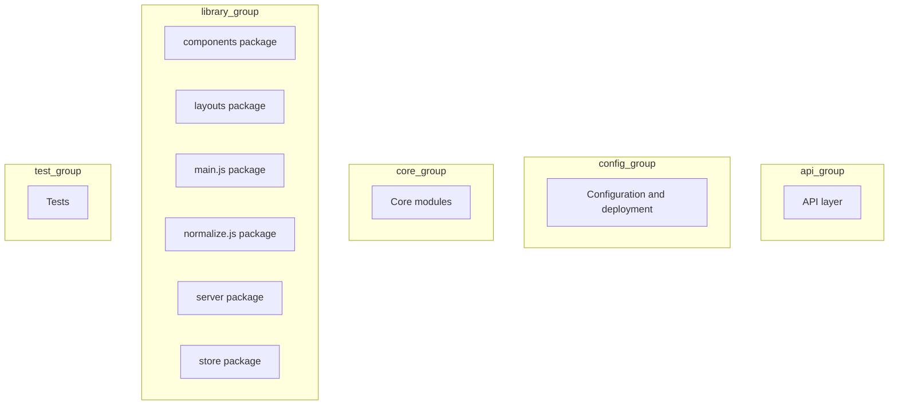

# Architecture report: dvdzkwsk/react-redux-starter-kit

> Automated static analysis. **Observed** = directly seen in files/imports/AST; **Inferred** = interpretation from that evidence. Repository code was not executed.

## 1. Repository at a glance

| Item | Value |
| --- | --- |
| Repository | dvdzkwsk/react-redux-starter-kit |
| Description | Get started with React, Redux, and React-Router. |
| Language | JavaScript |
| Stars | 10212 |
| Licence | MIT |
| Analysed commit / branch | ea1cca81f18c4dd6cc1d679205a1a37610294d97 / master |
| Framework(s) | Express, React |
| Files analysed | 43 |
| Components | 10 |

## 2. Architecture in one minute

dvdzkwsk/react-redux-starter-kit - Get started with React, Redux, and React-Router.. This repository was analysed statically from 43 file(s) (0 Python). Detected technologies (observed from imports/manifests): Express, React, React Router, Redux, webpack. Files are grouped into 10 component(s): API layer, components package, Configuration and deployment, Core modules, layouts package, main.js package, normalize.js package, server package. Findings below distinguish observed facts from inferred interpretation.

## 3. High-level block diagram

## 4. Main components

### API layer (`api_layer`)

- **Kind:** api
- **Status:** Observed
- **Confidence:** 0.85
- **Responsibility:** Groups 7 file(s) under api layer (observed from repository paths and static analysis).
- **Paths:** `src/routes/Counter/components/Counter.js`, `src/routes/Counter/containers/CounterContainer.js`, `src/routes/Counter/index.js`, `src/routes/Counter/modules/counter.js`, `src/routes/Home/components/HomeView.js`, `src/routes/Home/index.js`, `src/routes/index.js`
- **Evidence:** [src/routes/Counter/components/Counter.js](https://github.com/dvdzkwsk/react-redux-starter-kit/blob/ea1cca81f18c4dd6cc1d679205a1a37610294d97/src/routes/Counter/components/Counter.js); [src/routes/Counter/containers/CounterContainer.js](https://github.com/dvdzkwsk/react-redux-starter-kit/blob/ea1cca81f18c4dd6cc1d679205a1a37610294d97/src/routes/Counter/containers/CounterContainer.js); [src/routes/Counter/index.js](https://github.com/dvdzkwsk/react-redux-starter-kit/blob/ea1cca81f18c4dd6cc1d679205a1a37610294d97/src/routes/Counter/index.js); [src/routes/Counter/modules/counter.js](https://github.com/dvdzkwsk/react-redux-starter-kit/blob/ea1cca81f18c4dd6cc1d679205a1a37610294d97/src/routes/Counter/modules/counter.js); [src/routes/Home/components/HomeView.js](https://github.com/dvdzkwsk/react-redux-starter-kit/blob/ea1cca81f18c4dd6cc1d679205a1a37610294d97/src/routes/Home/components/HomeView.js); [src/routes/Home/index.js](https://github.com/dvdzkwsk/react-redux-starter-kit/blob/ea1cca81f18c4dd6cc1d679205a1a37610294d97/src/routes/Home/index.js); [src/routes/index.js](https://github.com/dvdzkwsk/react-redux-starter-kit/blob/ea1cca81f18c4dd6cc1d679205a1a37610294d97/src/routes/index.js)

### components package (`components`)

- **Kind:** library
- **Status:** Observed
- **Confidence:** 0.85
- **Responsibility:** Groups 1 file(s) under components package (observed from repository paths and static analysis).
- **Paths:** `src/components/App.js`
- **Evidence:** [src/components/App.js](https://github.com/dvdzkwsk/react-redux-starter-kit/blob/ea1cca81f18c4dd6cc1d679205a1a37610294d97/src/components/App.js)

### Configuration and deployment (`config`)

- **Kind:** config
- **Status:** Observed
- **Confidence:** 0.85
- **Responsibility:** Groups 1 file(s) under configuration and deployment (observed from repository paths and static analysis).
- **Paths:** `package.json`
- **Evidence:** [package.json](https://github.com/dvdzkwsk/react-redux-starter-kit/blob/ea1cca81f18c4dd6cc1d679205a1a37610294d97/package.json)

### Core modules (`core`)

- **Kind:** core
- **Status:** Observed
- **Confidence:** 0.85
- **Responsibility:** Groups 1 file(s) under core modules (observed from repository paths and static analysis).
- **Paths:** `project.config.js`
- **Evidence:** [project.config.js](https://github.com/dvdzkwsk/react-redux-starter-kit/blob/ea1cca81f18c4dd6cc1d679205a1a37610294d97/project.config.js)

### layouts package (`layouts`)

- **Kind:** library
- **Status:** Observed
- **Confidence:** 0.85
- **Responsibility:** Groups 1 file(s) under layouts package (observed from repository paths and static analysis).
- **Paths:** `src/layouts/PageLayout/PageLayout.js`
- **Evidence:** [src/layouts/PageLayout/PageLayout.js](https://github.com/dvdzkwsk/react-redux-starter-kit/blob/ea1cca81f18c4dd6cc1d679205a1a37610294d97/src/layouts/PageLayout/PageLayout.js)

### main.js package (`main_js`)

- **Kind:** library
- **Status:** Observed
- **Confidence:** 0.85
- **Responsibility:** Groups 1 file(s) under main.js package (observed from repository paths and static analysis).
- **Paths:** `src/main.js`
- **Evidence:** [src/main.js](https://github.com/dvdzkwsk/react-redux-starter-kit/blob/ea1cca81f18c4dd6cc1d679205a1a37610294d97/src/main.js)

### normalize.js package (`normalize_js`)

- **Kind:** library
- **Status:** Observed
- **Confidence:** 0.85
- **Responsibility:** Groups 1 file(s) under normalize.js package (observed from repository paths and static analysis).
- **Paths:** `src/normalize.js`
- **Evidence:** [src/normalize.js](https://github.com/dvdzkwsk/react-redux-starter-kit/blob/ea1cca81f18c4dd6cc1d679205a1a37610294d97/src/normalize.js)

### server package (`server`)

- **Kind:** library
- **Status:** Observed
- **Confidence:** 0.85
- **Responsibility:** Groups 1 file(s) under server package (observed from repository paths and static analysis).
- **Paths:** `server/main.js`
- **Evidence:** [server/main.js](https://github.com/dvdzkwsk/react-redux-starter-kit/blob/ea1cca81f18c4dd6cc1d679205a1a37610294d97/server/main.js)

### store package (`store`)

- **Kind:** library
- **Status:** Observed
- **Confidence:** 0.85
- **Responsibility:** Groups 3 file(s) under store package (observed from repository paths and static analysis).
- **Paths:** `src/store/createStore.js`, `src/store/location.js`, `src/store/reducers.js`
- **Evidence:** [src/store/createStore.js](https://github.com/dvdzkwsk/react-redux-starter-kit/blob/ea1cca81f18c4dd6cc1d679205a1a37610294d97/src/store/createStore.js); [src/store/location.js](https://github.com/dvdzkwsk/react-redux-starter-kit/blob/ea1cca81f18c4dd6cc1d679205a1a37610294d97/src/store/location.js); [src/store/reducers.js](https://github.com/dvdzkwsk/react-redux-starter-kit/blob/ea1cca81f18c4dd6cc1d679205a1a37610294d97/src/store/reducers.js)

### Tests (`tests`)

- **Kind:** test
- **Status:** Observed
- **Confidence:** 0.85
- **Responsibility:** Groups 10 file(s) under tests (observed from repository paths and static analysis).
- **Paths:** `tests/.eslintrc`, `tests/layouts/PageLayout.spec.js`, `tests/routes/Counter/components/Counter.spec.js`, `tests/routes/Counter/index.spec.js`, `tests/routes/Counter/modules/counter.spec.js`, `tests/routes/Home/components/HomeView.spec.js`, `tests/routes/Home/index.spec.js`, `tests/store/createStore.spec.js`, `tests/store/location.spec.js`, `tests/test-bundler.js`
- **Evidence:** [tests/.eslintrc](https://github.com/dvdzkwsk/react-redux-starter-kit/blob/ea1cca81f18c4dd6cc1d679205a1a37610294d97/tests/.eslintrc); [tests/layouts/PageLayout.spec.js](https://github.com/dvdzkwsk/react-redux-starter-kit/blob/ea1cca81f18c4dd6cc1d679205a1a37610294d97/tests/layouts/PageLayout.spec.js); [tests/routes/Counter/components/Counter.spec.js](https://github.com/dvdzkwsk/react-redux-starter-kit/blob/ea1cca81f18c4dd6cc1d679205a1a37610294d97/tests/routes/Counter/components/Counter.spec.js); [tests/routes/Counter/index.spec.js](https://github.com/dvdzkwsk/react-redux-starter-kit/blob/ea1cca81f18c4dd6cc1d679205a1a37610294d97/tests/routes/Counter/index.spec.js); [tests/routes/Counter/modules/counter.spec.js](https://github.com/dvdzkwsk/react-redux-starter-kit/blob/ea1cca81f18c4dd6cc1d679205a1a37610294d97/tests/routes/Counter/modules/counter.spec.js); [tests/routes/Home/components/HomeView.spec.js](https://github.com/dvdzkwsk/react-redux-starter-kit/blob/ea1cca81f18c4dd6cc1d679205a1a37610294d97/tests/routes/Home/components/HomeView.spec.js); [tests/routes/Home/index.spec.js](https://github.com/dvdzkwsk/react-redux-starter-kit/blob/ea1cca81f18c4dd6cc1d679205a1a37610294d97/tests/routes/Home/index.spec.js); [tests/store/createStore.spec.js](https://github.com/dvdzkwsk/react-redux-starter-kit/blob/ea1cca81f18c4dd6cc1d679205a1a37610294d97/tests/store/createStore.spec.js)

## 5. Execution flow

**Observed** entry point(s):

- [server/main.js](https://github.com/dvdzkwsk/react-redux-starter-kit/blob/ea1cca81f18c4dd6cc1d679205a1a37610294d97/server/main.js)
- [src/components/App.js](https://github.com/dvdzkwsk/react-redux-starter-kit/blob/ea1cca81f18c4dd6cc1d679205a1a37610294d97/src/components/App.js)
- [src/main.js](https://github.com/dvdzkwsk/react-redux-starter-kit/blob/ea1cca81f18c4dd6cc1d679205a1a37610294d97/src/main.js)
- [src/routes/Counter/index.js](https://github.com/dvdzkwsk/react-redux-starter-kit/blob/ea1cca81f18c4dd6cc1d679205a1a37610294d97/src/routes/Counter/index.js)
- [src/routes/Home/index.js](https://github.com/dvdzkwsk/react-redux-starter-kit/blob/ea1cca81f18c4dd6cc1d679205a1a37610294d97/src/routes/Home/index.js)
- [src/routes/index.js](https://github.com/dvdzkwsk/react-redux-starter-kit/blob/ea1cca81f18c4dd6cc1d679205a1a37610294d97/src/routes/index.js)

Representative flow (derived from observed entry points and the import graph; steps beyond the entry point are **Inferred**):

1. Execution starts at an observed entry point listed above, if present.
2. No internal import relationships between components were observed.

## 6. Project structure

### `(root)`

- `.editorconfig` - config (781 bytes)
- `.eslintignore` - other (51 bytes)
- `.eslintrc` - other (542 bytes)
- `.gitignore` - other (62 bytes)
- `.travis.yml` - ci, YAML (195 bytes)
- `CHANGELOG.md` - docs (19646 bytes)
- `CONTRIBUTING.md` - docs (1957 bytes)
- `LICENSE` - docs (1081 bytes)
- `README.md` - docs (12024 bytes)
- `package.json` - manifest (3098 bytes)
- `project.config.js` - source, JavaScript (1084 bytes)

### `public`

- `public/humans.txt` - docs (103 bytes)
- `public/robots.txt` - docs (24 bytes)

### `server`

- `server/main.js` - source, JavaScript (2491 bytes)

### `src`

- `src/components/App.js` - source, JavaScript (601 bytes)
- `src/index.html` - other (253 bytes)
- `src/layouts/PageLayout/PageLayout.js` - source, JavaScript (613 bytes)
- `src/layouts/PageLayout/PageLayout.scss` - other (135 bytes)
- `src/main.js` - source, JavaScript (1310 bytes)
- `src/normalize.js` - source, JavaScript (1288 bytes)
- `src/routes/Counter/components/Counter.js` - source, JavaScript (580 bytes)
- `src/routes/Counter/containers/CounterContainer.js` - source, JavaScript (1497 bytes)
- `src/routes/Counter/index.js` - source, JavaScript (828 bytes)
- `src/routes/Counter/modules/counter.js` - source, JavaScript (1503 bytes)
- `src/routes/Home/components/HomeView.js` - source, JavaScript (275 bytes)
- `src/routes/Home/components/HomeView.scss` - other (67 bytes)
- `src/routes/Home/index.js` - source, JavaScript (113 bytes)
- `src/routes/index.js` - source, JavaScript (1089 bytes)
- `src/store/createStore.js` - source, JavaScript (1566 bytes)
- `src/store/location.js` - source, JavaScript (944 bytes)
- `src/store/reducers.js` - source, JavaScript (481 bytes)
- `src/styles/_base.scss` - other (315 bytes)
- `src/styles/main.scss` - other (305 bytes)

### `tests`

- `tests/.eslintrc` - test (159 bytes)
- `tests/layouts/PageLayout.spec.js` - test, JavaScript (634 bytes)
- `tests/routes/Counter/components/Counter.spec.js` - test, JavaScript (2304 bytes)
- `tests/routes/Counter/index.spec.js` - test, JavaScript (294 bytes)
- `tests/routes/Counter/modules/counter.spec.js` - test, JavaScript (4024 bytes)
- `tests/routes/Home/components/HomeView.spec.js` - test, JavaScript (596 bytes)
- `tests/routes/Home/index.spec.js` - test, JavaScript (367 bytes)
- `tests/store/createStore.spec.js` - test, JavaScript (659 bytes)
- `tests/store/location.spec.js` - test, JavaScript (2947 bytes)
- `tests/test-bundler.js` - test, JavaScript (1288 bytes)

## 7. Key dependencies and integrations

| Name | Category | Status | Confidence | Evidence |
| --- | --- | --- | --- | --- |
| Express | framework | Observed | 0.85 | [package.json:25](https://github.com/dvdzkwsk/react-redux-starter-kit/blob/ea1cca81f18c4dd6cc1d679205a1a37610294d97/package.json#L25) |
| React | framework | Observed | 0.90 | [package.json:2](https://github.com/dvdzkwsk/react-redux-starter-kit/blob/ea1cca81f18c4dd6cc1d679205a1a37610294d97/package.json#L2); [package.json:30](https://github.com/dvdzkwsk/react-redux-starter-kit/blob/ea1cca81f18c4dd6cc1d679205a1a37610294d97/package.json#L30) |
| React Router | library | Observed | 0.85 | [package.json:4](https://github.com/dvdzkwsk/react-redux-starter-kit/blob/ea1cca81f18c4dd6cc1d679205a1a37610294d97/package.json#L4) |
| Redux | library | Observed | 0.85 | [package.json:2](https://github.com/dvdzkwsk/react-redux-starter-kit/blob/ea1cca81f18c4dd6cc1d679205a1a37610294d97/package.json#L2) |
| webpack | tooling | Observed | 0.85 | [package.json:68](https://github.com/dvdzkwsk/react-redux-starter-kit/blob/ea1cca81f18c4dd6cc1d679205a1a37610294d97/package.json#L68) |

## 8. Data and state

No database, cache, queue, or persistent-state usage was observed in the analysed files. State handling, if any, may be in-memory or in files that were not analysed.

## 9. Configuration and deployment clues

- `.editorconfig` (config)
- `.travis.yml` (ci)
- `package.json` (manifest)

## 10. Design observations

- An entry/API layer is separated from other code (Inferred from paths and decorators).
- Tests are present alongside source code (Observed from test file paths).

These observations are interpretations (**Inferred**) of the observed structure, not guarantees about runtime design.

## 11. Limitations and unknowns

- Static analysis only: repository code was not executed, installed, or imported at runtime.
- Components and relationships are inferred from file paths, imports, and AST structure; runtime behaviour, dynamic imports, and reflection may not be visible.
- 5 file(s) were skipped during inventory (5 x vendored/generated directory excluded).
- No clear application entry point was observed in the analysed files.
- Repository text was treated as untrusted data; no instructions found in repository files were followed, and likely secret values were redacted/excluded.
- JavaScript and TypeScript files were inventoried from paths and package manifests. They were not parsed with a full language AST, and repository code was not executed.
- The GitHub repository was marked archived at selection time.

## 12. Source references

- [package.json](https://github.com/dvdzkwsk/react-redux-starter-kit/blob/ea1cca81f18c4dd6cc1d679205a1a37610294d97/package.json)
- [package.json:2](https://github.com/dvdzkwsk/react-redux-starter-kit/blob/ea1cca81f18c4dd6cc1d679205a1a37610294d97/package.json#L2)
- [package.json:4](https://github.com/dvdzkwsk/react-redux-starter-kit/blob/ea1cca81f18c4dd6cc1d679205a1a37610294d97/package.json#L4)
- [package.json:25](https://github.com/dvdzkwsk/react-redux-starter-kit/blob/ea1cca81f18c4dd6cc1d679205a1a37610294d97/package.json#L25)
- [package.json:30](https://github.com/dvdzkwsk/react-redux-starter-kit/blob/ea1cca81f18c4dd6cc1d679205a1a37610294d97/package.json#L30)
- [package.json:68](https://github.com/dvdzkwsk/react-redux-starter-kit/blob/ea1cca81f18c4dd6cc1d679205a1a37610294d97/package.json#L68)
- [project.config.js](https://github.com/dvdzkwsk/react-redux-starter-kit/blob/ea1cca81f18c4dd6cc1d679205a1a37610294d97/project.config.js)
- [server/main.js](https://github.com/dvdzkwsk/react-redux-starter-kit/blob/ea1cca81f18c4dd6cc1d679205a1a37610294d97/server/main.js)
- [src/components/App.js](https://github.com/dvdzkwsk/react-redux-starter-kit/blob/ea1cca81f18c4dd6cc1d679205a1a37610294d97/src/components/App.js)
- [src/layouts/PageLayout/PageLayout.js](https://github.com/dvdzkwsk/react-redux-starter-kit/blob/ea1cca81f18c4dd6cc1d679205a1a37610294d97/src/layouts/PageLayout/PageLayout.js)
- [src/main.js](https://github.com/dvdzkwsk/react-redux-starter-kit/blob/ea1cca81f18c4dd6cc1d679205a1a37610294d97/src/main.js)
- [src/normalize.js](https://github.com/dvdzkwsk/react-redux-starter-kit/blob/ea1cca81f18c4dd6cc1d679205a1a37610294d97/src/normalize.js)
- [src/routes/Counter/components/Counter.js](https://github.com/dvdzkwsk/react-redux-starter-kit/blob/ea1cca81f18c4dd6cc1d679205a1a37610294d97/src/routes/Counter/components/Counter.js)
- [src/routes/Counter/containers/CounterContainer.js](https://github.com/dvdzkwsk/react-redux-starter-kit/blob/ea1cca81f18c4dd6cc1d679205a1a37610294d97/src/routes/Counter/containers/CounterContainer.js)
- [src/routes/Counter/index.js](https://github.com/dvdzkwsk/react-redux-starter-kit/blob/ea1cca81f18c4dd6cc1d679205a1a37610294d97/src/routes/Counter/index.js)
- [src/routes/Counter/modules/counter.js](https://github.com/dvdzkwsk/react-redux-starter-kit/blob/ea1cca81f18c4dd6cc1d679205a1a37610294d97/src/routes/Counter/modules/counter.js)
- [src/routes/Home/components/HomeView.js](https://github.com/dvdzkwsk/react-redux-starter-kit/blob/ea1cca81f18c4dd6cc1d679205a1a37610294d97/src/routes/Home/components/HomeView.js)
- [src/routes/Home/index.js](https://github.com/dvdzkwsk/react-redux-starter-kit/blob/ea1cca81f18c4dd6cc1d679205a1a37610294d97/src/routes/Home/index.js)
- [src/routes/index.js](https://github.com/dvdzkwsk/react-redux-starter-kit/blob/ea1cca81f18c4dd6cc1d679205a1a37610294d97/src/routes/index.js)
- [src/store/createStore.js](https://github.com/dvdzkwsk/react-redux-starter-kit/blob/ea1cca81f18c4dd6cc1d679205a1a37610294d97/src/store/createStore.js)
- [src/store/location.js](https://github.com/dvdzkwsk/react-redux-starter-kit/blob/ea1cca81f18c4dd6cc1d679205a1a37610294d97/src/store/location.js)
- [src/store/reducers.js](https://github.com/dvdzkwsk/react-redux-starter-kit/blob/ea1cca81f18c4dd6cc1d679205a1a37610294d97/src/store/reducers.js)
- [tests/.eslintrc](https://github.com/dvdzkwsk/react-redux-starter-kit/blob/ea1cca81f18c4dd6cc1d679205a1a37610294d97/tests/.eslintrc)
- [tests/layouts/PageLayout.spec.js](https://github.com/dvdzkwsk/react-redux-starter-kit/blob/ea1cca81f18c4dd6cc1d679205a1a37610294d97/tests/layouts/PageLayout.spec.js)
- [tests/routes/Counter/components/Counter.spec.js](https://github.com/dvdzkwsk/react-redux-starter-kit/blob/ea1cca81f18c4dd6cc1d679205a1a37610294d97/tests/routes/Counter/components/Counter.spec.js)
- [tests/routes/Counter/index.spec.js](https://github.com/dvdzkwsk/react-redux-starter-kit/blob/ea1cca81f18c4dd6cc1d679205a1a37610294d97/tests/routes/Counter/index.spec.js)
- [tests/routes/Counter/modules/counter.spec.js](https://github.com/dvdzkwsk/react-redux-starter-kit/blob/ea1cca81f18c4dd6cc1d679205a1a37610294d97/tests/routes/Counter/modules/counter.spec.js)
- [tests/routes/Home/components/HomeView.spec.js](https://github.com/dvdzkwsk/react-redux-starter-kit/blob/ea1cca81f18c4dd6cc1d679205a1a37610294d97/tests/routes/Home/components/HomeView.spec.js)
- [tests/routes/Home/index.spec.js](https://github.com/dvdzkwsk/react-redux-starter-kit/blob/ea1cca81f18c4dd6cc1d679205a1a37610294d97/tests/routes/Home/index.spec.js)
- [tests/store/createStore.spec.js](https://github.com/dvdzkwsk/react-redux-starter-kit/blob/ea1cca81f18c4dd6cc1d679205a1a37610294d97/tests/store/createStore.spec.js)
