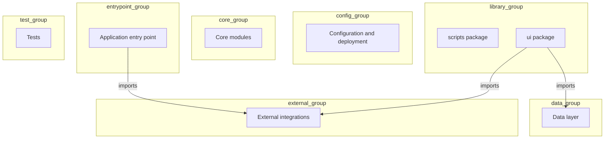

# Architecture report: easydiffusion/easydiffusion

> Automated static analysis. **Observed** = directly seen in files/imports/AST; **Inferred** = interpretation from that evidence. Repository code was not executed.

## 1. Repository at a glance

| Item | Value |
| --- | --- |
| Repository | easydiffusion/easydiffusion |
| Description | An easy 1-click way to create beautiful artwork on your PC using AI, with no tech knowledge. Provides a browser UI for generating images from text prompts and images. Just enter your text prompt, and see the generated image. |
| Language | JavaScript |
| Stars | 10479 |
| Licence | Other |
| Analysed commit / branch | 7caaf64acd47b6bc40ba2379571d48ea4cc29a6a / main |
| Framework(s) | FastAPI, Starlette |
| Files analysed | 145 |
| Components | 8 |

## 2. Architecture in one minute

easydiffusion/easydiffusion - An easy 1-click way to create beautiful artwork on your PC using AI, with no tech knowledge. Provides a browser UI for generating images from text prompts and images. Just enter your text prompt, and…. This repository was analysed statically from 145 file(s) (39 Python). Detected technologies (observed from imports/manifests): FastAPI, Starlette, NumPy, Pydantic, requests, SQLAlchemy. Files are grouped into 8 component(s): Configuration and deployment, Core modules, Data layer, Application entry point, External integrations, scripts package, Tests, ui package. Observed entry point(s): scripts/check_modules.py, scripts/webui_console.py, ui/easydiffusion/backends/webui.py. Findings below distinguish observed facts from inferred interpretation.

## 3. High-level block diagram

## 4. Main components

### Configuration and deployment (`config`)

- **Kind:** config
- **Status:** Observed
- **Confidence:** 0.85
- **Responsibility:** Groups 3 file(s) under configuration and deployment (observed from repository paths and static analysis).
- **Paths:** `environment.yaml`, `package.json`, `ui/modifiers.json`
- **Evidence:** [environment.yaml](https://github.com/easydiffusion/easydiffusion/blob/7caaf64acd47b6bc40ba2379571d48ea4cc29a6a/environment.yaml); [package.json](https://github.com/easydiffusion/easydiffusion/blob/7caaf64acd47b6bc40ba2379571d48ea4cc29a6a/package.json); [ui/modifiers.json](https://github.com/easydiffusion/easydiffusion/blob/7caaf64acd47b6bc40ba2379571d48ea4cc29a6a/ui/modifiers.json)

### Core modules (`core`)

- **Kind:** core
- **Status:** Observed
- **Confidence:** 0.85
- **Responsibility:** Groups 1 file(s) under core modules (observed from repository paths and static analysis).
- **Paths:** `build.sh`
- **Evidence:** [build.sh](https://github.com/easydiffusion/easydiffusion/blob/7caaf64acd47b6bc40ba2379571d48ea4cc29a6a/build.sh)

### Data layer (`data_layer`)

- **Kind:** data
- **Status:** Observed
- **Confidence:** 0.85
- **Responsibility:** Groups 3 file(s) under data layer (observed from repository paths and static analysis). Observed top-level classes: Bucket, BucketBase, BucketCreate, BucketFile, BucketFileBase, BucketFileCreate.
- **Paths:** `ui/easydiffusion/easydb/database.py`, `ui/easydiffusion/easydb/models.py`, `ui/easydiffusion/easydb/schemas.py`
- **Evidence:** [ui/easydiffusion/easydb/database.py](https://github.com/easydiffusion/easydiffusion/blob/7caaf64acd47b6bc40ba2379571d48ea4cc29a6a/ui/easydiffusion/easydb/database.py); [ui/easydiffusion/easydb/models.py:7](https://github.com/easydiffusion/easydiffusion/blob/7caaf64acd47b6bc40ba2379571d48ea4cc29a6a/ui/easydiffusion/easydb/models.py#L7); [ui/easydiffusion/easydb/schemas.py:6](https://github.com/easydiffusion/easydiffusion/blob/7caaf64acd47b6bc40ba2379571d48ea4cc29a6a/ui/easydiffusion/easydb/schemas.py#L6)

### Application entry point (`entrypoint`)

- **Kind:** entrypoint
- **Status:** Observed
- **Confidence:** 0.85
- **Responsibility:** Groups 7 file(s) under application entry point (observed from repository paths and static analysis). Observed application object created via FastAPI. Observed top-level classes: CloudflareTunnel, NoCacheStaticFiles, SetAppConfigRequest. Observed top-level functions: _install, apply_backend_config_env_overrides, check_output_in_conda, configure_env, enqueue_task, fail.
- **Paths:** `scripts/check_modules.py`, `scripts/webui_console.py`, `ui/easydiffusion/app.py`, `ui/easydiffusion/backends/webui.py`, `ui/easydiffusion/server.py`, `ui/easydiffusion/utils/model_identifier.py`, `ui/main.py`
- **Evidence:** [scripts/check_modules.py:49](https://github.com/easydiffusion/easydiffusion/blob/7caaf64acd47b6bc40ba2379571d48ea4cc29a6a/scripts/check_modules.py#L49); [scripts/webui_console.py:6](https://github.com/easydiffusion/easydiffusion/blob/7caaf64acd47b6bc40ba2379571d48ea4cc29a6a/scripts/webui_console.py#L6); [ui/easydiffusion/app.py:96](https://github.com/easydiffusion/easydiffusion/blob/7caaf64acd47b6bc40ba2379571d48ea4cc29a6a/ui/easydiffusion/app.py#L96); [ui/easydiffusion/backends/webui.py:155](https://github.com/easydiffusion/easydiffusion/blob/7caaf64acd47b6bc40ba2379571d48ea4cc29a6a/ui/easydiffusion/backends/webui.py#L155); [ui/easydiffusion/server.py:36](https://github.com/easydiffusion/easydiffusion/blob/7caaf64acd47b6bc40ba2379571d48ea4cc29a6a/ui/easydiffusion/server.py#L36); [ui/easydiffusion/utils/model_identifier.py:104](https://github.com/easydiffusion/easydiffusion/blob/7caaf64acd47b6bc40ba2379571d48ea4cc29a6a/ui/easydiffusion/utils/model_identifier.py#L104); [ui/main.py](https://github.com/easydiffusion/easydiffusion/blob/7caaf64acd47b6bc40ba2379571d48ea4cc29a6a/ui/main.py)

### External integrations (`external_integrations`)

- **Kind:** external
- **Status:** Inferred
- **Confidence:** 0.70
- **Responsibility:** Groups 0 file(s) under external integrations (observed from repository paths and static analysis).
- **Evidence:** [ui/easydiffusion/app.py:5](https://github.com/easydiffusion/easydiffusion/blob/7caaf64acd47b6bc40ba2379571d48ea4cc29a6a/ui/easydiffusion/app.py#L5); [ui/easydiffusion/backends/sdkit3.py:4](https://github.com/easydiffusion/easydiffusion/blob/7caaf64acd47b6bc40ba2379571d48ea4cc29a6a/ui/easydiffusion/backends/sdkit3.py#L4); [ui/easydiffusion/backends/webui_common.py:2](https://github.com/easydiffusion/easydiffusion/blob/7caaf64acd47b6bc40ba2379571d48ea4cc29a6a/ui/easydiffusion/backends/webui_common.py#L2); [ui/easydiffusion/backends/webui_common.py:3](https://github.com/easydiffusion/easydiffusion/blob/7caaf64acd47b6bc40ba2379571d48ea4cc29a6a/ui/easydiffusion/backends/webui_common.py#L3); [ui/easydiffusion/bucket_manager.py:4](https://github.com/easydiffusion/easydiffusion/blob/7caaf64acd47b6bc40ba2379571d48ea4cc29a6a/ui/easydiffusion/bucket_manager.py#L4); [ui/easydiffusion/bucket_manager.py:9](https://github.com/easydiffusion/easydiffusion/blob/7caaf64acd47b6bc40ba2379571d48ea4cc29a6a/ui/easydiffusion/bucket_manager.py#L9)

### scripts package (`scripts`)

- **Kind:** library
- **Status:** Observed
- **Confidence:** 0.85
- **Responsibility:** Groups 8 file(s) under scripts package (observed from repository paths and static analysis).
- **Paths:** `scripts/bootstrap.sh`, `scripts/developer_console.sh`, `scripts/ensure_torchruntime.py`, `scripts/functions.sh`, `scripts/get_config.py`, `scripts/on_env_start.sh`, `scripts/on_sd_start.sh`, `scripts/start.sh`
- **Evidence:** [scripts/bootstrap.sh](https://github.com/easydiffusion/easydiffusion/blob/7caaf64acd47b6bc40ba2379571d48ea4cc29a6a/scripts/bootstrap.sh); [scripts/developer_console.sh](https://github.com/easydiffusion/easydiffusion/blob/7caaf64acd47b6bc40ba2379571d48ea4cc29a6a/scripts/developer_console.sh); [scripts/ensure_torchruntime.py](https://github.com/easydiffusion/easydiffusion/blob/7caaf64acd47b6bc40ba2379571d48ea4cc29a6a/scripts/ensure_torchruntime.py); [scripts/functions.sh](https://github.com/easydiffusion/easydiffusion/blob/7caaf64acd47b6bc40ba2379571d48ea4cc29a6a/scripts/functions.sh); [scripts/get_config.py](https://github.com/easydiffusion/easydiffusion/blob/7caaf64acd47b6bc40ba2379571d48ea4cc29a6a/scripts/get_config.py); [scripts/on_env_start.sh](https://github.com/easydiffusion/easydiffusion/blob/7caaf64acd47b6bc40ba2379571d48ea4cc29a6a/scripts/on_env_start.sh); [scripts/on_sd_start.sh](https://github.com/easydiffusion/easydiffusion/blob/7caaf64acd47b6bc40ba2379571d48ea4cc29a6a/scripts/on_sd_start.sh); [scripts/start.sh](https://github.com/easydiffusion/easydiffusion/blob/7caaf64acd47b6bc40ba2379571d48ea4cc29a6a/scripts/start.sh)

### Tests (`tests`)

- **Kind:** test
- **Status:** Observed
- **Confidence:** 0.85
- **Responsibility:** Groups 3 file(s) under tests (observed from repository paths and static analysis). Observed top-level classes: TestBackendConfigEnvOverrides, TestTerminologyConsistency, TestWebuiFaceFilterPayloads, _FakeResponse. Observed top-level functions: _install_mock_dependencies, _load_check_modules, _load_webui_common, _restore_mock_dependencies.
- **Paths:** `scripts/test_backend_config_overrides.py`, `scripts/test_webui_alternate_field_names.py`, `scripts/test_webui_face_filters.py`
- **Evidence:** [scripts/test_backend_config_overrides.py:6](https://github.com/easydiffusion/easydiffusion/blob/7caaf64acd47b6bc40ba2379571d48ea4cc29a6a/scripts/test_backend_config_overrides.py#L6); [scripts/test_webui_alternate_field_names.py:6](https://github.com/easydiffusion/easydiffusion/blob/7caaf64acd47b6bc40ba2379571d48ea4cc29a6a/scripts/test_webui_alternate_field_names.py#L6); [scripts/test_webui_face_filters.py:20](https://github.com/easydiffusion/easydiffusion/blob/7caaf64acd47b6bc40ba2379571d48ea4cc29a6a/scripts/test_webui_face_filters.py#L20)

### ui package (`ui`)

- **Kind:** library
- **Status:** Observed
- **Confidence:** 0.85
- **Responsibility:** Groups 56 file(s) under ui package (observed from repository paths and static analysis). Observed top-level classes: DataCache, FilterImageRequest, FilterImageResponse, FilterTask, GenerateImageRequest, GenerateImageResponse. Observed top-level functions: _calculate_img_number, _filter_images, after_filter, any_model_exists, auto1111_hash, auto_pick_devices.
- **Paths:** `ui/easydiffusion/__init__.py`, `ui/easydiffusion/backend_manager.py`, `ui/easydiffusion/backends/common.py`, `ui/easydiffusion/backends/ed_classic.py`, `ui/easydiffusion/backends/ed_diffusers.py`, `ui/easydiffusion/backends/sdkit3.py`, `ui/easydiffusion/backends/sdkit_common.py`, `ui/easydiffusion/backends/webui_common.py`, `ui/easydiffusion/bucket_manager.py`, `ui/easydiffusion/device_manager.py`, `ui/easydiffusion/easydb/crud.py`, `ui/easydiffusion/model_manager/__init__.py`, `ui/easydiffusion/model_manager/list_models.py`, `ui/easydiffusion/package_manager.py`, `ui/easydiffusion/runtime.py`, `ui/easydiffusion/task_manager.py`, `ui/easydiffusion/tasks/__init__.py`, `ui/easydiffusion/tasks/filter_images.py`, `ui/easydiffusion/tasks/render_images.py`, `ui/easydiffusion/tasks/task.py`, `ui/easydiffusion/types.py`, `ui/easydiffusion/utils/__init__.py`, `ui/easydiffusion/utils/nsfw_checker.py`, `ui/easydiffusion/utils/save_utils.py`, `ui/media/js/auto-save.js`, `ui/media/js/croppr.js`, `ui/media/js/dnd.js`, `ui/media/js/engine.js`, `ui/media/js/exif-reader.js`, `ui/media/js/image-editor.js`, `ui/media/js/image-modal.js`, `ui/media/js/image-modifiers.js`, `ui/media/js/main.js`, `ui/media/js/multi-model-selector.js`, `ui/media/js/parameters.js`, `ui/media/js/plugins.js`, `ui/media/js/searchable-models.js`, `ui/media/js/task-manager.js`, `ui/media/js/themes.js`, `ui/media/js/utils.js`, `ui/plugins/ui/Autoscroll.plugin.js`, `ui/plugins/ui/Modifiers-dnd.plugin.js`, `ui/plugins/ui/Modifiers-wheel.plugin.js`, `ui/plugins/ui/custom-modifiers.plugin.js`, `ui/plugins/ui/image-editor-improvements.plugin.js`, `ui/plugins/ui/jasmine/boot0.js`, `ui/plugins/ui/jasmine/boot1.js`, `ui/plugins/ui/jasmine/jasmine-html.js`, `ui/plugins/ui/jasmineSpec.js`, `ui/plugins/ui/lora-prompt-parser.plugin.js`, `ui/plugins/ui/model-tools.plugin.js`, `ui/plugins/ui/modifiers-toggle.plugin.js`, `ui/plugins/ui/release-notes.plugin.js`, `ui/plugins/ui/selftest.plugin_.js`, `ui/plugins/ui/snow.plugin.js`, `ui/plugins/ui/tiled-image-download.plugin.js`
- **Evidence:** [ui/easydiffusion/__init__.py](https://github.com/easydiffusion/easydiffusion/blob/7caaf64acd47b6bc40ba2379571d48ea4cc29a6a/ui/easydiffusion/__init__.py); [ui/easydiffusion/backend_manager.py:13](https://github.com/easydiffusion/easydiffusion/blob/7caaf64acd47b6bc40ba2379571d48ea4cc29a6a/ui/easydiffusion/backend_manager.py#L13); [ui/easydiffusion/backends/common.py:6](https://github.com/easydiffusion/easydiffusion/blob/7caaf64acd47b6bc40ba2379571d48ea4cc29a6a/ui/easydiffusion/backends/common.py#L6); [ui/easydiffusion/backends/ed_classic.py:27](https://github.com/easydiffusion/easydiffusion/blob/7caaf64acd47b6bc40ba2379571d48ea4cc29a6a/ui/easydiffusion/backends/ed_classic.py#L27); [ui/easydiffusion/backends/ed_diffusers.py:27](https://github.com/easydiffusion/easydiffusion/blob/7caaf64acd47b6bc40ba2379571d48ea4cc29a6a/ui/easydiffusion/backends/ed_diffusers.py#L27); [ui/easydiffusion/backends/sdkit3.py:45](https://github.com/easydiffusion/easydiffusion/blob/7caaf64acd47b6bc40ba2379571d48ea4cc29a6a/ui/easydiffusion/backends/sdkit3.py#L45); [ui/easydiffusion/backends/sdkit_common.py:15](https://github.com/easydiffusion/easydiffusion/blob/7caaf64acd47b6bc40ba2379571d48ea4cc29a6a/ui/easydiffusion/backends/sdkit_common.py#L15); [ui/easydiffusion/backends/webui_common.py:58](https://github.com/easydiffusion/easydiffusion/blob/7caaf64acd47b6bc40ba2379571d48ea4cc29a6a/ui/easydiffusion/backends/webui_common.py#L58)

## 5. Execution flow

**Observed** entry point(s):

- [scripts/check_modules.py:400](https://github.com/easydiffusion/easydiffusion/blob/7caaf64acd47b6bc40ba2379571d48ea4cc29a6a/scripts/check_modules.py#L400)
- [scripts/webui_console.py:96](https://github.com/easydiffusion/easydiffusion/blob/7caaf64acd47b6bc40ba2379571d48ea4cc29a6a/scripts/webui_console.py#L96)
- [ui/easydiffusion/backends/webui.py:155](https://github.com/easydiffusion/easydiffusion/blob/7caaf64acd47b6bc40ba2379571d48ea4cc29a6a/ui/easydiffusion/backends/webui.py#L155)
- [ui/easydiffusion/server.py:36](https://github.com/easydiffusion/easydiffusion/blob/7caaf64acd47b6bc40ba2379571d48ea4cc29a6a/ui/easydiffusion/server.py#L36)
- [ui/easydiffusion/utils/model_identifier.py:411](https://github.com/easydiffusion/easydiffusion/blob/7caaf64acd47b6bc40ba2379571d48ea4cc29a6a/ui/easydiffusion/utils/model_identifier.py#L411)
- [ui/media/js/main.js](https://github.com/easydiffusion/easydiffusion/blob/7caaf64acd47b6bc40ba2379571d48ea4cc29a6a/ui/media/js/main.js)

Representative flow (derived from observed entry points and the import graph; steps beyond the entry point are **Inferred**):

1. Execution starts at an observed entry point listed above, if present.
2. `entrypoint` imports `external_integrations` (Application entry point -> External integrations).
3. `ui` imports `data_layer` (ui package -> Data layer).
4. `ui` imports `external_integrations` (ui package -> External integrations).

## 6. Project structure

### `(root)`

- `.gitignore` - other (76 bytes)
- `.prettierignore` - other (76 bytes)
- `.prettierrc.json` - config (121 bytes)
- `3rd-PARTY-LICENSES` - other (58245 bytes)
- `CHANGES.md` - docs (39581 bytes)
- `CONTRIBUTING.md` - docs (3309 bytes)
- `CreativeML Open RAIL-M License` - other (14384 bytes)
- `How to install and run.txt` - docs (1005 bytes)
- `LICENSE` - docs (4120 bytes)
- `PRIVACY.md` - docs (1589 bytes)
- `README BEFORE YOU RUN THIS.txt` - docs (294 bytes)
- `README.md` - docs (9705 bytes)
- `announcement_log.md` - docs (1980 bytes)
- `announcement_log.txt` - docs (30453 bytes)
- `build.bat` - other (2856 bytes)
- `build.sh` - source, Shell (1590 bytes)
- `environment.yaml` - config (107 bytes)
- `event_log.md` - docs (2442 bytes)
- `event_log.txt` - docs (47369 bytes)
- `package.json` - manifest (194 bytes)

### `.github`

- `.github/FUNDING.yml` - config (68 bytes)
- `.github/ISSUE_TEMPLATE/bug_report.md` - docs (731 bytes)
- `.github/ISSUE_TEMPLATE/feature_request.md` - docs (604 bytes)

### `NSIS`

- `NSIS/.gitignore` - other (6 bytes)
- `NSIS/README.md` - docs (68 bytes)
- `NSIS/sdui.nsi` - other (12976 bytes)

### `kb`

- `kb/README.md` - docs (2672 bytes)
- `kb/architecture.md` - docs (8769 bytes)
- `kb/backend-engines.md` - docs (6806 bytes)
- `kb/configuration.md` - docs (6665 bytes)
- `kb/development.md` - docs (3505 bytes)
- `kb/features.md` - docs (5485 bytes)
- `kb/frontend.md` - docs (6567 bytes)
- `kb/install-and-startup.md` - docs (6087 bytes)
- `kb/models.md` - docs (6560 bytes)
- `kb/release-process.md` - docs (4659 bytes)
- `kb/task-lifecycle.md` - docs (8634 bytes)
- `kb/testing.md` - docs (3666 bytes)
- `kb/v4.md` - docs (6340 bytes)

### `scripts`

- `scripts/Developer Console.cmd` - other (1576 bytes)
- `scripts/Start Stable Diffusion UI.cmd` - other (1639 bytes)
- `scripts/bootstrap.bat` - other (2815 bytes)
- `scripts/bootstrap.sh` - source, Shell (3745 bytes)
- `scripts/check_modules.py` - source, Python (14339 bytes)
- `scripts/config.yaml.sample` - other (1216 bytes)
- `scripts/developer_console.sh` - source, Shell (1645 bytes)
- `scripts/ensure_torchruntime.py` - source, Python (361 bytes)
- `scripts/functions.sh` - source, Shell (1058 bytes)
- `scripts/get_config.py` - source, Python (1610 bytes)
- `scripts/install_status.txt` - docs (0 bytes)
- `scripts/on_env_start.bat` - other (3515 bytes)
- `scripts/on_env_start.sh` - source, Shell (2364 bytes)
- `scripts/on_sd_start.bat` - other (3274 bytes)
- `scripts/on_sd_start.sh` - source, Shell (2009 bytes)
- `scripts/start.sh` - source, Shell (1199 bytes)
- `scripts/test_backend_config_overrides.py` - test, Python (1269 bytes)
- `scripts/test_webui_alternate_field_names.py` - test, Python (2238 bytes)
- `scripts/test_webui_face_filters.py` - test, Python (5816 bytes)
- `scripts/webui_console.py` - source, Python (2716 bytes)
- `scripts/win_enable_long_filepaths.ps1` - other (124 bytes)

### `ui`

- `ui/easydiffusion/__init__.py` - source, Python (0 bytes)
- `ui/easydiffusion/app.py` - source, Python (17241 bytes)
- `ui/easydiffusion/backend_manager.py` - source, Python (3010 bytes)
- `ui/easydiffusion/backends/common.py` - source, Python (866 bytes)
- `ui/easydiffusion/backends/ed_classic.py` - source, Python (531 bytes)
- `ui/easydiffusion/backends/ed_diffusers.py` - source, Python (532 bytes)
- `ui/easydiffusion/backends/sdkit3.py` - source, Python (7927 bytes)
- `ui/easydiffusion/backends/sdkit_common.py` - source, Python (7009 bytes)
- `ui/easydiffusion/backends/webui.py` - source, Python (11779 bytes)
- `ui/easydiffusion/backends/webui_common.py` - source, Python (26247 bytes)
- `ui/easydiffusion/bucket_manager.py` - source, Python (3741 bytes)
- `ui/easydiffusion/device_manager.py` - source, Python (6154 bytes)
- `ui/easydiffusion/easydb/crud.py` - source, Python (804 bytes)
- `ui/easydiffusion/easydb/database.py` - source, Python (500 bytes)
- `ui/easydiffusion/easydb/models.py` - source, Python (710 bytes)
- `ui/easydiffusion/easydb/schemas.py` - source, Python (491 bytes)
- `ui/easydiffusion/model_manager/__init__.py` - source, Python (15878 bytes)
- `ui/easydiffusion/model_manager/list_models.py` - source, Python (5444 bytes)
- `ui/easydiffusion/package_manager.py` - source, Python (3309 bytes)
- `ui/easydiffusion/runtime.py` - source, Python (1251 bytes)
- `ui/easydiffusion/server.py` - source, Python (19340 bytes)
- `ui/easydiffusion/task_manager.py` - source, Python (18124 bytes)
- `ui/easydiffusion/tasks/__init__.py` - source, Python (99 bytes)
- `ui/easydiffusion/tasks/filter_images.py` - source, Python (4199 bytes)
- `ui/easydiffusion/tasks/render_images.py` - source, Python (10448 bytes)
- `ui/easydiffusion/tasks/task.py` - source, Python (1500 bytes)
- `ui/easydiffusion/types.py` - source, Python (9716 bytes)
- `ui/easydiffusion/utils/__init__.py` - source, Python (478 bytes)
- `ui/easydiffusion/utils/model_identifier.py` - source, Python (17328 bytes)
- `ui/easydiffusion/utils/nsfw_checker.py` - source, Python (2751 bytes)
- `ui/easydiffusion/utils/save_utils.py` - source, Python (12432 bytes)
- `ui/index.html` - other (78712 bytes)
- `ui/main.py` - source, Python (249 bytes)
- `ui/media/css/animations.css` - other (1940 bytes)
- `ui/media/css/auto-save.css` - other (1494 bytes)
- `ui/media/css/croppr.css` - other (908 bytes)
- `ui/media/css/fonts.css` - other (1600 bytes)
- `ui/media/css/image-editor.css` - other (4874 bytes)
- `ui/media/css/image-modal.css` - other (2158 bytes)
- `ui/media/css/main.css` - other (42306 bytes)
- `ui/media/css/modifier-thumbnails.css` - other (4556 bytes)
- `ui/media/css/plugins.css` - other (5175 bytes)
- `ui/media/css/searchable-models.css` - other (1862 bytes)
- `ui/media/css/themes.css` - other (7423 bytes)
- `ui/media/images/fa-eraser.svg` - other (571 bytes)
- `ui/media/images/fa-eye-dropper.svg` - other (775 bytes)
- `ui/media/images/fa-fill.svg` - other (763 bytes)
- `ui/media/images/fa-pencil.svg` - other (934 bytes)
- `ui/media/js/auto-save.js` - source, JavaScript (11918 bytes)
- `ui/media/js/croppr.js` - source, JavaScript (41780 bytes)
- `ui/media/js/dnd.js` - source, JavaScript (32489 bytes)
- `ui/media/js/engine.js` - source, JavaScript (57376 bytes)
- `ui/media/js/exif-reader.js` - source, JavaScript (69261 bytes)
- `ui/media/js/image-editor.js` - source, JavaScript (35281 bytes)
- `ui/media/js/image-modal.js` - source, JavaScript (7333 bytes)
- `ui/media/js/image-modifiers.js` - source, JavaScript (19543 bytes)
- `ui/media/js/main.js` - source, JavaScript (125451 bytes)
- `ui/media/js/multi-model-selector.js` - source, JavaScript (8575 bytes)
- `ui/media/js/parameters.js` - source, JavaScript (33624 bytes)
- `ui/media/js/plugins.js` - source, JavaScript (42325 bytes)
- `ui/media/js/searchable-models.js` - source, JavaScript (26695 bytes)
- `ui/media/js/task-manager.js` - source, JavaScript (15705 bytes)
- `ui/media/js/themes.js` - source, JavaScript (3150 bytes)
- `ui/media/js/utils.js` - source, JavaScript (38914 bytes)
- `ui/media/manifest.webmanifest` - other (150 bytes)
- `ui/modifiers.json` - config (66602 bytes)
- `ui/plugins/ui/Autoscroll.plugin.js` - source, JavaScript (891 bytes)
- `ui/plugins/ui/DO NOT PLACE USER PLUGINS HERE, unless you are a developer.txt` - docs (188 bytes)
- `ui/plugins/ui/Modifiers-dnd.plugin.js` - source, JavaScript (4931 bytes)
- `ui/plugins/ui/Modifiers-wheel.plugin.js` - source, JavaScript (3591 bytes)
- `ui/plugins/ui/SpecRunner.html` - other (858 bytes)
- `ui/plugins/ui/custom-modifiers.plugin.js` - source, JavaScript (1082 bytes)
- `ui/plugins/ui/image-editor-improvements.plugin.js` - source, JavaScript (18640 bytes)
- `ui/plugins/ui/jasmine/boot0.js` - source, JavaScript (2764 bytes)
- `ui/plugins/ui/jasmine/boot1.js` - source, JavaScript (4739 bytes)
- `ui/plugins/ui/jasmine/jasmine-html.js` - source, JavaScript (31233 bytes)
- `ui/plugins/ui/jasmine/jasmine.css` - other (22160 bytes)
- `ui/plugins/ui/jasmineSpec.js` - source, JavaScript (16854 bytes)
- `ui/plugins/ui/lora-prompt-parser.plugin.js` - source, JavaScript (4387 bytes)
- `ui/plugins/ui/model-tools.plugin.js` - source, JavaScript (31413 bytes)
- `ui/plugins/ui/modifiers-toggle.plugin.js` - source, JavaScript (1897 bytes)
- `ui/plugins/ui/release-notes.plugin.js` - source, JavaScript (1798 bytes)
- `ui/plugins/ui/selftest.plugin_.js` - source, JavaScript (942 bytes)
- `ui/plugins/ui/snow.plugin.js` - source, JavaScript (4326 bytes)
- `ui/plugins/ui/tiled-image-download.plugin.js` - source, JavaScript (17959 bytes)

## 7. Key dependencies and integrations

| Name | Category | Status | Confidence | Evidence |
| --- | --- | --- | --- | --- |
| FastAPI | framework | Observed | 0.95 | [ui/easydiffusion/backends/webui.py:149](https://github.com/easydiffusion/easydiffusion/blob/7caaf64acd47b6bc40ba2379571d48ea4cc29a6a/ui/easydiffusion/backends/webui.py#L149); [ui/easydiffusion/backends/webui.py:150](https://github.com/easydiffusion/easydiffusion/blob/7caaf64acd47b6bc40ba2379571d48ea4cc29a6a/ui/easydiffusion/backends/webui.py#L150); [ui/easydiffusion/bucket_manager.py:3](https://github.com/easydiffusion/easydiffusion/blob/7caaf64acd47b6bc40ba2379571d48ea4cc29a6a/ui/easydiffusion/bucket_manager.py#L3); [ui/easydiffusion/server.py:27](https://github.com/easydiffusion/easydiffusion/blob/7caaf64acd47b6bc40ba2379571d48ea4cc29a6a/ui/easydiffusion/server.py#L27) |
| Starlette | framework | Observed | 0.90 | [ui/easydiffusion/server.py:30](https://github.com/easydiffusion/easydiffusion/blob/7caaf64acd47b6bc40ba2379571d48ea4cc29a6a/ui/easydiffusion/server.py#L30) |
| NumPy | library | Observed | 0.95 | [ui/easydiffusion/tasks/filter_images.py:6](https://github.com/easydiffusion/easydiffusion/blob/7caaf64acd47b6bc40ba2379571d48ea4cc29a6a/ui/easydiffusion/tasks/filter_images.py#L6); [ui/easydiffusion/utils/nsfw_checker.py:21](https://github.com/easydiffusion/easydiffusion/blob/7caaf64acd47b6bc40ba2379571d48ea4cc29a6a/ui/easydiffusion/utils/nsfw_checker.py#L21); [ui/easydiffusion/utils/save_utils.py:18](https://github.com/easydiffusion/easydiffusion/blob/7caaf64acd47b6bc40ba2379571d48ea4cc29a6a/ui/easydiffusion/utils/save_utils.py#L18) |
| Pydantic | library | Observed | 0.95 | [ui/easydiffusion/easydb/schemas.py:3](https://github.com/easydiffusion/easydiffusion/blob/7caaf64acd47b6bc40ba2379571d48ea4cc29a6a/ui/easydiffusion/easydb/schemas.py#L3); [ui/easydiffusion/server.py:29](https://github.com/easydiffusion/easydiffusion/blob/7caaf64acd47b6bc40ba2379571d48ea4cc29a6a/ui/easydiffusion/server.py#L29); [ui/easydiffusion/types.py:3](https://github.com/easydiffusion/easydiffusion/blob/7caaf64acd47b6bc40ba2379571d48ea4cc29a6a/ui/easydiffusion/types.py#L3) |
| requests | library | Observed | 0.95 | [ui/easydiffusion/backends/sdkit3.py:4](https://github.com/easydiffusion/easydiffusion/blob/7caaf64acd47b6bc40ba2379571d48ea4cc29a6a/ui/easydiffusion/backends/sdkit3.py#L4); [ui/easydiffusion/backends/webui_common.py:2](https://github.com/easydiffusion/easydiffusion/blob/7caaf64acd47b6bc40ba2379571d48ea4cc29a6a/ui/easydiffusion/backends/webui_common.py#L2); [ui/easydiffusion/backends/webui_common.py:3](https://github.com/easydiffusion/easydiffusion/blob/7caaf64acd47b6bc40ba2379571d48ea4cc29a6a/ui/easydiffusion/backends/webui_common.py#L3); [ui/easydiffusion/bucket_manager.py:9](https://github.com/easydiffusion/easydiffusion/blob/7caaf64acd47b6bc40ba2379571d48ea4cc29a6a/ui/easydiffusion/bucket_manager.py#L9) |
| SQLAlchemy | library | Observed | 0.95 | [ui/easydiffusion/bucket_manager.py:4](https://github.com/easydiffusion/easydiffusion/blob/7caaf64acd47b6bc40ba2379571d48ea4cc29a6a/ui/easydiffusion/bucket_manager.py#L4); [ui/easydiffusion/easydb/crud.py:1](https://github.com/easydiffusion/easydiffusion/blob/7caaf64acd47b6bc40ba2379571d48ea4cc29a6a/ui/easydiffusion/easydb/crud.py#L1); [ui/easydiffusion/easydb/database.py:4](https://github.com/easydiffusion/easydiffusion/blob/7caaf64acd47b6bc40ba2379571d48ea4cc29a6a/ui/easydiffusion/easydb/database.py#L4); [ui/easydiffusion/easydb/database.py:5](https://github.com/easydiffusion/easydiffusion/blob/7caaf64acd47b6bc40ba2379571d48ea4cc29a6a/ui/easydiffusion/easydb/database.py#L5) |
| Uvicorn | library | Observed | 0.90 | [scripts/check_modules.py:381](https://github.com/easydiffusion/easydiffusion/blob/7caaf64acd47b6bc40ba2379571d48ea4cc29a6a/scripts/check_modules.py#L381) |
| unittest | tooling | Observed | 0.95 | [scripts/test_backend_config_overrides.py:3](https://github.com/easydiffusion/easydiffusion/blob/7caaf64acd47b6bc40ba2379571d48ea4cc29a6a/scripts/test_backend_config_overrides.py#L3); [scripts/test_webui_alternate_field_names.py:3](https://github.com/easydiffusion/easydiffusion/blob/7caaf64acd47b6bc40ba2379571d48ea4cc29a6a/scripts/test_webui_alternate_field_names.py#L3); [scripts/test_webui_face_filters.py:5](https://github.com/easydiffusion/easydiffusion/blob/7caaf64acd47b6bc40ba2379571d48ea4cc29a6a/scripts/test_webui_face_filters.py#L5) |

## 8. Data and state

- Data component `data_layer` (Observed): Groups 3 file(s) under data layer (observed from repository paths and static analysis). Observed top-level classes: Bucket, BucketBase, BucketCreate, BucketFile, BucketFileBase, BucketFileCreate.

## 9. Configuration and deployment clues

- `.github/FUNDING.yml` (config)
- `.prettierrc.json` (config)
- `environment.yaml` (config)
- `package.json` (manifest)
- `ui/modifiers.json` (config)

## 10. Design observations

- An entry/API layer is separated from other code (Inferred from paths and decorators).
- Data-related code is grouped separately, suggesting a data-layer boundary (Inferred).
- Tests are present alongside source code (Observed from test file paths).
- External integrations appear isolated behind a boundary component (Inferred from imports/paths).

These observations are interpretations (**Inferred**) of the observed structure, not guarantees about runtime design.

## 11. Limitations and unknowns

- Static analysis only: repository code was not executed, installed, or imported at runtime.
- Components and relationships are inferred from file paths, imports, and AST structure; runtime behaviour, dynamic imports, and reflection may not be visible.
- 2 file(s) were skipped during inventory (2 x generated/minified file excluded).
- Repository text was treated as untrusted data; no instructions found in repository files were followed, and likely secret values were redacted/excluded.

## 12. Source references

- [build.sh](https://github.com/easydiffusion/easydiffusion/blob/7caaf64acd47b6bc40ba2379571d48ea4cc29a6a/build.sh)
- [environment.yaml](https://github.com/easydiffusion/easydiffusion/blob/7caaf64acd47b6bc40ba2379571d48ea4cc29a6a/environment.yaml)
- [package.json](https://github.com/easydiffusion/easydiffusion/blob/7caaf64acd47b6bc40ba2379571d48ea4cc29a6a/package.json)
- [scripts/bootstrap.sh](https://github.com/easydiffusion/easydiffusion/blob/7caaf64acd47b6bc40ba2379571d48ea4cc29a6a/scripts/bootstrap.sh)
- [scripts/check_modules.py:49](https://github.com/easydiffusion/easydiffusion/blob/7caaf64acd47b6bc40ba2379571d48ea4cc29a6a/scripts/check_modules.py#L49)
- [scripts/check_modules.py:381](https://github.com/easydiffusion/easydiffusion/blob/7caaf64acd47b6bc40ba2379571d48ea4cc29a6a/scripts/check_modules.py#L381)
- [scripts/check_modules.py:400](https://github.com/easydiffusion/easydiffusion/blob/7caaf64acd47b6bc40ba2379571d48ea4cc29a6a/scripts/check_modules.py#L400)
- [scripts/developer_console.sh](https://github.com/easydiffusion/easydiffusion/blob/7caaf64acd47b6bc40ba2379571d48ea4cc29a6a/scripts/developer_console.sh)
- [scripts/ensure_torchruntime.py](https://github.com/easydiffusion/easydiffusion/blob/7caaf64acd47b6bc40ba2379571d48ea4cc29a6a/scripts/ensure_torchruntime.py)
- [scripts/functions.sh](https://github.com/easydiffusion/easydiffusion/blob/7caaf64acd47b6bc40ba2379571d48ea4cc29a6a/scripts/functions.sh)
- [scripts/get_config.py](https://github.com/easydiffusion/easydiffusion/blob/7caaf64acd47b6bc40ba2379571d48ea4cc29a6a/scripts/get_config.py)
- [scripts/on_env_start.sh](https://github.com/easydiffusion/easydiffusion/blob/7caaf64acd47b6bc40ba2379571d48ea4cc29a6a/scripts/on_env_start.sh)
- [scripts/on_sd_start.sh](https://github.com/easydiffusion/easydiffusion/blob/7caaf64acd47b6bc40ba2379571d48ea4cc29a6a/scripts/on_sd_start.sh)
- [scripts/start.sh](https://github.com/easydiffusion/easydiffusion/blob/7caaf64acd47b6bc40ba2379571d48ea4cc29a6a/scripts/start.sh)
- [scripts/test_backend_config_overrides.py:3](https://github.com/easydiffusion/easydiffusion/blob/7caaf64acd47b6bc40ba2379571d48ea4cc29a6a/scripts/test_backend_config_overrides.py#L3)
- [scripts/test_backend_config_overrides.py:6](https://github.com/easydiffusion/easydiffusion/blob/7caaf64acd47b6bc40ba2379571d48ea4cc29a6a/scripts/test_backend_config_overrides.py#L6)
- [scripts/test_webui_alternate_field_names.py:3](https://github.com/easydiffusion/easydiffusion/blob/7caaf64acd47b6bc40ba2379571d48ea4cc29a6a/scripts/test_webui_alternate_field_names.py#L3)
- [scripts/test_webui_alternate_field_names.py:6](https://github.com/easydiffusion/easydiffusion/blob/7caaf64acd47b6bc40ba2379571d48ea4cc29a6a/scripts/test_webui_alternate_field_names.py#L6)
- [scripts/test_webui_face_filters.py:5](https://github.com/easydiffusion/easydiffusion/blob/7caaf64acd47b6bc40ba2379571d48ea4cc29a6a/scripts/test_webui_face_filters.py#L5)
- [scripts/test_webui_face_filters.py:20](https://github.com/easydiffusion/easydiffusion/blob/7caaf64acd47b6bc40ba2379571d48ea4cc29a6a/scripts/test_webui_face_filters.py#L20)
- [scripts/webui_console.py:6](https://github.com/easydiffusion/easydiffusion/blob/7caaf64acd47b6bc40ba2379571d48ea4cc29a6a/scripts/webui_console.py#L6)
- [scripts/webui_console.py:96](https://github.com/easydiffusion/easydiffusion/blob/7caaf64acd47b6bc40ba2379571d48ea4cc29a6a/scripts/webui_console.py#L96)
- [ui/easydiffusion/__init__.py](https://github.com/easydiffusion/easydiffusion/blob/7caaf64acd47b6bc40ba2379571d48ea4cc29a6a/ui/easydiffusion/__init__.py)
- [ui/easydiffusion/app.py:5](https://github.com/easydiffusion/easydiffusion/blob/7caaf64acd47b6bc40ba2379571d48ea4cc29a6a/ui/easydiffusion/app.py#L5)
- [ui/easydiffusion/app.py:96](https://github.com/easydiffusion/easydiffusion/blob/7caaf64acd47b6bc40ba2379571d48ea4cc29a6a/ui/easydiffusion/app.py#L96)
- [ui/easydiffusion/backend_manager.py:13](https://github.com/easydiffusion/easydiffusion/blob/7caaf64acd47b6bc40ba2379571d48ea4cc29a6a/ui/easydiffusion/backend_manager.py#L13)
- [ui/easydiffusion/backends/common.py:6](https://github.com/easydiffusion/easydiffusion/blob/7caaf64acd47b6bc40ba2379571d48ea4cc29a6a/ui/easydiffusion/backends/common.py#L6)
- [ui/easydiffusion/backends/ed_classic.py:27](https://github.com/easydiffusion/easydiffusion/blob/7caaf64acd47b6bc40ba2379571d48ea4cc29a6a/ui/easydiffusion/backends/ed_classic.py#L27)
- [ui/easydiffusion/backends/ed_diffusers.py:27](https://github.com/easydiffusion/easydiffusion/blob/7caaf64acd47b6bc40ba2379571d48ea4cc29a6a/ui/easydiffusion/backends/ed_diffusers.py#L27)
- [ui/easydiffusion/backends/sdkit3.py:4](https://github.com/easydiffusion/easydiffusion/blob/7caaf64acd47b6bc40ba2379571d48ea4cc29a6a/ui/easydiffusion/backends/sdkit3.py#L4)
- [ui/easydiffusion/backends/sdkit3.py:45](https://github.com/easydiffusion/easydiffusion/blob/7caaf64acd47b6bc40ba2379571d48ea4cc29a6a/ui/easydiffusion/backends/sdkit3.py#L45)
- [ui/easydiffusion/backends/sdkit_common.py:15](https://github.com/easydiffusion/easydiffusion/blob/7caaf64acd47b6bc40ba2379571d48ea4cc29a6a/ui/easydiffusion/backends/sdkit_common.py#L15)
- [ui/easydiffusion/backends/webui.py:149](https://github.com/easydiffusion/easydiffusion/blob/7caaf64acd47b6bc40ba2379571d48ea4cc29a6a/ui/easydiffusion/backends/webui.py#L149)
- [ui/easydiffusion/backends/webui.py:150](https://github.com/easydiffusion/easydiffusion/blob/7caaf64acd47b6bc40ba2379571d48ea4cc29a6a/ui/easydiffusion/backends/webui.py#L150)
- [ui/easydiffusion/backends/webui.py:155](https://github.com/easydiffusion/easydiffusion/blob/7caaf64acd47b6bc40ba2379571d48ea4cc29a6a/ui/easydiffusion/backends/webui.py#L155)
- [ui/easydiffusion/backends/webui_common.py:2](https://github.com/easydiffusion/easydiffusion/blob/7caaf64acd47b6bc40ba2379571d48ea4cc29a6a/ui/easydiffusion/backends/webui_common.py#L2)
- [ui/easydiffusion/backends/webui_common.py:3](https://github.com/easydiffusion/easydiffusion/blob/7caaf64acd47b6bc40ba2379571d48ea4cc29a6a/ui/easydiffusion/backends/webui_common.py#L3)
- [ui/easydiffusion/backends/webui_common.py:58](https://github.com/easydiffusion/easydiffusion/blob/7caaf64acd47b6bc40ba2379571d48ea4cc29a6a/ui/easydiffusion/backends/webui_common.py#L58)
- [ui/easydiffusion/bucket_manager.py:3](https://github.com/easydiffusion/easydiffusion/blob/7caaf64acd47b6bc40ba2379571d48ea4cc29a6a/ui/easydiffusion/bucket_manager.py#L3)
- [ui/easydiffusion/bucket_manager.py:4](https://github.com/easydiffusion/easydiffusion/blob/7caaf64acd47b6bc40ba2379571d48ea4cc29a6a/ui/easydiffusion/bucket_manager.py#L4)
- [ui/easydiffusion/bucket_manager.py:9](https://github.com/easydiffusion/easydiffusion/blob/7caaf64acd47b6bc40ba2379571d48ea4cc29a6a/ui/easydiffusion/bucket_manager.py#L9)
- [ui/easydiffusion/easydb/crud.py:1](https://github.com/easydiffusion/easydiffusion/blob/7caaf64acd47b6bc40ba2379571d48ea4cc29a6a/ui/easydiffusion/easydb/crud.py#L1)
- [ui/easydiffusion/easydb/database.py](https://github.com/easydiffusion/easydiffusion/blob/7caaf64acd47b6bc40ba2379571d48ea4cc29a6a/ui/easydiffusion/easydb/database.py)
- [ui/easydiffusion/easydb/database.py:4](https://github.com/easydiffusion/easydiffusion/blob/7caaf64acd47b6bc40ba2379571d48ea4cc29a6a/ui/easydiffusion/easydb/database.py#L4)
- [ui/easydiffusion/easydb/database.py:5](https://github.com/easydiffusion/easydiffusion/blob/7caaf64acd47b6bc40ba2379571d48ea4cc29a6a/ui/easydiffusion/easydb/database.py#L5)
- [ui/easydiffusion/easydb/database.py:6](https://github.com/easydiffusion/easydiffusion/blob/7caaf64acd47b6bc40ba2379571d48ea4cc29a6a/ui/easydiffusion/easydb/database.py#L6)
- [ui/easydiffusion/easydb/models.py:1](https://github.com/easydiffusion/easydiffusion/blob/7caaf64acd47b6bc40ba2379571d48ea4cc29a6a/ui/easydiffusion/easydb/models.py#L1)
- [ui/easydiffusion/easydb/models.py:2](https://github.com/easydiffusion/easydiffusion/blob/7caaf64acd47b6bc40ba2379571d48ea4cc29a6a/ui/easydiffusion/easydb/models.py#L2)
- [ui/easydiffusion/easydb/models.py:7](https://github.com/easydiffusion/easydiffusion/blob/7caaf64acd47b6bc40ba2379571d48ea4cc29a6a/ui/easydiffusion/easydb/models.py#L7)
- [ui/easydiffusion/easydb/schemas.py:3](https://github.com/easydiffusion/easydiffusion/blob/7caaf64acd47b6bc40ba2379571d48ea4cc29a6a/ui/easydiffusion/easydb/schemas.py#L3)
- [ui/easydiffusion/easydb/schemas.py:6](https://github.com/easydiffusion/easydiffusion/blob/7caaf64acd47b6bc40ba2379571d48ea4cc29a6a/ui/easydiffusion/easydb/schemas.py#L6)
- [ui/easydiffusion/server.py:27](https://github.com/easydiffusion/easydiffusion/blob/7caaf64acd47b6bc40ba2379571d48ea4cc29a6a/ui/easydiffusion/server.py#L27)
- [ui/easydiffusion/server.py:28](https://github.com/easydiffusion/easydiffusion/blob/7caaf64acd47b6bc40ba2379571d48ea4cc29a6a/ui/easydiffusion/server.py#L28)
- [ui/easydiffusion/server.py:29](https://github.com/easydiffusion/easydiffusion/blob/7caaf64acd47b6bc40ba2379571d48ea4cc29a6a/ui/easydiffusion/server.py#L29)
- [ui/easydiffusion/server.py:30](https://github.com/easydiffusion/easydiffusion/blob/7caaf64acd47b6bc40ba2379571d48ea4cc29a6a/ui/easydiffusion/server.py#L30)
- [ui/easydiffusion/server.py:36](https://github.com/easydiffusion/easydiffusion/blob/7caaf64acd47b6bc40ba2379571d48ea4cc29a6a/ui/easydiffusion/server.py#L36)
- [ui/easydiffusion/task_manager.py:239](https://github.com/easydiffusion/easydiffusion/blob/7caaf64acd47b6bc40ba2379571d48ea4cc29a6a/ui/easydiffusion/task_manager.py#L239)
- [ui/easydiffusion/tasks/filter_images.py:6](https://github.com/easydiffusion/easydiffusion/blob/7caaf64acd47b6bc40ba2379571d48ea4cc29a6a/ui/easydiffusion/tasks/filter_images.py#L6)
- [ui/easydiffusion/types.py:3](https://github.com/easydiffusion/easydiffusion/blob/7caaf64acd47b6bc40ba2379571d48ea4cc29a6a/ui/easydiffusion/types.py#L3)
- [ui/easydiffusion/utils/model_identifier.py:104](https://github.com/easydiffusion/easydiffusion/blob/7caaf64acd47b6bc40ba2379571d48ea4cc29a6a/ui/easydiffusion/utils/model_identifier.py#L104)
- [ui/easydiffusion/utils/model_identifier.py:411](https://github.com/easydiffusion/easydiffusion/blob/7caaf64acd47b6bc40ba2379571d48ea4cc29a6a/ui/easydiffusion/utils/model_identifier.py#L411)
- [ui/easydiffusion/utils/nsfw_checker.py:21](https://github.com/easydiffusion/easydiffusion/blob/7caaf64acd47b6bc40ba2379571d48ea4cc29a6a/ui/easydiffusion/utils/nsfw_checker.py#L21)
- [ui/easydiffusion/utils/save_utils.py:18](https://github.com/easydiffusion/easydiffusion/blob/7caaf64acd47b6bc40ba2379571d48ea4cc29a6a/ui/easydiffusion/utils/save_utils.py#L18)
- [ui/main.py](https://github.com/easydiffusion/easydiffusion/blob/7caaf64acd47b6bc40ba2379571d48ea4cc29a6a/ui/main.py)
- [ui/media/js/main.js](https://github.com/easydiffusion/easydiffusion/blob/7caaf64acd47b6bc40ba2379571d48ea4cc29a6a/ui/media/js/main.js)
- [ui/modifiers.json](https://github.com/easydiffusion/easydiffusion/blob/7caaf64acd47b6bc40ba2379571d48ea4cc29a6a/ui/modifiers.json)
