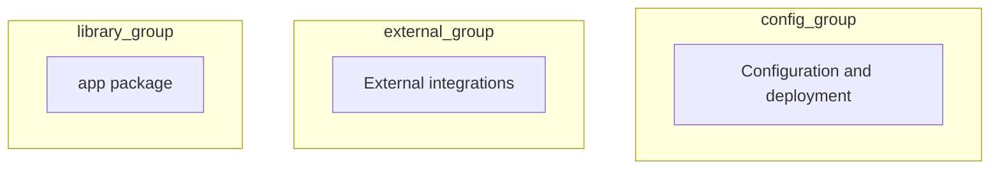

# Architecture report: electerm/electerm

> Automated static analysis. **Observed** = directly seen in files/imports/AST; **Inferred** = interpretation from that evidence. Repository code was not executed.

## 1. Repository at a glance

| Item | Value |
| --- | --- |
| Repository | electerm/electerm |
| Description | 📻Free and open-sourced terminal/ssh/sftp/ftp/telnet/serialport/RDP/VNC/Spice client(Linux, Mac, Windows, Android, HarmonyOS, iOS) |
| Language | JavaScript |
| Stars | 15631 |
| Licence | MIT |
| Analysed commit / branch | ee090c7cfa3d6bcbc8b9a3595839728323207347 / master |
| Framework(s) | Electron, Express, React |
| Files analysed | 732 |
| Components | 3 |

## 2. Architecture in one minute

electerm/electerm - 📻Free and open-sourced terminal/ssh/sftp/ftp/telnet/serialport/RDP/VNC/Spice client(Linux, Mac, Windows, Android, HarmonyOS, iOS). This repository was analysed statically from 732 file(s) (0 Python). Detected technologies (observed from imports/manifests): GitHub Actions, Electron, Express, React, axios, Docker. Files are grouped into 3 component(s): app package, Configuration and deployment, External integrations. Findings below distinguish observed facts from inferred interpretation.

## 3. High-level block diagram

## 4. Main components

### app package (`app`)

- **Kind:** library
- **Status:** Observed
- **Confidence:** 0.85
- **Responsibility:** Groups 173 file(s) under app package (observed from repository paths and static analysis).
- **Paths:** `src/app/app.js`, `src/app/common/app-props.js`, `src/app/common/bookmark-zod-schemas.js`, `src/app/common/build-run-scripts.js`, `src/app/common/build-ssh-tunnel.js`, `src/app/common/config-default.js`, `src/app/common/constants.js`, `src/app/common/create-session-log-file-path.js`, `src/app/common/dangerous-session-fields.js`, `src/app/common/default-setting.js`, `src/app/common/default-user-name.js`, `src/app/common/exit-status.js`, `src/app/common/get-folder-size-and-file-count.js`, `src/app/common/log.js`, `src/app/common/lookup.js`, `src/app/common/parse-quick-connect.js`, `src/app/common/pass-enc.js`, `src/app/common/powershell-integration.js`, `src/app/common/readdir-stat.js`, `src/app/common/runtime-constants.js`, `src/app/common/sanitize-filename.js`, `src/app/common/ssh-keygen.js`, `src/app/common/time.js`, `src/app/common/uid.js`, `src/app/common/version-compare.js`, `src/app/common/vv-file.js`, `src/app/lib/ai-format.js`, `src/app/lib/ai-response.js`, `src/app/lib/ai.js`, `src/app/lib/auth.js`, `src/app/lib/build-proxy.js`, `src/app/lib/check-host.js`, `src/app/lib/command-line.js`, `src/app/lib/crash-reporter.js`, `src/app/lib/create-app.js`, `src/app/lib/create-window.js`, `src/app/lib/custom-require.js`, `src/app/lib/db.js`, `src/app/lib/deep-link.js`, `src/app/lib/dialog-last-dir.js`, `src/app/lib/enc.js`, `src/app/lib/error-page.js`, `src/app/lib/file-server.js`, `src/app/lib/font-list.js`, `src/app/lib/free-port.js`, `src/app/lib/fs.js`, `src/app/lib/get-config.js`, `src/app/lib/get-port.js`, `src/app/lib/glob-state.js`, `src/app/lib/icon-download.js`, `src/app/lib/init-app.js`, `src/app/lib/init-data.js`, `src/app/lib/init-server.js`, `src/app/lib/install-command.js`, `src/app/lib/install-src.js`, `src/app/lib/ipc-sync.js`, `src/app/lib/ipc.js`, `src/app/lib/iterm-theme.js`, `src/app/lib/key-bind.js`, `src/app/lib/last-state.js`, `src/app/lib/locales.js`, `src/app/lib/lodash.js`, `src/app/lib/menu.js`, `src/app/lib/nedb.js`, `src/app/lib/npm.js`, `src/app/lib/on-close.js`, `src/app/lib/open-file-with-editor.js`, `src/app/lib/proxy-agent.js`, `src/app/lib/safe-storage.js`, `src/app/lib/serial-port.js`, `src/app/lib/shortcut.js`, `src/app/lib/single-instance.js`, `src/app/lib/sqlite.js`, `src/app/lib/ssh-config.js`, `src/app/lib/storage-key.js`, `src/app/lib/system-ca.js`, `src/app/lib/title-bar.js`, `src/app/lib/user-config-controller.js`, `src/app/lib/vv-file-open.js`, `src/app/lib/watch-file.js`, `src/app/lib/webview-handler.js`, `src/app/lib/window-control.js`, `src/app/lib/window-restore.js`, `src/app/lib/zod.js`, `src/app/mcp/server/mcp.js`, `src/app/mcp/server/streamableHttp.js`, `src/app/mcp/server/tasks.js`, `src/app/migrate/index.js`, `src/app/migrate/migrate-1-to-2.js`, `src/app/migrate/nedb-instance.js`, `src/app/migrate/v1.25.0.js`, `src/app/migrate/v1.27.17.js`, `src/app/migrate/v1.3.0.js`, `src/app/migrate/v1.3.9.js`, `src/app/migrate/v1.32.36.js`, `src/app/migrate/v1.34.20.js`, `src/app/migrate/v1.34.59.js`, `src/app/migrate/v1.5.13.js`, `src/app/migrate/v1.7.0.js`, `src/app/migrate/version-upgrade.js`, `src/app/preload/preload.js`, `src/app/server/app-wrap.js`, `src/app/server/child-process.js`, `src/app/server/dispatch-center.js`, `src/app/server/download-upgrade.js`, `src/app/server/fetch.js`, `src/app/server/fs.js`, `src/app/server/ftp-client.js`, `src/app/server/ftp-file.js`, `src/app/server/ftp-transfer.js`, `src/app/server/global-state.js`, `src/app/server/line-ending.js`, `src/app/server/rdp-proxy.js`, `src/app/server/remote-common.js`, `src/app/server/serial-view.js`, `src/app/server/server.js`, `src/app/server/session-api.js`, `src/app/server/session-base.js`, `src/app/server/session-common.js`, `src/app/server/session-ftp.js`, `src/app/server/session-hop.js`, `src/app/server/session-local.js`, `src/app/server/session-log.js`, `src/app/server/session-process.js`, `src/app/server/session-rdp.js`, `src/app/server/session-serial.js`, `src/app/server/session-server.js`, `src/app/server/session-sftp.js`, `src/app/server/session-spice.js`, `src/app/server/session-ssh.js`, `src/app/server/session-telnet.js`, `src/app/server/session-vnc.js`, `src/app/server/session.js`, `src/app/server/sftp-file.js`, `src/app/server/socks.js`, `src/app/server/spice-proxy.js`, `src/app/server/ssh-known-hosts.js`, `src/app/server/ssh-proxy-command.js`, `src/app/server/ssh-tunnel.js`, `src/app/server/ssh2-alg.js`, `src/app/server/structured-clone-shim.js`, `src/app/server/sync.js`, `src/app/server/telnet.js`, `src/app/server/terminal-api.js`, `src/app/server/transfer.js`, `src/app/server/trzsz.js`, `src/app/server/webdav-sync.js`, `src/app/server/ws-dec.js`, `src/app/server/x11.js`, `src/app/server/xmodem.js`, `src/app/server/zmodem.js`, `src/app/upgrade/db-defaults.js`, `src/app/upgrade/default-local-bookmarks.js`, `src/app/upgrade/default-quick-commands.js`, `src/app/upgrade/detect-shells.js`, `src/app/upgrade/index.js`, `src/app/upgrade/init-db.js`, `src/app/upgrade/version-upgrade.js`, `src/app/widgets/ai-config.js`, `src/app/widgets/bridge.js`, `src/app/widgets/instance-log.js`, `src/app/widgets/load-widget.js`, `src/app/widgets/paths.js`, `src/app/widgets/protocol.js`, `src/app/widgets/user-widget.js`, `src/app/widgets/widget-batch-op.js`, `src/app/widgets/widget-local-file-server.js`, `src/app/widgets/widget-local-ftp-server.js`, `src/app/widgets/widget-mcp-server.js`, `src/app/widgets/widget-registry.js`, `src/app/widgets/widget-rename.js`, `src/app/widgets/widget-source.js`, `src/app/widgets/widget-ssh-server.js`
- **Evidence:** [src/app/app.js](https://github.com/electerm/electerm/blob/ee090c7cfa3d6bcbc8b9a3595839728323207347/src/app/app.js); [src/app/common/app-props.js](https://github.com/electerm/electerm/blob/ee090c7cfa3d6bcbc8b9a3595839728323207347/src/app/common/app-props.js); [src/app/common/bookmark-zod-schemas.js](https://github.com/electerm/electerm/blob/ee090c7cfa3d6bcbc8b9a3595839728323207347/src/app/common/bookmark-zod-schemas.js); [src/app/common/build-run-scripts.js](https://github.com/electerm/electerm/blob/ee090c7cfa3d6bcbc8b9a3595839728323207347/src/app/common/build-run-scripts.js); [src/app/common/build-ssh-tunnel.js](https://github.com/electerm/electerm/blob/ee090c7cfa3d6bcbc8b9a3595839728323207347/src/app/common/build-ssh-tunnel.js); [src/app/common/config-default.js](https://github.com/electerm/electerm/blob/ee090c7cfa3d6bcbc8b9a3595839728323207347/src/app/common/config-default.js); [src/app/common/constants.js](https://github.com/electerm/electerm/blob/ee090c7cfa3d6bcbc8b9a3595839728323207347/src/app/common/constants.js); [src/app/common/create-session-log-file-path.js](https://github.com/electerm/electerm/blob/ee090c7cfa3d6bcbc8b9a3595839728323207347/src/app/common/create-session-log-file-path.js)

### Configuration and deployment (`config`)

- **Kind:** config
- **Status:** Observed
- **Confidence:** 0.85
- **Responsibility:** Groups 1 file(s) under configuration and deployment (observed from repository paths and static analysis).
- **Paths:** `package.json`
- **Evidence:** [package.json](https://github.com/electerm/electerm/blob/ee090c7cfa3d6bcbc8b9a3595839728323207347/package.json)

### External integrations (`external_integrations`)

- **Kind:** external
- **Status:** Observed
- **Confidence:** 0.85
- **Responsibility:** Groups 452 file(s) under external integrations (observed from repository paths and static analysis).
- **Paths:** `src/client/common/ai-feature.js`, `src/client/common/auto-complete-data-mapper.js`, `src/client/common/bookmark-export-filter.js`, `src/client/common/bookmark-group-tree.js`, `src/client/common/bookmark-schemas.js`, `src/client/common/bookmark-uncategorized.js`, `src/client/common/build-map.js`, `src/client/common/build-proxy.js`, `src/client/common/build-run-scripts.js`, `src/client/common/build-ssh-tunnel.js`, `src/client/common/cache.js`, `src/client/common/check-skip-src.js`, `src/client/common/choose-save-folder.js`, `src/client/common/class.js`, `src/client/common/click-rename.js`, `src/client/common/clipboard.js`, `src/client/common/constants.js`, `src/client/common/create-lang-edit-link.js`, `src/client/common/create-title.jsx`, `src/client/common/credential-provider-utils.js`, `src/client/common/credential-provider.jsx`, `src/client/common/custom-watcher.js`, `src/client/common/dangerous-session-fields.js`, `src/client/common/data-compare.js`, `src/client/common/db-fix.js`, `src/client/common/db.js`, `src/client/common/default-log-path.js`, `src/client/common/default-setting.js`, `src/client/common/distribute-tabs.js`, `src/client/common/download-mirrors.js`, `src/client/common/download.jsx`, `src/client/common/drop-position.js`, `src/client/common/error-handler.jsx`, `src/client/common/fetch-from-server.js`, `src/client/common/fetch.jsx`, `src/client/common/file-drop-utils.js`, `src/client/common/find-bookmark-group-id.js`, `src/client/common/find-parent.js`, `src/client/common/form-layout.js`, `src/client/common/fs.js`, `src/client/common/get-category-color.js`, `src/client/common/get-proxy.js`, `src/client/common/has-active-input.js`, `src/client/common/icon-assets.js`, `src/client/common/icon-helpers.jsx`, `src/client/common/icon-value.js`, `src/client/common/id-with-stamp.js`, `src/client/common/import-task.js`, `src/client/common/index-sorter.js`, `src/client/common/init-data.js`, `src/client/common/init-setting-item.js`, `src/client/common/is-absolute-path.js`, `src/client/common/is-color-dark.js`, `src/client/common/is-ip.js`, `src/client/common/is-valid-path.js`, `src/client/common/key-control-pressed.js`, `src/client/common/key-pressed.js`, `src/client/common/key-shift-pressed.js`, `src/client/common/keyword-presets.js`, `src/client/common/left-sidebar-icon-defs.js`, `src/client/common/mask-url.js`, `src/client/common/mcp-transfer-guard.js`, `src/client/common/mode2permission.js`, `src/client/common/new-terminal.js`, `src/client/common/normalize-remote-path.js`, `src/client/common/parse-bookmark-import.js`, `src/client/common/parse-int10.js`, `src/client/common/parse-json-safe.js`, `src/client/common/parse-quick-connect.js`, `src/client/common/parse-vv.js`, `src/client/common/parse-widget-log.js`, `src/client/common/pass-enc.js`, `src/client/common/platform.js`, `src/client/common/powershell-integration.js`, `src/client/common/pre.js`, `src/client/common/promise-timeout.js`, `src/client/common/quick-command-groups.js`, `src/client/common/quick-command-steps.js`, `src/client/common/quick-connect-string.js`, `src/client/common/rand-hex-color.js`, `src/client/common/resolve.js`, `src/client/common/reverse-color.js`, `src/client/common/right-click-behavior.js`, `src/client/common/run-idle.js`, `src/client/common/safe-join.js`, `src/client/common/safe-local-storage.js`, `src/client/common/sanitize-filename.js`, `src/client/common/serial-input.js`, `src/client/common/setting-list.js`, `src/client/common/sftp.js`, `src/client/common/sync-payload-limit.js`, `src/client/common/term-of-use.jsx`, `src/client/common/terminal-theme.js`, `src/client/common/test-connection.js`, `src/client/common/theme-defaults.js`, `src/client/common/time.js`, `src/client/common/to-simple-obj.js`, `src/client/common/transfer.js`, `src/client/common/ui-theme-color.mjs`, `src/client/common/ui-theme.js`, `src/client/common/uid.js`, `src/client/common/update-check.js`, `src/client/common/upgrade.js`, `src/client/common/version-compare.js`, `src/client/common/vv-to-tab.js`, `src/client/common/wait.js`, `src/client/common/web-url.js`, `src/client/common/widget-api-key.js`, `src/client/common/widget-form-memory-utils.js`, `src/client/common/widget-form-memory.js`, `src/client/common/widget-registry.js`, `src/client/common/ws.js`, `src/client/common/zod.js`, `src/client/components/ai/agent-tool-call-card.jsx`, `src/client/components/ai/agent-tools.js`, `src/client/components/ai/agent.js`, `src/client/components/ai/ai-attachments.js`, `src/client/components/ai/ai-auto-compress.js`, `src/client/components/ai/ai-cache.jsx`, `src/client/components/ai/ai-chat-empty.jsx`, `src/client/components/ai/ai-chat-entry.jsx`, `src/client/components/ai/ai-chat-history-item.jsx`, `src/client/components/ai/ai-chat-history.jsx`, `src/client/components/ai/ai-chat-session.jsx`, `src/client/components/ai/ai-chat-sessions.jsx`, `src/client/components/ai/ai-chat.jsx`, `src/client/components/ai/ai-compress.js`, `src/client/components/ai/ai-config-modal.jsx`, `src/client/components/ai/ai-config-props.js`, `src/client/components/ai/ai-config.jsx`, `src/client/components/ai/ai-context-indicator.jsx`, `src/client/components/ai/ai-context.js`, `src/client/components/ai/ai-guardrails.js`, `src/client/components/ai/ai-history-item.jsx`, `src/client/components/ai/ai-history.jsx`, `src/client/components/ai/ai-output.jsx`, `src/client/components/ai/ai-presets.js`, `src/client/components/ai/ai-stop-icon.jsx`, `src/client/components/ai/copy-icon.jsx`, `src/client/components/ai/get-brand.js`, `src/client/components/auth/login.jsx`, `src/client/components/batch-op/batch-op-alert.jsx`, `src/client/components/batch-op/batch-op-editor.jsx`, `src/client/components/batch-op/batch-op-logs.jsx`, `src/client/components/batch-op/batch-op-runner.jsx`, `src/client/components/bg/css-overwrite.jsx`, `src/client/components/bg/custom-css.jsx`, `src/client/components/bg/shapes.js`, `src/client/components/bookmark-export/export-bookmarks-modal.jsx`, `src/client/components/bookmark-form/ai-bookmark-form.jsx`, `src/client/components/bookmark-form/bookmark-from-history-modal.jsx`, `src/client/components/bookmark-form/bookmark-schema.js`, `src/client/components/bookmark-form/common/ai-category-select.jsx`, `src/client/components/bookmark-form/common/bookmark-group-tree-format.js`, `src/client/components/bookmark-form/common/bookmark-select.jsx`, `src/client/components/bookmark-form/common/category-select.jsx`, `src/client/components/bookmark-form/common/color-picker-item.jsx`, `src/client/components/bookmark-form/common/color-picker.jsx`, `src/client/components/bookmark-form/common/connection-hopping-form.jsx`, `src/client/components/bookmark-form/common/connection-hopping.jsx`, `src/client/components/bookmark-form/common/encodes.js`, `src/client/components/bookmark-form/common/exec-settings-field.jsx`, `src/client/components/bookmark-form/common/fields.jsx`, `src/client/components/bookmark-form/common/generate-ssh-key-modal.jsx`, `src/client/components/bookmark-form/common/hex-input.jsx`, `src/client/components/bookmark-form/common/host-check.jsx`, `src/client/components/bookmark-form/common/init-values.js`, `src/client/components/bookmark-form/common/profile-item.jsx`, `src/client/components/bookmark-form/common/proxy.jsx`, `src/client/components/bookmark-form/common/quick-commands.jsx`, `src/client/components/bookmark-form/common/render-auth-ssh.jsx`, `src/client/components/bookmark-form/common/run-scripts.jsx`, `src/client/components/bookmark-form/common/serial-path-selector.jsx`, `src/client/components/bookmark-form/common/ssh-agent.jsx`, `src/client/components/bookmark-form/common/ssh-auth-selector.jsx`, `src/client/components/bookmark-form/common/ssh-auth-type-selector.jsx`, `src/client/components/bookmark-form/common/ssh-host-selector.jsx`, `src/client/components/bookmark-form/common/ssh-tunnel-form.jsx`, `src/client/components/bookmark-form/common/ssh-tunnels.jsx`, `src/client/components/bookmark-form/common/submit-buttons.jsx`, `src/client/components/bookmark-form/common/terminal-background.jsx`, `src/client/components/bookmark-form/common/vv-file-field.jsx`, `src/client/components/bookmark-form/common/watchers.jsx`, `src/client/components/bookmark-form/common/x11.jsx`, `src/client/components/bookmark-form/config/common-fields.js`, `src/client/components/bookmark-form/config/ftp.js`, `src/client/components/bookmark-form/config/local.js`, `src/client/components/bookmark-form/config/rdp.js`, `src/client/components/bookmark-form/config/serial.js`, `src/client/components/bookmark-form/config/session-config.js`, `src/client/components/bookmark-form/config/spice.js`, `src/client/components/bookmark-form/config/ssh.js`, `src/client/components/bookmark-form/config/telnet.js`, `src/client/components/bookmark-form/config/vnc.js`, `src/client/components/bookmark-form/config/web.js`, `src/client/components/bookmark-form/copy-bookmark.jsx`, `src/client/components/bookmark-form/fix-bookmark-default.js`, `src/client/components/bookmark-form/form-renderer.jsx`, `src/client/components/bookmark-form/index.jsx`, `src/client/components/bookmark-form/render-form.jsx`, `src/client/components/bookmark-form/tree-select.jsx`, `src/client/components/common/animate-text.jsx`, `src/client/components/common/appearance-picker.jsx`, `src/client/components/common/component.jsx`, `src/client/components/common/connection-hopping-warning-text.jsx`, `src/client/components/common/drag-handle.jsx`, `src/client/components/common/drawer.jsx`, `src/client/components/common/external-link.jsx`, `src/client/components/common/font-select.jsx`, `src/client/components/common/help-icon.jsx`, `src/client/components/common/highlight.jsx`, `src/client/components/common/icon-picker.jsx`, `src/client/components/common/import-progress.jsx`, `src/client/components/common/input-auto-focus.jsx`, `src/client/components/common/input-confirm-common.jsx`, `src/client/components/common/input-confirm.jsx`, `src/client/components/common/input-context-menu.jsx`, `src/client/components/common/input-number-confirm.jsx`, `src/client/components/common/item-filter.jsx`, `src/client/components/common/item-icon.jsx`, `src/client/components/common/lazy-boundary.jsx`, `src/client/components/common/logo-elem.jsx`, `src/client/components/common/markdown.jsx`, `src/client/components/common/mcp-transfer-approval.jsx`, `src/client/components/common/message.jsx`, `src/client/components/common/modal.jsx`, `src/client/components/common/multi-select-modal.jsx`, `src/client/components/common/notification.jsx`, `src/client/components/common/opacity.jsx`, `src/client/components/common/password.jsx`, `src/client/components/common/placeholder.jsx`, `src/client/components/common/ref.js`, `src/client/components/common/remote-float-control.jsx`, `src/client/components/common/remote-pointer.js`, `src/client/components/common/remote-session-shell.jsx`, `src/client/components/common/responsive-tabs.jsx`, `src/client/components/common/search.jsx`, `src/client/components/common/show-item.jsx`, `src/client/components/common/switch.jsx`, `src/client/components/common/textarea-confirm.jsx`, `src/client/components/common/upload.jsx`, `src/client/components/common/zoom-control.jsx`, `src/client/components/file-transfer/conflict-resolve.jsx`, `src/client/components/file-transfer/remote2remote-handler.jsx`, `src/client/components/file-transfer/remote2remote-handlers.jsx`, `src/client/components/file-transfer/transfer-queue.jsx`, `src/client/components/file-transfer/transfer-speed-format.js`, `src/client/components/file-transfer/transfer.jsx`, `src/client/components/file-transfer/transports-action-store.jsx`, `src/client/components/file-transfer/transports-ui-store.jsx`, `src/client/components/footer/batch-input.jsx`, `src/client/components/footer/batch-item.jsx`, `src/client/components/footer/cmd-history.jsx`, `src/client/components/footer/footer-entry.jsx`, `src/client/components/footer/multi-tab-run-modal.jsx`, `src/client/components/footer/tab-select.jsx`, `src/client/components/icons/ai-icon.jsx`, `src/client/components/icons/heartbeat.jsx`, `src/client/components/icons/match-case.jsx`, `src/client/components/icons/match-whole-word.jsx`, `src/client/components/icons/regular-exp.jsx`, `src/client/components/icons/split-icons.jsx`, `src/client/components/icons/split-view.jsx`, `src/client/components/layout/layout-alg.js`, `src/client/components/layout/layout-item.jsx`, `src/client/components/layout/layout.jsx`, `src/client/components/layout/layouts.jsx`, `src/client/components/layout/pixed.js`, `src/client/components/layout/session-size-alg.js`, `src/client/components/main/connection-hopping-warnning.jsx`, `src/client/components/main/error-wrapper.jsx`, `src/client/components/main/index.jsx`, `src/client/components/main/main.jsx`, `src/client/components/main/title-bar-overlay.js`, `src/client/components/main/ui-theme.jsx`, `src/client/components/main/upgrade.jsx`, `src/client/components/profile/profile-form-elem.jsx`, `src/client/components/profile/profile-form-ftp.jsx`, `src/client/components/profile/profile-form-rdp.jsx`, `src/client/components/profile/profile-form-ssh.jsx`, `src/client/components/profile/profile-form-telnet.jsx`, `src/client/components/profile/profile-form-vnc.jsx`, `src/client/components/profile/profile-form.jsx`, `src/client/components/profile/profile-list.jsx`, `src/client/components/profile/profile-tabs.jsx`, `src/client/components/profile/profile-transport-mod.jsx`, `src/client/components/profile/profile-transport.jsx`, `src/client/components/quick-commands/on-drop.js`, `src/client/components/quick-commands/qm-label-group.jsx`, `src/client/components/quick-commands/qm-prompt.jsx`, `src/client/components/quick-commands/qm-record-status.jsx`, `src/client/components/quick-commands/qm-run-in-tabs.jsx`, `src/client/components/quick-commands/qm-run-status.jsx`, `src/client/components/quick-commands/quick-command-ai-editor.jsx`, `src/client/components/quick-commands/quick-command-create-modal.jsx`, `src/client/components/quick-commands/quick-command-item.jsx`, `src/client/components/quick-commands/quick-command-transport-mod.jsx`, `src/client/components/quick-commands/quick-command-transport.jsx`, `src/client/components/quick-commands/quick-commands-box.jsx`, `src/client/components/quick-commands/quick-commands-form-elem.jsx`, `src/client/components/quick-commands/quick-commands-form.jsx`, `src/client/components/quick-commands/quick-commands-list-form.jsx`, `src/client/components/quick-commands/quick-commands-list.jsx`, `src/client/components/quick-commands/quick-commands-select.jsx`, `src/client/components/quick-commands/templates.js`, `src/client/components/rdp/code-scan.js`, `src/client/components/rdp/file-transfer.js`, `src/client/components/rdp/rdp-cred-form.jsx`, `src/client/components/rdp/rdp-errors.js`, `src/client/components/rdp/rdp-logon.js`, `src/client/components/rdp/rdp-session.jsx`, `src/client/components/rdp/resolution-edit.jsx`, `src/client/components/rdp/resolution-form.jsx`, `src/client/components/rdp/resolutions.js`, `src/client/components/remote-monitor/custom-watcher-pool.js`, `src/client/components/remote-monitor/monitor-details.jsx`, `src/client/components/remote-monitor/monitor-model.js`, `src/client/components/remote-monitor/remote-monitor-bar-entry.jsx`, `src/client/components/remote-monitor/remote-monitor-bar.jsx`, `src/client/components/remote-monitor/session-monitor.js`, `src/client/components/remote-monitor/table-filter.jsx`, `src/client/components/remote-monitor/use-monitor-details.js`, `src/client/components/remote-monitor/visibility.js`, `src/client/components/remote-monitor/watcher-toggle.js`, `src/client/components/session/serial-control.jsx`, `src/client/components/session/session-control.jsx`, `src/client/components/session/session.jsx`, `src/client/components/session/sessions.jsx`, `src/client/components/setting-panel/bookmark-tree-list.jsx`, `src/client/components/setting-panel/col.jsx`, `src/client/components/setting-panel/deep-link-control.jsx`, `src/client/components/setting-panel/hotkey.jsx`, `src/client/components/setting-panel/install-command.jsx`, `src/client/components/setting-panel/keywords-form.jsx`, `src/client/components/setting-panel/keywords-transport.jsx`, `src/client/components/setting-panel/list.jsx`, `src/client/components/setting-panel/number-config.jsx`, `src/client/components/setting-panel/on-tree-drop.js`, `src/client/components/setting-panel/setting-common.jsx`, `src/client/components/setting-panel/setting-left-sidebar-icons.jsx`, `src/client/components/setting-panel/setting-mobile-breadcrumb.jsx`, `src/client/components/setting-panel/setting-modal.jsx`, `src/client/components/setting-panel/setting-passwords.jsx`, `src/client/components/setting-panel/setting-terminal.jsx`, `src/client/components/setting-panel/setting-wrap.jsx`, `src/client/components/setting-panel/start-session-select.jsx`, `src/client/components/setting-panel/tab-bookmarks.jsx`, `src/client/components/setting-panel/tab-profiles.jsx`, `src/client/components/setting-panel/tab-quick-commands.jsx`, `src/client/components/setting-panel/tab-settings.jsx`, `src/client/components/setting-panel/tab-themes.jsx`, `src/client/components/setting-panel/tab-triggers.jsx`, `src/client/components/setting-panel/tab-widgets.jsx`, `src/client/components/setting-panel/terminal-bg-config.jsx`, `src/client/components/setting-panel/text-bg-modal.jsx`, `src/client/components/setting-sync/auto-sync.jsx`, `src/client/components/setting-sync/data-import.jsx`, `src/client/components/setting-sync/data-select-item.jsx`, `src/client/components/setting-sync/data-select.jsx`, `src/client/components/setting-sync/server-data-status.jsx`, `src/client/components/setting-sync/setting-sync-form.jsx`, `src/client/components/setting-sync/setting-sync.jsx`, `src/client/components/setting-sync/sync-data-compare.jsx`, `src/client/components/sftp/address-bar.jsx`, `src/client/components/sftp/address-bookmark-item.jsx`, `src/client/components/sftp/address-bookmark.jsx`, `src/client/components/sftp/code-compare-utils.js`, `src/client/components/sftp/code-compare.jsx`, `src/client/components/sftp/file-compare-modal.jsx`, `src/client/components/sftp/file-icon.jsx`, `src/client/components/sftp/file-info-modal.jsx`, `src/client/components/sftp/file-item.jsx`, `src/client/components/sftp/file-read.js`, `src/client/components/sftp/file-table-header.jsx`, `src/client/components/sftp/keyword-bar.jsx`, `src/client/components/sftp/list-table-ui.jsx`, `src/client/components/sftp/owner-list.js`, `src/client/components/sftp/paged-list.jsx`, `src/client/components/sftp/permission-render.jsx`, `src/client/components/sftp/sftp-entry.jsx`, `src/client/components/sftp/transfer-common.js`, `src/client/components/sftp/transfer-tag.jsx`, `src/client/components/shortcuts/get-key-char.js`, `src/client/components/shortcuts/shortcut-control.jsx`, `src/client/components/shortcuts/shortcut-editor.jsx`, `src/client/components/shortcuts/shortcut-handler.js`, `src/client/components/shortcuts/shortcut-utils.js`, `src/client/components/shortcuts/shortcuts-defaults.js`, `src/client/components/shortcuts/shortcuts.jsx`, `src/client/components/shortcuts/terminal-key-combo.js`, `src/client/components/side-panel-r/side-panel-r.jsx`, `src/client/components/sidebar/app-running-time.jsx`, `src/client/components/sidebar/bookmark-select.jsx`, `src/client/components/sidebar/bookmark.jsx`, `src/client/components/sidebar/history-item.jsx`, `src/client/components/sidebar/history.jsx`, `src/client/components/sidebar/index.jsx`, `src/client/components/sidebar/info-modal.jsx`, `src/client/components/sidebar/left-sidebar-icons.jsx`, `src/client/components/sidebar/side-icon.jsx`, `src/client/components/sidebar/side-panel.jsx`, `src/client/components/sidebar/sidebar-panel.jsx`, `src/client/components/sidebar/transfer-history-modal.jsx`, `src/client/components/sidebar/transfer-list-control.jsx`, `src/client/components/sidebar/transfer-list.jsx`, `src/client/components/sidebar/transfer-modal.jsx`, `src/client/components/sidebar/transport-ui.jsx`, `src/client/components/spice/spice-session.jsx`, `src/client/components/ssh-config/load-ssh-configs-item.jsx`, `src/client/components/ssh-config/load-ssh-configs.jsx`, `src/client/components/ssh-config/ssh-config-load-notify.jsx`, `src/client/components/sys-menu/boomarks.jsx`, `src/client/components/sys-menu/history.jsx`, `src/client/components/sys-menu/icon-holder.jsx`, `src/client/components/sys-menu/icons-map.jsx`, `src/client/components/sys-menu/layoout-changer.jsx`, `src/client/components/sys-menu/menu-btn.jsx`, `src/client/components/sys-menu/sub-tab-menu.jsx`, `src/client/components/sys-menu/sys-menu.jsx`, `src/client/components/sys-menu/tabs.jsx`, `src/client/components/sys-menu/zoom.jsx`, `src/client/components/tabs/add-btn-menu.jsx`, `src/client/components/tabs/add-btn.jsx`, `src/client/components/tabs/app-drag.jsx`, `src/client/components/tabs/index.jsx`, `src/client/components/tabs/layout-menu.jsx`, `src/client/components/tabs/layout-select.jsx`, `src/client/components/tabs/no-session.jsx`, `src/client/components/tabs/on-tab-drop.js`, `src/client/components/tabs/quick-connect.jsx`, `src/client/components/tabs/tab-title.jsx`, `src/client/components/tabs/tab.jsx`, `src/client/components/tabs/window-control.jsx`, `src/client/components/tabs/workspace-save-modal.jsx`, `src/client/components/tabs/workspace-select.jsx`, `src/client/components/terminal-info/base.jsx`, `src/client/components/terminal-info/local-info-resolver.js`, `src/client/components/terminal-info/log-path-edit.jsx`, `src/client/components/terminal-info/terminal-info-entry.jsx`, `src/client/components/terminal-info/terminal-info.jsx`, `src/client/components/terminal/attach-addon-custom.js`, `src/client/components/terminal/automation/ask-group.js`, `src/client/components/terminal/automation/index.js`, `src/client/components/terminal/automation/key-sequences.js`, `src/client/components/terminal/automation/keys.js`, `src/client/components/terminal/automation/output-watch.js`, `src/client/components/terminal/automation/record-steps.js`, `src/client/components/terminal/automation/step-runner.js`, `src/client/components/terminal/automation/strip-ansi.js`, `src/client/components/terminal/automation/trigger-engine.js`, `src/client/components/terminal/automation/trigger-presets.js`, `src/client/components/terminal/build-ls-term-id.js`
- **Evidence:** [src/client/common/ai-feature.js](https://github.com/electerm/electerm/blob/ee090c7cfa3d6bcbc8b9a3595839728323207347/src/client/common/ai-feature.js); [src/client/common/auto-complete-data-mapper.js](https://github.com/electerm/electerm/blob/ee090c7cfa3d6bcbc8b9a3595839728323207347/src/client/common/auto-complete-data-mapper.js); [src/client/common/bookmark-export-filter.js](https://github.com/electerm/electerm/blob/ee090c7cfa3d6bcbc8b9a3595839728323207347/src/client/common/bookmark-export-filter.js); [src/client/common/bookmark-group-tree.js](https://github.com/electerm/electerm/blob/ee090c7cfa3d6bcbc8b9a3595839728323207347/src/client/common/bookmark-group-tree.js); [src/client/common/bookmark-schemas.js](https://github.com/electerm/electerm/blob/ee090c7cfa3d6bcbc8b9a3595839728323207347/src/client/common/bookmark-schemas.js); [src/client/common/bookmark-uncategorized.js](https://github.com/electerm/electerm/blob/ee090c7cfa3d6bcbc8b9a3595839728323207347/src/client/common/bookmark-uncategorized.js); [src/client/common/build-map.js](https://github.com/electerm/electerm/blob/ee090c7cfa3d6bcbc8b9a3595839728323207347/src/client/common/build-map.js); [src/client/common/build-proxy.js](https://github.com/electerm/electerm/blob/ee090c7cfa3d6bcbc8b9a3595839728323207347/src/client/common/build-proxy.js)

## 5. Execution flow

**Observed** entry point(s):

- [src/app/app.js](https://github.com/electerm/electerm/blob/ee090c7cfa3d6bcbc8b9a3595839728323207347/src/app/app.js)
- [src/app/migrate/index.js](https://github.com/electerm/electerm/blob/ee090c7cfa3d6bcbc8b9a3595839728323207347/src/app/migrate/index.js)
- [src/app/server/server.js](https://github.com/electerm/electerm/blob/ee090c7cfa3d6bcbc8b9a3595839728323207347/src/app/server/server.js)
- [src/app/upgrade/index.js](https://github.com/electerm/electerm/blob/ee090c7cfa3d6bcbc8b9a3595839728323207347/src/app/upgrade/index.js)

Representative flow (derived from observed entry points and the import graph; steps beyond the entry point are **Inferred**):

1. Execution starts at an observed entry point listed above, if present.
2. No internal import relationships between components were observed.

## 6. Project structure

### `(root)`

- `.gitignore` - other (2055 bytes)
- `LICENSE` - docs (1104 bytes)
- `README.md` - docs (12387 bytes)
- `package.json` - manifest (6167 bytes)

### `.github`

- `.github/CONTRIBUTING.md` - docs (3117 bytes)
- `.github/FUNDING.yml` - config (120 bytes)
- `.github/ISSUE_TEMPLATE.md` - docs (114 bytes)
- `.github/ISSUE_TEMPLATE/1-bug-report.yml` - config (2722 bytes)
- `.github/ISSUE_TEMPLATE/2-proposal.yml` - config (450 bytes)
- `.github/ISSUE_TEMPLATE/config.yml` - config (202 bytes)
- `.github/SECURITY.md` - docs (765 bytes)
- `.github/code-of-conduct.md` - docs (457 bytes)
- `.github/dependabot.yml` - config (117 bytes)
- `.github/workflows/build-homepage-trigger.yml` - ci, YAML (596 bytes)
- `.github/workflows/electerm-react-publish.yml` - ci, YAML (975 bytes)
- `.github/workflows/linux-arm-legacy.yml` - ci, YAML (3679 bytes)
- `.github/workflows/linux-arm.yml` - ci, YAML (3312 bytes)
- `.github/workflows/linux-deb-tar.yml` - ci, YAML (1822 bytes)
- `.github/workflows/linux-legacy.yml` - ci, YAML (4005 bytes)
- `.github/workflows/linux-loong64-legacy.yml` - ci, YAML (6539 bytes)
- `.github/workflows/linux-loong64.yml` - ci, YAML (3700 bytes)
- `.github/workflows/linux-riscv64.yml` - ci, YAML (3286 bytes)
- `.github/workflows/linux-rpm-snap.yml` - ci, YAML (2018 bytes)
- `.github/workflows/mac-10.yml` - ci, YAML (2696 bytes)
- `.github/workflows/mac-arm.yml` - ci, YAML (1982 bytes)
- `.github/workflows/mac-test-1.yml` - ci, YAML (2465 bytes)
- `.github/workflows/mac-test-2.yml` - ci, YAML (2466 bytes)
- `.github/workflows/mac-test-3.yml` - ci, YAML (2690 bytes)
- `.github/workflows/mac-test-4.yml` - ci, YAML (2481 bytes)
- `.github/workflows/mac.yml` - ci, YAML (1889 bytes)
- `.github/workflows/ms-store-upload.yml` - ci, YAML (26832 bytes)
- `.github/workflows/ppc64le.yml` - ci, YAML (5957 bytes)
- `.github/workflows/snap-store-upload.yml` - ci, YAML (1688 bytes)
- `.github/workflows/sync-atomgit-release.yml` - ci, YAML (20883 bytes)
- `.github/workflows/sync-gitee.yml` - ci, YAML (2676 bytes)
- `.github/workflows/trigger-npm-publish.yml` - ci, YAML (1768 bytes)
- `.github/workflows/upload-release-assets-r2.yml` - ci, YAML (2024 bytes)
- `.github/workflows/win-appx.yml` - ci, YAML (1888 bytes)
- `.github/workflows/win-arm.yml` - ci, YAML (2434 bytes)
- `.github/workflows/win-loose.yml` - ci, YAML (2123 bytes)
- `.github/workflows/win-nsis-arm.yml` - ci, YAML (2454 bytes)
- `.github/workflows/win-nsis.yml` - ci, YAML (2121 bytes)
- `.github/workflows/win-portable.yml` - ci, YAML (2134 bytes)
- `.github/workflows/win-tar.yml` - ci, YAML (2122 bytes)
- `.github/workflows/win7-tar.yml` - ci, YAML (2801 bytes)
- `.github/workflows/winget.yml` - ci, YAML (2844 bytes)

### `src`

- `src/app/app.js` - source, JavaScript (843 bytes)
- `src/app/common/app-props.js` - source, JavaScript (828 bytes)
- `src/app/common/bookmark-zod-schemas.js` - source, JavaScript (9593 bytes)
- `src/app/common/build-run-scripts.js` - source, JavaScript (131 bytes)
- `src/app/common/build-ssh-tunnel.js` - source, JavaScript (244 bytes)
- `src/app/common/config-default.js` - source, JavaScript (902 bytes)
- `src/app/common/constants.js` - source, JavaScript (1454 bytes)
- `src/app/common/create-session-log-file-path.js` - source, JavaScript (112 bytes)
- `src/app/common/dangerous-session-fields.js` - source, JavaScript (1598 bytes)
- `src/app/common/default-setting.js` - source, JavaScript (2625 bytes)
- `src/app/common/default-user-name.js` - source, JavaScript (58 bytes)
- `src/app/common/exit-status.js` - source, JavaScript (1323 bytes)
- `src/app/common/get-folder-size-and-file-count.js` - source, JavaScript (870 bytes)
- `src/app/common/log.js` - source, JavaScript (2531 bytes)
- `src/app/common/lookup.js` - source, JavaScript (658 bytes)
- `src/app/common/parse-quick-connect.js` - source, JavaScript (15621 bytes)
- `src/app/common/pass-enc.js` - source, JavaScript (405 bytes)
- `src/app/common/powershell-integration.js` - source, JavaScript (5220 bytes)
- `src/app/common/readdir-stat.js` - source, JavaScript (2445 bytes)
- `src/app/common/runtime-constants.js` - source, JavaScript (1293 bytes)
- `src/app/common/sanitize-filename.js` - source, JavaScript (2875 bytes)
- `src/app/common/ssh-keygen.js` - source, JavaScript (4959 bytes)
- `src/app/common/time.js` - source, JavaScript (645 bytes)
- `src/app/common/uid.js` - source, JavaScript (83 bytes)
- `src/app/common/version-compare.js` - source, JavaScript (721 bytes)
- `src/app/common/vv-file.js` - source, JavaScript (2214 bytes)
- `src/app/lib/ai-format.js` - source, JavaScript (24233 bytes)
- `src/app/lib/ai-response.js` - source, JavaScript (5800 bytes)
- `src/app/lib/ai.js` - source, JavaScript (10760 bytes)
- `src/app/lib/auth.js` - source, JavaScript (1670 bytes)
- `src/app/lib/build-proxy.js` - source, JavaScript (495 bytes)
- `src/app/lib/check-host.js` - source, JavaScript (2331 bytes)
- `src/app/lib/command-line.js` - source, JavaScript (3261 bytes)
- `src/app/lib/crash-reporter.js` - source, JavaScript (12297 bytes)
- `src/app/lib/create-app.js` - source, JavaScript (3700 bytes)
- `src/app/lib/create-window.js` - source, JavaScript (7283 bytes)
- `src/app/lib/custom-require.js` - source, JavaScript (998 bytes)
- `src/app/lib/db.js` - source, JavaScript (535 bytes)
- `src/app/lib/deep-link.js` - source, JavaScript (5294 bytes)
- `src/app/lib/dialog-last-dir.js` - source, JavaScript (3164 bytes)
- `src/app/lib/enc.js` - source, JavaScript (4270 bytes)
- `src/app/lib/error-page.js` - source, JavaScript (2671 bytes)
- `src/app/lib/file-server.js` - source, JavaScript (627 bytes)
- `src/app/lib/font-list.js` - source, JavaScript (332 bytes)
- `src/app/lib/free-port.js` - source, JavaScript (4368 bytes)
- `src/app/lib/fs.js` - source, JavaScript (11064 bytes)
- `src/app/lib/get-config.js` - source, JavaScript (1913 bytes)
- `src/app/lib/get-port.js` - source, JavaScript (590 bytes)
- `src/app/lib/glob-state.js` - source, JavaScript (791 bytes)
- `src/app/lib/icon-download.js` - source, JavaScript (5684 bytes)
- `src/app/lib/init-app.js` - source, JavaScript (1321 bytes)
- `src/app/lib/init-data.js` - source, JavaScript (2275 bytes)
- `src/app/lib/init-server.js` - source, JavaScript (1175 bytes)
- `src/app/lib/install-command.js` - source, JavaScript (18565 bytes)
- `src/app/lib/install-src.js` - source, JavaScript (276 bytes)
- `src/app/lib/ipc-sync.js` - source, JavaScript (3648 bytes)
- `src/app/lib/ipc.js` - source, JavaScript (13183 bytes)
- `src/app/lib/iterm-theme.js` - source, JavaScript (284 bytes)
- `src/app/lib/key-bind.js` - source, JavaScript (415 bytes)
- `src/app/lib/last-state.js` - source, JavaScript (763 bytes)
- `src/app/lib/locales.js` - source, JavaScript (1465 bytes)
- `src/app/lib/lodash.js` - source, JavaScript (2597 bytes)
- `src/app/lib/menu.js` - source, JavaScript (5611 bytes)
- `src/app/lib/nedb.js` - source, JavaScript (7381 bytes)
- `src/app/lib/npm.js` - source, JavaScript (1790 bytes)
- `src/app/lib/on-close.js` - source, JavaScript (1488 bytes)
- `src/app/lib/open-file-with-editor.js` - source, JavaScript (3319 bytes)
- `src/app/lib/proxy-agent.js` - source, JavaScript (380 bytes)
- `src/app/lib/safe-storage.js` - source, JavaScript (1780 bytes)
- `src/app/lib/serial-port.js` - source, JavaScript (516 bytes)
- `src/app/lib/shortcut.js` - source, JavaScript (1007 bytes)
- `src/app/lib/single-instance.js` - source, JavaScript (3051 bytes)
- `src/app/lib/sqlite.js` - source, JavaScript (5892 bytes)
- `src/app/lib/ssh-config.js` - source, JavaScript (289 bytes)
- `src/app/lib/storage-key.js` - source, JavaScript (1405 bytes)
- `src/app/lib/system-ca.js` - source, JavaScript (4327 bytes)
- `src/app/lib/title-bar.js` - source, JavaScript (2346 bytes)
- `src/app/lib/user-config-controller.js` - source, JavaScript (1610 bytes)
- `src/app/lib/vv-file-open.js` - source, JavaScript (2808 bytes)
- `src/app/lib/watch-file.js` - source, JavaScript (1250 bytes)
- `src/app/lib/webview-handler.js` - source, JavaScript (10624 bytes)
- `src/app/lib/window-control.js` - source, JavaScript (2710 bytes)
- `src/app/lib/window-restore.js` - source, JavaScript (11114 bytes)
- `src/app/lib/zod.js` - source, JavaScript (4717 bytes)
- `src/app/mcp/server/mcp.js` - source, JavaScript (946 bytes)
- `src/app/mcp/server/streamableHttp.js` - source, JavaScript (11010 bytes)
- `src/app/mcp/server/tasks.js` - source, JavaScript (6407 bytes)
- `src/app/migrate/index.js` - source, JavaScript (2863 bytes)
- `src/app/migrate/migrate-1-to-2.js` - source, JavaScript (3731 bytes)
- `src/app/migrate/nedb-instance.js` - source, JavaScript (448 bytes)
- `src/app/migrate/v1.25.0.js` - source, JavaScript (1071 bytes)
- `src/app/migrate/v1.27.17.js` - source, JavaScript (1516 bytes)
- `src/app/migrate/v1.3.0.js` - source, JavaScript (2712 bytes)
- `src/app/migrate/v1.3.9.js` - source, JavaScript (1009 bytes)
- `src/app/migrate/v1.32.36.js` - source, JavaScript (1137 bytes)
- `src/app/migrate/v1.34.20.js` - source, JavaScript (1111 bytes)
- `src/app/migrate/v1.34.59.js` - source, JavaScript (928 bytes)
- `src/app/migrate/v1.5.13.js` - source, JavaScript (1304 bytes)
- `src/app/migrate/v1.7.0.js` - source, JavaScript (1733 bytes)
- `src/app/migrate/version-upgrade.js` - source, JavaScript (862 bytes)
- `src/app/preload/preload.js` - source, JavaScript (1494 bytes)
- `src/app/server/app-wrap.js` - source, JavaScript (707 bytes)
- `src/app/server/child-process.js` - source, JavaScript (2264 bytes)
- `src/app/server/dispatch-center.js` - source, JavaScript (3257 bytes)
- `src/app/server/download-upgrade.js` - source, JavaScript (5407 bytes)
- `src/app/server/fetch.js` - source, JavaScript (756 bytes)
- `src/app/server/fs.js` - source, JavaScript (754 bytes)
- `src/app/server/ftp-client.js` - source, JavaScript (4634 bytes)
- `src/app/server/ftp-file.js` - source, JavaScript (688 bytes)
- `src/app/server/ftp-transfer.js` - source, JavaScript (2724 bytes)
- `src/app/server/global-state.js` - source, JavaScript (830 bytes)
- `src/app/server/line-ending.js` - source, JavaScript (3790 bytes)
- `src/app/server/rdp-proxy.js` - source, JavaScript (34912 bytes)
- `src/app/server/remote-common.js` - source, JavaScript (1216 bytes)
- `src/app/server/serial-view.js` - source, JavaScript (9052 bytes)
- `src/app/server/server.js` - source, JavaScript (1876 bytes)
- `src/app/server/session-api.js` - source, JavaScript (2098 bytes)
- `src/app/server/session-base.js` - source, JavaScript (6400 bytes)
- `src/app/server/session-common.js` - source, JavaScript (4643 bytes)
- `src/app/server/session-ftp.js` - source, JavaScript (8757 bytes)
- `src/app/server/session-hop.js` - source, JavaScript (2924 bytes)
- `src/app/server/session-local.js` - source, JavaScript (5652 bytes)
- `src/app/server/session-log.js` - source, JavaScript (2341 bytes)
- `src/app/server/session-process.js` - source, JavaScript (10927 bytes)
- `src/app/server/session-rdp.js` - source, JavaScript (4007 bytes)
- `src/app/server/session-serial.js` - source, JavaScript (7628 bytes)
- `src/app/server/session-server.js` - source, JavaScript (23664 bytes)
- `src/app/server/session-sftp.js` - source, JavaScript (17250 bytes)
- `src/app/server/session-spice.js` - source, JavaScript (2597 bytes)
- `src/app/server/session-ssh.js` - source, JavaScript (47783 bytes)
- `src/app/server/session-telnet.js` - source, JavaScript (5690 bytes)
- `src/app/server/session-vnc.js` - source, JavaScript (3709 bytes)
- `src/app/server/session.js` - source, JavaScript (784 bytes)
- `src/app/server/sftp-file.js` - source, JavaScript (1934 bytes)
- `src/app/server/socks.js` - source, JavaScript (2849 bytes)
- `src/app/server/spice-proxy.js` - source, JavaScript (13119 bytes)
- `src/app/server/ssh-known-hosts.js` - source, JavaScript (11081 bytes)
- `src/app/server/ssh-proxy-command.js` - source, JavaScript (7457 bytes)
- `src/app/server/ssh-tunnel.js` - source, JavaScript (10523 bytes)
- `src/app/server/ssh2-alg.js` - source, JavaScript (3279 bytes)
- `src/app/server/structured-clone-shim.js` - source, JavaScript (2086 bytes)
- `src/app/server/sync.js` - source, JavaScript (1310 bytes)
- `src/app/server/telnet.js` - source, JavaScript (14506 bytes)
- `src/app/server/terminal-api.js` - source, JavaScript (3087 bytes)
- `src/app/server/transfer.js` - source, JavaScript (11390 bytes)
- `src/app/server/trzsz.js` - source, JavaScript (23788 bytes)
- `src/app/server/webdav-sync.js` - source, JavaScript (8232 bytes)
- `src/app/server/ws-dec.js` - source, JavaScript (811 bytes)
- `src/app/server/x11.js` - source, JavaScript (4317 bytes)
- `src/app/server/xmodem.js` - source, JavaScript (23750 bytes)
- `src/app/server/zmodem.js` - source, JavaScript (39898 bytes)
- `src/app/upgrade/db-defaults.js` - source, JavaScript (3079 bytes)
- `src/app/upgrade/default-local-bookmarks.js` - source, JavaScript (5960 bytes)
- `src/app/upgrade/default-quick-commands.js` - source, JavaScript (5867 bytes)
- `src/app/upgrade/detect-shells.js` - source, JavaScript (1835 bytes)
- `src/app/upgrade/index.js` - source, JavaScript (2955 bytes)
- `src/app/upgrade/init-db.js` - source, JavaScript (445 bytes)
- `src/app/upgrade/version-upgrade.js` - source, JavaScript (856 bytes)
- `src/app/widgets/ai-config.js` - source, JavaScript (2745 bytes)
- `src/app/widgets/bridge.js` - source, JavaScript (2954 bytes)
- `src/app/widgets/instance-log.js` - source, JavaScript (7767 bytes)
- `src/app/widgets/load-widget.js` - source, JavaScript (12166 bytes)
- `src/app/widgets/paths.js` - source, JavaScript (2026 bytes)
- `src/app/widgets/protocol.js` - source, JavaScript (5933 bytes)
- `src/app/widgets/user-widget.js` - source, JavaScript (15314 bytes)
- `src/app/widgets/widget-batch-op.js` - source, JavaScript (873 bytes)
- `src/app/widgets/widget-local-file-server.js` - source, JavaScript (5632 bytes)
- `src/app/widgets/widget-local-ftp-server.js` - source, JavaScript (6959 bytes)
- `src/app/widgets/widget-mcp-server.js` - source, JavaScript (59342 bytes)
- `src/app/widgets/widget-registry.js` - source, JavaScript (10067 bytes)
- `src/app/widgets/widget-rename.js` - source, JavaScript (5149 bytes)
- `src/app/widgets/widget-source.js` - source, JavaScript (22647 bytes)
- `src/app/widgets/widget-ssh-server.js` - source, JavaScript (12431 bytes)
- `src/client/common/ai-feature.js` - source, JavaScript (354 bytes)
- `src/client/common/auto-complete-data-mapper.js` - source, JavaScript (68 bytes)
- `src/client/common/bookmark-export-filter.js` - source, JavaScript (9817 bytes)
- `src/client/common/bookmark-group-tree.js` - source, JavaScript (4607 bytes)
- `src/client/common/bookmark-schemas.js` - source, JavaScript (10748 bytes)
- `src/client/common/bookmark-uncategorized.js` - source, JavaScript (2591 bytes)
- `src/client/common/build-map.js` - source, JavaScript (242 bytes)
- `src/client/common/build-proxy.js` - source, JavaScript (500 bytes)
- `src/client/common/build-run-scripts.js` - source, JavaScript (136 bytes)
- `src/client/common/build-ssh-tunnel.js` - source, JavaScript (249 bytes)
- `src/client/common/cache.js` - source, JavaScript (1339 bytes)
- `src/client/common/check-skip-src.js` - source, JavaScript (458 bytes)
- `src/client/common/choose-save-folder.js` - source, JavaScript (1117 bytes)
- `src/client/common/class.js` - source, JavaScript (1136 bytes)
- `src/client/common/click-rename.js` - source, JavaScript (1161 bytes)
- `src/client/common/clipboard.js` - source, JavaScript (945 bytes)
- `src/client/common/constants.js` - source, JavaScript (12918 bytes)
- `src/client/common/create-lang-edit-link.js` - source, JavaScript (159 bytes)
- `src/client/common/create-title.jsx` - source, JavaScript (2309 bytes)
- `src/client/common/credential-provider-utils.js` - source, JavaScript (3241 bytes)
- `src/client/common/credential-provider.jsx` - source, JavaScript (11136 bytes)
- `src/client/common/custom-watcher.js` - source, JavaScript (9043 bytes)
- `src/client/common/dangerous-session-fields.js` - source, JavaScript (1596 bytes)
- `src/client/common/data-compare.js` - source, JavaScript (1414 bytes)
- `src/client/common/db-fix.js` - source, JavaScript (792 bytes)
- `src/client/common/db.js` - source, JavaScript (4947 bytes)
- `src/client/common/default-log-path.js` - source, JavaScript (167 bytes)
- `src/client/common/default-setting.js` - source, JavaScript (2923 bytes)
- `src/client/common/distribute-tabs.js` - source, JavaScript (1507 bytes)
- `src/client/common/download-mirrors.js` - source, JavaScript (81 bytes)
- `src/client/common/download.jsx` - source, JavaScript (1789 bytes)
- `src/client/common/drop-position.js` - source, JavaScript (1860 bytes)
- `src/client/common/error-handler.jsx` - source, JavaScript (382 bytes)
- `src/client/common/fetch-from-server.js` - source, JavaScript (1695 bytes)
- `src/client/common/fetch.jsx` - source, JavaScript (1762 bytes)
- `src/client/common/file-drop-utils.js` - source, JavaScript (1574 bytes)
- `src/client/common/find-bookmark-group-id.js` - source, JavaScript (283 bytes)
- `src/client/common/find-parent.js` - source, JavaScript (557 bytes)
- `src/client/common/form-layout.js` - source, JavaScript (338 bytes)
- `src/client/common/fs.js` - source, JavaScript (2330 bytes)
- `src/client/common/get-category-color.js` - source, JavaScript (1131 bytes)
- `src/client/common/get-proxy.js` - source, JavaScript (238 bytes)
- `src/client/common/has-active-input.js` - source, JavaScript (452 bytes)
- `src/client/common/icon-assets.js` - source, JavaScript (4747 bytes)
- `src/client/common/icon-helpers.jsx` - source, JavaScript (510 bytes)
- `src/client/common/icon-value.js` - source, JavaScript (3439 bytes)
- `src/client/common/id-with-stamp.js` - source, JavaScript (198 bytes)
- `src/client/common/import-task.js` - source, JavaScript (7722 bytes)
- `src/client/common/index-sorter.js` - source, JavaScript (55 bytes)
- `src/client/common/init-data.js` - source, JavaScript (1946 bytes)
- `src/client/common/init-setting-item.js` - source, JavaScript (1246 bytes)
- `src/client/common/is-absolute-path.js` - source, JavaScript (118 bytes)
- `src/client/common/is-color-dark.js` - source, JavaScript (1022 bytes)
- `src/client/common/is-ip.js` - source, JavaScript (446 bytes)
- `src/client/common/is-valid-path.js` - source, JavaScript (75 bytes)
- `src/client/common/key-control-pressed.js` - source, JavaScript (216 bytes)
- `src/client/common/key-pressed.js` - source, JavaScript (263 bytes)
- `src/client/common/key-shift-pressed.js` - source, JavaScript (112 bytes)
- `src/client/common/keyword-presets.js` - source, JavaScript (23027 bytes)
- `src/client/common/left-sidebar-icon-defs.js` - source, JavaScript (1348 bytes)
- `src/client/common/mask-url.js` - source, JavaScript (692 bytes)
- `src/client/common/mcp-transfer-guard.js` - source, JavaScript (6084 bytes)
- `src/client/common/mode2permission.js` - source, JavaScript (1537 bytes)
- `src/client/common/new-terminal.js` - source, JavaScript (477 bytes)
- `src/client/common/normalize-remote-path.js` - source, JavaScript (803 bytes)
- `src/client/common/parse-bookmark-import.js` - source, JavaScript (2034 bytes)
- `src/client/common/parse-int10.js` - source, JavaScript (55 bytes)
- `src/client/common/parse-json-safe.js` - source, JavaScript (517 bytes)
- `src/client/common/parse-quick-connect.js` - source, JavaScript (15606 bytes)
- `src/client/common/parse-vv.js` - source, JavaScript (12129 bytes)
- `src/client/common/parse-widget-log.js` - source, JavaScript (1323 bytes)
- `src/client/common/pass-enc.js` - source, JavaScript (419 bytes)
- `src/client/common/platform.js` - source, JavaScript (687 bytes)
- `src/client/common/powershell-integration.js` - source, JavaScript (5210 bytes)
- `src/client/common/pre.js` - source, JavaScript (1057 bytes)
- `src/client/common/promise-timeout.js` - source, JavaScript (556 bytes)
- `src/client/common/quick-command-groups.js` - source, JavaScript (1181 bytes)
- `src/client/common/quick-command-steps.js` - source, JavaScript (2384 bytes)
- `src/client/common/quick-connect-string.js` - source, JavaScript (3647 bytes)
- `src/client/common/rand-hex-color.js` - source, JavaScript (523 bytes)
- `src/client/common/resolve.js` - source, JavaScript (1919 bytes)
- `src/client/common/reverse-color.js` - source, JavaScript (474 bytes)
- `src/client/common/right-click-behavior.js` - source, JavaScript (1461 bytes)
- `src/client/common/run-idle.js` - source, JavaScript (64 bytes)
- `src/client/common/safe-join.js` - source, JavaScript (1665 bytes)
- `src/client/common/safe-local-storage.js` - source, JavaScript (4075 bytes)
- `src/client/common/sanitize-filename.js` - source, JavaScript (2981 bytes)
- `src/client/common/serial-input.js` - source, JavaScript (1662 bytes)
- `src/client/common/setting-list.js` - source, JavaScript (689 bytes)
- `src/client/common/sftp.js` - source, JavaScript (1850 bytes)
- `src/client/common/sync-payload-limit.js` - source, JavaScript (2257 bytes)
- `src/client/common/term-of-use.jsx` - source, JavaScript (1801 bytes)
- `src/client/common/terminal-theme.js` - source, JavaScript (3380 bytes)
- `src/client/common/test-connection.js` - source, JavaScript (158 bytes)
- `src/client/common/theme-defaults.js` - source, JavaScript (2403 bytes)
- `src/client/common/time.js` - source, JavaScript (597 bytes)
- `src/client/common/to-simple-obj.js` - source, JavaScript (91 bytes)
- `src/client/common/transfer.js` - source, JavaScript (2437 bytes)
- `src/client/common/ui-theme-color.mjs` - source, JavaScript (4138 bytes)
- `src/client/common/ui-theme.js` - source, JavaScript (1154 bytes)
- `src/client/common/uid.js` - source, JavaScript (77 bytes)
- `src/client/common/update-check.js` - source, JavaScript (3784 bytes)
- `src/client/common/upgrade.js` - source, JavaScript (1314 bytes)
- `src/client/common/version-compare.js` - source, JavaScript (701 bytes)
- `src/client/common/vv-to-tab.js` - source, JavaScript (3608 bytes)
- `src/client/common/wait.js` - source, JavaScript (131 bytes)
- `src/client/common/web-url.js` - source, JavaScript (789 bytes)
- `src/client/common/widget-api-key.js` - source, JavaScript (2661 bytes)
- `src/client/common/widget-form-memory-utils.js` - source, JavaScript (2874 bytes)
- `src/client/common/widget-form-memory.js` - source, JavaScript (1065 bytes)
- `src/client/common/widget-registry.js` - source, JavaScript (4064 bytes)
- `src/client/common/ws.js` - source, JavaScript (4238 bytes)
- `src/client/common/zod.js` - source, JavaScript (4015 bytes)
- `src/client/components/ai/agent-tool-call-card.jsx` - source, JavaScript (3523 bytes)
- `src/client/components/ai/agent-tools.js` - source, JavaScript (17936 bytes)
- `src/client/components/ai/agent.js` - source, JavaScript (13258 bytes)
- `src/client/components/ai/ai-attachments.js` - source, JavaScript (2233 bytes)
- `src/client/components/ai/ai-auto-compress.js` - source, JavaScript (4771 bytes)
- `src/client/components/ai/ai-cache.jsx` - source, JavaScript (697 bytes)
- `src/client/components/ai/ai-chat-empty.jsx` - source, JavaScript (1450 bytes)
- `src/client/components/ai/ai-chat-entry.jsx` - source, JavaScript (595 bytes)
- `src/client/components/ai/ai-chat-history-item.jsx` - source, JavaScript (11231 bytes)
- `src/client/components/ai/ai-chat-history.jsx` - source, JavaScript (803 bytes)
- `src/client/components/ai/ai-chat-session.jsx` - source, JavaScript (1648 bytes)
- `src/client/components/ai/ai-chat-sessions.jsx` - source, JavaScript (1402 bytes)
- `src/client/components/ai/ai-chat.jsx` - source, JavaScript (14349 bytes)
- `src/client/components/ai/ai-compress.js` - source, JavaScript (3271 bytes)
- `src/client/components/ai/ai-config-modal.jsx` - source, JavaScript (1209 bytes)
- `src/client/components/ai/ai-config-props.js` - source, JavaScript (566 bytes)
- `src/client/components/ai/ai-config.jsx` - source, JavaScript (14557 bytes)
- `src/client/components/ai/ai-config.styl` - other (786 bytes)
- `src/client/components/ai/ai-context-indicator.jsx` - source, JavaScript (2673 bytes)
- `src/client/components/ai/ai-context.js` - source, JavaScript (8605 bytes)
- `src/client/components/ai/ai-guardrails.js` - source, JavaScript (452 bytes)
- `src/client/components/ai/ai-history-item.jsx` - source, JavaScript (1003 bytes)
- `src/client/components/ai/ai-history.jsx` - source, JavaScript (2762 bytes)
- `src/client/components/ai/ai-history.styl` - other (805 bytes)
- `src/client/components/ai/ai-output.jsx` - source, JavaScript (4387 bytes)
- `src/client/components/ai/ai-presets.js` - source, JavaScript (9542 bytes)
- `src/client/components/ai/ai-stop-icon.jsx` - source, JavaScript (300 bytes)
- `src/client/components/ai/ai.styl` - other (7825 bytes)
- `src/client/components/ai/copy-icon.jsx` - source, JavaScript (815 bytes)
- `src/client/components/ai/get-brand.js` - source, JavaScript (630 bytes)
- `src/client/components/auth/login.jsx` - source, JavaScript (2451 bytes)
- `src/client/components/auth/login.styl` - other (174 bytes)
- `src/client/components/batch-op/batch-op-alert.jsx` - source, JavaScript (566 bytes)
- `src/client/components/batch-op/batch-op-editor.jsx` - source, JavaScript (7167 bytes)
- `src/client/components/batch-op/batch-op-logs.jsx` - source, JavaScript (1691 bytes)
- `src/client/components/batch-op/batch-op-runner.jsx` - source, JavaScript (8810 bytes)
- `src/client/components/bg/css-overwrite.jsx` - source, JavaScript (8031 bytes)
- `src/client/components/bg/custom-css.jsx` - source, JavaScript (462 bytes)
- `src/client/components/bg/shapes.js` - source, JavaScript (13348 bytes)
- `src/client/components/bookmark-export/export-bookmarks-modal.jsx` - source, JavaScript (5732 bytes)
- `src/client/components/bookmark-export/export-bookmarks.styl` - other (733 bytes)
- `src/client/components/bookmark-form/ai-bookmark-form.jsx` - source, JavaScript (12135 bytes)
- `src/client/components/bookmark-form/bookmark-form.styl` - other (1313 bytes)
- `src/client/components/bookmark-form/bookmark-from-history-modal.jsx` - source, JavaScript (3713 bytes)
- `src/client/components/bookmark-form/bookmark-schema.js` - source, JavaScript (11108 bytes)
- `src/client/components/bookmark-form/common/ai-category-select.jsx` - source, JavaScript (730 bytes)
- `src/client/components/bookmark-form/common/bookmark-group-tree-format.js` - source, JavaScript (896 bytes)
- `src/client/components/bookmark-form/common/bookmark-select.jsx` - source, JavaScript (1975 bytes)
- `src/client/components/bookmark-form/common/category-select.jsx` - source, JavaScript (2345 bytes)
- `src/client/components/bookmark-form/common/color-picker-item.jsx` - source, JavaScript (1027 bytes)
- `src/client/components/bookmark-form/common/color-picker.jsx` - source, JavaScript (2087 bytes)
- `src/client/components/bookmark-form/common/color-picker.styl` - other (510 bytes)
- `src/client/components/bookmark-form/common/connection-hopping-form.jsx` - source, JavaScript (3822 bytes)
- `src/client/components/bookmark-form/common/connection-hopping.jsx` - source, JavaScript (8049 bytes)
- `src/client/components/bookmark-form/common/encodes.js` - source, JavaScript (691 bytes)
- `src/client/components/bookmark-form/common/exec-settings-field.jsx` - source, JavaScript (1325 bytes)
- `src/client/components/bookmark-form/common/fields.jsx` - source, JavaScript (7533 bytes)
- `src/client/components/bookmark-form/common/generate-ssh-key-modal.jsx` - source, JavaScript (9062 bytes)
- `src/client/components/bookmark-form/common/hex-input.jsx` - source, JavaScript (709 bytes)
- `src/client/components/bookmark-form/common/host-check.jsx` - source, JavaScript (3105 bytes)
- `src/client/components/bookmark-form/common/init-values.js` - source, JavaScript (3251 bytes)
- `src/client/components/bookmark-form/common/profile-item.jsx` - source, JavaScript (1134 bytes)
- `src/client/components/bookmark-form/common/proxy.jsx` - source, JavaScript (877 bytes)
- `src/client/components/bookmark-form/common/quick-commands.jsx` - source, JavaScript (1996 bytes)
- `src/client/components/bookmark-form/common/render-auth-ssh.jsx` - source, JavaScript (46 bytes)
- `src/client/components/bookmark-form/common/run-scripts.jsx` - source, JavaScript (2289 bytes)
- `src/client/components/bookmark-form/common/serial-path-selector.jsx` - source, JavaScript (931 bytes)
- `src/client/components/bookmark-form/common/ssh-agent.jsx` - source, JavaScript (1095 bytes)
- `src/client/components/bookmark-form/common/ssh-auth-selector.jsx` - source, JavaScript (7213 bytes)
- `src/client/components/bookmark-form/common/ssh-auth-type-selector.jsx` - source, JavaScript (1097 bytes)
- `src/client/components/bookmark-form/common/ssh-host-selector.jsx` - source, JavaScript (1358 bytes)
- `src/client/components/bookmark-form/common/ssh-tunnel-form.jsx` - source, JavaScript (6791 bytes)
- `src/client/components/bookmark-form/common/ssh-tunnels.jsx` - source, JavaScript (5320 bytes)
- `src/client/components/bookmark-form/common/submit-buttons.jsx` - source, JavaScript (1152 bytes)
- `src/client/components/bookmark-form/common/terminal-background.jsx` - source, JavaScript (1133 bytes)
- `src/client/components/bookmark-form/common/vv-file-field.jsx` - source, JavaScript (3957 bytes)
- `src/client/components/bookmark-form/common/watchers.jsx` - source, JavaScript (8380 bytes)
- `src/client/components/bookmark-form/common/watchers.styl` - other (1424 bytes)
- `src/client/components/bookmark-form/common/x11.jsx` - source, JavaScript (3282 bytes)
- `src/client/components/bookmark-form/config/common-fields.js` - source, JavaScript (9688 bytes)
- `src/client/components/bookmark-form/config/ftp.js` - source, JavaScript (1452 bytes)
- `src/client/components/bookmark-form/config/local.js` - source, JavaScript (1868 bytes)
- `src/client/components/bookmark-form/config/rdp.js` - source, JavaScript (1924 bytes)
- `src/client/components/bookmark-form/config/serial.js` - source, JavaScript (3572 bytes)
- `src/client/components/bookmark-form/config/session-config.js` - source, JavaScript (673 bytes)
- `src/client/components/bookmark-form/config/spice.js` - source, JavaScript (2125 bytes)
- `src/client/components/bookmark-form/config/ssh.js` - source, JavaScript (1618 bytes)
- `src/client/components/bookmark-form/config/telnet.js` - source, JavaScript (1590 bytes)
- `src/client/components/bookmark-form/config/vnc.js` - source, JavaScript (2081 bytes)
- `src/client/components/bookmark-form/config/web.js` - source, JavaScript (1333 bytes)
- `src/client/components/bookmark-form/copy-bookmark.jsx` - source, JavaScript (1943 bytes)
- `src/client/components/bookmark-form/fix-bookmark-default.js` - source, JavaScript (2394 bytes)
- `src/client/components/bookmark-form/form-renderer.jsx` - source, JavaScript (8746 bytes)
- `src/client/components/bookmark-form/index.jsx` - source, JavaScript (5119 bytes)
- `src/client/components/bookmark-form/render-form.jsx` - source, JavaScript (411 bytes)
- `src/client/components/bookmark-form/tree-select.jsx` - source, JavaScript (5915 bytes)
- `src/client/components/common/animate-text.jsx` - source, JavaScript (696 bytes)
- `src/client/components/common/appearance-picker.jsx` - source, JavaScript (4210 bytes)
- `src/client/components/common/appearance-picker.styl` - other (769 bytes)
- `src/client/components/common/component.jsx` - source, JavaScript (1034 bytes)
- `src/client/components/common/connection-hopping-warning-text.jsx` - source, JavaScript (848 bytes)
- `src/client/components/common/drag-handle.jsx` - source, JavaScript (1206 bytes)
- `src/client/components/common/drag-handle.styl` - other (177 bytes)
- `src/client/components/common/drawer.jsx` - source, JavaScript (1105 bytes)
- `src/client/components/common/drawer.styl` - other (583 bytes)
- `src/client/components/common/external-link.jsx` - source, JavaScript (510 bytes)
- `src/client/components/common/font-select.jsx` - source, JavaScript (912 bytes)
- `src/client/components/common/help-icon.jsx` - source, JavaScript (484 bytes)
- `src/client/components/common/highlight.jsx` - source, JavaScript (430 bytes)
- `src/client/components/common/highlight.styl` - other (31 bytes)
- `src/client/components/common/icon-picker.jsx` - source, JavaScript (4766 bytes)
- `src/client/components/common/icon-picker.styl` - other (1093 bytes)
- `src/client/components/common/import-progress.jsx` - source, JavaScript (2228 bytes)
- `src/client/components/common/input-auto-focus.jsx` - source, JavaScript (1186 bytes)
- `src/client/components/common/input-confirm-common.jsx` - source, JavaScript (1775 bytes)
- `src/client/components/common/input-confirm-common.styl` - other (73 bytes)
- `src/client/components/common/input-confirm.jsx` - source, JavaScript (227 bytes)
- `src/client/components/common/input-context-menu.jsx` - source, JavaScript (7884 bytes)
- `src/client/components/common/input-number-confirm.jsx` - source, JavaScript (245 bytes)
- `src/client/components/common/item-filter.jsx` - source, JavaScript (2329 bytes)
- `src/client/components/common/item-filter.styl` - other (951 bytes)
- `src/client/components/common/item-icon.jsx` - source, JavaScript (1797 bytes)
- `src/client/components/common/item-icon.styl` - other (133 bytes)
- `src/client/components/common/lazy-boundary.jsx` - source, JavaScript (1159 bytes)
- `src/client/components/common/logo-elem.jsx` - source, JavaScript (518 bytes)
- `src/client/components/common/logo.styl` - other (310 bytes)
- `src/client/components/common/markdown.jsx` - source, JavaScript (543 bytes)
- `src/client/components/common/mcp-transfer-approval.jsx` - source, JavaScript (4081 bytes)
- `src/client/components/common/mcp-transfer-approval.styl` - other (431 bytes)
- `src/client/components/common/message.jsx` - source, JavaScript (3995 bytes)
- `src/client/components/common/message.styl` - other (967 bytes)
- `src/client/components/common/modal.jsx` - source, JavaScript (7161 bytes)
- `src/client/components/common/modal.styl` - other (1980 bytes)
- `src/client/components/common/multi-select-modal.jsx` - source, JavaScript (863 bytes)
- `src/client/components/common/notification.jsx` - source, JavaScript (5232 bytes)
- `src/client/components/common/notification.styl` - other (1200 bytes)
- `src/client/components/common/opacity.jsx` - source, JavaScript (1922 bytes)
- `src/client/components/common/password.jsx` - source, JavaScript (1500 bytes)
- `src/client/components/common/placeholder.jsx` - source, JavaScript (116 bytes)
- `src/client/components/common/ref.js` - source, JavaScript (1339 bytes)
- `src/client/components/common/remote-float-control.jsx` - source, JavaScript (1954 bytes)
- `src/client/components/common/remote-float-control.styl` - other (473 bytes)
- `src/client/components/common/remote-pointer.js` - source, JavaScript (1508 bytes)
- `src/client/components/common/remote-session-shell.jsx` - source, JavaScript (3332 bytes)
- `src/client/components/common/remote-session-shell.styl` - other (1978 bytes)
- `src/client/components/common/responsive-tabs.jsx` - source, JavaScript (2896 bytes)
- `src/client/components/common/responsive-tabs.styl` - other (855 bytes)
- `src/client/components/common/search.jsx` - source, JavaScript (120 bytes)
- `src/client/components/common/show-item.jsx` - source, JavaScript (544 bytes)
- `src/client/components/common/switch.jsx` - source, JavaScript (1727 bytes)
- `src/client/components/common/switch.styl` - other (125 bytes)
- `src/client/components/common/textarea-confirm.jsx` - source, JavaScript (261 bytes)
- `src/client/components/common/upload.jsx` - source, JavaScript (1917 bytes)
- `src/client/components/common/zoom-control.jsx` - source, JavaScript (1526 bytes)
- `src/client/components/file-transfer/conflict-resolve.jsx` - source, JavaScript (7019 bytes)
- `src/client/components/file-transfer/remote2remote-handler.jsx` - source, JavaScript (3832 bytes)
- `src/client/components/file-transfer/remote2remote-handlers.jsx` - source, JavaScript (2415 bytes)
- `src/client/components/file-transfer/transfer-queue.jsx` - source, JavaScript (4845 bytes)
- `src/client/components/file-transfer/transfer-speed-format.js` - source, JavaScript (1503 bytes)
- `src/client/components/file-transfer/transfer.jsx` - source, JavaScript (17748 bytes)
- `src/client/components/file-transfer/transfer.styl` - other (897 bytes)
- `src/client/components/file-transfer/transports-action-store.jsx` - source, JavaScript (2446 bytes)
- `src/client/components/file-transfer/transports-ui-store.jsx` - source, JavaScript (519 bytes)
- `src/client/components/footer/batch-input.jsx` - source, JavaScript (4889 bytes)
- `src/client/components/footer/batch-item.jsx` - source, JavaScript (764 bytes)
- `src/client/components/footer/cmd-history.jsx` - source, JavaScript (13711 bytes)
- `src/client/components/footer/cmd-history.styl` - other (4746 bytes)
- `src/client/components/footer/footer-entry.jsx` - source, JavaScript (8352 bytes)
- `src/client/components/footer/footer.styl` - other (2004 bytes)
- `src/client/components/footer/multi-tab-run-modal.jsx` - source, JavaScript (2479 bytes)
- `src/client/components/footer/tab-select.jsx` - source, JavaScript (1928 bytes)
- `src/client/components/icons/ai-icon.jsx` - source, JavaScript (280 bytes)
- `src/client/components/icons/ai-icon.styl` - other (161 bytes)
- `src/client/components/icons/heartbeat.jsx` - source, JavaScript (1597 bytes)
- `src/client/components/icons/match-case.jsx` - source, JavaScript (958 bytes)
- `src/client/components/icons/match-whole-word.jsx` - source, JavaScript (1350 bytes)
- `src/client/components/icons/regular-exp.jsx` - source, JavaScript (524 bytes)
- `src/client/components/icons/split-icons.jsx` - source, JavaScript (3407 bytes)
- `src/client/components/icons/split-view.jsx` - source, JavaScript (694 bytes)
- `src/client/components/layout/layout-alg.js` - source, JavaScript (4191 bytes)
- `src/client/components/layout/layout-item.jsx` - source, JavaScript (1867 bytes)
- `src/client/components/layout/layout.jsx` - source, JavaScript (5256 bytes)
- `src/client/components/layout/layout.styl` - other (138 bytes)
- `src/client/components/layout/layouts.jsx` - source, JavaScript (1430 bytes)
- `src/client/components/layout/pixed.js` - source, JavaScript (256 bytes)
- `src/client/components/layout/session-size-alg.js` - source, JavaScript (871 bytes)
- `src/client/components/main/connection-hopping-warnning.jsx` - source, JavaScript (1095 bytes)
- `src/client/components/main/error-wrapper.jsx` - source, JavaScript (4346 bytes)
- `src/client/components/main/index.jsx` - source, JavaScript (192 bytes)
- `src/client/components/main/main.jsx` - source, JavaScript (14883 bytes)
- `src/client/components/main/term-fullscreen.styl` - other (2561 bytes)
- `src/client/components/main/title-bar-overlay.js` - source, JavaScript (1916 bytes)
- `src/client/components/main/ui-theme.jsx` - source, JavaScript (1445 bytes)
- `src/client/components/main/upgrade.jsx` - source, JavaScript (9638 bytes)
- `src/client/components/main/upgrade.styl` - other (488 bytes)
- `src/client/components/main/wrapper.styl` - other (449 bytes)
- `src/client/components/profile/profile-form-elem.jsx` - source, JavaScript (2669 bytes)
- `src/client/components/profile/profile-form-ftp.jsx` - source, JavaScript (696 bytes)
- `src/client/components/profile/profile-form-rdp.jsx` - source, JavaScript (625 bytes)
- `src/client/components/profile/profile-form-ssh.jsx` - source, JavaScript (781 bytes)
- `src/client/components/profile/profile-form-telnet.jsx` - source, JavaScript (738 bytes)
- `src/client/components/profile/profile-form-vnc.jsx` - source, JavaScript (625 bytes)
- `src/client/components/profile/profile-form.jsx` - source, JavaScript (665 bytes)
- `src/client/components/profile/profile-list.jsx` - source, JavaScript (1605 bytes)
- `src/client/components/profile/profile-tabs.jsx` - source, JavaScript (1151 bytes)
- `src/client/components/profile/profile-transport-mod.jsx` - source, JavaScript (155 bytes)
- `src/client/components/profile/profile-transport.jsx` - source, JavaScript (211 bytes)
- `src/client/components/quick-commands/on-drop.js` - source, JavaScript (548 bytes)
- `src/client/components/quick-commands/qm-label-group.jsx` - source, JavaScript (1099 bytes)
- `src/client/components/quick-commands/qm-prompt.jsx` - source, JavaScript (2611 bytes)
- `src/client/components/quick-commands/qm-record-status.jsx` - source, JavaScript (2001 bytes)
- `src/client/components/quick-commands/qm-run-in-tabs.jsx` - source, JavaScript (898 bytes)
- `src/client/components/quick-commands/qm-run-status.jsx` - source, JavaScript (2627 bytes)
- `src/client/components/quick-commands/qm.styl` - other (9198 bytes)
- `src/client/components/quick-commands/quick-command-ai-editor.jsx` - source, JavaScript (8160 bytes)
- `src/client/components/quick-commands/quick-command-ai-editor.styl` - other (357 bytes)
- `src/client/components/quick-commands/quick-command-create-modal.jsx` - source, JavaScript (1613 bytes)
- `src/client/components/quick-commands/quick-command-item.jsx` - source, JavaScript (5169 bytes)
- `src/client/components/quick-commands/quick-command-transport-mod.jsx` - source, JavaScript (1416 bytes)
- `src/client/components/quick-commands/quick-command-transport.jsx` - source, JavaScript (202 bytes)
- `src/client/components/quick-commands/quick-commands-box.jsx` - source, JavaScript (11939 bytes)
- `src/client/components/quick-commands/quick-commands-form-elem.jsx` - source, JavaScript (7068 bytes)
- `src/client/components/quick-commands/quick-commands-form.jsx` - source, JavaScript (674 bytes)
- `src/client/components/quick-commands/quick-commands-list-form.jsx` - source, JavaScript (11705 bytes)
- `src/client/components/quick-commands/quick-commands-list.jsx` - source, JavaScript (6521 bytes)
- `src/client/components/quick-commands/quick-commands-select.jsx` - source, JavaScript (1351 bytes)
- `src/client/components/quick-commands/templates.js` - source, JavaScript (53 bytes)
- `src/client/components/rdp/code-scan.js` - source, JavaScript (3926 bytes)
- `src/client/components/rdp/file-transfer.js` - source, JavaScript (11447 bytes)
- `src/client/components/rdp/rdp-cred-form.jsx` - source, JavaScript (1185 bytes)
- `src/client/components/rdp/rdp-errors.js` - source, JavaScript (2742 bytes)
- `src/client/components/rdp/rdp-logon.js` - source, JavaScript (855 bytes)
- `src/client/components/rdp/rdp-session.jsx` - source, JavaScript (27840 bytes)
- `src/client/components/rdp/rdp.styl` - other (975 bytes)
- `src/client/components/rdp/resolution-edit.jsx` - source, JavaScript (1053 bytes)
- `src/client/components/rdp/resolution-form.jsx` - source, JavaScript (2739 bytes)
- `src/client/components/rdp/resolutions.js` - source, JavaScript (1677 bytes)
- `src/client/components/remote-monitor/custom-watcher-pool.js` - source, JavaScript (9876 bytes)
- `src/client/components/remote-monitor/monitor-details.jsx` - source, JavaScript (24143 bytes)
- `src/client/components/remote-monitor/monitor-details.styl` - other (3424 bytes)
- `src/client/components/remote-monitor/monitor-model.js` - source, JavaScript (25709 bytes)
- `src/client/components/remote-monitor/remote-monitor-bar-entry.jsx` - source, JavaScript (522 bytes)
- `src/client/components/remote-monitor/remote-monitor-bar.jsx` - source, JavaScript (14986 bytes)
- `src/client/components/remote-monitor/remote-monitor-bar.styl` - other (2081 bytes)
- `src/client/components/remote-monitor/session-monitor.js` - source, JavaScript (9899 bytes)
- `src/client/components/remote-monitor/table-filter.jsx` - source, JavaScript (4050 bytes)
- `src/client/components/remote-monitor/table-filter.styl` - other (1038 bytes)
- `src/client/components/remote-monitor/use-monitor-details.js` - source, JavaScript (465 bytes)
- `src/client/components/remote-monitor/visibility.js` - source, JavaScript (657 bytes)
- `src/client/components/remote-monitor/watcher-toggle.js` - source, JavaScript (745 bytes)
- `src/client/components/session/serial-control.jsx` - source, JavaScript (9244 bytes)
- `src/client/components/session/session-control.jsx` - source, JavaScript (9470 bytes)
- `src/client/components/session/session-control.styl` - other (1832 bytes)
- `src/client/components/session/session.jsx` - source, JavaScript (15909 bytes)
- `src/client/components/session/session.styl` - other (1609 bytes)
- `src/client/components/session/sessions.jsx` - source, JavaScript (2863 bytes)
- `src/client/components/setting-panel/bookmark-tree-list.jsx` - source, JavaScript (334 bytes)
- `src/client/components/setting-panel/col.jsx` - source, JavaScript (1695 bytes)
- `src/client/components/setting-panel/deep-link-control.jsx` - source, JavaScript (4110 bytes)
- `src/client/components/setting-panel/hotkey.jsx` - source, JavaScript (3450 bytes)
- `src/client/components/setting-panel/install-command.jsx` - source, JavaScript (4311 bytes)
- `src/client/components/setting-panel/keywords-form.jsx` - source, JavaScript (3311 bytes)
- `src/client/components/setting-panel/keywords-transport.jsx` - source, JavaScript (2022 bytes)
- `src/client/components/setting-panel/list.jsx` - source, JavaScript (4417 bytes)
- `src/client/components/setting-panel/list.styl` - other (1387 bytes)
- `src/client/components/setting-panel/number-config.jsx` - source, JavaScript (803 bytes)
- `src/client/components/setting-panel/on-tree-drop.js` - source, JavaScript (4604 bytes)
- `src/client/components/setting-panel/setting-common.jsx` - source, JavaScript (14971 bytes)
- `src/client/components/setting-panel/setting-left-sidebar-icons.jsx` - source, JavaScript (1369 bytes)
- `src/client/components/setting-panel/setting-mobile-breadcrumb.jsx` - source, JavaScript (886 bytes)
- `src/client/components/setting-panel/setting-modal.jsx` - source, JavaScript (6347 bytes)
- `src/client/components/setting-panel/setting-passwords.jsx` - source, JavaScript (6996 bytes)
- `src/client/components/setting-panel/setting-terminal.jsx` - source, JavaScript (16349 bytes)
- `src/client/components/setting-panel/setting-wrap.jsx` - source, JavaScript (1082 bytes)
- `src/client/components/setting-panel/setting-wrap.styl` - other (3316 bytes)
- `src/client/components/setting-panel/setting.styl` - other (1091 bytes)
- `src/client/components/setting-panel/start-session-select.jsx` - source, JavaScript (4316 bytes)
- `src/client/components/setting-panel/tab-bookmarks.jsx` - source, JavaScript (729 bytes)
- `src/client/components/setting-panel/tab-profiles.jsx` - source, JavaScript (778 bytes)
- `src/client/components/setting-panel/tab-quick-commands.jsx` - source, JavaScript (987 bytes)
- `src/client/components/setting-panel/tab-settings.jsx` - source, JavaScript (2606 bytes)
- `src/client/components/setting-panel/tab-themes.jsx` - source, JavaScript (715 bytes)
- `src/client/components/setting-panel/tab-triggers.jsx` - source, JavaScript (1773 bytes)
- `src/client/components/setting-panel/tab-widgets.jsx` - source, JavaScript (1458 bytes)
- `src/client/components/setting-panel/terminal-bg-config.jsx` - source, JavaScript (7498 bytes)
- `src/client/components/setting-panel/text-bg-modal.jsx` - source, JavaScript (2986 bytes)
- `src/client/components/setting-sync/auto-sync.jsx` - source, JavaScript (1340 bytes)
- `src/client/components/setting-sync/data-import.jsx` - source, JavaScript (3060 bytes)
- `src/client/components/setting-sync/data-select-item.jsx` - source, JavaScript (333 bytes)
- `src/client/components/setting-sync/data-select.jsx` - source, JavaScript (842 bytes)
- `src/client/components/setting-sync/server-data-status.jsx` - source, JavaScript (2420 bytes)
- `src/client/components/setting-sync/setting-sync-form.jsx` - source, JavaScript (12171 bytes)
- `src/client/components/setting-sync/setting-sync.jsx` - source, JavaScript (2652 bytes)
- `src/client/components/setting-sync/sync-data-compare.jsx` - source, JavaScript (2964 bytes)
- `src/client/components/sftp/address-bar.jsx` - source, JavaScript (4924 bytes)
- `src/client/components/sftp/address-bookmark-item.jsx` - source, JavaScript (2295 bytes)
- `src/client/components/sftp/address-bookmark.jsx` - source, JavaScript (2421 bytes)
- `src/client/components/sftp/address-bookmark.styl` - other (157 bytes)
- `src/client/components/sftp/code-compare-utils.js` - source, JavaScript (4614 bytes)
- `src/client/components/sftp/code-compare.jsx` - source, JavaScript (5756 bytes)
- `src/client/components/sftp/code-compare.styl` - other (227 bytes)
- `src/client/components/sftp/file-compare-modal.jsx` - source, JavaScript (5093 bytes)
- `src/client/components/sftp/file-compare-modal.styl` - other (218 bytes)
- `src/client/components/sftp/file-icon.jsx` - source, JavaScript (508 bytes)
- `src/client/components/sftp/file-info-modal.jsx` - source, JavaScript (10232 bytes)
- `src/client/components/sftp/file-item.jsx` - source, JavaScript (36235 bytes)
- `src/client/components/sftp/file-read.js` - source, JavaScript (3725 bytes)
- `src/client/components/sftp/file-table-header.jsx` - source, JavaScript (2072 bytes)
- `src/client/components/sftp/keyword-bar.jsx` - source, JavaScript (697 bytes)
- `src/client/components/sftp/list-table-ui.jsx` - source, JavaScript (9899 bytes)
- `src/client/components/sftp/owner-list.js` - source, JavaScript (2868 bytes)
- `src/client/components/sftp/paged-list.jsx` - source, JavaScript (2099 bytes)
- `src/client/components/sftp/permission-render.jsx` - source, JavaScript (883 bytes)
- `src/client/components/sftp/sftp-entry.jsx` - source, JavaScript (36716 bytes)
- `src/client/components/sftp/sftp.styl` - other (3685 bytes)
- `src/client/components/sftp/transfer-common.js` - source, JavaScript (182 bytes)
- `src/client/components/sftp/transfer-tag.jsx` - source, JavaScript (844 bytes)
- `src/client/components/sftp/transfer-tag.styl` - other (186 bytes)
- `src/client/components/shortcuts/get-key-char.js` - source, JavaScript (987 bytes)
- `src/client/components/shortcuts/shortcut-control.jsx` - source, JavaScript (7129 bytes)
- `src/client/components/shortcuts/shortcut-editor.jsx` - source, JavaScript (4056 bytes)
- `src/client/components/shortcuts/shortcut-handler.js` - source, JavaScript (9407 bytes)
- `src/client/components/shortcuts/shortcut-utils.js` - source, JavaScript (1285 bytes)
- `src/client/components/shortcuts/shortcuts-defaults.js` - source, JavaScript (2850 bytes)
- `src/client/components/shortcuts/shortcuts.jsx` - source, JavaScript (3097 bytes)
- `src/client/components/shortcuts/terminal-key-combo.js` - source, JavaScript (2560 bytes)
- `src/client/components/side-panel-r/right-side-panel.styl` - other (2620 bytes)
- `src/client/components/side-panel-r/side-panel-r.jsx` - source, JavaScript (4187 bytes)
- `src/client/components/sidebar/app-running-time.jsx` - source, JavaScript (916 bytes)
- `src/client/components/sidebar/bookmark-select.jsx` - source, JavaScript (2024 bytes)
- `src/client/components/sidebar/bookmark.jsx` - source, JavaScript (1115 bytes)
- `src/client/components/sidebar/history-item.jsx` - source, JavaScript (2398 bytes)
- `src/client/components/sidebar/history.jsx` - source, JavaScript (2573 bytes)
- `src/client/components/sidebar/index.jsx` - source, JavaScript (7249 bytes)
- `src/client/components/sidebar/info-modal.jsx` - source, JavaScript (7722 bytes)
- `src/client/components/sidebar/info.styl` - other (968 bytes)
- `src/client/components/sidebar/left-sidebar-icons.jsx` - source, JavaScript (3569 bytes)
- `src/client/components/sidebar/side-icon.jsx` - source, JavaScript (389 bytes)
- `src/client/components/sidebar/side-panel.jsx` - source, JavaScript (1294 bytes)
- `src/client/components/sidebar/sidebar-panel.jsx` - source, JavaScript (3838 bytes)
- `src/client/components/sidebar/sidebar.styl` - other (3786 bytes)
- `src/client/components/sidebar/transfer-history-modal.jsx` - source, JavaScript (2925 bytes)
- `src/client/components/sidebar/transfer-history.styl` - other (51 bytes)
- `src/client/components/sidebar/transfer-list-control.jsx` - source, JavaScript (4291 bytes)
- `src/client/components/sidebar/transfer-list.jsx` - source, JavaScript (1664 bytes)
- `src/client/components/sidebar/transfer-modal.jsx` - source, JavaScript (2032 bytes)
- `src/client/components/sidebar/transfer.styl` - other (485 bytes)
- `src/client/components/sidebar/transport-ui.jsx` - source, JavaScript (6014 bytes)
- `src/client/components/spice/spice-session.jsx` - source, JavaScript (8574 bytes)
- `src/client/components/spice/spice.styl` - other (797 bytes)
- `src/client/components/ssh-config/load-ssh-configs-item.jsx` - source, JavaScript (2332 bytes)
- `src/client/components/ssh-config/load-ssh-configs.jsx` - source, JavaScript (3121 bytes)
- `src/client/components/ssh-config/ssh-config-load-notify.jsx` - source, JavaScript (1533 bytes)
- `src/client/components/ssh-config/ssh-config.styl` - other (51 bytes)
- `src/client/components/sys-menu/boomarks.jsx` - source, JavaScript (291 bytes)
- `src/client/components/sys-menu/history.jsx` - source, JavaScript (393 bytes)
- `src/client/components/sys-menu/icon-holder.jsx` - source, JavaScript (99 bytes)
- `src/client/components/sys-menu/icons-map.jsx` - source, JavaScript (1303 bytes)
- `src/client/components/sys-menu/layoout-changer.jsx` - source, JavaScript (1338 bytes)
- `src/client/components/sys-menu/menu-btn.jsx` - source, JavaScript (5484 bytes)
- `src/client/components/sys-menu/sub-tab-menu.jsx` - source, JavaScript (644 bytes)
- `src/client/components/sys-menu/sys-menu.jsx` - source, JavaScript (3466 bytes)
- `src/client/components/sys-menu/sys-menu.styl` - other (1568 bytes)
- `src/client/components/sys-menu/tabs.jsx` - source, JavaScript (388 bytes)
- `src/client/components/sys-menu/zoom.jsx` - source, JavaScript (231 bytes)
- `src/client/components/tabs/add-btn-menu.jsx` - source, JavaScript (2796 bytes)
- `src/client/components/tabs/add-btn.jsx` - source, JavaScript (5423 bytes)
- `src/client/components/tabs/add-btn.styl` - other (676 bytes)
- `src/client/components/tabs/app-drag.jsx` - source, JavaScript (984 bytes)
- `src/client/components/tabs/index.jsx` - source, JavaScript (13846 bytes)
- `src/client/components/tabs/layout-menu.jsx` - source, JavaScript (1693 bytes)
- `src/client/components/tabs/layout-select.jsx` - source, JavaScript (1289 bytes)
- `src/client/components/tabs/no-session.jsx` - source, JavaScript (1511 bytes)
- `src/client/components/tabs/no-session.styl` - other (1091 bytes)
- `src/client/components/tabs/on-tab-drop.js` - source, JavaScript (629 bytes)
- `src/client/components/tabs/quick-connect.jsx` - source, JavaScript (3080 bytes)
- `src/client/components/tabs/tab-title.jsx` - source, JavaScript (426 bytes)
- `src/client/components/tabs/tab.jsx` - source, JavaScript (16144 bytes)
- `src/client/components/tabs/tabs.styl` - other (7587 bytes)
- `src/client/components/tabs/window-control.jsx` - source, JavaScript (1594 bytes)
- `src/client/components/tabs/workspace-save-modal.jsx` - source, JavaScript (3126 bytes)
- `src/client/components/tabs/workspace-select.jsx` - source, JavaScript (2030 bytes)
- `src/client/components/terminal-info/base.jsx` - source, JavaScript (5147 bytes)
- `src/client/components/terminal-info/local-info-resolver.js` - source, JavaScript (2608 bytes)
- `src/client/components/terminal-info/log-path-edit.jsx` - source, JavaScript (2143 bytes)
- `src/client/components/terminal-info/terminal-info-entry.jsx` - source, JavaScript (584 bytes)
- `src/client/components/terminal-info/terminal-info.jsx` - source, JavaScript (2941 bytes)
- `src/client/components/terminal-info/terminal-info.styl` - other (353 bytes)
- `src/client/components/terminal/attach-addon-custom.js` - source, JavaScript (29619 bytes)
- `src/client/components/terminal/automation/ask-group.js` - source, JavaScript (3372 bytes)
- `src/client/components/terminal/automation/index.js` - source, JavaScript (1647 bytes)
- `src/client/components/terminal/automation/key-sequences.js` - source, JavaScript (1990 bytes)
- `src/client/components/terminal/automation/keys.js` - source, JavaScript (1436 bytes)
- `src/client/components/terminal/automation/output-watch.js` - source, JavaScript (1949 bytes)
- `src/client/components/terminal/automation/record-steps.js` - source, JavaScript (4334 bytes)
- `src/client/components/terminal/automation/step-runner.js` - source, JavaScript (5227 bytes)
- `src/client/components/terminal/automation/strip-ansi.js` - source, JavaScript (1644 bytes)
- `src/client/components/terminal/automation/trigger-engine.js` - source, JavaScript (7079 bytes)
- `src/client/components/terminal/automation/trigger-presets.js` - source, JavaScript (3228 bytes)
- `src/client/components/terminal/build-ls-term-id.js` - source, JavaScript (114 bytes)

## 7. Key dependencies and integrations

| Name | Category | Status | Confidence | Evidence |
| --- | --- | --- | --- | --- |
| GitHub Actions | ci | Observed | 0.90 | [.github/workflows/build-homepage-trigger.yml](https://github.com/electerm/electerm/blob/ee090c7cfa3d6bcbc8b9a3595839728323207347/.github/workflows/build-homepage-trigger.yml); [.github/workflows/electerm-react-publish.yml](https://github.com/electerm/electerm/blob/ee090c7cfa3d6bcbc8b9a3595839728323207347/.github/workflows/electerm-react-publish.yml); [.github/workflows/linux-arm-legacy.yml](https://github.com/electerm/electerm/blob/ee090c7cfa3d6bcbc8b9a3595839728323207347/.github/workflows/linux-arm-legacy.yml); [.github/workflows/linux-arm.yml](https://github.com/electerm/electerm/blob/ee090c7cfa3d6bcbc8b9a3595839728323207347/.github/workflows/linux-arm.yml) |
| Electron | framework | Observed | 0.85 | [package.json:14](https://github.com/electerm/electerm/blob/ee090c7cfa3d6bcbc8b9a3595839728323207347/package.json#L14) |
| Express | framework | Observed | 0.85 | [package.json:114](https://github.com/electerm/electerm/blob/ee090c7cfa3d6bcbc8b9a3595839728323207347/package.json#L114) |
| React | framework | Observed | 0.90 | [package.json:62](https://github.com/electerm/electerm/blob/ee090c7cfa3d6bcbc8b9a3595839728323207347/package.json#L62); [package.json:91](https://github.com/electerm/electerm/blob/ee090c7cfa3d6bcbc8b9a3595839728323207347/package.json#L91) |
| axios | library | Observed | 0.85 | [package.json:108](https://github.com/electerm/electerm/blob/ee090c7cfa3d6bcbc8b9a3595839728323207347/package.json#L108) |
| Docker | tooling | Observed | 0.75 | [.github/workflows/linux-arm-legacy.yml:1](https://github.com/electerm/electerm/blob/ee090c7cfa3d6bcbc8b9a3595839728323207347/.github/workflows/linux-arm-legacy.yml#L1); [.github/workflows/linux-legacy.yml:1](https://github.com/electerm/electerm/blob/ee090c7cfa3d6bcbc8b9a3595839728323207347/.github/workflows/linux-legacy.yml#L1) |
| Vite | tooling | Observed | 0.85 | [package.json:8](https://github.com/electerm/electerm/blob/ee090c7cfa3d6bcbc8b9a3595839728323207347/package.json#L8) |

## 8. Data and state

No database, cache, queue, or persistent-state usage was observed in the analysed files. State handling, if any, may be in-memory or in files that were not analysed.

## 9. Configuration and deployment clues

- `.github/FUNDING.yml` (config)
- `.github/ISSUE_TEMPLATE/1-bug-report.yml` (config)
- `.github/ISSUE_TEMPLATE/2-proposal.yml` (config)
- `.github/ISSUE_TEMPLATE/config.yml` (config)
- `.github/dependabot.yml` (config)
- `.github/workflows/build-homepage-trigger.yml` (ci)
- `.github/workflows/electerm-react-publish.yml` (ci)
- `.github/workflows/linux-arm-legacy.yml` (ci)
- `.github/workflows/linux-arm.yml` (ci)
- `.github/workflows/linux-deb-tar.yml` (ci)
- `.github/workflows/linux-legacy.yml` (ci)
- `.github/workflows/linux-loong64-legacy.yml` (ci)
- `.github/workflows/linux-loong64.yml` (ci)
- `.github/workflows/linux-riscv64.yml` (ci)
- `.github/workflows/linux-rpm-snap.yml` (ci)
- `.github/workflows/mac-10.yml` (ci)
- `.github/workflows/mac-arm.yml` (ci)
- `.github/workflows/mac-test-1.yml` (ci)
- `.github/workflows/mac-test-2.yml` (ci)
- `.github/workflows/mac-test-3.yml` (ci)
- `.github/workflows/mac-test-4.yml` (ci)
- `.github/workflows/mac.yml` (ci)
- `.github/workflows/ms-store-upload.yml` (ci)
- `.github/workflows/ppc64le.yml` (ci)
- `.github/workflows/snap-store-upload.yml` (ci)
- `.github/workflows/sync-atomgit-release.yml` (ci)
- `.github/workflows/sync-gitee.yml` (ci)
- `.github/workflows/trigger-npm-publish.yml` (ci)
- `.github/workflows/upload-release-assets-r2.yml` (ci)
- `.github/workflows/win-appx.yml` (ci)
- `.github/workflows/win-arm.yml` (ci)
- `.github/workflows/win-loose.yml` (ci)
- `.github/workflows/win-nsis-arm.yml` (ci)
- `.github/workflows/win-nsis.yml` (ci)
- `.github/workflows/win-portable.yml` (ci)
- `.github/workflows/win-tar.yml` (ci)
- `.github/workflows/win7-tar.yml` (ci)
- `.github/workflows/winget.yml` (ci)
- `package.json` (manifest)

## 10. Design observations

- External integrations appear isolated behind a boundary component (Inferred from imports/paths).

These observations are interpretations (**Inferred**) of the observed structure, not guarantees about runtime design.

## 11. Limitations and unknowns

- Static analysis only: repository code was not executed, installed, or imported at runtime.
- Components and relationships are inferred from file paths, imports, and AST structure; runtime behaviour, dynamic imports, and reflection may not be visible.
- 68 file(s) were skipped during inventory (68 x vendored/generated directory excluded).
- No clear application entry point was observed in the analysed files.
- Repository text was treated as untrusted data; no instructions found in repository files were followed, and likely secret values were redacted/excluded.
- JavaScript and TypeScript files were inventoried from paths and package manifests. They were not parsed with a full language AST, and repository code was not executed.

## 12. Source references

- [.github/workflows/build-homepage-trigger.yml](https://github.com/electerm/electerm/blob/ee090c7cfa3d6bcbc8b9a3595839728323207347/.github/workflows/build-homepage-trigger.yml)
- [.github/workflows/electerm-react-publish.yml](https://github.com/electerm/electerm/blob/ee090c7cfa3d6bcbc8b9a3595839728323207347/.github/workflows/electerm-react-publish.yml)
- [.github/workflows/linux-arm-legacy.yml](https://github.com/electerm/electerm/blob/ee090c7cfa3d6bcbc8b9a3595839728323207347/.github/workflows/linux-arm-legacy.yml)
- [.github/workflows/linux-arm-legacy.yml:1](https://github.com/electerm/electerm/blob/ee090c7cfa3d6bcbc8b9a3595839728323207347/.github/workflows/linux-arm-legacy.yml#L1)
- [.github/workflows/linux-arm.yml](https://github.com/electerm/electerm/blob/ee090c7cfa3d6bcbc8b9a3595839728323207347/.github/workflows/linux-arm.yml)
- [.github/workflows/linux-deb-tar.yml](https://github.com/electerm/electerm/blob/ee090c7cfa3d6bcbc8b9a3595839728323207347/.github/workflows/linux-deb-tar.yml)
- [.github/workflows/linux-legacy.yml](https://github.com/electerm/electerm/blob/ee090c7cfa3d6bcbc8b9a3595839728323207347/.github/workflows/linux-legacy.yml)
- [.github/workflows/linux-legacy.yml:1](https://github.com/electerm/electerm/blob/ee090c7cfa3d6bcbc8b9a3595839728323207347/.github/workflows/linux-legacy.yml#L1)
- [.github/workflows/linux-loong64-legacy.yml](https://github.com/electerm/electerm/blob/ee090c7cfa3d6bcbc8b9a3595839728323207347/.github/workflows/linux-loong64-legacy.yml)
- [.github/workflows/linux-loong64.yml](https://github.com/electerm/electerm/blob/ee090c7cfa3d6bcbc8b9a3595839728323207347/.github/workflows/linux-loong64.yml)
- [package.json](https://github.com/electerm/electerm/blob/ee090c7cfa3d6bcbc8b9a3595839728323207347/package.json)
- [package.json:8](https://github.com/electerm/electerm/blob/ee090c7cfa3d6bcbc8b9a3595839728323207347/package.json#L8)
- [package.json:14](https://github.com/electerm/electerm/blob/ee090c7cfa3d6bcbc8b9a3595839728323207347/package.json#L14)
- [package.json:62](https://github.com/electerm/electerm/blob/ee090c7cfa3d6bcbc8b9a3595839728323207347/package.json#L62)
- [package.json:91](https://github.com/electerm/electerm/blob/ee090c7cfa3d6bcbc8b9a3595839728323207347/package.json#L91)
- [package.json:108](https://github.com/electerm/electerm/blob/ee090c7cfa3d6bcbc8b9a3595839728323207347/package.json#L108)
- [package.json:114](https://github.com/electerm/electerm/blob/ee090c7cfa3d6bcbc8b9a3595839728323207347/package.json#L114)
- [src/app/app.js](https://github.com/electerm/electerm/blob/ee090c7cfa3d6bcbc8b9a3595839728323207347/src/app/app.js)
- [src/app/common/app-props.js](https://github.com/electerm/electerm/blob/ee090c7cfa3d6bcbc8b9a3595839728323207347/src/app/common/app-props.js)
- [src/app/common/bookmark-zod-schemas.js](https://github.com/electerm/electerm/blob/ee090c7cfa3d6bcbc8b9a3595839728323207347/src/app/common/bookmark-zod-schemas.js)
- [src/app/common/build-run-scripts.js](https://github.com/electerm/electerm/blob/ee090c7cfa3d6bcbc8b9a3595839728323207347/src/app/common/build-run-scripts.js)
- [src/app/common/build-ssh-tunnel.js](https://github.com/electerm/electerm/blob/ee090c7cfa3d6bcbc8b9a3595839728323207347/src/app/common/build-ssh-tunnel.js)
- [src/app/common/config-default.js](https://github.com/electerm/electerm/blob/ee090c7cfa3d6bcbc8b9a3595839728323207347/src/app/common/config-default.js)
- [src/app/common/constants.js](https://github.com/electerm/electerm/blob/ee090c7cfa3d6bcbc8b9a3595839728323207347/src/app/common/constants.js)
- [src/app/common/create-session-log-file-path.js](https://github.com/electerm/electerm/blob/ee090c7cfa3d6bcbc8b9a3595839728323207347/src/app/common/create-session-log-file-path.js)
- [src/app/migrate/index.js](https://github.com/electerm/electerm/blob/ee090c7cfa3d6bcbc8b9a3595839728323207347/src/app/migrate/index.js)
- [src/app/server/server.js](https://github.com/electerm/electerm/blob/ee090c7cfa3d6bcbc8b9a3595839728323207347/src/app/server/server.js)
- [src/app/upgrade/index.js](https://github.com/electerm/electerm/blob/ee090c7cfa3d6bcbc8b9a3595839728323207347/src/app/upgrade/index.js)
- [src/client/common/ai-feature.js](https://github.com/electerm/electerm/blob/ee090c7cfa3d6bcbc8b9a3595839728323207347/src/client/common/ai-feature.js)
- [src/client/common/auto-complete-data-mapper.js](https://github.com/electerm/electerm/blob/ee090c7cfa3d6bcbc8b9a3595839728323207347/src/client/common/auto-complete-data-mapper.js)
- [src/client/common/bookmark-export-filter.js](https://github.com/electerm/electerm/blob/ee090c7cfa3d6bcbc8b9a3595839728323207347/src/client/common/bookmark-export-filter.js)
- [src/client/common/bookmark-group-tree.js](https://github.com/electerm/electerm/blob/ee090c7cfa3d6bcbc8b9a3595839728323207347/src/client/common/bookmark-group-tree.js)
- [src/client/common/bookmark-schemas.js](https://github.com/electerm/electerm/blob/ee090c7cfa3d6bcbc8b9a3595839728323207347/src/client/common/bookmark-schemas.js)
- [src/client/common/bookmark-uncategorized.js](https://github.com/electerm/electerm/blob/ee090c7cfa3d6bcbc8b9a3595839728323207347/src/client/common/bookmark-uncategorized.js)
- [src/client/common/build-map.js](https://github.com/electerm/electerm/blob/ee090c7cfa3d6bcbc8b9a3595839728323207347/src/client/common/build-map.js)
- [src/client/common/build-proxy.js](https://github.com/electerm/electerm/blob/ee090c7cfa3d6bcbc8b9a3595839728323207347/src/client/common/build-proxy.js)
