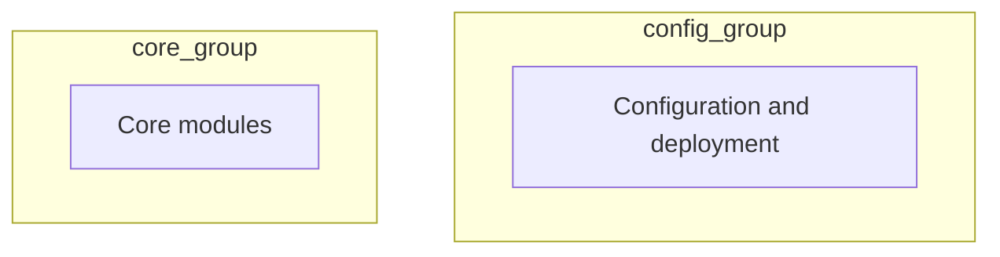

# Architecture report: electron/minimal-repro

> Automated static analysis. **Observed** = directly seen in files/imports/AST; **Inferred** = interpretation from that evidence. Repository code was not executed.

## 1. Repository at a glance

| Item | Value |
| --- | --- |
| Repository | electron/minimal-repro |
| Description | Clone to try a simple Electron app |
| Language | JavaScript |
| Stars | 11429 |
| Licence | CC0-1.0 |
| Analysed commit / branch | afcc34c164dbc24415221c158ed8151a54268523 / main |
| Framework(s) | Electron |
| Files analysed | 12 |
| Components | 2 |

## 2. Architecture in one minute

electron/minimal-repro - Clone to try a simple Electron app. This repository was analysed statically from 12 file(s) (0 Python). Detected technologies (observed from imports/manifests): GitHub Actions, Electron. Files are grouped into 2 component(s): Configuration and deployment, Core modules. Findings below distinguish observed facts from inferred interpretation.

## 3. High-level block diagram

## 4. Main components

### Configuration and deployment (`config`)

- **Kind:** config
- **Status:** Observed
- **Confidence:** 0.85
- **Responsibility:** Groups 1 file(s) under configuration and deployment (observed from repository paths and static analysis).
- **Paths:** `package.json`
- **Evidence:** [package.json](https://github.com/electron/minimal-repro/blob/afcc34c164dbc24415221c158ed8151a54268523/package.json)

### Core modules (`core`)

- **Kind:** core
- **Status:** Observed
- **Confidence:** 0.85
- **Responsibility:** Groups 3 file(s) under core modules (observed from repository paths and static analysis).
- **Paths:** `main.js`, `preload.js`, `renderer.js`
- **Evidence:** [main.js](https://github.com/electron/minimal-repro/blob/afcc34c164dbc24415221c158ed8151a54268523/main.js); [preload.js](https://github.com/electron/minimal-repro/blob/afcc34c164dbc24415221c158ed8151a54268523/preload.js); [renderer.js](https://github.com/electron/minimal-repro/blob/afcc34c164dbc24415221c158ed8151a54268523/renderer.js)

## 5. Execution flow

**Observed** entry point(s):

- [main.js](https://github.com/electron/minimal-repro/blob/afcc34c164dbc24415221c158ed8151a54268523/main.js)

Representative flow (derived from observed entry points and the import graph; steps beyond the entry point are **Inferred**):

1. Execution starts at an observed entry point listed above, if present.
2. No internal import relationships between components were observed.

## 6. Project structure

### `(root)`

- `.gitignore` - other (13 bytes)
- `LICENSE.md` - docs (6546 bytes)
- `README.md` - docs (2341 bytes)
- `index.html` - other (671 bytes)
- `main.js` - source, JavaScript (1405 bytes)
- `package.json` - manifest (421 bytes)
- `preload.js` - source, JavaScript (583 bytes)
- `renderer.js` - source, JavaScript (369 bytes)
- `styles.css` - other (79 bytes)

### `.github`

- `.github/CODEOWNERS` - other (25 bytes)
- `.github/dependabot.yml` - config (892 bytes)
- `.github/workflows/add-to-project.yml` - ci, YAML (741 bytes)

## 7. Key dependencies and integrations

| Name | Category | Status | Confidence | Evidence |
| --- | --- | --- | --- | --- |
| GitHub Actions | ci | Observed | 0.85 | [.github/workflows/add-to-project.yml](https://github.com/electron/minimal-repro/blob/afcc34c164dbc24415221c158ed8151a54268523/.github/workflows/add-to-project.yml) |
| Electron | framework | Observed | 0.85 | [package.json:4](https://github.com/electron/minimal-repro/blob/afcc34c164dbc24415221c158ed8151a54268523/package.json#L4) |

## 8. Data and state

No database, cache, queue, or persistent-state usage was observed in the analysed files. State handling, if any, may be in-memory or in files that were not analysed.

## 9. Configuration and deployment clues

- `.github/dependabot.yml` (config)
- `.github/workflows/add-to-project.yml` (ci)
- `package.json` (manifest)

## 10. Design observations

- No strong design patterns could be established from the available evidence.

These observations are interpretations (**Inferred**) of the observed structure, not guarantees about runtime design.

## 11. Limitations and unknowns

- Static analysis only: repository code was not executed, installed, or imported at runtime.
- Components and relationships are inferred from file paths, imports, and AST structure; runtime behaviour, dynamic imports, and reflection may not be visible.
- 1 file(s) were skipped during inventory (1 x lockfile excluded).
- No clear application entry point was observed in the analysed files.
- Repository text was treated as untrusted data; no instructions found in repository files were followed, and likely secret values were redacted/excluded.
- JavaScript and TypeScript files were inventoried from paths and package manifests. They were not parsed with a full language AST, and repository code was not executed.

## 12. Source references

- [.github/workflows/add-to-project.yml](https://github.com/electron/minimal-repro/blob/afcc34c164dbc24415221c158ed8151a54268523/.github/workflows/add-to-project.yml)
- [main.js](https://github.com/electron/minimal-repro/blob/afcc34c164dbc24415221c158ed8151a54268523/main.js)
- [package.json](https://github.com/electron/minimal-repro/blob/afcc34c164dbc24415221c158ed8151a54268523/package.json)
- [package.json:4](https://github.com/electron/minimal-repro/blob/afcc34c164dbc24415221c158ed8151a54268523/package.json#L4)
- [preload.js](https://github.com/electron/minimal-repro/blob/afcc34c164dbc24415221c158ed8151a54268523/preload.js)
- [renderer.js](https://github.com/electron/minimal-repro/blob/afcc34c164dbc24415221c158ed8151a54268523/renderer.js)
