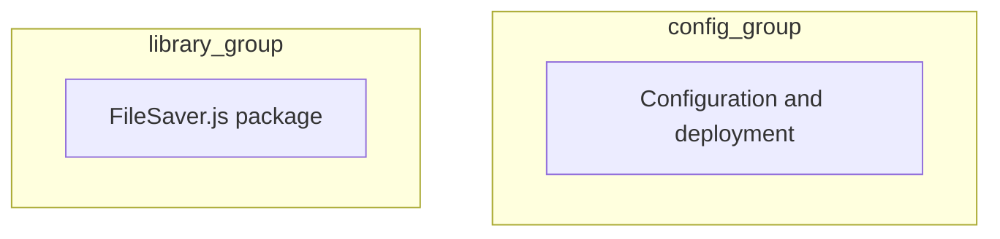

# Architecture report: eligrey/FileSaver.js

> Automated static analysis. **Observed** = directly seen in files/imports/AST; **Inferred** = interpretation from that evidence. Repository code was not executed.

## 1. Repository at a glance

| Item | Value |
| --- | --- |
| Repository | eligrey/FileSaver.js |
| Description | An HTML5 saveAs() FileSaver implementation |
| Language | JavaScript |
| Stars | 21959 |
| Licence | Other |
| Analysed commit / branch | cea522bc41bfadc364837293d0c4dc585a65ac46 / master |
| Framework(s) | None detected |
| Files analysed | 8 |
| Components | 2 |

## 2. Architecture in one minute

eligrey/FileSaver.js - An HTML5 saveAs() FileSaver implementation. This repository was analysed statically from 8 file(s) (0 Python). Detected technologies (observed from imports/manifests): no known frameworks/libraries. Files are grouped into 2 component(s): Configuration and deployment, FileSaver.js package. Findings below distinguish observed facts from inferred interpretation.

## 3. High-level block diagram

## 4. Main components

### Configuration and deployment (`config`)

- **Kind:** config
- **Status:** Observed
- **Confidence:** 0.85
- **Responsibility:** Groups 2 file(s) under configuration and deployment (observed from repository paths and static analysis).
- **Paths:** `bower.json`, `package.json`
- **Evidence:** [bower.json](https://github.com/eligrey/FileSaver.js/blob/cea522bc41bfadc364837293d0c4dc585a65ac46/bower.json); [package.json](https://github.com/eligrey/FileSaver.js/blob/cea522bc41bfadc364837293d0c4dc585a65ac46/package.json)

### FileSaver.js package (`filesaver_js`)

- **Kind:** library
- **Status:** Observed
- **Confidence:** 0.85
- **Responsibility:** Groups 1 file(s) under filesaver.js package (observed from repository paths and static analysis).
- **Paths:** `src/FileSaver.js`
- **Evidence:** [src/FileSaver.js](https://github.com/eligrey/FileSaver.js/blob/cea522bc41bfadc364837293d0c4dc585a65ac46/src/FileSaver.js)

## 5. Execution flow

No entry point was observed; the startup flow below is therefore limited.

Representative flow (derived from observed entry points and the import graph; steps beyond the entry point are **Inferred**):

1. Execution starts at an observed entry point listed above, if present.
2. No internal import relationships between components were observed.

## 6. Project structure

### `(root)`

- `.gitignore` - other (31 bytes)
- `CHANGELOG.md` - docs (2502 bytes)
- `LICENSE.md` - docs (1101 bytes)
- `README.md` - docs (6075 bytes)
- `bower.json` - config (411 bytes)
- `package.json` - manifest (1255 bytes)

### `.github`

- `.github/FUNDING.yml` - config (63 bytes)

### `src`

- `src/FileSaver.js` - source, JavaScript (5775 bytes)

## 7. Key dependencies and integrations

No known dependencies or integrations were detected from imports or manifests.

## 8. Data and state

No database, cache, queue, or persistent-state usage was observed in the analysed files. State handling, if any, may be in-memory or in files that were not analysed.

## 9. Configuration and deployment clues

- `.github/FUNDING.yml` (config)
- `bower.json` (config)
- `package.json` (manifest)

## 10. Design observations

- No strong design patterns could be established from the available evidence.

These observations are interpretations (**Inferred**) of the observed structure, not guarantees about runtime design.

## 11. Limitations and unknowns

- Static analysis only: repository code was not executed, installed, or imported at runtime.
- Components and relationships are inferred from file paths, imports, and AST structure; runtime behaviour, dynamic imports, and reflection may not be visible.
- 2 file(s) were skipped during inventory (1 x lockfile excluded; 1 x vendored/generated directory excluded).
- No clear application entry point was observed in the analysed files.
- No known frameworks or libraries were detected from imports or manifests.
- Repository text was treated as untrusted data; no instructions found in repository files were followed, and likely secret values were redacted/excluded.
- JavaScript and TypeScript files were inventoried from paths and package manifests. They were not parsed with a full language AST, and repository code was not executed.

## 12. Source references

- [bower.json](https://github.com/eligrey/FileSaver.js/blob/cea522bc41bfadc364837293d0c4dc585a65ac46/bower.json)
- [package.json](https://github.com/eligrey/FileSaver.js/blob/cea522bc41bfadc364837293d0c4dc585a65ac46/package.json)
- [src/FileSaver.js](https://github.com/eligrey/FileSaver.js/blob/cea522bc41bfadc364837293d0c4dc585a65ac46/src/FileSaver.js)
