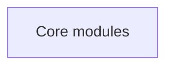

# Architecture report: elsewhencode/project-guidelines

> Automated static analysis. **Observed** = directly seen in files/imports/AST; **Inferred** = interpretation from that evidence. Repository code was not executed.

## 1. Repository at a glance

| Item | Value |
| --- | --- |
| Repository | elsewhencode/project-guidelines |
| Description | A set of best practices for JavaScript projects |
| Language | JavaScript |
| Stars | 29413 |
| Licence | MIT |
| Analysed commit / branch | 87c9014ec4f96f8469984538ec5c6601e6f09e7e / master |
| Framework(s) | None detected |
| Files analysed | 15 |
| Components | 1 |

## 2. Architecture in one minute

elsewhencode/project-guidelines - A set of best practices for JavaScript projects. This repository was analysed statically from 15 file(s) (0 Python). Detected technologies (observed from imports/manifests): no known frameworks/libraries. Files are grouped into 1 component(s): Core modules. Findings below distinguish observed facts from inferred interpretation.

## 3. High-level block diagram

## 4. Main components

### Core modules (`core`)

- **Kind:** core
- **Status:** Observed
- **Confidence:** 0.85
- **Responsibility:** Groups 2 file(s) under core modules (observed from repository paths and static analysis).
- **Paths:** `config.sample.js`, `configWithTest.sample.js`
- **Evidence:** [config.sample.js](https://github.com/elsewhencode/project-guidelines/blob/87c9014ec4f96f8469984538ec5c6601e6f09e7e/config.sample.js); [configWithTest.sample.js](https://github.com/elsewhencode/project-guidelines/blob/87c9014ec4f96f8469984538ec5c6601e6f09e7e/configWithTest.sample.js)

## 5. Execution flow

No entry point was observed; the startup flow below is therefore limited.

Representative flow (derived from observed entry points and the import graph; steps beyond the entry point are **Inferred**):

1. Execution starts at an observed entry point listed above, if present.
2. No internal import relationships between components were observed.

## 6. Project structure

### `(root)`

- `.gitignore` - other (1312 bytes)
- `CODE_OF_CONDUCT.md` - docs (3214 bytes)
- `CONTRIBUTING.md` - docs (304 bytes)
- `LICENSE` - docs (1096 bytes)
- `README-ir.md` - docs (77833 bytes)
- `README-it.md` - docs (50395 bytes)
- `README-ja.md` - docs (53154 bytes)
- `README-ko.md` - docs (48603 bytes)
- `README-pt-BR.md` - docs (42455 bytes)
- `README-ru.md` - docs (70812 bytes)
- `README-zh.md` - docs (41231 bytes)
- `README.md` - docs (43433 bytes)
- `README.sample.md` - docs (3098 bytes)
- `config.sample.js` - source, JavaScript (465 bytes)
- `configWithTest.sample.js` - source, JavaScript (941 bytes)

## 7. Key dependencies and integrations

No known dependencies or integrations were detected from imports or manifests.

## 8. Data and state

No database, cache, queue, or persistent-state usage was observed in the analysed files. State handling, if any, may be in-memory or in files that were not analysed.

## 9. Configuration and deployment clues

No configuration, manifest, CI, or container files were observed.

## 10. Design observations

- The analysed code appears small or monolithic; few component boundaries were observed.

These observations are interpretations (**Inferred**) of the observed structure, not guarantees about runtime design.

## 11. Limitations and unknowns

- Static analysis only: repository code was not executed, installed, or imported at runtime.
- Components and relationships are inferred from file paths, imports, and AST structure; runtime behaviour, dynamic imports, and reflection may not be visible.
- No clear application entry point was observed in the analysed files.
- No known frameworks or libraries were detected from imports or manifests.
- Repository text was treated as untrusted data; no instructions found in repository files were followed, and likely secret values were redacted/excluded.
- JavaScript and TypeScript files were inventoried from paths and package manifests. They were not parsed with a full language AST, and repository code was not executed.

## 12. Source references

- [config.sample.js](https://github.com/elsewhencode/project-guidelines/blob/87c9014ec4f96f8469984538ec5c6601e6f09e7e/config.sample.js)
- [configWithTest.sample.js](https://github.com/elsewhencode/project-guidelines/blob/87c9014ec4f96f8469984538ec5c6601e6f09e7e/configWithTest.sample.js)
