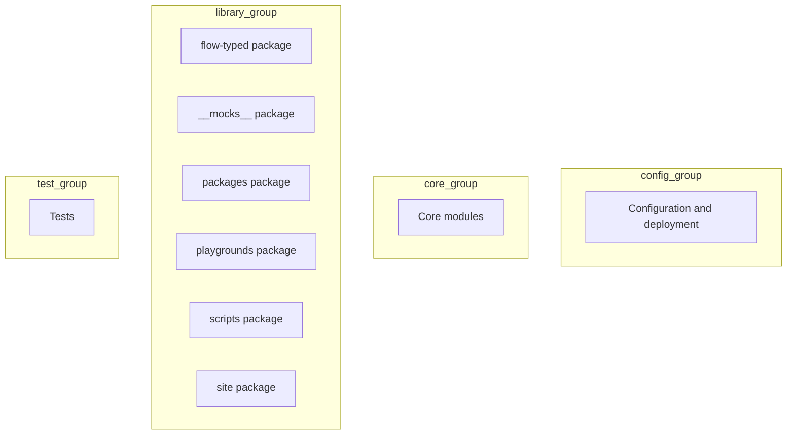

# Architecture report: emotion-js/emotion

> Automated static analysis. **Observed** = directly seen in files/imports/AST; **Inferred** = interpretation from that evidence. Repository code was not executed.

## 1. Repository at a glance

| Item | Value |
| --- | --- |
| Repository | emotion-js/emotion |
| Description | 👩‍🎤 CSS-in-JS library designed for high performance style composition |
| Language | JavaScript |
| Stars | 18025 |
| Licence | MIT |
| Analysed commit / branch | b882bcba85132554992e4bd49e94c95939bbf810 / main |
| Framework(s) | Next.js, React |
| Files analysed | 799 |
| Components | 9 |

## 2. Architecture in one minute

emotion-js/emotion - 👩‍🎤 CSS-in-JS library designed for high performance style composition. This repository was analysed statically from 799 file(s) (0 Python). Detected technologies (observed from imports/manifests): GitHub Actions, Next.js, React, Jest, TypeScript. Files are grouped into 9 component(s): Configuration and deployment, Core modules, flow-typed package, __mocks__ package, packages package, playgrounds package, scripts package, site package. Findings below distinguish observed facts from inferred interpretation.

## 3. High-level block diagram

## 4. Main components

### Configuration and deployment (`config`)

- **Kind:** config
- **Status:** Observed
- **Confidence:** 0.85
- **Responsibility:** Groups 71 file(s) under configuration and deployment (observed from repository paths and static analysis).
- **Paths:** `codecov.yml`, `netlify.toml`, `package.json`, `packages/babel-plugin-jsx-pragmatic/package.json`, `packages/babel-plugin/package.json`, `packages/babel-preset-css-prop/package.json`, `packages/cache/package.json`, `packages/cache/types/tsconfig.json`, `packages/cache/types/tslint.json`, `packages/css-prettifier/package.json`, `packages/css/create-instance/package.json`, `packages/css/package.json`, `packages/css/types/tsconfig.json`, `packages/css/types/tslint.json`, `packages/eslint-plugin/package.json`, `packages/hash/package.json`, `packages/hash/types/tsconfig.json`, `packages/hash/types/tslint.json`, `packages/is-prop-valid/package.json`, `packages/is-prop-valid/types/tsconfig.json`, `packages/is-prop-valid/types/tslint.json`, `packages/jest/enzyme-serializer/package.json`, `packages/jest/enzyme/package.json`, `packages/jest/package.json`, `packages/jest/serializer/package.json`, `packages/jest/types/tsconfig.json`, `packages/jest/types/tslint.json`, `packages/memoize/package.json`, `packages/memoize/types/tsconfig.json`, `packages/memoize/types/tslint.json`, `packages/native/package.json`, `packages/native/tsconfig.json`, `packages/native/types/tsconfig.json`, `packages/native/types/tslint.json`, `packages/primitives-core/package.json`, `packages/primitives/package.json`, `packages/react/_isolated-hnrs/package.json`, `packages/react/jsx-dev-runtime/package.json`, `packages/react/jsx-runtime/package.json`, `packages/react/package.json`, `packages/react/types/tsconfig.json`, `packages/react/types/tslint.json`, `packages/serialize/package.json`, `packages/serialize/types/tsconfig.json`, `packages/serialize/types/tslint.json`, `packages/server/create-instance/package.json`, `packages/server/package.json`, `packages/server/types/tsconfig.json`, `packages/server/types/tslint.json`, `packages/sheet/package.json`, `packages/sheet/types/tsconfig.json`, `packages/sheet/types/tslint.json`, `packages/styled/base/package.json`, `packages/styled/package.json`, `packages/styled/types/tsconfig.json`, `packages/styled/types/tslint.json`, `packages/unitless/package.json`, `packages/use-insertion-effect-with-fallbacks/package.json`, `packages/utils/package.json`, `packages/utils/types/tsconfig.json`, `packages/utils/types/tslint.json`, `packages/weak-memoize/package.json`, `packages/weak-memoize/types/tsconfig.json`, `packages/weak-memoize/types/tslint.json`, `playgrounds/cra/package.json`, `playgrounds/nextjs/package.json`, `scripts/babel-preset-emotion-dev/package.json`, `scripts/babel-tester/package.json`, `scripts/benchmarks/package.json`, `scripts/ssr-benchmarks/package.json`, `scripts/test-utils/package.json`
- **Evidence:** [codecov.yml](https://github.com/emotion-js/emotion/blob/b882bcba85132554992e4bd49e94c95939bbf810/codecov.yml); [netlify.toml](https://github.com/emotion-js/emotion/blob/b882bcba85132554992e4bd49e94c95939bbf810/netlify.toml); [package.json](https://github.com/emotion-js/emotion/blob/b882bcba85132554992e4bd49e94c95939bbf810/package.json); [packages/babel-plugin-jsx-pragmatic/package.json](https://github.com/emotion-js/emotion/blob/b882bcba85132554992e4bd49e94c95939bbf810/packages/babel-plugin-jsx-pragmatic/package.json); [packages/babel-plugin/package.json](https://github.com/emotion-js/emotion/blob/b882bcba85132554992e4bd49e94c95939bbf810/packages/babel-plugin/package.json); [packages/babel-preset-css-prop/package.json](https://github.com/emotion-js/emotion/blob/b882bcba85132554992e4bd49e94c95939bbf810/packages/babel-preset-css-prop/package.json); [packages/cache/package.json](https://github.com/emotion-js/emotion/blob/b882bcba85132554992e4bd49e94c95939bbf810/packages/cache/package.json); [packages/cache/types/tsconfig.json](https://github.com/emotion-js/emotion/blob/b882bcba85132554992e4bd49e94c95939bbf810/packages/cache/types/tsconfig.json)

### Core modules (`core`)

- **Kind:** core
- **Status:** Observed
- **Confidence:** 0.85
- **Responsibility:** Groups 5 file(s) under core modules (observed from repository paths and static analysis).
- **Paths:** `babel.config.js`, `jest-react18.config.js`, `jest.config.js`, `jest.dist.js`, `jest.prod.js`
- **Evidence:** [babel.config.js](https://github.com/emotion-js/emotion/blob/b882bcba85132554992e4bd49e94c95939bbf810/babel.config.js); [jest-react18.config.js](https://github.com/emotion-js/emotion/blob/b882bcba85132554992e4bd49e94c95939bbf810/jest-react18.config.js); [jest.config.js](https://github.com/emotion-js/emotion/blob/b882bcba85132554992e4bd49e94c95939bbf810/jest.config.js); [jest.dist.js](https://github.com/emotion-js/emotion/blob/b882bcba85132554992e4bd49e94c95939bbf810/jest.dist.js); [jest.prod.js](https://github.com/emotion-js/emotion/blob/b882bcba85132554992e4bd49e94c95939bbf810/jest.prod.js)

### flow-typed package (`flow_typed`)

- **Kind:** library
- **Status:** Observed
- **Confidence:** 0.85
- **Responsibility:** Groups 1 file(s) under flow-typed package (observed from repository paths and static analysis).
- **Paths:** `flow-typed/npm/vitest_vx.x.x.js`
- **Evidence:** [flow-typed/npm/vitest_vx.x.x.js](https://github.com/emotion-js/emotion/blob/b882bcba85132554992e4bd49e94c95939bbf810/flow-typed/npm/vitest_vx.x.x.js)

### __mocks__ package (`mocks`)

- **Kind:** library
- **Status:** Observed
- **Confidence:** 0.85
- **Responsibility:** Groups 2 file(s) under __mocks__ package (observed from repository paths and static analysis).
- **Paths:** `__mocks__/react-native.js`, `__mocks__/react-primitives.js`
- **Evidence:** [__mocks__/react-native.js](https://github.com/emotion-js/emotion/blob/b882bcba85132554992e4bd49e94c95939bbf810/__mocks__/react-native.js); [__mocks__/react-primitives.js](https://github.com/emotion-js/emotion/blob/b882bcba85132554992e4bd49e94c95939bbf810/__mocks__/react-primitives.js)

### packages package (`packages`)

- **Kind:** library
- **Status:** Observed
- **Confidence:** 0.85
- **Responsibility:** Groups 364 file(s) under packages package (observed from repository paths and static analysis).
- **Paths:** `packages/babel-plugin-jsx-pragmatic/__tests__/__fixtures__/existing-imports.js`, `packages/babel-plugin-jsx-pragmatic/__tests__/__fixtures__/fragment-only.js`, `packages/babel-plugin-jsx-pragmatic/__tests__/__fixtures__/minimal.js`, `packages/babel-plugin-jsx-pragmatic/__tests__/index.js`, `packages/babel-plugin-jsx-pragmatic/babel__plugin-syntax-jsx.d.ts`, `packages/babel-plugin-jsx-pragmatic/src/index.ts`, `packages/babel-plugin/__tests__/__fixtures__/autolabel-and-css-property-label.js`, `packages/babel-plugin/__tests__/__fixtures__/core-with-component.js`, `packages/babel-plugin/__tests__/__fixtures__/core-with-css-import-dynamic.js`, `packages/babel-plugin/__tests__/__fixtures__/core-with-css-import.js`, `packages/babel-plugin/__tests__/__fixtures__/css-prop-complex-array.js`, `packages/babel-plugin/__tests__/__fixtures__/does-not-change-other-props.js`, `packages/babel-plugin/__tests__/__fixtures__/dynamic.js`, `packages/babel-plugin/__tests__/__fixtures__/function-declaration.js`, `packages/babel-plugin/__tests__/__fixtures__/import-namespace-does-not-throw.js`, `packages/babel-plugin/__tests__/__fixtures__/jsx-hoist.js`, `packages/babel-plugin/__tests__/__fixtures__/object-property.js`, `packages/babel-plugin/__tests__/__fixtures__/static-object-with-camel-case.js`, `packages/babel-plugin/__tests__/__fixtures__/static-object-with-child-selectors.js`, `packages/babel-plugin/__tests__/css-macro/__fixtures__/actual-expected-usage.js`, `packages/babel-plugin/__tests__/css-macro/__fixtures__/already-transpiled-by-babel.js`, `packages/babel-plugin/__tests__/css-macro/__fixtures__/basic.js`, `packages/babel-plugin/__tests__/css-macro/__fixtures__/call-expression.js`, `packages/babel-plugin/__tests__/css-macro/__fixtures__/call-inside-call.js`, `packages/babel-plugin/__tests__/css-macro/__fixtures__/comment-with-interpolation.js`, `packages/babel-plugin/__tests__/css-macro/__fixtures__/impure.js`, `packages/babel-plugin/__tests__/css-macro/__fixtures__/inside-anonymous-arrow-function.js`, `packages/babel-plugin/__tests__/css-macro/__fixtures__/inside-anonymous-function.js`, `packages/babel-plugin/__tests__/css-macro/__fixtures__/inside-class.js`, `packages/babel-plugin/__tests__/css-macro/__fixtures__/label-1.js`, `packages/babel-plugin/__tests__/css-macro/__fixtures__/label-arrow-as-obj-property.js`, `packages/babel-plugin/__tests__/css-macro/__fixtures__/label-arrow-function-expression.js`, `packages/babel-plugin/__tests__/css-macro/__fixtures__/label-function-expression-as-obj-property.js`, `packages/babel-plugin/__tests__/css-macro/__fixtures__/label-function-expression-named.js`, `packages/babel-plugin/__tests__/css-macro/__fixtures__/label-function-expression.js`, `packages/babel-plugin/__tests__/css-macro/__fixtures__/label-no-final-semi.js`, `packages/babel-plugin/__tests__/css-macro/__fixtures__/label-obj-method.js`, `packages/babel-plugin/__tests__/css-macro/__fixtures__/label-obj-property-literal.js`, `packages/babel-plugin/__tests__/css-macro/__fixtures__/label-object.js`, `packages/babel-plugin/__tests__/css-macro/__fixtures__/label-transpiled-by-ts-with-interpolations.js`, `packages/babel-plugin/__tests__/css-macro/__fixtures__/label-transpiled-by-ts.js`, `packages/babel-plugin/__tests__/css-macro/__fixtures__/multiple-calls.js`, `packages/babel-plugin/__tests__/css-macro/__fixtures__/no-actual-import.js`, `packages/babel-plugin/__tests__/css-macro/__fixtures__/no-label-array-pattern.js`, `packages/babel-plugin/__tests__/css-macro/__fixtures__/no-label-obj-pattern-computed-property.js`, `packages/babel-plugin/__tests__/css-macro/__fixtures__/object-dynamic-property.js`, `packages/babel-plugin/__tests__/css-macro/__fixtures__/object-pattern-variable-declarator.js`, `packages/babel-plugin/__tests__/css-macro/__fixtures__/other-imports.js`, `packages/babel-plugin/__tests__/css-macro/__fixtures__/remove-block-comments.js`, `packages/babel-plugin/__tests__/css-macro/__fixtures__/remove-line-comments.js`, `packages/babel-plugin/__tests__/css-macro/__fixtures__/tagged-template-args-forwarded.js`, `packages/babel-plugin/__tests__/css-macro/index.js`, `packages/babel-plugin/__tests__/css-requires-options.js`, `packages/babel-plugin/__tests__/css.js`, `packages/babel-plugin/__tests__/disable-source-map/__fixtures__/css.js`, `packages/babel-plugin/__tests__/disable-source-map/__fixtures__/styled.js`, `packages/babel-plugin/__tests__/disable-source-map/__fixtures__/vanilla.js`, `packages/babel-plugin/__tests__/disable-source-map/index.js`, `packages/babel-plugin/__tests__/global-macro/__fixtures__/basic-array.js`, `packages/babel-plugin/__tests__/global-macro/__fixtures__/basic-obj.js`, `packages/babel-plugin/__tests__/global-macro/__fixtures__/complex-array.js`, `packages/babel-plugin/__tests__/global-macro/__fixtures__/complex-obj.js`, `packages/babel-plugin/__tests__/global-macro/__fixtures__/css-used-as-value.js`, `packages/babel-plugin/__tests__/global-macro/__fixtures__/no-jsx.js`, `packages/babel-plugin/__tests__/global-macro/__fixtures__/no-styles-prop.js`, `packages/babel-plugin/__tests__/global-macro/__fixtures__/spread-styles.js`, `packages/babel-plugin/__tests__/global-macro/__fixtures__/with-closing-element.js`, `packages/babel-plugin/__tests__/global-macro/index.js`, `packages/babel-plugin/__tests__/global-requires-options.js`, `packages/babel-plugin/__tests__/global.js`, `packages/babel-plugin/__tests__/import-mapping/__fixtures__/global-needs-css.js`, `packages/babel-plugin/__tests__/import-mapping/__fixtures__/global.js`, `packages/babel-plugin/__tests__/import-mapping/__fixtures__/jsx.js`, `packages/babel-plugin/__tests__/import-mapping/__fixtures__/non-default-styled-aliased.js`, `packages/babel-plugin/__tests__/import-mapping/__fixtures__/non-default-styled.js`, `packages/babel-plugin/__tests__/import-mapping/__fixtures__/styled-with-base-specified.js`, `packages/babel-plugin/__tests__/import-mapping/__fixtures__/vanilla.js`, `packages/babel-plugin/__tests__/import-mapping/import-mapping.js`, `packages/babel-plugin/__tests__/index.js`, `packages/babel-plugin/__tests__/source-maps/__fixtures__/css-object.js`, `packages/babel-plugin/__tests__/source-maps/__fixtures__/css-prop-dynamic.js`, `packages/babel-plugin/__tests__/source-maps/__fixtures__/css-prop.js`, `packages/babel-plugin/__tests__/source-maps/__fixtures__/css-string.js`, `packages/babel-plugin/__tests__/source-maps/__fixtures__/css-transpiled-by-ts-with-interpolations.js`, `packages/babel-plugin/__tests__/source-maps/__fixtures__/css-transpiled-by-ts.js`, `packages/babel-plugin/__tests__/source-maps/__fixtures__/global-styles-prop.js`, `packages/babel-plugin/__tests__/source-maps/__fixtures__/styled-object.js`, `packages/babel-plugin/__tests__/source-maps/__fixtures__/styled-string.js`, `packages/babel-plugin/__tests__/source-maps/index.js`, `packages/babel-plugin/__tests__/styled-macro/__fixtures__/already-transpiled-by-babel.js`, `packages/babel-plugin/__tests__/styled-macro/__fixtures__/auto-inserted-rule-in-at-rule-preceeded-by-interpolation.js`, `packages/babel-plugin/__tests__/styled-macro/__fixtures__/basic.js`, `packages/babel-plugin/__tests__/styled-macro/__fixtures__/call-expression.js`, `packages/babel-plugin/__tests__/styled-macro/__fixtures__/comments.js`, `packages/babel-plugin/__tests__/styled-macro/__fixtures__/component-selector.js`, `packages/babel-plugin/__tests__/styled-macro/__fixtures__/existing-options.js`, `packages/babel-plugin/__tests__/styled-macro/__fixtures__/function-interpolation.js`, `packages/babel-plugin/__tests__/styled-macro/__fixtures__/label-assignment-expression.js`, `packages/babel-plugin/__tests__/styled-macro/__fixtures__/label-class-fields.js`, `packages/babel-plugin/__tests__/styled-macro/__fixtures__/label-member-expression.js`, `packages/babel-plugin/__tests__/styled-macro/__fixtures__/label-sanitize.js`, `packages/babel-plugin/__tests__/styled-macro/__fixtures__/label.js`, `packages/babel-plugin/__tests__/styled-macro/__fixtures__/more-than-10-interpolations.js`, `packages/babel-plugin/__tests__/styled-macro/__fixtures__/multiple-calls.js`, `packages/babel-plugin/__tests__/styled-macro/__fixtures__/native.js`, `packages/babel-plugin/__tests__/styled-macro/__fixtures__/no-call.js`, `packages/babel-plugin/__tests__/styled-macro/__fixtures__/no-import.js`, `packages/babel-plugin/__tests__/styled-macro/__fixtures__/object-call-expression.js`, `packages/babel-plugin/__tests__/styled-macro/__fixtures__/object-function.js`, `packages/babel-plugin/__tests__/styled-macro/__fixtures__/object.js`, `packages/babel-plugin/__tests__/styled-macro/__fixtures__/other-imports.js`, `packages/babel-plugin/__tests__/styled-macro/__fixtures__/primitives-other-name.js`, `packages/babel-plugin/__tests__/styled-macro/__fixtures__/primitives.js`, `packages/babel-plugin/__tests__/styled-macro/__fixtures__/same-nested-contex-value.js`, `packages/babel-plugin/__tests__/styled-macro/__fixtures__/shorthand-property.js`, `packages/babel-plugin/__tests__/styled-macro/__fixtures__/two-consecutive-interpolations.js`, `packages/babel-plugin/__tests__/styled-macro/__fixtures__/with-spread.js`, `packages/babel-plugin/__tests__/styled-macro/index.js`, `packages/babel-plugin/__tests__/styled-requires-options.js`, `packages/babel-plugin/__tests__/styled.js`, `packages/babel-plugin/__tests__/vanilla-emotion-macro/__fixtures__/comments.js`, `packages/babel-plugin/__tests__/vanilla-emotion-macro/__fixtures__/css-basic.js`, `packages/babel-plugin/__tests__/vanilla-emotion-macro/__fixtures__/css-object.js`, `packages/babel-plugin/__tests__/vanilla-emotion-macro/__fixtures__/does-not-minify-inside-content-property.js`, `packages/babel-plugin/__tests__/vanilla-emotion-macro/__fixtures__/hoisting.js`, `packages/babel-plugin/__tests__/vanilla-emotion-macro/__fixtures__/inject-global-basic.js`, `packages/babel-plugin/__tests__/vanilla-emotion-macro/__fixtures__/inject-global-change-import.js`, `packages/babel-plugin/__tests__/vanilla-emotion-macro/__fixtures__/inject-global-with-font-face.js`, `packages/babel-plugin/__tests__/vanilla-emotion-macro/__fixtures__/inject-global-with-interpolation.js`, `packages/babel-plugin/__tests__/vanilla-emotion-macro/__fixtures__/keyframes-basic.js`, `packages/babel-plugin/__tests__/vanilla-emotion-macro/__fixtures__/keyframes-with-interpolation.js`, `packages/babel-plugin/__tests__/vanilla-emotion-macro/__fixtures__/nested-orphaned-pseudo.js`, `packages/babel-plugin/__tests__/vanilla-emotion-macro/__fixtures__/object-label.js`, `packages/babel-plugin/__tests__/vanilla-emotion-macro/index.js`, `packages/babel-plugin/__tests__/vanilla-emotion.js`, `packages/babel-plugin/src/core-macro.js`, `packages/babel-plugin/src/emotion-macro.js`, `packages/babel-plugin/src/index.js`, `packages/babel-plugin/src/styled-macro.js`, `packages/babel-plugin/src/utils/add-import.js`, `packages/babel-plugin/src/utils/create-node-env-conditional.js`, `packages/babel-plugin/src/utils/get-styled-options.js`, `packages/babel-plugin/src/utils/get-target-class-name.js`, `packages/babel-plugin/src/utils/index.js`, `packages/babel-plugin/src/utils/label.js`, `packages/babel-plugin/src/utils/minify.js`, `packages/babel-plugin/src/utils/object-to-string.js`, `packages/babel-plugin/src/utils/source-maps.js`, `packages/babel-plugin/src/utils/strings.js`, `packages/babel-plugin/src/utils/transform-expression-with-styles.js`, `packages/babel-plugin/src/utils/transformer-macro.js`, `packages/babel-plugin/src/utils/transpiled-output-utils.js`, `packages/babel-preset-css-prop/__tests__/__fixtures__/array-css-prop.js`, `packages/babel-preset-css-prop/__tests__/__fixtures__/index.js`, `packages/babel-preset-css-prop/__tests__/index.js`, `packages/babel-preset-css-prop/__tests__/options-are-used.js`, `packages/babel-preset-css-prop/src/index.js`, `packages/cache/__tests__/hydration.js`, `packages/cache/__tests__/index.js`, `packages/cache/src/conditions/false.ts`, `packages/cache/src/conditions/is-browser.ts`, `packages/cache/src/conditions/true.ts`, `packages/cache/src/index.ts`, `packages/cache/src/prefixer.ts`, `packages/cache/src/stylis-plugins.ts`, `packages/cache/src/types.ts`, `packages/cache/types/index.d.ts`, `packages/cache/types/resolved-condition.ts`, `packages/cache/types/tests.ts`, `packages/css-prettifier/src/index.ts`, `packages/css/macro.d.ts`, `packages/css/macro.js`, `packages/css/src/conditions/false.ts`, `packages/css/src/conditions/true.ts`, `packages/css/src/create-instance.ts`, `packages/css/src/index.ts`, `packages/css/types/create-instance.d.ts`, `packages/css/types/index.d.ts`, `packages/css/types/tests-create-instance.ts`, `packages/css/types/tests.ts`, `packages/eslint-plugin/src/index.ts`, `packages/eslint-plugin/src/rules/import-from-emotion.ts`, `packages/eslint-plugin/src/rules/jsx-import.ts`, `packages/eslint-plugin/src/rules/no-vanilla.ts`, `packages/eslint-plugin/src/rules/pkg-renaming.ts`, `packages/eslint-plugin/src/rules/styled-import.ts`, `packages/eslint-plugin/src/rules/syntax-preference.ts`, `packages/eslint-plugin/src/utils.ts`, `packages/hash/__tests__/index.js`, `packages/hash/src/index.ts`, `packages/hash/types/index.d.ts`, `packages/hash/types/tests.ts`, `packages/is-prop-valid/src/index.ts`, `packages/is-prop-valid/src/props.js`, `packages/is-prop-valid/types/index.d.ts`, `packages/is-prop-valid/types/tests.ts`, `packages/jest/src/create-enzyme-serializer.js`, `packages/jest/src/create-serializer.js`, `packages/jest/src/enzyme-serializer.d.ts`, `packages/jest/src/enzyme-serializer.js`, `packages/jest/src/enzyme-tickler.js`, `packages/jest/src/enzyme.d.ts`, `packages/jest/src/enzyme.js`, `packages/jest/src/index.d.ts`, `packages/jest/src/index.js`, `packages/jest/src/matchers.js`, `packages/jest/src/replace-class-names.js`, `packages/jest/src/serializer.d.ts`, `packages/jest/src/serializer.js`, `packages/jest/src/utils.js`, `packages/jest/types/enzyme-serializer.d.ts`, `packages/jest/types/enzyme.d.ts`, `packages/jest/types/index.d.ts`, `packages/jest/types/serializer.d.ts`, `packages/jest/types/test.ts`, `packages/memoize/src/index.ts`, `packages/memoize/types/index.d.ts`, `packages/memoize/types/tests.ts`, `packages/native/macro.d.ts`, `packages/native/macro.js`, `packages/native/src/base.js`, `packages/native/src/index.d.ts`, `packages/native/src/index.js`, `packages/native/types/base.d.ts`, `packages/native/types/index.d.ts`, `packages/native/types/resolved-condition.ts`, `packages/native/types/tests.tsx`, `packages/primitives-core/src/conditions/false.ts`, `packages/primitives-core/src/conditions/true.ts`, `packages/primitives-core/src/css.ts`, `packages/primitives-core/src/index.ts`, `packages/primitives-core/src/styled.ts`, `packages/primitives-core/src/types.ts`, `packages/primitives-core/src/utils.ts`, `packages/primitives/examples/index.js`, `packages/primitives/macro.js`, `packages/primitives/src/conditions/false.js`, `packages/primitives/src/conditions/true.js`, `packages/primitives/src/index.js`, `packages/primitives/src/styled.js`, `packages/primitives/src/test-props.js`, `packages/react/__tests__/at-import.js`, `packages/react/__tests__/automatic-dev-runtime.js`, `packages/react/__tests__/automatic-runtime.js`, `packages/react/__tests__/babel/css.js`, `packages/react/__tests__/babel/source-map-server.js`, `packages/react/__tests__/class-names.js`, `packages/react/__tests__/clone-element.js`, `packages/react/__tests__/compat/browser.js`, `packages/react/__tests__/compat/server.js`, `packages/react/__tests__/css-cache-hash.js`, `packages/react/__tests__/css.js`, `packages/react/__tests__/custom-cache.js`, `packages/react/__tests__/element.js`, `packages/react/__tests__/get-label-from-stack-trace.js`, `packages/react/__tests__/global-insertion-after-others.js`, `packages/react/__tests__/global-with-theme.js`, `packages/react/__tests__/global.js`, `packages/react/__tests__/globals-are-the-worst.js`, `packages/react/__tests__/import-prod.js`, `packages/react/__tests__/keyframes.js`, `packages/react/__tests__/legacy-class-name.js`, `packages/react/__tests__/prod.js`, `packages/react/__tests__/ref.js`, `packages/react/__tests__/rehydration.js`, `packages/react/__tests__/server.js`, `packages/react/__tests__/theme-provider.dom.js`, `packages/react/__tests__/theme-provider.js`, `packages/react/__tests__/use-theme.js`, `packages/react/__tests__/warnings.js`, `packages/react/__tests__/with-theme.js`, `packages/react/macro.d.ts`, `packages/react/macro.js`, `packages/react/src/_isolated-hnrs.ts`, `packages/react/src/class-names.tsx`, `packages/react/src/conditions/false.ts`, `packages/react/src/conditions/is-browser.ts`, `packages/react/src/conditions/true.ts`, `packages/react/src/context.tsx`, `packages/react/src/css.ts`, `packages/react/src/emotion-element.tsx`, `packages/react/src/get-label-from-stack-trace.ts`, `packages/react/src/global.tsx`, `packages/react/src/index.ts`, `packages/react/src/jsx-dev-runtime.ts`, `packages/react/src/jsx-namespace.ts`, `packages/react/src/jsx-runtime.ts`, `packages/react/src/jsx.ts`, `packages/react/src/keyframes.ts`, `packages/react/src/theming.tsx`, `packages/react/src/types.ts`, `packages/react/src/utils.ts`, `packages/react/types/css-prop.d.ts`, `packages/react/types/index.d.ts`, `packages/react/types/resolved-condition.ts`, `packages/react/types/tests-css.tsx`, `packages/react/types/tests-theming.tsx`, `packages/react/types/tests.tsx`, `packages/serialize/src/conditions/false.ts`, `packages/serialize/src/conditions/true.ts`, `packages/serialize/src/index.ts`, `packages/serialize/types/index.d.ts`, `packages/serialize/types/tests.ts`, `packages/server/src/conditions/false.js`, `packages/server/src/conditions/true.js`, `packages/server/src/create-instance/construct-style-tags-from-chunks.js`, `packages/server/src/create-instance/extract-critical-to-chunks.js`, `packages/server/src/create-instance/extract-critical.js`, `packages/server/src/create-instance/index.d.ts`, `packages/server/src/create-instance/index.js`, `packages/server/src/create-instance/inline.js`, `packages/server/src/create-instance/stream.js`, `packages/server/src/create-instance/utils.js`, `packages/server/src/index.d.ts`, `packages/server/src/index.js`, `packages/server/types/create-instance.d.ts`, `packages/server/types/index.d.ts`, `packages/server/types/resolved-condition.ts`, `packages/server/types/tests-create-instance.ts`, `packages/server/types/tests.tsx`, `packages/sheet/__tests__/index.js`, `packages/sheet/src/conditions/false.ts`, `packages/sheet/src/conditions/true.ts`, `packages/sheet/src/index.ts`, `packages/sheet/types/index.d.ts`, `packages/sheet/types/tests.ts`, `packages/styled/__tests__/as-prop.js`, `packages/styled/__tests__/edge-cases.js`, `packages/styled/__tests__/styled-dom.js`, `packages/styled/__tests__/styled.js`, `packages/styled/__tests__/warnings.js`, `packages/styled/macro.d.ts`, `packages/styled/macro.js`, `packages/styled/src/base.tsx`, `packages/styled/src/conditions/false.ts`, `packages/styled/src/conditions/is-browser.ts`, `packages/styled/src/conditions/true.ts`, `packages/styled/src/index.ts`, `packages/styled/src/jsx-namespace.ts`, `packages/styled/src/tags.ts`, `packages/styled/src/types.ts`, `packages/styled/src/utils.ts`, `packages/styled/types/base.d.ts`, `packages/styled/types/index.d.ts`, `packages/styled/types/resolved-condition.ts`, `packages/styled/types/tests-base.tsx`, `packages/styled/types/tests.tsx`, `packages/unitless/src/index.ts`, `packages/use-insertion-effect-with-fallbacks/src/conditions/false.ts`, `packages/use-insertion-effect-with-fallbacks/src/conditions/is-browser.ts`, `packages/use-insertion-effect-with-fallbacks/src/conditions/true.ts`, `packages/use-insertion-effect-with-fallbacks/src/index.ts`, `packages/utils/src/conditions/false.ts`, `packages/utils/src/conditions/is-browser.ts`, `packages/utils/src/conditions/true.ts`, `packages/utils/src/index.ts`, `packages/utils/src/types.ts`, `packages/utils/types/index.d.ts`, `packages/utils/types/resolved-condition.ts`, `packages/utils/types/tests.ts`, `packages/weak-memoize/__tests__/index.js`, `packages/weak-memoize/src/index.ts`, `packages/weak-memoize/types/index.d.ts`, `packages/weak-memoize/types/tests.ts`
- **Evidence:** [packages/babel-plugin-jsx-pragmatic/__tests__/__fixtures__/existing-imports.js](https://github.com/emotion-js/emotion/blob/b882bcba85132554992e4bd49e94c95939bbf810/packages/babel-plugin-jsx-pragmatic/__tests__/__fixtures__/existing-imports.js); [packages/babel-plugin-jsx-pragmatic/__tests__/__fixtures__/fragment-only.js](https://github.com/emotion-js/emotion/blob/b882bcba85132554992e4bd49e94c95939bbf810/packages/babel-plugin-jsx-pragmatic/__tests__/__fixtures__/fragment-only.js); [packages/babel-plugin-jsx-pragmatic/__tests__/__fixtures__/minimal.js](https://github.com/emotion-js/emotion/blob/b882bcba85132554992e4bd49e94c95939bbf810/packages/babel-plugin-jsx-pragmatic/__tests__/__fixtures__/minimal.js); [packages/babel-plugin-jsx-pragmatic/__tests__/index.js](https://github.com/emotion-js/emotion/blob/b882bcba85132554992e4bd49e94c95939bbf810/packages/babel-plugin-jsx-pragmatic/__tests__/index.js); [packages/babel-plugin-jsx-pragmatic/babel__plugin-syntax-jsx.d.ts](https://github.com/emotion-js/emotion/blob/b882bcba85132554992e4bd49e94c95939bbf810/packages/babel-plugin-jsx-pragmatic/babel__plugin-syntax-jsx.d.ts); [packages/babel-plugin-jsx-pragmatic/src/index.ts](https://github.com/emotion-js/emotion/blob/b882bcba85132554992e4bd49e94c95939bbf810/packages/babel-plugin-jsx-pragmatic/src/index.ts); [packages/babel-plugin/__tests__/__fixtures__/autolabel-and-css-property-label.js](https://github.com/emotion-js/emotion/blob/b882bcba85132554992e4bd49e94c95939bbf810/packages/babel-plugin/__tests__/__fixtures__/autolabel-and-css-property-label.js); [packages/babel-plugin/__tests__/__fixtures__/core-with-component.js](https://github.com/emotion-js/emotion/blob/b882bcba85132554992e4bd49e94c95939bbf810/packages/babel-plugin/__tests__/__fixtures__/core-with-component.js)

### playgrounds package (`playgrounds`)

- **Kind:** library
- **Status:** Observed
- **Confidence:** 0.85
- **Responsibility:** Groups 6 file(s) under playgrounds package (observed from repository paths and static analysis).
- **Paths:** `playgrounds/cra/src/App.js`, `playgrounds/cra/src/index.js`, `playgrounds/nextjs/.babelrc.js`, `playgrounds/nextjs/next.config.js`, `playgrounds/nextjs/pages/_app.js`, `playgrounds/nextjs/pages/index.js`
- **Evidence:** [playgrounds/cra/src/App.js](https://github.com/emotion-js/emotion/blob/b882bcba85132554992e4bd49e94c95939bbf810/playgrounds/cra/src/App.js); [playgrounds/cra/src/index.js](https://github.com/emotion-js/emotion/blob/b882bcba85132554992e4bd49e94c95939bbf810/playgrounds/cra/src/index.js); [playgrounds/nextjs/.babelrc.js](https://github.com/emotion-js/emotion/blob/b882bcba85132554992e4bd49e94c95939bbf810/playgrounds/nextjs/.babelrc.js); [playgrounds/nextjs/next.config.js](https://github.com/emotion-js/emotion/blob/b882bcba85132554992e4bd49e94c95939bbf810/playgrounds/nextjs/next.config.js); [playgrounds/nextjs/pages/_app.js](https://github.com/emotion-js/emotion/blob/b882bcba85132554992e4bd49e94c95939bbf810/playgrounds/nextjs/pages/_app.js); [playgrounds/nextjs/pages/index.js](https://github.com/emotion-js/emotion/blob/b882bcba85132554992e4bd49e94c95939bbf810/playgrounds/nextjs/pages/index.js)

### scripts package (`scripts`)

- **Kind:** library
- **Status:** Observed
- **Confidence:** 0.85
- **Responsibility:** Groups 48 file(s) under scripts package (observed from repository paths and static analysis).
- **Paths:** `scripts/babel-preset-emotion-dev/src/index.js`, `scripts/babel-tester/babel-check-duplicated-nodes.d.ts`, `scripts/babel-tester/src/index.ts`, `scripts/benchmarks/run.js`, `scripts/benchmarks/src/app/App.js`, `scripts/benchmarks/src/app/Benchmark/index.js`, `scripts/benchmarks/src/app/Benchmark/math.js`, `scripts/benchmarks/src/app/Benchmark/timing.js`, `scripts/benchmarks/src/app/Benchmark/types.js`, `scripts/benchmarks/src/app/Button.js`, `scripts/benchmarks/src/app/Icons.js`, `scripts/benchmarks/src/app/Layout.js`, `scripts/benchmarks/src/app/ReportCard.js`, `scripts/benchmarks/src/app/Text.js`, `scripts/benchmarks/src/app/theme.js`, `scripts/benchmarks/src/cases/SierpinskiTriangle.js`, `scripts/benchmarks/src/cases/Tree.js`, `scripts/benchmarks/src/impl.js`, `scripts/benchmarks/src/implementations/emotion-css-func/Box.js`, `scripts/benchmarks/src/implementations/emotion-css-func/Dot.js`, `scripts/benchmarks/src/implementations/emotion-css-func/Provider.js`, `scripts/benchmarks/src/implementations/emotion-css-func/View.js`, `scripts/benchmarks/src/implementations/emotion-css-func/index.js`, `scripts/benchmarks/src/implementations/emotion-css-prop/Box.js`, `scripts/benchmarks/src/implementations/emotion-css-prop/Dot.js`, `scripts/benchmarks/src/implementations/emotion-css-prop/Provider.js`, `scripts/benchmarks/src/implementations/emotion-css-prop/View.js`, `scripts/benchmarks/src/implementations/emotion-css-prop/index.js`, `scripts/benchmarks/src/implementations/emotion-styled/Box.js`, `scripts/benchmarks/src/implementations/emotion-styled/Dot.js`, `scripts/benchmarks/src/implementations/emotion-styled/Provider.js`, `scripts/benchmarks/src/implementations/emotion-styled/View.js`, `scripts/benchmarks/src/implementations/emotion-styled/index.js`, `scripts/benchmarks/src/index.js`, `scripts/ensure-yarn.js`, `scripts/replace-slack-link.js`, `scripts/ssr-benchmarks/basic.js`, `scripts/ssr-benchmarks/bench.js`, `scripts/ssr-benchmarks/triangle.js`, `scripts/test-utils/enzyme-env.js`, `scripts/test-utils/index.d.ts`, `scripts/test-utils/legacy-env.js`, `scripts/test-utils/next-env.js`, `scripts/test-utils/pretty-css.js`, `scripts/test-utils/resolved-conditions/false.js`, `scripts/test-utils/resolved-conditions/true.js`, `scripts/test-utils/src/index.js`, `scripts/test-utils/testSetup.js`
- **Evidence:** [scripts/babel-preset-emotion-dev/src/index.js](https://github.com/emotion-js/emotion/blob/b882bcba85132554992e4bd49e94c95939bbf810/scripts/babel-preset-emotion-dev/src/index.js); [scripts/babel-tester/babel-check-duplicated-nodes.d.ts](https://github.com/emotion-js/emotion/blob/b882bcba85132554992e4bd49e94c95939bbf810/scripts/babel-tester/babel-check-duplicated-nodes.d.ts); [scripts/babel-tester/src/index.ts](https://github.com/emotion-js/emotion/blob/b882bcba85132554992e4bd49e94c95939bbf810/scripts/babel-tester/src/index.ts); [scripts/benchmarks/run.js](https://github.com/emotion-js/emotion/blob/b882bcba85132554992e4bd49e94c95939bbf810/scripts/benchmarks/run.js); [scripts/benchmarks/src/app/App.js](https://github.com/emotion-js/emotion/blob/b882bcba85132554992e4bd49e94c95939bbf810/scripts/benchmarks/src/app/App.js); [scripts/benchmarks/src/app/Benchmark/index.js](https://github.com/emotion-js/emotion/blob/b882bcba85132554992e4bd49e94c95939bbf810/scripts/benchmarks/src/app/Benchmark/index.js); [scripts/benchmarks/src/app/Benchmark/math.js](https://github.com/emotion-js/emotion/blob/b882bcba85132554992e4bd49e94c95939bbf810/scripts/benchmarks/src/app/Benchmark/math.js); [scripts/benchmarks/src/app/Benchmark/timing.js](https://github.com/emotion-js/emotion/blob/b882bcba85132554992e4bd49e94c95939bbf810/scripts/benchmarks/src/app/Benchmark/timing.js)

### site package (`site`)

- **Kind:** library
- **Status:** Observed
- **Confidence:** 0.85
- **Responsibility:** Groups 31 file(s) under site package (observed from repository paths and static analysis).
- **Paths:** `site/.babelrc.js`, `site/components/carbon-ads.tsx`, `site/components/container.tsx`, `site/components/doc-wrapper.tsx`, `site/components/global-styles.tsx`, `site/components/index.ts`, `site/components/live-editor/compiler/babel-worker.ts`, `site/components/live-editor/compiler/compile.ts`, `site/components/live-editor/compiler/index.ts`, `site/components/live-editor/compiler/message.ts`, `site/components/live-editor/components/error-boundary.tsx`, `site/components/live-editor/components/index.ts`, `site/components/live-editor/components/live-context.ts`, `site/components/live-editor/components/live-editor.tsx`, `site/components/live-editor/components/live-error.tsx`, `site/components/live-editor/components/live-preview.tsx`, `site/components/live-editor/components/live-provider.tsx`, `site/components/live-editor/components/render-element-async.tsx`, `site/components/live-editor/emotion-live-editor.tsx`, `site/components/live-editor/index.ts`, `site/components/live-editor/remark-live-editor.ts`, `site/components/markdown-css.tsx`, `site/components/search.tsx`, `site/components/site-header.tsx`, `site/components/title.tsx`, `site/misc.d.ts`, `site/module-stubs/cosmiconfig.cjs`, `site/module-stubs/find-root.cjs`, `site/module-stubs/resolve.cjs`, `site/next-env.d.ts`, `site/next.config.js`
- **Evidence:** [site/.babelrc.js](https://github.com/emotion-js/emotion/blob/b882bcba85132554992e4bd49e94c95939bbf810/site/.babelrc.js); [site/components/carbon-ads.tsx](https://github.com/emotion-js/emotion/blob/b882bcba85132554992e4bd49e94c95939bbf810/site/components/carbon-ads.tsx); [site/components/container.tsx](https://github.com/emotion-js/emotion/blob/b882bcba85132554992e4bd49e94c95939bbf810/site/components/container.tsx); [site/components/doc-wrapper.tsx](https://github.com/emotion-js/emotion/blob/b882bcba85132554992e4bd49e94c95939bbf810/site/components/doc-wrapper.tsx); [site/components/global-styles.tsx](https://github.com/emotion-js/emotion/blob/b882bcba85132554992e4bd49e94c95939bbf810/site/components/global-styles.tsx); [site/components/index.ts](https://github.com/emotion-js/emotion/blob/b882bcba85132554992e4bd49e94c95939bbf810/site/components/index.ts); [site/components/live-editor/compiler/babel-worker.ts](https://github.com/emotion-js/emotion/blob/b882bcba85132554992e4bd49e94c95939bbf810/site/components/live-editor/compiler/babel-worker.ts); [site/components/live-editor/compiler/compile.ts](https://github.com/emotion-js/emotion/blob/b882bcba85132554992e4bd49e94c95939bbf810/site/components/live-editor/compiler/compile.ts)

### Tests (`tests`)

- **Kind:** test
- **Status:** Observed
- **Confidence:** 0.85
- **Responsibility:** Groups 76 file(s) under tests (observed from repository paths and static analysis).
- **Paths:** `packages/css/test/__snapshots__/component-selector.test.js.snap`, `packages/css/test/__snapshots__/css.test.js.snap`, `packages/css/test/__snapshots__/cx.test.js.snap`, `packages/css/test/__snapshots__/inject-global.test.js.snap`, `packages/css/test/__snapshots__/keyframes.test.js.snap`, `packages/css/test/__snapshots__/label-pattern.test.js.snap`, `packages/css/test/__snapshots__/selectivity.test.js.snap`, `packages/css/test/__snapshots__/sheet.dom.test.js.snap`, `packages/css/test/__snapshots__/warnings.test.js.snap`, `packages/css/test/component-selector.test.js`, `packages/css/test/css.test.js`, `packages/css/test/cx.test.js`, `packages/css/test/inject-global.test.js`, `packages/css/test/instance/__snapshots__/css.test.js.snap`, `packages/css/test/instance/__snapshots__/instance.test.js.snap`, `packages/css/test/instance/css.test.js`, `packages/css/test/instance/emotion-instance.js`, `packages/css/test/instance/inline.test.js`, `packages/css/test/instance/instance.test.js`, `packages/css/test/instance/stream.test.js`, `packages/css/test/keyframes.test.js`, `packages/css/test/label-pattern.test.js`, `packages/css/test/no-babel/__snapshots__/index.test.js.snap`, `packages/css/test/no-babel/index.test.js`, `packages/css/test/no-babel/warnings.test.js`, `packages/css/test/selectivity.test.js`, `packages/css/test/sheet.dom.test.js`, `packages/css/test/source-map/.babelrc`, `packages/css/test/source-map/__snapshots__/source-map.test.js.snap`, `packages/css/test/source-map/source-map.test.js`, `packages/css/test/warnings.test.js`, `packages/eslint-plugin/test/rules/import-from-emotion.test.ts`, `packages/eslint-plugin/test/rules/jsx-import.test.ts`, `packages/eslint-plugin/test/rules/no-vanilla.test.ts`, `packages/eslint-plugin/test/rules/pkg-renaming.test.ts`, `packages/eslint-plugin/test/rules/styled-import.test.ts`, `packages/eslint-plugin/test/rules/syntax-preference.test.ts`, `packages/eslint-plugin/test/test-utils.ts`, `packages/jest/test/__snapshots__/matchers.test.js.snap`, `packages/jest/test/__snapshots__/printer.test.js.snap`, `packages/jest/test/__snapshots__/react-enzyme.test.js.snap`, `packages/jest/test/matchers.test.js`, `packages/jest/test/printer.test.js`, `packages/jest/test/prod.test.js`, `packages/jest/test/react-enzyme.test.js`, `packages/native/test/__snapshots__/native-styled.test.js.snap`, `packages/native/test/native-css.test.js`, `packages/native/test/native-styled.test.js`, `packages/primitives/test/__snapshots__/emotion-primitives.test.js.snap`, `packages/primitives/test/css.test.js`, `packages/primitives/test/emotion-primitives.test.js`, `packages/primitives/test/no-babel/__snapshots__/basic.test.js.snap`, `packages/primitives/test/no-babel/basic.test.js`, `packages/primitives/test/warnings.test.js`, `packages/server/test/__snapshots__/extract-critical-to-chunks.test.js.snap`, `packages/server/test/__snapshots__/index.test.js.snap`, `packages/server/test/extract-critical-to-chunks.test.js`, `packages/server/test/index.test.js`, `packages/server/test/inline.test.js`, `packages/server/test/stream.test.js`, `packages/server/test/util.js`, `packages/styled/test/__snapshots__/component-selector.test.js.snap`, `packages/styled/test/__snapshots__/composition.test.js.snap`, `packages/styled/test/__snapshots__/index.test.js.snap`, `packages/styled/test/__snapshots__/prop-filtering.test.js.snap`, `packages/styled/test/__snapshots__/source-map.test.js.snap`, `packages/styled/test/__snapshots__/theming.dom.test.js.snap`, `packages/styled/test/__snapshots__/theming.test.js.snap`, `packages/styled/test/babel-plugin.test.js`, `packages/styled/test/component-selector.test.js`, `packages/styled/test/composition.test.js`, `packages/styled/test/index.test.js`, `packages/styled/test/prop-filtering.test.js`, `packages/styled/test/source-map.test.js`, `packages/styled/test/theming.dom.test.js`, `packages/styled/test/theming.test.js`
- **Evidence:** [packages/css/test/__snapshots__/component-selector.test.js.snap](https://github.com/emotion-js/emotion/blob/b882bcba85132554992e4bd49e94c95939bbf810/packages/css/test/__snapshots__/component-selector.test.js.snap); [packages/css/test/__snapshots__/css.test.js.snap](https://github.com/emotion-js/emotion/blob/b882bcba85132554992e4bd49e94c95939bbf810/packages/css/test/__snapshots__/css.test.js.snap); [packages/css/test/__snapshots__/cx.test.js.snap](https://github.com/emotion-js/emotion/blob/b882bcba85132554992e4bd49e94c95939bbf810/packages/css/test/__snapshots__/cx.test.js.snap); [packages/css/test/__snapshots__/inject-global.test.js.snap](https://github.com/emotion-js/emotion/blob/b882bcba85132554992e4bd49e94c95939bbf810/packages/css/test/__snapshots__/inject-global.test.js.snap); [packages/css/test/__snapshots__/keyframes.test.js.snap](https://github.com/emotion-js/emotion/blob/b882bcba85132554992e4bd49e94c95939bbf810/packages/css/test/__snapshots__/keyframes.test.js.snap); [packages/css/test/__snapshots__/label-pattern.test.js.snap](https://github.com/emotion-js/emotion/blob/b882bcba85132554992e4bd49e94c95939bbf810/packages/css/test/__snapshots__/label-pattern.test.js.snap); [packages/css/test/__snapshots__/selectivity.test.js.snap](https://github.com/emotion-js/emotion/blob/b882bcba85132554992e4bd49e94c95939bbf810/packages/css/test/__snapshots__/selectivity.test.js.snap); [packages/css/test/__snapshots__/sheet.dom.test.js.snap](https://github.com/emotion-js/emotion/blob/b882bcba85132554992e4bd49e94c95939bbf810/packages/css/test/__snapshots__/sheet.dom.test.js.snap)

## 5. Execution flow

**Observed** entry point(s):

- [packages/babel-plugin-jsx-pragmatic/src/index.ts](https://github.com/emotion-js/emotion/blob/b882bcba85132554992e4bd49e94c95939bbf810/packages/babel-plugin-jsx-pragmatic/src/index.ts)
- [packages/babel-plugin/src/index.js](https://github.com/emotion-js/emotion/blob/b882bcba85132554992e4bd49e94c95939bbf810/packages/babel-plugin/src/index.js)
- [packages/babel-preset-css-prop/src/index.js](https://github.com/emotion-js/emotion/blob/b882bcba85132554992e4bd49e94c95939bbf810/packages/babel-preset-css-prop/src/index.js)
- [packages/cache/src/index.ts](https://github.com/emotion-js/emotion/blob/b882bcba85132554992e4bd49e94c95939bbf810/packages/cache/src/index.ts)
- [packages/css-prettifier/src/index.ts](https://github.com/emotion-js/emotion/blob/b882bcba85132554992e4bd49e94c95939bbf810/packages/css-prettifier/src/index.ts)
- [packages/css/src/index.ts](https://github.com/emotion-js/emotion/blob/b882bcba85132554992e4bd49e94c95939bbf810/packages/css/src/index.ts)
- [packages/eslint-plugin/src/index.ts](https://github.com/emotion-js/emotion/blob/b882bcba85132554992e4bd49e94c95939bbf810/packages/eslint-plugin/src/index.ts)
- [packages/hash/src/index.ts](https://github.com/emotion-js/emotion/blob/b882bcba85132554992e4bd49e94c95939bbf810/packages/hash/src/index.ts)
- [packages/is-prop-valid/src/index.ts](https://github.com/emotion-js/emotion/blob/b882bcba85132554992e4bd49e94c95939bbf810/packages/is-prop-valid/src/index.ts)
- [packages/jest/src/index.js](https://github.com/emotion-js/emotion/blob/b882bcba85132554992e4bd49e94c95939bbf810/packages/jest/src/index.js)
- [packages/memoize/src/index.ts](https://github.com/emotion-js/emotion/blob/b882bcba85132554992e4bd49e94c95939bbf810/packages/memoize/src/index.ts)
- [scripts/babel-tester/src/index.ts](https://github.com/emotion-js/emotion/blob/b882bcba85132554992e4bd49e94c95939bbf810/scripts/babel-tester/src/index.ts)

Representative flow (derived from observed entry points and the import graph; steps beyond the entry point are **Inferred**):

1. Execution starts at an observed entry point listed above, if present.
2. No internal import relationships between components were observed.

## 6. Project structure

### `(root)`

- `.editorconfig` - config (140 bytes)
- `.eslintignore` - other (69 bytes)
- `.gitattributes` - other (19 bytes)
- `.gitignore` - other (247 bytes)
- `.nvmrc` - other (2 bytes)
- `.prettierignore` - other (12 bytes)
- `.prettierrc.yaml` - config (137 bytes)
- `.yarnrc.yml` - config (206 bytes)
- `CHANGELOG.md` - docs (62310 bytes)
- `CODE_OF_CONDUCT.md` - docs (3235 bytes)
- `CONTRIBUTING.md` - docs (1663 bytes)
- `LICENSE` - docs (1087 bytes)
- `README.md` - docs (8477 bytes)
- `RELEASING.md` - docs (488 bytes)
- `SECURITY.md` - docs (221 bytes)
- `babel.config.js` - source, JavaScript (1559 bytes)
- `codecov.yml` - config (316 bytes)
- `jest-react18.config.js` - source, JavaScript (269 bytes)
- `jest.config.js` - source, JavaScript (628 bytes)
- `jest.dist.js` - source, JavaScript (152 bytes)
- `jest.prod.js` - source, JavaScript (314 bytes)
- `netlify.toml` - config (459 bytes)
- `package.json` - manifest (7010 bytes)

### `.changeset`

- `.changeset/README.md` - docs (510 bytes)
- `.changeset/config.json` - config (739 bytes)

### `.codesandbox`

- `.codesandbox/ci.json` - config (80 bytes)

### `.github`

- `.github/FUNDING.yml` - config (670 bytes)
- `.github/ISSUE_TEMPLATE/--bug-report.md` - docs (1288 bytes)
- `.github/ISSUE_TEMPLATE/--documentation-issue.md` - docs (809 bytes)
- `.github/ISSUE_TEMPLATE/--feature-request.md` - docs (646 bytes)
- `.github/ISSUE_TEMPLATE/config.yml` - config (248 bytes)
- `.github/PULL_REQUEST_TEMPLATE.md` - docs (1255 bytes)
- `.github/actions/ci-setup/action.yml` - config (257 bytes)
- `.github/no-response.yml` - config (704 bytes)
- `.github/stale.yml` - config (679 bytes)
- `.github/workflows/main.yml` - ci, YAML (1928 bytes)
- `.github/workflows/release.yml` - ci, YAML (740 bytes)

### `.yarn`

- `.yarn/patches/@definitelytyped-dtslint-npm-0.0.112-1e6b842976.patch` - other (808 bytes)
- `.yarn/plugins/@yarnpkg/plugin-workspace-tools.cjs` - source, JavaScript (51983 bytes)

### `__mocks__`

- `__mocks__/react-native.js` - source, JavaScript (1065 bytes)
- `__mocks__/react-primitives.js` - source, JavaScript (47 bytes)

### `docs`

- `docs/README.md` - docs (70 bytes)
- `docs/babel-macros.mdx` - docs (848 bytes)
- `docs/babel.mdx` - docs (1142 bytes)
- `docs/best-practices.mdx` - docs (8190 bytes)
- `docs/cache-provider.mdx` - docs (996 bytes)
- `docs/class-names.mdx` - docs (1012 bytes)
- `docs/community.mdx` - docs (2936 bytes)
- `docs/composition.mdx` - docs (2236 bytes)
- `docs/css-prop.mdx` - docs (7903 bytes)
- `docs/docs.yaml` - config (1069 bytes)
- `docs/emotion-11.mdx` - docs (8711 bytes)
- `docs/eslint-plugin-react.mdx` - docs (623 bytes)
- `docs/extract-static.mdx` - docs (2575 bytes)
- `docs/for-library-authors.mdx` - docs (1284 bytes)
- `docs/globals.mdx` - docs (757 bytes)
- `docs/install.mdx` - docs (2675 bytes)
- `docs/introduction.mdx` - docs (3627 bytes)
- `docs/keyframes.mdx` - docs (696 bytes)
- `docs/labels.mdx` - docs (1228 bytes)
- `docs/media-queries.mdx` - docs (2126 bytes)
- `docs/migrating-to-emotion-10.mdx` - docs (4487 bytes)
- `docs/nested.mdx` - docs (873 bytes)
- `docs/object-styles.mdx` - docs (3239 bytes)
- `docs/package-summary.mdx` - docs (2503 bytes)
- `docs/performance.mdx` - docs (1900 bytes)
- `docs/source-maps.mdx` - docs (580 bytes)
- `docs/ssr.mdx` - docs (9501 bytes)
- `docs/styled.mdx` - docs (5732 bytes)
- `docs/testing.mdx` - docs (2363 bytes)
- `docs/theming.mdx` - docs (4495 bytes)
- `docs/typescript.mdx` - docs (8380 bytes)
- `docs/with-props.mdx` - docs (777 bytes)

### `flow-typed`

- `flow-typed/npm/vitest_vx.x.x.js` - source, JavaScript (19 bytes)

### `packages`

- `packages/babel-plugin-jsx-pragmatic/CHANGELOG.md` - docs (1966 bytes)
- `packages/babel-plugin-jsx-pragmatic/LICENSE` - docs (1087 bytes)
- `packages/babel-plugin-jsx-pragmatic/README.md` - docs (3327 bytes)
- `packages/babel-plugin-jsx-pragmatic/__tests__/__fixtures__/existing-imports.js` - source, JavaScript (256 bytes)
- `packages/babel-plugin-jsx-pragmatic/__tests__/__fixtures__/fragment-only.js` - source, JavaScript (54 bytes)
- `packages/babel-plugin-jsx-pragmatic/__tests__/__fixtures__/minimal.js` - source, JavaScript (54 bytes)
- `packages/babel-plugin-jsx-pragmatic/__tests__/__snapshots__/index.js.snap` - other (1259 bytes)
- `packages/babel-plugin-jsx-pragmatic/__tests__/index.js` - source, JavaScript (687 bytes)
- `packages/babel-plugin-jsx-pragmatic/babel__plugin-syntax-jsx.d.ts` - source, TypeScript (90 bytes)
- `packages/babel-plugin-jsx-pragmatic/package.json` - manifest (1154 bytes)
- `packages/babel-plugin-jsx-pragmatic/src/index.ts` - source, TypeScript (1886 bytes)
- `packages/babel-plugin/CHANGELOG.md` - docs (28430 bytes)
- `packages/babel-plugin/LICENSE` - docs (1087 bytes)
- `packages/babel-plugin/README.md` - docs (8182 bytes)
- `packages/babel-plugin/__tests__/__fixtures__/autolabel-and-css-property-label.js` - source, JavaScript (292 bytes)
- `packages/babel-plugin/__tests__/__fixtures__/core-with-component.js` - source, JavaScript (152 bytes)
- `packages/babel-plugin/__tests__/__fixtures__/core-with-css-import-dynamic.js` - source, JavaScript (166 bytes)
- `packages/babel-plugin/__tests__/__fixtures__/core-with-css-import.js` - source, JavaScript (164 bytes)
- `packages/babel-plugin/__tests__/__fixtures__/css-prop-complex-array.js` - source, JavaScript (270 bytes)
- `packages/babel-plugin/__tests__/__fixtures__/does-not-change-other-props.js` - source, JavaScript (105 bytes)
- `packages/babel-plugin/__tests__/__fixtures__/dynamic.js` - source, JavaScript (128 bytes)
- `packages/babel-plugin/__tests__/__fixtures__/function-declaration.js` - source, JavaScript (170 bytes)
- `packages/babel-plugin/__tests__/__fixtures__/import-namespace-does-not-throw.js` - source, JavaScript (145 bytes)
- `packages/babel-plugin/__tests__/__fixtures__/jsx-hoist.js` - source, JavaScript (157 bytes)
- `packages/babel-plugin/__tests__/__fixtures__/object-property.js` - source, JavaScript (233 bytes)
- `packages/babel-plugin/__tests__/__fixtures__/static-object-with-camel-case.js` - source, JavaScript (189 bytes)
- `packages/babel-plugin/__tests__/__fixtures__/static-object-with-child-selectors.js` - source, JavaScript (241 bytes)
- `packages/babel-plugin/__tests__/__snapshots__/css-requires-options.js.snap` - other (14184 bytes)
- `packages/babel-plugin/__tests__/__snapshots__/css.js.snap` - other (41647 bytes)
- `packages/babel-plugin/__tests__/__snapshots__/global-requires-options.js.snap` - other (889 bytes)
- `packages/babel-plugin/__tests__/__snapshots__/global.js.snap` - other (8925 bytes)
- `packages/babel-plugin/__tests__/__snapshots__/index.js.snap` - other (18398 bytes)
- `packages/babel-plugin/__tests__/__snapshots__/styled-requires-options.js.snap` - other (1904 bytes)
- `packages/babel-plugin/__tests__/__snapshots__/styled.js.snap` - other (46537 bytes)
- `packages/babel-plugin/__tests__/__snapshots__/vanilla-emotion.js.snap` - other (40939 bytes)
- `packages/babel-plugin/__tests__/css-macro/__fixtures__/actual-expected-usage.js` - source, JavaScript (152 bytes)
- `packages/babel-plugin/__tests__/css-macro/__fixtures__/already-transpiled-by-babel.js` - source, JavaScript (430 bytes)
- `packages/babel-plugin/__tests__/css-macro/__fixtures__/basic.js` - source, JavaScript (104 bytes)
- `packages/babel-plugin/__tests__/css-macro/__fixtures__/call-expression.js` - source, JavaScript (102 bytes)
- `packages/babel-plugin/__tests__/css-macro/__fixtures__/call-inside-call.js` - source, JavaScript (139 bytes)
- `packages/babel-plugin/__tests__/css-macro/__fixtures__/comment-with-interpolation.js` - source, JavaScript (230 bytes)
- `packages/babel-plugin/__tests__/css-macro/__fixtures__/impure.js` - source, JavaScript (131 bytes)
- `packages/babel-plugin/__tests__/css-macro/__fixtures__/inside-anonymous-arrow-function.js` - source, JavaScript (100 bytes)
- `packages/babel-plugin/__tests__/css-macro/__fixtures__/inside-anonymous-function.js` - source, JavaScript (100 bytes)
- `packages/babel-plugin/__tests__/css-macro/__fixtures__/inside-class.js` - source, JavaScript (252 bytes)
- `packages/babel-plugin/__tests__/css-macro/__fixtures__/label-1.js` - source, JavaScript (83 bytes)
- `packages/babel-plugin/__tests__/css-macro/__fixtures__/label-arrow-as-obj-property.js` - source, JavaScript (117 bytes)
- `packages/babel-plugin/__tests__/css-macro/__fixtures__/label-arrow-function-expression.js` - source, JavaScript (89 bytes)
- `packages/babel-plugin/__tests__/css-macro/__fixtures__/label-function-expression-as-obj-property.js` - source, JavaScript (144 bytes)
- `packages/babel-plugin/__tests__/css-macro/__fixtures__/label-function-expression-named.js` - source, JavaScript (120 bytes)
- `packages/babel-plugin/__tests__/css-macro/__fixtures__/label-function-expression.js` - source, JavaScript (112 bytes)
- `packages/babel-plugin/__tests__/css-macro/__fixtures__/label-no-final-semi.js` - source, JavaScript (101 bytes)
- `packages/babel-plugin/__tests__/css-macro/__fixtures__/label-obj-method.js` - source, JavaScript (182 bytes)
- `packages/babel-plugin/__tests__/css-macro/__fixtures__/label-obj-property-literal.js` - source, JavaScript (161 bytes)
- `packages/babel-plugin/__tests__/css-macro/__fixtures__/label-object.js` - source, JavaScript (188 bytes)
- `packages/babel-plugin/__tests__/css-macro/__fixtures__/label-transpiled-by-ts-with-interpolations.js` - source, JavaScript (324 bytes)
- `packages/babel-plugin/__tests__/css-macro/__fixtures__/label-transpiled-by-ts.js` - source, JavaScript (274 bytes)
- `packages/babel-plugin/__tests__/css-macro/__fixtures__/multiple-calls.js` - source, JavaScript (126 bytes)
- `packages/babel-plugin/__tests__/css-macro/__fixtures__/no-actual-import.js` - source, JavaScript (30 bytes)
- `packages/babel-plugin/__tests__/css-macro/__fixtures__/no-label-array-pattern.js` - source, JavaScript (119 bytes)
- `packages/babel-plugin/__tests__/css-macro/__fixtures__/no-label-obj-pattern-computed-property.js` - source, JavaScript (160 bytes)
- `packages/babel-plugin/__tests__/css-macro/__fixtures__/object-dynamic-property.js` - source, JavaScript (126 bytes)
- `packages/babel-plugin/__tests__/css-macro/__fixtures__/object-pattern-variable-declarator.js` - source, JavaScript (294 bytes)
- `packages/babel-plugin/__tests__/css-macro/__fixtures__/other-imports.js` - source, JavaScript (78 bytes)
- `packages/babel-plugin/__tests__/css-macro/__fixtures__/remove-block-comments.js` - source, JavaScript (102 bytes)
- `packages/babel-plugin/__tests__/css-macro/__fixtures__/remove-line-comments.js` - source, JavaScript (88 bytes)
- `packages/babel-plugin/__tests__/css-macro/__fixtures__/tagged-template-args-forwarded.js` - source, JavaScript (197 bytes)
- `packages/babel-plugin/__tests__/css-macro/__snapshots__/index.js.snap` - other (41032 bytes)
- `packages/babel-plugin/__tests__/css-macro/index.js` - source, JavaScript (93 bytes)
- `packages/babel-plugin/__tests__/css-requires-options.js` - source, JavaScript (7004 bytes)
- `packages/babel-plugin/__tests__/css.js` - source, JavaScript (256 bytes)
- `packages/babel-plugin/__tests__/disable-source-map/__fixtures__/css.js` - source, JavaScript (76 bytes)
- `packages/babel-plugin/__tests__/disable-source-map/__fixtures__/styled.js` - source, JavaScript (82 bytes)
- `packages/babel-plugin/__tests__/disable-source-map/__fixtures__/vanilla.js` - source, JavaScript (72 bytes)
- `packages/babel-plugin/__tests__/disable-source-map/__snapshots__/index.js.snap` - other (2283 bytes)
- `packages/babel-plugin/__tests__/disable-source-map/index.js` - source, JavaScript (177 bytes)
- `packages/babel-plugin/__tests__/global-macro/__fixtures__/basic-array.js` - source, JavaScript (177 bytes)
- `packages/babel-plugin/__tests__/global-macro/__fixtures__/basic-obj.js` - source, JavaScript (140 bytes)
- `packages/babel-plugin/__tests__/global-macro/__fixtures__/complex-array.js` - source, JavaScript (212 bytes)
- `packages/babel-plugin/__tests__/global-macro/__fixtures__/complex-obj.js` - source, JavaScript (213 bytes)
- `packages/babel-plugin/__tests__/global-macro/__fixtures__/css-used-as-value.js` - source, JavaScript (250 bytes)
- `packages/babel-plugin/__tests__/global-macro/__fixtures__/no-jsx.js` - source, JavaScript (97 bytes)
- `packages/babel-plugin/__tests__/global-macro/__fixtures__/no-styles-prop.js` - source, JavaScript (110 bytes)
- `packages/babel-plugin/__tests__/global-macro/__fixtures__/spread-styles.js` - source, JavaScript (143 bytes)
- `packages/babel-plugin/__tests__/global-macro/__fixtures__/with-closing-element.js` - source, JavaScript (187 bytes)
- `packages/babel-plugin/__tests__/global-macro/__snapshots__/index.js.snap` - other (9045 bytes)
- `packages/babel-plugin/__tests__/global-macro/index.js` - source, JavaScript (96 bytes)
- `packages/babel-plugin/__tests__/global-requires-options.js` - source, JavaScript (376 bytes)
- `packages/babel-plugin/__tests__/global.js` - source, JavaScript (276 bytes)
- `packages/babel-plugin/__tests__/import-mapping/__fixtures__/global-needs-css.js` - source, JavaScript (234 bytes)
- `packages/babel-plugin/__tests__/import-mapping/__fixtures__/global.js` - source, JavaScript (155 bytes)
- `packages/babel-plugin/__tests__/import-mapping/__fixtures__/jsx.js` - source, JavaScript (133 bytes)
- `packages/babel-plugin/__tests__/import-mapping/__fixtures__/non-default-styled-aliased.js` - source, JavaScript (112 bytes)
- `packages/babel-plugin/__tests__/import-mapping/__fixtures__/non-default-styled.js` - source, JavaScript (106 bytes)
- `packages/babel-plugin/__tests__/import-mapping/__fixtures__/styled-with-base-specified.js` - source, JavaScript (107 bytes)
- `packages/babel-plugin/__tests__/import-mapping/__fixtures__/vanilla.js` - source, JavaScript (73 bytes)
- `packages/babel-plugin/__tests__/import-mapping/__snapshots__/import-mapping.js.snap` - other (8416 bytes)
- `packages/babel-plugin/__tests__/import-mapping/import-mapping.js` - source, JavaScript (1066 bytes)
- `packages/babel-plugin/__tests__/index.js` - source, JavaScript (329 bytes)
- `packages/babel-plugin/__tests__/source-maps/__fixtures__/css-object.js` - source, JavaScript (64 bytes)
- `packages/babel-plugin/__tests__/source-maps/__fixtures__/css-prop-dynamic.js` - source, JavaScript (174 bytes)
- `packages/babel-plugin/__tests__/source-maps/__fixtures__/css-prop.js` - source, JavaScript (131 bytes)
- `packages/babel-plugin/__tests__/source-maps/__fixtures__/css-string.js` - source, JavaScript (63 bytes)
- `packages/babel-plugin/__tests__/source-maps/__fixtures__/css-transpiled-by-ts-with-interpolations.js` - source, JavaScript (306 bytes)
- `packages/babel-plugin/__tests__/source-maps/__fixtures__/css-transpiled-by-ts.js` - source, JavaScript (252 bytes)
- `packages/babel-plugin/__tests__/source-maps/__fixtures__/global-styles-prop.js` - source, JavaScript (134 bytes)
- `packages/babel-plugin/__tests__/source-maps/__fixtures__/styled-object.js` - source, JavaScript (95 bytes)
- `packages/babel-plugin/__tests__/source-maps/__fixtures__/styled-string.js` - source, JavaScript (92 bytes)
- `packages/babel-plugin/__tests__/source-maps/__snapshots__/index.js.snap` - other (12098 bytes)
- `packages/babel-plugin/__tests__/source-maps/index.js` - source, JavaScript (203 bytes)
- `packages/babel-plugin/__tests__/styled-macro/__fixtures__/already-transpiled-by-babel.js` - source, JavaScript (443 bytes)
- `packages/babel-plugin/__tests__/styled-macro/__fixtures__/auto-inserted-rule-in-at-rule-preceeded-by-interpolation.js` - source, JavaScript (242 bytes)
- `packages/babel-plugin/__tests__/styled-macro/__fixtures__/basic.js` - source, JavaScript (98 bytes)
- `packages/babel-plugin/__tests__/styled-macro/__fixtures__/call-expression.js` - source, JavaScript (101 bytes)
- `packages/babel-plugin/__tests__/styled-macro/__fixtures__/comments.js` - source, JavaScript (114 bytes)
- `packages/babel-plugin/__tests__/styled-macro/__fixtures__/component-selector.js` - source, JavaScript (420 bytes)
- `packages/babel-plugin/__tests__/styled-macro/__fixtures__/existing-options.js` - source, JavaScript (453 bytes)
- `packages/babel-plugin/__tests__/styled-macro/__fixtures__/function-interpolation.js` - source, JavaScript (214 bytes)
- `packages/babel-plugin/__tests__/styled-macro/__fixtures__/label-assignment-expression.js` - source, JavaScript (126 bytes)
- `packages/babel-plugin/__tests__/styled-macro/__fixtures__/label-class-fields.js` - source, JavaScript (236 bytes)
- `packages/babel-plugin/__tests__/styled-macro/__fixtures__/label-member-expression.js` - source, JavaScript (188 bytes)
- `packages/babel-plugin/__tests__/styled-macro/__fixtures__/label-sanitize.js` - source, JavaScript (225 bytes)
- `packages/babel-plugin/__tests__/styled-macro/__fixtures__/label.js` - source, JavaScript (188 bytes)
- `packages/babel-plugin/__tests__/styled-macro/__fixtures__/more-than-10-interpolations.js` - source, JavaScript (431 bytes)
- `packages/babel-plugin/__tests__/styled-macro/__fixtures__/multiple-calls.js` - source, JavaScript (159 bytes)
- `packages/babel-plugin/__tests__/styled-macro/__fixtures__/native.js` - source, JavaScript (88 bytes)
- `packages/babel-plugin/__tests__/styled-macro/__fixtures__/no-call.js` - source, JavaScript (91 bytes)
- `packages/babel-plugin/__tests__/styled-macro/__fixtures__/no-import.js` - source, JavaScript (25 bytes)
- `packages/babel-plugin/__tests__/styled-macro/__fixtures__/object-call-expression.js` - source, JavaScript (102 bytes)
- `packages/babel-plugin/__tests__/styled-macro/__fixtures__/object-function.js` - source, JavaScript (112 bytes)
- `packages/babel-plugin/__tests__/styled-macro/__fixtures__/object.js` - source, JavaScript (99 bytes)
- `packages/babel-plugin/__tests__/styled-macro/__fixtures__/other-imports.js` - source, JavaScript (82 bytes)
- `packages/babel-plugin/__tests__/styled-macro/__fixtures__/primitives-other-name.js` - source, JavaScript (101 bytes)
- `packages/babel-plugin/__tests__/styled-macro/__fixtures__/primitives.js` - source, JavaScript (175 bytes)
- `packages/babel-plugin/__tests__/styled-macro/__fixtures__/same-nested-contex-value.js` - source, JavaScript (150 bytes)
- `packages/babel-plugin/__tests__/styled-macro/__fixtures__/shorthand-property.js` - source, JavaScript (111 bytes)
- `packages/babel-plugin/__tests__/styled-macro/__fixtures__/two-consecutive-interpolations.js` - source, JavaScript (220 bytes)
- `packages/babel-plugin/__tests__/styled-macro/__fixtures__/with-spread.js` - source, JavaScript (89 bytes)
- `packages/babel-plugin/__tests__/styled-macro/__snapshots__/index.js.snap` - other (42814 bytes)
- `packages/babel-plugin/__tests__/styled-macro/index.js` - source, JavaScript (88 bytes)
- `packages/babel-plugin/__tests__/styled-requires-options.js` - source, JavaScript (519 bytes)
- `packages/babel-plugin/__tests__/styled.js` - source, JavaScript (276 bytes)
- `packages/babel-plugin/__tests__/vanilla-emotion-macro/__fixtures__/comments.js` - source, JavaScript (511 bytes)
- `packages/babel-plugin/__tests__/vanilla-emotion-macro/__fixtures__/css-basic.js` - source, JavaScript (224 bytes)
- `packages/babel-plugin/__tests__/vanilla-emotion-macro/__fixtures__/css-object.js` - source, JavaScript (90 bytes)
- `packages/babel-plugin/__tests__/vanilla-emotion-macro/__fixtures__/does-not-minify-inside-content-property.js` - source, JavaScript (147 bytes)
- `packages/babel-plugin/__tests__/vanilla-emotion-macro/__fixtures__/hoisting.js` - source, JavaScript (822 bytes)
- `packages/babel-plugin/__tests__/vanilla-emotion-macro/__fixtures__/inject-global-basic.js` - source, JavaScript (188 bytes)
- `packages/babel-plugin/__tests__/vanilla-emotion-macro/__fixtures__/inject-global-change-import.js` - source, JavaScript (366 bytes)
- `packages/babel-plugin/__tests__/vanilla-emotion-macro/__fixtures__/inject-global-with-font-face.js` - source, JavaScript (466 bytes)
- `packages/babel-plugin/__tests__/vanilla-emotion-macro/__fixtures__/inject-global-with-interpolation.js` - source, JavaScript (244 bytes)
- `packages/babel-plugin/__tests__/vanilla-emotion-macro/__fixtures__/keyframes-basic.js` - source, JavaScript (163 bytes)
- `packages/babel-plugin/__tests__/vanilla-emotion-macro/__fixtures__/keyframes-with-interpolation.js` - source, JavaScript (212 bytes)
- `packages/babel-plugin/__tests__/vanilla-emotion-macro/__fixtures__/nested-orphaned-pseudo.js` - source, JavaScript (134 bytes)
- `packages/babel-plugin/__tests__/vanilla-emotion-macro/__fixtures__/object-label.js` - source, JavaScript (225 bytes)
- `packages/babel-plugin/__tests__/vanilla-emotion-macro/__snapshots__/index.js.snap` - other (41249 bytes)
- `packages/babel-plugin/__tests__/vanilla-emotion-macro/index.js` - source, JavaScript (82 bytes)
- `packages/babel-plugin/__tests__/vanilla-emotion.js` - source, JavaScript (259 bytes)
- `packages/babel-plugin/package.json` - manifest (1532 bytes)
- `packages/babel-plugin/src/core-macro.js` - source, JavaScript (4253 bytes)
- `packages/babel-plugin/src/emotion-macro.js` - source, JavaScript (1403 bytes)
- `packages/babel-plugin/src/index.js` - source, JavaScript (9968 bytes)
- `packages/babel-plugin/src/styled-macro.js` - source, JavaScript (3506 bytes)
- `packages/babel-plugin/src/utils/add-import.js` - source, JavaScript (750 bytes)
- `packages/babel-plugin/src/utils/create-node-env-conditional.js` - source, JavaScript (373 bytes)
- `packages/babel-plugin/src/utils/get-styled-options.js` - source, JavaScript (2854 bytes)
- `packages/babel-plugin/src/utils/get-target-class-name.js` - source, JavaScript (1525 bytes)
- `packages/babel-plugin/src/utils/index.js` - source, JavaScript (537 bytes)
- `packages/babel-plugin/src/utils/label.js` - source, JavaScript (4733 bytes)
- `packages/babel-plugin/src/utils/minify.js` - source, JavaScript (4000 bytes)
- `packages/babel-plugin/src/utils/object-to-string.js` - source, JavaScript (1293 bytes)
- `packages/babel-plugin/src/utils/source-maps.js` - source, JavaScript (1098 bytes)
- `packages/babel-plugin/src/utils/strings.js` - source, JavaScript (1948 bytes)
- `packages/babel-plugin/src/utils/transform-expression-with-styles.js` - source, JavaScript (4314 bytes)
- `packages/babel-plugin/src/utils/transformer-macro.js` - source, JavaScript (1687 bytes)
- `packages/babel-plugin/src/utils/transpiled-output-utils.js` - source, JavaScript (2334 bytes)
- `packages/babel-preset-css-prop/CHANGELOG.md` - docs (14447 bytes)
- `packages/babel-preset-css-prop/LICENSE` - docs (1087 bytes)
- `packages/babel-preset-css-prop/README.md` - docs (4705 bytes)
- `packages/babel-preset-css-prop/__tests__/__fixtures__/array-css-prop.js` - source, JavaScript (105 bytes)
- `packages/babel-preset-css-prop/__tests__/__fixtures__/index.js` - source, JavaScript (190 bytes)
- `packages/babel-preset-css-prop/__tests__/__snapshots__/index.js.snap` - other (3493 bytes)
- `packages/babel-preset-css-prop/__tests__/__snapshots__/options-are-used.js.snap` - other (2722 bytes)
- `packages/babel-preset-css-prop/__tests__/index.js` - source, JavaScript (174 bytes)
- `packages/babel-preset-css-prop/__tests__/options-are-used.js` - source, JavaScript (279 bytes)
- `packages/babel-preset-css-prop/package.json` - manifest (1210 bytes)
- `packages/babel-preset-css-prop/src/index.js` - source, JavaScript (1445 bytes)
- `packages/cache/CHANGELOG.md` - docs (27129 bytes)
- `packages/cache/LICENSE` - docs (1087 bytes)
- `packages/cache/README.md` - docs (2218 bytes)
- `packages/cache/__tests__/__snapshots__/hydration.js.snap` - other (552 bytes)
- `packages/cache/__tests__/__snapshots__/index.js.snap` - other (1039 bytes)
- `packages/cache/__tests__/hydration.js` - source, JavaScript (4608 bytes)
- `packages/cache/__tests__/index.js` - source, JavaScript (1339 bytes)
- `packages/cache/package.json` - manifest (3563 bytes)
- `packages/cache/src/conditions/false.ts` - source, TypeScript (21 bytes)
- `packages/cache/src/conditions/is-browser.ts` - source, TypeScript (47 bytes)
- `packages/cache/src/conditions/true.ts` - source, TypeScript (20 bytes)
- `packages/cache/src/index.ts` - source, TypeScript (8441 bytes)
- `packages/cache/src/prefixer.ts` - source, TypeScript (8671 bytes)
- `packages/cache/src/stylis-plugins.ts` - source, TypeScript (7802 bytes)
- `packages/cache/src/types.ts` - source, TypeScript (591 bytes)
- `packages/cache/types/index.d.ts` - source, TypeScript (19 bytes)
- `packages/cache/types/resolved-condition.ts` - source, TypeScript (31 bytes)
- `packages/cache/types/tests.ts` - source, TypeScript (205 bytes)
- `packages/cache/types/tsconfig.json` - config (448 bytes)
- `packages/cache/types/tslint.json` - config (166 bytes)
- `packages/css-prettifier/CHANGELOG.md` - docs (2940 bytes)
- `packages/css-prettifier/LICENSE` - docs (1087 bytes)
- `packages/css-prettifier/README.md` - docs (26 bytes)
- `packages/css-prettifier/package.json` - manifest (1122 bytes)
- `packages/css-prettifier/src/index.ts` - source, TypeScript (1851 bytes)
- `packages/css/CHANGELOG.md` - docs (31865 bytes)
- `packages/css/LICENSE` - docs (1087 bytes)
- `packages/css/README.md` - docs (6659 bytes)
- `packages/css/create-instance/package.json` - manifest (284 bytes)
- `packages/css/macro.d.mts` - other (27 bytes)
- `packages/css/macro.d.ts` - source, TypeScript (29 bytes)
- `packages/css/macro.js` - source, JavaScript (72 bytes)
- `packages/css/package.json` - manifest (2994 bytes)
- `packages/css/src/conditions/false.ts` - source, TypeScript (32 bytes)
- `packages/css/src/conditions/true.ts` - source, TypeScript (31 bytes)
- `packages/css/src/create-instance.ts` - source, TypeScript (4634 bytes)
- `packages/css/src/index.ts` - source, TypeScript (207 bytes)
- `packages/css/test/__snapshots__/component-selector.test.js.snap` - test (297 bytes)
- `packages/css/test/__snapshots__/css.test.js.snap` - test (7962 bytes)
- `packages/css/test/__snapshots__/cx.test.js.snap` - test (1252 bytes)
- `packages/css/test/__snapshots__/inject-global.test.js.snap` - test (1267 bytes)
- `packages/css/test/__snapshots__/keyframes.test.js.snap` - test (2051 bytes)
- `packages/css/test/__snapshots__/label-pattern.test.js.snap` - test (259 bytes)
- `packages/css/test/__snapshots__/selectivity.test.js.snap` - test (4548 bytes)
- `packages/css/test/__snapshots__/sheet.dom.test.js.snap` - test (279 bytes)
- `packages/css/test/__snapshots__/warnings.test.js.snap` - test (901 bytes)
- `packages/css/test/component-selector.test.js` - test, JavaScript (613 bytes)
- `packages/css/test/css.test.js` - test, JavaScript (10717 bytes)
- `packages/css/test/cx.test.js` - test, JavaScript (2663 bytes)
- `packages/css/test/inject-global.test.js` - test, JavaScript (1710 bytes)
- `packages/css/test/instance/__snapshots__/css.test.js.snap` - test (5518 bytes)
- `packages/css/test/instance/__snapshots__/instance.test.js.snap` - test (204 bytes)
- `packages/css/test/instance/css.test.js` - test, JavaScript (9923 bytes)
- `packages/css/test/instance/emotion-instance.js` - test, JavaScript (840 bytes)
- `packages/css/test/instance/inline.test.js` - test, JavaScript (2301 bytes)
- `packages/css/test/instance/instance.test.js` - test, JavaScript (604 bytes)
- `packages/css/test/instance/stream.test.js` - test, JavaScript (2282 bytes)
- `packages/css/test/keyframes.test.js` - test, JavaScript (1523 bytes)
- `packages/css/test/label-pattern.test.js` - test, JavaScript (586 bytes)
- `packages/css/test/no-babel/__snapshots__/index.test.js.snap` - test (3750 bytes)
- `packages/css/test/no-babel/index.test.js` - test, JavaScript (6132 bytes)
- `packages/css/test/no-babel/warnings.test.js` - test, JavaScript (1594 bytes)
- `packages/css/test/selectivity.test.js` - test, JavaScript (5828 bytes)
- `packages/css/test/sheet.dom.test.js` - test, JavaScript (1279 bytes)
- `packages/css/test/source-map/.babelrc` - test (111 bytes)
- `packages/css/test/source-map/__snapshots__/source-map.test.js.snap` - test (19608 bytes)
- `packages/css/test/source-map/source-map.test.js` - test, JavaScript (1334 bytes)
- `packages/css/test/warnings.test.js` - test, JavaScript (2653 bytes)
- `packages/css/types/create-instance.d.ts` - source, TypeScript (174 bytes)
- `packages/css/types/index.d.ts` - source, TypeScript (19 bytes)
- `packages/css/types/tests-create-instance.ts` - source, TypeScript (2114 bytes)
- `packages/css/types/tests.ts` - source, TypeScript (1284 bytes)
- `packages/css/types/tsconfig.json` - config (438 bytes)
- `packages/css/types/tslint.json` - config (546 bytes)
- `packages/eslint-plugin/CHANGELOG.md` - docs (6186 bytes)
- `packages/eslint-plugin/LICENSE` - docs (1087 bytes)
- `packages/eslint-plugin/README.md` - docs (2211 bytes)
- `packages/eslint-plugin/docs/rules/import-from-emotion.md` - docs (696 bytes)
- `packages/eslint-plugin/docs/rules/jsx-import.md` - docs (657 bytes)
- `packages/eslint-plugin/docs/rules/no-vanilla.md` - docs (391 bytes)
- `packages/eslint-plugin/docs/rules/styled-import.md` - docs (508 bytes)
- `packages/eslint-plugin/docs/rules/syntax-preference.md` - docs (861 bytes)
- `packages/eslint-plugin/package.json` - manifest (1119 bytes)
- `packages/eslint-plugin/src/index.ts` - source, TypeScript (527 bytes)
- `packages/eslint-plugin/src/rules/import-from-emotion.ts` - source, TypeScript (2101 bytes)
- `packages/eslint-plugin/src/rules/jsx-import.ts` - source, TypeScript (8831 bytes)
- `packages/eslint-plugin/src/rules/no-vanilla.ts` - source, TypeScript (643 bytes)
- `packages/eslint-plugin/src/rules/pkg-renaming.ts` - source, TypeScript (3082 bytes)
- `packages/eslint-plugin/src/rules/styled-import.ts` - source, TypeScript (1098 bytes)
- `packages/eslint-plugin/src/rules/syntax-preference.ts` - source, TypeScript (6401 bytes)
- `packages/eslint-plugin/src/utils.ts` - source, TypeScript (426 bytes)
- `packages/eslint-plugin/test/rules/import-from-emotion.test.ts` - test, TypeScript (1217 bytes)
- `packages/eslint-plugin/test/rules/jsx-import.test.ts` - test, TypeScript (7008 bytes)
- `packages/eslint-plugin/test/rules/no-vanilla.test.ts` - test, TypeScript (628 bytes)
- `packages/eslint-plugin/test/rules/pkg-renaming.test.ts` - test, TypeScript (1996 bytes)
- `packages/eslint-plugin/test/rules/styled-import.test.ts` - test, TypeScript (747 bytes)
- `packages/eslint-plugin/test/rules/syntax-preference.test.ts` - test, TypeScript (6939 bytes)
- `packages/eslint-plugin/test/test-utils.ts` - test, TypeScript (131 bytes)
- `packages/hash/CHANGELOG.md` - docs (2228 bytes)
- `packages/hash/LICENSE` - docs (1087 bytes)
- `packages/hash/README.md` - docs (226 bytes)
- `packages/hash/__tests__/index.js` - source, JavaScript (144 bytes)
- `packages/hash/package.json` - manifest (857 bytes)
- `packages/hash/src/index.ts` - source, TypeScript (1708 bytes)
- `packages/hash/types/index.d.ts` - source, TypeScript (29 bytes)
- `packages/hash/types/tests.ts` - source, TypeScript (285 bytes)
- `packages/hash/types/tsconfig.json` - config (291 bytes)
- `packages/hash/types/tslint.json` - config (484 bytes)
- `packages/is-prop-valid/CHANGELOG.md` - docs (8320 bytes)
- `packages/is-prop-valid/LICENSE` - docs (1087 bytes)
- `packages/is-prop-valid/README.md` - docs (259 bytes)
- `packages/is-prop-valid/package.json` - manifest (1095 bytes)
- `packages/is-prop-valid/src/index.ts` - source, TypeScript (497 bytes)
- `packages/is-prop-valid/src/props.js` - source, JavaScript (11083 bytes)
- `packages/is-prop-valid/types/index.d.ts` - source, TypeScript (57 bytes)
- `packages/is-prop-valid/types/tests.ts` - source, TypeScript (174 bytes)
- `packages/is-prop-valid/types/tsconfig.json` - config (291 bytes)
- `packages/is-prop-valid/types/tslint.json` - config (516 bytes)
- `packages/jest/CHANGELOG.md` - docs (26394 bytes)
- `packages/jest/LICENSE` - docs (1087 bytes)
- `packages/jest/README.md` - docs (5843 bytes)
- `packages/jest/enzyme-serializer/package.json` - manifest (158 bytes)
- `packages/jest/enzyme/package.json` - manifest (95 bytes)
- `packages/jest/package.json` - manifest (3225 bytes)
- `packages/jest/serializer/package.json` - manifest (137 bytes)
- `packages/jest/src/create-enzyme-serializer.js` - source, JavaScript (3308 bytes)
- `packages/jest/src/create-serializer.js` - source, JavaScript (5709 bytes)
- `packages/jest/src/enzyme-serializer.d.ts` - source, TypeScript (43 bytes)
- `packages/jest/src/enzyme-serializer.js` - source, JavaScript (128 bytes)
- `packages/jest/src/enzyme-tickler.js` - source, JavaScript (594 bytes)
- `packages/jest/src/enzyme.d.ts` - source, TypeScript (32 bytes)
- `packages/jest/src/enzyme.js` - source, JavaScript (106 bytes)
- `packages/jest/src/index.d.ts` - source, TypeScript (25 bytes)
- `packages/jest/src/index.js` - source, JavaScript (93 bytes)
- `packages/jest/src/matchers.js` - source, JavaScript (2695 bytes)
- `packages/jest/src/replace-class-names.js` - source, JavaScript (952 bytes)
- `packages/jest/src/serializer.d.ts` - source, TypeScript (36 bytes)
- `packages/jest/src/serializer.js` - source, JavaScript (109 bytes)
- `packages/jest/src/utils.js` - source, JavaScript (9874 bytes)
- `packages/jest/test/__snapshots__/matchers.test.js.snap` - test (342 bytes)
- `packages/jest/test/__snapshots__/printer.test.js.snap` - test (1459 bytes)
- `packages/jest/test/__snapshots__/react-enzyme.test.js.snap` - test (10783 bytes)
- `packages/jest/test/matchers.test.js` - test, JavaScript (9953 bytes)
- `packages/jest/test/printer.test.js` - test, JavaScript (4445 bytes)
- `packages/jest/test/prod.test.js` - test, JavaScript (1238 bytes)
- `packages/jest/test/react-enzyme.test.js` - test, JavaScript (8927 bytes)
- `packages/jest/types/enzyme-serializer.d.ts` - source, TypeScript (244 bytes)
- `packages/jest/types/enzyme.d.ts` - source, TypeScript (464 bytes)
- `packages/jest/types/index.d.ts` - source, TypeScript (1018 bytes)
- `packages/jest/types/serializer.d.ts` - source, TypeScript (244 bytes)
- `packages/jest/types/test.ts` - source, TypeScript (987 bytes)
- `packages/jest/types/tsconfig.json` - config (285 bytes)
- `packages/jest/types/tslint.json` - config (243 bytes)
- `packages/memoize/CHANGELOG.md` - docs (2236 bytes)
- `packages/memoize/LICENSE` - docs (1087 bytes)
- `packages/memoize/package.json` - manifest (933 bytes)
- `packages/memoize/src/index.ts` - source, TypeScript (248 bytes)
- `packages/memoize/types/index.d.ts` - source, TypeScript (29 bytes)
- `packages/memoize/types/tests.ts` - source, TypeScript (152 bytes)
- `packages/memoize/types/tsconfig.json` - config (291 bytes)
- `packages/memoize/types/tslint.json` - config (562 bytes)
- `packages/native/CHANGELOG.md` - docs (15179 bytes)
- `packages/native/LICENSE` - docs (1087 bytes)
- `packages/native/README.md` - docs (2652 bytes)
- `packages/native/macro.d.mts` - other (91 bytes)
- `packages/native/macro.d.ts` - source, TypeScript (91 bytes)
- `packages/native/macro.js` - source, JavaScript (70 bytes)
- `packages/native/package.json` - manifest (1814 bytes)
- `packages/native/src/base.js` - source, JavaScript (246 bytes)
- `packages/native/src/index.d.ts` - source, TypeScript (60 bytes)
- `packages/native/src/index.js` - source, JavaScript (1146 bytes)
- `packages/native/test/__snapshots__/native-styled.test.js.snap` - test (2293 bytes)
- `packages/native/test/native-css.test.js` - test, JavaScript (3841 bytes)
- `packages/native/test/native-styled.test.js` - test, JavaScript (4776 bytes)
- `packages/native/tsconfig.json` - config (375 bytes)
- `packages/native/types/base.d.ts` - source, TypeScript (6110 bytes)
- `packages/native/types/index.d.ts` - source, TypeScript (4314 bytes)
- `packages/native/types/resolved-condition.ts` - source, TypeScript (31 bytes)
- `packages/native/types/tests.tsx` - source, TypeScript (4292 bytes)
- `packages/native/types/tsconfig.json` - config (534 bytes)
- `packages/native/types/tslint.json` - config (624 bytes)
- `packages/primitives-core/CHANGELOG.md` - docs (12423 bytes)
- `packages/primitives-core/LICENSE` - docs (1087 bytes)
- `packages/primitives-core/README.md` - docs (1441 bytes)
- `packages/primitives-core/package.json` - manifest (1787 bytes)
- `packages/primitives-core/src/conditions/false.ts` - source, TypeScript (21 bytes)
- `packages/primitives-core/src/conditions/true.ts` - source, TypeScript (20 bytes)
- `packages/primitives-core/src/css.ts` - source, TypeScript (4518 bytes)
- `packages/primitives-core/src/index.ts` - source, TypeScript (74 bytes)
- `packages/primitives-core/src/styled.ts` - source, TypeScript (3138 bytes)
- `packages/primitives-core/src/types.ts` - source, TypeScript (288 bytes)
- `packages/primitives-core/src/utils.ts` - source, TypeScript (339 bytes)
- `packages/primitives/CHANGELOG.md` - docs (19026 bytes)
- `packages/primitives/LICENSE` - docs (1087 bytes)
- `packages/primitives/README.md` - docs (1687 bytes)
- `packages/primitives/examples/index.js` - source, JavaScript (559 bytes)
- `packages/primitives/macro.js` - source, JavaScript (74 bytes)
- `packages/primitives/package.json` - manifest (1471 bytes)
- `packages/primitives/src/conditions/false.js` - source, JavaScript (21 bytes)
- `packages/primitives/src/conditions/true.js` - source, JavaScript (20 bytes)
- `packages/primitives/src/index.js` - source, JavaScript (465 bytes)
- `packages/primitives/src/styled.js` - source, JavaScript (1082 bytes)
- `packages/primitives/src/test-props.js` - source, JavaScript (1581 bytes)
- `packages/primitives/test/__snapshots__/emotion-primitives.test.js.snap` - test (3255 bytes)
- `packages/primitives/test/css.test.js` - test, JavaScript (3165 bytes)
- `packages/primitives/test/emotion-primitives.test.js` - test, JavaScript (5172 bytes)
- `packages/primitives/test/no-babel/__snapshots__/basic.test.js.snap` - test (311 bytes)
- `packages/primitives/test/no-babel/basic.test.js` - test, JavaScript (1629 bytes)
- `packages/primitives/test/warnings.test.js` - test, JavaScript (637 bytes)
- `packages/react/CHANGELOG.md` - docs (64321 bytes)
- `packages/react/LICENSE` - docs (1087 bytes)
- `packages/react/README.md` - docs (720 bytes)
- `packages/react/__tests__/__snapshots__/at-import.js.snap` - other (518 bytes)
- `packages/react/__tests__/__snapshots__/class-names.js.snap` - other (363 bytes)
- `packages/react/__tests__/__snapshots__/css-cache-hash.js.snap` - other (199 bytes)
- `packages/react/__tests__/__snapshots__/css.js.snap` - other (3141 bytes)
- `packages/react/__tests__/__snapshots__/global-with-theme.js.snap` - other (750 bytes)
- `packages/react/__tests__/__snapshots__/global.js.snap` - other (2083 bytes)
- `packages/react/__tests__/__snapshots__/globals-are-the-worst.js.snap` - other (1074 bytes)
- `packages/react/__tests__/__snapshots__/keyframes.js.snap` - other (6352 bytes)
- `packages/react/__tests__/__snapshots__/legacy-class-name.js.snap` - other (279 bytes)
- `packages/react/__tests__/__snapshots__/server.js.snap` - other (5869 bytes)
- `packages/react/__tests__/__snapshots__/theme-provider.dom.js.snap` - other (395 bytes)
- `packages/react/__tests__/__snapshots__/theme-provider.js.snap` - other (1034 bytes)
- `packages/react/__tests__/__snapshots__/use-theme.js.snap` - other (529 bytes)
- `packages/react/__tests__/__snapshots__/warnings.js.snap` - other (13372 bytes)
- `packages/react/__tests__/__snapshots__/with-theme.js.snap` - other (86 bytes)
- `packages/react/__tests__/at-import.js` - source, JavaScript (1305 bytes)
- `packages/react/__tests__/automatic-dev-runtime.js` - source, JavaScript (2530 bytes)
- `packages/react/__tests__/automatic-runtime.js` - source, JavaScript (2530 bytes)
- `packages/react/__tests__/babel/__snapshots__/css.js.snap` - other (478 bytes)
- `packages/react/__tests__/babel/__snapshots__/source-map-server.js.snap` - other (1012 bytes)
- `packages/react/__tests__/babel/css.js` - source, JavaScript (996 bytes)
- `packages/react/__tests__/babel/source-map-server.js` - source, JavaScript (376 bytes)
- `packages/react/__tests__/class-names.js` - source, JavaScript (1763 bytes)
- `packages/react/__tests__/clone-element.js` - source, JavaScript (439 bytes)
- `packages/react/__tests__/compat/__snapshots__/browser.js.snap` - other (340 bytes)
- `packages/react/__tests__/compat/__snapshots__/server.js.snap` - other (848 bytes)
- `packages/react/__tests__/compat/browser.js` - source, JavaScript (452 bytes)
- `packages/react/__tests__/compat/server.js` - source, JavaScript (1718 bytes)
- `packages/react/__tests__/css-cache-hash.js` - source, JavaScript (596 bytes)
- `packages/react/__tests__/css.js` - source, JavaScript (8321 bytes)
- `packages/react/__tests__/custom-cache.js` - source, JavaScript (1956 bytes)
- `packages/react/__tests__/element.js` - source, JavaScript (927 bytes)
- `packages/react/__tests__/get-label-from-stack-trace.js` - source, JavaScript (43722 bytes)
- `packages/react/__tests__/global-insertion-after-others.js` - source, JavaScript (794 bytes)
- `packages/react/__tests__/global-with-theme.js` - source, JavaScript (1005 bytes)
- `packages/react/__tests__/global.js` - source, JavaScript (2269 bytes)
- `packages/react/__tests__/globals-are-the-worst.js` - source, JavaScript (836 bytes)
- `packages/react/__tests__/import-prod.js` - source, JavaScript (2265 bytes)
- `packages/react/__tests__/keyframes.js` - source, JavaScript (5141 bytes)
- `packages/react/__tests__/legacy-class-name.js` - source, JavaScript (626 bytes)
- `packages/react/__tests__/prod.js` - source, JavaScript (572 bytes)
- `packages/react/__tests__/ref.js` - source, JavaScript (374 bytes)
- `packages/react/__tests__/rehydration.js` - source, JavaScript (17909 bytes)
- `packages/react/__tests__/server.js` - source, JavaScript (4559 bytes)
- `packages/react/__tests__/theme-provider.dom.js` - source, JavaScript (1018 bytes)
- `packages/react/__tests__/theme-provider.js` - source, JavaScript (2139 bytes)
- `packages/react/__tests__/use-theme.js` - source, JavaScript (1658 bytes)
- `packages/react/__tests__/warnings.js` - source, JavaScript (15823 bytes)
- `packages/react/__tests__/with-theme.js` - source, JavaScript (1399 bytes)
- `packages/react/_isolated-hnrs/package.json` - manifest (326 bytes)
- `packages/react/jsx-dev-runtime/package.json` - manifest (328 bytes)
- `packages/react/jsx-runtime/package.json` - manifest (309 bytes)
- `packages/react/macro.d.mts` - other (27 bytes)
- `packages/react/macro.d.ts` - source, TypeScript (31 bytes)
- `packages/react/macro.js` - source, JavaScript (62 bytes)
- `packages/react/package.json` - manifest (14788 bytes)
- `packages/react/src/_isolated-hnrs.ts` - source, TypeScript (650 bytes)
- `packages/react/src/class-names.tsx` - source, TypeScript (4612 bytes)
- `packages/react/src/conditions/false.ts` - source, TypeScript (21 bytes)
- `packages/react/src/conditions/is-browser.ts` - source, TypeScript (47 bytes)
- `packages/react/src/conditions/true.ts` - source, TypeScript (20 bytes)
- `packages/react/src/context.tsx` - source, TypeScript (2553 bytes)
- `packages/react/src/css.ts` - source, TypeScript (423 bytes)
- `packages/react/src/emotion-element.tsx` - source, TypeScript (5113 bytes)
- `packages/react/src/get-label-from-stack-trace.ts` - source, TypeScript (1653 bytes)
- `packages/react/src/global.tsx` - source, TypeScript (4597 bytes)
- `packages/react/src/index.ts` - source, TypeScript (2131 bytes)
- `packages/react/src/jsx-dev-runtime.ts` - source, TypeScript (826 bytes)
- `packages/react/src/jsx-namespace.ts` - source, TypeScript (4333 bytes)
- `packages/react/src/jsx-runtime.ts` - source, TypeScript (924 bytes)
- `packages/react/src/jsx.ts` - source, TypeScript (1586 bytes)
- `packages/react/src/keyframes.ts` - source, TypeScript (654 bytes)
- `packages/react/src/theming.tsx` - source, TypeScript (2921 bytes)
- `packages/react/src/types.ts` - source, TypeScript (544 bytes)
- `packages/react/src/utils.ts` - source, TypeScript (40 bytes)
- `packages/react/types/css-prop.d.ts` - source, TypeScript (201 bytes)
- `packages/react/types/index.d.ts` - source, TypeScript (46 bytes)
- `packages/react/types/resolved-condition.ts` - source, TypeScript (31 bytes)
- `packages/react/types/tests-css.tsx` - source, TypeScript (672 bytes)
- `packages/react/types/tests-theming.tsx` - source, TypeScript (2605 bytes)
- `packages/react/types/tests.tsx` - source, TypeScript (5869 bytes)
- `packages/react/types/tsconfig.json` - config (542 bytes)
- `packages/react/types/tslint.json` - config (735 bytes)
- `packages/serialize/CHANGELOG.md` - docs (19784 bytes)
- `packages/serialize/LICENSE` - docs (1087 bytes)
- `packages/serialize/package.json` - manifest (1514 bytes)
- `packages/serialize/src/conditions/false.ts` - source, TypeScript (32 bytes)
- `packages/serialize/src/conditions/true.ts` - source, TypeScript (31 bytes)
- `packages/serialize/src/index.ts` - source, TypeScript (13213 bytes)
- `packages/serialize/types/index.d.ts` - source, TypeScript (19 bytes)
- `packages/serialize/types/tests.ts` - source, TypeScript (1368 bytes)
- `packages/serialize/types/tsconfig.json` - config (438 bytes)
- `packages/serialize/types/tslint.json` - config (202 bytes)
- `packages/server/CHANGELOG.md` - docs (9322 bytes)
- `packages/server/LICENSE` - docs (1087 bytes)
- `packages/server/README.md` - docs (400 bytes)
- `packages/server/create-instance/package.json` - manifest (156 bytes)
- `packages/server/package.json` - manifest (2228 bytes)
- `packages/server/src/conditions/false.js` - source, JavaScript (21 bytes)
- `packages/server/src/conditions/true.js` - source, JavaScript (20 bytes)
- `packages/server/src/create-instance/construct-style-tags-from-chunks.js` - source, JavaScript (624 bytes)
- `packages/server/src/create-instance/extract-critical-to-chunks.js` - source, JavaScript (1410 bytes)
- `packages/server/src/create-instance/extract-critical.js` - source, JavaScript (829 bytes)
- `packages/server/src/create-instance/index.d.ts` - source, TypeScript (98 bytes)
- `packages/server/src/create-instance/index.js` - source, JavaScript (1091 bytes)
- `packages/server/src/create-instance/inline.js` - source, JavaScript (1829 bytes)
- `packages/server/src/create-instance/stream.js` - source, JavaScript (1650 bytes)
- `packages/server/src/create-instance/utils.js` - source, JavaScript (219 bytes)
- `packages/server/src/index.d.ts` - source, TypeScript (25 bytes)
- `packages/server/src/index.js` - source, JavaScript (265 bytes)
- `packages/server/test/__snapshots__/extract-critical-to-chunks.test.js.snap` - test (3003 bytes)
- `packages/server/test/__snapshots__/index.test.js.snap` - test (12258 bytes)
- `packages/server/test/extract-critical-to-chunks.test.js` - test, JavaScript (2212 bytes)
- `packages/server/test/index.test.js` - test, JavaScript (2579 bytes)
- `packages/server/test/inline.test.js` - test, JavaScript (2773 bytes)
- `packages/server/test/stream.test.js` - test, JavaScript (2251 bytes)
- `packages/server/test/util.js` - test, JavaScript (5483 bytes)
- `packages/server/types/create-instance.d.ts` - source, TypeScript (810 bytes)
- `packages/server/types/index.d.ts` - source, TypeScript (545 bytes)
- `packages/server/types/resolved-condition.ts` - source, TypeScript (31 bytes)
- `packages/server/types/tests-create-instance.ts` - source, TypeScript (951 bytes)
- `packages/server/types/tests.tsx` - source, TypeScript (703 bytes)
- `packages/server/types/tsconfig.json` - config (637 bytes)
- `packages/server/types/tslint.json` - config (197 bytes)
- `packages/sheet/CHANGELOG.md` - docs (11002 bytes)
- `packages/sheet/LICENSE` - docs (1087 bytes)
- `packages/sheet/README.md` - docs (3362 bytes)
- `packages/sheet/__tests__/__snapshots__/index.js.snap` - other (4742 bytes)
- `packages/sheet/__tests__/index.js` - source, JavaScript (7858 bytes)
- `packages/sheet/package.json` - manifest (1269 bytes)
- `packages/sheet/src/conditions/false.ts` - source, TypeScript (21 bytes)
- `packages/sheet/src/conditions/true.ts` - source, TypeScript (20 bytes)
- `packages/sheet/src/index.ts` - source, TypeScript (5185 bytes)
- `packages/sheet/types/index.d.ts` - source, TypeScript (47 bytes)
- `packages/sheet/types/tests.ts` - source, TypeScript (1725 bytes)
- `packages/sheet/types/tsconfig.json` - config (387 bytes)
- `packages/sheet/types/tslint.json` - config (166 bytes)
- `packages/styled/CHANGELOG.md` - docs (51313 bytes)
- `packages/styled/LICENSE` - docs (1087 bytes)
- `packages/styled/README.md` - docs (471 bytes)
- `packages/styled/__tests__/__snapshots__/edge-cases.js.snap` - other (486 bytes)
- `packages/styled/__tests__/__snapshots__/styled.js.snap` - other (9310 bytes)
- `packages/styled/__tests__/as-prop.js` - source, JavaScript (3012 bytes)
- `packages/styled/__tests__/edge-cases.js` - source, JavaScript (798 bytes)
- `packages/styled/__tests__/styled-dom.js` - source, JavaScript (405 bytes)
- `packages/styled/__tests__/styled.js` - source, JavaScript (15573 bytes)
- `packages/styled/__tests__/warnings.js` - source, JavaScript (2131 bytes)
- `packages/styled/base/package.json` - manifest (256 bytes)
- `packages/styled/macro.d.mts` - other (91 bytes)
- `packages/styled/macro.d.ts` - source, TypeScript (91 bytes)
- `packages/styled/macro.js` - source, JavaScript (67 bytes)
- `packages/styled/package.json` - manifest (7187 bytes)
- `packages/styled/src/base.tsx` - source, TypeScript (6954 bytes)
- `packages/styled/src/conditions/false.ts` - source, TypeScript (21 bytes)
- `packages/styled/src/conditions/is-browser.ts` - source, TypeScript (47 bytes)
- `packages/styled/src/conditions/true.ts` - source, TypeScript (20 bytes)
- `packages/styled/src/index.ts` - source, TypeScript (999 bytes)
- `packages/styled/src/jsx-namespace.ts` - source, TypeScript (608 bytes)
- `packages/styled/src/tags.ts` - source, TypeScript (1468 bytes)
- `packages/styled/src/types.ts` - source, TypeScript (5539 bytes)
- `packages/styled/src/utils.ts` - source, TypeScript (1171 bytes)
- `packages/styled/test/__snapshots__/component-selector.test.js.snap` - test (1669 bytes)
- `packages/styled/test/__snapshots__/composition.test.js.snap` - test (2482 bytes)
- `packages/styled/test/__snapshots__/index.test.js.snap` - test (5988 bytes)
- `packages/styled/test/__snapshots__/prop-filtering.test.js.snap` - test (2852 bytes)
- `packages/styled/test/__snapshots__/source-map.test.js.snap` - test (9127 bytes)
- `packages/styled/test/__snapshots__/theming.dom.test.js.snap` - test (410 bytes)
- `packages/styled/test/__snapshots__/theming.test.js.snap` - test (781 bytes)
- `packages/styled/test/babel-plugin.test.js` - test, JavaScript (556 bytes)
- `packages/styled/test/component-selector.test.js` - test, JavaScript (1797 bytes)
- `packages/styled/test/composition.test.js` - test, JavaScript (3639 bytes)
- `packages/styled/test/index.test.js` - test, JavaScript (9267 bytes)
- `packages/styled/test/prop-filtering.test.js` - test, JavaScript (12145 bytes)
- `packages/styled/test/source-map.test.js` - test, JavaScript (792 bytes)
- `packages/styled/test/theming.dom.test.js` - test, JavaScript (871 bytes)
- `packages/styled/test/theming.test.js` - test, JavaScript (1792 bytes)
- `packages/styled/types/base.d.ts` - source, TypeScript (51 bytes)
- `packages/styled/types/index.d.ts` - source, TypeScript (46 bytes)
- `packages/styled/types/resolved-condition.ts` - source, TypeScript (31 bytes)
- `packages/styled/types/tests-base.tsx` - source, TypeScript (11911 bytes)
- `packages/styled/types/tests.tsx` - source, TypeScript (7652 bytes)
- `packages/styled/types/tsconfig.json` - config (537 bytes)
- `packages/styled/types/tslint.json` - config (592 bytes)
- `packages/unitless/CHANGELOG.md` - docs (2173 bytes)
- `packages/unitless/LICENSE` - docs (1087 bytes)
- `packages/unitless/README.md` - docs (193 bytes)
- `packages/unitless/package.json` - manifest (825 bytes)
- `packages/unitless/src/index.ts` - source, TypeScript (947 bytes)
- `packages/use-insertion-effect-with-fallbacks/CHANGELOG.md` - docs (2094 bytes)
- `packages/use-insertion-effect-with-fallbacks/LICENSE` - docs (1087 bytes)
- `packages/use-insertion-effect-with-fallbacks/README.md` - docs (47 bytes)
- `packages/use-insertion-effect-with-fallbacks/package.json` - manifest (2675 bytes)
- `packages/use-insertion-effect-with-fallbacks/src/conditions/false.ts` - source, TypeScript (21 bytes)
- `packages/use-insertion-effect-with-fallbacks/src/conditions/is-browser.ts` - source, TypeScript (47 bytes)
- `packages/use-insertion-effect-with-fallbacks/src/conditions/true.ts` - source, TypeScript (20 bytes)
- `packages/use-insertion-effect-with-fallbacks/src/index.ts` - source, TypeScript (637 bytes)
- `packages/utils/CHANGELOG.md` - docs (6314 bytes)
- `packages/utils/LICENSE` - docs (1087 bytes)
- `packages/utils/package.json` - manifest (2025 bytes)
- `packages/utils/src/conditions/false.ts` - source, TypeScript (32 bytes)
- `packages/utils/src/conditions/is-browser.ts` - source, TypeScript (47 bytes)
- `packages/utils/src/conditions/true.ts` - source, TypeScript (31 bytes)
- `packages/utils/src/index.ts` - source, TypeScript (2298 bytes)
- `packages/utils/src/types.ts` - source, TypeScript (557 bytes)
- `packages/utils/types/index.d.ts` - source, TypeScript (47 bytes)
- `packages/utils/types/resolved-condition.ts` - source, TypeScript (31 bytes)
- `packages/utils/types/tests.ts` - source, TypeScript (843 bytes)
- `packages/utils/types/tsconfig.json` - config (443 bytes)
- `packages/utils/types/tslint.json` - config (135 bytes)
- `packages/weak-memoize/CHANGELOG.md` - docs (1933 bytes)
- `packages/weak-memoize/LICENSE` - docs (1087 bytes)
- `packages/weak-memoize/README.md` - docs (740 bytes)
- `packages/weak-memoize/__tests__/index.js` - source, JavaScript (372 bytes)
- `packages/weak-memoize/package.json` - manifest (1000 bytes)
- `packages/weak-memoize/src/index.ts` - source, TypeScript (484 bytes)
- `packages/weak-memoize/types/index.d.ts` - source, TypeScript (57 bytes)
- `packages/weak-memoize/types/tests.ts` - source, TypeScript (775 bytes)
- `packages/weak-memoize/types/tsconfig.json` - config (291 bytes)
- `packages/weak-memoize/types/tslint.json` - config (562 bytes)

### `playgrounds`

- `playgrounds/README.md` - docs (516 bytes)
- `playgrounds/cra/.gitignore` - other (310 bytes)
- `playgrounds/cra/README.md` - docs (119 bytes)
- `playgrounds/cra/package.json` - manifest (595 bytes)
- `playgrounds/cra/public/index.html` - other (1244 bytes)
- `playgrounds/cra/src/App.js` - source, JavaScript (475 bytes)
- `playgrounds/cra/src/index.js` - source, JavaScript (193 bytes)
- `playgrounds/nextjs/.babelrc.js` - source, JavaScript (233 bytes)
- `playgrounds/nextjs/.gitignore` - other (386 bytes)
- `playgrounds/nextjs/README.md` - docs (1581 bytes)
- `playgrounds/nextjs/next.config.js` - source, JavaScript (45 bytes)
- `playgrounds/nextjs/package.json` - manifest (278 bytes)
- `playgrounds/nextjs/pages/_app.js` - source, JavaScript (105 bytes)
- `playgrounds/nextjs/pages/index.js` - source, JavaScript (1012 bytes)
- `playgrounds/nextjs/public/vercel.svg` - other (1101 bytes)

### `scripts`

- `scripts/babel-preset-emotion-dev/package.json` - manifest (324 bytes)
- `scripts/babel-preset-emotion-dev/src/index.js` - source, JavaScript (1120 bytes)
- `scripts/babel-tester/babel-check-duplicated-nodes.d.ts` - source, TypeScript (191 bytes)
- `scripts/babel-tester/package.json` - manifest (344 bytes)
- `scripts/babel-tester/src/index.ts` - source, TypeScript (2668 bytes)
- `scripts/benchmarks/.babelrc` - other (286 bytes)
- `scripts/benchmarks/CHANGELOG.md` - docs (1921 bytes)
- `scripts/benchmarks/README.md` - docs (733 bytes)
- `scripts/benchmarks/package.json` - manifest (658 bytes)
- `scripts/benchmarks/run.js` - source, JavaScript (2343 bytes)
- `scripts/benchmarks/src/app/App.js` - source, JavaScript (8642 bytes)
- `scripts/benchmarks/src/app/Benchmark/index.js` - source, JavaScript (7239 bytes)
- `scripts/benchmarks/src/app/Benchmark/math.js` - source, JavaScript (431 bytes)
- `scripts/benchmarks/src/app/Benchmark/timing.js` - source, JavaScript (453 bytes)
- `scripts/benchmarks/src/app/Benchmark/types.js` - source, JavaScript (526 bytes)
- `scripts/benchmarks/src/app/Button.js` - source, JavaScript (1542 bytes)
- `scripts/benchmarks/src/app/Icons.js` - source, JavaScript (2516 bytes)
- `scripts/benchmarks/src/app/Layout.js` - source, JavaScript (1620 bytes)
- `scripts/benchmarks/src/app/ReportCard.js` - source, JavaScript (1977 bytes)
- `scripts/benchmarks/src/app/Text.js` - source, JavaScript (676 bytes)
- `scripts/benchmarks/src/app/theme.js` - source, JavaScript (2804 bytes)
- `scripts/benchmarks/src/cases/SierpinskiTriangle.js` - source, JavaScript (2204 bytes)
- `scripts/benchmarks/src/cases/Tree.js` - source, JavaScript (1120 bytes)
- `scripts/benchmarks/src/impl.js` - source, JavaScript (999 bytes)
- `scripts/benchmarks/src/implementations/emotion-css-func/Box.js` - source, JavaScript (909 bytes)
- `scripts/benchmarks/src/implementations/emotion-css-func/Dot.js` - source, JavaScript (656 bytes)
- `scripts/benchmarks/src/implementations/emotion-css-func/Provider.js` - source, JavaScript (46 bytes)
- `scripts/benchmarks/src/implementations/emotion-css-func/View.js` - source, JavaScript (503 bytes)
- `scripts/benchmarks/src/implementations/emotion-css-func/index.js` - source, JavaScript (168 bytes)
- `scripts/benchmarks/src/implementations/emotion-css-prop/Box.js` - source, JavaScript (900 bytes)
- `scripts/benchmarks/src/implementations/emotion-css-prop/Dot.js` - source, JavaScript (647 bytes)
- `scripts/benchmarks/src/implementations/emotion-css-prop/Provider.js` - source, JavaScript (260 bytes)
- `scripts/benchmarks/src/implementations/emotion-css-prop/View.js` - source, JavaScript (494 bytes)
- `scripts/benchmarks/src/implementations/emotion-css-prop/index.js` - source, JavaScript (168 bytes)
- `scripts/benchmarks/src/implementations/emotion-styled/Box.js` - source, JavaScript (665 bytes)
- `scripts/benchmarks/src/implementations/emotion-styled/Dot.js` - source, JavaScript (585 bytes)
- `scripts/benchmarks/src/implementations/emotion-styled/Provider.js` - source, JavaScript (260 bytes)
- `scripts/benchmarks/src/implementations/emotion-styled/View.js` - source, JavaScript (341 bytes)
- `scripts/benchmarks/src/implementations/emotion-styled/index.js` - source, JavaScript (168 bytes)
- `scripts/benchmarks/src/index.html` - other (484 bytes)
- `scripts/benchmarks/src/index.js` - source, JavaScript (1792 bytes)
- `scripts/ensure-yarn.js` - source, JavaScript (112 bytes)
- `scripts/replace-slack-link.js` - source, JavaScript (729 bytes)
- `scripts/ssr-benchmarks/.babelrc` - other (41 bytes)
- `scripts/ssr-benchmarks/basic.js` - source, JavaScript (882 bytes)
- `scripts/ssr-benchmarks/bench.js` - source, JavaScript (6501 bytes)
- `scripts/ssr-benchmarks/package.json` - manifest (357 bytes)
- `scripts/ssr-benchmarks/triangle.js` - source, JavaScript (1564 bytes)
- `scripts/test-utils/enzyme-env.js` - source, JavaScript (120 bytes)
- `scripts/test-utils/index.d.ts` - source, TypeScript (214 bytes)
- `scripts/test-utils/legacy-env.js` - source, JavaScript (171 bytes)
- `scripts/test-utils/next-env.js` - source, JavaScript (121 bytes)
- `scripts/test-utils/package.json` - manifest (246 bytes)
- `scripts/test-utils/pretty-css.js` - source, JavaScript (552 bytes)
- `scripts/test-utils/resolved-conditions/false.js` - source, JavaScript (21 bytes)
- `scripts/test-utils/resolved-conditions/true.js` - source, JavaScript (20 bytes)
- `scripts/test-utils/src/index.js` - source, JavaScript (1544 bytes)
- `scripts/test-utils/testSetup.js` - source, JavaScript (1916 bytes)

### `site`

- `site/.babelrc.js` - source, JavaScript (233 bytes)
- `site/README.md` - docs (995 bytes)
- `site/components/carbon-ads.tsx` - source, TypeScript (2247 bytes)
- `site/components/container.tsx` - source, TypeScript (596 bytes)
- `site/components/doc-wrapper.tsx` - source, TypeScript (5087 bytes)
- `site/components/global-styles.tsx` - source, TypeScript (406 bytes)
- `site/components/index.ts` - source, TypeScript (175 bytes)
- `site/components/live-editor/compiler/babel-worker.ts` - source, TypeScript (1446 bytes)
- `site/components/live-editor/compiler/compile.ts` - source, TypeScript (1148 bytes)
- `site/components/live-editor/compiler/index.ts` - source, TypeScript (26 bytes)
- `site/components/live-editor/compiler/message.ts` - source, TypeScript (279 bytes)
- `site/components/live-editor/components/README.md` - docs (94 bytes)
- `site/components/live-editor/components/error-boundary.tsx` - source, TypeScript (356 bytes)
- `site/components/live-editor/components/index.ts` - source, TypeScript (174 bytes)
- `site/components/live-editor/components/live-context.ts` - source, TypeScript (361 bytes)
- `site/components/live-editor/components/live-editor.tsx` - source, TypeScript (1676 bytes)
- `site/components/live-editor/components/live-error.tsx` - source, TypeScript (371 bytes)
- `site/components/live-editor/components/live-preview.tsx` - source, TypeScript (326 bytes)
- `site/components/live-editor/components/live-provider.tsx` - source, TypeScript (1390 bytes)
- `site/components/live-editor/components/render-element-async.tsx` - source, TypeScript (897 bytes)
- `site/components/live-editor/emotion-live-editor.tsx` - source, TypeScript (3269 bytes)
- `site/components/live-editor/index.ts` - source, TypeScript (75 bytes)
- `site/components/live-editor/remark-live-editor.ts` - source, TypeScript (878 bytes)
- `site/components/markdown-css.tsx` - source, TypeScript (2252 bytes)
- `site/components/search.tsx` - source, TypeScript (966 bytes)
- `site/components/site-header.tsx` - source, TypeScript (5398 bytes)
- `site/components/title.tsx` - source, TypeScript (355 bytes)
- `site/misc.d.ts` - source, TypeScript (78 bytes)
- `site/module-stubs/README.md` - docs (541 bytes)
- `site/module-stubs/cosmiconfig.cjs` - source, JavaScript (28 bytes)
- `site/module-stubs/find-root.cjs` - source, JavaScript (53 bytes)
- `site/module-stubs/resolve.cjs` - source, JavaScript (35 bytes)
- `site/next-env.d.ts` - source, TypeScript (201 bytes)
- `site/next.config.js` - source, JavaScript (1231 bytes)

## 7. Key dependencies and integrations

| Name | Category | Status | Confidence | Evidence |
| --- | --- | --- | --- | --- |
| GitHub Actions | ci | Observed | 0.90 | [.github/workflows/main.yml](https://github.com/emotion-js/emotion/blob/b882bcba85132554992e4bd49e94c95939bbf810/.github/workflows/main.yml); [.github/workflows/release.yml](https://github.com/emotion-js/emotion/blob/b882bcba85132554992e4bd49e94c95939bbf810/.github/workflows/release.yml) |
| Next.js | framework | Observed | 0.85 | [playgrounds/nextjs/package.json:2](https://github.com/emotion-js/emotion/blob/b882bcba85132554992e4bd49e94c95939bbf810/playgrounds/nextjs/package.json#L2) |
| React | framework | Observed | 0.90 | [package.json:12](https://github.com/emotion-js/emotion/blob/b882bcba85132554992e4bd49e94c95939bbf810/package.json#L12); [package.json:233](https://github.com/emotion-js/emotion/blob/b882bcba85132554992e4bd49e94c95939bbf810/package.json#L233); [packages/jest/package.json:80](https://github.com/emotion-js/emotion/blob/b882bcba85132554992e4bd49e94c95939bbf810/packages/jest/package.json#L80); [packages/jest/package.json:85](https://github.com/emotion-js/emotion/blob/b882bcba85132554992e4bd49e94c95939bbf810/packages/jest/package.json#L85) |
| Jest | tooling | Observed | 0.85 | [package.json:10](https://github.com/emotion-js/emotion/blob/b882bcba85132554992e4bd49e94c95939bbf810/package.json#L10) |
| TypeScript | tooling | Observed | 0.90 | [package.json:13](https://github.com/emotion-js/emotion/blob/b882bcba85132554992e4bd49e94c95939bbf810/package.json#L13); [packages/cache/package.json:81](https://github.com/emotion-js/emotion/blob/b882bcba85132554992e4bd49e94c95939bbf810/packages/cache/package.json#L81); [packages/css/package.json:16](https://github.com/emotion-js/emotion/blob/b882bcba85132554992e4bd49e94c95939bbf810/packages/css/package.json#L16); [packages/hash/package.json:15](https://github.com/emotion-js/emotion/blob/b882bcba85132554992e4bd49e94c95939bbf810/packages/hash/package.json#L15) |

## 8. Data and state

No database, cache, queue, or persistent-state usage was observed in the analysed files. State handling, if any, may be in-memory or in files that were not analysed.

## 9. Configuration and deployment clues

- `.changeset/config.json` (config)
- `.codesandbox/ci.json` (config)
- `.editorconfig` (config)
- `.github/FUNDING.yml` (config)
- `.github/ISSUE_TEMPLATE/config.yml` (config)
- `.github/actions/ci-setup/action.yml` (config)
- `.github/no-response.yml` (config)
- `.github/stale.yml` (config)
- `.github/workflows/main.yml` (ci)
- `.github/workflows/release.yml` (ci)
- `.prettierrc.yaml` (config)
- `.yarnrc.yml` (config)
- `codecov.yml` (config)
- `docs/docs.yaml` (config)
- `netlify.toml` (config)
- `package.json` (manifest)
- `packages/babel-plugin-jsx-pragmatic/package.json` (manifest)
- `packages/babel-plugin/package.json` (manifest)
- `packages/babel-preset-css-prop/package.json` (manifest)
- `packages/cache/package.json` (manifest)
- `packages/cache/types/tsconfig.json` (config)
- `packages/cache/types/tslint.json` (config)
- `packages/css-prettifier/package.json` (manifest)
- `packages/css/create-instance/package.json` (manifest)
- `packages/css/package.json` (manifest)
- `packages/css/types/tsconfig.json` (config)
- `packages/css/types/tslint.json` (config)
- `packages/eslint-plugin/package.json` (manifest)
- `packages/hash/package.json` (manifest)
- `packages/hash/types/tsconfig.json` (config)
- `packages/hash/types/tslint.json` (config)
- `packages/is-prop-valid/package.json` (manifest)
- `packages/is-prop-valid/types/tsconfig.json` (config)
- `packages/is-prop-valid/types/tslint.json` (config)
- `packages/jest/enzyme-serializer/package.json` (manifest)
- `packages/jest/enzyme/package.json` (manifest)
- `packages/jest/package.json` (manifest)
- `packages/jest/serializer/package.json` (manifest)
- `packages/jest/types/tsconfig.json` (config)
- `packages/jest/types/tslint.json` (config)
- `packages/memoize/package.json` (manifest)
- `packages/memoize/types/tsconfig.json` (config)
- `packages/memoize/types/tslint.json` (config)
- `packages/native/package.json` (manifest)
- `packages/native/tsconfig.json` (config)
- `packages/native/types/tsconfig.json` (config)
- `packages/native/types/tslint.json` (config)
- `packages/primitives-core/package.json` (manifest)
- `packages/primitives/package.json` (manifest)
- `packages/react/_isolated-hnrs/package.json` (manifest)
- `packages/react/jsx-dev-runtime/package.json` (manifest)
- `packages/react/jsx-runtime/package.json` (manifest)
- `packages/react/package.json` (manifest)
- `packages/react/types/tsconfig.json` (config)
- `packages/react/types/tslint.json` (config)
- `packages/serialize/package.json` (manifest)
- `packages/serialize/types/tsconfig.json` (config)
- `packages/serialize/types/tslint.json` (config)
- `packages/server/create-instance/package.json` (manifest)
- `packages/server/package.json` (manifest)
- `packages/server/types/tsconfig.json` (config)
- `packages/server/types/tslint.json` (config)
- `packages/sheet/package.json` (manifest)
- `packages/sheet/types/tsconfig.json` (config)
- `packages/sheet/types/tslint.json` (config)
- `packages/styled/base/package.json` (manifest)
- `packages/styled/package.json` (manifest)
- `packages/styled/types/tsconfig.json` (config)
- `packages/styled/types/tslint.json` (config)
- `packages/unitless/package.json` (manifest)
- `packages/use-insertion-effect-with-fallbacks/package.json` (manifest)
- `packages/utils/package.json` (manifest)
- `packages/utils/types/tsconfig.json` (config)
- `packages/utils/types/tslint.json` (config)
- `packages/weak-memoize/package.json` (manifest)
- `packages/weak-memoize/types/tsconfig.json` (config)
- `packages/weak-memoize/types/tslint.json` (config)
- `playgrounds/cra/package.json` (manifest)
- `playgrounds/nextjs/package.json` (manifest)
- `scripts/babel-preset-emotion-dev/package.json` (manifest)
- `scripts/babel-tester/package.json` (manifest)
- `scripts/benchmarks/package.json` (manifest)
- `scripts/ssr-benchmarks/package.json` (manifest)
- `scripts/test-utils/package.json` (manifest)

## 10. Design observations

- Tests are present alongside source code (Observed from test file paths).

These observations are interpretations (**Inferred**) of the observed structure, not guarantees about runtime design.

## 11. Limitations and unknowns

- Static analysis only: repository code was not executed, installed, or imported at runtime.
- Components and relationships are inferred from file paths, imports, and AST structure; runtime behaviour, dynamic imports, and reflection may not be visible.
- 1 file(s) were skipped during inventory (1 x likely secret file excluded).
- No clear application entry point was observed in the analysed files.
- Repository text was treated as untrusted data; no instructions found in repository files were followed, and likely secret values were redacted/excluded.
- JavaScript and TypeScript files were inventoried from paths and package manifests. They were not parsed with a full language AST, and repository code was not executed.

## 12. Source references

- [.github/workflows/main.yml](https://github.com/emotion-js/emotion/blob/b882bcba85132554992e4bd49e94c95939bbf810/.github/workflows/main.yml)
- [.github/workflows/release.yml](https://github.com/emotion-js/emotion/blob/b882bcba85132554992e4bd49e94c95939bbf810/.github/workflows/release.yml)
- [__mocks__/react-native.js](https://github.com/emotion-js/emotion/blob/b882bcba85132554992e4bd49e94c95939bbf810/__mocks__/react-native.js)
- [__mocks__/react-primitives.js](https://github.com/emotion-js/emotion/blob/b882bcba85132554992e4bd49e94c95939bbf810/__mocks__/react-primitives.js)
- [babel.config.js](https://github.com/emotion-js/emotion/blob/b882bcba85132554992e4bd49e94c95939bbf810/babel.config.js)
- [codecov.yml](https://github.com/emotion-js/emotion/blob/b882bcba85132554992e4bd49e94c95939bbf810/codecov.yml)
- [flow-typed/npm/vitest_vx.x.x.js](https://github.com/emotion-js/emotion/blob/b882bcba85132554992e4bd49e94c95939bbf810/flow-typed/npm/vitest_vx.x.x.js)
- [jest-react18.config.js](https://github.com/emotion-js/emotion/blob/b882bcba85132554992e4bd49e94c95939bbf810/jest-react18.config.js)
- [jest.config.js](https://github.com/emotion-js/emotion/blob/b882bcba85132554992e4bd49e94c95939bbf810/jest.config.js)
- [jest.dist.js](https://github.com/emotion-js/emotion/blob/b882bcba85132554992e4bd49e94c95939bbf810/jest.dist.js)
- [jest.prod.js](https://github.com/emotion-js/emotion/blob/b882bcba85132554992e4bd49e94c95939bbf810/jest.prod.js)
- [netlify.toml](https://github.com/emotion-js/emotion/blob/b882bcba85132554992e4bd49e94c95939bbf810/netlify.toml)
- [package.json](https://github.com/emotion-js/emotion/blob/b882bcba85132554992e4bd49e94c95939bbf810/package.json)
- [package.json:10](https://github.com/emotion-js/emotion/blob/b882bcba85132554992e4bd49e94c95939bbf810/package.json#L10)
- [package.json:12](https://github.com/emotion-js/emotion/blob/b882bcba85132554992e4bd49e94c95939bbf810/package.json#L12)
- [package.json:13](https://github.com/emotion-js/emotion/blob/b882bcba85132554992e4bd49e94c95939bbf810/package.json#L13)
- [package.json:233](https://github.com/emotion-js/emotion/blob/b882bcba85132554992e4bd49e94c95939bbf810/package.json#L233)
- [packages/babel-plugin-jsx-pragmatic/__tests__/__fixtures__/existing-imports.js](https://github.com/emotion-js/emotion/blob/b882bcba85132554992e4bd49e94c95939bbf810/packages/babel-plugin-jsx-pragmatic/__tests__/__fixtures__/existing-imports.js)
- [packages/babel-plugin-jsx-pragmatic/__tests__/__fixtures__/fragment-only.js](https://github.com/emotion-js/emotion/blob/b882bcba85132554992e4bd49e94c95939bbf810/packages/babel-plugin-jsx-pragmatic/__tests__/__fixtures__/fragment-only.js)
- [packages/babel-plugin-jsx-pragmatic/__tests__/__fixtures__/minimal.js](https://github.com/emotion-js/emotion/blob/b882bcba85132554992e4bd49e94c95939bbf810/packages/babel-plugin-jsx-pragmatic/__tests__/__fixtures__/minimal.js)
- [packages/babel-plugin-jsx-pragmatic/__tests__/index.js](https://github.com/emotion-js/emotion/blob/b882bcba85132554992e4bd49e94c95939bbf810/packages/babel-plugin-jsx-pragmatic/__tests__/index.js)
- [packages/babel-plugin-jsx-pragmatic/babel__plugin-syntax-jsx.d.ts](https://github.com/emotion-js/emotion/blob/b882bcba85132554992e4bd49e94c95939bbf810/packages/babel-plugin-jsx-pragmatic/babel__plugin-syntax-jsx.d.ts)
- [packages/babel-plugin-jsx-pragmatic/package.json](https://github.com/emotion-js/emotion/blob/b882bcba85132554992e4bd49e94c95939bbf810/packages/babel-plugin-jsx-pragmatic/package.json)
- [packages/babel-plugin-jsx-pragmatic/src/index.ts](https://github.com/emotion-js/emotion/blob/b882bcba85132554992e4bd49e94c95939bbf810/packages/babel-plugin-jsx-pragmatic/src/index.ts)
- [packages/babel-plugin/__tests__/__fixtures__/autolabel-and-css-property-label.js](https://github.com/emotion-js/emotion/blob/b882bcba85132554992e4bd49e94c95939bbf810/packages/babel-plugin/__tests__/__fixtures__/autolabel-and-css-property-label.js)
- [packages/babel-plugin/__tests__/__fixtures__/core-with-component.js](https://github.com/emotion-js/emotion/blob/b882bcba85132554992e4bd49e94c95939bbf810/packages/babel-plugin/__tests__/__fixtures__/core-with-component.js)
- [packages/babel-plugin/package.json](https://github.com/emotion-js/emotion/blob/b882bcba85132554992e4bd49e94c95939bbf810/packages/babel-plugin/package.json)
- [packages/babel-plugin/src/index.js](https://github.com/emotion-js/emotion/blob/b882bcba85132554992e4bd49e94c95939bbf810/packages/babel-plugin/src/index.js)
- [packages/babel-preset-css-prop/package.json](https://github.com/emotion-js/emotion/blob/b882bcba85132554992e4bd49e94c95939bbf810/packages/babel-preset-css-prop/package.json)
- [packages/babel-preset-css-prop/src/index.js](https://github.com/emotion-js/emotion/blob/b882bcba85132554992e4bd49e94c95939bbf810/packages/babel-preset-css-prop/src/index.js)
- [packages/cache/package.json](https://github.com/emotion-js/emotion/blob/b882bcba85132554992e4bd49e94c95939bbf810/packages/cache/package.json)
- [packages/cache/package.json:81](https://github.com/emotion-js/emotion/blob/b882bcba85132554992e4bd49e94c95939bbf810/packages/cache/package.json#L81)
- [packages/cache/src/index.ts](https://github.com/emotion-js/emotion/blob/b882bcba85132554992e4bd49e94c95939bbf810/packages/cache/src/index.ts)
- [packages/cache/types/tsconfig.json](https://github.com/emotion-js/emotion/blob/b882bcba85132554992e4bd49e94c95939bbf810/packages/cache/types/tsconfig.json)
- [packages/css-prettifier/src/index.ts](https://github.com/emotion-js/emotion/blob/b882bcba85132554992e4bd49e94c95939bbf810/packages/css-prettifier/src/index.ts)
- [packages/css/package.json:16](https://github.com/emotion-js/emotion/blob/b882bcba85132554992e4bd49e94c95939bbf810/packages/css/package.json#L16)
- [packages/css/src/index.ts](https://github.com/emotion-js/emotion/blob/b882bcba85132554992e4bd49e94c95939bbf810/packages/css/src/index.ts)
- [packages/css/test/__snapshots__/component-selector.test.js.snap](https://github.com/emotion-js/emotion/blob/b882bcba85132554992e4bd49e94c95939bbf810/packages/css/test/__snapshots__/component-selector.test.js.snap)
- [packages/css/test/__snapshots__/css.test.js.snap](https://github.com/emotion-js/emotion/blob/b882bcba85132554992e4bd49e94c95939bbf810/packages/css/test/__snapshots__/css.test.js.snap)
- [packages/css/test/__snapshots__/cx.test.js.snap](https://github.com/emotion-js/emotion/blob/b882bcba85132554992e4bd49e94c95939bbf810/packages/css/test/__snapshots__/cx.test.js.snap)
- [packages/css/test/__snapshots__/inject-global.test.js.snap](https://github.com/emotion-js/emotion/blob/b882bcba85132554992e4bd49e94c95939bbf810/packages/css/test/__snapshots__/inject-global.test.js.snap)
- [packages/css/test/__snapshots__/keyframes.test.js.snap](https://github.com/emotion-js/emotion/blob/b882bcba85132554992e4bd49e94c95939bbf810/packages/css/test/__snapshots__/keyframes.test.js.snap)
- [packages/css/test/__snapshots__/label-pattern.test.js.snap](https://github.com/emotion-js/emotion/blob/b882bcba85132554992e4bd49e94c95939bbf810/packages/css/test/__snapshots__/label-pattern.test.js.snap)
- [packages/css/test/__snapshots__/selectivity.test.js.snap](https://github.com/emotion-js/emotion/blob/b882bcba85132554992e4bd49e94c95939bbf810/packages/css/test/__snapshots__/selectivity.test.js.snap)
- [packages/css/test/__snapshots__/sheet.dom.test.js.snap](https://github.com/emotion-js/emotion/blob/b882bcba85132554992e4bd49e94c95939bbf810/packages/css/test/__snapshots__/sheet.dom.test.js.snap)
- [packages/eslint-plugin/src/index.ts](https://github.com/emotion-js/emotion/blob/b882bcba85132554992e4bd49e94c95939bbf810/packages/eslint-plugin/src/index.ts)
- [packages/hash/package.json:15](https://github.com/emotion-js/emotion/blob/b882bcba85132554992e4bd49e94c95939bbf810/packages/hash/package.json#L15)
- [packages/hash/src/index.ts](https://github.com/emotion-js/emotion/blob/b882bcba85132554992e4bd49e94c95939bbf810/packages/hash/src/index.ts)
- [packages/is-prop-valid/package.json:11](https://github.com/emotion-js/emotion/blob/b882bcba85132554992e4bd49e94c95939bbf810/packages/is-prop-valid/package.json#L11)
- [packages/is-prop-valid/src/index.ts](https://github.com/emotion-js/emotion/blob/b882bcba85132554992e4bd49e94c95939bbf810/packages/is-prop-valid/src/index.ts)
- [packages/jest/package.json:56](https://github.com/emotion-js/emotion/blob/b882bcba85132554992e4bd49e94c95939bbf810/packages/jest/package.json#L56)
- [packages/jest/package.json:80](https://github.com/emotion-js/emotion/blob/b882bcba85132554992e4bd49e94c95939bbf810/packages/jest/package.json#L80)
- [packages/jest/package.json:85](https://github.com/emotion-js/emotion/blob/b882bcba85132554992e4bd49e94c95939bbf810/packages/jest/package.json#L85)
- [packages/jest/src/index.js](https://github.com/emotion-js/emotion/blob/b882bcba85132554992e4bd49e94c95939bbf810/packages/jest/src/index.js)
- [packages/memoize/package.json:11](https://github.com/emotion-js/emotion/blob/b882bcba85132554992e4bd49e94c95939bbf810/packages/memoize/package.json#L11)
- [packages/memoize/src/index.ts](https://github.com/emotion-js/emotion/blob/b882bcba85132554992e4bd49e94c95939bbf810/packages/memoize/src/index.ts)
- [packages/native/package.json:4](https://github.com/emotion-js/emotion/blob/b882bcba85132554992e4bd49e94c95939bbf810/packages/native/package.json#L4)
- [packages/native/package.json:27](https://github.com/emotion-js/emotion/blob/b882bcba85132554992e4bd49e94c95939bbf810/packages/native/package.json#L27)
- [packages/primitives-core/package.json:14](https://github.com/emotion-js/emotion/blob/b882bcba85132554992e4bd49e94c95939bbf810/packages/primitives-core/package.json#L14)
- [packages/primitives/package.json:17](https://github.com/emotion-js/emotion/blob/b882bcba85132554992e4bd49e94c95939bbf810/packages/primitives/package.json#L17)
- [packages/react/package.json:2](https://github.com/emotion-js/emotion/blob/b882bcba85132554992e4bd49e94c95939bbf810/packages/react/package.json#L2)
- [playgrounds/cra/src/App.js](https://github.com/emotion-js/emotion/blob/b882bcba85132554992e4bd49e94c95939bbf810/playgrounds/cra/src/App.js)
- [playgrounds/cra/src/index.js](https://github.com/emotion-js/emotion/blob/b882bcba85132554992e4bd49e94c95939bbf810/playgrounds/cra/src/index.js)
- [playgrounds/nextjs/.babelrc.js](https://github.com/emotion-js/emotion/blob/b882bcba85132554992e4bd49e94c95939bbf810/playgrounds/nextjs/.babelrc.js)
- [playgrounds/nextjs/next.config.js](https://github.com/emotion-js/emotion/blob/b882bcba85132554992e4bd49e94c95939bbf810/playgrounds/nextjs/next.config.js)
- [playgrounds/nextjs/package.json:2](https://github.com/emotion-js/emotion/blob/b882bcba85132554992e4bd49e94c95939bbf810/playgrounds/nextjs/package.json#L2)
- [playgrounds/nextjs/pages/_app.js](https://github.com/emotion-js/emotion/blob/b882bcba85132554992e4bd49e94c95939bbf810/playgrounds/nextjs/pages/_app.js)
- [playgrounds/nextjs/pages/index.js](https://github.com/emotion-js/emotion/blob/b882bcba85132554992e4bd49e94c95939bbf810/playgrounds/nextjs/pages/index.js)
- [scripts/babel-preset-emotion-dev/src/index.js](https://github.com/emotion-js/emotion/blob/b882bcba85132554992e4bd49e94c95939bbf810/scripts/babel-preset-emotion-dev/src/index.js)
- [scripts/babel-tester/babel-check-duplicated-nodes.d.ts](https://github.com/emotion-js/emotion/blob/b882bcba85132554992e4bd49e94c95939bbf810/scripts/babel-tester/babel-check-duplicated-nodes.d.ts)
- [scripts/babel-tester/src/index.ts](https://github.com/emotion-js/emotion/blob/b882bcba85132554992e4bd49e94c95939bbf810/scripts/babel-tester/src/index.ts)
- [scripts/benchmarks/run.js](https://github.com/emotion-js/emotion/blob/b882bcba85132554992e4bd49e94c95939bbf810/scripts/benchmarks/run.js)
- [scripts/benchmarks/src/app/App.js](https://github.com/emotion-js/emotion/blob/b882bcba85132554992e4bd49e94c95939bbf810/scripts/benchmarks/src/app/App.js)
- [scripts/benchmarks/src/app/Benchmark/index.js](https://github.com/emotion-js/emotion/blob/b882bcba85132554992e4bd49e94c95939bbf810/scripts/benchmarks/src/app/Benchmark/index.js)
- [scripts/benchmarks/src/app/Benchmark/math.js](https://github.com/emotion-js/emotion/blob/b882bcba85132554992e4bd49e94c95939bbf810/scripts/benchmarks/src/app/Benchmark/math.js)
- [scripts/benchmarks/src/app/Benchmark/timing.js](https://github.com/emotion-js/emotion/blob/b882bcba85132554992e4bd49e94c95939bbf810/scripts/benchmarks/src/app/Benchmark/timing.js)
- [site/.babelrc.js](https://github.com/emotion-js/emotion/blob/b882bcba85132554992e4bd49e94c95939bbf810/site/.babelrc.js)
- [site/components/carbon-ads.tsx](https://github.com/emotion-js/emotion/blob/b882bcba85132554992e4bd49e94c95939bbf810/site/components/carbon-ads.tsx)
- [site/components/container.tsx](https://github.com/emotion-js/emotion/blob/b882bcba85132554992e4bd49e94c95939bbf810/site/components/container.tsx)
- [site/components/doc-wrapper.tsx](https://github.com/emotion-js/emotion/blob/b882bcba85132554992e4bd49e94c95939bbf810/site/components/doc-wrapper.tsx)
- [site/components/global-styles.tsx](https://github.com/emotion-js/emotion/blob/b882bcba85132554992e4bd49e94c95939bbf810/site/components/global-styles.tsx)
- [site/components/index.ts](https://github.com/emotion-js/emotion/blob/b882bcba85132554992e4bd49e94c95939bbf810/site/components/index.ts)
- [site/components/live-editor/compiler/babel-worker.ts](https://github.com/emotion-js/emotion/blob/b882bcba85132554992e4bd49e94c95939bbf810/site/components/live-editor/compiler/babel-worker.ts)
- [site/components/live-editor/compiler/compile.ts](https://github.com/emotion-js/emotion/blob/b882bcba85132554992e4bd49e94c95939bbf810/site/components/live-editor/compiler/compile.ts)
