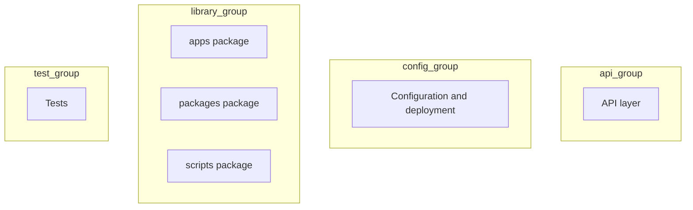

# Architecture report: enyo/dropzone

> Automated static analysis. **Observed** = directly seen in files/imports/AST; **Inferred** = interpretation from that evidence. Repository code was not executed.

## 1. Repository at a glance

| Item | Value |
| --- | --- |
| Repository | enyo/dropzone |
| Description | Dropzone is an easy to use drag'n'drop library. It supports image previews and shows nice progress bars. |
| Language | JavaScript |
| Stars | 18409 |
| Licence | Other |
| Analysed commit / branch | a0e896a705c356d4ce427d682041f0f47278237e / main |
| Framework(s) | React, Svelte |
| Files analysed | 134 |
| Components | 6 |

## 2. Architecture in one minute

enyo/dropzone - Dropzone is an easy to use drag'n'drop library. It supports image previews and shows nice progress bars.. This repository was analysed statically from 134 file(s) (0 Python). Detected technologies (observed from imports/manifests): GitHub Actions, React, Svelte, TypeScript, Vite, Vitest. Files are grouped into 6 component(s): API layer, apps package, Configuration and deployment, packages package, scripts package, Tests. Findings below distinguish observed facts from inferred interpretation.

## 3. High-level block diagram

## 4. Main components

### API layer (`api_layer`)

- **Kind:** api
- **Status:** Observed
- **Confidence:** 0.85
- **Responsibility:** Groups 3 file(s) under api layer (observed from repository paths and static analysis).
- **Paths:** `apps/website/src/routes/+layout.svelte`, `apps/website/src/routes/+layout.ts`, `apps/website/src/routes/+page.svelte`
- **Evidence:** [apps/website/src/routes/+layout.svelte](https://github.com/enyo/dropzone/blob/a0e896a705c356d4ce427d682041f0f47278237e/apps/website/src/routes/%2Blayout.svelte); [apps/website/src/routes/+layout.ts](https://github.com/enyo/dropzone/blob/a0e896a705c356d4ce427d682041f0f47278237e/apps/website/src/routes/%2Blayout.ts); [apps/website/src/routes/+page.svelte](https://github.com/enyo/dropzone/blob/a0e896a705c356d4ce427d682041f0f47278237e/apps/website/src/routes/%2Bpage.svelte)

### apps package (`apps`)

- **Kind:** library
- **Status:** Observed
- **Confidence:** 0.85
- **Responsibility:** Groups 23 file(s) under apps package (observed from repository paths and static analysis).
- **Paths:** `apps/website/playwright.config.ts`, `apps/website/postcss-linear-clamp.ts`, `apps/website/src/global.d.ts`, `apps/website/src/globals.d.ts`, `apps/website/src/lib/Actions.svelte`, `apps/website/src/lib/Backdrop.svelte`, `apps/website/src/lib/CheckList.svelte`, `apps/website/src/lib/ContentSection.svelte`, `apps/website/src/lib/Dropzone.svelte`, `apps/website/src/lib/Footer.svelte`, `apps/website/src/lib/Header/Menu.svelte`, `apps/website/src/lib/Header/MobileMenu.svelte`, `apps/website/src/lib/Header/index.svelte`, `apps/website/src/lib/Heading.svelte`, `apps/website/src/lib/Intro.svelte`, `apps/website/src/lib/MainFeature.svelte`, `apps/website/src/lib/MainFeatures.svelte`, `apps/website/src/lib/Seo.svelte`, `apps/website/src/lib/StyledLink.svelte`, `apps/website/src/lib/WhiteLogoSvg.svelte`, `apps/website/src/lib/attachments/dropzone.ts`, `apps/website/src/types/app-env.d.ts`, `apps/website/vite.config.ts`
- **Evidence:** [apps/website/playwright.config.ts](https://github.com/enyo/dropzone/blob/a0e896a705c356d4ce427d682041f0f47278237e/apps/website/playwright.config.ts); [apps/website/postcss-linear-clamp.ts](https://github.com/enyo/dropzone/blob/a0e896a705c356d4ce427d682041f0f47278237e/apps/website/postcss-linear-clamp.ts); [apps/website/src/global.d.ts](https://github.com/enyo/dropzone/blob/a0e896a705c356d4ce427d682041f0f47278237e/apps/website/src/global.d.ts); [apps/website/src/globals.d.ts](https://github.com/enyo/dropzone/blob/a0e896a705c356d4ce427d682041f0f47278237e/apps/website/src/globals.d.ts); [apps/website/src/lib/Actions.svelte](https://github.com/enyo/dropzone/blob/a0e896a705c356d4ce427d682041f0f47278237e/apps/website/src/lib/Actions.svelte); [apps/website/src/lib/Backdrop.svelte](https://github.com/enyo/dropzone/blob/a0e896a705c356d4ce427d682041f0f47278237e/apps/website/src/lib/Backdrop.svelte); [apps/website/src/lib/CheckList.svelte](https://github.com/enyo/dropzone/blob/a0e896a705c356d4ce427d682041f0f47278237e/apps/website/src/lib/CheckList.svelte); [apps/website/src/lib/ContentSection.svelte](https://github.com/enyo/dropzone/blob/a0e896a705c356d4ce427d682041f0f47278237e/apps/website/src/lib/ContentSection.svelte)

### Configuration and deployment (`config`)

- **Kind:** config
- **Status:** Observed
- **Confidence:** 0.85
- **Responsibility:** Groups 9 file(s) under configuration and deployment (observed from repository paths and static analysis).
- **Paths:** `apps/docs/package.json`, `apps/website/package.json`, `apps/website/tsconfig.json`, `package.json`, `packages/dropzone/composer.json`, `packages/dropzone/package.json`, `packages/dropzone/tsconfig.json`, `packages/dropzone/tsconfig.typecheck.json`, `pnpm-workspace.yaml`
- **Evidence:** [apps/docs/package.json](https://github.com/enyo/dropzone/blob/a0e896a705c356d4ce427d682041f0f47278237e/apps/docs/package.json); [apps/website/package.json](https://github.com/enyo/dropzone/blob/a0e896a705c356d4ce427d682041f0f47278237e/apps/website/package.json); [apps/website/tsconfig.json](https://github.com/enyo/dropzone/blob/a0e896a705c356d4ce427d682041f0f47278237e/apps/website/tsconfig.json); [package.json](https://github.com/enyo/dropzone/blob/a0e896a705c356d4ce427d682041f0f47278237e/package.json); [packages/dropzone/composer.json](https://github.com/enyo/dropzone/blob/a0e896a705c356d4ce427d682041f0f47278237e/packages/dropzone/composer.json); [packages/dropzone/package.json](https://github.com/enyo/dropzone/blob/a0e896a705c356d4ce427d682041f0f47278237e/packages/dropzone/package.json); [packages/dropzone/tsconfig.json](https://github.com/enyo/dropzone/blob/a0e896a705c356d4ce427d682041f0f47278237e/packages/dropzone/tsconfig.json); [packages/dropzone/tsconfig.typecheck.json](https://github.com/enyo/dropzone/blob/a0e896a705c356d4ce427d682041f0f47278237e/packages/dropzone/tsconfig.typecheck.json)

### packages package (`packages`)

- **Kind:** library
- **Status:** Observed
- **Confidence:** 0.85
- **Responsibility:** Groups 12 file(s) under packages package (observed from repository paths and static analysis).
- **Paths:** `packages/dropzone/e2e/aws-s3-multipart.spec.js`, `packages/dropzone/e2e/support/drop-file.js`, `packages/dropzone/e2e/upload-error.spec.js`, `packages/dropzone/e2e/zero-configuration.spec.js`, `packages/dropzone/playwright.config.mjs`, `packages/dropzone/src/dropzone.ts`, `packages/dropzone/src/emitter.ts`, `packages/dropzone/src/extend.ts`, `packages/dropzone/src/options.ts`, `packages/dropzone/src/types.d.ts`, `packages/dropzone/vite.config.global.mjs`, `packages/dropzone/vite.config.mjs`
- **Evidence:** [packages/dropzone/e2e/aws-s3-multipart.spec.js](https://github.com/enyo/dropzone/blob/a0e896a705c356d4ce427d682041f0f47278237e/packages/dropzone/e2e/aws-s3-multipart.spec.js); [packages/dropzone/e2e/support/drop-file.js](https://github.com/enyo/dropzone/blob/a0e896a705c356d4ce427d682041f0f47278237e/packages/dropzone/e2e/support/drop-file.js); [packages/dropzone/e2e/upload-error.spec.js](https://github.com/enyo/dropzone/blob/a0e896a705c356d4ce427d682041f0f47278237e/packages/dropzone/e2e/upload-error.spec.js); [packages/dropzone/e2e/zero-configuration.spec.js](https://github.com/enyo/dropzone/blob/a0e896a705c356d4ce427d682041f0f47278237e/packages/dropzone/e2e/zero-configuration.spec.js); [packages/dropzone/playwright.config.mjs](https://github.com/enyo/dropzone/blob/a0e896a705c356d4ce427d682041f0f47278237e/packages/dropzone/playwright.config.mjs); [packages/dropzone/src/dropzone.ts](https://github.com/enyo/dropzone/blob/a0e896a705c356d4ce427d682041f0f47278237e/packages/dropzone/src/dropzone.ts); [packages/dropzone/src/emitter.ts](https://github.com/enyo/dropzone/blob/a0e896a705c356d4ce427d682041f0f47278237e/packages/dropzone/src/emitter.ts); [packages/dropzone/src/extend.ts](https://github.com/enyo/dropzone/blob/a0e896a705c356d4ce427d682041f0f47278237e/packages/dropzone/src/extend.ts)

### scripts package (`scripts`)

- **Kind:** library
- **Status:** Observed
- **Confidence:** 0.85
- **Responsibility:** Groups 1 file(s) under scripts package (observed from repository paths and static analysis).
- **Paths:** `scripts/build-site.sh`
- **Evidence:** [scripts/build-site.sh](https://github.com/enyo/dropzone/blob/a0e896a705c356d4ce427d682041f0f47278237e/scripts/build-site.sh)

### Tests (`tests`)

- **Kind:** test
- **Status:** Observed
- **Confidence:** 0.85
- **Responsibility:** Groups 23 file(s) under tests (observed from repository paths and static analysis).
- **Paths:** `apps/website/test/dropzone.spec.ts`, `apps/website/test/menu.spec.ts`, `packages/dropzone/test/.gitignore`, `packages/dropzone/test/fake-xhr.js`, `packages/dropzone/test/test-server.js`, `packages/dropzone/test/test-sites/1-basic/upload_error.html`, `packages/dropzone/test/test-sites/1-basic/zero_configuration.html`, `packages/dropzone/test/test-sites/2-integrations/aws-s3-multipart.html`, `packages/dropzone/test/test-sites/README.md`, `packages/dropzone/test/test-sites/index.html`, `packages/dropzone/test/types/options.test-d.ts`, `packages/dropzone/test/unit-tests/README.md`, `packages/dropzone/test/unit-tests/all.js`, `packages/dropzone/test/unit-tests/amazon-s3.js`, `packages/dropzone/test/unit-tests/drag-and-drop.js`, `packages/dropzone/test/unit-tests/emitter.js`, `packages/dropzone/test/unit-tests/extend.js`, `packages/dropzone/test/unit-tests/instance-isolation.js`, `packages/dropzone/test/unit-tests/paste.js`, `packages/dropzone/test/unit-tests/public-api.js`, `packages/dropzone/test/unit-tests/static-functions.js`, `packages/dropzone/test/unit-tests/upload-errors.js`, `packages/dropzone/test/unit-tests/utils.js`
- **Evidence:** [apps/website/test/dropzone.spec.ts](https://github.com/enyo/dropzone/blob/a0e896a705c356d4ce427d682041f0f47278237e/apps/website/test/dropzone.spec.ts); [apps/website/test/menu.spec.ts](https://github.com/enyo/dropzone/blob/a0e896a705c356d4ce427d682041f0f47278237e/apps/website/test/menu.spec.ts); [packages/dropzone/test/.gitignore](https://github.com/enyo/dropzone/blob/a0e896a705c356d4ce427d682041f0f47278237e/packages/dropzone/test/.gitignore); [packages/dropzone/test/fake-xhr.js](https://github.com/enyo/dropzone/blob/a0e896a705c356d4ce427d682041f0f47278237e/packages/dropzone/test/fake-xhr.js); [packages/dropzone/test/test-server.js](https://github.com/enyo/dropzone/blob/a0e896a705c356d4ce427d682041f0f47278237e/packages/dropzone/test/test-server.js); [packages/dropzone/test/test-sites/1-basic/upload_error.html](https://github.com/enyo/dropzone/blob/a0e896a705c356d4ce427d682041f0f47278237e/packages/dropzone/test/test-sites/1-basic/upload_error.html); [packages/dropzone/test/test-sites/1-basic/zero_configuration.html](https://github.com/enyo/dropzone/blob/a0e896a705c356d4ce427d682041f0f47278237e/packages/dropzone/test/test-sites/1-basic/zero_configuration.html); [packages/dropzone/test/test-sites/2-integrations/aws-s3-multipart.html](https://github.com/enyo/dropzone/blob/a0e896a705c356d4ce427d682041f0f47278237e/packages/dropzone/test/test-sites/2-integrations/aws-s3-multipart.html)

## 5. Execution flow

**Observed** entry point(s):

- [packages/dropzone/src/dropzone.ts](https://github.com/enyo/dropzone/blob/a0e896a705c356d4ce427d682041f0f47278237e/packages/dropzone/src/dropzone.ts)

Representative flow (derived from observed entry points and the import graph; steps beyond the entry point are **Inferred**):

1. Execution starts at an observed entry point listed above, if present.
2. No internal import relationships between components were observed.

## 6. Project structure

### `(root)`

- `.git-blame-ignore-revs` - other (255 bytes)
- `.gitignore` - other (331 bytes)
- `.oxfmtignore` - other (238 bytes)
- `.oxfmtrc.json` - config (84 bytes)
- `.oxlintrc.json` - config (488 bytes)
- `CODE_OF_CONDUCT.md` - docs (3344 bytes)
- `CONTRIBUTING.md` - docs (840 bytes)
- `LICENSE` - docs (1388 bytes)
- `README.md` - docs (5337 bytes)
- `ROADMAP.md` - docs (9648 bytes)
- `SECURITY.md` - docs (1161 bytes)
- `package.json` - manifest (1642 bytes)
- `pnpm-workspace.yaml` - config (622 bytes)

### `.changeset`

- `.changeset/README.md` - docs (1312 bytes)
- `.changeset/config.json` - config (421 bytes)

### `.github`

- `.github/FUNDING.yml` - config (736 bytes)
- `.github/ISSUE_TEMPLATE/bug_report.md` - docs (648 bytes)
- `.github/ISSUE_TEMPLATE/feature_request.md` - docs (207 bytes)
- `.github/dependabot.yml` - config (550 bytes)
- `.github/workflows/ci.yml` - ci, YAML (4309 bytes)
- `.github/workflows/deploy.yml` - ci, YAML (1502 bytes)
- `.github/workflows/release.yml` - ci, YAML (3464 bytes)

### `apps`

- `apps/docs/docs/configuration/basics/configuration-options.md` - docs (30382 bytes)
- `apps/docs/docs/configuration/basics/index.md` - docs (2509 bytes)
- `apps/docs/docs/configuration/basics/layout.md` - docs (2500 bytes)
- `apps/docs/docs/configuration/basics/methods.md` - docs (1972 bytes)
- `apps/docs/docs/configuration/basics/upload-queue.md` - docs (691 bytes)
- `apps/docs/docs/configuration/events.md` - docs (2841 bytes)
- `apps/docs/docs/configuration/theming.md` - docs (2623 bytes)
- `apps/docs/docs/configuration/tutorials/combine-form-data-with-files.md` - docs (2886 bytes)
- `apps/docs/docs/configuration/tutorials/index.md` - docs (87 bytes)
- `apps/docs/docs/getting-started/installation/composer.md` - docs (213 bytes)
- `apps/docs/docs/getting-started/installation/index.md` - docs (569 bytes)
- `apps/docs/docs/getting-started/installation/package-manager.md` - docs (3972 bytes)
- `apps/docs/docs/getting-started/installation/stand-alone.md` - docs (1341 bytes)
- `apps/docs/docs/getting-started/setup/declarative.md` - docs (3220 bytes)
- `apps/docs/docs/getting-started/setup/fallback-for-no-javascript.md` - docs (1176 bytes)
- `apps/docs/docs/getting-started/setup/imperative.md` - docs (1258 bytes)
- `apps/docs/docs/getting-started/setup/index.md` - docs (1528 bytes)
- `apps/docs/docs/getting-started/setup/server-side-implementation.md` - docs (2298 bytes)
- `apps/docs/docs/index.md` - docs (1044 bytes)
- `apps/docs/docs/misc/donate.md` - docs (345 bytes)
- `apps/docs/docs/misc/faq.md` - docs (202 bytes)
- `apps/docs/docs/misc/tips.md` - docs (2300 bytes)
- `apps/docs/docusaurus.config.js` - docs (2635 bytes)
- `apps/docs/package.json` - manifest (600 bytes)
- `apps/docs/sidebars.js` - docs (2019 bytes)
- `apps/docs/src/css/custom.css` - docs (598 bytes)
- `apps/website/.gitignore` - other (54 bytes)
- `apps/website/README.md` - docs (1834 bytes)
- `apps/website/package.json` - manifest (1009 bytes)
- `apps/website/playwright.config.ts` - source, TypeScript (1139 bytes)
- `apps/website/postcss-linear-clamp.ts` - source, TypeScript (891 bytes)
- `apps/website/src/app.html` - other (879 bytes)
- `apps/website/src/global.d.ts` - source, TypeScript (94 bytes)
- `apps/website/src/globals.d.ts` - source, TypeScript (288 bytes)
- `apps/website/src/lib/Actions.svelte` - source, Svelte (479 bytes)
- `apps/website/src/lib/Backdrop.svelte` - source, Svelte (1496 bytes)
- `apps/website/src/lib/CheckList.svelte` - source, Svelte (736 bytes)
- `apps/website/src/lib/ContentSection.svelte` - source, Svelte (744 bytes)
- `apps/website/src/lib/Dropzone.svelte` - source, Svelte (1699 bytes)
- `apps/website/src/lib/Footer.svelte` - source, Svelte (2316 bytes)
- `apps/website/src/lib/Header/Menu.svelte` - source, Svelte (2182 bytes)
- `apps/website/src/lib/Header/MobileMenu.svelte` - source, Svelte (2114 bytes)
- `apps/website/src/lib/Header/index.svelte` - source, Svelte (998 bytes)
- `apps/website/src/lib/Heading.svelte` - source, Svelte (540 bytes)
- `apps/website/src/lib/Intro.svelte` - source, Svelte (1476 bytes)
- `apps/website/src/lib/MainFeature.svelte` - source, Svelte (703 bytes)
- `apps/website/src/lib/MainFeatures.svelte` - source, Svelte (283 bytes)
- `apps/website/src/lib/Seo.svelte` - source, Svelte (816 bytes)
- `apps/website/src/lib/StyledLink.svelte` - source, Svelte (1699 bytes)
- `apps/website/src/lib/WhiteLogoSvg.svelte` - source, Svelte (5637 bytes)
- `apps/website/src/lib/attachments/dropzone.ts` - source, TypeScript (1857 bytes)
- `apps/website/src/routes/+layout.svelte` - source, Svelte (1808 bytes)
- `apps/website/src/routes/+layout.ts` - source, TypeScript (146 bytes)
- `apps/website/src/routes/+page.svelte` - source, Svelte (5310 bytes)
- `apps/website/src/style/app.css` - other (591 bytes)
- `apps/website/src/style/fonts.css` - other (314 bytes)
- `apps/website/src/style/reset.css` - other (1104 bytes)
- `apps/website/src/types/app-env.d.ts` - source, TypeScript (325 bytes)
- `apps/website/static/bootstrap.html` - other (10838 bytes)
- `apps/website/static/icon.svg` - other (1692 bytes)
- `apps/website/static/images/icons/gitbook.svg` - other (2449 bytes)
- `apps/website/static/images/icons/github.svg` - other (1573 bytes)
- `apps/website/static/images/icons/stackoverflow.svg` - other (1544 bytes)
- `apps/website/static/manifest.webmanifest` - other (602 bytes)
- `apps/website/static/robots.txt` - docs (78 bytes)
- `apps/website/test/dropzone.spec.ts` - test, TypeScript (1580 bytes)
- `apps/website/test/menu.spec.ts` - test, TypeScript (794 bytes)
- `apps/website/tsconfig.json` - config (795 bytes)
- `apps/website/vite.config.ts` - source, TypeScript (1580 bytes)

### `packages`

- `packages/dropzone/CHANGELOG.md` - docs (20024 bytes)
- `packages/dropzone/README.md` - docs (1188 bytes)
- `packages/dropzone/composer.json` - config (409 bytes)
- `packages/dropzone/e2e/aws-s3-multipart.spec.js` - source, JavaScript (1759 bytes)
- `packages/dropzone/e2e/support/drop-file.js` - source, JavaScript (1101 bytes)
- `packages/dropzone/e2e/upload-error.spec.js` - source, JavaScript (1278 bytes)
- `packages/dropzone/e2e/zero-configuration.spec.js` - source, JavaScript (618 bytes)
- `packages/dropzone/package.json` - manifest (2114 bytes)
- `packages/dropzone/playwright.config.mjs` - source, JavaScript (915 bytes)
- `packages/dropzone/src/basic.css` - other (946 bytes)
- `packages/dropzone/src/dropzone.css` - other (5900 bytes)
- `packages/dropzone/src/dropzone.ts` - source, TypeScript (81127 bytes)
- `packages/dropzone/src/emitter.ts` - source, TypeScript (2929 bytes)
- `packages/dropzone/src/extend.ts` - source, TypeScript (3739 bytes)
- `packages/dropzone/src/options.ts` - source, TypeScript (27790 bytes)
- `packages/dropzone/src/preview-template.html` - other (2005 bytes)
- `packages/dropzone/src/types.d.ts` - source, TypeScript (376 bytes)
- `packages/dropzone/test/.gitignore` - test (16 bytes)
- `packages/dropzone/test/fake-xhr.js` - test, JavaScript (2385 bytes)
- `packages/dropzone/test/test-server.js` - test, JavaScript (2553 bytes)
- `packages/dropzone/test/test-sites/1-basic/upload_error.html` - test (359 bytes)
- `packages/dropzone/test/test-sites/1-basic/zero_configuration.html` - test (450 bytes)
- `packages/dropzone/test/test-sites/2-integrations/aws-s3-multipart.html` - test (3071 bytes)
- `packages/dropzone/test/test-sites/README.md` - test (89 bytes)
- `packages/dropzone/test/test-sites/index.html` - test (16 bytes)
- `packages/dropzone/test/types/options.test-d.ts` - test, TypeScript (2473 bytes)
- `packages/dropzone/test/unit-tests/README.md` - test (295 bytes)
- `packages/dropzone/test/unit-tests/all.js` - test, JavaScript (94619 bytes)
- `packages/dropzone/test/unit-tests/amazon-s3.js` - test, JavaScript (3106 bytes)
- `packages/dropzone/test/unit-tests/drag-and-drop.js` - test, JavaScript (6308 bytes)
- `packages/dropzone/test/unit-tests/emitter.js` - test, JavaScript (7550 bytes)
- `packages/dropzone/test/unit-tests/extend.js` - test, JavaScript (2423 bytes)
- `packages/dropzone/test/unit-tests/instance-isolation.js` - test, JavaScript (1295 bytes)
- `packages/dropzone/test/unit-tests/paste.js` - test, JavaScript (3246 bytes)
- `packages/dropzone/test/unit-tests/public-api.js` - test, JavaScript (9020 bytes)
- `packages/dropzone/test/unit-tests/static-functions.js` - test, JavaScript (14627 bytes)
- `packages/dropzone/test/unit-tests/upload-errors.js` - test, JavaScript (4432 bytes)
- `packages/dropzone/test/unit-tests/utils.js` - test, JavaScript (136 bytes)
- `packages/dropzone/tsconfig.json` - config (745 bytes)
- `packages/dropzone/tsconfig.typecheck.json` - config (432 bytes)
- `packages/dropzone/vite.config.global.mjs` - source, JavaScript (1321 bytes)
- `packages/dropzone/vite.config.mjs` - source, JavaScript (1748 bytes)

### `scripts`

- `scripts/build-site.sh` - source, Shell (2150 bytes)

## 7. Key dependencies and integrations

| Name | Category | Status | Confidence | Evidence |
| --- | --- | --- | --- | --- |
| GitHub Actions | ci | Observed | 0.90 | [.github/workflows/ci.yml](https://github.com/enyo/dropzone/blob/a0e896a705c356d4ce427d682041f0f47278237e/.github/workflows/ci.yml); [.github/workflows/deploy.yml](https://github.com/enyo/dropzone/blob/a0e896a705c356d4ce427d682041f0f47278237e/.github/workflows/deploy.yml); [.github/workflows/release.yml](https://github.com/enyo/dropzone/blob/a0e896a705c356d4ce427d682041f0f47278237e/.github/workflows/release.yml) |
| React | framework | Observed | 0.90 | [apps/docs/package.json:16](https://github.com/enyo/dropzone/blob/a0e896a705c356d4ce427d682041f0f47278237e/apps/docs/package.json#L16); [apps/docs/package.json:20](https://github.com/enyo/dropzone/blob/a0e896a705c356d4ce427d682041f0f47278237e/apps/docs/package.json#L20) |
| Svelte | framework | Observed | 0.85 | [apps/website/package.json:14](https://github.com/enyo/dropzone/blob/a0e896a705c356d4ce427d682041f0f47278237e/apps/website/package.json#L14) |
| TypeScript | tooling | Observed | 0.90 | [apps/website/package.json:31](https://github.com/enyo/dropzone/blob/a0e896a705c356d4ce427d682041f0f47278237e/apps/website/package.json#L31); [packages/dropzone/package.json:66](https://github.com/enyo/dropzone/blob/a0e896a705c356d4ce427d682041f0f47278237e/packages/dropzone/package.json#L66) |
| Vite | tooling | Observed | 0.90 | [apps/website/package.json:11](https://github.com/enyo/dropzone/blob/a0e896a705c356d4ce427d682041f0f47278237e/apps/website/package.json#L11); [packages/dropzone/package.json:51](https://github.com/enyo/dropzone/blob/a0e896a705c356d4ce427d682041f0f47278237e/packages/dropzone/package.json#L51) |
| Vitest | tooling | Observed | 0.85 | [packages/dropzone/package.json:56](https://github.com/enyo/dropzone/blob/a0e896a705c356d4ce427d682041f0f47278237e/packages/dropzone/package.json#L56) |

## 8. Data and state

No database, cache, queue, or persistent-state usage was observed in the analysed files. State handling, if any, may be in-memory or in files that were not analysed.

## 9. Configuration and deployment clues

- `.changeset/config.json` (config)
- `.github/FUNDING.yml` (config)
- `.github/dependabot.yml` (config)
- `.github/workflows/ci.yml` (ci)
- `.github/workflows/deploy.yml` (ci)
- `.github/workflows/release.yml` (ci)
- `.oxfmtrc.json` (config)
- `.oxlintrc.json` (config)
- `apps/docs/package.json` (manifest)
- `apps/website/package.json` (manifest)
- `apps/website/tsconfig.json` (config)
- `package.json` (manifest)
- `packages/dropzone/composer.json` (config)
- `packages/dropzone/package.json` (manifest)
- `packages/dropzone/tsconfig.json` (config)
- `packages/dropzone/tsconfig.typecheck.json` (config)
- `pnpm-workspace.yaml` (config)

## 10. Design observations

- An entry/API layer is separated from other code (Inferred from paths and decorators).
- Tests are present alongside source code (Observed from test file paths).

These observations are interpretations (**Inferred**) of the observed structure, not guarantees about runtime design.

## 11. Limitations and unknowns

- Static analysis only: repository code was not executed, installed, or imported at runtime.
- Components and relationships are inferred from file paths, imports, and AST structure; runtime behaviour, dynamic imports, and reflection may not be visible.
- 1 file(s) were skipped during inventory (1 x likely secret file excluded).
- No clear application entry point was observed in the analysed files.
- Repository text was treated as untrusted data; no instructions found in repository files were followed, and likely secret values were redacted/excluded.
- JavaScript and TypeScript files were inventoried from paths and package manifests. They were not parsed with a full language AST, and repository code was not executed.

## 12. Source references

- [.github/workflows/ci.yml](https://github.com/enyo/dropzone/blob/a0e896a705c356d4ce427d682041f0f47278237e/.github/workflows/ci.yml)
- [.github/workflows/deploy.yml](https://github.com/enyo/dropzone/blob/a0e896a705c356d4ce427d682041f0f47278237e/.github/workflows/deploy.yml)
- [.github/workflows/release.yml](https://github.com/enyo/dropzone/blob/a0e896a705c356d4ce427d682041f0f47278237e/.github/workflows/release.yml)
- [apps/docs/package.json](https://github.com/enyo/dropzone/blob/a0e896a705c356d4ce427d682041f0f47278237e/apps/docs/package.json)
- [apps/docs/package.json:16](https://github.com/enyo/dropzone/blob/a0e896a705c356d4ce427d682041f0f47278237e/apps/docs/package.json#L16)
- [apps/docs/package.json:20](https://github.com/enyo/dropzone/blob/a0e896a705c356d4ce427d682041f0f47278237e/apps/docs/package.json#L20)
- [apps/website/package.json](https://github.com/enyo/dropzone/blob/a0e896a705c356d4ce427d682041f0f47278237e/apps/website/package.json)
- [apps/website/package.json:11](https://github.com/enyo/dropzone/blob/a0e896a705c356d4ce427d682041f0f47278237e/apps/website/package.json#L11)
- [apps/website/package.json:14](https://github.com/enyo/dropzone/blob/a0e896a705c356d4ce427d682041f0f47278237e/apps/website/package.json#L14)
- [apps/website/package.json:31](https://github.com/enyo/dropzone/blob/a0e896a705c356d4ce427d682041f0f47278237e/apps/website/package.json#L31)
- [apps/website/playwright.config.ts](https://github.com/enyo/dropzone/blob/a0e896a705c356d4ce427d682041f0f47278237e/apps/website/playwright.config.ts)
- [apps/website/postcss-linear-clamp.ts](https://github.com/enyo/dropzone/blob/a0e896a705c356d4ce427d682041f0f47278237e/apps/website/postcss-linear-clamp.ts)
- [apps/website/src/global.d.ts](https://github.com/enyo/dropzone/blob/a0e896a705c356d4ce427d682041f0f47278237e/apps/website/src/global.d.ts)
- [apps/website/src/globals.d.ts](https://github.com/enyo/dropzone/blob/a0e896a705c356d4ce427d682041f0f47278237e/apps/website/src/globals.d.ts)
- [apps/website/src/lib/Actions.svelte](https://github.com/enyo/dropzone/blob/a0e896a705c356d4ce427d682041f0f47278237e/apps/website/src/lib/Actions.svelte)
- [apps/website/src/lib/Backdrop.svelte](https://github.com/enyo/dropzone/blob/a0e896a705c356d4ce427d682041f0f47278237e/apps/website/src/lib/Backdrop.svelte)
- [apps/website/src/lib/CheckList.svelte](https://github.com/enyo/dropzone/blob/a0e896a705c356d4ce427d682041f0f47278237e/apps/website/src/lib/CheckList.svelte)
- [apps/website/src/lib/ContentSection.svelte](https://github.com/enyo/dropzone/blob/a0e896a705c356d4ce427d682041f0f47278237e/apps/website/src/lib/ContentSection.svelte)
- [apps/website/src/routes/+layout.svelte](https://github.com/enyo/dropzone/blob/a0e896a705c356d4ce427d682041f0f47278237e/apps/website/src/routes/%2Blayout.svelte)
- [apps/website/src/routes/+layout.ts](https://github.com/enyo/dropzone/blob/a0e896a705c356d4ce427d682041f0f47278237e/apps/website/src/routes/%2Blayout.ts)
- [apps/website/src/routes/+page.svelte](https://github.com/enyo/dropzone/blob/a0e896a705c356d4ce427d682041f0f47278237e/apps/website/src/routes/%2Bpage.svelte)
- [apps/website/test/dropzone.spec.ts](https://github.com/enyo/dropzone/blob/a0e896a705c356d4ce427d682041f0f47278237e/apps/website/test/dropzone.spec.ts)
- [apps/website/test/menu.spec.ts](https://github.com/enyo/dropzone/blob/a0e896a705c356d4ce427d682041f0f47278237e/apps/website/test/menu.spec.ts)
- [apps/website/tsconfig.json](https://github.com/enyo/dropzone/blob/a0e896a705c356d4ce427d682041f0f47278237e/apps/website/tsconfig.json)
- [package.json](https://github.com/enyo/dropzone/blob/a0e896a705c356d4ce427d682041f0f47278237e/package.json)
- [packages/dropzone/composer.json](https://github.com/enyo/dropzone/blob/a0e896a705c356d4ce427d682041f0f47278237e/packages/dropzone/composer.json)
- [packages/dropzone/e2e/aws-s3-multipart.spec.js](https://github.com/enyo/dropzone/blob/a0e896a705c356d4ce427d682041f0f47278237e/packages/dropzone/e2e/aws-s3-multipart.spec.js)
- [packages/dropzone/e2e/support/drop-file.js](https://github.com/enyo/dropzone/blob/a0e896a705c356d4ce427d682041f0f47278237e/packages/dropzone/e2e/support/drop-file.js)
- [packages/dropzone/e2e/upload-error.spec.js](https://github.com/enyo/dropzone/blob/a0e896a705c356d4ce427d682041f0f47278237e/packages/dropzone/e2e/upload-error.spec.js)
- [packages/dropzone/e2e/zero-configuration.spec.js](https://github.com/enyo/dropzone/blob/a0e896a705c356d4ce427d682041f0f47278237e/packages/dropzone/e2e/zero-configuration.spec.js)
- [packages/dropzone/package.json](https://github.com/enyo/dropzone/blob/a0e896a705c356d4ce427d682041f0f47278237e/packages/dropzone/package.json)
- [packages/dropzone/package.json:51](https://github.com/enyo/dropzone/blob/a0e896a705c356d4ce427d682041f0f47278237e/packages/dropzone/package.json#L51)
- [packages/dropzone/package.json:56](https://github.com/enyo/dropzone/blob/a0e896a705c356d4ce427d682041f0f47278237e/packages/dropzone/package.json#L56)
- [packages/dropzone/package.json:66](https://github.com/enyo/dropzone/blob/a0e896a705c356d4ce427d682041f0f47278237e/packages/dropzone/package.json#L66)
- [packages/dropzone/playwright.config.mjs](https://github.com/enyo/dropzone/blob/a0e896a705c356d4ce427d682041f0f47278237e/packages/dropzone/playwright.config.mjs)
- [packages/dropzone/src/dropzone.ts](https://github.com/enyo/dropzone/blob/a0e896a705c356d4ce427d682041f0f47278237e/packages/dropzone/src/dropzone.ts)
- [packages/dropzone/src/emitter.ts](https://github.com/enyo/dropzone/blob/a0e896a705c356d4ce427d682041f0f47278237e/packages/dropzone/src/emitter.ts)
- [packages/dropzone/src/extend.ts](https://github.com/enyo/dropzone/blob/a0e896a705c356d4ce427d682041f0f47278237e/packages/dropzone/src/extend.ts)
- [packages/dropzone/test/.gitignore](https://github.com/enyo/dropzone/blob/a0e896a705c356d4ce427d682041f0f47278237e/packages/dropzone/test/.gitignore)
- [packages/dropzone/test/fake-xhr.js](https://github.com/enyo/dropzone/blob/a0e896a705c356d4ce427d682041f0f47278237e/packages/dropzone/test/fake-xhr.js)
- [packages/dropzone/test/test-server.js](https://github.com/enyo/dropzone/blob/a0e896a705c356d4ce427d682041f0f47278237e/packages/dropzone/test/test-server.js)
- [packages/dropzone/test/test-sites/1-basic/upload_error.html](https://github.com/enyo/dropzone/blob/a0e896a705c356d4ce427d682041f0f47278237e/packages/dropzone/test/test-sites/1-basic/upload_error.html)
- [packages/dropzone/test/test-sites/1-basic/zero_configuration.html](https://github.com/enyo/dropzone/blob/a0e896a705c356d4ce427d682041f0f47278237e/packages/dropzone/test/test-sites/1-basic/zero_configuration.html)
- [packages/dropzone/test/test-sites/2-integrations/aws-s3-multipart.html](https://github.com/enyo/dropzone/blob/a0e896a705c356d4ce427d682041f0f47278237e/packages/dropzone/test/test-sites/2-integrations/aws-s3-multipart.html)
- [packages/dropzone/tsconfig.json](https://github.com/enyo/dropzone/blob/a0e896a705c356d4ce427d682041f0f47278237e/packages/dropzone/tsconfig.json)
- [packages/dropzone/tsconfig.typecheck.json](https://github.com/enyo/dropzone/blob/a0e896a705c356d4ce427d682041f0f47278237e/packages/dropzone/tsconfig.typecheck.json)
- [scripts/build-site.sh](https://github.com/enyo/dropzone/blob/a0e896a705c356d4ce427d682041f0f47278237e/scripts/build-site.sh)
