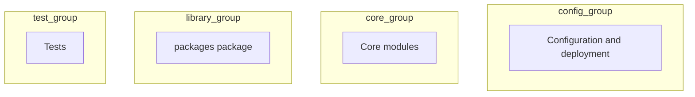

# Architecture report: enzymejs/enzyme

> Automated static analysis. **Observed** = directly seen in files/imports/AST; **Inferred** = interpretation from that evidence. Repository code was not executed.

## 1. Repository at a glance

| Item | Value |
| --- | --- |
| Repository | enzymejs/enzyme |
| Description | JavaScript Testing utilities for React |
| Language | JavaScript |
| Stars | 19800 |
| Licence | MIT |
| Analysed commit / branch | 61e1b47c4bdc4509b2ac286c0d3ae3df172d26f0 / master |
| Framework(s) | React |
| Files analysed | 399 |
| Components | 4 |

## 2. Architecture in one minute

enzymejs/enzyme - JavaScript Testing utilities for React. This repository was analysed statically from 399 file(s) (0 Python). Detected technologies (observed from imports/manifests): GitHub Actions, React, webpack. Files are grouped into 4 component(s): Configuration and deployment, Core modules, packages package, Tests. Findings below distinguish observed facts from inferred interpretation.

## 3. High-level block diagram

## 4. Main components

### Configuration and deployment (`config`)

- **Kind:** config
- **Status:** Observed
- **Confidence:** 0.85
- **Responsibility:** Groups 18 file(s) under configuration and deployment (observed from repository paths and static analysis).
- **Paths:** `book.json`, `lerna.json`, `package.json`, `packages/enzyme-adapter-react-13/package.json`, `packages/enzyme-adapter-react-14/package.json`, `packages/enzyme-adapter-react-15.4/package.json`, `packages/enzyme-adapter-react-15/package.json`, `packages/enzyme-adapter-react-16.1/package.json`, `packages/enzyme-adapter-react-16.2/package.json`, `packages/enzyme-adapter-react-16.3/package.json`, `packages/enzyme-adapter-react-16/package.json`, `packages/enzyme-adapter-react-helper/package.json`, `packages/enzyme-adapter-utils/package.json`, `packages/enzyme-example-mocha/package.json`, `packages/enzyme-shallow-equal/package.json`, `packages/enzyme-test-suite/package.json`, `packages/enzyme/package.json`, `tea.yaml`
- **Evidence:** [book.json](https://github.com/enzymejs/enzyme/blob/61e1b47c4bdc4509b2ac286c0d3ae3df172d26f0/book.json); [lerna.json](https://github.com/enzymejs/enzyme/blob/61e1b47c4bdc4509b2ac286c0d3ae3df172d26f0/lerna.json); [package.json](https://github.com/enzymejs/enzyme/blob/61e1b47c4bdc4509b2ac286c0d3ae3df172d26f0/package.json); [packages/enzyme-adapter-react-13/package.json](https://github.com/enzymejs/enzyme/blob/61e1b47c4bdc4509b2ac286c0d3ae3df172d26f0/packages/enzyme-adapter-react-13/package.json); [packages/enzyme-adapter-react-14/package.json](https://github.com/enzymejs/enzyme/blob/61e1b47c4bdc4509b2ac286c0d3ae3df172d26f0/packages/enzyme-adapter-react-14/package.json); [packages/enzyme-adapter-react-15.4/package.json](https://github.com/enzymejs/enzyme/blob/61e1b47c4bdc4509b2ac286c0d3ae3df172d26f0/packages/enzyme-adapter-react-15.4/package.json); [packages/enzyme-adapter-react-15/package.json](https://github.com/enzymejs/enzyme/blob/61e1b47c4bdc4509b2ac286c0d3ae3df172d26f0/packages/enzyme-adapter-react-15/package.json); [packages/enzyme-adapter-react-16.1/package.json](https://github.com/enzymejs/enzyme/blob/61e1b47c4bdc4509b2ac286c0d3ae3df172d26f0/packages/enzyme-adapter-react-16.1/package.json)

### Core modules (`core`)

- **Kind:** core
- **Status:** Observed
- **Confidence:** 0.85
- **Responsibility:** Groups 4 file(s) under core modules (observed from repository paths and static analysis).
- **Paths:** `env.js`, `install-relevant-react.sh`, `karma.conf.js`, `since.js`
- **Evidence:** [env.js](https://github.com/enzymejs/enzyme/blob/61e1b47c4bdc4509b2ac286c0d3ae3df172d26f0/env.js); [install-relevant-react.sh](https://github.com/enzymejs/enzyme/blob/61e1b47c4bdc4509b2ac286c0d3ae3df172d26f0/install-relevant-react.sh); [karma.conf.js](https://github.com/enzymejs/enzyme/blob/61e1b47c4bdc4509b2ac286c0d3ae3df172d26f0/karma.conf.js); [since.js](https://github.com/enzymejs/enzyme/blob/61e1b47c4bdc4509b2ac286c0d3ae3df172d26f0/since.js)

### packages package (`packages`)

- **Kind:** library
- **Status:** Observed
- **Confidence:** 0.85
- **Responsibility:** Groups 54 file(s) under packages package (observed from repository paths and static analysis).
- **Paths:** `packages/enzyme-adapter-react-13/src/ReactThirteenAdapter.js`, `packages/enzyme-adapter-react-13/src/ReactThirteenElementToTree.js`, `packages/enzyme-adapter-react-13/src/ReactThirteenMapNativeEventNames.js`, `packages/enzyme-adapter-react-13/src/index.js`, `packages/enzyme-adapter-react-14/src/ReactFourteenAdapter.js`, `packages/enzyme-adapter-react-14/src/index.js`, `packages/enzyme-adapter-react-15.4/src/ReactFifteenFourAdapter.js`, `packages/enzyme-adapter-react-15.4/src/index.js`, `packages/enzyme-adapter-react-15/src/ReactFifteenAdapter.js`, `packages/enzyme-adapter-react-15/src/index.js`, `packages/enzyme-adapter-react-16.1/src/ReactSixteenOneAdapter.js`, `packages/enzyme-adapter-react-16.1/src/index.js`, `packages/enzyme-adapter-react-16.2/src/ReactSixteenTwoAdapter.js`, `packages/enzyme-adapter-react-16.2/src/index.js`, `packages/enzyme-adapter-react-16.3/src/ReactSixteenThreeAdapter.js`, `packages/enzyme-adapter-react-16.3/src/index.js`, `packages/enzyme-adapter-react-16/src/ReactSixteenAdapter.js`, `packages/enzyme-adapter-react-16/src/detectFiberTags.js`, `packages/enzyme-adapter-react-16/src/findCurrentFiberUsingSlowPath.js`, `packages/enzyme-adapter-react-16/src/index.js`, `packages/enzyme-adapter-react-helper/src/enzyme-adapter-react-install.js`, `packages/enzyme-adapter-react-helper/src/getAdapterForReactVersion.js`, `packages/enzyme-adapter-react-helper/src/ifReact.js`, `packages/enzyme-adapter-react-helper/src/index.js`, `packages/enzyme-adapter-react-helper/src/safeSFC.jsx`, `packages/enzyme-adapter-utils/src/RootFinder.jsx`, `packages/enzyme-adapter-utils/src/Utils.js`, `packages/enzyme-adapter-utils/src/createMountWrapper.jsx`, `packages/enzyme-adapter-utils/src/createRenderWrapper.jsx`, `packages/enzyme-adapter-utils/src/index.js`, `packages/enzyme-adapter-utils/src/wrapWithSimpleWrapper.jsx`, `packages/enzyme-example-mocha/src/Foo.jsx`, `packages/enzyme-example-mocha/src/Foo.spec.jsx`, `packages/enzyme-shallow-equal/src/index.js`, `packages/enzyme/ReactWrapper.js`, `packages/enzyme/ShallowWrapper.js`, `packages/enzyme/mount.js`, `packages/enzyme/render.js`, `packages/enzyme/shallow.js`, `packages/enzyme/src/Debug.js`, `packages/enzyme/src/EnzymeAdapter.js`, `packages/enzyme/src/RSTTraversal.js`, `packages/enzyme/src/ReactWrapper.js`, `packages/enzyme/src/ShallowWrapper.js`, `packages/enzyme/src/Utils.js`, `packages/enzyme/src/configuration.js`, `packages/enzyme/src/getAdapter.js`, `packages/enzyme/src/index.js`, `packages/enzyme/src/mount.js`, `packages/enzyme/src/render.js`, `packages/enzyme/src/selectors.js`, `packages/enzyme/src/shallow.js`, `packages/enzyme/src/validateAdapter.js`, `packages/enzyme/withDom.js`
- **Evidence:** [packages/enzyme-adapter-react-13/src/ReactThirteenAdapter.js](https://github.com/enzymejs/enzyme/blob/61e1b47c4bdc4509b2ac286c0d3ae3df172d26f0/packages/enzyme-adapter-react-13/src/ReactThirteenAdapter.js); [packages/enzyme-adapter-react-13/src/ReactThirteenElementToTree.js](https://github.com/enzymejs/enzyme/blob/61e1b47c4bdc4509b2ac286c0d3ae3df172d26f0/packages/enzyme-adapter-react-13/src/ReactThirteenElementToTree.js); [packages/enzyme-adapter-react-13/src/ReactThirteenMapNativeEventNames.js](https://github.com/enzymejs/enzyme/blob/61e1b47c4bdc4509b2ac286c0d3ae3df172d26f0/packages/enzyme-adapter-react-13/src/ReactThirteenMapNativeEventNames.js); [packages/enzyme-adapter-react-13/src/index.js](https://github.com/enzymejs/enzyme/blob/61e1b47c4bdc4509b2ac286c0d3ae3df172d26f0/packages/enzyme-adapter-react-13/src/index.js); [packages/enzyme-adapter-react-14/src/ReactFourteenAdapter.js](https://github.com/enzymejs/enzyme/blob/61e1b47c4bdc4509b2ac286c0d3ae3df172d26f0/packages/enzyme-adapter-react-14/src/ReactFourteenAdapter.js); [packages/enzyme-adapter-react-14/src/index.js](https://github.com/enzymejs/enzyme/blob/61e1b47c4bdc4509b2ac286c0d3ae3df172d26f0/packages/enzyme-adapter-react-14/src/index.js); [packages/enzyme-adapter-react-15.4/src/ReactFifteenFourAdapter.js](https://github.com/enzymejs/enzyme/blob/61e1b47c4bdc4509b2ac286c0d3ae3df172d26f0/packages/enzyme-adapter-react-15.4/src/ReactFifteenFourAdapter.js); [packages/enzyme-adapter-react-15.4/src/index.js](https://github.com/enzymejs/enzyme/blob/61e1b47c4bdc4509b2ac286c0d3ae3df172d26f0/packages/enzyme-adapter-react-15.4/src/index.js)

### Tests (`tests`)

- **Kind:** test
- **Status:** Observed
- **Confidence:** 0.85
- **Responsibility:** Groups 115 file(s) under tests (observed from repository paths and static analysis).
- **Paths:** `packages/enzyme-example-mocha/test/.setup.js`, `packages/enzyme-example-mocha/test/mocha.opts`, `packages/enzyme-test-suite/test/Adapter-spec.jsx`, `packages/enzyme-test-suite/test/Debug-spec.jsx`, `packages/enzyme-test-suite/test/RSTTraversal-spec.jsx`, `packages/enzyme-test-suite/test/ReactWrapper-spec.jsx`, `packages/enzyme-test-suite/test/ShallowWrapper-spec.jsx`, `packages/enzyme-test-suite/test/Utils-spec.jsx`, `packages/enzyme-test-suite/test/_helpers/adapter.js`, `packages/enzyme-test-suite/test/_helpers/beforeEach.js`, `packages/enzyme-test-suite/test/_helpers/describeHooks.js`, `packages/enzyme-test-suite/test/_helpers/describeLifecycles.js`, `packages/enzyme-test-suite/test/_helpers/describeMethods.js`, `packages/enzyme-test-suite/test/_helpers/getLoadedLazyComponent.js`, `packages/enzyme-test-suite/test/_helpers/index.jsx`, `packages/enzyme-test-suite/test/_helpers/react-compat.js`, `packages/enzyme-test-suite/test/_helpers/realArrowFunction.js`, `packages/enzyme-test-suite/test/_helpers/selectors.js`, `packages/enzyme-test-suite/test/_helpers/setupAdapters.js`, `packages/enzyme-test-suite/test/_helpers/untranspiledArrowFunction.js`, `packages/enzyme-test-suite/test/_helpers/untranspiledSloppyReturnThis.js`, `packages/enzyme-test-suite/test/_helpers/version.js`, `packages/enzyme-test-suite/test/adapter-utils-spec.jsx`, `packages/enzyme-test-suite/test/enzyme-adapter-react-install-spec.js`, `packages/enzyme-test-suite/test/enzyme-shallow-equal-spec.js`, `packages/enzyme-test-suite/test/selector-spec.jsx`, `packages/enzyme-test-suite/test/shared/hooks/_hook.template`, `packages/enzyme-test-suite/test/shared/hooks/custom.jsx`, `packages/enzyme-test-suite/test/shared/hooks/useCallback.jsx`, `packages/enzyme-test-suite/test/shared/hooks/useContext.jsx`, `packages/enzyme-test-suite/test/shared/hooks/useDebugValue.jsx`, `packages/enzyme-test-suite/test/shared/hooks/useEffect.jsx`, `packages/enzyme-test-suite/test/shared/hooks/useImperativeHandle.jsx`, `packages/enzyme-test-suite/test/shared/hooks/useLayoutEffect.jsx`, `packages/enzyme-test-suite/test/shared/hooks/useMemo.jsx`, `packages/enzyme-test-suite/test/shared/hooks/useReducer.jsx`, `packages/enzyme-test-suite/test/shared/hooks/useRef.jsx`, `packages/enzyme-test-suite/test/shared/hooks/useState.jsx`, `packages/enzyme-test-suite/test/shared/lifecycles/componentDidCatch.jsx`, `packages/enzyme-test-suite/test/shared/lifecycles/componentDidMount.jsx`, `packages/enzyme-test-suite/test/shared/lifecycles/componentDidUpdate.jsx`, `packages/enzyme-test-suite/test/shared/lifecycles/componentWillUnmount.jsx`, `packages/enzyme-test-suite/test/shared/lifecycles/getDerivedStateFromError.jsx`, `packages/enzyme-test-suite/test/shared/lifecycles/getDerivedStateFromProps.jsx`, `packages/enzyme-test-suite/test/shared/lifecycles/getSnapshotBeforeUpdate.jsx`, `packages/enzyme-test-suite/test/shared/lifecycles/misc.jsx`, `packages/enzyme-test-suite/test/shared/methods/@@iterator.jsx`, `packages/enzyme-test-suite/test/shared/methods/_method.template`, `packages/enzyme-test-suite/test/shared/methods/at.jsx`, `packages/enzyme-test-suite/test/shared/methods/childAt.jsx`, `packages/enzyme-test-suite/test/shared/methods/children.jsx`, `packages/enzyme-test-suite/test/shared/methods/closest.jsx`, `packages/enzyme-test-suite/test/shared/methods/contains.jsx`, `packages/enzyme-test-suite/test/shared/methods/containsAllMatchingElements.jsx`, `packages/enzyme-test-suite/test/shared/methods/containsAnyMatchingElements.jsx`, `packages/enzyme-test-suite/test/shared/methods/containsMatchingElement.jsx`, `packages/enzyme-test-suite/test/shared/methods/context.jsx`, `packages/enzyme-test-suite/test/shared/methods/debug.jsx`, `packages/enzyme-test-suite/test/shared/methods/deprecatedInstanceProperties.jsx`, `packages/enzyme-test-suite/test/shared/methods/equals.jsx`, `packages/enzyme-test-suite/test/shared/methods/every.jsx`, `packages/enzyme-test-suite/test/shared/methods/everyWhere.jsx`, `packages/enzyme-test-suite/test/shared/methods/exists.jsx`, `packages/enzyme-test-suite/test/shared/methods/filter.jsx`, `packages/enzyme-test-suite/test/shared/methods/filterWhere.jsx`, `packages/enzyme-test-suite/test/shared/methods/find.jsx`, `packages/enzyme-test-suite/test/shared/methods/findWhere.jsx`, `packages/enzyme-test-suite/test/shared/methods/first.jsx`, `packages/enzyme-test-suite/test/shared/methods/flatMap.jsx`, `packages/enzyme-test-suite/test/shared/methods/forEach.jsx`, `packages/enzyme-test-suite/test/shared/methods/get.jsx`, `packages/enzyme-test-suite/test/shared/methods/getElement.jsx`, `packages/enzyme-test-suite/test/shared/methods/getElements.jsx`, `packages/enzyme-test-suite/test/shared/methods/getNode.jsx`, `packages/enzyme-test-suite/test/shared/methods/getNodes.jsx`, `packages/enzyme-test-suite/test/shared/methods/getWrappingComponent.jsx`, `packages/enzyme-test-suite/test/shared/methods/hasClass.jsx`, `packages/enzyme-test-suite/test/shared/methods/hostNodes.jsx`, `packages/enzyme-test-suite/test/shared/methods/html.jsx`, `packages/enzyme-test-suite/test/shared/methods/instance.jsx`, `packages/enzyme-test-suite/test/shared/methods/invoke.jsx`, `packages/enzyme-test-suite/test/shared/methods/is.jsx`, `packages/enzyme-test-suite/test/shared/methods/isEmpty.jsx`, `packages/enzyme-test-suite/test/shared/methods/isEmptyRender.jsx`, `packages/enzyme-test-suite/test/shared/methods/key.jsx`, `packages/enzyme-test-suite/test/shared/methods/last.jsx`, `packages/enzyme-test-suite/test/shared/methods/map.jsx`, `packages/enzyme-test-suite/test/shared/methods/matchesElement.jsx`, `packages/enzyme-test-suite/test/shared/methods/name.jsx`, `packages/enzyme-test-suite/test/shared/methods/not.jsx`, `packages/enzyme-test-suite/test/shared/methods/parent.jsx`, `packages/enzyme-test-suite/test/shared/methods/parents.jsx`, `packages/enzyme-test-suite/test/shared/methods/prop.jsx`, `packages/enzyme-test-suite/test/shared/methods/props.jsx`, `packages/enzyme-test-suite/test/shared/methods/reduce.jsx`, `packages/enzyme-test-suite/test/shared/methods/reduceRight.jsx`, `packages/enzyme-test-suite/test/shared/methods/render.jsx`, `packages/enzyme-test-suite/test/shared/methods/renderProp.jsx`, `packages/enzyme-test-suite/test/shared/methods/root.jsx`, `packages/enzyme-test-suite/test/shared/methods/setContext.jsx`, `packages/enzyme-test-suite/test/shared/methods/setProps.jsx`, `packages/enzyme-test-suite/test/shared/methods/setState.jsx`, `packages/enzyme-test-suite/test/shared/methods/simulate.jsx`, `packages/enzyme-test-suite/test/shared/methods/simulateError.jsx`, `packages/enzyme-test-suite/test/shared/methods/single.jsx`, `packages/enzyme-test-suite/test/shared/methods/slice.jsx`, `packages/enzyme-test-suite/test/shared/methods/some.jsx`, `packages/enzyme-test-suite/test/shared/methods/someWhere.jsx`, `packages/enzyme-test-suite/test/shared/methods/state.jsx`, `packages/enzyme-test-suite/test/shared/methods/tap.jsx`, `packages/enzyme-test-suite/test/shared/methods/text.jsx`, `packages/enzyme-test-suite/test/shared/methods/unmount.jsx`, `packages/enzyme-test-suite/test/shared/methods/wrap.jsx`, `packages/enzyme-test-suite/test/staticRender-spec.jsx`, `test/mocha.opts`
- **Evidence:** [packages/enzyme-example-mocha/test/.setup.js](https://github.com/enzymejs/enzyme/blob/61e1b47c4bdc4509b2ac286c0d3ae3df172d26f0/packages/enzyme-example-mocha/test/.setup.js); [packages/enzyme-example-mocha/test/mocha.opts](https://github.com/enzymejs/enzyme/blob/61e1b47c4bdc4509b2ac286c0d3ae3df172d26f0/packages/enzyme-example-mocha/test/mocha.opts); [packages/enzyme-test-suite/test/Adapter-spec.jsx](https://github.com/enzymejs/enzyme/blob/61e1b47c4bdc4509b2ac286c0d3ae3df172d26f0/packages/enzyme-test-suite/test/Adapter-spec.jsx); [packages/enzyme-test-suite/test/Debug-spec.jsx](https://github.com/enzymejs/enzyme/blob/61e1b47c4bdc4509b2ac286c0d3ae3df172d26f0/packages/enzyme-test-suite/test/Debug-spec.jsx); [packages/enzyme-test-suite/test/RSTTraversal-spec.jsx](https://github.com/enzymejs/enzyme/blob/61e1b47c4bdc4509b2ac286c0d3ae3df172d26f0/packages/enzyme-test-suite/test/RSTTraversal-spec.jsx); [packages/enzyme-test-suite/test/ReactWrapper-spec.jsx](https://github.com/enzymejs/enzyme/blob/61e1b47c4bdc4509b2ac286c0d3ae3df172d26f0/packages/enzyme-test-suite/test/ReactWrapper-spec.jsx); [packages/enzyme-test-suite/test/ShallowWrapper-spec.jsx](https://github.com/enzymejs/enzyme/blob/61e1b47c4bdc4509b2ac286c0d3ae3df172d26f0/packages/enzyme-test-suite/test/ShallowWrapper-spec.jsx); [packages/enzyme-test-suite/test/Utils-spec.jsx](https://github.com/enzymejs/enzyme/blob/61e1b47c4bdc4509b2ac286c0d3ae3df172d26f0/packages/enzyme-test-suite/test/Utils-spec.jsx)

## 5. Execution flow

**Observed** entry point(s):

- [packages/enzyme-adapter-react-13/src/index.js](https://github.com/enzymejs/enzyme/blob/61e1b47c4bdc4509b2ac286c0d3ae3df172d26f0/packages/enzyme-adapter-react-13/src/index.js)
- [packages/enzyme-adapter-react-14/src/index.js](https://github.com/enzymejs/enzyme/blob/61e1b47c4bdc4509b2ac286c0d3ae3df172d26f0/packages/enzyme-adapter-react-14/src/index.js)
- [packages/enzyme-adapter-react-15.4/src/index.js](https://github.com/enzymejs/enzyme/blob/61e1b47c4bdc4509b2ac286c0d3ae3df172d26f0/packages/enzyme-adapter-react-15.4/src/index.js)
- [packages/enzyme-adapter-react-15/src/index.js](https://github.com/enzymejs/enzyme/blob/61e1b47c4bdc4509b2ac286c0d3ae3df172d26f0/packages/enzyme-adapter-react-15/src/index.js)
- [packages/enzyme-adapter-react-16.1/src/index.js](https://github.com/enzymejs/enzyme/blob/61e1b47c4bdc4509b2ac286c0d3ae3df172d26f0/packages/enzyme-adapter-react-16.1/src/index.js)
- [packages/enzyme-adapter-react-16.2/src/index.js](https://github.com/enzymejs/enzyme/blob/61e1b47c4bdc4509b2ac286c0d3ae3df172d26f0/packages/enzyme-adapter-react-16.2/src/index.js)
- [packages/enzyme-adapter-react-16.3/src/index.js](https://github.com/enzymejs/enzyme/blob/61e1b47c4bdc4509b2ac286c0d3ae3df172d26f0/packages/enzyme-adapter-react-16.3/src/index.js)
- [packages/enzyme-adapter-react-16/src/index.js](https://github.com/enzymejs/enzyme/blob/61e1b47c4bdc4509b2ac286c0d3ae3df172d26f0/packages/enzyme-adapter-react-16/src/index.js)
- [packages/enzyme-adapter-react-helper/src/index.js](https://github.com/enzymejs/enzyme/blob/61e1b47c4bdc4509b2ac286c0d3ae3df172d26f0/packages/enzyme-adapter-react-helper/src/index.js)
- [packages/enzyme-adapter-utils/src/index.js](https://github.com/enzymejs/enzyme/blob/61e1b47c4bdc4509b2ac286c0d3ae3df172d26f0/packages/enzyme-adapter-utils/src/index.js)
- [packages/enzyme-shallow-equal/src/index.js](https://github.com/enzymejs/enzyme/blob/61e1b47c4bdc4509b2ac286c0d3ae3df172d26f0/packages/enzyme-shallow-equal/src/index.js)
- [packages/enzyme/src/index.js](https://github.com/enzymejs/enzyme/blob/61e1b47c4bdc4509b2ac286c0d3ae3df172d26f0/packages/enzyme/src/index.js)

Representative flow (derived from observed entry points and the import graph; steps beyond the entry point are **Inferred**):

1. Execution starts at an observed entry point listed above, if present.
2. No internal import relationships between components were observed.

## 6. Project structure

### `(root)`

- `.babelrc` - other (263 bytes)
- `.eslintrc` - other (2003 bytes)
- `.gitignore` - other (868 bytes)
- `.lgtm` - other (51 bytes)
- `.nycrc` - other (480 bytes)
- `CHANGELOG.md` - docs (36392 bytes)
- `CONTRIBUTING.md` - docs (6410 bytes)
- `INTHEWILD.md` - docs (1933 bytes)
- `LICENSE.md` - docs (1097 bytes)
- `MAINTAINERS` - other (53 bytes)
- `README.md` - docs (9755 bytes)
- `SUMMARY.md` - docs (8657 bytes)
- `book.json` - config (439 bytes)
- `env.js` - source, JavaScript (5014 bytes)
- `install-relevant-react.sh` - source, Shell (214 bytes)
- `karma.conf.js` - source, JavaScript (3291 bytes)
- `lerna.json` - config (112 bytes)
- `package.json` - manifest (4531 bytes)
- `since.js` - source, JavaScript (1087 bytes)
- `tea.yaml` - config (127 bytes)

### `.github`

- `.github/FUNDING.yml` - config (577 bytes)
- `.github/ISSUE_TEMPLATE/Bug_report.md` - docs (1494 bytes)
- `.github/ISSUE_TEMPLATE/Feature_request.md` - docs (566 bytes)
- `.github/workflows/node-pretest.yml` - ci, YAML (575 bytes)
- `.github/workflows/node.yml` - ci, YAML (4412 bytes)
- `.github/workflows/rebase.yml` - ci, YAML (257 bytes)
- `.github/workflows/require-allow-edits.yml` - ci, YAML (193 bytes)

### `docs`

- `docs/GLOSSARY.md` - docs (401 bytes)
- `docs/api/README.md` - docs (406 bytes)
- `docs/api/ReactWrapper/at.md` - docs (635 bytes)
- `docs/api/ReactWrapper/childAt.md` - docs (639 bytes)
- `docs/api/ReactWrapper/children.md` - docs (738 bytes)
- `docs/api/ReactWrapper/closest.md` - docs (706 bytes)
- `docs/api/ReactWrapper/contains.md` - docs (1992 bytes)
- `docs/api/ReactWrapper/containsAllMatchingElements.md` - docs (1616 bytes)
- `docs/api/ReactWrapper/containsAnyMatchingElements.md` - docs (1631 bytes)
- `docs/api/ReactWrapper/containsMatchingElement.md` - docs (1845 bytes)
- `docs/api/ReactWrapper/context.md` - docs (619 bytes)
- `docs/api/ReactWrapper/debug.md` - docs (1997 bytes)
- `docs/api/ReactWrapper/detach.md` - docs (2588 bytes)
- `docs/api/ReactWrapper/equals.md` - docs (1003 bytes)
- `docs/api/ReactWrapper/every.md` - docs (791 bytes)
- `docs/api/ReactWrapper/everyWhere.md` - docs (857 bytes)
- `docs/api/ReactWrapper/exists.md` - docs (600 bytes)
- `docs/api/ReactWrapper/filter.md` - docs (528 bytes)
- `docs/api/ReactWrapper/filterWhere.md` - docs (651 bytes)
- `docs/api/ReactWrapper/find.md` - docs (1230 bytes)
- `docs/api/ReactWrapper/findWhere.md` - docs (594 bytes)
- `docs/api/ReactWrapper/first.md` - docs (466 bytes)
- `docs/api/ReactWrapper/forEach.md` - docs (803 bytes)
- `docs/api/ReactWrapper/get.md` - docs (493 bytes)
- `docs/api/ReactWrapper/getDOMNode.md` - docs (418 bytes)
- `docs/api/ReactWrapper/getElement.md` - docs (549 bytes)
- `docs/api/ReactWrapper/getElements.md` - docs (607 bytes)
- `docs/api/ReactWrapper/getWrappingComponent.md` - docs (1077 bytes)
- `docs/api/ReactWrapper/hasClass.md` - docs (851 bytes)
- `docs/api/ReactWrapper/hostNodes.md` - docs (663 bytes)
- `docs/api/ReactWrapper/html.md` - docs (814 bytes)
- `docs/api/ReactWrapper/instance.md` - docs (1442 bytes)
- `docs/api/ReactWrapper/invoke.md` - docs (856 bytes)
- `docs/api/ReactWrapper/is.md` - docs (470 bytes)
- `docs/api/ReactWrapper/isEmpty.md` - docs (336 bytes)
- `docs/api/ReactWrapper/isEmptyRender.md` - docs (337 bytes)
- `docs/api/ReactWrapper/key.md` - docs (340 bytes)
- `docs/api/ReactWrapper/last.md` - docs (467 bytes)
- `docs/api/ReactWrapper/length.md` - docs (251 bytes)
- `docs/api/ReactWrapper/map.md` - docs (1027 bytes)
- `docs/api/ReactWrapper/matchesElement.md` - docs (2072 bytes)
- `docs/api/ReactWrapper/mount.md` - docs (1441 bytes)
- `docs/api/ReactWrapper/name.md` - docs (789 bytes)
- `docs/api/ReactWrapper/not.md` - docs (657 bytes)
- `docs/api/ReactWrapper/parent.md` - docs (501 bytes)
- `docs/api/ReactWrapper/parents.md` - docs (784 bytes)
- `docs/api/ReactWrapper/prop.md` - docs (522 bytes)
- `docs/api/ReactWrapper/props.md` - docs (1511 bytes)
- `docs/api/ReactWrapper/reduce.md` - docs (1400 bytes)
- `docs/api/ReactWrapper/reduceRight.md` - docs (1412 bytes)
- `docs/api/ReactWrapper/ref.md` - docs (996 bytes)
- `docs/api/ReactWrapper/render.md` - docs (556 bytes)
- `docs/api/ReactWrapper/renderProp.md` - docs (1686 bytes)
- `docs/api/ReactWrapper/setContext.md` - docs (1396 bytes)
- `docs/api/ReactWrapper/setProps.md` - docs (1690 bytes)
- `docs/api/ReactWrapper/setState.md` - docs (1601 bytes)
- `docs/api/ReactWrapper/simulate.md` - docs (2466 bytes)
- `docs/api/ReactWrapper/simulateError.md` - docs (1586 bytes)
- `docs/api/ReactWrapper/slice.md` - docs (1194 bytes)
- `docs/api/ReactWrapper/some.md` - docs (845 bytes)
- `docs/api/ReactWrapper/someWhere.md` - docs (921 bytes)
- `docs/api/ReactWrapper/state.md` - docs (579 bytes)
- `docs/api/ReactWrapper/tap.md` - docs (495 bytes)
- `docs/api/ReactWrapper/text.md` - docs (769 bytes)
- `docs/api/ReactWrapper/type.md` - docs (1010 bytes)
- `docs/api/ReactWrapper/unmount.md` - docs (1196 bytes)
- `docs/api/ReactWrapper/update.md` - docs (1220 bytes)
- `docs/api/ShallowWrapper/at.md` - docs (645 bytes)
- `docs/api/ShallowWrapper/childAt.md` - docs (653 bytes)
- `docs/api/ShallowWrapper/children.md` - docs (750 bytes)
- `docs/api/ShallowWrapper/closest.md` - docs (718 bytes)
- `docs/api/ShallowWrapper/contains.md` - docs (2040 bytes)
- `docs/api/ShallowWrapper/containsAllMatchingElements.md` - docs (1624 bytes)
- `docs/api/ShallowWrapper/containsAnyMatchingElements.md` - docs (1639 bytes)
- `docs/api/ShallowWrapper/containsMatchingElement.md` - docs (1851 bytes)
- `docs/api/ShallowWrapper/context.md` - docs (620 bytes)
- `docs/api/ShallowWrapper/debug.md` - docs (1953 bytes)
- `docs/api/ShallowWrapper/dive.md` - docs (1152 bytes)
- `docs/api/ShallowWrapper/equals.md` - docs (994 bytes)
- `docs/api/ShallowWrapper/every.md` - docs (793 bytes)
- `docs/api/ShallowWrapper/everyWhere.md` - docs (915 bytes)
- `docs/api/ShallowWrapper/exists.md` - docs (602 bytes)
- `docs/api/ShallowWrapper/filter.md` - docs (536 bytes)
- `docs/api/ShallowWrapper/filterWhere.md` - docs (647 bytes)
- `docs/api/ShallowWrapper/find.md` - docs (1157 bytes)
- `docs/api/ShallowWrapper/findWhere.md` - docs (597 bytes)
- `docs/api/ShallowWrapper/first.md` - docs (476 bytes)
- `docs/api/ShallowWrapper/forEach.md` - docs (813 bytes)
- `docs/api/ShallowWrapper/get.md` - docs (497 bytes)
- `docs/api/ShallowWrapper/getElement.md` - docs (551 bytes)
- `docs/api/ShallowWrapper/getElements.md` - docs (609 bytes)
- `docs/api/ShallowWrapper/getWrappingComponent.md` - docs (1089 bytes)
- `docs/api/ShallowWrapper/hasClass.md` - docs (843 bytes)
- `docs/api/ShallowWrapper/hostNodes.md` - docs (669 bytes)
- `docs/api/ShallowWrapper/html.md` - docs (985 bytes)
- `docs/api/ShallowWrapper/instance.md` - docs (1450 bytes)
- `docs/api/ShallowWrapper/invoke.md` - docs (750 bytes)
- `docs/api/ShallowWrapper/is.md` - docs (472 bytes)
- `docs/api/ShallowWrapper/isEmpty.md` - docs (338 bytes)
- `docs/api/ShallowWrapper/isEmptyRender.md` - docs (339 bytes)
- `docs/api/ShallowWrapper/key.md` - docs (342 bytes)
- `docs/api/ShallowWrapper/last.md` - docs (477 bytes)
- `docs/api/ShallowWrapper/length.md` - docs (253 bytes)
- `docs/api/ShallowWrapper/map.md` - docs (1037 bytes)
- `docs/api/ShallowWrapper/matchesElement.md` - docs (2065 bytes)
- `docs/api/ShallowWrapper/name.md` - docs (959 bytes)
- `docs/api/ShallowWrapper/not.md` - docs (667 bytes)
- `docs/api/ShallowWrapper/parent.md` - docs (513 bytes)
- `docs/api/ShallowWrapper/parents.md` - docs (796 bytes)
- `docs/api/ShallowWrapper/prop.md` - docs (2403 bytes)
- `docs/api/ShallowWrapper/props.md` - docs (1668 bytes)
- `docs/api/ShallowWrapper/reduce.md` - docs (1408 bytes)
- `docs/api/ShallowWrapper/reduceRight.md` - docs (1420 bytes)
- `docs/api/ShallowWrapper/render.md` - docs (558 bytes)
- `docs/api/ShallowWrapper/renderProp.md` - docs (1694 bytes)
- `docs/api/ShallowWrapper/setContext.md` - docs (1402 bytes)
- `docs/api/ShallowWrapper/setProps.md` - docs (1696 bytes)
- `docs/api/ShallowWrapper/setState.md` - docs (1579 bytes)
- `docs/api/ShallowWrapper/shallow.md` - docs (1095 bytes)
- `docs/api/ShallowWrapper/simulate.md` - docs (2771 bytes)
- `docs/api/ShallowWrapper/simulateError.md` - docs (1589 bytes)
- `docs/api/ShallowWrapper/slice.md` - docs (1202 bytes)
- `docs/api/ShallowWrapper/some.md` - docs (847 bytes)
- `docs/api/ShallowWrapper/someWhere.md` - docs (925 bytes)
- `docs/api/ShallowWrapper/state.md` - docs (581 bytes)
- `docs/api/ShallowWrapper/tap.md` - docs (501 bytes)
- `docs/api/ShallowWrapper/text.md` - docs (708 bytes)
- `docs/api/ShallowWrapper/type.md` - docs (958 bytes)
- `docs/api/ShallowWrapper/unmount.md` - docs (764 bytes)
- `docs/api/ShallowWrapper/update.md` - docs (1222 bytes)
- `docs/api/mount.md` - docs (11171 bytes)
- `docs/api/render.md` - docs (1807 bytes)
- `docs/api/selector.md` - docs (3944 bytes)
- `docs/api/shallow.md` - docs (11205 bytes)
- `docs/common-issues.md` - docs (3227 bytes)
- `docs/future.md` - docs (923 bytes)
- `docs/guides.md` - docs (472 bytes)
- `docs/guides/browserify.md` - docs (506 bytes)
- `docs/guides/jest.md` - docs (1988 bytes)
- `docs/guides/jsdom.md` - docs (3862 bytes)
- `docs/guides/karma.md` - docs (1837 bytes)
- `docs/guides/lab.md` - docs (949 bytes)
- `docs/guides/migration-from-2-to-3.md` - docs (22050 bytes)
- `docs/guides/mocha.md` - docs (616 bytes)
- `docs/guides/react-native.md` - docs (6988 bytes)
- `docs/guides/systemjs.md` - docs (480 bytes)
- `docs/guides/tape-ava.md` - docs (1437 bytes)
- `docs/guides/webpack.md` - docs (501 bytes)
- `docs/installation/README.md` - docs (459 bytes)
- `docs/installation/react-013.md` - docs (972 bytes)
- `docs/installation/react-014.md` - docs (1141 bytes)
- `docs/installation/react-15.md` - docs (1109 bytes)
- `docs/installation/react-16.md` - docs (991 bytes)

### `packages`

- `packages/enzyme-adapter-react-13/.babelrc` - other (224 bytes)
- `packages/enzyme-adapter-react-13/.eslintrc` - other (460 bytes)
- `packages/enzyme-adapter-react-13/package.json` - manifest (2123 bytes)
- `packages/enzyme-adapter-react-13/src/ReactThirteenAdapter.js` - source, JavaScript (8830 bytes)
- `packages/enzyme-adapter-react-13/src/ReactThirteenElementToTree.js` - source, JavaScript (1177 bytes)
- `packages/enzyme-adapter-react-13/src/ReactThirteenMapNativeEventNames.js` - source, JavaScript (1212 bytes)
- `packages/enzyme-adapter-react-13/src/index.js` - source, JavaScript (83 bytes)
- `packages/enzyme-adapter-react-14/.babelrc` - other (224 bytes)
- `packages/enzyme-adapter-react-14/.eslintrc` - other (429 bytes)
- `packages/enzyme-adapter-react-14/package.json` - manifest (2258 bytes)
- `packages/enzyme-adapter-react-14/src/ReactFourteenAdapter.js` - source, JavaScript (10422 bytes)
- `packages/enzyme-adapter-react-14/src/index.js` - source, JavaScript (83 bytes)
- `packages/enzyme-adapter-react-15.4/.babelrc` - other (224 bytes)
- `packages/enzyme-adapter-react-15.4/.eslintrc` - other (429 bytes)
- `packages/enzyme-adapter-react-15.4/package.json` - manifest (2300 bytes)
- `packages/enzyme-adapter-react-15.4/src/ReactFifteenFourAdapter.js` - source, JavaScript (10854 bytes)
- `packages/enzyme-adapter-react-15.4/src/index.js` - source, JavaScript (86 bytes)
- `packages/enzyme-adapter-react-15/.babelrc` - other (224 bytes)
- `packages/enzyme-adapter-react-15/.eslintrc` - other (429 bytes)
- `packages/enzyme-adapter-react-15/package.json` - manifest (2216 bytes)
- `packages/enzyme-adapter-react-15/src/ReactFifteenAdapter.js` - source, JavaScript (9786 bytes)
- `packages/enzyme-adapter-react-15/src/index.js` - source, JavaScript (82 bytes)
- `packages/enzyme-adapter-react-16.1/.babelrc` - other (224 bytes)
- `packages/enzyme-adapter-react-16.1/.eslintignore` - other (45 bytes)
- `packages/enzyme-adapter-react-16.1/.eslintrc` - other (404 bytes)
- `packages/enzyme-adapter-react-16.1/package.json` - manifest (2294 bytes)
- `packages/enzyme-adapter-react-16.1/src/ReactSixteenOneAdapter.js` - source, JavaScript (16687 bytes)
- `packages/enzyme-adapter-react-16.1/src/index.js` - source, JavaScript (54 bytes)
- `packages/enzyme-adapter-react-16.2/.babelrc` - other (224 bytes)
- `packages/enzyme-adapter-react-16.2/.eslintignore` - other (45 bytes)
- `packages/enzyme-adapter-react-16.2/.eslintrc` - other (404 bytes)
- `packages/enzyme-adapter-react-16.2/package.json` - manifest (2288 bytes)
- `packages/enzyme-adapter-react-16.2/src/ReactSixteenTwoAdapter.js` - source, JavaScript (16890 bytes)
- `packages/enzyme-adapter-react-16.2/src/index.js` - source, JavaScript (54 bytes)
- `packages/enzyme-adapter-react-16.3/.babelrc` - other (224 bytes)
- `packages/enzyme-adapter-react-16.3/.eslintignore` - other (45 bytes)
- `packages/enzyme-adapter-react-16.3/.eslintrc` - other (373 bytes)
- `packages/enzyme-adapter-react-16.3/package.json` - manifest (2299 bytes)
- `packages/enzyme-adapter-react-16.3/src/ReactSixteenThreeAdapter.js` - source, JavaScript (18881 bytes)
- `packages/enzyme-adapter-react-16.3/src/index.js` - source, JavaScript (56 bytes)
- `packages/enzyme-adapter-react-16/.babelrc` - other (224 bytes)
- `packages/enzyme-adapter-react-16/.eslintrc` - other (503 bytes)
- `packages/enzyme-adapter-react-16/package.json` - manifest (2310 bytes)
- `packages/enzyme-adapter-react-16/src/ReactSixteenAdapter.js` - source, JavaScript (29670 bytes)
- `packages/enzyme-adapter-react-16/src/detectFiberTags.js` - source, JavaScript (3738 bytes)
- `packages/enzyme-adapter-react-16/src/findCurrentFiberUsingSlowPath.js` - source, JavaScript (3443 bytes)
- `packages/enzyme-adapter-react-16/src/index.js` - source, JavaScript (82 bytes)
- `packages/enzyme-adapter-react-helper/.babelrc` - other (224 bytes)
- `packages/enzyme-adapter-react-helper/.eslintrc` - other (217 bytes)
- `packages/enzyme-adapter-react-helper/package.json` - manifest (2439 bytes)
- `packages/enzyme-adapter-react-helper/src/enzyme-adapter-react-install.js` - source, JavaScript (1647 bytes)
- `packages/enzyme-adapter-react-helper/src/getAdapterForReactVersion.js` - source, JavaScript (1479 bytes)
- `packages/enzyme-adapter-react-helper/src/ifReact.js` - source, JavaScript (341 bytes)
- `packages/enzyme-adapter-react-helper/src/index.js` - source, JavaScript (2135 bytes)
- `packages/enzyme-adapter-react-helper/src/safeSFC.jsx` - source, JavaScript (1125 bytes)
- `packages/enzyme-adapter-utils/.babelrc` - other (224 bytes)
- `packages/enzyme-adapter-utils/.eslintrc` - other (358 bytes)
- `packages/enzyme-adapter-utils/package.json` - manifest (2196 bytes)
- `packages/enzyme-adapter-utils/src/RootFinder.jsx` - source, JavaScript (304 bytes)
- `packages/enzyme-adapter-utils/src/Utils.js` - source, JavaScript (12975 bytes)
- `packages/enzyme-adapter-utils/src/createMountWrapper.jsx` - source, JavaScript (4269 bytes)
- `packages/enzyme-adapter-utils/src/createRenderWrapper.jsx` - source, JavaScript (337 bytes)
- `packages/enzyme-adapter-utils/src/index.js` - source, JavaScript (68 bytes)
- `packages/enzyme-adapter-utils/src/wrapWithSimpleWrapper.jsx` - source, JavaScript (912 bytes)
- `packages/enzyme-example-mocha/.babelrc` - other (200 bytes)
- `packages/enzyme-example-mocha/.eslintrc` - other (164 bytes)
- `packages/enzyme-example-mocha/.gitignore` - other (219 bytes)
- `packages/enzyme-example-mocha/.nycrc` - other (88 bytes)
- `packages/enzyme-example-mocha/LICENSE` - docs (1084 bytes)
- `packages/enzyme-example-mocha/README.md` - docs (102 bytes)
- `packages/enzyme-example-mocha/package.json` - manifest (1593 bytes)
- `packages/enzyme-example-mocha/src/Foo.jsx` - source, JavaScript (92 bytes)
- `packages/enzyme-example-mocha/src/Foo.spec.jsx` - source, JavaScript (624 bytes)
- `packages/enzyme-example-mocha/test/.setup.js` - test, JavaScript (491 bytes)
- `packages/enzyme-example-mocha/test/mocha.opts` - test (56 bytes)
- `packages/enzyme-shallow-equal/.babelrc` - other (224 bytes)
- `packages/enzyme-shallow-equal/.eslintrc` - other (116 bytes)
- `packages/enzyme-shallow-equal/README.md` - docs (224 bytes)
- `packages/enzyme-shallow-equal/package.json` - manifest (1839 bytes)
- `packages/enzyme-shallow-equal/src/index.js` - source, JavaScript (769 bytes)
- `packages/enzyme-test-suite/.babelrc` - other (224 bytes)
- `packages/enzyme-test-suite/.eslintrc` - other (1921 bytes)
- `packages/enzyme-test-suite/package.json` - manifest (2046 bytes)
- `packages/enzyme-test-suite/test/Adapter-spec.jsx` - test, JavaScript (35734 bytes)
- `packages/enzyme-test-suite/test/Debug-spec.jsx` - test, JavaScript (20940 bytes)
- `packages/enzyme-test-suite/test/RSTTraversal-spec.jsx` - test, JavaScript (14540 bytes)
- `packages/enzyme-test-suite/test/ReactWrapper-spec.jsx` - test, JavaScript (58442 bytes)
- `packages/enzyme-test-suite/test/ShallowWrapper-spec.jsx` - test, JavaScript (81730 bytes)
- `packages/enzyme-test-suite/test/Utils-spec.jsx` - test, JavaScript (37715 bytes)
- `packages/enzyme-test-suite/test/_helpers/adapter.js` - test, JavaScript (1196 bytes)
- `packages/enzyme-test-suite/test/_helpers/beforeEach.js` - test, JavaScript (126 bytes)
- `packages/enzyme-test-suite/test/_helpers/describeHooks.js` - test, JavaScript (754 bytes)
- `packages/enzyme-test-suite/test/_helpers/describeLifecycles.js` - test, JavaScript (720 bytes)
- `packages/enzyme-test-suite/test/_helpers/describeMethods.js` - test, JavaScript (702 bytes)
- `packages/enzyme-test-suite/test/_helpers/getLoadedLazyComponent.js` - test, JavaScript (1000 bytes)
- `packages/enzyme-test-suite/test/_helpers/index.jsx` - test, JavaScript (4214 bytes)
- `packages/enzyme-test-suite/test/_helpers/react-compat.js` - test, JavaScript (3150 bytes)
- `packages/enzyme-test-suite/test/_helpers/realArrowFunction.js` - test, JavaScript (161 bytes)
- `packages/enzyme-test-suite/test/_helpers/selectors.js` - test, JavaScript (140 bytes)
- `packages/enzyme-test-suite/test/_helpers/setupAdapters.js` - test, JavaScript (1236 bytes)
- `packages/enzyme-test-suite/test/_helpers/untranspiledArrowFunction.js` - test, JavaScript (168 bytes)
- `packages/enzyme-test-suite/test/_helpers/untranspiledSloppyReturnThis.js` - test, JavaScript (220 bytes)
- `packages/enzyme-test-suite/test/_helpers/version.js` - test, JavaScript (517 bytes)
- `packages/enzyme-test-suite/test/adapter-utils-spec.jsx` - test, JavaScript (22180 bytes)
- `packages/enzyme-test-suite/test/enzyme-adapter-react-install-spec.js` - test, JavaScript (8212 bytes)
- `packages/enzyme-test-suite/test/enzyme-shallow-equal-spec.js` - test, JavaScript (1930 bytes)
- `packages/enzyme-test-suite/test/selector-spec.jsx` - test, JavaScript (26415 bytes)
- `packages/enzyme-test-suite/test/shared/hooks/_hook.template` - test (753 bytes)
- `packages/enzyme-test-suite/test/shared/hooks/custom.jsx` - test, JavaScript (4576 bytes)
- `packages/enzyme-test-suite/test/shared/hooks/useCallback.jsx` - test, JavaScript (1920 bytes)
- `packages/enzyme-test-suite/test/shared/hooks/useContext.jsx` - test, JavaScript (3280 bytes)
- `packages/enzyme-test-suite/test/shared/hooks/useDebugValue.jsx` - test, JavaScript (1345 bytes)
- `packages/enzyme-test-suite/test/shared/hooks/useEffect.jsx` - test, JavaScript (7333 bytes)
- `packages/enzyme-test-suite/test/shared/hooks/useImperativeHandle.jsx` - test, JavaScript (1204 bytes)
- `packages/enzyme-test-suite/test/shared/hooks/useLayoutEffect.jsx` - test, JavaScript (1313 bytes)
- `packages/enzyme-test-suite/test/shared/hooks/useMemo.jsx` - test, JavaScript (1719 bytes)
- `packages/enzyme-test-suite/test/shared/hooks/useReducer.jsx` - test, JavaScript (2181 bytes)
- `packages/enzyme-test-suite/test/shared/hooks/useRef.jsx` - test, JavaScript (787 bytes)
- `packages/enzyme-test-suite/test/shared/hooks/useState.jsx` - test, JavaScript (3322 bytes)
- `packages/enzyme-test-suite/test/shared/lifecycles/componentDidCatch.jsx` - test, JavaScript (8998 bytes)
- `packages/enzyme-test-suite/test/shared/lifecycles/componentDidMount.jsx` - test, JavaScript (1155 bytes)
- `packages/enzyme-test-suite/test/shared/lifecycles/componentDidUpdate.jsx` - test, JavaScript (8783 bytes)
- `packages/enzyme-test-suite/test/shared/lifecycles/componentWillUnmount.jsx` - test, JavaScript (665 bytes)
- `packages/enzyme-test-suite/test/shared/lifecycles/getDerivedStateFromError.jsx` - test, JavaScript (6886 bytes)
- `packages/enzyme-test-suite/test/shared/lifecycles/getDerivedStateFromProps.jsx` - test, JavaScript (6824 bytes)
- `packages/enzyme-test-suite/test/shared/lifecycles/getSnapshotBeforeUpdate.jsx` - test, JavaScript (1763 bytes)
- `packages/enzyme-test-suite/test/shared/lifecycles/misc.jsx` - test, JavaScript (40524 bytes)
- `packages/enzyme-test-suite/test/shared/methods/@@iterator.jsx` - test, JavaScript (1613 bytes)
- `packages/enzyme-test-suite/test/shared/methods/_method.template` - test (862 bytes)
- `packages/enzyme-test-suite/test/shared/methods/at.jsx` - test, JavaScript (1157 bytes)
- `packages/enzyme-test-suite/test/shared/methods/childAt.jsx` - test, JavaScript (496 bytes)
- `packages/enzyme-test-suite/test/shared/methods/children.jsx` - test, JavaScript (6176 bytes)
- `packages/enzyme-test-suite/test/shared/methods/closest.jsx` - test, JavaScript (1751 bytes)
- `packages/enzyme-test-suite/test/shared/methods/contains.jsx` - test, JavaScript (4045 bytes)
- `packages/enzyme-test-suite/test/shared/methods/containsAllMatchingElements.jsx` - test, JavaScript (3994 bytes)
- `packages/enzyme-test-suite/test/shared/methods/containsAnyMatchingElements.jsx` - test, JavaScript (3217 bytes)
- `packages/enzyme-test-suite/test/shared/methods/containsMatchingElement.jsx` - test, JavaScript (5658 bytes)
- `packages/enzyme-test-suite/test/shared/methods/context.jsx` - test, JavaScript (3388 bytes)
- `packages/enzyme-test-suite/test/shared/methods/debug.jsx` - test, JavaScript (8761 bytes)
- `packages/enzyme-test-suite/test/shared/methods/deprecatedInstanceProperties.jsx` - test, JavaScript (1132 bytes)
- `packages/enzyme-test-suite/test/shared/methods/equals.jsx` - test, JavaScript (3177 bytes)
- `packages/enzyme-test-suite/test/shared/methods/every.jsx` - test, JavaScript (605 bytes)
- `packages/enzyme-test-suite/test/shared/methods/everyWhere.jsx` - test, JavaScript (675 bytes)
- `packages/enzyme-test-suite/test/shared/methods/exists.jsx` - test, JavaScript (1625 bytes)
- `packages/enzyme-test-suite/test/shared/methods/filter.jsx` - test, JavaScript (1242 bytes)
- `packages/enzyme-test-suite/test/shared/methods/filterWhere.jsx` - test, JavaScript (1572 bytes)
- `packages/enzyme-test-suite/test/shared/methods/find.jsx` - test, JavaScript (30259 bytes)
- `packages/enzyme-test-suite/test/shared/methods/findWhere.jsx` - test, JavaScript (12843 bytes)
- `packages/enzyme-test-suite/test/shared/methods/first.jsx` - test, JavaScript (502 bytes)
- `packages/enzyme-test-suite/test/shared/methods/flatMap.jsx` - test, JavaScript (1144 bytes)
- `packages/enzyme-test-suite/test/shared/methods/forEach.jsx` - test, JavaScript (1060 bytes)
- `packages/enzyme-test-suite/test/shared/methods/get.jsx` - test, JavaScript (1464 bytes)
- `packages/enzyme-test-suite/test/shared/methods/getElement.jsx` - test, JavaScript (2797 bytes)
- `packages/enzyme-test-suite/test/shared/methods/getElements.jsx` - test, JavaScript (775 bytes)
- `packages/enzyme-test-suite/test/shared/methods/getNode.jsx` - test, JavaScript (442 bytes)
- `packages/enzyme-test-suite/test/shared/methods/getNodes.jsx` - test, JavaScript (362 bytes)
- `packages/enzyme-test-suite/test/shared/methods/getWrappingComponent.jsx` - test, JavaScript (8023 bytes)
- `packages/enzyme-test-suite/test/shared/methods/hasClass.jsx` - test, JavaScript (7461 bytes)
- `packages/enzyme-test-suite/test/shared/methods/hostNodes.jsx` - test, JavaScript (3462 bytes)
- `packages/enzyme-test-suite/test/shared/methods/html.jsx` - test, JavaScript (3564 bytes)
- `packages/enzyme-test-suite/test/shared/methods/instance.jsx` - test, JavaScript (1932 bytes)
- `packages/enzyme-test-suite/test/shared/methods/invoke.jsx` - test, JavaScript (3440 bytes)
- `packages/enzyme-test-suite/test/shared/methods/is.jsx` - test, JavaScript (2735 bytes)
- `packages/enzyme-test-suite/test/shared/methods/isEmpty.jsx` - test, JavaScript (1116 bytes)
- `packages/enzyme-test-suite/test/shared/methods/isEmptyRender.jsx` - test, JavaScript (5365 bytes)
- `packages/enzyme-test-suite/test/shared/methods/key.jsx` - test, JavaScript (701 bytes)
- `packages/enzyme-test-suite/test/shared/methods/last.jsx` - test, JavaScript (498 bytes)
- `packages/enzyme-test-suite/test/shared/methods/map.jsx` - test, JavaScript (1485 bytes)
- `packages/enzyme-test-suite/test/shared/methods/matchesElement.jsx` - test, JavaScript (2411 bytes)
- `packages/enzyme-test-suite/test/shared/methods/name.jsx` - test, JavaScript (3841 bytes)
- `packages/enzyme-test-suite/test/shared/methods/not.jsx` - test, JavaScript (681 bytes)
- `packages/enzyme-test-suite/test/shared/methods/parent.jsx` - test, JavaScript (2501 bytes)
- `packages/enzyme-test-suite/test/shared/methods/parents.jsx` - test, JavaScript (4501 bytes)
- `packages/enzyme-test-suite/test/shared/methods/prop.jsx` - test, JavaScript (2913 bytes)
- `packages/enzyme-test-suite/test/shared/methods/props.jsx` - test, JavaScript (5103 bytes)
- `packages/enzyme-test-suite/test/shared/methods/reduce.jsx` - test, JavaScript (2367 bytes)
- `packages/enzyme-test-suite/test/shared/methods/reduceRight.jsx` - test, JavaScript (2408 bytes)
- `packages/enzyme-test-suite/test/shared/methods/render.jsx` - test, JavaScript (2055 bytes)
- `packages/enzyme-test-suite/test/shared/methods/renderProp.jsx` - test, JavaScript (5395 bytes)
- `packages/enzyme-test-suite/test/shared/methods/root.jsx` - test, JavaScript (1186 bytes)
- `packages/enzyme-test-suite/test/shared/methods/setContext.jsx` - test, JavaScript (4923 bytes)
- `packages/enzyme-test-suite/test/shared/methods/setProps.jsx` - test, JavaScript (18530 bytes)
- `packages/enzyme-test-suite/test/shared/methods/setState.jsx` - test, JavaScript (13178 bytes)
- `packages/enzyme-test-suite/test/shared/methods/simulate.jsx` - test, JavaScript (11141 bytes)
- `packages/enzyme-test-suite/test/shared/methods/simulateError.jsx` - test, JavaScript (4121 bytes)
- `packages/enzyme-test-suite/test/shared/methods/single.jsx` - test, JavaScript (1192 bytes)
- `packages/enzyme-test-suite/test/shared/methods/slice.jsx` - test, JavaScript (1974 bytes)
- `packages/enzyme-test-suite/test/shared/methods/some.jsx` - test, JavaScript (892 bytes)
- `packages/enzyme-test-suite/test/shared/methods/someWhere.jsx` - test, JavaScript (665 bytes)
- `packages/enzyme-test-suite/test/shared/methods/state.jsx` - test, JavaScript (4793 bytes)
- `packages/enzyme-test-suite/test/shared/methods/tap.jsx` - test, JavaScript (584 bytes)
- `packages/enzyme-test-suite/test/shared/methods/text.jsx` - test, JavaScript (9755 bytes)
- `packages/enzyme-test-suite/test/shared/methods/unmount.jsx` - test, JavaScript (1177 bytes)
- `packages/enzyme-test-suite/test/shared/methods/wrap.jsx` - test, JavaScript (1576 bytes)
- `packages/enzyme-test-suite/test/staticRender-spec.jsx` - test, JavaScript (4321 bytes)
- `packages/enzyme/.babelrc` - other (224 bytes)
- `packages/enzyme/.eslintrc` - other (784 bytes)
- `packages/enzyme/ReactWrapper.js` - source, JavaScript (50 bytes)
- `packages/enzyme/ShallowWrapper.js` - source, JavaScript (52 bytes)
- `packages/enzyme/mount.js` - source, JavaScript (43 bytes)
- `packages/enzyme/package.json` - manifest (2617 bytes)
- `packages/enzyme/render.js` - source, JavaScript (44 bytes)
- `packages/enzyme/shallow.js` - source, JavaScript (45 bytes)
- `packages/enzyme/src/Debug.js` - source, JavaScript (3251 bytes)
- `packages/enzyme/src/EnzymeAdapter.js` - source, JavaScript (1778 bytes)
- `packages/enzyme/src/RSTTraversal.js` - source, JavaScript (5266 bytes)
- `packages/enzyme/src/ReactWrapper.js` - source, JavaScript (39349 bytes)
- `packages/enzyme/src/ShallowWrapper.js` - source, JavaScript (60665 bytes)
- `packages/enzyme/src/Utils.js` - source, JavaScript (12173 bytes)
- `packages/enzyme/src/configuration.js` - source, JavaScript (369 bytes)
- `packages/enzyme/src/getAdapter.js` - source, JavaScript (312 bytes)
- `packages/enzyme/src/index.js` - source, JavaScript (373 bytes)
- `packages/enzyme/src/mount.js` - source, JavaScript (294 bytes)
- `packages/enzyme/src/render.js` - source, JavaScript (933 bytes)
- `packages/enzyme/src/selectors.js` - source, JavaScript (15588 bytes)
- `packages/enzyme/src/shallow.js` - source, JavaScript (283 bytes)
- `packages/enzyme/src/validateAdapter.js` - source, JavaScript (2105 bytes)
- `packages/enzyme/withDom.js` - source, JavaScript (1039 bytes)

### `test`

- `test/mocha.opts` - test (158 bytes)

## 7. Key dependencies and integrations

| Name | Category | Status | Confidence | Evidence |
| --- | --- | --- | --- | --- |
| GitHub Actions | ci | Observed | 0.90 | [.github/workflows/node-pretest.yml](https://github.com/enzymejs/enzyme/blob/61e1b47c4bdc4509b2ac286c0d3ae3df172d26f0/.github/workflows/node-pretest.yml); [.github/workflows/node.yml](https://github.com/enzymejs/enzyme/blob/61e1b47c4bdc4509b2ac286c0d3ae3df172d26f0/.github/workflows/node.yml); [.github/workflows/rebase.yml](https://github.com/enzymejs/enzyme/blob/61e1b47c4bdc4509b2ac286c0d3ae3df172d26f0/.github/workflows/rebase.yml); [.github/workflows/require-allow-edits.yml](https://github.com/enzymejs/enzyme/blob/61e1b47c4bdc4509b2ac286c0d3ae3df172d26f0/.github/workflows/require-allow-edits.yml) |
| React | framework | Observed | 0.90 | [packages/enzyme-adapter-react-13/package.json:2](https://github.com/enzymejs/enzyme/blob/61e1b47c4bdc4509b2ac286c0d3ae3df172d26f0/packages/enzyme-adapter-react-13/package.json#L2); [packages/enzyme-adapter-react-14/package.json:2](https://github.com/enzymejs/enzyme/blob/61e1b47c4bdc4509b2ac286c0d3ae3df172d26f0/packages/enzyme-adapter-react-14/package.json#L2); [packages/enzyme-adapter-react-14/package.json:54](https://github.com/enzymejs/enzyme/blob/61e1b47c4bdc4509b2ac286c0d3ae3df172d26f0/packages/enzyme-adapter-react-14/package.json#L54); [packages/enzyme-adapter-react-15.4/package.json:2](https://github.com/enzymejs/enzyme/blob/61e1b47c4bdc4509b2ac286c0d3ae3df172d26f0/packages/enzyme-adapter-react-15.4/package.json#L2) |
| webpack | tooling | Observed | 0.85 | [package.json:93](https://github.com/enzymejs/enzyme/blob/61e1b47c4bdc4509b2ac286c0d3ae3df172d26f0/package.json#L93) |

## 8. Data and state

No database, cache, queue, or persistent-state usage was observed in the analysed files. State handling, if any, may be in-memory or in files that were not analysed.

## 9. Configuration and deployment clues

- `.github/FUNDING.yml` (config)
- `.github/workflows/node-pretest.yml` (ci)
- `.github/workflows/node.yml` (ci)
- `.github/workflows/rebase.yml` (ci)
- `.github/workflows/require-allow-edits.yml` (ci)
- `book.json` (config)
- `lerna.json` (config)
- `package.json` (manifest)
- `packages/enzyme-adapter-react-13/package.json` (manifest)
- `packages/enzyme-adapter-react-14/package.json` (manifest)
- `packages/enzyme-adapter-react-15.4/package.json` (manifest)
- `packages/enzyme-adapter-react-15/package.json` (manifest)
- `packages/enzyme-adapter-react-16.1/package.json` (manifest)
- `packages/enzyme-adapter-react-16.2/package.json` (manifest)
- `packages/enzyme-adapter-react-16.3/package.json` (manifest)
- `packages/enzyme-adapter-react-16/package.json` (manifest)
- `packages/enzyme-adapter-react-helper/package.json` (manifest)
- `packages/enzyme-adapter-utils/package.json` (manifest)
- `packages/enzyme-example-mocha/package.json` (manifest)
- `packages/enzyme-shallow-equal/package.json` (manifest)
- `packages/enzyme-test-suite/package.json` (manifest)
- `packages/enzyme/package.json` (manifest)
- `tea.yaml` (config)

## 10. Design observations

- Tests are present alongside source code (Observed from test file paths).

These observations are interpretations (**Inferred**) of the observed structure, not guarantees about runtime design.

## 11. Limitations and unknowns

- Static analysis only: repository code was not executed, installed, or imported at runtime.
- Components and relationships are inferred from file paths, imports, and AST structure; runtime behaviour, dynamic imports, and reflection may not be visible.
- 4 file(s) were skipped during inventory (4 x likely secret file excluded).
- No clear application entry point was observed in the analysed files.
- Repository text was treated as untrusted data; no instructions found in repository files were followed, and likely secret values were redacted/excluded.
- JavaScript and TypeScript files were inventoried from paths and package manifests. They were not parsed with a full language AST, and repository code was not executed.

## 12. Source references

- [.github/workflows/node-pretest.yml](https://github.com/enzymejs/enzyme/blob/61e1b47c4bdc4509b2ac286c0d3ae3df172d26f0/.github/workflows/node-pretest.yml)
- [.github/workflows/node.yml](https://github.com/enzymejs/enzyme/blob/61e1b47c4bdc4509b2ac286c0d3ae3df172d26f0/.github/workflows/node.yml)
- [.github/workflows/rebase.yml](https://github.com/enzymejs/enzyme/blob/61e1b47c4bdc4509b2ac286c0d3ae3df172d26f0/.github/workflows/rebase.yml)
- [.github/workflows/require-allow-edits.yml](https://github.com/enzymejs/enzyme/blob/61e1b47c4bdc4509b2ac286c0d3ae3df172d26f0/.github/workflows/require-allow-edits.yml)
- [book.json](https://github.com/enzymejs/enzyme/blob/61e1b47c4bdc4509b2ac286c0d3ae3df172d26f0/book.json)
- [env.js](https://github.com/enzymejs/enzyme/blob/61e1b47c4bdc4509b2ac286c0d3ae3df172d26f0/env.js)
- [install-relevant-react.sh](https://github.com/enzymejs/enzyme/blob/61e1b47c4bdc4509b2ac286c0d3ae3df172d26f0/install-relevant-react.sh)
- [karma.conf.js](https://github.com/enzymejs/enzyme/blob/61e1b47c4bdc4509b2ac286c0d3ae3df172d26f0/karma.conf.js)
- [lerna.json](https://github.com/enzymejs/enzyme/blob/61e1b47c4bdc4509b2ac286c0d3ae3df172d26f0/lerna.json)
- [package.json](https://github.com/enzymejs/enzyme/blob/61e1b47c4bdc4509b2ac286c0d3ae3df172d26f0/package.json)
- [package.json:93](https://github.com/enzymejs/enzyme/blob/61e1b47c4bdc4509b2ac286c0d3ae3df172d26f0/package.json#L93)
- [packages/enzyme-adapter-react-13/package.json](https://github.com/enzymejs/enzyme/blob/61e1b47c4bdc4509b2ac286c0d3ae3df172d26f0/packages/enzyme-adapter-react-13/package.json)
- [packages/enzyme-adapter-react-13/package.json:2](https://github.com/enzymejs/enzyme/blob/61e1b47c4bdc4509b2ac286c0d3ae3df172d26f0/packages/enzyme-adapter-react-13/package.json#L2)
- [packages/enzyme-adapter-react-13/src/ReactThirteenAdapter.js](https://github.com/enzymejs/enzyme/blob/61e1b47c4bdc4509b2ac286c0d3ae3df172d26f0/packages/enzyme-adapter-react-13/src/ReactThirteenAdapter.js)
- [packages/enzyme-adapter-react-13/src/ReactThirteenElementToTree.js](https://github.com/enzymejs/enzyme/blob/61e1b47c4bdc4509b2ac286c0d3ae3df172d26f0/packages/enzyme-adapter-react-13/src/ReactThirteenElementToTree.js)
- [packages/enzyme-adapter-react-13/src/ReactThirteenMapNativeEventNames.js](https://github.com/enzymejs/enzyme/blob/61e1b47c4bdc4509b2ac286c0d3ae3df172d26f0/packages/enzyme-adapter-react-13/src/ReactThirteenMapNativeEventNames.js)
- [packages/enzyme-adapter-react-13/src/index.js](https://github.com/enzymejs/enzyme/blob/61e1b47c4bdc4509b2ac286c0d3ae3df172d26f0/packages/enzyme-adapter-react-13/src/index.js)
- [packages/enzyme-adapter-react-14/package.json](https://github.com/enzymejs/enzyme/blob/61e1b47c4bdc4509b2ac286c0d3ae3df172d26f0/packages/enzyme-adapter-react-14/package.json)
- [packages/enzyme-adapter-react-14/package.json:2](https://github.com/enzymejs/enzyme/blob/61e1b47c4bdc4509b2ac286c0d3ae3df172d26f0/packages/enzyme-adapter-react-14/package.json#L2)
- [packages/enzyme-adapter-react-14/package.json:54](https://github.com/enzymejs/enzyme/blob/61e1b47c4bdc4509b2ac286c0d3ae3df172d26f0/packages/enzyme-adapter-react-14/package.json#L54)
- [packages/enzyme-adapter-react-14/src/ReactFourteenAdapter.js](https://github.com/enzymejs/enzyme/blob/61e1b47c4bdc4509b2ac286c0d3ae3df172d26f0/packages/enzyme-adapter-react-14/src/ReactFourteenAdapter.js)
- [packages/enzyme-adapter-react-14/src/index.js](https://github.com/enzymejs/enzyme/blob/61e1b47c4bdc4509b2ac286c0d3ae3df172d26f0/packages/enzyme-adapter-react-14/src/index.js)
- [packages/enzyme-adapter-react-15.4/package.json](https://github.com/enzymejs/enzyme/blob/61e1b47c4bdc4509b2ac286c0d3ae3df172d26f0/packages/enzyme-adapter-react-15.4/package.json)
- [packages/enzyme-adapter-react-15.4/package.json:2](https://github.com/enzymejs/enzyme/blob/61e1b47c4bdc4509b2ac286c0d3ae3df172d26f0/packages/enzyme-adapter-react-15.4/package.json#L2)
- [packages/enzyme-adapter-react-15.4/package.json:54](https://github.com/enzymejs/enzyme/blob/61e1b47c4bdc4509b2ac286c0d3ae3df172d26f0/packages/enzyme-adapter-react-15.4/package.json#L54)
- [packages/enzyme-adapter-react-15.4/src/ReactFifteenFourAdapter.js](https://github.com/enzymejs/enzyme/blob/61e1b47c4bdc4509b2ac286c0d3ae3df172d26f0/packages/enzyme-adapter-react-15.4/src/ReactFifteenFourAdapter.js)
- [packages/enzyme-adapter-react-15.4/src/index.js](https://github.com/enzymejs/enzyme/blob/61e1b47c4bdc4509b2ac286c0d3ae3df172d26f0/packages/enzyme-adapter-react-15.4/src/index.js)
- [packages/enzyme-adapter-react-15/package.json](https://github.com/enzymejs/enzyme/blob/61e1b47c4bdc4509b2ac286c0d3ae3df172d26f0/packages/enzyme-adapter-react-15/package.json)
- [packages/enzyme-adapter-react-15/package.json:2](https://github.com/enzymejs/enzyme/blob/61e1b47c4bdc4509b2ac286c0d3ae3df172d26f0/packages/enzyme-adapter-react-15/package.json#L2)
- [packages/enzyme-adapter-react-15/package.json:52](https://github.com/enzymejs/enzyme/blob/61e1b47c4bdc4509b2ac286c0d3ae3df172d26f0/packages/enzyme-adapter-react-15/package.json#L52)
- [packages/enzyme-adapter-react-15/src/index.js](https://github.com/enzymejs/enzyme/blob/61e1b47c4bdc4509b2ac286c0d3ae3df172d26f0/packages/enzyme-adapter-react-15/src/index.js)
- [packages/enzyme-adapter-react-16.1/package.json](https://github.com/enzymejs/enzyme/blob/61e1b47c4bdc4509b2ac286c0d3ae3df172d26f0/packages/enzyme-adapter-react-16.1/package.json)
- [packages/enzyme-adapter-react-16.1/package.json:2](https://github.com/enzymejs/enzyme/blob/61e1b47c4bdc4509b2ac286c0d3ae3df172d26f0/packages/enzyme-adapter-react-16.1/package.json#L2)
- [packages/enzyme-adapter-react-16.1/src/index.js](https://github.com/enzymejs/enzyme/blob/61e1b47c4bdc4509b2ac286c0d3ae3df172d26f0/packages/enzyme-adapter-react-16.1/src/index.js)
- [packages/enzyme-adapter-react-16.2/src/index.js](https://github.com/enzymejs/enzyme/blob/61e1b47c4bdc4509b2ac286c0d3ae3df172d26f0/packages/enzyme-adapter-react-16.2/src/index.js)
- [packages/enzyme-adapter-react-16.3/src/index.js](https://github.com/enzymejs/enzyme/blob/61e1b47c4bdc4509b2ac286c0d3ae3df172d26f0/packages/enzyme-adapter-react-16.3/src/index.js)
- [packages/enzyme-adapter-react-16/src/index.js](https://github.com/enzymejs/enzyme/blob/61e1b47c4bdc4509b2ac286c0d3ae3df172d26f0/packages/enzyme-adapter-react-16/src/index.js)
- [packages/enzyme-adapter-react-helper/src/index.js](https://github.com/enzymejs/enzyme/blob/61e1b47c4bdc4509b2ac286c0d3ae3df172d26f0/packages/enzyme-adapter-react-helper/src/index.js)
- [packages/enzyme-adapter-utils/src/index.js](https://github.com/enzymejs/enzyme/blob/61e1b47c4bdc4509b2ac286c0d3ae3df172d26f0/packages/enzyme-adapter-utils/src/index.js)
- [packages/enzyme-example-mocha/test/.setup.js](https://github.com/enzymejs/enzyme/blob/61e1b47c4bdc4509b2ac286c0d3ae3df172d26f0/packages/enzyme-example-mocha/test/.setup.js)
- [packages/enzyme-example-mocha/test/mocha.opts](https://github.com/enzymejs/enzyme/blob/61e1b47c4bdc4509b2ac286c0d3ae3df172d26f0/packages/enzyme-example-mocha/test/mocha.opts)
- [packages/enzyme-shallow-equal/src/index.js](https://github.com/enzymejs/enzyme/blob/61e1b47c4bdc4509b2ac286c0d3ae3df172d26f0/packages/enzyme-shallow-equal/src/index.js)
- [packages/enzyme-test-suite/test/Adapter-spec.jsx](https://github.com/enzymejs/enzyme/blob/61e1b47c4bdc4509b2ac286c0d3ae3df172d26f0/packages/enzyme-test-suite/test/Adapter-spec.jsx)
- [packages/enzyme-test-suite/test/Debug-spec.jsx](https://github.com/enzymejs/enzyme/blob/61e1b47c4bdc4509b2ac286c0d3ae3df172d26f0/packages/enzyme-test-suite/test/Debug-spec.jsx)
- [packages/enzyme-test-suite/test/RSTTraversal-spec.jsx](https://github.com/enzymejs/enzyme/blob/61e1b47c4bdc4509b2ac286c0d3ae3df172d26f0/packages/enzyme-test-suite/test/RSTTraversal-spec.jsx)
- [packages/enzyme-test-suite/test/ReactWrapper-spec.jsx](https://github.com/enzymejs/enzyme/blob/61e1b47c4bdc4509b2ac286c0d3ae3df172d26f0/packages/enzyme-test-suite/test/ReactWrapper-spec.jsx)
- [packages/enzyme-test-suite/test/ShallowWrapper-spec.jsx](https://github.com/enzymejs/enzyme/blob/61e1b47c4bdc4509b2ac286c0d3ae3df172d26f0/packages/enzyme-test-suite/test/ShallowWrapper-spec.jsx)
- [packages/enzyme-test-suite/test/Utils-spec.jsx](https://github.com/enzymejs/enzyme/blob/61e1b47c4bdc4509b2ac286c0d3ae3df172d26f0/packages/enzyme-test-suite/test/Utils-spec.jsx)
- [packages/enzyme/src/index.js](https://github.com/enzymejs/enzyme/blob/61e1b47c4bdc4509b2ac286c0d3ae3df172d26f0/packages/enzyme/src/index.js)
- [since.js](https://github.com/enzymejs/enzyme/blob/61e1b47c4bdc4509b2ac286c0d3ae3df172d26f0/since.js)
