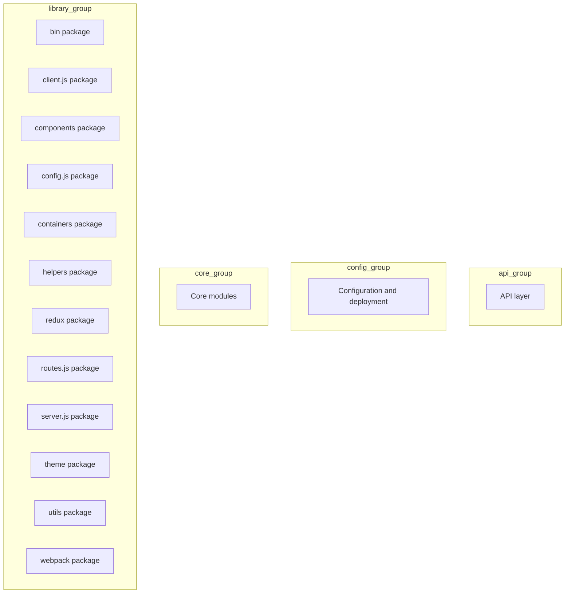

# Architecture report: erikras/react-redux-universal-hot-example

> Automated static analysis. **Observed** = directly seen in files/imports/AST; **Inferred** = interpretation from that evidence. Repository code was not executed.

## 1. Repository at a glance

| Item | Value |
| --- | --- |
| Repository | erikras/react-redux-universal-hot-example |
| Description | A starter boilerplate for a universal webapp using express, react, redux, webpack, and react-transform |
| Language | JavaScript |
| Stars | 12049 |
| Licence | MIT |
| Analysed commit / branch | 076e24bcd9b363a9ce84f0ebbd0fe036f15561e2 / master |
| Framework(s) | Express, React |
| Files analysed | 97 |
| Components | 15 |

## 2. Architecture in one minute

erikras/react-redux-universal-hot-example - A starter boilerplate for a universal webapp using express, react, redux, webpack, and react-transform. This repository was analysed statically from 97 file(s) (0 Python). Detected technologies (observed from imports/manifests): Express, React, React Router, Redux, webpack. Files are grouped into 15 component(s): API layer, bin package, client.js package, components package, Configuration and deployment, config.js package, containers package, Core modules. Findings below distinguish observed facts from inferred interpretation.

## 3. High-level block diagram

## 4. Main components

### API layer (`api_layer`)

- **Kind:** api
- **Status:** Observed
- **Confidence:** 0.85
- **Responsibility:** Groups 16 file(s) under api layer (observed from repository paths and static analysis).
- **Paths:** `api/__tests__/api-test.js`, `api/actions/__tests__/loadInfo-test.js`, `api/actions/__tests__/widget-load-test.js`, `api/actions/__tests__/widget-update-test.js`, `api/actions/index.js`, `api/actions/loadAuth.js`, `api/actions/loadInfo.js`, `api/actions/login.js`, `api/actions/logout.js`, `api/actions/survey/index.js`, `api/actions/survey/isValid.js`, `api/actions/widget/index.js`, `api/actions/widget/load.js`, `api/actions/widget/update.js`, `api/api.js`, `api/utils/url.js`
- **Evidence:** [api/__tests__/api-test.js](https://github.com/erikras/react-redux-universal-hot-example/blob/076e24bcd9b363a9ce84f0ebbd0fe036f15561e2/api/__tests__/api-test.js); [api/actions/__tests__/loadInfo-test.js](https://github.com/erikras/react-redux-universal-hot-example/blob/076e24bcd9b363a9ce84f0ebbd0fe036f15561e2/api/actions/__tests__/loadInfo-test.js); [api/actions/__tests__/widget-load-test.js](https://github.com/erikras/react-redux-universal-hot-example/blob/076e24bcd9b363a9ce84f0ebbd0fe036f15561e2/api/actions/__tests__/widget-load-test.js); [api/actions/__tests__/widget-update-test.js](https://github.com/erikras/react-redux-universal-hot-example/blob/076e24bcd9b363a9ce84f0ebbd0fe036f15561e2/api/actions/__tests__/widget-update-test.js); [api/actions/index.js](https://github.com/erikras/react-redux-universal-hot-example/blob/076e24bcd9b363a9ce84f0ebbd0fe036f15561e2/api/actions/index.js); [api/actions/loadAuth.js](https://github.com/erikras/react-redux-universal-hot-example/blob/076e24bcd9b363a9ce84f0ebbd0fe036f15561e2/api/actions/loadAuth.js); [api/actions/loadInfo.js](https://github.com/erikras/react-redux-universal-hot-example/blob/076e24bcd9b363a9ce84f0ebbd0fe036f15561e2/api/actions/loadInfo.js); [api/actions/login.js](https://github.com/erikras/react-redux-universal-hot-example/blob/076e24bcd9b363a9ce84f0ebbd0fe036f15561e2/api/actions/login.js)

### bin package (`bin`)

- **Kind:** library
- **Status:** Observed
- **Confidence:** 0.85
- **Responsibility:** Groups 2 file(s) under bin package (observed from repository paths and static analysis).
- **Paths:** `bin/api.js`, `bin/server.js`
- **Evidence:** [bin/api.js](https://github.com/erikras/react-redux-universal-hot-example/blob/076e24bcd9b363a9ce84f0ebbd0fe036f15561e2/bin/api.js); [bin/server.js](https://github.com/erikras/react-redux-universal-hot-example/blob/076e24bcd9b363a9ce84f0ebbd0fe036f15561e2/bin/server.js)

### client.js package (`client_js`)

- **Kind:** library
- **Status:** Observed
- **Confidence:** 0.85
- **Responsibility:** Groups 1 file(s) under client.js package (observed from repository paths and static analysis).
- **Paths:** `src/client.js`
- **Evidence:** [src/client.js](https://github.com/erikras/react-redux-universal-hot-example/blob/076e24bcd9b363a9ce84f0ebbd0fe036f15561e2/src/client.js)

### components package (`components`)

- **Kind:** library
- **Status:** Observed
- **Confidence:** 0.85
- **Responsibility:** Groups 10 file(s) under components package (observed from repository paths and static analysis).
- **Paths:** `src/components/CounterButton/CounterButton.js`, `src/components/GithubButton/GithubButton.js`, `src/components/InfoBar/InfoBar.js`, `src/components/MiniInfoBar/MiniInfoBar.js`, `src/components/SurveyForm/SurveyForm.js`, `src/components/SurveyForm/surveyValidation.js`, `src/components/WidgetForm/WidgetForm.js`, `src/components/WidgetForm/widgetValidation.js`, `src/components/__tests__/InfoBar-test.js`, `src/components/index.js`
- **Evidence:** [src/components/CounterButton/CounterButton.js](https://github.com/erikras/react-redux-universal-hot-example/blob/076e24bcd9b363a9ce84f0ebbd0fe036f15561e2/src/components/CounterButton/CounterButton.js); [src/components/GithubButton/GithubButton.js](https://github.com/erikras/react-redux-universal-hot-example/blob/076e24bcd9b363a9ce84f0ebbd0fe036f15561e2/src/components/GithubButton/GithubButton.js); [src/components/InfoBar/InfoBar.js](https://github.com/erikras/react-redux-universal-hot-example/blob/076e24bcd9b363a9ce84f0ebbd0fe036f15561e2/src/components/InfoBar/InfoBar.js); [src/components/MiniInfoBar/MiniInfoBar.js](https://github.com/erikras/react-redux-universal-hot-example/blob/076e24bcd9b363a9ce84f0ebbd0fe036f15561e2/src/components/MiniInfoBar/MiniInfoBar.js); [src/components/SurveyForm/SurveyForm.js](https://github.com/erikras/react-redux-universal-hot-example/blob/076e24bcd9b363a9ce84f0ebbd0fe036f15561e2/src/components/SurveyForm/SurveyForm.js); [src/components/SurveyForm/surveyValidation.js](https://github.com/erikras/react-redux-universal-hot-example/blob/076e24bcd9b363a9ce84f0ebbd0fe036f15561e2/src/components/SurveyForm/surveyValidation.js); [src/components/WidgetForm/WidgetForm.js](https://github.com/erikras/react-redux-universal-hot-example/blob/076e24bcd9b363a9ce84f0ebbd0fe036f15561e2/src/components/WidgetForm/WidgetForm.js); [src/components/WidgetForm/widgetValidation.js](https://github.com/erikras/react-redux-universal-hot-example/blob/076e24bcd9b363a9ce84f0ebbd0fe036f15561e2/src/components/WidgetForm/widgetValidation.js)

### Configuration and deployment (`config`)

- **Kind:** config
- **Status:** Observed
- **Confidence:** 0.85
- **Responsibility:** Groups 3 file(s) under configuration and deployment (observed from repository paths and static analysis).
- **Paths:** `app.json`, `circle.yml`, `package.json`
- **Evidence:** [app.json](https://github.com/erikras/react-redux-universal-hot-example/blob/076e24bcd9b363a9ce84f0ebbd0fe036f15561e2/app.json); [circle.yml](https://github.com/erikras/react-redux-universal-hot-example/blob/076e24bcd9b363a9ce84f0ebbd0fe036f15561e2/circle.yml); [package.json](https://github.com/erikras/react-redux-universal-hot-example/blob/076e24bcd9b363a9ce84f0ebbd0fe036f15561e2/package.json)

### config.js package (`config_js`)

- **Kind:** library
- **Status:** Observed
- **Confidence:** 0.85
- **Responsibility:** Groups 1 file(s) under config.js package (observed from repository paths and static analysis).
- **Paths:** `src/config.js`
- **Evidence:** [src/config.js](https://github.com/erikras/react-redux-universal-hot-example/blob/076e24bcd9b363a9ce84f0ebbd0fe036f15561e2/src/config.js)

### containers package (`containers`)

- **Kind:** library
- **Status:** Observed
- **Confidence:** 0.85
- **Responsibility:** Groups 12 file(s) under containers package (observed from repository paths and static analysis).
- **Paths:** `src/containers/About/About.js`, `src/containers/App/App.js`, `src/containers/Chat/Chat.js`, `src/containers/DevTools/DevTools.js`, `src/containers/Home/Home.js`, `src/containers/Login/Login.js`, `src/containers/LoginSuccess/LoginSuccess.js`, `src/containers/NotFound/NotFound.js`, `src/containers/Pagination/Pagination.jsx`, `src/containers/Survey/Survey.js`, `src/containers/Widgets/Widgets.js`, `src/containers/index.js`
- **Evidence:** [src/containers/About/About.js](https://github.com/erikras/react-redux-universal-hot-example/blob/076e24bcd9b363a9ce84f0ebbd0fe036f15561e2/src/containers/About/About.js); [src/containers/App/App.js](https://github.com/erikras/react-redux-universal-hot-example/blob/076e24bcd9b363a9ce84f0ebbd0fe036f15561e2/src/containers/App/App.js); [src/containers/Chat/Chat.js](https://github.com/erikras/react-redux-universal-hot-example/blob/076e24bcd9b363a9ce84f0ebbd0fe036f15561e2/src/containers/Chat/Chat.js); [src/containers/DevTools/DevTools.js](https://github.com/erikras/react-redux-universal-hot-example/blob/076e24bcd9b363a9ce84f0ebbd0fe036f15561e2/src/containers/DevTools/DevTools.js); [src/containers/Home/Home.js](https://github.com/erikras/react-redux-universal-hot-example/blob/076e24bcd9b363a9ce84f0ebbd0fe036f15561e2/src/containers/Home/Home.js); [src/containers/Login/Login.js](https://github.com/erikras/react-redux-universal-hot-example/blob/076e24bcd9b363a9ce84f0ebbd0fe036f15561e2/src/containers/Login/Login.js); [src/containers/LoginSuccess/LoginSuccess.js](https://github.com/erikras/react-redux-universal-hot-example/blob/076e24bcd9b363a9ce84f0ebbd0fe036f15561e2/src/containers/LoginSuccess/LoginSuccess.js); [src/containers/NotFound/NotFound.js](https://github.com/erikras/react-redux-universal-hot-example/blob/076e24bcd9b363a9ce84f0ebbd0fe036f15561e2/src/containers/NotFound/NotFound.js)

### Core modules (`core`)

- **Kind:** core
- **Status:** Observed
- **Confidence:** 0.85
- **Responsibility:** Groups 3 file(s) under core modules (observed from repository paths and static analysis).
- **Paths:** `karma.conf.js`, `server.babel.js`, `tests.webpack.js`
- **Evidence:** [karma.conf.js](https://github.com/erikras/react-redux-universal-hot-example/blob/076e24bcd9b363a9ce84f0ebbd0fe036f15561e2/karma.conf.js); [server.babel.js](https://github.com/erikras/react-redux-universal-hot-example/blob/076e24bcd9b363a9ce84f0ebbd0fe036f15561e2/server.babel.js); [tests.webpack.js](https://github.com/erikras/react-redux-universal-hot-example/blob/076e24bcd9b363a9ce84f0ebbd0fe036f15561e2/tests.webpack.js)

### helpers package (`helpers`)

- **Kind:** library
- **Status:** Observed
- **Confidence:** 0.85
- **Responsibility:** Groups 2 file(s) under helpers package (observed from repository paths and static analysis).
- **Paths:** `src/helpers/ApiClient.js`, `src/helpers/Html.js`
- **Evidence:** [src/helpers/ApiClient.js](https://github.com/erikras/react-redux-universal-hot-example/blob/076e24bcd9b363a9ce84f0ebbd0fe036f15561e2/src/helpers/ApiClient.js); [src/helpers/Html.js](https://github.com/erikras/react-redux-universal-hot-example/blob/076e24bcd9b363a9ce84f0ebbd0fe036f15561e2/src/helpers/Html.js)

### redux package (`redux`)

- **Kind:** library
- **Status:** Observed
- **Confidence:** 0.85
- **Responsibility:** Groups 8 file(s) under redux package (observed from repository paths and static analysis).
- **Paths:** `src/redux/create.js`, `src/redux/middleware/clientMiddleware.js`, `src/redux/modules/auth.js`, `src/redux/modules/counter.js`, `src/redux/modules/info.js`, `src/redux/modules/reducer.js`, `src/redux/modules/survey.js`, `src/redux/modules/widgets.js`
- **Evidence:** [src/redux/create.js](https://github.com/erikras/react-redux-universal-hot-example/blob/076e24bcd9b363a9ce84f0ebbd0fe036f15561e2/src/redux/create.js); [src/redux/middleware/clientMiddleware.js](https://github.com/erikras/react-redux-universal-hot-example/blob/076e24bcd9b363a9ce84f0ebbd0fe036f15561e2/src/redux/middleware/clientMiddleware.js); [src/redux/modules/auth.js](https://github.com/erikras/react-redux-universal-hot-example/blob/076e24bcd9b363a9ce84f0ebbd0fe036f15561e2/src/redux/modules/auth.js); [src/redux/modules/counter.js](https://github.com/erikras/react-redux-universal-hot-example/blob/076e24bcd9b363a9ce84f0ebbd0fe036f15561e2/src/redux/modules/counter.js); [src/redux/modules/info.js](https://github.com/erikras/react-redux-universal-hot-example/blob/076e24bcd9b363a9ce84f0ebbd0fe036f15561e2/src/redux/modules/info.js); [src/redux/modules/reducer.js](https://github.com/erikras/react-redux-universal-hot-example/blob/076e24bcd9b363a9ce84f0ebbd0fe036f15561e2/src/redux/modules/reducer.js); [src/redux/modules/survey.js](https://github.com/erikras/react-redux-universal-hot-example/blob/076e24bcd9b363a9ce84f0ebbd0fe036f15561e2/src/redux/modules/survey.js); [src/redux/modules/widgets.js](https://github.com/erikras/react-redux-universal-hot-example/blob/076e24bcd9b363a9ce84f0ebbd0fe036f15561e2/src/redux/modules/widgets.js)

### routes.js package (`routes_js`)

- **Kind:** library
- **Status:** Observed
- **Confidence:** 0.85
- **Responsibility:** Groups 1 file(s) under routes.js package (observed from repository paths and static analysis).
- **Paths:** `src/routes.js`
- **Evidence:** [src/routes.js](https://github.com/erikras/react-redux-universal-hot-example/blob/076e24bcd9b363a9ce84f0ebbd0fe036f15561e2/src/routes.js)

### server.js package (`server_js`)

- **Kind:** library
- **Status:** Observed
- **Confidence:** 0.85
- **Responsibility:** Groups 1 file(s) under server.js package (observed from repository paths and static analysis).
- **Paths:** `src/server.js`
- **Evidence:** [src/server.js](https://github.com/erikras/react-redux-universal-hot-example/blob/076e24bcd9b363a9ce84f0ebbd0fe036f15561e2/src/server.js)

### theme package (`theme`)

- **Kind:** library
- **Status:** Observed
- **Confidence:** 0.85
- **Responsibility:** Groups 4 file(s) under theme package (observed from repository paths and static analysis).
- **Paths:** `src/theme/bootstrap.config.js`, `src/theme/bootstrap.config.prod.js`, `src/theme/font-awesome.config.js`, `src/theme/font-awesome.config.prod.js`
- **Evidence:** [src/theme/bootstrap.config.js](https://github.com/erikras/react-redux-universal-hot-example/blob/076e24bcd9b363a9ce84f0ebbd0fe036f15561e2/src/theme/bootstrap.config.js); [src/theme/bootstrap.config.prod.js](https://github.com/erikras/react-redux-universal-hot-example/blob/076e24bcd9b363a9ce84f0ebbd0fe036f15561e2/src/theme/bootstrap.config.prod.js); [src/theme/font-awesome.config.js](https://github.com/erikras/react-redux-universal-hot-example/blob/076e24bcd9b363a9ce84f0ebbd0fe036f15561e2/src/theme/font-awesome.config.js); [src/theme/font-awesome.config.prod.js](https://github.com/erikras/react-redux-universal-hot-example/blob/076e24bcd9b363a9ce84f0ebbd0fe036f15561e2/src/theme/font-awesome.config.prod.js)

### utils package (`utils`)

- **Kind:** library
- **Status:** Observed
- **Confidence:** 0.85
- **Responsibility:** Groups 1 file(s) under utils package (observed from repository paths and static analysis).
- **Paths:** `src/utils/validation.js`
- **Evidence:** [src/utils/validation.js](https://github.com/erikras/react-redux-universal-hot-example/blob/076e24bcd9b363a9ce84f0ebbd0fe036f15561e2/src/utils/validation.js)

### webpack package (`webpack`)

- **Kind:** library
- **Status:** Observed
- **Confidence:** 0.85
- **Responsibility:** Groups 4 file(s) under webpack package (observed from repository paths and static analysis).
- **Paths:** `webpack/dev.config.js`, `webpack/prod.config.js`, `webpack/webpack-dev-server.js`, `webpack/webpack-isomorphic-tools.js`
- **Evidence:** [webpack/dev.config.js](https://github.com/erikras/react-redux-universal-hot-example/blob/076e24bcd9b363a9ce84f0ebbd0fe036f15561e2/webpack/dev.config.js); [webpack/prod.config.js](https://github.com/erikras/react-redux-universal-hot-example/blob/076e24bcd9b363a9ce84f0ebbd0fe036f15561e2/webpack/prod.config.js); [webpack/webpack-dev-server.js](https://github.com/erikras/react-redux-universal-hot-example/blob/076e24bcd9b363a9ce84f0ebbd0fe036f15561e2/webpack/webpack-dev-server.js); [webpack/webpack-isomorphic-tools.js](https://github.com/erikras/react-redux-universal-hot-example/blob/076e24bcd9b363a9ce84f0ebbd0fe036f15561e2/webpack/webpack-isomorphic-tools.js)

## 5. Execution flow

**Observed** entry point(s):

- [api/actions/index.js](https://github.com/erikras/react-redux-universal-hot-example/blob/076e24bcd9b363a9ce84f0ebbd0fe036f15561e2/api/actions/index.js)
- [api/actions/survey/index.js](https://github.com/erikras/react-redux-universal-hot-example/blob/076e24bcd9b363a9ce84f0ebbd0fe036f15561e2/api/actions/survey/index.js)
- [api/actions/widget/index.js](https://github.com/erikras/react-redux-universal-hot-example/blob/076e24bcd9b363a9ce84f0ebbd0fe036f15561e2/api/actions/widget/index.js)
- [bin/server.js](https://github.com/erikras/react-redux-universal-hot-example/blob/076e24bcd9b363a9ce84f0ebbd0fe036f15561e2/bin/server.js)
- [src/components/index.js](https://github.com/erikras/react-redux-universal-hot-example/blob/076e24bcd9b363a9ce84f0ebbd0fe036f15561e2/src/components/index.js)
- [src/containers/App/App.js](https://github.com/erikras/react-redux-universal-hot-example/blob/076e24bcd9b363a9ce84f0ebbd0fe036f15561e2/src/containers/App/App.js)
- [src/containers/index.js](https://github.com/erikras/react-redux-universal-hot-example/blob/076e24bcd9b363a9ce84f0ebbd0fe036f15561e2/src/containers/index.js)
- [src/server.js](https://github.com/erikras/react-redux-universal-hot-example/blob/076e24bcd9b363a9ce84f0ebbd0fe036f15561e2/src/server.js)

Representative flow (derived from observed entry points and the import graph; steps beyond the entry point are **Inferred**):

1. Execution starts at an observed entry point listed above, if present.
2. No internal import relationships between components were observed.

## 6. Project structure

### `(root)`

- `.babelrc` - other (496 bytes)
- `.editorconfig` - config (167 bytes)
- `.eslintignore` - other (41 bytes)
- `.eslintrc` - other (939 bytes)
- `.gitignore` - other (92 bytes)
- `.travis.yml` - ci, YAML (226 bytes)
- `CONTRIBUTING.md` - docs (1918 bytes)
- `LICENSE` - docs (1081 bytes)
- `README.md` - docs (15968 bytes)
- `app.json` - config (493 bytes)
- `circle.yml` - config (257 bytes)
- `karma.conf.js` - source, JavaScript (1708 bytes)
- `package.json` - manifest (6120 bytes)
- `server.babel.js` - source, JavaScript (316 bytes)
- `tests.webpack.js` - source, JavaScript (93 bytes)

### `api`

- `api/__tests__/api-test.js` - source, JavaScript (2200 bytes)
- `api/actions/__tests__/loadInfo-test.js` - source, JavaScript (372 bytes)
- `api/actions/__tests__/widget-load-test.js` - source, JavaScript (1124 bytes)
- `api/actions/__tests__/widget-update-test.js` - source, JavaScript (2065 bytes)
- `api/actions/index.js` - source, JavaScript (214 bytes)
- `api/actions/loadAuth.js` - source, JavaScript (94 bytes)
- `api/actions/loadInfo.js` - source, JavaScript (174 bytes)
- `api/actions/login.js` - source, JavaScript (144 bytes)
- `api/actions/logout.js` - source, JavaScript (176 bytes)
- `api/actions/survey/index.js` - source, JavaScript (33 bytes)
- `api/actions/survey/isValid.js` - source, JavaScript (426 bytes)
- `api/actions/widget/index.js` - source, JavaScript (58 bytes)
- `api/actions/widget/load.js` - source, JavaScript (793 bytes)
- `api/actions/widget/update.js` - source, JavaScript (895 bytes)
- `api/api.js` - source, JavaScript (2364 bytes)
- `api/utils/url.js` - source, JavaScript (819 bytes)

### `bin`

- `bin/api.js` - source, JavaScript (273 bytes)
- `bin/server.js` - source, JavaScript (903 bytes)

### `docs`

- `docs/AddingAPage/AddingAPage.md` - docs (3676 bytes)
- `docs/AddingToHomePage/AddingToHomePage.md` - docs (2612 bytes)
- `docs/ApiConfig.md` - docs (3702 bytes)
- `docs/Ducks.md` - docs (118 bytes)
- `docs/ExploringTheDemoApp/ExploringTheDemoApp.md` - docs (5223 bytes)
- `docs/InlineStyles.md` - docs (2520 bytes)
- `docs/InstallingTheKit/InstallingTheKit.md` - docs (4291 bytes)

### `src`

- `src/client.js` - source, JavaScript (2125 bytes)
- `src/components/CounterButton/CounterButton.js` - source, JavaScript (796 bytes)
- `src/components/GithubButton/GithubButton.js` - source, JavaScript (896 bytes)
- `src/components/InfoBar/InfoBar.js` - source, JavaScript (970 bytes)
- `src/components/InfoBar/InfoBar.scss` - other (67 bytes)
- `src/components/MiniInfoBar/MiniInfoBar.js` - source, JavaScript (481 bytes)
- `src/components/SurveyForm/SurveyForm.js` - source, JavaScript (4829 bytes)
- `src/components/SurveyForm/SurveyForm.scss` - other (659 bytes)
- `src/components/SurveyForm/surveyValidation.js` - source, JavaScript (343 bytes)
- `src/components/WidgetForm/WidgetForm.js` - source, JavaScript (3084 bytes)
- `src/components/WidgetForm/widgetValidation.js` - source, JavaScript (356 bytes)
- `src/components/__tests__/InfoBar-test.js` - source, JavaScript (1510 bytes)
- `src/components/index.js` - source, JavaScript (428 bytes)
- `src/config.js` - source, JavaScript (1330 bytes)
- `src/containers/About/About.js` - source, JavaScript (1584 bytes)
- `src/containers/App/App.js` - source, JavaScript (4345 bytes)
- `src/containers/App/App.scss` - other (433 bytes)
- `src/containers/Chat/Chat.js` - source, JavaScript (1818 bytes)
- `src/containers/Chat/Chat.scss` - other (182 bytes)
- `src/containers/DevTools/DevTools.js` - source, JavaScript (342 bytes)
- `src/containers/Home/Home.js` - source, JavaScript (9658 bytes)
- `src/containers/Home/Home.scss` - other (854 bytes)
- `src/containers/Login/Login.js` - source, JavaScript (1638 bytes)
- `src/containers/Login/Login.scss` - other (188 bytes)
- `src/containers/LoginSuccess/LoginSuccess.js` - source, JavaScript (1120 bytes)
- `src/containers/NotFound/NotFound.js` - source, JavaScript (219 bytes)
- `src/containers/Pagination/Pagination.jsx` - source, JavaScript (2082 bytes)
- `src/containers/Pagination/Pagination.scss` - other (25 bytes)
- `src/containers/Pagination/violet.min.scss` - other (12127 bytes)
- `src/containers/Survey/Survey.js` - source, JavaScript (2408 bytes)
- `src/containers/Widgets/Widgets.js` - source, JavaScript (4000 bytes)
- `src/containers/Widgets/Widgets.scss` - other (450 bytes)
- `src/containers/index.js` - source, JavaScript (392 bytes)
- `src/helpers/ApiClient.js` - source, JavaScript (1480 bytes)
- `src/helpers/Html.js` - source, JavaScript (2454 bytes)
- `src/redux/create.js` - source, JavaScript (1408 bytes)
- `src/redux/middleware/clientMiddleware.js` - source, JavaScript (812 bytes)
- `src/redux/modules/auth.js` - source, JavaScript (2224 bytes)
- `src/redux/modules/counter.js` - source, JavaScript (392 bytes)
- `src/redux/modules/info.js` - source, JavaScript (894 bytes)
- `src/redux/modules/reducer.js` - source, JavaScript (650 bytes)
- `src/redux/modules/survey.js` - source, JavaScript (963 bytes)
- `src/redux/modules/widgets.js` - source, JavaScript (2581 bytes)
- `src/routes.js` - source, JavaScript (1486 bytes)
- `src/server.js` - source, JavaScript (3905 bytes)
- `src/theme/bootstrap.config.js` - source, JavaScript (1555 bytes)
- `src/theme/bootstrap.config.prod.js` - source, JavaScript (258 bytes)
- `src/theme/bootstrap.overrides.scss` - other (341 bytes)
- `src/theme/font-awesome.config.js` - source, JavaScript (297 bytes)
- `src/theme/font-awesome.config.less` - other (98 bytes)
- `src/theme/font-awesome.config.prod.js` - source, JavaScript (267 bytes)
- `src/theme/variables.scss` - other (469 bytes)
- `src/utils/validation.js` - source, JavaScript (1688 bytes)

### `webpack`

- `webpack/dev.config.js` - source, JavaScript (4344 bytes)
- `webpack/prod.config.js` - source, JavaScript (3176 bytes)
- `webpack/webpack-dev-server.js` - source, JavaScript (884 bytes)
- `webpack/webpack-isomorphic-tools.js` - source, JavaScript (3598 bytes)

## 7. Key dependencies and integrations

| Name | Category | Status | Confidence | Evidence |
| --- | --- | --- | --- | --- |
| Express | framework | Observed | 0.85 | [package.json:17](https://github.com/erikras/react-redux-universal-hot-example/blob/076e24bcd9b363a9ce84f0ebbd0fe036f15561e2/package.json#L17) |
| React | framework | Observed | 0.90 | [package.json:2](https://github.com/erikras/react-redux-universal-hot-example/blob/076e24bcd9b363a9ce84f0ebbd0fe036f15561e2/package.json#L2); [package.json:123](https://github.com/erikras/react-redux-universal-hot-example/blob/076e24bcd9b363a9ce84f0ebbd0fe036f15561e2/package.json#L123) |
| React Router | library | Observed | 0.85 | [package.json:127](https://github.com/erikras/react-redux-universal-hot-example/blob/076e24bcd9b363a9ce84f0ebbd0fe036f15561e2/package.json#L127) |
| Redux | library | Observed | 0.85 | [package.json:2](https://github.com/erikras/react-redux-universal-hot-example/blob/076e24bcd9b363a9ce84f0ebbd0fe036f15561e2/package.json#L2) |
| webpack | tooling | Observed | 0.85 | [package.json:16](https://github.com/erikras/react-redux-universal-hot-example/blob/076e24bcd9b363a9ce84f0ebbd0fe036f15561e2/package.json#L16) |

## 8. Data and state

No database, cache, queue, or persistent-state usage was observed in the analysed files. State handling, if any, may be in-memory or in files that were not analysed.

## 9. Configuration and deployment clues

- `.editorconfig` (config)
- `.travis.yml` (ci)
- `app.json` (config)
- `circle.yml` (config)
- `package.json` (manifest)

## 10. Design observations

- An entry/API layer is separated from other code (Inferred from paths and decorators).

These observations are interpretations (**Inferred**) of the observed structure, not guarantees about runtime design.

## 11. Limitations and unknowns

- Static analysis only: repository code was not executed, installed, or imported at runtime.
- Components and relationships are inferred from file paths, imports, and AST structure; runtime behaviour, dynamic imports, and reflection may not be visible.
- No clear application entry point was observed in the analysed files.
- Repository text was treated as untrusted data; no instructions found in repository files were followed, and likely secret values were redacted/excluded.
- JavaScript and TypeScript files were inventoried from paths and package manifests. They were not parsed with a full language AST, and repository code was not executed.

## 12. Source references

- [api/__tests__/api-test.js](https://github.com/erikras/react-redux-universal-hot-example/blob/076e24bcd9b363a9ce84f0ebbd0fe036f15561e2/api/__tests__/api-test.js)
- [api/actions/__tests__/loadInfo-test.js](https://github.com/erikras/react-redux-universal-hot-example/blob/076e24bcd9b363a9ce84f0ebbd0fe036f15561e2/api/actions/__tests__/loadInfo-test.js)
- [api/actions/__tests__/widget-load-test.js](https://github.com/erikras/react-redux-universal-hot-example/blob/076e24bcd9b363a9ce84f0ebbd0fe036f15561e2/api/actions/__tests__/widget-load-test.js)
- [api/actions/__tests__/widget-update-test.js](https://github.com/erikras/react-redux-universal-hot-example/blob/076e24bcd9b363a9ce84f0ebbd0fe036f15561e2/api/actions/__tests__/widget-update-test.js)
- [api/actions/index.js](https://github.com/erikras/react-redux-universal-hot-example/blob/076e24bcd9b363a9ce84f0ebbd0fe036f15561e2/api/actions/index.js)
- [api/actions/loadAuth.js](https://github.com/erikras/react-redux-universal-hot-example/blob/076e24bcd9b363a9ce84f0ebbd0fe036f15561e2/api/actions/loadAuth.js)
- [api/actions/loadInfo.js](https://github.com/erikras/react-redux-universal-hot-example/blob/076e24bcd9b363a9ce84f0ebbd0fe036f15561e2/api/actions/loadInfo.js)
- [api/actions/login.js](https://github.com/erikras/react-redux-universal-hot-example/blob/076e24bcd9b363a9ce84f0ebbd0fe036f15561e2/api/actions/login.js)
- [api/actions/survey/index.js](https://github.com/erikras/react-redux-universal-hot-example/blob/076e24bcd9b363a9ce84f0ebbd0fe036f15561e2/api/actions/survey/index.js)
- [api/actions/widget/index.js](https://github.com/erikras/react-redux-universal-hot-example/blob/076e24bcd9b363a9ce84f0ebbd0fe036f15561e2/api/actions/widget/index.js)
- [app.json](https://github.com/erikras/react-redux-universal-hot-example/blob/076e24bcd9b363a9ce84f0ebbd0fe036f15561e2/app.json)
- [bin/api.js](https://github.com/erikras/react-redux-universal-hot-example/blob/076e24bcd9b363a9ce84f0ebbd0fe036f15561e2/bin/api.js)
- [bin/server.js](https://github.com/erikras/react-redux-universal-hot-example/blob/076e24bcd9b363a9ce84f0ebbd0fe036f15561e2/bin/server.js)
- [circle.yml](https://github.com/erikras/react-redux-universal-hot-example/blob/076e24bcd9b363a9ce84f0ebbd0fe036f15561e2/circle.yml)
- [karma.conf.js](https://github.com/erikras/react-redux-universal-hot-example/blob/076e24bcd9b363a9ce84f0ebbd0fe036f15561e2/karma.conf.js)
- [package.json](https://github.com/erikras/react-redux-universal-hot-example/blob/076e24bcd9b363a9ce84f0ebbd0fe036f15561e2/package.json)
- [package.json:2](https://github.com/erikras/react-redux-universal-hot-example/blob/076e24bcd9b363a9ce84f0ebbd0fe036f15561e2/package.json#L2)
- [package.json:16](https://github.com/erikras/react-redux-universal-hot-example/blob/076e24bcd9b363a9ce84f0ebbd0fe036f15561e2/package.json#L16)
- [package.json:17](https://github.com/erikras/react-redux-universal-hot-example/blob/076e24bcd9b363a9ce84f0ebbd0fe036f15561e2/package.json#L17)
- [package.json:123](https://github.com/erikras/react-redux-universal-hot-example/blob/076e24bcd9b363a9ce84f0ebbd0fe036f15561e2/package.json#L123)
- [package.json:127](https://github.com/erikras/react-redux-universal-hot-example/blob/076e24bcd9b363a9ce84f0ebbd0fe036f15561e2/package.json#L127)
- [server.babel.js](https://github.com/erikras/react-redux-universal-hot-example/blob/076e24bcd9b363a9ce84f0ebbd0fe036f15561e2/server.babel.js)
- [src/client.js](https://github.com/erikras/react-redux-universal-hot-example/blob/076e24bcd9b363a9ce84f0ebbd0fe036f15561e2/src/client.js)
- [src/components/CounterButton/CounterButton.js](https://github.com/erikras/react-redux-universal-hot-example/blob/076e24bcd9b363a9ce84f0ebbd0fe036f15561e2/src/components/CounterButton/CounterButton.js)
- [src/components/GithubButton/GithubButton.js](https://github.com/erikras/react-redux-universal-hot-example/blob/076e24bcd9b363a9ce84f0ebbd0fe036f15561e2/src/components/GithubButton/GithubButton.js)
- [src/components/InfoBar/InfoBar.js](https://github.com/erikras/react-redux-universal-hot-example/blob/076e24bcd9b363a9ce84f0ebbd0fe036f15561e2/src/components/InfoBar/InfoBar.js)
- [src/components/MiniInfoBar/MiniInfoBar.js](https://github.com/erikras/react-redux-universal-hot-example/blob/076e24bcd9b363a9ce84f0ebbd0fe036f15561e2/src/components/MiniInfoBar/MiniInfoBar.js)
- [src/components/SurveyForm/SurveyForm.js](https://github.com/erikras/react-redux-universal-hot-example/blob/076e24bcd9b363a9ce84f0ebbd0fe036f15561e2/src/components/SurveyForm/SurveyForm.js)
- [src/components/SurveyForm/surveyValidation.js](https://github.com/erikras/react-redux-universal-hot-example/blob/076e24bcd9b363a9ce84f0ebbd0fe036f15561e2/src/components/SurveyForm/surveyValidation.js)
- [src/components/WidgetForm/WidgetForm.js](https://github.com/erikras/react-redux-universal-hot-example/blob/076e24bcd9b363a9ce84f0ebbd0fe036f15561e2/src/components/WidgetForm/WidgetForm.js)
- [src/components/WidgetForm/widgetValidation.js](https://github.com/erikras/react-redux-universal-hot-example/blob/076e24bcd9b363a9ce84f0ebbd0fe036f15561e2/src/components/WidgetForm/widgetValidation.js)
- [src/components/index.js](https://github.com/erikras/react-redux-universal-hot-example/blob/076e24bcd9b363a9ce84f0ebbd0fe036f15561e2/src/components/index.js)
- [src/config.js](https://github.com/erikras/react-redux-universal-hot-example/blob/076e24bcd9b363a9ce84f0ebbd0fe036f15561e2/src/config.js)
- [src/containers/About/About.js](https://github.com/erikras/react-redux-universal-hot-example/blob/076e24bcd9b363a9ce84f0ebbd0fe036f15561e2/src/containers/About/About.js)
- [src/containers/App/App.js](https://github.com/erikras/react-redux-universal-hot-example/blob/076e24bcd9b363a9ce84f0ebbd0fe036f15561e2/src/containers/App/App.js)
- [src/containers/Chat/Chat.js](https://github.com/erikras/react-redux-universal-hot-example/blob/076e24bcd9b363a9ce84f0ebbd0fe036f15561e2/src/containers/Chat/Chat.js)
- [src/containers/DevTools/DevTools.js](https://github.com/erikras/react-redux-universal-hot-example/blob/076e24bcd9b363a9ce84f0ebbd0fe036f15561e2/src/containers/DevTools/DevTools.js)
- [src/containers/Home/Home.js](https://github.com/erikras/react-redux-universal-hot-example/blob/076e24bcd9b363a9ce84f0ebbd0fe036f15561e2/src/containers/Home/Home.js)
- [src/containers/Login/Login.js](https://github.com/erikras/react-redux-universal-hot-example/blob/076e24bcd9b363a9ce84f0ebbd0fe036f15561e2/src/containers/Login/Login.js)
- [src/containers/LoginSuccess/LoginSuccess.js](https://github.com/erikras/react-redux-universal-hot-example/blob/076e24bcd9b363a9ce84f0ebbd0fe036f15561e2/src/containers/LoginSuccess/LoginSuccess.js)
- [src/containers/NotFound/NotFound.js](https://github.com/erikras/react-redux-universal-hot-example/blob/076e24bcd9b363a9ce84f0ebbd0fe036f15561e2/src/containers/NotFound/NotFound.js)
- [src/containers/index.js](https://github.com/erikras/react-redux-universal-hot-example/blob/076e24bcd9b363a9ce84f0ebbd0fe036f15561e2/src/containers/index.js)
- [src/helpers/ApiClient.js](https://github.com/erikras/react-redux-universal-hot-example/blob/076e24bcd9b363a9ce84f0ebbd0fe036f15561e2/src/helpers/ApiClient.js)
- [src/helpers/Html.js](https://github.com/erikras/react-redux-universal-hot-example/blob/076e24bcd9b363a9ce84f0ebbd0fe036f15561e2/src/helpers/Html.js)
- [src/redux/create.js](https://github.com/erikras/react-redux-universal-hot-example/blob/076e24bcd9b363a9ce84f0ebbd0fe036f15561e2/src/redux/create.js)
- [src/redux/middleware/clientMiddleware.js](https://github.com/erikras/react-redux-universal-hot-example/blob/076e24bcd9b363a9ce84f0ebbd0fe036f15561e2/src/redux/middleware/clientMiddleware.js)
- [src/redux/modules/auth.js](https://github.com/erikras/react-redux-universal-hot-example/blob/076e24bcd9b363a9ce84f0ebbd0fe036f15561e2/src/redux/modules/auth.js)
- [src/redux/modules/counter.js](https://github.com/erikras/react-redux-universal-hot-example/blob/076e24bcd9b363a9ce84f0ebbd0fe036f15561e2/src/redux/modules/counter.js)
- [src/redux/modules/info.js](https://github.com/erikras/react-redux-universal-hot-example/blob/076e24bcd9b363a9ce84f0ebbd0fe036f15561e2/src/redux/modules/info.js)
- [src/redux/modules/reducer.js](https://github.com/erikras/react-redux-universal-hot-example/blob/076e24bcd9b363a9ce84f0ebbd0fe036f15561e2/src/redux/modules/reducer.js)
- [src/redux/modules/survey.js](https://github.com/erikras/react-redux-universal-hot-example/blob/076e24bcd9b363a9ce84f0ebbd0fe036f15561e2/src/redux/modules/survey.js)
- [src/redux/modules/widgets.js](https://github.com/erikras/react-redux-universal-hot-example/blob/076e24bcd9b363a9ce84f0ebbd0fe036f15561e2/src/redux/modules/widgets.js)
- [src/routes.js](https://github.com/erikras/react-redux-universal-hot-example/blob/076e24bcd9b363a9ce84f0ebbd0fe036f15561e2/src/routes.js)
- [src/server.js](https://github.com/erikras/react-redux-universal-hot-example/blob/076e24bcd9b363a9ce84f0ebbd0fe036f15561e2/src/server.js)
- [src/theme/bootstrap.config.js](https://github.com/erikras/react-redux-universal-hot-example/blob/076e24bcd9b363a9ce84f0ebbd0fe036f15561e2/src/theme/bootstrap.config.js)
- [src/theme/bootstrap.config.prod.js](https://github.com/erikras/react-redux-universal-hot-example/blob/076e24bcd9b363a9ce84f0ebbd0fe036f15561e2/src/theme/bootstrap.config.prod.js)
- [src/theme/font-awesome.config.js](https://github.com/erikras/react-redux-universal-hot-example/blob/076e24bcd9b363a9ce84f0ebbd0fe036f15561e2/src/theme/font-awesome.config.js)
- [src/theme/font-awesome.config.prod.js](https://github.com/erikras/react-redux-universal-hot-example/blob/076e24bcd9b363a9ce84f0ebbd0fe036f15561e2/src/theme/font-awesome.config.prod.js)
- [src/utils/validation.js](https://github.com/erikras/react-redux-universal-hot-example/blob/076e24bcd9b363a9ce84f0ebbd0fe036f15561e2/src/utils/validation.js)
- [tests.webpack.js](https://github.com/erikras/react-redux-universal-hot-example/blob/076e24bcd9b363a9ce84f0ebbd0fe036f15561e2/tests.webpack.js)
- [webpack/dev.config.js](https://github.com/erikras/react-redux-universal-hot-example/blob/076e24bcd9b363a9ce84f0ebbd0fe036f15561e2/webpack/dev.config.js)
- [webpack/prod.config.js](https://github.com/erikras/react-redux-universal-hot-example/blob/076e24bcd9b363a9ce84f0ebbd0fe036f15561e2/webpack/prod.config.js)
- [webpack/webpack-dev-server.js](https://github.com/erikras/react-redux-universal-hot-example/blob/076e24bcd9b363a9ce84f0ebbd0fe036f15561e2/webpack/webpack-dev-server.js)
- [webpack/webpack-isomorphic-tools.js](https://github.com/erikras/react-redux-universal-hot-example/blob/076e24bcd9b363a9ce84f0ebbd0fe036f15561e2/webpack/webpack-isomorphic-tools.js)
