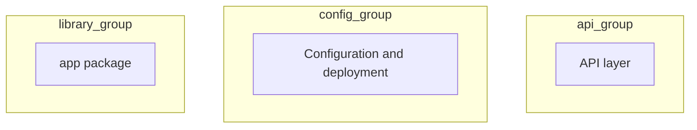

# Architecture report: evolus/pencil

> Automated static analysis. **Observed** = directly seen in files/imports/AST; **Inferred** = interpretation from that evidence. Repository code was not executed.

## 1. Repository at a glance

| Item | Value |
| --- | --- |
| Repository | evolus/pencil |
| Description | The Pencil Project's unique mission is to build a free and opensource tool for making diagrams and GUI prototyping that everyone can use.  |
| Language | JavaScript |
| Stars | 9914 |
| Licence | GPL-2.0 |
| Analysed commit / branch | 3fc5856b60415068259a8916d17a14adcd6ecc7a / master |
| Framework(s) | Electron, Express |
| Files analysed | 633 |
| Components | 3 |

## 2. Architecture in one minute

evolus/pencil - The Pencil Project's unique mission is to build a free and opensource tool for making diagrams and GUI prototyping that everyone can use. . This repository was analysed statically from 633 file(s) (0 Python). Detected technologies (observed from imports/manifests): Electron, Express. Files are grouped into 3 component(s): API layer, app package, Configuration and deployment. Findings below distinguish observed facts from inferred interpretation.

## 3. High-level block diagram

## 4. Main components

### API layer (`api_layer`)

- **Kind:** api
- **Status:** Observed
- **Confidence:** 0.85
- **Responsibility:** Groups 102 file(s) under api layer (observed from repository paths and static analysis).
- **Paths:** `app/views/AboutDialog.js`, `app/views/ApplicationPane.js`, `app/views/EditPageNoteDialog.js`, `app/views/ExportDialog.js`, `app/views/PageDetailDialog.js`, `app/views/StartUpDocumentView.js`, `app/views/collections/AboutCollectionDialog.js`, `app/views/collections/BaseCollectionPane.js`, `app/views/collections/CollectionBrowserDialog.js`, `app/views/collections/CollectionManagementDialog.js`, `app/views/collections/CollectionMenu.js`, `app/views/collections/CollectionPane.js`, `app/views/collections/CollectionRepoBrowserView.js`, `app/views/collections/CollectionResourceBrowserDialog.js`, `app/views/collections/CollectionSettingDialog.js`, `app/views/collections/EditPrivateCollectionDialog.js`, `app/views/collections/EditPrivateShapeDialog.js`, `app/views/collections/MyCollectionPane.js`, `app/views/collections/PrivateCollectionDialog.js`, `app/views/collections/PrivateCollectionMenu.js`, `app/views/collections/ShowAllCollectionMenu.js`, `app/views/collections/ShowHiddenCollectionDialog.js`, `app/views/common/AgentStatusPill.js`, `app/views/common/CollapseablePanel.js`, `app/views/common/Dialog.js`, `app/views/common/FooPanel.js`, `app/views/common/NotificationPopup.js`, `app/views/common/PageListView.js`, `app/views/common/PageThumbnailView.js`, `app/views/common/Popup.js`, `app/views/common/ProgressiveJobDialog.js`, `app/views/common/PromptDialog.js`, `app/views/common/RepeaterView.js`, `app/views/common/SamplePanel.js`, `app/views/common/ScrollableView.js`, `app/views/common/TabHeader.js`, `app/views/common/TabPane.js`, `app/views/common/TestDialog.js`, `app/views/common/ToolBar.js`, `app/views/common/Tree.js`, `app/views/common/UICommandManager.js`, `app/views/common/WizardDialog.js`, `app/views/editors/AlignEditor.js`, `app/views/editors/ColorEditor.js`, `app/views/editors/ColorPropertyEditor.js`, `app/views/editors/ColorSelector.js`, `app/views/editors/ComboManager.js`, `app/views/editors/ComboTest.js`, `app/views/editors/DataTable.js`, `app/views/editors/EnumEditor.js`, `app/views/editors/FontEditor.js`, `app/views/editors/NPatchSpecEditorDialog.js`, `app/views/editors/NumEditor.js`, `app/views/editors/OnMenuEditor.js`, `app/views/editors/OnScreenRichTextEditor.js`, `app/views/editors/OnScreenTextEditor.js`, `app/views/editors/PlainTextEditor.js`, `app/views/editors/PropertyEditor.js`, `app/views/editors/SampleSharedColorEditor.js`, `app/views/editors/ShadowStyleEditor.js`, `app/views/editors/SharedBorderStyleEditor.js`, `app/views/editors/SharedColorEditor.js`, `app/views/editors/SharedFontEditor.js`, `app/views/editors/SharedGeomtryEditor.js`, `app/views/editors/SharedPropertyEditor.js`, `app/views/editors/StrokeEditor.js`, `app/views/editors/StrokeStyleEditor.js`, `app/views/editors/TextToolOverlay.js`, `app/views/editors/image-editor/ExternalImageEditorDialog.js`, `app/views/editors/image-editor/ImageEditDialog.js`, `app/views/editors/image-editor/ImageEditorDialog.js`, `app/views/editors/image-editor/tools/BaseImmediateActionTool.js`, `app/views/editors/image-editor/tools/BaseSimpleArgumentTool.js`, `app/views/editors/image-editor/tools/BrightnessAdjustTool.js`, `app/views/menus/CanvasMenu.js`, `app/views/menus/ChildPageListMenu.js`, `app/views/menus/MainMenu.js`, `app/views/menus/Menu.js`, `app/views/menus/PageMenu.js`, `app/views/toolbars/AlignmentToolbar.js`, `app/views/toolbars/EditToolbar.js`, `app/views/toolbars/FileToolbar.js`, `app/views/toolbars/GestureModeToolbar.js`, `app/views/toolbars/MacOSToolbar.js`, `app/views/toolbars/SizeToolbar.js`, `app/views/toolbars/ZoomToolbar.js`, `app/views/tools/ConsoleOutputDialog.js`, `app/views/tools/DocumentDiagTools.js`, `app/views/tools/FontDetailDialog.js`, `app/views/tools/FontManagementDialog.js`, `app/views/tools/NPatchDialog.js`, `app/views/tools/OpenClipartPane.js`, `app/views/tools/ScreenCaptureOptionDialog.js`, `app/views/tools/ScriptEditorDialog.js`, `app/views/tools/SettingDialog.js`, `app/views/tools/ShapeTestCanvasPane.js`, `app/views/tools/SizingPolicyDialog.js`, `app/views/tools/StencilCollectionBuilder.js`, `app/views/tools/StencilCollectionDetailDialog.js`, `app/views/tools/StencilGeneratorDialog.js`, `app/views/tools/StencilShapeCanvasToolbar.js`, `app/views/tools/TemplateManagementDialog.js`
- **Evidence:** [app/views/AboutDialog.js](https://github.com/evolus/pencil/blob/3fc5856b60415068259a8916d17a14adcd6ecc7a/app/views/AboutDialog.js); [app/views/ApplicationPane.js](https://github.com/evolus/pencil/blob/3fc5856b60415068259a8916d17a14adcd6ecc7a/app/views/ApplicationPane.js); [app/views/EditPageNoteDialog.js](https://github.com/evolus/pencil/blob/3fc5856b60415068259a8916d17a14adcd6ecc7a/app/views/EditPageNoteDialog.js); [app/views/ExportDialog.js](https://github.com/evolus/pencil/blob/3fc5856b60415068259a8916d17a14adcd6ecc7a/app/views/ExportDialog.js); [app/views/PageDetailDialog.js](https://github.com/evolus/pencil/blob/3fc5856b60415068259a8916d17a14adcd6ecc7a/app/views/PageDetailDialog.js); [app/views/StartUpDocumentView.js](https://github.com/evolus/pencil/blob/3fc5856b60415068259a8916d17a14adcd6ecc7a/app/views/StartUpDocumentView.js); [app/views/collections/AboutCollectionDialog.js](https://github.com/evolus/pencil/blob/3fc5856b60415068259a8916d17a14adcd6ecc7a/app/views/collections/AboutCollectionDialog.js); [app/views/collections/BaseCollectionPane.js](https://github.com/evolus/pencil/blob/3fc5856b60415068259a8916d17a14adcd6ecc7a/app/views/collections/BaseCollectionPane.js)

### app package (`app`)

- **Kind:** library
- **Status:** Observed
- **Confidence:** 0.85
- **Responsibility:** Groups 194 file(s) under app package (observed from repository paths and static analysis).
- **Paths:** `app/app.js`, `app/archive/aboutDialog.js`, `app/archive/exportWizard.js`, `app/archive/firefoxOverlay.js`, `app/archive/installRemoteCollectionsDialog.js`, `app/archive/main.js`, `app/archive/mainWindow.js`, `app/archive/mainWindow_old.js`, `app/archive/messageDialog.js`, `app/archive/pageDetailDialog.js`, `app/archive/pageNoteDialog.js`, `app/archive/privateCollectionDialog.js`, `app/archive/privateCollectionWizard.js`, `app/archive/privateShapeDialog.js`, `app/archive/progressDialog.js`, `app/archive/propertyDialog.js`, `app/archive/settingDialog.js`, `app/archive/sizingPolicyDialog.js`, `app/archive/stencilGenerator.js`, `app/archive/templateManagementDialog.js`, `app/css/less-watch.sh`, `app/desktop.js`, `app/index.js`, `app/lib/codemirror/htmlmixed.js`, `app/lib/codemirror/javascript.js`, `app/lib/codemirror/xml.js`, `app/lib/common-dom.js`, `app/lib/loader.js`, `app/lib/widget/ActionBar.js`, `app/lib/widget/ColorPicker.js`, `app/lib/widget/ComboManager.js`, `app/lib/widget/Common.js`, `app/lib/widget/DataTable.js`, `app/lib/widget/Dialog.js`, `app/lib/widget/ImageUploader.js`, `app/lib/widget/MapView.js`, `app/lib/widget/Paginator.js`, `app/lib/widget/PropertyEditor.js`, `app/lib/widget/Scale.js`, `app/lib/widget/SplitView.js`, `app/lib/widget/Tree.js`, `app/lib/widget/param/BaseParamEditor.js`, `app/lib/widget/param/CommonParamEditors.js`, `app/lib/widget/param/CompositeParamEditors.js`, `app/lib/widget/param/ParamEditorPanel.js`, `app/lib/widget/param/ValueParamEditor.js`, `app/pencil-core/behavior/SVGTextLayout.js`, `app/pencil-core/behavior/commonBehaviors.js`, `app/pencil-core/behavior/commonFunctions.js`, `app/pencil-core/canvasHelper/GestureHelper.js`, `app/pencil-core/canvasHelper/OffScreenCanvas.js`, `app/pencil-core/canvasHelper/canvasCareTaker.js`, `app/pencil-core/canvasHelper/canvasImpl.js`, `app/pencil-core/canvasHelper/canvasMemento.js`, `app/pencil-core/canvasHelper/drawingMode.js`, `app/pencil-core/canvasHelper/snappingHelper.js`, `app/pencil-core/clipartBrowser/googleImageSearch.js`, `app/pencil-core/clipartBrowser/newOpenClipartSearch.js`, `app/pencil-core/clipartBrowser/openClipartSearch.js`, `app/pencil-core/clipartBrowser/searchEngine.js`, `app/pencil-core/clipartBrowser/webUtil.js`, `app/pencil-core/common/AgentFeedbackManager.js`, `app/pencil-core/common/Canvas.js`, `app/pencil-core/common/CanvasAnimationOverlay.js`, `app/pencil-core/common/DocumentHandler.js`, `app/pencil-core/common/EpHandler.js`, `app/pencil-core/common/EpgzHandler.js`, `app/pencil-core/common/EpzHandler.js`, `app/pencil-core/common/FileHandler.js`, `app/pencil-core/common/FontLoader.js`, `app/pencil-core/common/FontLoaderUtil.js`, `app/pencil-core/common/QueueHandler.js`, `app/pencil-core/common/UpdateService.js`, `app/pencil-core/common/abstractSymbol.js`, `app/pencil-core/common/androidSupports.js`, `app/pencil-core/common/base64.js`, `app/pencil-core/common/canvas-external-renderer.js`, `app/pencil-core/common/canvasPool.js`, `app/pencil-core/common/collectionSettingEditor.js`, `app/pencil-core/common/colorDroppers.js`, `app/pencil-core/common/config.js`, `app/pencil-core/common/connectorSupports.js`, `app/pencil-core/common/controller.js`, `app/pencil-core/common/controller_old.js`, `app/pencil-core/common/dockingManager.js`, `app/pencil-core/common/eventBus.js`, `app/pencil-core/common/externalEditorSupports.js`, `app/pencil-core/common/io.js`, `app/pencil-core/common/lorem.js`, `app/pencil-core/common/messages.js`, `app/pencil-core/common/nsDragAndDrop.js`, `app/pencil-core/common/nsDragAndDrop2.js`, `app/pencil-core/common/nsTransferable.js`, `app/pencil-core/common/pdf.js`, `app/pencil-core/common/pencil.js`, `app/pencil-core/common/pencilNamespaces.js`, `app/pencil-core/common/renderer.js`, `app/pencil-core/common/richTextDialog.js`, `app/pencil-core/common/sax.js`, `app/pencil-core/common/shared-util.js`, `app/pencil-core/common/stencilEditor.js`, `app/pencil-core/common/svgRasterizer.js`, `app/pencil-core/common/tree.js`, `app/pencil-core/common/typeEditorRegistry.js`, `app/pencil-core/common/util.js`, `app/pencil-core/common/webPrinter.js`, `app/pencil-core/definition/StencilUpdateService.js`, `app/pencil-core/definition/collectionManager.js`, `app/pencil-core/definition/collectionRepository.js`, `app/pencil-core/definition/exportTemplate.js`, `app/pencil-core/definition/exportTemplateManager.js`, `app/pencil-core/definition/geometry.js`, `app/pencil-core/definition/shapeDef.js`, `app/pencil-core/definition/shapeDefCollection.js`, `app/pencil-core/definition/shapeDefCollectionParser.js`, `app/pencil-core/document/document.js`, `app/pencil-core/document/document_old.js`, `app/pencil-core/document/persistentHooks.js`, `app/pencil-core/document/xmlDocumentPersister.js`, `app/pencil-core/editor/geometryEditor.js`, `app/pencil-core/editor/handleEditor.js`, `app/pencil-core/editor/onMenuEditor.js`, `app/pencil-core/editor/onMenuTypeEditors.js`, `app/pencil-core/editor/onScreenTextEditor-RichTextSupport.js`, `app/pencil-core/editor/onScreenTextEditor.js`, `app/pencil-core/editor/propertyPageEditor.js`, `app/pencil-core/editor/sharedBorderStyleEditor.js`, `app/pencil-core/editor/sharedFillColorEditor.js`, `app/pencil-core/editor/sharedFontEditor.js`, `app/pencil-core/editor/sharedGeometryEditor.js`, `app/pencil-core/exporter/baseExporter.js`, `app/pencil-core/exporter/baseRasterizedExporter.js`, `app/pencil-core/exporter/documentExportManager.js`, `app/pencil-core/exporter/odtExporter.js`, `app/pencil-core/exporter/ooConversionExporter.js`, `app/pencil-core/exporter/otherExporters.js`, `app/pencil-core/exporter/printingExporter.js`, `app/pencil-core/exporter/svgExporter.js`, `app/pencil-core/exporter/webPageExporter.js`, `app/pencil-core/n-patch/9patch_backup.js`, `app/pencil-core/privateCollection/privateCollection.js`, `app/pencil-core/privateCollection/privateCollectionManager.js`, `app/pencil-core/privateCollection/privateShapeDef.js`, `app/pencil-core/privateCollection/privateShapeDefParser.js`, `app/pencil-core/propertyType/alignment.js`, `app/pencil-core/propertyType/bool.js`, `app/pencil-core/propertyType/bound.js`, `app/pencil-core/propertyType/color.js`, `app/pencil-core/propertyType/css.js`, `app/pencil-core/propertyType/dimension.js`, `app/pencil-core/propertyType/enum.js`, `app/pencil-core/propertyType/font.js`, `app/pencil-core/propertyType/handle.js`, `app/pencil-core/propertyType/imageData.js`, `app/pencil-core/propertyType/num.js`, `app/pencil-core/propertyType/plainText.js`, `app/pencil-core/propertyType/point.js`, `app/pencil-core/propertyType/richText.js`, `app/pencil-core/propertyType/richTextArray.js`, `app/pencil-core/propertyType/shadowStyle.js`, `app/pencil-core/propertyType/snappingData.js`, `app/pencil-core/propertyType/strokeStyle.js`, `app/pencil-core/templates/HTML/prototype.HTML/Resources/script.js`, `app/pencil-core/xferHelper/dragObservers.js`, `app/pencil-core/xferHelper/pngImageXferHelper.js`, `app/pencil-core/xferHelper/richTextXferHelper.js`, `app/pencil-core/xferHelper/shapeXferHelper.js`, `app/pencil-core/xferHelper/svgXferHelper.js`, `app/pencil-core/xferHelper/targetSetXferHelper.js`, `app/tools/api-server.js`, `app/tools/capture-services.js`, `app/tools/color-picker-window.js`, `app/tools/global-shortcut-main.js`, `app/tools/global-shortcut.js`, `app/tools/mcp/index.js`, `app/tools/mcp/logger.js`, `app/tools/mcp/resources/resource-registry.js`, `app/tools/mcp/server.js`, `app/tools/mcp/tools/base-tool.js`, `app/tools/mcp/tools/canvas-helper.js`, `app/tools/mcp/tools/document-tool.js`, `app/tools/mcp/tools/editing-tool.js`, `app/tools/mcp/tools/editing-validator.js`, `app/tools/mcp/tools/icon-synonyms.js`, `app/tools/mcp/tools/kb-tool.js`, `app/tools/mcp/tools/layout-helper.js`, `app/tools/mcp/tools/stencil-tool.js`, `app/tools/mcp/tools/style-resolver.js`, `app/tools/mcp/tools/system-tool.js`, `app/tools/mcp/tools/tool-registry.js`, `app/tools/mcp/transport/http-controller.js`, `app/tools/mcp/transport/session-manager.js`, `app/tools/screenshot-renderer.js`, `app/updater.js`
- **Evidence:** [app/app.js](https://github.com/evolus/pencil/blob/3fc5856b60415068259a8916d17a14adcd6ecc7a/app/app.js); [app/archive/aboutDialog.js](https://github.com/evolus/pencil/blob/3fc5856b60415068259a8916d17a14adcd6ecc7a/app/archive/aboutDialog.js); [app/archive/exportWizard.js](https://github.com/evolus/pencil/blob/3fc5856b60415068259a8916d17a14adcd6ecc7a/app/archive/exportWizard.js); [app/archive/firefoxOverlay.js](https://github.com/evolus/pencil/blob/3fc5856b60415068259a8916d17a14adcd6ecc7a/app/archive/firefoxOverlay.js); [app/archive/installRemoteCollectionsDialog.js](https://github.com/evolus/pencil/blob/3fc5856b60415068259a8916d17a14adcd6ecc7a/app/archive/installRemoteCollectionsDialog.js); [app/archive/main.js](https://github.com/evolus/pencil/blob/3fc5856b60415068259a8916d17a14adcd6ecc7a/app/archive/main.js); [app/archive/mainWindow.js](https://github.com/evolus/pencil/blob/3fc5856b60415068259a8916d17a14adcd6ecc7a/app/archive/mainWindow.js); [app/archive/mainWindow_old.js](https://github.com/evolus/pencil/blob/3fc5856b60415068259a8916d17a14adcd6ecc7a/app/archive/mainWindow_old.js)

### Configuration and deployment (`config`)

- **Kind:** config
- **Status:** Observed
- **Confidence:** 0.85
- **Responsibility:** Groups 6 file(s) under configuration and deployment (observed from repository paths and static analysis).
- **Paths:** `app/lib/bootstrap/.csscomb.json`, `app/package.json`, `app/tools/mcp/kb/pencil/package.json`, `appveyor.yml`, `package.json`, `version.json`
- **Evidence:** [app/lib/bootstrap/.csscomb.json](https://github.com/evolus/pencil/blob/3fc5856b60415068259a8916d17a14adcd6ecc7a/app/lib/bootstrap/.csscomb.json); [app/package.json](https://github.com/evolus/pencil/blob/3fc5856b60415068259a8916d17a14adcd6ecc7a/app/package.json); [app/tools/mcp/kb/pencil/package.json](https://github.com/evolus/pencil/blob/3fc5856b60415068259a8916d17a14adcd6ecc7a/app/tools/mcp/kb/pencil/package.json); [appveyor.yml](https://github.com/evolus/pencil/blob/3fc5856b60415068259a8916d17a14adcd6ecc7a/appveyor.yml); [package.json](https://github.com/evolus/pencil/blob/3fc5856b60415068259a8916d17a14adcd6ecc7a/package.json); [version.json](https://github.com/evolus/pencil/blob/3fc5856b60415068259a8916d17a14adcd6ecc7a/version.json)

## 5. Execution flow

**Observed** entry point(s):

- [app/app.js](https://github.com/evolus/pencil/blob/3fc5856b60415068259a8916d17a14adcd6ecc7a/app/app.js)
- [app/archive/main.js](https://github.com/evolus/pencil/blob/3fc5856b60415068259a8916d17a14adcd6ecc7a/app/archive/main.js)
- [app/index.js](https://github.com/evolus/pencil/blob/3fc5856b60415068259a8916d17a14adcd6ecc7a/app/index.js)
- [app/tools/mcp/index.js](https://github.com/evolus/pencil/blob/3fc5856b60415068259a8916d17a14adcd6ecc7a/app/tools/mcp/index.js)
- [app/tools/mcp/server.js](https://github.com/evolus/pencil/blob/3fc5856b60415068259a8916d17a14adcd6ecc7a/app/tools/mcp/server.js)

Representative flow (derived from observed entry points and the import graph; steps beyond the entry point are **Inferred**):

1. Execution starts at an observed entry point listed above, if present.
2. No internal import relationships between components were observed.

## 6. Project structure

### `(root)`

- `.buildignore` - other (8 bytes)
- `.editorconfig` - config (415 bytes)
- `.gitattributes` - other (11 bytes)
- `.gitignore` - other (165 bytes)
- `.gitlab-ci.yml` - ci, YAML (714 bytes)
- `.project` - other (201 bytes)
- `.travis.yml` - ci, YAML (2174 bytes)
- `ISSUE_TEMPLATE.md` - docs (39 bytes)
- `LICENSE.md` - docs (17987 bytes)
- `README.md` - docs (12779 bytes)
- `appveyor.yml` - config (456 bytes)
- `package.json` - manifest (2639 bytes)
- `version.json` - config (131 bytes)

### `RELEASE`

- `RELEASE/RELEASE-NOTE-310.md` - docs (3114 bytes)
- `RELEASE/RELEASE-NOTE-311.md` - docs (2983 bytes)
- `RELEASE/RELEASE-NOTE-400.md` - docs (4638 bytes)

### `app`

- `app/app.js` - source, JavaScript (885 bytes)
- `app/app.xhtml` - other (20234 bytes)
- `app/app_.xhtml` - other (2321 bytes)
- `app/archive/aboutDialog.js` - source, JavaScript (665 bytes)
- `app/archive/aboutDialog.xul` - other (4395 bytes)
- `app/archive/androidSupportOverlay.xul` - other (2809 bytes)
- `app/archive/bindings/alignEditor.css` - other (444 bytes)
- `app/archive/bindings/alignEditor.xbl` - other (4780 bytes)
- `app/archive/bindings/clipartBrowserPane.css` - other (3277 bytes)
- `app/archive/bindings/clipartBrowserPane.xbl` - other (21167 bytes)
- `app/archive/bindings/collectionPane.css` - other (5715 bytes)
- `app/archive/bindings/collectionPane.xbl` - other (24460 bytes)
- `app/archive/bindings/colorEditor.css` - other (816 bytes)
- `app/archive/bindings/colorEditor.xbl` - other (11027 bytes)
- `app/archive/bindings/colorPickerButton.css` - other (1753 bytes)
- `app/archive/bindings/colorPickerButton.xbl` - other (4091 bytes)
- `app/archive/bindings/colorPickers.css` - other (1971 bytes)
- `app/archive/bindings/colorPickers.xbl` - other (36569 bytes)
- `app/archive/bindings/commonEditors.css` - other (515 bytes)
- `app/archive/bindings/editorWrapper.css` - other (688 bytes)
- `app/archive/bindings/editorWrapper.xbl` - other (4102 bytes)
- `app/archive/bindings/enumEditor.css` - other (157 bytes)
- `app/archive/bindings/enumEditor.xbl` - other (3012 bytes)
- `app/archive/bindings/fontEditor.css` - other (556 bytes)
- `app/archive/bindings/fontEditor.xbl` - other (5537 bytes)
- `app/archive/bindings/pCanvas.xbl` - other (114752 bytes)
- `app/archive/bindings/pCanvas.xml` - other (114752 bytes)
- `app/archive/bindings/plainTextEditor.css` - other (172 bytes)
- `app/archive/bindings/plainTextEditor.xbl` - other (2425 bytes)
- `app/archive/bindings/privateCollectionPane.css` - other (4321 bytes)
- `app/archive/bindings/privateCollectionPane.xbl` - other (18781 bytes)
- `app/archive/bindings/searchBar.css` - other (3187 bytes)
- `app/archive/bindings/searchBar.xbl` - other (23608 bytes)
- `app/archive/bindings/shadowStyleEditor.css` - other (178 bytes)
- `app/archive/bindings/shadowStyleEditor.xbl` - other (3037 bytes)
- `app/archive/bindings/strokeEditor.css` - other (265 bytes)
- `app/archive/bindings/strokeEditor.xbl` - other (4107 bytes)
- `app/archive/borderToolOverlay.xul` - other (621 bytes)
- `app/archive/clipartBrowser.xul` - other (4641 bytes)
- `app/archive/colorToolOverlay.xul` - other (882 bytes)
- `app/archive/exportWizard.js` - source, JavaScript (11902 bytes)
- `app/archive/exportWizard.xul` - other (3493 bytes)
- `app/archive/firefoxOverlay.js` - source, JavaScript (6238 bytes)
- `app/archive/firefoxOverlay.xul` - other (1339 bytes)
- `app/archive/innershadow.patch` - other (3883 bytes)
- `app/archive/installRemoteCollectionsDialog.js` - source, JavaScript (14801 bytes)
- `app/archive/installRemoteCollectionsDialog.xul` - other (1539 bytes)
- `app/archive/main.js` - source, JavaScript (2511 bytes)
- `app/archive/mainWindow.js` - source, JavaScript (9161 bytes)
- `app/archive/mainWindow.xul` - other (44000 bytes)
- `app/archive/mainWindow_old.js` - source, JavaScript (9873 bytes)
- `app/archive/messageDialog.js` - source, JavaScript (2840 bytes)
- `app/archive/messageDialog.xul` - other (1420 bytes)
- `app/archive/pageDetailDialog.js` - source, JavaScript (7156 bytes)
- `app/archive/pageDetailDialog.xul` - other (4755 bytes)
- `app/archive/pageNoteDialog.js` - source, JavaScript (4723 bytes)
- `app/archive/pageNoteDialog.xul` - other (8494 bytes)
- `app/archive/port.xhtml` - other (7464 bytes)
- `app/archive/print.xul` - other (1000 bytes)
- `app/archive/privateCollectionDialog.js` - source, JavaScript (2407 bytes)
- `app/archive/privateCollectionDialog.xul` - other (2905 bytes)
- `app/archive/privateCollectionWizard.js` - source, JavaScript (5641 bytes)
- `app/archive/privateCollectionWizard.xul` - other (5109 bytes)
- `app/archive/privateShapeDialog.js` - source, JavaScript (2925 bytes)
- `app/archive/privateShapeDialog.xul` - other (2924 bytes)
- `app/archive/progressDialog.js` - source, JavaScript (1626 bytes)
- `app/archive/progressDialog.xul` - other (1254 bytes)
- `app/archive/propertyDialog.js` - source, JavaScript (4249 bytes)
- `app/archive/propertyDialog.xul` - other (1933 bytes)
- `app/archive/settingDialog.js` - source, JavaScript (22890 bytes)
- `app/archive/settingDialog.xul` - other (17887 bytes)
- `app/archive/sizingPolicyDialog.js` - source, JavaScript (2069 bytes)
- `app/archive/sizingPolicyDialog.xul` - other (4732 bytes)
- `app/archive/stencil/Annotation/Definition.xml` - other (18203 bytes)
- `app/archive/stencil/Annotation/Icons/icons.ep` - other (5570 bytes)
- `app/archive/stencil/BasicWebElements/Definition.xml` - other (62532 bytes)
- `app/archive/stencil/Common/Definition.xml` - other (105960 bytes)
- `app/archive/stencil/Gtk.GUI/Definition.xml` - other (39706 bytes)
- `app/archive/stencil/Native.GUI/Definition.xml` - other (88929 bytes)
- `app/archive/stencil/Native.GUI/Icons/icons.ep` - other (366 bytes)
- `app/archive/stencil/SketchyGUI/Definition.xml` - other (117005 bytes)
- `app/archive/stencil/WindowsXP-GUI/Definition.xml` - other (86484 bytes)
- `app/archive/stencilGenerator.js` - source, JavaScript (44084 bytes)
- `app/archive/stencilGenerator.xul` - other (6602 bytes)
- `app/archive/templateManagementDialog.js` - source, JavaScript (3817 bytes)
- `app/archive/templateManagementDialog.xul` - other (2268 bytes)
- `app/archive/textToolOverlay.xul` - other (10187 bytes)
- `app/blank.xhtml` - other (390 bytes)
- `app/css/bootstrap-fix.less` - other (3192 bytes)
- `app/css/bootstrap-wrapper.css` - other (132239 bytes)
- `app/css/bootstrap-wrapper.less` - other (53 bytes)
- `app/css/canvas.css` - other (4951 bytes)
- `app/css/common.less` - other (873 bytes)
- `app/css/dialog.less` - other (515 bytes)
- `app/css/form.less` - other (167 bytes)
- `app/css/layout.less` - other (887 bytes)
- `app/css/less-watch.sh` - source, Shell (133 bytes)
- `app/css/material-icons.css` - other (803 bytes)
- `app/css/pencil.css` - other (3367 bytes)
- `app/css/pencil.less` - other (371 bytes)
- `app/css/theme.css` - other (6463 bytes)
- `app/css/theme.less` - other (235 bytes)
- `app/css/variables.less` - other (935 bytes)
- `app/desktop.js` - source, JavaScript (539 bytes)
- `app/dnd.html` - other (830 bytes)
- `app/fonts/core/registry.xml` - other (2998 bytes)
- `app/index.js` - source, JavaScript (5018 bytes)
- `app/lib/bootstrap/.csscomb.json` - config (8099 bytes)
- `app/lib/bootstrap/.csslintrc` - other (456 bytes)
- `app/lib/bootstrap/alerts.less` - other (1518 bytes)
- `app/lib/bootstrap/badges.less` - other (1199 bytes)
- `app/lib/bootstrap/bootstrap.less` - other (1291 bytes)
- `app/lib/bootstrap/breadcrumbs.less` - other (594 bytes)
- `app/lib/bootstrap/button-groups.less` - other (5675 bytes)
- `app/lib/bootstrap/buttons.less` - other (3662 bytes)
- `app/lib/bootstrap/carousel.less` - other (5407 bytes)
- `app/lib/bootstrap/close.less` - other (764 bytes)
- `app/lib/bootstrap/code.less` - other (1401 bytes)
- `app/lib/bootstrap/component-animations.less` - other (666 bytes)
- `app/lib/bootstrap/dropdowns.less` - other (4876 bytes)
- `app/lib/bootstrap/forms.less` - other (15740 bytes)
- `app/lib/bootstrap/glyphicons.less` - other (19803 bytes)
- `app/lib/bootstrap/grid.less` - other (1387 bytes)
- `app/lib/bootstrap/input-groups.less` - other (4233 bytes)
- `app/lib/bootstrap/jumbotron.less` - other (1062 bytes)
- `app/lib/bootstrap/labels.less` - other (1079 bytes)
- `app/lib/bootstrap/list-group.less` - other (3124 bytes)
- `app/lib/bootstrap/media.less` - other (900 bytes)
- `app/lib/bootstrap/mixins.less` - other (1136 bytes)
- `app/lib/bootstrap/mixins/alerts.less` - other (257 bytes)
- `app/lib/bootstrap/mixins/background-variant.less` - other (151 bytes)
- `app/lib/bootstrap/mixins/border-radius.less` - other (468 bytes)
- `app/lib/bootstrap/mixins/buttons.less` - other (1476 bytes)
- `app/lib/bootstrap/mixins/center-block.less` - other (120 bytes)
- `app/lib/bootstrap/mixins/clearfix.less` - other (605 bytes)
- `app/lib/bootstrap/mixins/forms.less` - other (2641 bytes)
- `app/lib/bootstrap/mixins/gradients.less` - other (4388 bytes)
- `app/lib/bootstrap/mixins/grid-framework.less` - other (2797 bytes)
- `app/lib/bootstrap/mixins/grid.less` - other (3107 bytes)
- `app/lib/bootstrap/mixins/hide-text.less` - other (574 bytes)
- `app/lib/bootstrap/mixins/image.less` - other (1062 bytes)
- `app/lib/bootstrap/mixins/labels.less` - other (161 bytes)
- `app/lib/bootstrap/mixins/list-group.less` - other (546 bytes)
- `app/lib/bootstrap/mixins/nav-divider.less` - other (232 bytes)
- `app/lib/bootstrap/mixins/nav-vertical-align.less` - other (364 bytes)
- `app/lib/bootstrap/mixins/opacity.less` - other (148 bytes)
- `app/lib/bootstrap/mixins/pagination.less` - other (485 bytes)
- `app/lib/bootstrap/mixins/panels.less` - other (537 bytes)
- `app/lib/bootstrap/mixins/progress-bar.less` - other (191 bytes)
- `app/lib/bootstrap/mixins/reset-filter.less` - other (248 bytes)
- `app/lib/bootstrap/mixins/reset-text.less` - other (470 bytes)
- `app/lib/bootstrap/mixins/resize.less` - other (196 bytes)
- `app/lib/bootstrap/mixins/responsive-visibility.less` - other (354 bytes)
- `app/lib/bootstrap/mixins/size.less` - other (127 bytes)
- `app/lib/bootstrap/mixins/tab-focus.less` - other (159 bytes)
- `app/lib/bootstrap/mixins/table-row.less` - other (700 bytes)
- `app/lib/bootstrap/mixins/text-emphasis.less` - other (128 bytes)
- `app/lib/bootstrap/mixins/text-overflow.less` - other (162 bytes)
- `app/lib/bootstrap/mixins/vendor-prefixes.less` - other (6650 bytes)
- `app/lib/bootstrap/modals.less` - other (3565 bytes)
- `app/lib/bootstrap/navbar.less` - other (14628 bytes)
- `app/lib/bootstrap/navs.less` - other (4930 bytes)
- `app/lib/bootstrap/normalize.less` - other (7559 bytes)
- `app/lib/bootstrap/pager.less` - other (861 bytes)
- `app/lib/bootstrap/pagination.less` - other (2059 bytes)
- `app/lib/bootstrap/panels.less` - other (6279 bytes)
- `app/lib/bootstrap/popovers.less` - other (3488 bytes)
- `app/lib/bootstrap/print.less` - other (1939 bytes)
- `app/lib/bootstrap/progress-bars.less` - other (1925 bytes)
- `app/lib/bootstrap/responsive-embed.less` - other (546 bytes)
- `app/lib/bootstrap/responsive-utilities.less` - other (4262 bytes)
- `app/lib/bootstrap/scaffolding.less` - other (2988 bytes)
- `app/lib/bootstrap/tables.less` - other (4612 bytes)
- `app/lib/bootstrap/theme.less` - other (8197 bytes)
- `app/lib/bootstrap/thumbnails.less` - other (753 bytes)
- `app/lib/bootstrap/tooltip.less` - other (2985 bytes)
- `app/lib/bootstrap/type.less` - other (5951 bytes)
- `app/lib/bootstrap/utilities.less` - other (747 bytes)
- `app/lib/bootstrap/variables.less` - other (27365 bytes)
- `app/lib/bootstrap/wells.less` - other (527 bytes)
- `app/lib/codemirror/codemirror.css` - other (8241 bytes)
- `app/lib/codemirror/htmlmixed.js` - source, JavaScript (5622 bytes)
- `app/lib/codemirror/javascript.js` - source, JavaScript (31720 bytes)
- `app/lib/codemirror/xml.js` - source, JavaScript (13227 bytes)
- `app/lib/common-dom.js` - source, JavaScript (29061 bytes)
- `app/lib/font-awesome-4.4.0/HELP-US-OUT.txt` - docs (318 bytes)
- `app/lib/font-awesome-4.4.0/css/font-awesome.css` - other (32318 bytes)
- `app/lib/font-awesome-4.4.0/less/animated.less` - other (713 bytes)
- `app/lib/font-awesome-4.4.0/less/bordered-pulled.less` - other (585 bytes)
- `app/lib/font-awesome-4.4.0/less/core.less` - other (452 bytes)
- `app/lib/font-awesome-4.4.0/less/fixed-width.less` - other (119 bytes)
- `app/lib/font-awesome-4.4.0/less/font-awesome.less` - other (465 bytes)
- `app/lib/font-awesome-4.4.0/less/icons.less` - other (42489 bytes)
- `app/lib/font-awesome-4.4.0/less/larger.less` - other (370 bytes)
- `app/lib/font-awesome-4.4.0/less/list.less` - other (377 bytes)
- `app/lib/font-awesome-4.4.0/less/mixins.less` - other (926 bytes)
- `app/lib/font-awesome-4.4.0/less/path.less` - other (770 bytes)
- `app/lib/font-awesome-4.4.0/less/rotated-flipped.less` - other (622 bytes)
- `app/lib/font-awesome-4.4.0/less/stacked.less` - other (476 bytes)
- `app/lib/font-awesome-4.4.0/less/variables.less` - other (19203 bytes)
- `app/lib/font-awesome-4.4.0/scss/_animated.scss` - other (715 bytes)
- `app/lib/font-awesome-4.4.0/scss/_bordered-pulled.scss` - other (592 bytes)
- `app/lib/font-awesome-4.4.0/scss/_core.scss` - other (459 bytes)
- `app/lib/font-awesome-4.4.0/scss/_fixed-width.scss` - other (120 bytes)
- `app/lib/font-awesome-4.4.0/scss/_icons.scss` - other (43163 bytes)
- `app/lib/font-awesome-4.4.0/scss/_larger.scss` - other (375 bytes)
- `app/lib/font-awesome-4.4.0/scss/_list.scss` - other (378 bytes)
- `app/lib/font-awesome-4.4.0/scss/_mixins.scss` - other (946 bytes)
- `app/lib/font-awesome-4.4.0/scss/_path.scss` - other (783 bytes)
- `app/lib/font-awesome-4.4.0/scss/_rotated-flipped.scss` - other (672 bytes)
- `app/lib/font-awesome-4.4.0/scss/_stacked.scss` - other (482 bytes)
- `app/lib/font-awesome-4.4.0/scss/_variables.scss` - other (19284 bytes)
- `app/lib/font-awesome-4.4.0/scss/font-awesome.scss` - other (405 bytes)
- `app/lib/loader.js` - source, JavaScript (184 bytes)
- `app/lib/widget/ActionBar.js` - source, JavaScript (1937 bytes)
- `app/lib/widget/ColorPicker.js` - source, JavaScript (24896 bytes)
- `app/lib/widget/ComboManager.js` - source, JavaScript (8685 bytes)
- `app/lib/widget/Common.js` - source, JavaScript (31368 bytes)
- `app/lib/widget/DataTable.js` - source, JavaScript (54566 bytes)
- `app/lib/widget/Dialog.js` - source, JavaScript (28232 bytes)
- `app/lib/widget/ImageUploader.js` - source, JavaScript (10703 bytes)
- `app/lib/widget/MapView.js` - source, JavaScript (83138 bytes)
- `app/lib/widget/Paginator.js` - source, JavaScript (16278 bytes)
- `app/lib/widget/PropertyEditor.js` - source, JavaScript (21185 bytes)
- `app/lib/widget/Scale.js` - source, JavaScript (4233 bytes)
- `app/lib/widget/SplitView.js` - source, JavaScript (6050 bytes)
- `app/lib/widget/Tree.js` - source, JavaScript (18231 bytes)
- `app/lib/widget/param/BaseParamEditor.js` - source, JavaScript (4816 bytes)
- `app/lib/widget/param/CommonParamEditors.js` - source, JavaScript (362 bytes)
- `app/lib/widget/param/CompositeParamEditors.js` - source, JavaScript (7246 bytes)
- `app/lib/widget/param/ParamEditorPanel.js` - source, JavaScript (3664 bytes)
- `app/lib/widget/param/ValueParamEditor.js` - source, JavaScript (29392 bytes)
- `app/license.txt` - docs (17987 bytes)
- `app/package.json` - manifest (4128 bytes)
- `app/pencil-core/behavior/SVGTextLayout.js` - source, JavaScript (27149 bytes)
- `app/pencil-core/behavior/commonBehaviors.js` - source, JavaScript (25579 bytes)
- `app/pencil-core/behavior/commonFunctions.js` - source, JavaScript (7360 bytes)
- `app/pencil-core/blank.html` - other (309 bytes)
- `app/pencil-core/canvasHelper/GestureHelper.js` - source, JavaScript (17653 bytes)
- `app/pencil-core/canvasHelper/OffScreenCanvas.js` - source, JavaScript (622 bytes)
- `app/pencil-core/canvasHelper/canvasCareTaker.js` - source, JavaScript (2914 bytes)
- `app/pencil-core/canvasHelper/canvasImpl.js` - source, JavaScript (3230 bytes)
- `app/pencil-core/canvasHelper/canvasMemento.js` - source, JavaScript (1080 bytes)
- `app/pencil-core/canvasHelper/drawingMode.js` - source, JavaScript (26 bytes)
- `app/pencil-core/canvasHelper/snappingHelper.js` - source, JavaScript (9996 bytes)
- `app/pencil-core/clipartBrowser/googleImageSearch.js` - source, JavaScript (478 bytes)
- `app/pencil-core/clipartBrowser/newOpenClipartSearch.js` - source, JavaScript (8670 bytes)
- `app/pencil-core/clipartBrowser/openClipartSearch.js` - source, JavaScript (2573 bytes)
- `app/pencil-core/clipartBrowser/searchEngine.js` - source, JavaScript (272 bytes)
- `app/pencil-core/clipartBrowser/webUtil.js` - source, JavaScript (1217 bytes)
- `app/pencil-core/common/AgentFeedbackManager.js` - source, JavaScript (8065 bytes)
- `app/pencil-core/common/Canvas.js` - source, JavaScript (104913 bytes)
- `app/pencil-core/common/CanvasAnimationOverlay.js` - source, JavaScript (13791 bytes)
- `app/pencil-core/common/DocumentHandler.js` - source, JavaScript (10770 bytes)
- `app/pencil-core/common/EpHandler.js` - source, JavaScript (3205 bytes)
- `app/pencil-core/common/EpgzHandler.js` - source, JavaScript (3212 bytes)
- `app/pencil-core/common/EpzHandler.js` - source, JavaScript (1621 bytes)
- `app/pencil-core/common/FileHandler.js` - source, JavaScript (9803 bytes)
- `app/pencil-core/common/FontLoader.js` - source, JavaScript (14080 bytes)
- `app/pencil-core/common/FontLoaderUtil.js` - source, JavaScript (1501 bytes)
- `app/pencil-core/common/QueueHandler.js` - source, JavaScript (643 bytes)
- `app/pencil-core/common/UpdateService.js` - source, JavaScript (5099 bytes)
- `app/pencil-core/common/abstractSymbol.js` - source, JavaScript (191 bytes)
- `app/pencil-core/common/androidSupports.js` - source, JavaScript (2990 bytes)
- `app/pencil-core/common/base64.js` - source, JavaScript (3054 bytes)
- `app/pencil-core/common/canvas-external-renderer.js` - source, JavaScript (7669 bytes)
- `app/pencil-core/common/canvasPool.js` - source, JavaScript (1676 bytes)
- `app/pencil-core/common/collectionSettingEditor.js` - source, JavaScript (1956 bytes)
- `app/pencil-core/common/colorDroppers.js` - source, JavaScript (2627 bytes)
- `app/pencil-core/common/config.js` - source, JavaScript (3296 bytes)
- `app/pencil-core/common/connectorSupports.js` - source, JavaScript (15717 bytes)
- `app/pencil-core/common/controller.js` - source, JavaScript (62693 bytes)
- `app/pencil-core/common/controller_old.js` - source, JavaScript (54668 bytes)
- `app/pencil-core/common/dockingManager.js` - source, JavaScript (10004 bytes)
- `app/pencil-core/common/eventBus.js` - source, JavaScript (544 bytes)
- `app/pencil-core/common/externalEditorSupports.js` - source, JavaScript (7360 bytes)
- `app/pencil-core/common/io.js` - source, JavaScript (7718 bytes)
- `app/pencil-core/common/lorem.js` - source, JavaScript (7500 bytes)
- `app/pencil-core/common/messages.js` - source, JavaScript (11737 bytes)
- `app/pencil-core/common/nsDragAndDrop.js` - source, JavaScript (22614 bytes)
- `app/pencil-core/common/nsDragAndDrop2.js` - source, JavaScript (2255 bytes)
- `app/pencil-core/common/nsTransferable.js` - source, JavaScript (1 bytes)
- `app/pencil-core/common/pdf.js` - source, JavaScript (2536 bytes)
- `app/pencil-core/common/pencil.js` - source, JavaScript (25560 bytes)
- `app/pencil-core/common/pencilNamespaces.js` - source, JavaScript (1320 bytes)
- `app/pencil-core/common/renderer.js` - source, JavaScript (10462 bytes)
- `app/pencil-core/common/richTextDialog.js` - source, JavaScript (3245 bytes)
- `app/pencil-core/common/sax.js` - source, JavaScript (6907 bytes)
- `app/pencil-core/common/shared-util.js` - source, JavaScript (3064 bytes)
- `app/pencil-core/common/stencilEditor.js` - source, JavaScript (540 bytes)
- `app/pencil-core/common/svgRasterizer.js` - source, JavaScript (22200 bytes)
- `app/pencil-core/common/tree.js` - source, JavaScript (1311 bytes)
- `app/pencil-core/common/typeEditorRegistry.js` - source, JavaScript (1344 bytes)
- `app/pencil-core/common/util.js` - source, JavaScript (86280 bytes)
- `app/pencil-core/common/webPrinter.js` - source, JavaScript (3670 bytes)
- `app/pencil-core/definition/StencilUpdateService.js` - source, JavaScript (12167 bytes)
- `app/pencil-core/definition/collectionManager.js` - source, JavaScript (26945 bytes)
- `app/pencil-core/definition/collectionRepository.js` - source, JavaScript (5047 bytes)
- `app/pencil-core/definition/exportTemplate.js` - source, JavaScript (2085 bytes)
- `app/pencil-core/definition/exportTemplateManager.js` - source, JavaScript (10462 bytes)
- `app/pencil-core/definition/geometry.js` - source, JavaScript (504 bytes)
- `app/pencil-core/definition/shapeDef.js` - source, JavaScript (4928 bytes)
- `app/pencil-core/definition/shapeDefCollection.js` - source, JavaScript (1271 bytes)
- `app/pencil-core/definition/shapeDefCollectionParser.js` - source, JavaScript (26445 bytes)
- `app/pencil-core/document/document.js` - source, JavaScript (7803 bytes)
- `app/pencil-core/document/document_old.js` - source, JavaScript (7352 bytes)
- `app/pencil-core/document/persistentHooks.js` - source, JavaScript (3903 bytes)
- `app/pencil-core/document/xmlDocumentPersister.js` - source, JavaScript (3858 bytes)
- `app/pencil-core/editor-blank.html` - other (307 bytes)
- `app/pencil-core/editor/geometryEditor.config.xml` - other (5348 bytes)
- `app/pencil-core/editor/geometryEditor.js` - source, JavaScript (25932 bytes)
- `app/pencil-core/editor/handleEditor.config.xml` - other (1681 bytes)
- `app/pencil-core/editor/handleEditor.js` - source, JavaScript (13757 bytes)
- `app/pencil-core/editor/onMenuEditor.js` - source, JavaScript (5015 bytes)
- `app/pencil-core/editor/onMenuTypeEditors.js` - source, JavaScript (2044 bytes)
- `app/pencil-core/editor/onScreenTextEditor-RichTextSupport.js` - source, JavaScript (24850 bytes)
- `app/pencil-core/editor/onScreenTextEditor.config.xml` - other (2131 bytes)
- `app/pencil-core/editor/onScreenTextEditor.js` - source, JavaScript (9678 bytes)
- `app/pencil-core/editor/propertyPageEditor.js` - source, JavaScript (3652 bytes)
- `app/pencil-core/editor/sharedBorderStyleEditor.js` - source, JavaScript (2041 bytes)
- `app/pencil-core/editor/sharedFillColorEditor.js` - source, JavaScript (1750 bytes)
- `app/pencil-core/editor/sharedFontEditor.js` - source, JavaScript (4009 bytes)
- `app/pencil-core/editor/sharedGeometryEditor.js` - source, JavaScript (4400 bytes)
- `app/pencil-core/exporter/Pencil2SVG.xslt` - other (3992 bytes)
- `app/pencil-core/exporter/baseExporter.js` - source, JavaScript (674 bytes)
- `app/pencil-core/exporter/baseRasterizedExporter.js` - source, JavaScript (1172 bytes)
- `app/pencil-core/exporter/documentExportManager.js` - source, JavaScript (16957 bytes)
- `app/pencil-core/exporter/odtExporter.js` - source, JavaScript (3351 bytes)
- `app/pencil-core/exporter/ooConversionExporter.js` - source, JavaScript (3505 bytes)
- `app/pencil-core/exporter/otherExporters.js` - source, JavaScript (373 bytes)
- `app/pencil-core/exporter/printingExporter.js` - source, JavaScript (5180 bytes)
- `app/pencil-core/exporter/svgExporter.js` - source, JavaScript (1396 bytes)
- `app/pencil-core/exporter/webPageExporter.js` - source, JavaScript (2289 bytes)
- `app/pencil-core/n-patch/9patch_backup.html` - other (4356 bytes)
- `app/pencil-core/n-patch/9patch_backup.js` - source, JavaScript (8093 bytes)
- `app/pencil-core/n-patch/nPatchGeneratorDialog.xul` - other (936 bytes)
- `app/pencil-core/privateCollection/privateCollection.js` - source, JavaScript (1467 bytes)
- `app/pencil-core/privateCollection/privateCollectionManager.js` - source, JavaScript (15608 bytes)
- `app/pencil-core/privateCollection/privateShapeDef.js` - source, JavaScript (234 bytes)
- `app/pencil-core/privateCollection/privateShapeDefParser.js` - source, JavaScript (1024 bytes)
- `app/pencil-core/propertyType/alignment.js` - source, JavaScript (696 bytes)
- `app/pencil-core/propertyType/bool.js` - source, JavaScript (466 bytes)
- `app/pencil-core/propertyType/bound.js` - source, JavaScript (1219 bytes)
- `app/pencil-core/propertyType/color.js` - source, JavaScript (7495 bytes)
- `app/pencil-core/propertyType/css.js` - source, JavaScript (1615 bytes)
- `app/pencil-core/propertyType/dimension.js` - source, JavaScript (800 bytes)
- `app/pencil-core/propertyType/enum.js` - source, JavaScript (1108 bytes)
- `app/pencil-core/propertyType/font.js` - source, JavaScript (4591 bytes)
- `app/pencil-core/propertyType/handle.js` - source, JavaScript (1755 bytes)
- `app/pencil-core/propertyType/imageData.js` - source, JavaScript (23943 bytes)
- `app/pencil-core/propertyType/num.js` - source, JavaScript (475 bytes)
- `app/pencil-core/propertyType/plainText.js` - source, JavaScript (582 bytes)
- `app/pencil-core/propertyType/point.js` - source, JavaScript (829 bytes)
- `app/pencil-core/propertyType/richText.js` - source, JavaScript (720 bytes)
- `app/pencil-core/propertyType/richTextArray.js` - source, JavaScript (1522 bytes)
- `app/pencil-core/propertyType/shadowStyle.js` - source, JavaScript (1607 bytes)
- `app/pencil-core/propertyType/snappingData.js` - source, JavaScript (1812 bytes)
- `app/pencil-core/propertyType/strokeStyle.js` - source, JavaScript (1421 bytes)
- `app/pencil-core/templates/HTML/default.HTML/Resources/SampleStyle.css` - other (91 bytes)
- `app/pencil-core/templates/HTML/default.HTML/StyleSheet.xslt` - other (2807 bytes)
- `app/pencil-core/templates/HTML/default.HTML/Template.xml` - other (418 bytes)
- `app/pencil-core/templates/HTML/prototype.HTML/Resources/script.js` - source, JavaScript (7909 bytes)
- `app/pencil-core/templates/HTML/prototype.HTML/Resources/style.css` - other (2757 bytes)
- `app/pencil-core/templates/HTML/prototype.HTML/StyleSheet.xslt` - other (2783 bytes)
- `app/pencil-core/templates/HTML/prototype.HTML/Template.xml` - other (430 bytes)
- `app/pencil-core/templates/ODT/default.ODT/META-INF/manifest.xml` - other (2189 bytes)
- `app/pencil-core/templates/ODT/default.ODT/Template.xml` - other (338 bytes)
- `app/pencil-core/templates/ODT/default.ODT/content.xslt` - other (18937 bytes)
- `app/pencil-core/templates/ODT/default.ODT/manifest.rdf` - other (899 bytes)
- `app/pencil-core/templates/ODT/default.ODT/meta.xslt` - other (2854 bytes)
- `app/pencil-core/templates/ODT/default.ODT/mimetype` - other (39 bytes)
- `app/pencil-core/templates/ODT/default.ODT/settings.xml` - other (8094 bytes)
- `app/pencil-core/templates/ODT/default.ODT/styles.xml` - other (14422 bytes)
- `app/pencil-core/templates/Print/brochure.print/StyleSheet.xslt` - other (19496 bytes)
- `app/pencil-core/templates/Print/brochure.print/Template.xml` - other (1198 bytes)
- `app/pencil-core/templates/Print/vector.print/StyleSheet.xslt` - other (22507 bytes)
- `app/pencil-core/templates/Print/vector.print/Template.xml` - other (1908 bytes)
- `app/pencil-core/xferHelper/dragObservers.js` - source, JavaScript (22866 bytes)
- `app/pencil-core/xferHelper/pngImageXferHelper.js` - source, JavaScript (3191 bytes)
- `app/pencil-core/xferHelper/richTextXferHelper.js` - source, JavaScript (1996 bytes)
- `app/pencil-core/xferHelper/shapeXferHelper.js` - source, JavaScript (3506 bytes)
- `app/pencil-core/xferHelper/svgXferHelper.js` - source, JavaScript (408 bytes)
- `app/pencil-core/xferHelper/targetSetXferHelper.js` - source, JavaScript (3386 bytes)
- `app/renderer.xhtml` - other (635 bytes)
- `app/screenshot.xhtml` - other (1263 bytes)
- `app/stencils/Annotation/Definition.xml` - other (18203 bytes)
- `app/stencils/Annotation/Icons/icons.ep` - other (5570 bytes)
- `app/stencils/BasicWebElements/Definition.xml` - other (76594 bytes)
- `app/stencils/BasicWebElements/Layout.xhtml` - other (3284 bytes)
- `app/stencils/Common/Definition.xml` - other (124081 bytes)
- `app/stencils/ExtJSKitchenSink_Neptune/Definition.xml` - other (186882 bytes)
- `app/stencils/Gtk.GUI/Definition.xml` - other (39706 bytes)
- `app/stencils/Prototype_GUI/Definition.xml` - other (185754 bytes)
- `app/stencils/SketchyGUI/Definition.xml` - other (148201 bytes)
- `app/stencils/TemplateDesign/Definition.xml` - other (51229 bytes)
- `app/stencils/WindowsXP-GUI/Definition.xml` - other (86484 bytes)
- `app/stencils/out.txt` - docs (380 bytes)
- `app/test.xhtml` - other (582 bytes)
- `app/theme/default/theme.css` - other (3884 bytes)
- `app/tools/api-server.js` - source, JavaScript (11567 bytes)
- `app/tools/capture-services.js` - source, JavaScript (18075 bytes)
- `app/tools/color-picker-window.js` - source, JavaScript (1385 bytes)
- `app/tools/color-picker-window.xhtml` - other (1047 bytes)
- `app/tools/global-shortcut-main.js` - source, JavaScript (869 bytes)
- `app/tools/global-shortcut.js` - source, JavaScript (577 bytes)
- `app/tools/mcp/index.js` - source, JavaScript (3256 bytes)
- `app/tools/mcp/kb/.gitkeep` - other (0 bytes)
- `app/tools/mcp/kb/pencil/data_types_specification.md` - docs (21889 bytes)
- `app/tools/mcp/kb/pencil/design_tokens.md` - docs (17480 bytes)
- `app/tools/mcp/kb/pencil/design_tokens_mini.md` - docs (3048 bytes)
- `app/tools/mcp/kb/pencil/output_schema.md` - docs (16312 bytes)
- `app/tools/mcp/kb/pencil/package.json` - manifest (284 bytes)
- `app/tools/mcp/kb/pencil/shapes_specification.md` - docs (12607 bytes)
- `app/tools/mcp/kb/skills/pencil-designer/SKILL.md` - docs (22883 bytes)
- `app/tools/mcp/logger.js` - source, JavaScript (3433 bytes)
- `app/tools/mcp/resources/resource-registry.js` - source, JavaScript (11691 bytes)
- `app/tools/mcp/server.js` - source, JavaScript (174 bytes)
- `app/tools/mcp/tools/base-tool.js` - source, JavaScript (447 bytes)
- `app/tools/mcp/tools/canvas-helper.js` - source, JavaScript (19088 bytes)
- `app/tools/mcp/tools/document-tool.js` - source, JavaScript (70539 bytes)
- `app/tools/mcp/tools/editing-tool.js` - source, JavaScript (72697 bytes)
- `app/tools/mcp/tools/editing-validator.js` - source, JavaScript (47874 bytes)
- `app/tools/mcp/tools/icon-synonyms.js` - source, JavaScript (9919 bytes)
- `app/tools/mcp/tools/kb-tool.js` - source, JavaScript (11387 bytes)
- `app/tools/mcp/tools/layout-helper.js` - source, JavaScript (11767 bytes)
- `app/tools/mcp/tools/stencil-tool.js` - source, JavaScript (54402 bytes)
- `app/tools/mcp/tools/style-resolver.js` - source, JavaScript (39458 bytes)
- `app/tools/mcp/tools/system-tool.js` - source, JavaScript (2786 bytes)
- `app/tools/mcp/tools/tool-registry.js` - source, JavaScript (6929 bytes)
- `app/tools/mcp/transport/http-controller.js` - source, JavaScript (6738 bytes)
- `app/tools/mcp/transport/session-manager.js` - source, JavaScript (2923 bytes)
- `app/tools/screenshot-renderer.js` - source, JavaScript (2050 bytes)
- `app/updater.js` - source, JavaScript (1120 bytes)
- `app/views/AboutDialog.js` - source, JavaScript (680 bytes)
- `app/views/AboutDialog.xhtml` - other (4526 bytes)
- `app/views/ApplicationPane.js` - source, JavaScript (28586 bytes)
- `app/views/ApplicationPane.xhtml` - other (12167 bytes)
- `app/views/EditPageNoteDialog.js` - source, JavaScript (9818 bytes)
- `app/views/EditPageNoteDialog.xhtml` - other (4397 bytes)
- `app/views/ExportDialog.js` - source, JavaScript (10150 bytes)
- `app/views/ExportDialog.xhtml` - other (2404 bytes)
- `app/views/PageDetailDialog.js` - source, JavaScript (16688 bytes)
- `app/views/PageDetailDialog.xhtml` - other (3153 bytes)
- `app/views/StartUpDocumentView.js` - source, JavaScript (7856 bytes)
- `app/views/StartUpDocumentView.xhtml` - other (5810 bytes)
- `app/views/collections/AboutCollectionDialog.js` - source, JavaScript (2910 bytes)
- `app/views/collections/AboutCollectionDialog.xhtml` - other (833 bytes)
- `app/views/collections/BaseCollectionPane.js` - source, JavaScript (18726 bytes)
- `app/views/collections/BaseCollectionPane.xhtml` - other (12239 bytes)
- `app/views/collections/CollectionBrowserDialog.js` - source, JavaScript (1669 bytes)
- `app/views/collections/CollectionBrowserDialog.xhtml` - other (215 bytes)
- `app/views/collections/CollectionManagementDialog.js` - source, JavaScript (12420 bytes)
- `app/views/collections/CollectionManagementDialog.xhtml` - other (6027 bytes)
- `app/views/collections/CollectionMenu.js` - source, JavaScript (3155 bytes)
- `app/views/collections/CollectionPane.js` - source, JavaScript (2684 bytes)
- `app/views/collections/CollectionRepoBrowserView.js` - source, JavaScript (4912 bytes)
- `app/views/collections/CollectionRepoBrowserView.xhtml` - other (6462 bytes)
- `app/views/collections/CollectionResourceBrowserDialog.js` - source, JavaScript (17088 bytes)
- `app/views/collections/CollectionResourceBrowserDialog.xhtml` - other (2188 bytes)
- `app/views/collections/CollectionSettingDialog.js` - source, JavaScript (4378 bytes)
- `app/views/collections/CollectionSettingDialog.xhtml` - other (2940 bytes)
- `app/views/collections/EditPrivateCollectionDialog.js` - source, JavaScript (2724 bytes)
- `app/views/collections/EditPrivateCollectionDialog.xhtml` - other (996 bytes)
- `app/views/collections/EditPrivateShapeDialog.js` - source, JavaScript (3270 bytes)
- `app/views/collections/EditPrivateShapeDialog.xhtml` - other (927 bytes)
- `app/views/collections/MyCollectionPane.js` - source, JavaScript (1791 bytes)
- `app/views/collections/PrivateCollectionDialog.js` - source, JavaScript (6298 bytes)
- `app/views/collections/PrivateCollectionDialog.xhtml` - other (2459 bytes)
- `app/views/collections/PrivateCollectionMenu.js` - source, JavaScript (4617 bytes)
- `app/views/collections/ShowAllCollectionMenu.js` - source, JavaScript (875 bytes)
- `app/views/collections/ShowHiddenCollectionDialog.js` - source, JavaScript (3208 bytes)
- `app/views/collections/ShowHiddenCollectionDialog.xhtml` - other (1221 bytes)
- `app/views/common/AgentStatusPill.js` - source, JavaScript (27515 bytes)
- `app/views/common/CollapseablePanel.js` - source, JavaScript (8826 bytes)
- `app/views/common/CollapseablePanel.xhtml` - other (6855 bytes)
- `app/views/common/Dialog.js` - source, JavaScript (20795 bytes)
- `app/views/common/Dialog.xhtml` - other (5212 bytes)
- `app/views/common/FooPanel.js` - source, JavaScript (245 bytes)
- `app/views/common/FooPanel.xhtml` - other (170 bytes)
- `app/views/common/NotificationPopup.js` - source, JavaScript (3656 bytes)
- `app/views/common/NotificationPopup.xhtml` - other (1460 bytes)
- `app/views/common/PageListView.js` - source, JavaScript (20049 bytes)
- `app/views/common/PageListView.xhtml` - other (9874 bytes)
- `app/views/common/PageThumbnailView.js` - source, JavaScript (2380 bytes)
- `app/views/common/PageThumbnailView.xhtml` - other (2219 bytes)
- `app/views/common/Popup.js` - source, JavaScript (13222 bytes)
- `app/views/common/Popup.xhtml` - other (501 bytes)
- `app/views/common/ProgressiveJobDialog.js` - source, JavaScript (1459 bytes)
- `app/views/common/ProgressiveJobDialog.xhtml` - other (738 bytes)
- `app/views/common/PromptDialog.js` - source, JavaScript (1332 bytes)
- `app/views/common/PromptDialog.xhtml` - other (208 bytes)
- `app/views/common/RepeaterView.js` - source, JavaScript (2512 bytes)
- `app/views/common/SamplePanel.js` - source, JavaScript (177 bytes)
- `app/views/common/SamplePanel.xhtml` - other (241 bytes)
- `app/views/common/ScrollableView.js` - source, JavaScript (6060 bytes)
- `app/views/common/ScrollableView.xhtml` - other (3417 bytes)
- `app/views/common/TabHeader.js` - source, JavaScript (2701 bytes)
- `app/views/common/TabHeader.xhtml` - other (363 bytes)
- `app/views/common/TabPane.js` - source, JavaScript (3031 bytes)
- `app/views/common/TabPane.xhtml` - other (1300 bytes)
- `app/views/common/TestDialog.js` - source, JavaScript (543 bytes)
- `app/views/common/TestDialog.xhtml` - other (657 bytes)
- `app/views/common/ToolBar.js` - source, JavaScript (1728 bytes)
- `app/views/common/Tree.js` - source, JavaScript (20176 bytes)
- `app/views/common/Tree.xhtml` - other (3344 bytes)
- `app/views/common/UICommandManager.js` - source, JavaScript (11599 bytes)
- `app/views/common/WizardDialog.js` - source, JavaScript (4076 bytes)
- `app/views/editors/AlignEditor.js` - source, JavaScript (1539 bytes)
- `app/views/editors/AlignEditor.xhtml` - other (1329 bytes)
- `app/views/editors/ColorEditor.js` - source, JavaScript (107 bytes)
- `app/views/editors/ColorEditor.xhtml` - other (390 bytes)
- `app/views/editors/ColorPropertyEditor.js` - source, JavaScript (4355 bytes)
- `app/views/editors/ColorPropertyEditor.xhtml` - other (725 bytes)
- `app/views/editors/ColorSelector.js` - source, JavaScript (24300 bytes)
- `app/views/editors/ColorSelector.xhtml` - other (17423 bytes)
- `app/views/editors/ComboManager.js` - source, JavaScript (7766 bytes)
- `app/views/editors/ComboManager.xhtml` - other (1288 bytes)
- `app/views/editors/ComboTest.js` - source, JavaScript (287 bytes)
- `app/views/editors/ComboTest.xhtml` - other (571 bytes)
- `app/views/editors/DataTable.js` - source, JavaScript (55145 bytes)
- `app/views/editors/DataTable.xhtml` - other (12562 bytes)
- `app/views/editors/EnumEditor.js` - source, JavaScript (1205 bytes)
- `app/views/editors/EnumEditor.xhtml` - other (84 bytes)
- `app/views/editors/FontEditor.js` - source, JavaScript (7279 bytes)
- `app/views/editors/FontEditor.xhtml` - other (1801 bytes)
- `app/views/editors/NPatchSpecEditorDialog.js` - source, JavaScript (8460 bytes)
- `app/views/editors/NPatchSpecEditorDialog.xhtml` - other (3993 bytes)
- `app/views/editors/NumEditor.js` - source, JavaScript (1176 bytes)
- `app/views/editors/NumEditor.xhtml` - other (275 bytes)
- `app/views/editors/OnMenuEditor.js` - source, JavaScript (12866 bytes)
- `app/views/editors/OnScreenRichTextEditor.js` - source, JavaScript (15292 bytes)
- `app/views/editors/OnScreenRichTextEditor.xhtml` - other (1688 bytes)
- `app/views/editors/OnScreenTextEditor.js` - source, JavaScript (7155 bytes)
- `app/views/editors/OnScreenTextEditor.xhtml` - other (1315 bytes)
- `app/views/editors/PlainTextEditor.js` - source, JavaScript (1703 bytes)
- `app/views/editors/PlainTextEditor.xhtml` - other (518 bytes)
- `app/views/editors/PropertyEditor.js` - source, JavaScript (302 bytes)
- `app/views/editors/SampleSharedColorEditor.js` - source, JavaScript (823 bytes)
- `app/views/editors/SampleSharedColorEditor.xhtml` - other (110 bytes)
- `app/views/editors/ShadowStyleEditor.js` - source, JavaScript (2539 bytes)
- `app/views/editors/ShadowStyleEditor.xhtml` - other (1552 bytes)
- `app/views/editors/SharedBorderStyleEditor.js` - source, JavaScript (2341 bytes)
- `app/views/editors/SharedBorderStyleEditor.xhtml` - other (133 bytes)
- `app/views/editors/SharedColorEditor.js` - source, JavaScript (4272 bytes)
- `app/views/editors/SharedColorEditor.xhtml` - other (1396 bytes)
- `app/views/editors/SharedFontEditor.js` - source, JavaScript (8186 bytes)
- `app/views/editors/SharedFontEditor.xhtml` - other (1685 bytes)
- `app/views/editors/SharedGeomtryEditor.js` - source, JavaScript (7750 bytes)
- `app/views/editors/SharedGeomtryEditor.xhtml` - other (1061 bytes)
- `app/views/editors/SharedPropertyEditor.js` - source, JavaScript (12918 bytes)
- `app/views/editors/SharedPropertyEditor.xhtml` - other (5880 bytes)
- `app/views/editors/StrokeEditor.js` - source, JavaScript (3434 bytes)
- `app/views/editors/StrokeEditor.xhtml` - other (662 bytes)
- `app/views/editors/StrokeStyleEditor.js` - source, JavaScript (105 bytes)
- `app/views/editors/StrokeStyleEditor.xhtml` - other (902 bytes)
- `app/views/editors/TextToolOverlay.js` - source, JavaScript (12044 bytes)
- `app/views/editors/TextToolOverlay.xhtml` - other (5295 bytes)
- `app/views/editors/image-editor/ExternalImageEditorDialog.js` - source, JavaScript (7101 bytes)
- `app/views/editors/image-editor/ExternalImageEditorDialog.xhtml` - other (1512 bytes)
- `app/views/editors/image-editor/ImageEditDialog.js` - source, JavaScript (16359 bytes)
- `app/views/editors/image-editor/ImageEditDialog.xhtml` - other (5227 bytes)
- `app/views/editors/image-editor/ImageEditorDialog.js` - source, JavaScript (23372 bytes)
- `app/views/editors/image-editor/ImageEditorDialog.xhtml` - other (11286 bytes)
- `app/views/editors/image-editor/tools/BaseImmediateActionTool.js` - source, JavaScript (2605 bytes)
- `app/views/editors/image-editor/tools/BaseImmediateActionTool.xhtml` - other (249 bytes)
- `app/views/editors/image-editor/tools/BaseSimpleArgumentTool.js` - source, JavaScript (6928 bytes)
- `app/views/editors/image-editor/tools/BaseSimpleArgumentTool.xhtml` - other (1460 bytes)
- `app/views/editors/image-editor/tools/BrightnessAdjustTool.js` - source, JavaScript (0 bytes)
- `app/views/menus/CanvasMenu.js` - source, JavaScript (13270 bytes)
- `app/views/menus/ChildPageListMenu.js` - source, JavaScript (2034 bytes)
- `app/views/menus/MainMenu.js` - source, JavaScript (9115 bytes)
- `app/views/menus/Menu.js` - source, JavaScript (9085 bytes)
- `app/views/menus/Menu.xhtml` - other (3975 bytes)
- `app/views/menus/PageMenu.js` - source, JavaScript (6519 bytes)
- `app/views/toolbars/AlignmentToolbar.js` - source, JavaScript (2721 bytes)
- `app/views/toolbars/AlignmentToolbar.xhtml` - other (842 bytes)
- `app/views/toolbars/EditToolbar.js` - source, JavaScript (1469 bytes)
- `app/views/toolbars/EditToolbar.xhtml` - other (459 bytes)
- `app/views/toolbars/FileToolbar.js` - source, JavaScript (3530 bytes)
- `app/views/toolbars/FileToolbar.xhtml` - other (40 bytes)
- `app/views/toolbars/GestureModeToolbar.js` - source, JavaScript (1558 bytes)
- `app/views/toolbars/GestureModeToolbar.xhtml` - other (219 bytes)
- `app/views/toolbars/MacOSToolbar.js` - source, JavaScript (1021 bytes)
- `app/views/toolbars/SizeToolbar.js` - source, JavaScript (2873 bytes)
- `app/views/toolbars/SizeToolbar.xhtml` - other (745 bytes)
- `app/views/toolbars/ZoomToolbar.js` - source, JavaScript (1801 bytes)
- `app/views/toolbars/ZoomToolbar.xhtml` - other (416 bytes)
- `app/views/tools/ConsoleOutputDialog.js` - source, JavaScript (826 bytes)
- `app/views/tools/ConsoleOutputDialog.xhtml` - other (587 bytes)
- `app/views/tools/DocumentDiagTools.js` - source, JavaScript (1663 bytes)
- `app/views/tools/FontDetailDialog.js` - source, JavaScript (7576 bytes)
- `app/views/tools/FontDetailDialog.xhtml` - other (1837 bytes)
- `app/views/tools/FontManagementDialog.js` - source, JavaScript (2440 bytes)
- `app/views/tools/FontManagementDialog.xhtml` - other (3566 bytes)
- `app/views/tools/NPatchDialog.js` - source, JavaScript (8772 bytes)
- `app/views/tools/NPatchDialog.xhtml` - other (2723 bytes)
- `app/views/tools/OpenClipartPane.js` - source, JavaScript (5220 bytes)
- `app/views/tools/OpenClipartPane.xhtml` - other (4428 bytes)
- `app/views/tools/ScreenCaptureOptionDialog.js` - source, JavaScript (3133 bytes)
- `app/views/tools/ScreenCaptureOptionDialog.xhtml` - other (3005 bytes)
- `app/views/tools/ScriptEditorDialog.js` - source, JavaScript (1199 bytes)
- `app/views/tools/ScriptEditorDialog.xhtml` - other (669 bytes)
- `app/views/tools/SettingDialog.js` - source, JavaScript (26946 bytes)
- `app/views/tools/SettingDialog.xhtml` - other (15318 bytes)
- `app/views/tools/ShapeTestCanvasPane.js` - source, JavaScript (2705 bytes)
- `app/views/tools/ShapeTestCanvasPane.xhtml` - other (1743 bytes)
- `app/views/tools/SizingPolicyDialog.js` - source, JavaScript (4415 bytes)
- `app/views/tools/SizingPolicyDialog.xhtml` - other (4216 bytes)
- `app/views/tools/StencilCollectionBuilder.js` - source, JavaScript (73187 bytes)
- `app/views/tools/StencilCollectionDetailDialog.js` - source, JavaScript (5621 bytes)
- `app/views/tools/StencilCollectionDetailDialog.xhtml` - other (7473 bytes)
- `app/views/tools/StencilGeneratorDialog.js` - source, JavaScript (27487 bytes)
- `app/views/tools/StencilGeneratorDialog.xhtml` - other (4861 bytes)
- `app/views/tools/StencilShapeCanvasToolbar.js` - source, JavaScript (331 bytes)
- `app/views/tools/StencilShapeCanvasToolbar.xhtml` - other (724 bytes)
- `app/views/tools/TemplateManagementDialog.js` - source, JavaScript (3906 bytes)
- `app/views/tools/TemplateManagementDialog.xhtml` - other (579 bytes)

## 7. Key dependencies and integrations

| Name | Category | Status | Confidence | Evidence |
| --- | --- | --- | --- | --- |
| Electron | framework | Observed | 0.90 | [app/package.json:37](https://github.com/evolus/pencil/blob/3fc5856b60415068259a8916d17a14adcd6ecc7a/app/package.json#L37); [package.json:4](https://github.com/evolus/pencil/blob/3fc5856b60415068259a8916d17a14adcd6ecc7a/package.json#L4) |
| Express | framework | Observed | 0.85 | [app/package.json:63](https://github.com/evolus/pencil/blob/3fc5856b60415068259a8916d17a14adcd6ecc7a/app/package.json#L63) |

## 8. Data and state

No database, cache, queue, or persistent-state usage was observed in the analysed files. State handling, if any, may be in-memory or in files that were not analysed.

## 9. Configuration and deployment clues

- `.editorconfig` (config)
- `.gitlab-ci.yml` (ci)
- `.travis.yml` (ci)
- `app/lib/bootstrap/.csscomb.json` (config)
- `app/package.json` (manifest)
- `app/tools/mcp/kb/pencil/package.json` (manifest)
- `appveyor.yml` (config)
- `package.json` (manifest)
- `version.json` (config)

## 10. Design observations

- An entry/API layer is separated from other code (Inferred from paths and decorators).

These observations are interpretations (**Inferred**) of the observed structure, not guarantees about runtime design.

## 11. Limitations and unknowns

- Static analysis only: repository code was not executed, installed, or imported at runtime.
- Components and relationships are inferred from file paths, imports, and AST structure; runtime behaviour, dynamic imports, and reflection may not be visible.
- 9 file(s) were skipped during inventory (3 x generated/minified file excluded; 2 x lockfile excluded; 4 x vendored/generated directory excluded).
- No clear application entry point was observed in the analysed files.
- Repository text was treated as untrusted data; no instructions found in repository files were followed, and likely secret values were redacted/excluded.
- JavaScript and TypeScript files were inventoried from paths and package manifests. They were not parsed with a full language AST, and repository code was not executed.

## 12. Source references

- [app/app.js](https://github.com/evolus/pencil/blob/3fc5856b60415068259a8916d17a14adcd6ecc7a/app/app.js)
- [app/archive/aboutDialog.js](https://github.com/evolus/pencil/blob/3fc5856b60415068259a8916d17a14adcd6ecc7a/app/archive/aboutDialog.js)
- [app/archive/exportWizard.js](https://github.com/evolus/pencil/blob/3fc5856b60415068259a8916d17a14adcd6ecc7a/app/archive/exportWizard.js)
- [app/archive/firefoxOverlay.js](https://github.com/evolus/pencil/blob/3fc5856b60415068259a8916d17a14adcd6ecc7a/app/archive/firefoxOverlay.js)
- [app/archive/installRemoteCollectionsDialog.js](https://github.com/evolus/pencil/blob/3fc5856b60415068259a8916d17a14adcd6ecc7a/app/archive/installRemoteCollectionsDialog.js)
- [app/archive/main.js](https://github.com/evolus/pencil/blob/3fc5856b60415068259a8916d17a14adcd6ecc7a/app/archive/main.js)
- [app/archive/mainWindow.js](https://github.com/evolus/pencil/blob/3fc5856b60415068259a8916d17a14adcd6ecc7a/app/archive/mainWindow.js)
- [app/archive/mainWindow_old.js](https://github.com/evolus/pencil/blob/3fc5856b60415068259a8916d17a14adcd6ecc7a/app/archive/mainWindow_old.js)
- [app/index.js](https://github.com/evolus/pencil/blob/3fc5856b60415068259a8916d17a14adcd6ecc7a/app/index.js)
- [app/lib/bootstrap/.csscomb.json](https://github.com/evolus/pencil/blob/3fc5856b60415068259a8916d17a14adcd6ecc7a/app/lib/bootstrap/.csscomb.json)
- [app/package.json](https://github.com/evolus/pencil/blob/3fc5856b60415068259a8916d17a14adcd6ecc7a/app/package.json)
- [app/package.json:37](https://github.com/evolus/pencil/blob/3fc5856b60415068259a8916d17a14adcd6ecc7a/app/package.json#L37)
- [app/package.json:63](https://github.com/evolus/pencil/blob/3fc5856b60415068259a8916d17a14adcd6ecc7a/app/package.json#L63)
- [app/tools/mcp/index.js](https://github.com/evolus/pencil/blob/3fc5856b60415068259a8916d17a14adcd6ecc7a/app/tools/mcp/index.js)
- [app/tools/mcp/kb/pencil/package.json](https://github.com/evolus/pencil/blob/3fc5856b60415068259a8916d17a14adcd6ecc7a/app/tools/mcp/kb/pencil/package.json)
- [app/tools/mcp/server.js](https://github.com/evolus/pencil/blob/3fc5856b60415068259a8916d17a14adcd6ecc7a/app/tools/mcp/server.js)
- [app/views/AboutDialog.js](https://github.com/evolus/pencil/blob/3fc5856b60415068259a8916d17a14adcd6ecc7a/app/views/AboutDialog.js)
- [app/views/ApplicationPane.js](https://github.com/evolus/pencil/blob/3fc5856b60415068259a8916d17a14adcd6ecc7a/app/views/ApplicationPane.js)
- [app/views/EditPageNoteDialog.js](https://github.com/evolus/pencil/blob/3fc5856b60415068259a8916d17a14adcd6ecc7a/app/views/EditPageNoteDialog.js)
- [app/views/ExportDialog.js](https://github.com/evolus/pencil/blob/3fc5856b60415068259a8916d17a14adcd6ecc7a/app/views/ExportDialog.js)
- [app/views/PageDetailDialog.js](https://github.com/evolus/pencil/blob/3fc5856b60415068259a8916d17a14adcd6ecc7a/app/views/PageDetailDialog.js)
- [app/views/StartUpDocumentView.js](https://github.com/evolus/pencil/blob/3fc5856b60415068259a8916d17a14adcd6ecc7a/app/views/StartUpDocumentView.js)
- [app/views/collections/AboutCollectionDialog.js](https://github.com/evolus/pencil/blob/3fc5856b60415068259a8916d17a14adcd6ecc7a/app/views/collections/AboutCollectionDialog.js)
- [app/views/collections/BaseCollectionPane.js](https://github.com/evolus/pencil/blob/3fc5856b60415068259a8916d17a14adcd6ecc7a/app/views/collections/BaseCollectionPane.js)
- [appveyor.yml](https://github.com/evolus/pencil/blob/3fc5856b60415068259a8916d17a14adcd6ecc7a/appveyor.yml)
- [package.json](https://github.com/evolus/pencil/blob/3fc5856b60415068259a8916d17a14adcd6ecc7a/package.json)
- [package.json:4](https://github.com/evolus/pencil/blob/3fc5856b60415068259a8916d17a14adcd6ecc7a/package.json#L4)
- [version.json](https://github.com/evolus/pencil/blob/3fc5856b60415068259a8916d17a14adcd6ecc7a/version.json)
