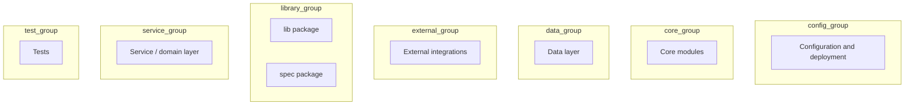

# Architecture report: exceljs/exceljs

> Automated static analysis. **Observed** = directly seen in files/imports/AST; **Inferred** = interpretation from that evidence. Repository code was not executed.

## 1. Repository at a glance

| Item | Value |
| --- | --- |
| Repository | exceljs/exceljs |
| Description | Excel Workbook Manager |
| Language | JavaScript |
| Stars | 15517 |
| Licence | MIT |
| Analysed commit / branch | 5bed18b45e824f409b08456b59b87430ded023ab / master |
| Framework(s) | Express |
| Files analysed | 501 |
| Components | 8 |

## 2. Architecture in one minute

exceljs/exceljs - Excel Workbook Manager. This repository was analysed statically from 501 file(s) (0 Python). Detected technologies (observed from imports/manifests): GitHub Actions, Express, TypeScript. Files are grouped into 8 component(s): Configuration and deployment, Core modules, Data layer, External integrations, lib package, Service / domain layer, spec package, Tests. Findings below distinguish observed facts from inferred interpretation.

## 3. High-level block diagram

## 4. Main components

### Configuration and deployment (`config`)

- **Kind:** config
- **Status:** Observed
- **Confidence:** 0.85
- **Responsibility:** Groups 40 file(s) under configuration and deployment (observed from repository paths and static analysis).
- **Paths:** `lib/doc/data/theme1.json`, `package.json`, `spec/config/setup-unit.js`, `spec/config/setup.js`, `spec/integration/data/rich-text-sample-a1.json`, `spec/integration/data/testmodel.json`, `spec/unit/data/simpleWorkbook.json`, `spec/unit/xlsx/xform/book/data/book.1.1.json`, `spec/unit/xlsx/xform/book/data/book.1.3.json`, `spec/unit/xlsx/xform/book/data/book.2.3.json`, `spec/unit/xlsx/xform/core/data/worksheet.rels.1.json`, `spec/unit/xlsx/xform/sheet/data/sheet.1.0.json`, `spec/unit/xlsx/xform/sheet/data/sheet.1.1.json`, `spec/unit/xlsx/xform/sheet/data/sheet.1.3.json`, `spec/unit/xlsx/xform/sheet/data/sheet.1.4.json`, `spec/unit/xlsx/xform/sheet/data/sheet.2.0.json`, `spec/unit/xlsx/xform/sheet/data/sheet.2.1.json`, `spec/unit/xlsx/xform/sheet/data/sheet.3.1.json`, `spec/unit/xlsx/xform/sheet/data/sheet.4.0.json`, `spec/unit/xlsx/xform/sheet/data/sheet.5.0.json`, `spec/unit/xlsx/xform/sheet/data/sheet.5.1.json`, `spec/unit/xlsx/xform/sheet/data/sheet.5.3.json`, `spec/unit/xlsx/xform/sheet/data/sheet.5.4.json`, `spec/unit/xlsx/xform/sheet/data/sheet.6.1.json`, `spec/unit/xlsx/xform/sheet/data/sheet.6.3.json`, `spec/unit/xlsx/xform/sheet/data/sheet.7.0.json`, `spec/unit/xlsx/xform/sheet/data/sheet.7.1.json`, `spec/unit/xlsx/xform/strings/data/sharedStrings.json`, `spec/unit/xlsx/xform/style/data/styles.1.1.json`, `spec/unit/xlsx/xform/table/data/table.1.1.json`, `spec/unit/xlsx/xform/table/data/table.1.3.json`, `spec/utils/data/conditional-formatting.json`, `spec/utils/data/data-validations.json`, `spec/utils/data/header-footer.json`, `spec/utils/data/page-setup.json`, `spec/utils/data/sheet-properties.json`, `spec/utils/data/sheet-values.json`, `spec/utils/data/styles.json`, `spec/utils/data/views.json`, `tsconfig.json`
- **Evidence:** [lib/doc/data/theme1.json](https://github.com/exceljs/exceljs/blob/5bed18b45e824f409b08456b59b87430ded023ab/lib/doc/data/theme1.json); [package.json](https://github.com/exceljs/exceljs/blob/5bed18b45e824f409b08456b59b87430ded023ab/package.json); [spec/config/setup-unit.js](https://github.com/exceljs/exceljs/blob/5bed18b45e824f409b08456b59b87430ded023ab/spec/config/setup-unit.js); [spec/config/setup.js](https://github.com/exceljs/exceljs/blob/5bed18b45e824f409b08456b59b87430ded023ab/spec/config/setup.js); [spec/integration/data/rich-text-sample-a1.json](https://github.com/exceljs/exceljs/blob/5bed18b45e824f409b08456b59b87430ded023ab/spec/integration/data/rich-text-sample-a1.json); [spec/integration/data/testmodel.json](https://github.com/exceljs/exceljs/blob/5bed18b45e824f409b08456b59b87430ded023ab/spec/integration/data/testmodel.json); [spec/unit/data/simpleWorkbook.json](https://github.com/exceljs/exceljs/blob/5bed18b45e824f409b08456b59b87430ded023ab/spec/unit/data/simpleWorkbook.json); [spec/unit/xlsx/xform/book/data/book.1.1.json](https://github.com/exceljs/exceljs/blob/5bed18b45e824f409b08456b59b87430ded023ab/spec/unit/xlsx/xform/book/data/book.1.1.json)

### Core modules (`core`)

- **Kind:** core
- **Status:** Observed
- **Confidence:** 0.85
- **Responsibility:** Groups 5 file(s) under core modules (observed from repository paths and static analysis).
- **Paths:** `benchmark.js`, `excel.js`, `gruntfile.js`, `index.d.ts`, `index.ts`
- **Evidence:** [benchmark.js](https://github.com/exceljs/exceljs/blob/5bed18b45e824f409b08456b59b87430ded023ab/benchmark.js); [excel.js](https://github.com/exceljs/exceljs/blob/5bed18b45e824f409b08456b59b87430ded023ab/excel.js); [gruntfile.js](https://github.com/exceljs/exceljs/blob/5bed18b45e824f409b08456b59b87430ded023ab/gruntfile.js); [index.d.ts](https://github.com/exceljs/exceljs/blob/5bed18b45e824f409b08456b59b87430ded023ab/index.d.ts); [index.ts](https://github.com/exceljs/exceljs/blob/5bed18b45e824f409b08456b59b87430ded023ab/index.ts)

### Data layer (`data_layer`)

- **Kind:** data
- **Status:** Observed
- **Confidence:** 0.85
- **Responsibility:** Groups 5 file(s) under data layer (observed from repository paths and static analysis).
- **Paths:** `spec/integration/data/rich-text-sample.js`, `spec/unit/xlsx/xform/drawing/data/drawing.1.0.js`, `spec/unit/xlsx/xform/drawing/data/drawing.1.1.js`, `spec/unit/xlsx/xform/drawing/data/drawing.1.3.js`, `spec/unit/xlsx/xform/drawing/data/drawing.1.4.js`
- **Evidence:** [spec/integration/data/rich-text-sample.js](https://github.com/exceljs/exceljs/blob/5bed18b45e824f409b08456b59b87430ded023ab/spec/integration/data/rich-text-sample.js); [spec/unit/xlsx/xform/drawing/data/drawing.1.0.js](https://github.com/exceljs/exceljs/blob/5bed18b45e824f409b08456b59b87430ded023ab/spec/unit/xlsx/xform/drawing/data/drawing.1.0.js); [spec/unit/xlsx/xform/drawing/data/drawing.1.1.js](https://github.com/exceljs/exceljs/blob/5bed18b45e824f409b08456b59b87430ded023ab/spec/unit/xlsx/xform/drawing/data/drawing.1.1.js); [spec/unit/xlsx/xform/drawing/data/drawing.1.3.js](https://github.com/exceljs/exceljs/blob/5bed18b45e824f409b08456b59b87430ded023ab/spec/unit/xlsx/xform/drawing/data/drawing.1.3.js); [spec/unit/xlsx/xform/drawing/data/drawing.1.4.js](https://github.com/exceljs/exceljs/blob/5bed18b45e824f409b08456b59b87430ded023ab/spec/unit/xlsx/xform/drawing/data/drawing.1.4.js)

### External integrations (`external_integrations`)

- **Kind:** external
- **Status:** Observed
- **Confidence:** 0.85
- **Responsibility:** Groups 44 file(s) under external integrations (observed from repository paths and static analysis).
- **Paths:** `spec/integration/gold.spec.js`, `spec/integration/issues/issue-1027-sheet-defined-data-validate.spec.js`, `spec/integration/issues/issue-1328-xlsx-worksheet-reader-date.spec.js`, `spec/integration/issues/issue-1339-speciel-cell-file.spec.js`, `spec/integration/issues/issue-1364-incorrect-worksheet-name-streaming-xlsx.spec.js`, `spec/integration/issues/issue-163-xlsx-read-file.spec.js`, `spec/integration/issues/issue-1669-optional-custom-autofilter-on-table.spec.js`, `spec/integration/issues/issue-176-unexpected-xml-node.spec.js`, `spec/integration/issues/issue-1842-dataValidations-memory-overload.spec.js`, `spec/integration/issues/issue-2125-spliceRows-last-row.spec.js`, `spec/integration/issues/issue-219-1904-dates.spec.js`, `spec/integration/issues/issue-234-vertical-tab-char.spec.js`, `spec/integration/issues/issue-257-sheet-order.spec.js`, `spec/integration/issues/issue-275-hyperlink-query-param.spec.js`, `spec/integration/issues/issue-539-contentType-element.spec.js`, `spec/integration/issues/issue-623-borders-for-merged-cell.spec.js`, `spec/integration/issues/issue-703-speciel-cell-file.spec.js`, `spec/integration/issues/issue-771-data-validation-without-type.spec.js`, `spec/integration/issues/issue-877-hyperlink-no-text.spec.js`, `spec/integration/issues/issue-880-malformed-comment.spec.js`, `spec/integration/issues/issue-988-missing-table-autofilter.spec.js`, `spec/integration/issues/issue-991-csv-read-dates.spec.js`, `spec/integration/issues/issue-995-encoding.spec.js`, `spec/integration/issues/shared-formula.spec.js`, `spec/integration/pr/pr-896/test-pr-896.spec.js`, `spec/integration/pr/test-pr-1157.spec.js`, `spec/integration/pr/test-pr-1220.spec.js`, `spec/integration/pr/test-pr-1262.spec.js`, `spec/integration/pr/test-pr-1334.spec.js`, `spec/integration/pr/test-pr-1431.spec.js`, `spec/integration/pr/test-pr-1487.spec.js`, `spec/integration/pr/test-pr-1576.spec.js`, `spec/integration/pr/test-pr-2244.spec.js`, `spec/integration/pr/test-pr-567.spec.js`, `spec/integration/pr/test-pr-728.spec.js`, `spec/integration/pr/test-pr-896.spec.js`, `spec/integration/workbook-xlsx-reader.spec.js`, `spec/integration/workbook-xlsx-writer/workbook-xlsx-writer.spec.js`, `spec/integration/workbook/images.spec.js`, `spec/integration/workbook/pivot-tables.spec.js`, `spec/integration/workbook/styles.spec.js`, `spec/integration/workbook/workbook.spec.js`, `spec/integration/worksheet-xlsx-writer.spec.js`, `spec/integration/worksheet.spec.js`
- **Evidence:** [spec/integration/gold.spec.js](https://github.com/exceljs/exceljs/blob/5bed18b45e824f409b08456b59b87430ded023ab/spec/integration/gold.spec.js); [spec/integration/issues/issue-1027-sheet-defined-data-validate.spec.js](https://github.com/exceljs/exceljs/blob/5bed18b45e824f409b08456b59b87430ded023ab/spec/integration/issues/issue-1027-sheet-defined-data-validate.spec.js); [spec/integration/issues/issue-1328-xlsx-worksheet-reader-date.spec.js](https://github.com/exceljs/exceljs/blob/5bed18b45e824f409b08456b59b87430ded023ab/spec/integration/issues/issue-1328-xlsx-worksheet-reader-date.spec.js); [spec/integration/issues/issue-1339-speciel-cell-file.spec.js](https://github.com/exceljs/exceljs/blob/5bed18b45e824f409b08456b59b87430ded023ab/spec/integration/issues/issue-1339-speciel-cell-file.spec.js); [spec/integration/issues/issue-1364-incorrect-worksheet-name-streaming-xlsx.spec.js](https://github.com/exceljs/exceljs/blob/5bed18b45e824f409b08456b59b87430ded023ab/spec/integration/issues/issue-1364-incorrect-worksheet-name-streaming-xlsx.spec.js); [spec/integration/issues/issue-163-xlsx-read-file.spec.js](https://github.com/exceljs/exceljs/blob/5bed18b45e824f409b08456b59b87430ded023ab/spec/integration/issues/issue-163-xlsx-read-file.spec.js); [spec/integration/issues/issue-1669-optional-custom-autofilter-on-table.spec.js](https://github.com/exceljs/exceljs/blob/5bed18b45e824f409b08456b59b87430ded023ab/spec/integration/issues/issue-1669-optional-custom-autofilter-on-table.spec.js); [spec/integration/issues/issue-176-unexpected-xml-node.spec.js](https://github.com/exceljs/exceljs/blob/5bed18b45e824f409b08456b59b87430ded023ab/spec/integration/issues/issue-176-unexpected-xml-node.spec.js)

### lib package (`lib`)

- **Kind:** library
- **Status:** Observed
- **Confidence:** 0.85
- **Responsibility:** Groups 164 file(s) under lib package (observed from repository paths and static analysis).
- **Paths:** `lib/csv/csv.js`, `lib/csv/line-buffer.js`, `lib/csv/stream-converter.js`, `lib/doc/anchor.js`, `lib/doc/cell.js`, `lib/doc/column.js`, `lib/doc/data-validations.js`, `lib/doc/defined-names.js`, `lib/doc/enums.js`, `lib/doc/image.js`, `lib/doc/modelcontainer.js`, `lib/doc/note.js`, `lib/doc/pivot-table.js`, `lib/doc/range.js`, `lib/doc/row.js`, `lib/doc/table.js`, `lib/doc/workbook.js`, `lib/doc/worksheet.js`, `lib/exceljs.bare.js`, `lib/exceljs.browser.js`, `lib/exceljs.nodejs.js`, `lib/stream/xlsx/hyperlink-reader.js`, `lib/stream/xlsx/sheet-comments-writer.js`, `lib/stream/xlsx/sheet-rels-writer.js`, `lib/stream/xlsx/workbook-reader.js`, `lib/stream/xlsx/workbook-writer.js`, `lib/stream/xlsx/worksheet-reader.js`, `lib/stream/xlsx/worksheet-writer.js`, `lib/utils/auto-drain.js`, `lib/utils/browser-buffer-decode.js`, `lib/utils/browser-buffer-encode.js`, `lib/utils/cell-matrix.js`, `lib/utils/col-cache.js`, `lib/utils/copy-style.js`, `lib/utils/encryptor.js`, `lib/utils/iterate-stream.js`, `lib/utils/parse-sax.js`, `lib/utils/shared-formula.js`, `lib/utils/shared-strings.js`, `lib/utils/stream-base64.js`, `lib/utils/stream-buf.js`, `lib/utils/string-buf.js`, `lib/utils/string-builder.js`, `lib/utils/stuttered-pipe.js`, `lib/utils/typed-stack.js`, `lib/utils/under-dash.js`, `lib/utils/utils.js`, `lib/utils/xml-stream.js`, `lib/utils/zip-stream.js`, `lib/xlsx/defaultnumformats.js`, `lib/xlsx/rel-type.js`, `lib/xlsx/xform/base-xform.js`, `lib/xlsx/xform/book/defined-name-xform.js`, `lib/xlsx/xform/book/sheet-xform.js`, `lib/xlsx/xform/book/workbook-calc-properties-xform.js`, `lib/xlsx/xform/book/workbook-pivot-cache-xform.js`, `lib/xlsx/xform/book/workbook-properties-xform.js`, `lib/xlsx/xform/book/workbook-view-xform.js`, `lib/xlsx/xform/book/workbook-xform.js`, `lib/xlsx/xform/comment/comment-xform.js`, `lib/xlsx/xform/comment/comments-xform.js`, `lib/xlsx/xform/comment/style/vml-position-xform.js`, `lib/xlsx/xform/comment/style/vml-protection-xform.js`, `lib/xlsx/xform/comment/vml-anchor-xform.js`, `lib/xlsx/xform/comment/vml-client-data-xform.js`, `lib/xlsx/xform/comment/vml-notes-xform.js`, `lib/xlsx/xform/comment/vml-shape-xform.js`, `lib/xlsx/xform/comment/vml-textbox-xform.js`, `lib/xlsx/xform/composite-xform.js`, `lib/xlsx/xform/drawing/base-cell-anchor-xform.js`, `lib/xlsx/xform/drawing/blip-fill-xform.js`, `lib/xlsx/xform/drawing/blip-xform.js`, `lib/xlsx/xform/drawing/c-nv-pic-pr-xform.js`, `lib/xlsx/xform/drawing/c-nv-pr-xform.js`, `lib/xlsx/xform/drawing/cell-position-xform.js`, `lib/xlsx/xform/drawing/drawing-xform.js`, `lib/xlsx/xform/drawing/ext-lst-xform.js`, `lib/xlsx/xform/drawing/ext-xform.js`, `lib/xlsx/xform/drawing/hlink-click-xform.js`, `lib/xlsx/xform/drawing/nv-pic-pr-xform.js`, `lib/xlsx/xform/drawing/one-cell-anchor-xform.js`, `lib/xlsx/xform/drawing/pic-xform.js`, `lib/xlsx/xform/drawing/sp-pr.js`, `lib/xlsx/xform/drawing/two-cell-anchor-xform.js`, `lib/xlsx/xform/list-xform.js`, `lib/xlsx/xform/pivot-table/cache-field.js`, `lib/xlsx/xform/pivot-table/pivot-cache-definition-xform.js`, `lib/xlsx/xform/pivot-table/pivot-cache-records-xform.js`, `lib/xlsx/xform/pivot-table/pivot-table-xform.js`, `lib/xlsx/xform/sheet/auto-filter-xform.js`, `lib/xlsx/xform/sheet/cell-xform.js`, `lib/xlsx/xform/sheet/cf-ext/cf-icon-ext-xform.js`, `lib/xlsx/xform/sheet/cf-ext/cf-rule-ext-xform.js`, `lib/xlsx/xform/sheet/cf-ext/cfvo-ext-xform.js`, `lib/xlsx/xform/sheet/cf-ext/conditional-formatting-ext-xform.js`, `lib/xlsx/xform/sheet/cf-ext/conditional-formattings-ext-xform.js`, `lib/xlsx/xform/sheet/cf-ext/databar-ext-xform.js`, `lib/xlsx/xform/sheet/cf-ext/f-ext-xform.js`, `lib/xlsx/xform/sheet/cf-ext/icon-set-ext-xform.js`, `lib/xlsx/xform/sheet/cf-ext/sqref-ext-xform.js`, `lib/xlsx/xform/sheet/cf/cf-rule-xform.js`, `lib/xlsx/xform/sheet/cf/cfvo-xform.js`, `lib/xlsx/xform/sheet/cf/color-scale-xform.js`, `lib/xlsx/xform/sheet/cf/conditional-formatting-xform.js`, `lib/xlsx/xform/sheet/cf/conditional-formattings-xform.js`, `lib/xlsx/xform/sheet/cf/databar-xform.js`, `lib/xlsx/xform/sheet/cf/ext-lst-ref-xform.js`, `lib/xlsx/xform/sheet/cf/formula-xform.js`, `lib/xlsx/xform/sheet/cf/icon-set-xform.js`, `lib/xlsx/xform/sheet/col-xform.js`, `lib/xlsx/xform/sheet/data-validations-xform.js`, `lib/xlsx/xform/sheet/dimension-xform.js`, `lib/xlsx/xform/sheet/drawing-xform.js`, `lib/xlsx/xform/sheet/ext-lst-xform.js`, `lib/xlsx/xform/sheet/header-footer-xform.js`, `lib/xlsx/xform/sheet/hyperlink-xform.js`, `lib/xlsx/xform/sheet/merge-cell-xform.js`, `lib/xlsx/xform/sheet/merges.js`, `lib/xlsx/xform/sheet/outline-properties-xform.js`, `lib/xlsx/xform/sheet/page-breaks-xform.js`, `lib/xlsx/xform/sheet/page-margins-xform.js`, `lib/xlsx/xform/sheet/page-setup-properties-xform.js`, `lib/xlsx/xform/sheet/page-setup-xform.js`, `lib/xlsx/xform/sheet/picture-xform.js`, `lib/xlsx/xform/sheet/print-options-xform.js`, `lib/xlsx/xform/sheet/row-breaks-xform.js`, `lib/xlsx/xform/sheet/row-xform.js`, `lib/xlsx/xform/sheet/sheet-format-properties-xform.js`, `lib/xlsx/xform/sheet/sheet-properties-xform.js`, `lib/xlsx/xform/sheet/sheet-protection-xform.js`, `lib/xlsx/xform/sheet/sheet-view-xform.js`, `lib/xlsx/xform/sheet/table-part-xform.js`, `lib/xlsx/xform/sheet/worksheet-xform.js`, `lib/xlsx/xform/simple/boolean-xform.js`, `lib/xlsx/xform/simple/date-xform.js`, `lib/xlsx/xform/simple/float-xform.js`, `lib/xlsx/xform/simple/integer-xform.js`, `lib/xlsx/xform/simple/string-xform.js`, `lib/xlsx/xform/static-xform.js`, `lib/xlsx/xform/strings/phonetic-text-xform.js`, `lib/xlsx/xform/strings/rich-text-xform.js`, `lib/xlsx/xform/strings/shared-string-xform.js`, `lib/xlsx/xform/strings/shared-strings-xform.js`, `lib/xlsx/xform/strings/text-xform.js`, `lib/xlsx/xform/style/alignment-xform.js`, `lib/xlsx/xform/style/border-xform.js`, `lib/xlsx/xform/style/color-xform.js`, `lib/xlsx/xform/style/dxf-xform.js`, `lib/xlsx/xform/style/fill-xform.js`, `lib/xlsx/xform/style/font-xform.js`, `lib/xlsx/xform/style/numfmt-xform.js`, `lib/xlsx/xform/style/protection-xform.js`, `lib/xlsx/xform/style/style-xform.js`, `lib/xlsx/xform/style/styles-xform.js`, `lib/xlsx/xform/style/underline-xform.js`, `lib/xlsx/xform/table/auto-filter-xform.js`, `lib/xlsx/xform/table/custom-filter-xform.js`, `lib/xlsx/xform/table/filter-column-xform.js`, `lib/xlsx/xform/table/filter-xform.js`, `lib/xlsx/xform/table/table-column-xform.js`, `lib/xlsx/xform/table/table-style-info-xform.js`, `lib/xlsx/xform/table/table-xform.js`, `lib/xlsx/xlsx.js`, `lib/xlsx/xml/theme1.js`
- **Evidence:** [lib/csv/csv.js](https://github.com/exceljs/exceljs/blob/5bed18b45e824f409b08456b59b87430ded023ab/lib/csv/csv.js); [lib/csv/line-buffer.js](https://github.com/exceljs/exceljs/blob/5bed18b45e824f409b08456b59b87430ded023ab/lib/csv/line-buffer.js); [lib/csv/stream-converter.js](https://github.com/exceljs/exceljs/blob/5bed18b45e824f409b08456b59b87430ded023ab/lib/csv/stream-converter.js); [lib/doc/anchor.js](https://github.com/exceljs/exceljs/blob/5bed18b45e824f409b08456b59b87430ded023ab/lib/doc/anchor.js); [lib/doc/cell.js](https://github.com/exceljs/exceljs/blob/5bed18b45e824f409b08456b59b87430ded023ab/lib/doc/cell.js); [lib/doc/column.js](https://github.com/exceljs/exceljs/blob/5bed18b45e824f409b08456b59b87430ded023ab/lib/doc/column.js); [lib/doc/data-validations.js](https://github.com/exceljs/exceljs/blob/5bed18b45e824f409b08456b59b87430ded023ab/lib/doc/data-validations.js); [lib/doc/defined-names.js](https://github.com/exceljs/exceljs/blob/5bed18b45e824f409b08456b59b87430ded023ab/lib/doc/defined-names.js)

### Service / domain layer (`service_layer`)

- **Kind:** service
- **Status:** Observed
- **Confidence:** 0.85
- **Responsibility:** Groups 13 file(s) under service / domain layer (observed from repository paths and static analysis).
- **Paths:** `lib/xlsx/xform/core/app-heading-pairs-xform.js`, `lib/xlsx/xform/core/app-titles-of-parts-xform.js`, `lib/xlsx/xform/core/app-xform.js`, `lib/xlsx/xform/core/content-types-xform.js`, `lib/xlsx/xform/core/core-xform.js`, `lib/xlsx/xform/core/relationship-xform.js`, `lib/xlsx/xform/core/relationships-xform.js`, `spec/unit/xlsx/xform/core/app-heading-pairs-xform.spec.js`, `spec/unit/xlsx/xform/core/app-titles-of-parts-xform.spec.js`, `spec/unit/xlsx/xform/core/app-xform.spec.js`, `spec/unit/xlsx/xform/core/content-types-xform.spec.js`, `spec/unit/xlsx/xform/core/core-xform.spec.js`, `spec/unit/xlsx/xform/core/relationships-xform.spec.js`
- **Evidence:** [lib/xlsx/xform/core/app-heading-pairs-xform.js](https://github.com/exceljs/exceljs/blob/5bed18b45e824f409b08456b59b87430ded023ab/lib/xlsx/xform/core/app-heading-pairs-xform.js); [lib/xlsx/xform/core/app-titles-of-parts-xform.js](https://github.com/exceljs/exceljs/blob/5bed18b45e824f409b08456b59b87430ded023ab/lib/xlsx/xform/core/app-titles-of-parts-xform.js); [lib/xlsx/xform/core/app-xform.js](https://github.com/exceljs/exceljs/blob/5bed18b45e824f409b08456b59b87430ded023ab/lib/xlsx/xform/core/app-xform.js); [lib/xlsx/xform/core/content-types-xform.js](https://github.com/exceljs/exceljs/blob/5bed18b45e824f409b08456b59b87430ded023ab/lib/xlsx/xform/core/content-types-xform.js); [lib/xlsx/xform/core/core-xform.js](https://github.com/exceljs/exceljs/blob/5bed18b45e824f409b08456b59b87430ded023ab/lib/xlsx/xform/core/core-xform.js); [lib/xlsx/xform/core/relationship-xform.js](https://github.com/exceljs/exceljs/blob/5bed18b45e824f409b08456b59b87430ded023ab/lib/xlsx/xform/core/relationship-xform.js); [lib/xlsx/xform/core/relationships-xform.js](https://github.com/exceljs/exceljs/blob/5bed18b45e824f409b08456b59b87430ded023ab/lib/xlsx/xform/core/relationships-xform.js); [spec/unit/xlsx/xform/core/app-heading-pairs-xform.spec.js](https://github.com/exceljs/exceljs/blob/5bed18b45e824f409b08456b59b87430ded023ab/spec/unit/xlsx/xform/core/app-heading-pairs-xform.spec.js)

### spec package (`spec`)

- **Kind:** library
- **Status:** Observed
- **Confidence:** 0.85
- **Responsibility:** Groups 109 file(s) under spec package (observed from repository paths and static analysis).
- **Paths:** `spec/browser/exceljs.spec.js`, `spec/end-to-end/express.spec.js`, `spec/manual/app.js`, `spec/typescript/exceljs.spec.ts`, `spec/unit/doc/anchor.spec.js`, `spec/unit/doc/cell.spec.js`, `spec/unit/doc/column.spec.js`, `spec/unit/doc/defined-names.spec.js`, `spec/unit/doc/range.spec.js`, `spec/unit/doc/row.spec.js`, `spec/unit/doc/workbook-writer.spec.js`, `spec/unit/doc/workbook.spec.js`, `spec/unit/doc/worksheet-table.spec.js`, `spec/unit/doc/worksheet-writer.spec.js`, `spec/unit/doc/worksheet.merge.spec.js`, `spec/unit/doc/worksheet.pagebreak.spec.js`, `spec/unit/doc/worksheet.shared-formula.spec.js`, `spec/unit/doc/worksheet.styles.spec.js`, `spec/unit/doc/worksheet.values.spec.js`, `spec/unit/doc/worksheet.views.spec.js`, `spec/unit/utils/cell-matrix.spec.js`, `spec/unit/utils/col-cache.spec.js`, `spec/unit/utils/copy-style.spec.js`, `spec/unit/utils/encryptor.spec.js`, `spec/unit/utils/shared-formula.spec.js`, `spec/unit/utils/shared-strings.spec.js`, `spec/unit/utils/stream-buf.spec.js`, `spec/unit/utils/string-buf.spec.js`, `spec/unit/utils/under-dash.spec.js`, `spec/unit/utils/utils.spec.js`, `spec/unit/utils/xml-stream.spec.js`, `spec/unit/xlsx/xform/book/defined-name-xform.spec.js`, `spec/unit/xlsx/xform/book/workbook-calc-properties-xform.spec.js`, `spec/unit/xlsx/xform/book/workbook-properties-xform.spec.js`, `spec/unit/xlsx/xform/book/workbook-view-xform.spec.js`, `spec/unit/xlsx/xform/book/workbook-xform.spec.js`, `spec/unit/xlsx/xform/compy-xform.js`, `spec/unit/xlsx/xform/drawing/blip-fill-xform.spec.js`, `spec/unit/xlsx/xform/drawing/blip-xform.spec.js`, `spec/unit/xlsx/xform/drawing/cell-position-xform.spec.js`, `spec/unit/xlsx/xform/drawing/drawing-xform.spec.js`, `spec/unit/xlsx/xform/drawing/two-cell-anchor-xform.spec.js`, `spec/unit/xlsx/xform/list-xform.spec.js`, `spec/unit/xlsx/xform/sheet/auto-filter-xform.spec.js`, `spec/unit/xlsx/xform/sheet/cell-xform.spec.js`, `spec/unit/xlsx/xform/sheet/cf-ext/cf-icon-ext-xform.spec.js`, `spec/unit/xlsx/xform/sheet/cf-ext/cf-rule-ext-xform.spec.js`, `spec/unit/xlsx/xform/sheet/cf-ext/databar-ext-xform.spec.js`, `spec/unit/xlsx/xform/sheet/cf-ext/f-ext-xform.spec.js`, `spec/unit/xlsx/xform/sheet/cf-ext/icon-set-ext-xform.spec.js`, `spec/unit/xlsx/xform/sheet/cf-ext/sqref-ext-xform.spec.js`, `spec/unit/xlsx/xform/sheet/cf/cf-rule-xform.spec.js`, `spec/unit/xlsx/xform/sheet/cf/cfvo-xform.spec.js`, `spec/unit/xlsx/xform/sheet/cf/color-scale-xform.spec.js`, `spec/unit/xlsx/xform/sheet/cf/formula-xform.spec.js`, `spec/unit/xlsx/xform/sheet/cf/icon-set-xform.spec.js`, `spec/unit/xlsx/xform/sheet/col-xform.spec.js`, `spec/unit/xlsx/xform/sheet/data-validations-xform.spec.js`, `spec/unit/xlsx/xform/sheet/dimension-xform.spec.js`, `spec/unit/xlsx/xform/sheet/header-footer-xform.spec.js`, `spec/unit/xlsx/xform/sheet/hyperlink-xform.spec.js`, `spec/unit/xlsx/xform/sheet/merge-cell-xform.spec.js`, `spec/unit/xlsx/xform/sheet/outline-properties-xform.spec.js`, `spec/unit/xlsx/xform/sheet/page-breaks-xform.spec.js`, `spec/unit/xlsx/xform/sheet/page-margins-xform.spec.js`, `spec/unit/xlsx/xform/sheet/page-setup-properties-xform.spec.js`, `spec/unit/xlsx/xform/sheet/page-setup-xform.spec.js`, `spec/unit/xlsx/xform/sheet/print-options-xform.spec.js`, `spec/unit/xlsx/xform/sheet/row-xform.spec.js`, `spec/unit/xlsx/xform/sheet/sheet-format-properties-xform.spec.js`, `spec/unit/xlsx/xform/sheet/sheet-properties-xform.spec.js`, `spec/unit/xlsx/xform/sheet/sheet-protection-xform.spec.js`, `spec/unit/xlsx/xform/sheet/sheet-view-xform.spec.js`, `spec/unit/xlsx/xform/sheet/worksheet-xform.spec.js`, `spec/unit/xlsx/xform/simple/boolean-xform.spec.js`, `spec/unit/xlsx/xform/simple/date-xform.spec.js`, `spec/unit/xlsx/xform/simple/float-xform.spec.js`, `spec/unit/xlsx/xform/simple/integer-xform.spec.js`, `spec/unit/xlsx/xform/simple/string-xform.spec.js`, `spec/unit/xlsx/xform/static-xform.spec.js`, `spec/unit/xlsx/xform/strings/phonetic-text-xform.spec.js`, `spec/unit/xlsx/xform/strings/shared-string-xform.spec.js`, `spec/unit/xlsx/xform/strings/shared-strings-xform.spec.js`, `spec/unit/xlsx/xform/style/alignment-xform.spec.js`, `spec/unit/xlsx/xform/style/border-xform.spec.js`, `spec/unit/xlsx/xform/style/color-xform.spec.js`, `spec/unit/xlsx/xform/style/fill-xform.spec.js`, `spec/unit/xlsx/xform/style/font-xform.spec.js`, `spec/unit/xlsx/xform/style/numfmt-xform.spec.js`, `spec/unit/xlsx/xform/style/protection-xform.spec.js`, `spec/unit/xlsx/xform/style/style-xform.spec.js`, `spec/unit/xlsx/xform/style/styles-xform.spec.js`, `spec/unit/xlsx/xform/style/underline-xform.spec.js`, `spec/unit/xlsx/xform/table/auto-filter-xform.spec.js`, `spec/unit/xlsx/xform/table/custom-filter-xform.spec.js`, `spec/unit/xlsx/xform/table/filter-column-xform.spec.js`, `spec/unit/xlsx/xform/table/table-column-xform.spec.js`, `spec/unit/xlsx/xform/table/table-style-info-xform.spec.js`, `spec/unit/xlsx/xform/table/table-xform.spec.js`, `spec/unit/xlsx/xform/test-xform-helper.js`, `spec/utils/index.js`, `spec/utils/test-conditional-formatting-sheet.js`, `spec/utils/test-data-validation-sheet.js`, `spec/utils/test-spliced-sheet.js`, `spec/utils/test-values-sheet.js`, `spec/utils/test-workbook-reader.js`, `spec/utils/tools.js`, `spec/utils/under-dash.js`, `spec/utils/verquire.js`
- **Evidence:** [spec/browser/exceljs.spec.js](https://github.com/exceljs/exceljs/blob/5bed18b45e824f409b08456b59b87430ded023ab/spec/browser/exceljs.spec.js); [spec/end-to-end/express.spec.js](https://github.com/exceljs/exceljs/blob/5bed18b45e824f409b08456b59b87430ded023ab/spec/end-to-end/express.spec.js); [spec/manual/app.js](https://github.com/exceljs/exceljs/blob/5bed18b45e824f409b08456b59b87430ded023ab/spec/manual/app.js); [spec/typescript/exceljs.spec.ts](https://github.com/exceljs/exceljs/blob/5bed18b45e824f409b08456b59b87430ded023ab/spec/typescript/exceljs.spec.ts); [spec/unit/doc/anchor.spec.js](https://github.com/exceljs/exceljs/blob/5bed18b45e824f409b08456b59b87430ded023ab/spec/unit/doc/anchor.spec.js); [spec/unit/doc/cell.spec.js](https://github.com/exceljs/exceljs/blob/5bed18b45e824f409b08456b59b87430ded023ab/spec/unit/doc/cell.spec.js); [spec/unit/doc/column.spec.js](https://github.com/exceljs/exceljs/blob/5bed18b45e824f409b08456b59b87430ded023ab/spec/unit/doc/column.spec.js); [spec/unit/doc/defined-names.spec.js](https://github.com/exceljs/exceljs/blob/5bed18b45e824f409b08456b59b87430ded023ab/spec/unit/doc/defined-names.spec.js)

### Tests (`tests`)

- **Kind:** test
- **Status:** Observed
- **Confidence:** 0.85
- **Responsibility:** Groups 62 file(s) under tests (observed from repository paths and static analysis).
- **Paths:** `test/.eslintrc`, `test/regression/package.json`, `test/regression/testBookIn.js`, `test/regression/testBookOut.js`, `test/regression/utils/hr-stopwatch.js`, `test/test-a1.js`, `test/test-cf.js`, `test/test-chart.js`, `test/test-colour-cell.js`, `test/test-comment-new.js`, `test/test-comment-stream-writer.js`, `test/test-comments.js`, `test/test-copy.js`, `test/test-default-height.js`, `test/test-formula.js`, `test/test-header-footer.js`, `test/test-hyperlink.js`, `test/test-image-one-cell-anchor.js`, `test/test-image-oneCell.js`, `test/test-image-out.js`, `test/test-image-stream-writer.js`, `test/test-issue-530.js`, `test/test-issue-581.js`, `test/test-jszip.js`, `test/test-merge-align.js`, `test/test-newline.js`, `test/test-pivot-table.js`, `test/test-protection-spinCount.js`, `test/test-protection.js`, `test/test-table.js`, `test/testArray.js`, `test/testBigBookIn.js`, `test/testBigBookOut.js`, `test/testBookFont.js`, `test/testBookIn.js`, `test/testBookOut.js`, `test/testBookOutS.js`, `test/testBookRead.js`, `test/testColCache.js`, `test/testCsvIn.js`, `test/testCsvOut.js`, `test/testImageIn.js`, `test/testMergedBorder.js`, `test/testMultiplePrintAreaOut.js`, `test/testPerformance.js`, `test/testPrintAreaOut.js`, `test/testPrintColRowOut.js`, `test/testProcess.js`, `test/testSax2.js`, `test/testSharedStrings.js`, `test/testSheet.js`, `test/testStreamBuf.js`, `test/testStringBuf.js`, `test/testStringtable.js`, `test/testTemplate.js`, `test/testTinyBookOut.js`, `test/testWbStreamCompressionOptions.js`, `test/testWbStreamOut.js`, `test/testXlsxIn.js`, `test/utils/column-sum.js`, `test/utils/hr-stopwatch.js`, `test/utils/utils.js`
- **Evidence:** [test/.eslintrc](https://github.com/exceljs/exceljs/blob/5bed18b45e824f409b08456b59b87430ded023ab/test/.eslintrc); [test/regression/package.json](https://github.com/exceljs/exceljs/blob/5bed18b45e824f409b08456b59b87430ded023ab/test/regression/package.json); [test/regression/testBookIn.js](https://github.com/exceljs/exceljs/blob/5bed18b45e824f409b08456b59b87430ded023ab/test/regression/testBookIn.js); [test/regression/testBookOut.js](https://github.com/exceljs/exceljs/blob/5bed18b45e824f409b08456b59b87430ded023ab/test/regression/testBookOut.js); [test/regression/utils/hr-stopwatch.js](https://github.com/exceljs/exceljs/blob/5bed18b45e824f409b08456b59b87430ded023ab/test/regression/utils/hr-stopwatch.js); [test/test-a1.js](https://github.com/exceljs/exceljs/blob/5bed18b45e824f409b08456b59b87430ded023ab/test/test-a1.js); [test/test-cf.js](https://github.com/exceljs/exceljs/blob/5bed18b45e824f409b08456b59b87430ded023ab/test/test-cf.js); [test/test-chart.js](https://github.com/exceljs/exceljs/blob/5bed18b45e824f409b08456b59b87430ded023ab/test/test-chart.js)

## 5. Execution flow

**Observed** entry point(s):

- [excel.js](https://github.com/exceljs/exceljs/blob/5bed18b45e824f409b08456b59b87430ded023ab/excel.js)
- [index.ts](https://github.com/exceljs/exceljs/blob/5bed18b45e824f409b08456b59b87430ded023ab/index.ts)
- [spec/manual/app.js](https://github.com/exceljs/exceljs/blob/5bed18b45e824f409b08456b59b87430ded023ab/spec/manual/app.js)
- [spec/utils/index.js](https://github.com/exceljs/exceljs/blob/5bed18b45e824f409b08456b59b87430ded023ab/spec/utils/index.js)

Representative flow (derived from observed entry points and the import graph; steps beyond the entry point are **Inferred**):

1. Execution starts at an observed entry point listed above, if present.
2. No internal import relationships between components were observed.

## 6. Project structure

### `(root)`

- `.babelrc` - other (47 bytes)
- `.browserslistrc` - other (17 bytes)
- `.eslintignore` - other (35 bytes)
- `.eslintrc` - other (2078 bytes)
- `.gitignore` - other (995 bytes)
- `.prettier` - other (127 bytes)
- `.prettierignore` - other (35 bytes)
- `LICENSE` - docs (1084 bytes)
- `MODEL.md` - docs (2289 bytes)
- `README_zh.md` - docs (198886 bytes)
- `TODO.txt` - docs (15330 bytes)
- `UPGRADE-4.0.md` - docs (2018 bytes)
- `benchmark.js` - source, JavaScript (3534 bytes)
- `excel.js` - source, JavaScript (437 bytes)
- `gruntfile.js` - source, JavaScript (3628 bytes)
- `index.d.ts` - source, TypeScript (48628 bytes)
- `index.ts` - source, TypeScript (65 bytes)
- `package.json` - manifest (4658 bytes)
- `tsconfig.json` - config (203 bytes)

### `.github`

- `.github/FUNDING.yml` - config (646 bytes)
- `.github/ISSUE_TEMPLATE/bug_report.md` - docs (660 bytes)
- `.github/ISSUE_TEMPLATE/feature.md` - docs (353 bytes)
- `.github/ISSUE_TEMPLATE/question.md` - docs (570 bytes)
- `.github/PULL_REQUEST_TEMPLATE.md` - docs (574 bytes)
- `.github/lock.yml` - config (1168 bytes)
- `.github/workflows/asset-size.yml` - ci, YAML (426 bytes)
- `.github/workflows/tests.yml` - ci, YAML (3206 bytes)

### `lib`

- `lib/csv/csv.js` - source, JavaScript (5552 bytes)
- `lib/csv/line-buffer.js` - source, JavaScript (1307 bytes)
- `lib/csv/stream-converter.js` - source, JavaScript (3163 bytes)
- `lib/doc/anchor.js` - source, JavaScript (2571 bytes)
- `lib/doc/cell.js` - source, JavaScript (21120 bytes)
- `lib/doc/column.js` - source, JavaScript (6902 bytes)
- `lib/doc/data-validations.js` - source, JavaScript (316 bytes)
- `lib/doc/data/theme1.json` - config (9079 bytes)
- `lib/doc/defined-names.js` - source, JavaScript (5004 bytes)
- `lib/doc/enums.js` - source, JavaScript (732 bytes)
- `lib/doc/image.js` - source, JavaScript (1549 bytes)
- `lib/doc/modelcontainer.js` - source, JavaScript (271 bytes)
- `lib/doc/note.js` - source, JavaScript (1188 bytes)
- `lib/doc/pivot-table.js` - source, JavaScript (4073 bytes)
- `lib/doc/range.js` - source, JavaScript (6101 bytes)
- `lib/doc/row.js` - source, JavaScript (9903 bytes)
- `lib/doc/table.js` - source, JavaScript (11941 bytes)
- `lib/doc/workbook.js` - source, JavaScript (6027 bytes)
- `lib/doc/worksheet.js` - source, JavaScript (27124 bytes)
- `lib/exceljs.bare.js` - source, JavaScript (306 bytes)
- `lib/exceljs.browser.js` - source, JavaScript (1473 bytes)
- `lib/exceljs.nodejs.js` - source, JavaScript (351 bytes)
- `lib/stream/xlsx/hyperlink-reader.js` - source, JavaScript (2130 bytes)
- `lib/stream/xlsx/sheet-comments-writer.js` - source, JavaScript (3738 bytes)
- `lib/stream/xlsx/sheet-rels-writer.js` - source, JavaScript (2685 bytes)
- `lib/stream/xlsx/workbook-reader.js` - source, JavaScript (10216 bytes)
- `lib/stream/xlsx/workbook-writer.js` - source, JavaScript (9768 bytes)
- `lib/stream/xlsx/worksheet-reader.js` - source, JavaScript (10537 bytes)
- `lib/stream/xlsx/worksheet-writer.js` - source, JavaScript (20795 bytes)
- `lib/utils/auto-drain.js` - source, JavaScript (315 bytes)
- `lib/utils/browser-buffer-decode.js` - source, JavaScript (386 bytes)
- `lib/utils/browser-buffer-encode.js` - source, JavaScript (434 bytes)
- `lib/utils/cell-matrix.js` - source, JavaScript (3822 bytes)
- `lib/utils/col-cache.js` - source, JavaScript (7265 bytes)
- `lib/utils/copy-style.js` - source, JavaScript (1273 bytes)
- `lib/utils/encryptor.js` - source, JavaScript (1941 bytes)
- `lib/utils/iterate-stream.js` - source, JavaScript (1218 bytes)
- `lib/utils/parse-sax.js` - source, JavaScript (1220 bytes)
- `lib/utils/shared-formula.js` - source, JavaScript (1413 bytes)
- `lib/utils/shared-strings.js` - source, JavaScript (596 bytes)
- `lib/utils/stream-base64.js` - source, JavaScript (1811 bytes)
- `lib/utils/stream-buf.js` - source, JavaScript (9211 bytes)
- `lib/utils/string-buf.js` - source, JavaScript (1948 bytes)
- `lib/utils/string-builder.js` - source, JavaScript (597 bytes)
- `lib/utils/stuttered-pipe.js` - source, JavaScript (1527 bytes)
- `lib/utils/typed-stack.js` - source, JavaScript (426 bytes)
- `lib/utils/under-dash.js` - source, JavaScript (4059 bytes)
- `lib/utils/utils.js` - source, JavaScript (5199 bytes)
- `lib/utils/xml-stream.js` - source, JavaScript (3496 bytes)
- `lib/utils/zip-stream.js` - source, JavaScript (1951 bytes)
- `lib/xlsx/.rels` - other (397 bytes)
- `lib/xlsx/calcChain.xml` - other (307 bytes)
- `lib/xlsx/core.xml` - other (689 bytes)
- `lib/xlsx/defaultnumformats.js` - source, JavaScript (3773 bytes)
- `lib/xlsx/rel-type.js` - source, JavaScript (1601 bytes)
- `lib/xlsx/styles.xml` - other (1631 bytes)
- `lib/xlsx/workbook.xml` - other (764 bytes)
- `lib/xlsx/xform/base-xform.js` - source, JavaScript (3532 bytes)
- `lib/xlsx/xform/book/defined-name-xform.js` - source, JavaScript (2169 bytes)
- `lib/xlsx/xform/book/sheet-xform.js` - source, JavaScript (713 bytes)
- `lib/xlsx/xform/book/workbook-calc-properties-xform.js` - source, JavaScript (489 bytes)
- `lib/xlsx/xform/book/workbook-pivot-cache-xform.js` - source, JavaScript (549 bytes)
- `lib/xlsx/xform/book/workbook-properties-xform.js` - source, JavaScript (575 bytes)
- `lib/xlsx/xform/book/workbook-view-xform.js` - source, JavaScript (1583 bytes)
- `lib/xlsx/xform/book/workbook-xform.js` - source, JavaScript (8347 bytes)
- `lib/xlsx/xform/comment/comment-xform.js` - source, JavaScript (2204 bytes)
- `lib/xlsx/xform/comment/comments-xform.js` - source, JavaScript (1992 bytes)
- `lib/xlsx/xform/comment/style/vml-position-xform.js` - source, JavaScript (728 bytes)
- `lib/xlsx/xform/comment/style/vml-protection-xform.js` - source, JavaScript (587 bytes)
- `lib/xlsx/xform/comment/vml-anchor-xform.js` - source, JavaScript (1357 bytes)
- `lib/xlsx/xform/comment/vml-client-data-xform.js` - source, JavaScript (2668 bytes)
- `lib/xlsx/xform/comment/vml-notes-xform.js` - source, JavaScript (2573 bytes)
- `lib/xlsx/xform/comment/vml-shape-xform.js` - source, JavaScript (2600 bytes)
- `lib/xlsx/xform/comment/vml-textbox-xform.js` - source, JavaScript (1430 bytes)
- `lib/xlsx/xform/composite-xform.js` - source, JavaScript (1283 bytes)
- `lib/xlsx/xform/core/app-heading-pairs-xform.js` - source, JavaScript (746 bytes)
- `lib/xlsx/xform/core/app-titles-of-parts-xform.js` - source, JavaScript (608 bytes)
- `lib/xlsx/xform/core/app-xform.js` - source, JavaScript (2764 bytes)
- `lib/xlsx/xform/core/content-types-xform.js` - source, JavaScript (4463 bytes)
- `lib/xlsx/xform/core/core-xform.js` - source, JavaScript (5088 bytes)
- `lib/xlsx/xform/core/relationship-xform.js` - source, JavaScript (445 bytes)
- `lib/xlsx/xform/core/relationships-xform.js` - source, JavaScript (1725 bytes)
- `lib/xlsx/xform/drawing/base-cell-anchor-xform.js` - source, JavaScript (1069 bytes)
- `lib/xlsx/xform/drawing/blip-fill-xform.js` - source, JavaScript (1285 bytes)
- `lib/xlsx/xform/drawing/blip-xform.js` - source, JavaScript (833 bytes)
- `lib/xlsx/xform/drawing/c-nv-pic-pr-xform.js` - source, JavaScript (648 bytes)
- `lib/xlsx/xform/drawing/c-nv-pr-xform.js` - source, JavaScript (1372 bytes)
- `lib/xlsx/xform/drawing/cell-position-xform.js` - source, JavaScript (1898 bytes)
- `lib/xlsx/xform/drawing/drawing-xform.js` - source, JavaScript (2596 bytes)
- `lib/xlsx/xform/drawing/ext-lst-xform.js` - source, JavaScript (867 bytes)
- `lib/xlsx/xform/drawing/ext-xform.js` - source, JavaScript (1011 bytes)
- `lib/xlsx/xform/drawing/hlink-click-xform.js` - source, JavaScript (837 bytes)
- `lib/xlsx/xform/drawing/nv-pic-pr-xform.js` - source, JavaScript (1301 bytes)
- `lib/xlsx/xform/drawing/one-cell-anchor-xform.js` - source, JavaScript (1712 bytes)
- `lib/xlsx/xform/drawing/pic-xform.js` - source, JavaScript (1588 bytes)
- `lib/xlsx/xform/drawing/sp-pr.js` - source, JavaScript (291 bytes)
- `lib/xlsx/xform/drawing/two-cell-anchor-xform.js` - source, JavaScript (1674 bytes)
- `lib/xlsx/xform/list-xform.js` - source, JavaScript (2173 bytes)
- `lib/xlsx/xform/pivot-table/cache-field.js` - source, JavaScript (1130 bytes)
- `lib/xlsx/xform/pivot-table/pivot-cache-definition-xform.js` - source, JavaScript (2073 bytes)
- `lib/xlsx/xform/pivot-table/pivot-cache-records-xform.js` - source, JavaScript (2864 bytes)
- `lib/xlsx/xform/pivot-table/pivot-table-xform.js` - source, JavaScript (5259 bytes)
- `lib/xlsx/xform/sheet/auto-filter-xform.js` - source, JavaScript (980 bytes)
- `lib/xlsx/xform/sheet/cell-xform.js` - source, JavaScript (13525 bytes)
- `lib/xlsx/xform/sheet/cf-ext/cf-icon-ext-xform.js` - source, JavaScript (508 bytes)
- `lib/xlsx/xform/sheet/cf-ext/cf-rule-ext-xform.js` - source, JavaScript (2071 bytes)
- `lib/xlsx/xform/sheet/cf-ext/cfvo-ext-xform.js` - source, JavaScript (810 bytes)
- `lib/xlsx/xform/sheet/cf-ext/conditional-formatting-ext-xform.js` - source, JavaScript (1393 bytes)
- `lib/xlsx/xform/sheet/cf-ext/conditional-formattings-ext-xform.js` - source, JavaScript (1194 bytes)
- `lib/xlsx/xform/sheet/cf-ext/databar-ext-xform.js` - source, JavaScript (3165 bytes)
- `lib/xlsx/xform/sheet/cf-ext/f-ext-xform.js` - source, JavaScript (380 bytes)
- `lib/xlsx/xform/sheet/cf-ext/icon-set-ext-xform.js` - source, JavaScript (1814 bytes)
- `lib/xlsx/xform/sheet/cf-ext/sqref-ext-xform.js` - source, JavaScript (392 bytes)
- `lib/xlsx/xform/sheet/cf/cf-rule-xform.js` - source, JavaScript (7911 bytes)
- `lib/xlsx/xform/sheet/cf/cfvo-xform.js` - source, JavaScript (476 bytes)
- `lib/xlsx/xform/sheet/cf/color-scale-xform.js` - source, JavaScript (880 bytes)
- `lib/xlsx/xform/sheet/cf/conditional-formatting-xform.js` - source, JavaScript (956 bytes)
- `lib/xlsx/xform/sheet/cf/conditional-formattings-xform.js` - source, JavaScript (1879 bytes)
- `lib/xlsx/xform/sheet/cf/databar-xform.js` - source, JavaScript (950 bytes)
- `lib/xlsx/xform/sheet/cf/ext-lst-ref-xform.js` - source, JavaScript (1521 bytes)
- `lib/xlsx/xform/sheet/cf/formula-xform.js` - source, JavaScript (389 bytes)
- `lib/xlsx/xform/sheet/cf/icon-set-xform.js` - source, JavaScript (1127 bytes)
- `lib/xlsx/xform/sheet/col-xform.js` - source, JavaScript (2214 bytes)
- `lib/xlsx/xform/sheet/data-validations-xform.js` - source, JavaScript (7819 bytes)
- `lib/xlsx/xform/sheet/dimension-xform.js` - source, JavaScript (477 bytes)
- `lib/xlsx/xform/sheet/drawing-xform.js` - source, JavaScript (539 bytes)
- `lib/xlsx/xform/sheet/ext-lst-xform.js` - source, JavaScript (1750 bytes)
- `lib/xlsx/xform/sheet/header-footer-xform.js` - source, JavaScript (3605 bytes)
- `lib/xlsx/xform/sheet/hyperlink-xform.js` - source, JavaScript (1150 bytes)
- `lib/xlsx/xform/sheet/merge-cell-xform.js` - source, JavaScript (452 bytes)
- `lib/xlsx/xform/sheet/merges.js` - source, JavaScript (1683 bytes)
- `lib/xlsx/xform/sheet/outline-properties-xform.js` - source, JavaScript (1109 bytes)
- `lib/xlsx/xform/sheet/page-breaks-xform.js` - source, JavaScript (429 bytes)
- `lib/xlsx/xform/sheet/page-margins-xform.js` - source, JavaScript (1182 bytes)
- `lib/xlsx/xform/sheet/page-setup-properties-xform.js` - source, JavaScript (644 bytes)
- `lib/xlsx/xform/sheet/page-setup-xform.js` - source, JavaScript (3111 bytes)
- `lib/xlsx/xform/sheet/picture-xform.js` - source, JavaScript (539 bytes)
- `lib/xlsx/xform/sheet/print-options-xform.js` - source, JavaScript (1239 bytes)
- `lib/xlsx/xform/sheet/row-breaks-xform.js` - source, JavaScript (888 bytes)
- `lib/xlsx/xform/sheet/row-xform.js` - source, JavaScript (3706 bytes)
- `lib/xlsx/xform/sheet/sheet-format-properties-xform.js` - source, JavaScript (1596 bytes)
- `lib/xlsx/xform/sheet/sheet-properties-xform.js` - source, JavaScript (2216 bytes)
- `lib/xlsx/xform/sheet/sheet-protection-xform.js` - source, JavaScript (3571 bytes)
- `lib/xlsx/xform/sheet/sheet-view-xform.js` - source, JavaScript (6262 bytes)
- `lib/xlsx/xform/sheet/table-part-xform.js` - source, JavaScript (545 bytes)
- `lib/xlsx/xform/sheet/worksheet-xform.js` - source, JavaScript (18332 bytes)
- `lib/xlsx/xform/simple/boolean-xform.js` - source, JavaScript (489 bytes)
- `lib/xlsx/xform/simple/date-xform.js` - source, JavaScript (1332 bytes)
- `lib/xlsx/xform/simple/float-xform.js` - source, JavaScript (988 bytes)
- `lib/xlsx/xform/simple/integer-xform.js` - source, JavaScript (1159 bytes)
- `lib/xlsx/xform/simple/string-xform.js` - source, JavaScript (966 bytes)
- `lib/xlsx/xform/static-xform.js` - source, JavaScript (1499 bytes)
- `lib/xlsx/xform/strings/phonetic-text-xform.js` - source, JavaScript (2044 bytes)
- `lib/xlsx/xform/strings/rich-text-xform.js` - source, JavaScript (2061 bytes)
- `lib/xlsx/xform/strings/shared-string-xform.js` - source, JavaScript (2112 bytes)
- `lib/xlsx/xform/strings/shared-strings-xform.js` - source, JavaScript (3040 bytes)
- `lib/xlsx/xform/strings/text-xform.js` - source, JavaScript (798 bytes)
- `lib/xlsx/xform/style/alignment-xform.js` - source, JavaScript (4208 bytes)
- `lib/xlsx/xform/style/border-xform.js` - source, JavaScript (4654 bytes)
- `lib/xlsx/xform/style/color-xform.js` - source, JavaScript (1579 bytes)
- `lib/xlsx/xform/style/dxf-xform.js` - source, JavaScript (2678 bytes)
- `lib/xlsx/xform/style/fill-xform.js` - source, JavaScript (7953 bytes)
- `lib/xlsx/xform/style/font-xform.js` - source, JavaScript (3114 bytes)
- `lib/xlsx/xform/style/numfmt-xform.js` - source, JavaScript (1445 bytes)
- `lib/xlsx/xform/style/protection-xform.js` - source, JavaScript (1298 bytes)
- `lib/xlsx/xform/style/style-xform.js` - source, JavaScript (3176 bytes)
- `lib/xlsx/xform/style/styles-xform.js` - source, JavaScript (15334 bytes)
- `lib/xlsx/xform/style/underline-xform.js` - source, JavaScript (819 bytes)
- `lib/xlsx/xform/table/auto-filter-xform.js` - source, JavaScript (1685 bytes)
- `lib/xlsx/xform/table/custom-filter-xform.js` - source, JavaScript (572 bytes)
- `lib/xlsx/xform/table/filter-column-xform.js` - source, JavaScript (2160 bytes)
- `lib/xlsx/xform/table/filter-xform.js` - source, JavaScript (478 bytes)
- `lib/xlsx/xform/table/table-column-xform.js` - source, JavaScript (901 bytes)
- `lib/xlsx/xform/table/table-style-info-xform.js` - source, JavaScript (1080 bytes)
- `lib/xlsx/xform/table/table-xform.js` - source, JavaScript (3667 bytes)
- `lib/xlsx/xlsx.js` - source, JavaScript (25051 bytes)
- `lib/xlsx/xml/theme1.js` - source, JavaScript (8006 bytes)
- `lib/xlsx/xml/theme1.xml` - other (9451 bytes)

### `spec`

- `spec/.eslintrc` - other (494 bytes)
- `spec/.jshintrc` - other (142 bytes)
- `spec/browser/exceljs.spec.js` - source, JavaScript (2463 bytes)
- `spec/config/setup-unit.js` - source, JavaScript (43 bytes)
- `spec/config/setup.js` - source, JavaScript (299 bytes)
- `spec/end-to-end/express.spec.js` - source, JavaScript (1140 bytes)
- `spec/integration/data/.gitignore` - other (8 bytes)
- `spec/integration/data/rich-text-sample-a1.json` - config (1665 bytes)
- `spec/integration/data/rich-text-sample.js` - source, JavaScript (49096 bytes)
- `spec/integration/data/test-issue-991.csv` - data (73 bytes)
- `spec/integration/data/testmodel.json` - config (2872 bytes)
- `spec/integration/gold.spec.js` - source, JavaScript (1221 bytes)
- `spec/integration/issues/issue-1027-sheet-defined-data-validate.spec.js` - source, JavaScript (670 bytes)
- `spec/integration/issues/issue-1328-xlsx-worksheet-reader-date.spec.js` - source, JavaScript (984 bytes)
- `spec/integration/issues/issue-1339-speciel-cell-file.spec.js` - source, JavaScript (1361 bytes)
- `spec/integration/issues/issue-1364-incorrect-worksheet-name-streaming-xlsx.spec.js` - source, JavaScript (495 bytes)
- `spec/integration/issues/issue-163-xlsx-read-file.spec.js` - source, JavaScript (373 bytes)
- `spec/integration/issues/issue-1669-optional-custom-autofilter-on-table.spec.js` - source, JavaScript (293 bytes)
- `spec/integration/issues/issue-176-unexpected-xml-node.spec.js` - source, JavaScript (367 bytes)
- `spec/integration/issues/issue-1842-dataValidations-memory-overload.spec.js` - source, JavaScript (928 bytes)
- `spec/integration/issues/issue-2125-spliceRows-last-row.spec.js` - source, JavaScript (362 bytes)
- `spec/integration/issues/issue-219-1904-dates.spec.js` - source, JavaScript (1350 bytes)
- `spec/integration/issues/issue-234-vertical-tab-char.spec.js` - source, JavaScript (925 bytes)
- `spec/integration/issues/issue-257-sheet-order.spec.js` - source, JavaScript (410 bytes)
- `spec/integration/issues/issue-275-hyperlink-query-param.spec.js` - source, JavaScript (998 bytes)
- `spec/integration/issues/issue-539-contentType-element.spec.js` - source, JavaScript (337 bytes)
- `spec/integration/issues/issue-623-borders-for-merged-cell.spec.js` - source, JavaScript (1458 bytes)
- `spec/integration/issues/issue-703-speciel-cell-file.spec.js` - source, JavaScript (1344 bytes)
- `spec/integration/issues/issue-771-data-validation-without-type.spec.js` - source, JavaScript (294 bytes)
- `spec/integration/issues/issue-877-hyperlink-no-text.spec.js` - source, JavaScript (872 bytes)
- `spec/integration/issues/issue-880-malformed-comment.spec.js` - source, JavaScript (773 bytes)
- `spec/integration/issues/issue-988-missing-table-autofilter.spec.js` - source, JavaScript (270 bytes)
- `spec/integration/issues/issue-991-csv-read-dates.spec.js` - source, JavaScript (893 bytes)
- `spec/integration/issues/issue-995-encoding.spec.js` - source, JavaScript (768 bytes)
- `spec/integration/issues/shared-formula.spec.js` - source, JavaScript (2071 bytes)
- `spec/integration/pr/pr-896/test-pr-896.spec.js` - source, JavaScript (1637 bytes)
- `spec/integration/pr/test-pr-1157.spec.js` - source, JavaScript (859 bytes)
- `spec/integration/pr/test-pr-1220.spec.js` - source, JavaScript (349 bytes)
- `spec/integration/pr/test-pr-1262.spec.js` - source, JavaScript (838 bytes)
- `spec/integration/pr/test-pr-1334.spec.js` - source, JavaScript (1001 bytes)
- `spec/integration/pr/test-pr-1431.spec.js` - source, JavaScript (1310 bytes)
- `spec/integration/pr/test-pr-1487.spec.js` - source, JavaScript (487 bytes)
- `spec/integration/pr/test-pr-1576.spec.js` - source, JavaScript (933 bytes)
- `spec/integration/pr/test-pr-2244.spec.js` - source, JavaScript (685 bytes)
- `spec/integration/pr/test-pr-567.spec.js` - source, JavaScript (376 bytes)
- `spec/integration/pr/test-pr-728.spec.js` - source, JavaScript (469 bytes)
- `spec/integration/pr/test-pr-896.spec.js` - source, JavaScript (2187 bytes)
- `spec/integration/workbook-xlsx-reader.spec.js` - source, JavaScript (13186 bytes)
- `spec/integration/workbook-xlsx-writer/workbook-xlsx-writer.spec.js` - source, JavaScript (18985 bytes)
- `spec/integration/workbook/images.spec.js` - source, JavaScript (8660 bytes)
- `spec/integration/workbook/pivot-tables.spec.js` - source, JavaScript (2423 bytes)
- `spec/integration/workbook/styles.spec.js` - source, JavaScript (9866 bytes)
- `spec/integration/workbook/workbook.spec.js` - source, JavaScript (35591 bytes)
- `spec/integration/worksheet-xlsx-writer.spec.js` - source, JavaScript (18475 bytes)
- `spec/integration/worksheet.spec.js` - source, JavaScript (40648 bytes)
- `spec/manual/app.js` - source, JavaScript (1447 bytes)
- `spec/manual/public/index.html` - other (1404 bytes)
- `spec/manual/public/index.min.html` - other (1412 bytes)
- `spec/out/README.md` - docs (23 bytes)
- `spec/typescript/exceljs.spec.ts` - source, TypeScript (1178 bytes)
- `spec/unit/data/simpleWorkbook.json` - config (2821 bytes)
- `spec/unit/doc/anchor.spec.js` - source, JavaScript (4837 bytes)
- `spec/unit/doc/cell.spec.js` - source, JavaScript (10993 bytes)
- `spec/unit/doc/column.spec.js` - source, JavaScript (5264 bytes)
- `spec/unit/doc/defined-names.spec.js` - source, JavaScript (4427 bytes)
- `spec/unit/doc/range.spec.js` - source, JavaScript (9486 bytes)
- `spec/unit/doc/row.spec.js` - source, JavaScript (10977 bytes)
- `spec/unit/doc/workbook-writer.spec.js` - source, JavaScript (428 bytes)
- `spec/unit/doc/workbook.spec.js` - source, JavaScript (10701 bytes)
- `spec/unit/doc/worksheet-table.spec.js` - source, JavaScript (5483 bytes)
- `spec/unit/doc/worksheet-writer.spec.js` - source, JavaScript (900 bytes)
- `spec/unit/doc/worksheet.merge.spec.js` - source, JavaScript (7486 bytes)
- `spec/unit/doc/worksheet.pagebreak.spec.js` - source, JavaScript (647 bytes)
- `spec/unit/doc/worksheet.shared-formula.spec.js` - source, JavaScript (4624 bytes)
- `spec/unit/doc/worksheet.styles.spec.js` - source, JavaScript (5491 bytes)
- `spec/unit/doc/worksheet.values.spec.js` - source, JavaScript (29706 bytes)
- `spec/unit/doc/worksheet.views.spec.js` - source, JavaScript (2497 bytes)
- `spec/unit/utils/cell-matrix.spec.js` - source, JavaScript (550 bytes)
- `spec/unit/utils/col-cache.spec.js` - source, JavaScript (5886 bytes)
- `spec/unit/utils/copy-style.spec.js` - source, JavaScript (1324 bytes)
- `spec/unit/utils/encryptor.spec.js` - source, JavaScript (0 bytes)
- `spec/unit/utils/shared-formula.spec.js` - source, JavaScript (866 bytes)
- `spec/unit/utils/shared-strings.spec.js` - source, JavaScript (775 bytes)
- `spec/unit/utils/stream-buf.spec.js` - source, JavaScript (1900 bytes)
- `spec/unit/utils/string-buf.spec.js` - source, JavaScript (1543 bytes)
- `spec/unit/utils/under-dash.spec.js` - source, JavaScript (1955 bytes)
- `spec/unit/utils/utils.spec.js` - source, JavaScript (2250 bytes)
- `spec/unit/utils/xml-stream.spec.js` - source, JavaScript (2717 bytes)
- `spec/unit/xlsx/xform/book/data/book.1.1.json` - config (376 bytes)
- `spec/unit/xlsx/xform/book/data/book.1.2.xml` - other (984 bytes)
- `spec/unit/xlsx/xform/book/data/book.1.3.json` - config (395 bytes)
- `spec/unit/xlsx/xform/book/data/book.2.2.xml` - other (721 bytes)
- `spec/unit/xlsx/xform/book/data/book.2.3.json` - config (209 bytes)
- `spec/unit/xlsx/xform/book/defined-name-xform.spec.js` - source, JavaScript (1341 bytes)
- `spec/unit/xlsx/xform/book/workbook-calc-properties-xform.spec.js` - source, JavaScript (778 bytes)
- `spec/unit/xlsx/xform/book/workbook-properties-xform.spec.js` - source, JavaScript (843 bytes)
- `spec/unit/xlsx/xform/book/workbook-view-xform.spec.js` - source, JavaScript (1518 bytes)
- `spec/unit/xlsx/xform/book/workbook-xform.spec.js` - source, JavaScript (886 bytes)
- `spec/unit/xlsx/xform/compy-xform.js` - source, JavaScript (1715 bytes)
- `spec/unit/xlsx/xform/core/app-heading-pairs-xform.spec.js` - source, JavaScript (994 bytes)
- `spec/unit/xlsx/xform/core/app-titles-of-parts-xform.spec.js` - source, JavaScript (887 bytes)
- `spec/unit/xlsx/xform/core/app-xform.spec.js` - source, JavaScript (898 bytes)
- `spec/unit/xlsx/xform/core/content-types-xform.spec.js` - source, JavaScript (2012 bytes)
- `spec/unit/xlsx/xform/core/core-xform.spec.js` - source, JavaScript (3318 bytes)
- `spec/unit/xlsx/xform/core/data/app.01.xml` - other (971 bytes)
- `spec/unit/xlsx/xform/core/data/app.02.xml` - other (1074 bytes)
- `spec/unit/xlsx/xform/core/data/content-types.01.xml` - other (1462 bytes)
- `spec/unit/xlsx/xform/core/data/content-types.02.xml` - other (1428 bytes)
- `spec/unit/xlsx/xform/core/data/content-types.03.xml` - other (1324 bytes)
- `spec/unit/xlsx/xform/core/data/content-types.04.xml` - other (1290 bytes)
- `spec/unit/xlsx/xform/core/data/core.01.xml` - other (673 bytes)
- `spec/unit/xlsx/xform/core/data/core.02.xml` - other (938 bytes)
- `spec/unit/xlsx/xform/core/data/core.03.xml` - other (731 bytes)
- `spec/unit/xlsx/xform/core/data/core.04.xml` - other (720 bytes)
- `spec/unit/xlsx/xform/core/data/core.05.xml` - other (760 bytes)
- `spec/unit/xlsx/xform/core/data/core.06.xml` - other (500 bytes)
- `spec/unit/xlsx/xform/core/data/worksheet.rels.1.json` - config (337 bytes)
- `spec/unit/xlsx/xform/core/data/worksheet.rels.xml` - other (496 bytes)
- `spec/unit/xlsx/xform/core/relationships-xform.spec.js` - source, JavaScript (653 bytes)
- `spec/unit/xlsx/xform/drawing/blip-fill-xform.spec.js` - source, JavaScript (659 bytes)
- `spec/unit/xlsx/xform/drawing/blip-xform.spec.js` - source, JavaScript (541 bytes)
- `spec/unit/xlsx/xform/drawing/cell-position-xform.spec.js` - source, JavaScript (1280 bytes)
- `spec/unit/xlsx/xform/drawing/data/drawing.1.0.js` - source, JavaScript (622 bytes)
- `spec/unit/xlsx/xform/drawing/data/drawing.1.1.js` - source, JavaScript (736 bytes)
- `spec/unit/xlsx/xform/drawing/data/drawing.1.2.xml` - other (2967 bytes)
- `spec/unit/xlsx/xform/drawing/data/drawing.1.3.js` - source, JavaScript (676 bytes)
- `spec/unit/xlsx/xform/drawing/data/drawing.1.4.js` - source, JavaScript (676 bytes)
- `spec/unit/xlsx/xform/drawing/drawing-xform.spec.js` - source, JavaScript (901 bytes)
- `spec/unit/xlsx/xform/drawing/two-cell-anchor-xform.spec.js` - source, JavaScript (743 bytes)
- `spec/unit/xlsx/xform/list-xform.spec.js` - source, JavaScript (1080 bytes)
- `spec/unit/xlsx/xform/sheet/auto-filter-xform.spec.js` - source, JavaScript (916 bytes)
- `spec/unit/xlsx/xform/sheet/cell-xform.spec.js` - source, JavaScript (13290 bytes)
- `spec/unit/xlsx/xform/sheet/cf-ext/cf-icon-ext-xform.spec.js` - source, JavaScript (524 bytes)
- `spec/unit/xlsx/xform/sheet/cf-ext/cf-rule-ext-xform.spec.js` - source, JavaScript (2277 bytes)
- `spec/unit/xlsx/xform/sheet/cf-ext/databar-ext-xform.spec.js` - source, JavaScript (2189 bytes)
- `spec/unit/xlsx/xform/sheet/cf-ext/f-ext-xform.spec.js` - source, JavaScript (411 bytes)
- `spec/unit/xlsx/xform/sheet/cf-ext/icon-set-ext-xform.spec.js` - source, JavaScript (1966 bytes)
- `spec/unit/xlsx/xform/sheet/cf-ext/sqref-ext-xform.spec.js` - source, JavaScript (445 bytes)
- `spec/unit/xlsx/xform/sheet/cf/cf-rule-xform.spec.js` - source, JavaScript (4649 bytes)
- `spec/unit/xlsx/xform/sheet/cf/cfvo-xform.spec.js` - source, JavaScript (736 bytes)
- `spec/unit/xlsx/xform/sheet/cf/color-scale-xform.spec.js` - source, JavaScript (863 bytes)
- `spec/unit/xlsx/xform/sheet/cf/formula-xform.spec.js` - source, JavaScript (436 bytes)
- `spec/unit/xlsx/xform/sheet/cf/icon-set-xform.spec.js` - source, JavaScript (1583 bytes)
- `spec/unit/xlsx/xform/sheet/col-xform.spec.js` - source, JavaScript (1048 bytes)
- `spec/unit/xlsx/xform/sheet/data-validations-xform.spec.js` - source, JavaScript (4164 bytes)
- `spec/unit/xlsx/xform/sheet/data/sheet.1.0.json` - config (2704 bytes)
- `spec/unit/xlsx/xform/sheet/data/sheet.1.1.json` - config (3219 bytes)
- `spec/unit/xlsx/xform/sheet/data/sheet.1.2.xml` - other (3071 bytes)
- `spec/unit/xlsx/xform/sheet/data/sheet.1.3.json` - config (2775 bytes)
- `spec/unit/xlsx/xform/sheet/data/sheet.1.4.json` - config (2610 bytes)
- `spec/unit/xlsx/xform/sheet/data/sheet.2.0.json` - config (1648 bytes)
- `spec/unit/xlsx/xform/sheet/data/sheet.2.1.json` - config (1786 bytes)
- `spec/unit/xlsx/xform/sheet/data/sheet.2.2.xml` - other (2196 bytes)
- `spec/unit/xlsx/xform/sheet/data/sheet.3.1.json` - config (277 bytes)
- `spec/unit/xlsx/xform/sheet/data/sheet.3.2.xml` - other (541 bytes)
- `spec/unit/xlsx/xform/sheet/data/sheet.4.0.json` - config (1924 bytes)
- `spec/unit/xlsx/xform/sheet/data/sheet.5.0.json` - config (452 bytes)
- `spec/unit/xlsx/xform/sheet/data/sheet.5.1.json` - config (500 bytes)
- `spec/unit/xlsx/xform/sheet/data/sheet.5.2.xml` - other (784 bytes)
- `spec/unit/xlsx/xform/sheet/data/sheet.5.3.json` - config (718 bytes)
- `spec/unit/xlsx/xform/sheet/data/sheet.5.4.json` - config (360 bytes)
- `spec/unit/xlsx/xform/sheet/data/sheet.6.1.json` - config (436 bytes)
- `spec/unit/xlsx/xform/sheet/data/sheet.6.2.xml` - other (730 bytes)
- `spec/unit/xlsx/xform/sheet/data/sheet.6.3.json` - config (637 bytes)
- `spec/unit/xlsx/xform/sheet/data/sheet.7.0.json` - config (1306 bytes)
- `spec/unit/xlsx/xform/sheet/data/sheet.7.1.json` - config (1444 bytes)
- `spec/unit/xlsx/xform/sheet/data/sheet.7.2.xml` - other (1728 bytes)
- `spec/unit/xlsx/xform/sheet/dimension-xform.spec.js` - source, JavaScript (490 bytes)
- `spec/unit/xlsx/xform/sheet/header-footer-xform.spec.js` - source, JavaScript (2991 bytes)
- `spec/unit/xlsx/xform/sheet/hyperlink-xform.spec.js` - source, JavaScript (858 bytes)
- `spec/unit/xlsx/xform/sheet/merge-cell-xform.spec.js` - source, JavaScript (449 bytes)
- `spec/unit/xlsx/xform/sheet/outline-properties-xform.spec.js` - source, JavaScript (1306 bytes)
- `spec/unit/xlsx/xform/sheet/page-breaks-xform.spec.js` - source, JavaScript (576 bytes)
- `spec/unit/xlsx/xform/sheet/page-margins-xform.spec.js` - source, JavaScript (748 bytes)
- `spec/unit/xlsx/xform/sheet/page-setup-properties-xform.spec.js` - source, JavaScript (522 bytes)
- `spec/unit/xlsx/xform/sheet/page-setup-xform.spec.js` - source, JavaScript (3931 bytes)
- `spec/unit/xlsx/xform/sheet/print-options-xform.spec.js` - source, JavaScript (1586 bytes)
- `spec/unit/xlsx/xform/sheet/row-xform.spec.js` - source, JavaScript (4630 bytes)
- `spec/unit/xlsx/xform/sheet/sheet-format-properties-xform.spec.js` - source, JavaScript (1330 bytes)
- `spec/unit/xlsx/xform/sheet/sheet-properties-xform.spec.js` - source, JavaScript (3342 bytes)
- `spec/unit/xlsx/xform/sheet/sheet-protection-xform.spec.js` - source, JavaScript (2979 bytes)
- `spec/unit/xlsx/xform/sheet/sheet-view-xform.spec.js` - source, JavaScript (7478 bytes)
- `spec/unit/xlsx/xform/sheet/worksheet-xform.spec.js` - source, JavaScript (5684 bytes)
- `spec/unit/xlsx/xform/simple/boolean-xform.spec.js` - source, JavaScript (872 bytes)
- `spec/unit/xlsx/xform/simple/date-xform.spec.js` - source, JavaScript (1398 bytes)
- `spec/unit/xlsx/xform/simple/float-xform.spec.js` - source, JavaScript (1083 bytes)
- `spec/unit/xlsx/xform/simple/integer-xform.spec.js` - source, JavaScript (828 bytes)
- `spec/unit/xlsx/xform/simple/string-xform.spec.js` - source, JavaScript (907 bytes)
- `spec/unit/xlsx/xform/static-xform.spec.js` - source, JavaScript (1374 bytes)
- `spec/unit/xlsx/xform/strings/data/sharedStrings.json` - config (2154 bytes)
- `spec/unit/xlsx/xform/strings/data/sharedStrings.xml` - other (4472 bytes)
- `spec/unit/xlsx/xform/strings/phonetic-text-xform.spec.js` - source, JavaScript (848 bytes)
- `spec/unit/xlsx/xform/strings/shared-string-xform.spec.js` - source, JavaScript (2635 bytes)
- `spec/unit/xlsx/xform/strings/shared-strings-xform.spec.js` - source, JavaScript (609 bytes)
- `spec/unit/xlsx/xform/style/alignment-xform.spec.js` - source, JavaScript (7393 bytes)
- `spec/unit/xlsx/xform/style/border-xform.spec.js` - source, JavaScript (3167 bytes)
- `spec/unit/xlsx/xform/style/color-xform.spec.js` - source, JavaScript (1865 bytes)
- `spec/unit/xlsx/xform/style/data/styles.1.1.json` - config (6337 bytes)
- `spec/unit/xlsx/xform/style/data/styles.1.2.xml` - other (10308 bytes)
- `spec/unit/xlsx/xform/style/data/styles.2.2.xml` - other (1999 bytes)
- `spec/unit/xlsx/xform/style/fill-xform.spec.js` - source, JavaScript (3352 bytes)
- `spec/unit/xlsx/xform/style/font-xform.spec.js` - source, JavaScript (1216 bytes)
- `spec/unit/xlsx/xform/style/numfmt-xform.spec.js` - source, JavaScript (831 bytes)
- `spec/unit/xlsx/xform/style/protection-xform.spec.js` - source, JavaScript (1385 bytes)
- `spec/unit/xlsx/xform/style/style-xform.spec.js` - source, JavaScript (3763 bytes)
- `spec/unit/xlsx/xform/style/styles-xform.spec.js` - source, JavaScript (1006 bytes)
- `spec/unit/xlsx/xform/style/underline-xform.spec.js` - source, JavaScript (942 bytes)
- `spec/unit/xlsx/xform/table/auto-filter-xform.spec.js` - source, JavaScript (1062 bytes)
- `spec/unit/xlsx/xform/table/custom-filter-xform.spec.js` - source, JavaScript (822 bytes)
- `spec/unit/xlsx/xform/table/data/table.1.1.json` - config (712 bytes)
- `spec/unit/xlsx/xform/table/data/table.1.2.xml` - other (1150 bytes)
- `spec/unit/xlsx/xform/table/data/table.1.3.json` - config (626 bytes)
- `spec/unit/xlsx/xform/table/filter-column-xform.spec.js` - source, JavaScript (1603 bytes)
- `spec/unit/xlsx/xform/table/table-column-xform.spec.js` - source, JavaScript (882 bytes)
- `spec/unit/xlsx/xform/table/table-style-info-xform.spec.js` - source, JavaScript (1228 bytes)
- `spec/unit/xlsx/xform/table/table-xform.spec.js` - source, JavaScript (567 bytes)
- `spec/unit/xlsx/xform/test-xform-helper.js` - source, JavaScript (6427 bytes)
- `spec/utils/data/conditional-formatting.json` - config (2765 bytes)
- `spec/utils/data/data-validations.json` - config (1794 bytes)
- `spec/utils/data/header-footer.json` - config (360 bytes)
- `spec/utils/data/page-setup.json` - config (574 bytes)
- `spec/utils/data/sheet-properties.json` - config (131 bytes)
- `spec/utils/data/sheet-values.json` - config (617 bytes)
- `spec/utils/data/styles.json` - config (4426 bytes)
- `spec/utils/data/views.json` - config (1040 bytes)
- `spec/utils/index.js` - source, JavaScript (4391 bytes)
- `spec/utils/test-conditional-formatting-sheet.js` - source, JavaScript (1367 bytes)
- `spec/utils/test-data-validation-sheet.js` - source, JavaScript (5063 bytes)
- `spec/utils/test-spliced-sheet.js` - source, JavaScript (38876 bytes)
- `spec/utils/test-values-sheet.js` - source, JavaScript (14881 bytes)
- `spec/utils/test-workbook-reader.js` - source, JavaScript (6175 bytes)
- `spec/utils/tools.js` - source, JavaScript (791 bytes)
- `spec/utils/under-dash.js` - source, JavaScript (1148 bytes)
- `spec/utils/verquire.js` - source, JavaScript (959 bytes)

### `test`

- `test/.eslintrc` - test (190 bytes)
- `test/regression/package.json` - test (786 bytes)
- `test/regression/testBookIn.js` - test, JavaScript (10774 bytes)
- `test/regression/testBookOut.js` - test, JavaScript (8272 bytes)
- `test/regression/utils/hr-stopwatch.js` - test, JavaScript (991 bytes)
- `test/test-a1.js` - test, JavaScript (529 bytes)
- `test/test-cf.js` - test, JavaScript (14132 bytes)
- `test/test-chart.js` - test, JavaScript (1161 bytes)
- `test/test-colour-cell.js` - test, JavaScript (1430 bytes)
- `test/test-comment-new.js` - test, JavaScript (2011 bytes)
- `test/test-comment-stream-writer.js` - test, JavaScript (2020 bytes)
- `test/test-comments.js` - test, JavaScript (2414 bytes)
- `test/test-copy.js` - test, JavaScript (643 bytes)
- `test/test-default-height.js` - test, JavaScript (686 bytes)
- `test/test-formula.js` - test, JavaScript (1257 bytes)
- `test/test-header-footer.js` - test, JavaScript (625 bytes)
- `test/test-hyperlink.js` - test, JavaScript (643 bytes)
- `test/test-image-one-cell-anchor.js` - test, JavaScript (960 bytes)
- `test/test-image-oneCell.js` - test, JavaScript (737 bytes)
- `test/test-image-out.js` - test, JavaScript (956 bytes)
- `test/test-image-stream-writer.js` - test, JavaScript (668 bytes)
- `test/test-issue-530.js` - test, JavaScript (728 bytes)
- `test/test-issue-581.js` - test, JavaScript (376 bytes)
- `test/test-jszip.js` - test, JavaScript (619 bytes)
- `test/test-merge-align.js` - test, JavaScript (738 bytes)
- `test/test-newline.js` - test, JavaScript (737 bytes)
- `test/test-pivot-table.js` - test, JavaScript (1689 bytes)
- `test/test-protection-spinCount.js` - test, JavaScript (1386 bytes)
- `test/test-protection.js` - test, JavaScript (901 bytes)
- `test/test-table.js` - test, JavaScript (1470 bytes)
- `test/testArray.js` - test, JavaScript (196 bytes)
- `test/testBigBookIn.js` - test, JavaScript (3052 bytes)
- `test/testBigBookOut.js` - test, JavaScript (3641 bytes)
- `test/testBookFont.js` - test, JavaScript (614 bytes)
- `test/testBookIn.js` - test, JavaScript (11057 bytes)
- `test/testBookOut.js` - test, JavaScript (9738 bytes)
- `test/testBookOutS.js` - test, JavaScript (7709 bytes)
- `test/testBookRead.js` - test, JavaScript (425 bytes)
- `test/testColCache.js` - test, JavaScript (359 bytes)
- `test/testCsvIn.js` - test, JavaScript (4420 bytes)
- `test/testCsvOut.js` - test, JavaScript (1507 bytes)
- `test/testImageIn.js` - test, JavaScript (589 bytes)
- `test/testMergedBorder.js` - test, JavaScript (1048 bytes)
- `test/testMultiplePrintAreaOut.js` - test, JavaScript (813 bytes)
- `test/testPerformance.js` - test, JavaScript (5608 bytes)
- `test/testPrintAreaOut.js` - test, JavaScript (806 bytes)
- `test/testPrintColRowOut.js` - test, JavaScript (963 bytes)
- `test/testProcess.js` - test, JavaScript (1002 bytes)
- `test/testSax2.js` - test, JavaScript (1879 bytes)
- `test/testSharedStrings.js` - test, JavaScript (422 bytes)
- `test/testSheet.js` - test, JavaScript (1568 bytes)
- `test/testStreamBuf.js` - test, JavaScript (294 bytes)
- `test/testStringBuf.js` - test, JavaScript (1915 bytes)
- `test/testStringtable.js` - test, JavaScript (506 bytes)
- `test/testTemplate.js` - test, JavaScript (460 bytes)
- `test/testTinyBookOut.js` - test, JavaScript (546 bytes)
- `test/testWbStreamCompressionOptions.js` - test, JavaScript (2547 bytes)
- `test/testWbStreamOut.js` - test, JavaScript (876 bytes)
- `test/testXlsxIn.js` - test, JavaScript (571 bytes)
- `test/utils/column-sum.js` - test, JavaScript (579 bytes)
- `test/utils/hr-stopwatch.js` - test, JavaScript (991 bytes)
- `test/utils/utils.js` - test, JavaScript (2088 bytes)

## 7. Key dependencies and integrations

| Name | Category | Status | Confidence | Evidence |
| --- | --- | --- | --- | --- |
| GitHub Actions | ci | Observed | 0.90 | [.github/workflows/asset-size.yml](https://github.com/exceljs/exceljs/blob/5bed18b45e824f409b08456b59b87430ded023ab/.github/workflows/asset-size.yml); [.github/workflows/tests.yml](https://github.com/exceljs/exceljs/blob/5bed18b45e824f409b08456b59b87430ded023ab/.github/workflows/tests.yml) |
| Express | framework | Observed | 0.85 | [package.json:129](https://github.com/exceljs/exceljs/blob/5bed18b45e824f409b08456b59b87430ded023ab/package.json#L129) |
| TypeScript | tooling | Observed | 0.85 | [package.json:48](https://github.com/exceljs/exceljs/blob/5bed18b45e824f409b08456b59b87430ded023ab/package.json#L48) |

## 8. Data and state

- Data component `data_layer` (Observed): Groups 5 file(s) under data layer (observed from repository paths and static analysis).

## 9. Configuration and deployment clues

- `.github/FUNDING.yml` (config)
- `.github/lock.yml` (config)
- `.github/workflows/asset-size.yml` (ci)
- `.github/workflows/tests.yml` (ci)
- `lib/doc/data/theme1.json` (config)
- `package.json` (manifest)
- `spec/integration/data/rich-text-sample-a1.json` (config)
- `spec/integration/data/testmodel.json` (config)
- `spec/unit/data/simpleWorkbook.json` (config)
- `spec/unit/xlsx/xform/book/data/book.1.1.json` (config)
- `spec/unit/xlsx/xform/book/data/book.1.3.json` (config)
- `spec/unit/xlsx/xform/book/data/book.2.3.json` (config)
- `spec/unit/xlsx/xform/core/data/worksheet.rels.1.json` (config)
- `spec/unit/xlsx/xform/sheet/data/sheet.1.0.json` (config)
- `spec/unit/xlsx/xform/sheet/data/sheet.1.1.json` (config)
- `spec/unit/xlsx/xform/sheet/data/sheet.1.3.json` (config)
- `spec/unit/xlsx/xform/sheet/data/sheet.1.4.json` (config)
- `spec/unit/xlsx/xform/sheet/data/sheet.2.0.json` (config)
- `spec/unit/xlsx/xform/sheet/data/sheet.2.1.json` (config)
- `spec/unit/xlsx/xform/sheet/data/sheet.3.1.json` (config)
- `spec/unit/xlsx/xform/sheet/data/sheet.4.0.json` (config)
- `spec/unit/xlsx/xform/sheet/data/sheet.5.0.json` (config)
- `spec/unit/xlsx/xform/sheet/data/sheet.5.1.json` (config)
- `spec/unit/xlsx/xform/sheet/data/sheet.5.3.json` (config)
- `spec/unit/xlsx/xform/sheet/data/sheet.5.4.json` (config)
- `spec/unit/xlsx/xform/sheet/data/sheet.6.1.json` (config)
- `spec/unit/xlsx/xform/sheet/data/sheet.6.3.json` (config)
- `spec/unit/xlsx/xform/sheet/data/sheet.7.0.json` (config)
- `spec/unit/xlsx/xform/sheet/data/sheet.7.1.json` (config)
- `spec/unit/xlsx/xform/strings/data/sharedStrings.json` (config)
- `spec/unit/xlsx/xform/style/data/styles.1.1.json` (config)
- `spec/unit/xlsx/xform/table/data/table.1.1.json` (config)
- `spec/unit/xlsx/xform/table/data/table.1.3.json` (config)
- `spec/utils/data/conditional-formatting.json` (config)
- `spec/utils/data/data-validations.json` (config)
- `spec/utils/data/header-footer.json` (config)
- `spec/utils/data/page-setup.json` (config)
- `spec/utils/data/sheet-properties.json` (config)
- `spec/utils/data/sheet-values.json` (config)
- `spec/utils/data/styles.json` (config)
- `spec/utils/data/views.json` (config)
- `tsconfig.json` (config)

## 10. Design observations

- Data-related code is grouped separately, suggesting a data-layer boundary (Inferred).
- Service/domain code is distinct from entry and data code, suggesting layered separation (Inferred).
- Tests are present alongside source code (Observed from test file paths).
- External integrations appear isolated behind a boundary component (Inferred from imports/paths).

These observations are interpretations (**Inferred**) of the observed structure, not guarantees about runtime design.

## 11. Limitations and unknowns

- Static analysis only: repository code was not executed, installed, or imported at runtime.
- Components and relationships are inferred from file paths, imports, and AST structure; runtime behaviour, dynamic imports, and reflection may not be visible.
- 2 file(s) were skipped during inventory (1 x likely secret file excluded; 1 x vendored/generated directory excluded).
- No clear application entry point was observed in the analysed files.
- Repository text was treated as untrusted data; no instructions found in repository files were followed, and likely secret values were redacted/excluded.
- JavaScript and TypeScript files were inventoried from paths and package manifests. They were not parsed with a full language AST, and repository code was not executed.

## 12. Source references

- [.github/workflows/asset-size.yml](https://github.com/exceljs/exceljs/blob/5bed18b45e824f409b08456b59b87430ded023ab/.github/workflows/asset-size.yml)
- [.github/workflows/tests.yml](https://github.com/exceljs/exceljs/blob/5bed18b45e824f409b08456b59b87430ded023ab/.github/workflows/tests.yml)
- [benchmark.js](https://github.com/exceljs/exceljs/blob/5bed18b45e824f409b08456b59b87430ded023ab/benchmark.js)
- [excel.js](https://github.com/exceljs/exceljs/blob/5bed18b45e824f409b08456b59b87430ded023ab/excel.js)
- [gruntfile.js](https://github.com/exceljs/exceljs/blob/5bed18b45e824f409b08456b59b87430ded023ab/gruntfile.js)
- [index.d.ts](https://github.com/exceljs/exceljs/blob/5bed18b45e824f409b08456b59b87430ded023ab/index.d.ts)
- [index.ts](https://github.com/exceljs/exceljs/blob/5bed18b45e824f409b08456b59b87430ded023ab/index.ts)
- [lib/csv/csv.js](https://github.com/exceljs/exceljs/blob/5bed18b45e824f409b08456b59b87430ded023ab/lib/csv/csv.js)
- [lib/csv/line-buffer.js](https://github.com/exceljs/exceljs/blob/5bed18b45e824f409b08456b59b87430ded023ab/lib/csv/line-buffer.js)
- [lib/csv/stream-converter.js](https://github.com/exceljs/exceljs/blob/5bed18b45e824f409b08456b59b87430ded023ab/lib/csv/stream-converter.js)
- [lib/doc/anchor.js](https://github.com/exceljs/exceljs/blob/5bed18b45e824f409b08456b59b87430ded023ab/lib/doc/anchor.js)
- [lib/doc/cell.js](https://github.com/exceljs/exceljs/blob/5bed18b45e824f409b08456b59b87430ded023ab/lib/doc/cell.js)
- [lib/doc/column.js](https://github.com/exceljs/exceljs/blob/5bed18b45e824f409b08456b59b87430ded023ab/lib/doc/column.js)
- [lib/doc/data-validations.js](https://github.com/exceljs/exceljs/blob/5bed18b45e824f409b08456b59b87430ded023ab/lib/doc/data-validations.js)
- [lib/doc/data/theme1.json](https://github.com/exceljs/exceljs/blob/5bed18b45e824f409b08456b59b87430ded023ab/lib/doc/data/theme1.json)
- [lib/doc/defined-names.js](https://github.com/exceljs/exceljs/blob/5bed18b45e824f409b08456b59b87430ded023ab/lib/doc/defined-names.js)
- [lib/xlsx/xform/core/app-heading-pairs-xform.js](https://github.com/exceljs/exceljs/blob/5bed18b45e824f409b08456b59b87430ded023ab/lib/xlsx/xform/core/app-heading-pairs-xform.js)
- [lib/xlsx/xform/core/app-titles-of-parts-xform.js](https://github.com/exceljs/exceljs/blob/5bed18b45e824f409b08456b59b87430ded023ab/lib/xlsx/xform/core/app-titles-of-parts-xform.js)
- [lib/xlsx/xform/core/app-xform.js](https://github.com/exceljs/exceljs/blob/5bed18b45e824f409b08456b59b87430ded023ab/lib/xlsx/xform/core/app-xform.js)
- [lib/xlsx/xform/core/content-types-xform.js](https://github.com/exceljs/exceljs/blob/5bed18b45e824f409b08456b59b87430ded023ab/lib/xlsx/xform/core/content-types-xform.js)
- [lib/xlsx/xform/core/core-xform.js](https://github.com/exceljs/exceljs/blob/5bed18b45e824f409b08456b59b87430ded023ab/lib/xlsx/xform/core/core-xform.js)
- [lib/xlsx/xform/core/relationship-xform.js](https://github.com/exceljs/exceljs/blob/5bed18b45e824f409b08456b59b87430ded023ab/lib/xlsx/xform/core/relationship-xform.js)
- [lib/xlsx/xform/core/relationships-xform.js](https://github.com/exceljs/exceljs/blob/5bed18b45e824f409b08456b59b87430ded023ab/lib/xlsx/xform/core/relationships-xform.js)
- [package.json](https://github.com/exceljs/exceljs/blob/5bed18b45e824f409b08456b59b87430ded023ab/package.json)
- [package.json:48](https://github.com/exceljs/exceljs/blob/5bed18b45e824f409b08456b59b87430ded023ab/package.json#L48)
- [package.json:129](https://github.com/exceljs/exceljs/blob/5bed18b45e824f409b08456b59b87430ded023ab/package.json#L129)
- [spec/browser/exceljs.spec.js](https://github.com/exceljs/exceljs/blob/5bed18b45e824f409b08456b59b87430ded023ab/spec/browser/exceljs.spec.js)
- [spec/config/setup-unit.js](https://github.com/exceljs/exceljs/blob/5bed18b45e824f409b08456b59b87430ded023ab/spec/config/setup-unit.js)
- [spec/config/setup.js](https://github.com/exceljs/exceljs/blob/5bed18b45e824f409b08456b59b87430ded023ab/spec/config/setup.js)
- [spec/end-to-end/express.spec.js](https://github.com/exceljs/exceljs/blob/5bed18b45e824f409b08456b59b87430ded023ab/spec/end-to-end/express.spec.js)
- [spec/integration/data/rich-text-sample-a1.json](https://github.com/exceljs/exceljs/blob/5bed18b45e824f409b08456b59b87430ded023ab/spec/integration/data/rich-text-sample-a1.json)
- [spec/integration/data/rich-text-sample.js](https://github.com/exceljs/exceljs/blob/5bed18b45e824f409b08456b59b87430ded023ab/spec/integration/data/rich-text-sample.js)
- [spec/integration/data/testmodel.json](https://github.com/exceljs/exceljs/blob/5bed18b45e824f409b08456b59b87430ded023ab/spec/integration/data/testmodel.json)
- [spec/integration/gold.spec.js](https://github.com/exceljs/exceljs/blob/5bed18b45e824f409b08456b59b87430ded023ab/spec/integration/gold.spec.js)
- [spec/integration/issues/issue-1027-sheet-defined-data-validate.spec.js](https://github.com/exceljs/exceljs/blob/5bed18b45e824f409b08456b59b87430ded023ab/spec/integration/issues/issue-1027-sheet-defined-data-validate.spec.js)
- [spec/integration/issues/issue-1328-xlsx-worksheet-reader-date.spec.js](https://github.com/exceljs/exceljs/blob/5bed18b45e824f409b08456b59b87430ded023ab/spec/integration/issues/issue-1328-xlsx-worksheet-reader-date.spec.js)
- [spec/integration/issues/issue-1339-speciel-cell-file.spec.js](https://github.com/exceljs/exceljs/blob/5bed18b45e824f409b08456b59b87430ded023ab/spec/integration/issues/issue-1339-speciel-cell-file.spec.js)
- [spec/integration/issues/issue-1364-incorrect-worksheet-name-streaming-xlsx.spec.js](https://github.com/exceljs/exceljs/blob/5bed18b45e824f409b08456b59b87430ded023ab/spec/integration/issues/issue-1364-incorrect-worksheet-name-streaming-xlsx.spec.js)
- [spec/integration/issues/issue-163-xlsx-read-file.spec.js](https://github.com/exceljs/exceljs/blob/5bed18b45e824f409b08456b59b87430ded023ab/spec/integration/issues/issue-163-xlsx-read-file.spec.js)
- [spec/integration/issues/issue-1669-optional-custom-autofilter-on-table.spec.js](https://github.com/exceljs/exceljs/blob/5bed18b45e824f409b08456b59b87430ded023ab/spec/integration/issues/issue-1669-optional-custom-autofilter-on-table.spec.js)
- [spec/integration/issues/issue-176-unexpected-xml-node.spec.js](https://github.com/exceljs/exceljs/blob/5bed18b45e824f409b08456b59b87430ded023ab/spec/integration/issues/issue-176-unexpected-xml-node.spec.js)
- [spec/manual/app.js](https://github.com/exceljs/exceljs/blob/5bed18b45e824f409b08456b59b87430ded023ab/spec/manual/app.js)
- [spec/typescript/exceljs.spec.ts](https://github.com/exceljs/exceljs/blob/5bed18b45e824f409b08456b59b87430ded023ab/spec/typescript/exceljs.spec.ts)
- [spec/unit/data/simpleWorkbook.json](https://github.com/exceljs/exceljs/blob/5bed18b45e824f409b08456b59b87430ded023ab/spec/unit/data/simpleWorkbook.json)
- [spec/unit/doc/anchor.spec.js](https://github.com/exceljs/exceljs/blob/5bed18b45e824f409b08456b59b87430ded023ab/spec/unit/doc/anchor.spec.js)
- [spec/unit/doc/cell.spec.js](https://github.com/exceljs/exceljs/blob/5bed18b45e824f409b08456b59b87430ded023ab/spec/unit/doc/cell.spec.js)
- [spec/unit/doc/column.spec.js](https://github.com/exceljs/exceljs/blob/5bed18b45e824f409b08456b59b87430ded023ab/spec/unit/doc/column.spec.js)
- [spec/unit/doc/defined-names.spec.js](https://github.com/exceljs/exceljs/blob/5bed18b45e824f409b08456b59b87430ded023ab/spec/unit/doc/defined-names.spec.js)
- [spec/unit/xlsx/xform/book/data/book.1.1.json](https://github.com/exceljs/exceljs/blob/5bed18b45e824f409b08456b59b87430ded023ab/spec/unit/xlsx/xform/book/data/book.1.1.json)
- [spec/unit/xlsx/xform/core/app-heading-pairs-xform.spec.js](https://github.com/exceljs/exceljs/blob/5bed18b45e824f409b08456b59b87430ded023ab/spec/unit/xlsx/xform/core/app-heading-pairs-xform.spec.js)
- [spec/unit/xlsx/xform/drawing/data/drawing.1.0.js](https://github.com/exceljs/exceljs/blob/5bed18b45e824f409b08456b59b87430ded023ab/spec/unit/xlsx/xform/drawing/data/drawing.1.0.js)
- [spec/unit/xlsx/xform/drawing/data/drawing.1.1.js](https://github.com/exceljs/exceljs/blob/5bed18b45e824f409b08456b59b87430ded023ab/spec/unit/xlsx/xform/drawing/data/drawing.1.1.js)
- [spec/unit/xlsx/xform/drawing/data/drawing.1.3.js](https://github.com/exceljs/exceljs/blob/5bed18b45e824f409b08456b59b87430ded023ab/spec/unit/xlsx/xform/drawing/data/drawing.1.3.js)
- [spec/unit/xlsx/xform/drawing/data/drawing.1.4.js](https://github.com/exceljs/exceljs/blob/5bed18b45e824f409b08456b59b87430ded023ab/spec/unit/xlsx/xform/drawing/data/drawing.1.4.js)
- [spec/utils/index.js](https://github.com/exceljs/exceljs/blob/5bed18b45e824f409b08456b59b87430ded023ab/spec/utils/index.js)
- [test/.eslintrc](https://github.com/exceljs/exceljs/blob/5bed18b45e824f409b08456b59b87430ded023ab/test/.eslintrc)
- [test/regression/package.json](https://github.com/exceljs/exceljs/blob/5bed18b45e824f409b08456b59b87430ded023ab/test/regression/package.json)
- [test/regression/testBookIn.js](https://github.com/exceljs/exceljs/blob/5bed18b45e824f409b08456b59b87430ded023ab/test/regression/testBookIn.js)
- [test/regression/testBookOut.js](https://github.com/exceljs/exceljs/blob/5bed18b45e824f409b08456b59b87430ded023ab/test/regression/testBookOut.js)
- [test/regression/utils/hr-stopwatch.js](https://github.com/exceljs/exceljs/blob/5bed18b45e824f409b08456b59b87430ded023ab/test/regression/utils/hr-stopwatch.js)
- [test/test-a1.js](https://github.com/exceljs/exceljs/blob/5bed18b45e824f409b08456b59b87430ded023ab/test/test-a1.js)
- [test/test-cf.js](https://github.com/exceljs/exceljs/blob/5bed18b45e824f409b08456b59b87430ded023ab/test/test-cf.js)
- [test/test-chart.js](https://github.com/exceljs/exceljs/blob/5bed18b45e824f409b08456b59b87430ded023ab/test/test-chart.js)
