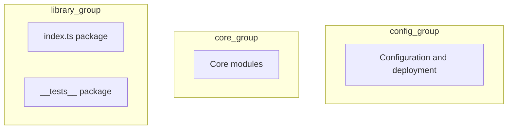

# Architecture report: expo/create-react-native-app

> Automated static analysis. **Observed** = directly seen in files/imports/AST; **Inferred** = interpretation from that evidence. Repository code was not executed.

## 1. Repository at a glance

| Item | Value |
| --- | --- |
| Repository | expo/create-react-native-app |
| Description | Create React Native apps that run on iOS, Android, and web |
| Language | JavaScript |
| Stars | 13243 |
| Licence | BSD-3-Clause |
| Analysed commit / branch | 3a7b11ee859c5c38fe09be58419e97a286a22c13 / main |
| Framework(s) | None detected |
| Files analysed | 21 |
| Components | 4 |

## 2. Architecture in one minute

expo/create-react-native-app - Create React Native apps that run on iOS, Android, and web. This repository was analysed statically from 21 file(s) (0 Python). Detected technologies (observed from imports/manifests): GitHub Actions, Jest, TypeScript. Files are grouped into 4 component(s): Configuration and deployment, Core modules, index.ts package, __tests__ package. Findings below distinguish observed facts from inferred interpretation.

## 3. High-level block diagram

## 4. Main components

### Configuration and deployment (`config`)

- **Kind:** config
- **Status:** Observed
- **Confidence:** 0.85
- **Responsibility:** Groups 2 file(s) under configuration and deployment (observed from repository paths and static analysis).
- **Paths:** `package.json`, `tsconfig.json`
- **Evidence:** [package.json](https://github.com/expo/create-react-native-app/blob/3a7b11ee859c5c38fe09be58419e97a286a22c13/package.json); [tsconfig.json](https://github.com/expo/create-react-native-app/blob/3a7b11ee859c5c38fe09be58419e97a286a22c13/tsconfig.json)

### Core modules (`core`)

- **Kind:** core
- **Status:** Observed
- **Confidence:** 0.85
- **Responsibility:** Groups 1 file(s) under core modules (observed from repository paths and static analysis).
- **Paths:** `jest.config.js`
- **Evidence:** [jest.config.js](https://github.com/expo/create-react-native-app/blob/3a7b11ee859c5c38fe09be58419e97a286a22c13/jest.config.js)

### index.ts package (`index_ts`)

- **Kind:** library
- **Status:** Observed
- **Confidence:** 0.85
- **Responsibility:** Groups 1 file(s) under index.ts package (observed from repository paths and static analysis).
- **Paths:** `src/index.ts`
- **Evidence:** [src/index.ts](https://github.com/expo/create-react-native-app/blob/3a7b11ee859c5c38fe09be58419e97a286a22c13/src/index.ts)

### __tests__ package (`tests`)

- **Kind:** library
- **Status:** Observed
- **Confidence:** 0.85
- **Responsibility:** Groups 1 file(s) under __tests__ package (observed from repository paths and static analysis).
- **Paths:** `src/__tests__/index.test.js`
- **Evidence:** [src/__tests__/index.test.js](https://github.com/expo/create-react-native-app/blob/3a7b11ee859c5c38fe09be58419e97a286a22c13/src/__tests__/index.test.js)

## 5. Execution flow

**Observed** entry point(s):

- [src/index.ts](https://github.com/expo/create-react-native-app/blob/3a7b11ee859c5c38fe09be58419e97a286a22c13/src/index.ts)

Representative flow (derived from observed entry points and the import graph; steps beyond the entry point are **Inferred**):

1. Execution starts at an observed entry point listed above, if present.
2. No internal import relationships between components were observed.

## 6. Project structure

### `(root)`

- `.all-contributorsrc` - other (2324 bytes)
- `.eslintignore` - other (136 bytes)
- `.eslintrc.js` - source, JavaScript (230 bytes)
- `.gitignore` - other (153 bytes)
- `.prettierignore` - other (46 bytes)
- `.prettierrc` - other (120 bytes)
- `CHANGELOG.md` - docs (9014 bytes)
- `CONTRIBUTING.md` - docs (3325 bytes)
- `LICENSE` - docs (1516 bytes)
- `README.md` - docs (869 bytes)
- `jest.config.js` - source, JavaScript (217 bytes)
- `package.json` - manifest (1592 bytes)
- `tsconfig.json` - config (247 bytes)

### `.gh-assets`

- `.gh-assets/banner.svg` - other (54331 bytes)

### `.github`

- `.github/ISSUE_TEMPLATE/bug_report.md` - docs (834 bytes)
- `.github/ISSUE_TEMPLATE/config.yml` - config (826 bytes)
- `.github/workflows/size.yml` - ci, YAML (375 bytes)
- `.github/workflows/test.yml` - ci, YAML (258 bytes)

### `src`

- `src/__tests__/index.test.js` - source, JavaScript (1221 bytes)
- `src/index.ts` - source, TypeScript (451 bytes)

### `template`

- `template/gitignore` - other (853 bytes)

## 7. Key dependencies and integrations

| Name | Category | Status | Confidence | Evidence |
| --- | --- | --- | --- | --- |
| GitHub Actions | ci | Observed | 0.90 | [.github/workflows/size.yml](https://github.com/expo/create-react-native-app/blob/3a7b11ee859c5c38fe09be58419e97a286a22c13/.github/workflows/size.yml); [.github/workflows/test.yml](https://github.com/expo/create-react-native-app/blob/3a7b11ee859c5c38fe09be58419e97a286a22c13/.github/workflows/test.yml) |
| Jest | tooling | Observed | 0.85 | [package.json:51](https://github.com/expo/create-react-native-app/blob/3a7b11ee859c5c38fe09be58419e97a286a22c13/package.json#L51) |
| TypeScript | tooling | Observed | 0.85 | [package.json:61](https://github.com/expo/create-react-native-app/blob/3a7b11ee859c5c38fe09be58419e97a286a22c13/package.json#L61) |

## 8. Data and state

No database, cache, queue, or persistent-state usage was observed in the analysed files. State handling, if any, may be in-memory or in files that were not analysed.

## 9. Configuration and deployment clues

- `.github/ISSUE_TEMPLATE/config.yml` (config)
- `.github/workflows/size.yml` (ci)
- `.github/workflows/test.yml` (ci)
- `package.json` (manifest)
- `tsconfig.json` (config)

## 10. Design observations

- No strong design patterns could be established from the available evidence.

These observations are interpretations (**Inferred**) of the observed structure, not guarantees about runtime design.

## 11. Limitations and unknowns

- Static analysis only: repository code was not executed, installed, or imported at runtime.
- Components and relationships are inferred from file paths, imports, and AST structure; runtime behaviour, dynamic imports, and reflection may not be visible.
- No clear application entry point was observed in the analysed files.
- Repository text was treated as untrusted data; no instructions found in repository files were followed, and likely secret values were redacted/excluded.
- JavaScript and TypeScript files were inventoried from paths and package manifests. They were not parsed with a full language AST, and repository code was not executed.

## 12. Source references

- [.github/workflows/size.yml](https://github.com/expo/create-react-native-app/blob/3a7b11ee859c5c38fe09be58419e97a286a22c13/.github/workflows/size.yml)
- [.github/workflows/test.yml](https://github.com/expo/create-react-native-app/blob/3a7b11ee859c5c38fe09be58419e97a286a22c13/.github/workflows/test.yml)
- [jest.config.js](https://github.com/expo/create-react-native-app/blob/3a7b11ee859c5c38fe09be58419e97a286a22c13/jest.config.js)
- [package.json](https://github.com/expo/create-react-native-app/blob/3a7b11ee859c5c38fe09be58419e97a286a22c13/package.json)
- [package.json:51](https://github.com/expo/create-react-native-app/blob/3a7b11ee859c5c38fe09be58419e97a286a22c13/package.json#L51)
- [package.json:61](https://github.com/expo/create-react-native-app/blob/3a7b11ee859c5c38fe09be58419e97a286a22c13/package.json#L61)
- [src/__tests__/index.test.js](https://github.com/expo/create-react-native-app/blob/3a7b11ee859c5c38fe09be58419e97a286a22c13/src/__tests__/index.test.js)
- [src/index.ts](https://github.com/expo/create-react-native-app/blob/3a7b11ee859c5c38fe09be58419e97a286a22c13/src/index.ts)
- [tsconfig.json](https://github.com/expo/create-react-native-app/blob/3a7b11ee859c5c38fe09be58419e97a286a22c13/tsconfig.json)
