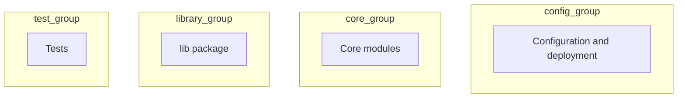

# Architecture report: expressjs/express

> Automated static analysis. **Observed** = directly seen in files/imports/AST; **Inferred** = interpretation from that evidence. Repository code was not executed.

## 1. Repository at a glance

| Item | Value |
| --- | --- |
| Repository | expressjs/express |
| Description | Fast, unopinionated, minimalist web framework for node. |
| Language | JavaScript |
| Stars | 69674 |
| Licence | MIT |
| Analysed commit / branch | 43fca52d28a422c8be48fd489cbd4f2d6152bab6 / master |
| Framework(s) | None detected |
| Files analysed | 215 |
| Components | 4 |

## 2. Architecture in one minute

expressjs/express - Fast, unopinionated, minimalist web framework for node.. This repository was analysed statically from 215 file(s) (0 Python). Detected technologies (observed from imports/manifests): GitHub Actions. Files are grouped into 4 component(s): Configuration and deployment, Core modules, lib package, Tests. Findings below distinguish observed facts from inferred interpretation.

## 3. High-level block diagram

## 4. Main components

### Configuration and deployment (`config`)

- **Kind:** config
- **Status:** Observed
- **Confidence:** 0.85
- **Responsibility:** Groups 1 file(s) under configuration and deployment (observed from repository paths and static analysis).
- **Paths:** `package.json`
- **Evidence:** [package.json](https://github.com/expressjs/express/blob/43fca52d28a422c8be48fd489cbd4f2d6152bab6/package.json)

### Core modules (`core`)

- **Kind:** core
- **Status:** Observed
- **Confidence:** 0.85
- **Responsibility:** Groups 1 file(s) under core modules (observed from repository paths and static analysis).
- **Paths:** `index.js`
- **Evidence:** [index.js](https://github.com/expressjs/express/blob/43fca52d28a422c8be48fd489cbd4f2d6152bab6/index.js)

### lib package (`lib`)

- **Kind:** library
- **Status:** Observed
- **Confidence:** 0.85
- **Responsibility:** Groups 6 file(s) under lib package (observed from repository paths and static analysis).
- **Paths:** `lib/application.js`, `lib/express.js`, `lib/request.js`, `lib/response.js`, `lib/utils.js`, `lib/view.js`
- **Evidence:** [lib/application.js](https://github.com/expressjs/express/blob/43fca52d28a422c8be48fd489cbd4f2d6152bab6/lib/application.js); [lib/express.js](https://github.com/expressjs/express/blob/43fca52d28a422c8be48fd489cbd4f2d6152bab6/lib/express.js); [lib/request.js](https://github.com/expressjs/express/blob/43fca52d28a422c8be48fd489cbd4f2d6152bab6/lib/request.js); [lib/response.js](https://github.com/expressjs/express/blob/43fca52d28a422c8be48fd489cbd4f2d6152bab6/lib/response.js); [lib/utils.js](https://github.com/expressjs/express/blob/43fca52d28a422c8be48fd489cbd4f2d6152bab6/lib/utils.js); [lib/view.js](https://github.com/expressjs/express/blob/43fca52d28a422c8be48fd489cbd4f2d6152bab6/lib/view.js)

### Tests (`tests`)

- **Kind:** test
- **Status:** Observed
- **Confidence:** 0.85
- **Responsibility:** Groups 114 file(s) under tests (observed from repository paths and static analysis).
- **Paths:** `test/Route.js`, `test/Router.js`, `test/acceptance/auth.js`, `test/acceptance/content-negotiation.js`, `test/acceptance/cookie-sessions.js`, `test/acceptance/cookies.js`, `test/acceptance/downloads.js`, `test/acceptance/ejs.js`, `test/acceptance/error-pages.js`, `test/acceptance/error.js`, `test/acceptance/hello-world.js`, `test/acceptance/markdown.js`, `test/acceptance/multi-router.js`, `test/acceptance/mvc.js`, `test/acceptance/params.js`, `test/acceptance/resource.js`, `test/acceptance/route-map.js`, `test/acceptance/route-separation.js`, `test/acceptance/vhost.js`, `test/acceptance/web-service.js`, `test/app.all.js`, `test/app.engine.js`, `test/app.head.js`, `test/app.js`, `test/app.listen.js`, `test/app.locals.js`, `test/app.options.js`, `test/app.param.js`, `test/app.render.js`, `test/app.request.js`, `test/app.response.js`, `test/app.route.js`, `test/app.router.js`, `test/app.routes.error.js`, `test/app.use.js`, `test/config.js`, `test/exports.js`, `test/express.json.js`, `test/express.raw.js`, `test/express.static.js`, `test/express.text.js`, `test/express.urlencoded.js`, `test/fixtures/% of dogs.txt`, `test/fixtures/.name`, `test/fixtures/blog/index.html`, `test/fixtures/blog/post/index.tmpl`, `test/fixtures/broken.send`, `test/fixtures/default_layout/name.tmpl`, `test/fixtures/default_layout/user.tmpl`, `test/fixtures/email.tmpl`, `test/fixtures/empty.txt`, `test/fixtures/local_layout/user.tmpl`, `test/fixtures/name.tmpl`, `test/fixtures/name.txt`, `test/fixtures/nums.txt`, `test/fixtures/pets/names.txt`, `test/fixtures/snow ☃/.gitkeep`, `test/fixtures/todo.html`, `test/fixtures/todo.txt`, `test/fixtures/user.ejs`, `test/fixtures/user.html`, `test/fixtures/user.tmpl`, `test/fixtures/users/index.html`, `test/fixtures/users/tobi.txt`, `test/middleware.basic.js`, `test/regression.js`, `test/req.accepts.js`, `test/req.acceptsCharsets.js`, `test/req.acceptsEncodings.js`, `test/req.acceptsLanguages.js`, `test/req.baseUrl.js`, `test/req.fresh.js`, `test/req.get.js`, `test/req.host.js`, `test/req.hostname.js`, `test/req.ip.js`, `test/req.ips.js`, `test/req.is.js`, `test/req.path.js`, `test/req.protocol.js`, `test/req.query.js`, `test/req.range.js`, `test/req.route.js`, `test/req.secure.js`, `test/req.signedCookies.js`, `test/req.stale.js`, `test/req.subdomains.js`, `test/req.xhr.js`, `test/res.append.js`, `test/res.attachment.js`, `test/res.clearCookie.js`, `test/res.cookie.js`, `test/res.download.js`, `test/res.format.js`, `test/res.get.js`, `test/res.json.js`, `test/res.jsonp.js`, `test/res.links.js`, `test/res.locals.js`, `test/res.location.js`, `test/res.redirect.js`, `test/res.render.js`, `test/res.send.js`, `test/res.sendFile.js`, `test/res.sendStatus.js`, `test/res.set.js`, `test/res.status.js`, `test/res.type.js`, `test/res.vary.js`, `test/support/env.js`, `test/support/tmpl.js`, `test/support/utils.js`, `test/utils.js`, `test/view.js`
- **Evidence:** [test/Route.js](https://github.com/expressjs/express/blob/43fca52d28a422c8be48fd489cbd4f2d6152bab6/test/Route.js); [test/Router.js](https://github.com/expressjs/express/blob/43fca52d28a422c8be48fd489cbd4f2d6152bab6/test/Router.js); [test/acceptance/auth.js](https://github.com/expressjs/express/blob/43fca52d28a422c8be48fd489cbd4f2d6152bab6/test/acceptance/auth.js); [test/acceptance/content-negotiation.js](https://github.com/expressjs/express/blob/43fca52d28a422c8be48fd489cbd4f2d6152bab6/test/acceptance/content-negotiation.js); [test/acceptance/cookie-sessions.js](https://github.com/expressjs/express/blob/43fca52d28a422c8be48fd489cbd4f2d6152bab6/test/acceptance/cookie-sessions.js); [test/acceptance/cookies.js](https://github.com/expressjs/express/blob/43fca52d28a422c8be48fd489cbd4f2d6152bab6/test/acceptance/cookies.js); [test/acceptance/downloads.js](https://github.com/expressjs/express/blob/43fca52d28a422c8be48fd489cbd4f2d6152bab6/test/acceptance/downloads.js); [test/acceptance/ejs.js](https://github.com/expressjs/express/blob/43fca52d28a422c8be48fd489cbd4f2d6152bab6/test/acceptance/ejs.js)

## 5. Execution flow

**Observed** entry point(s):

- [index.js](https://github.com/expressjs/express/blob/43fca52d28a422c8be48fd489cbd4f2d6152bab6/index.js)

Representative flow (derived from observed entry points and the import graph; steps beyond the entry point are **Inferred**):

1. Execution starts at an observed entry point listed above, if present.
2. No internal import relationships between components were observed.

## 6. Project structure

### `(root)`

- `.editorconfig` - config (180 bytes)
- `.eslintignore` - other (22 bytes)
- `.eslintrc.yml` - config (415 bytes)
- `.gitignore` - other (257 bytes)
- `History.md` - docs (121595 bytes)
- `LICENSE` - docs (1249 bytes)
- `Readme.md` - docs (10375 bytes)
- `index.js` - source, JavaScript (224 bytes)
- `package.json` - manifest (2731 bytes)

### `.github`

- `.github/dependabot.yml` - config (442 bytes)
- `.github/workflows/ci.yml` - ci, YAML (3230 bytes)
- `.github/workflows/codeql.yml` - ci, YAML (2654 bytes)
- `.github/workflows/legacy.yml` - ci, YAML (2748 bytes)
- `.github/workflows/npm-publish.yml` - ci, YAML (2826 bytes)
- `.github/workflows/scorecard.yml` - ci, YAML (2981 bytes)

### `examples`

- `examples/README.md` - docs (1592 bytes)
- `examples/auth/index.js` - source, JavaScript (3570 bytes)
- `examples/auth/views/foot.ejs` - other (18 bytes)
- `examples/auth/views/head.ejs` - other (394 bytes)
- `examples/auth/views/login.ejs` - other (533 bytes)
- `examples/content-negotiation/db.js` - source, JavaScript (146 bytes)
- `examples/content-negotiation/index.js` - source, JavaScript (1003 bytes)
- `examples/content-negotiation/users.js` - source, JavaScript (382 bytes)
- `examples/cookie-sessions/index.js` - source, JavaScript (551 bytes)
- `examples/cookies/index.js` - source, JavaScript (1311 bytes)
- `examples/downloads/files/CCTV大赛上海分赛区.txt` - docs (38 bytes)
- `examples/downloads/files/amazing.txt` - docs (24 bytes)
- `examples/downloads/files/notes/groceries.txt` - docs (22 bytes)
- `examples/downloads/index.js` - source, JavaScript (1193 bytes)
- `examples/ejs/index.js` - source, JavaScript (1331 bytes)
- `examples/ejs/public/stylesheets/style.css` - other (98 bytes)
- `examples/ejs/views/footer.html` - other (16 bytes)
- `examples/ejs/views/header.html` - other (236 bytes)
- `examples/ejs/views/users.html` - other (206 bytes)
- `examples/error-pages/index.js` - source, JavaScript (2665 bytes)
- `examples/error-pages/views/404.ejs` - other (90 bytes)
- `examples/error-pages/views/500.ejs` - other (218 bytes)
- `examples/error-pages/views/error_header.ejs` - other (186 bytes)
- `examples/error-pages/views/footer.ejs` - other (16 bytes)
- `examples/error-pages/views/index.ejs` - other (356 bytes)
- `examples/error/index.js` - source, JavaScript (1333 bytes)
- `examples/hello-world/index.js` - source, JavaScript (269 bytes)
- `examples/markdown/index.js` - source, JavaScript (1025 bytes)
- `examples/markdown/views/index.md` - docs (58 bytes)
- `examples/multi-router/controllers/api_v1.js` - source, JavaScript (272 bytes)
- `examples/multi-router/controllers/api_v2.js` - source, JavaScript (272 bytes)
- `examples/multi-router/index.js` - source, JavaScript (387 bytes)
- `examples/mvc/controllers/main/index.js` - source, JavaScript (79 bytes)
- `examples/mvc/controllers/pet/index.js` - source, JavaScript (599 bytes)
- `examples/mvc/controllers/pet/views/edit.ejs` - other (448 bytes)
- `examples/mvc/controllers/pet/views/show.ejs` - other (334 bytes)
- `examples/mvc/controllers/user-pet/index.js` - source, JavaScript (468 bytes)
- `examples/mvc/controllers/user/index.js` - source, JavaScript (873 bytes)
- `examples/mvc/controllers/user/views/edit.hbs` - other (731 bytes)
- `examples/mvc/controllers/user/views/list.hbs` - other (388 bytes)
- `examples/mvc/controllers/user/views/show.hbs` - other (601 bytes)
- `examples/mvc/db.js` - source, JavaScript (420 bytes)
- `examples/mvc/index.js` - source, JavaScript (2320 bytes)
- `examples/mvc/lib/boot.js` - source, JavaScript (2263 bytes)
- `examples/mvc/public/style.css` - other (206 bytes)
- `examples/mvc/views/404.ejs` - other (313 bytes)
- `examples/mvc/views/5xx.ejs` - other (336 bytes)
- `examples/online/index.js` - source, JavaScript (1024 bytes)
- `examples/params/index.js` - source, JavaScript (1353 bytes)
- `examples/resource/index.js` - source, JavaScript (2295 bytes)
- `examples/route-map/index.js` - source, JavaScript (1419 bytes)
- `examples/route-middleware/index.js` - source, JavaScript (2399 bytes)
- `examples/route-separation/index.js` - source, JavaScript (1136 bytes)
- `examples/route-separation/post.js` - source, JavaScript (292 bytes)
- `examples/route-separation/public/style.css` - other (286 bytes)
- `examples/route-separation/site.js` - source, JavaScript (115 bytes)
- `examples/route-separation/user.js` - source, JavaScript (1006 bytes)
- `examples/route-separation/views/footer.ejs` - other (16 bytes)
- `examples/route-separation/views/header.ejs` - other (224 bytes)
- `examples/route-separation/views/index.ejs` - other (196 bytes)
- `examples/route-separation/views/posts/index.ejs` - other (209 bytes)
- `examples/route-separation/views/users/edit.ejs` - other (439 bytes)
- `examples/route-separation/views/users/index.ejs` - other (288 bytes)
- `examples/route-separation/views/users/view.ejs` - other (144 bytes)
- `examples/search/index.js` - source, JavaScript (1577 bytes)
- `examples/search/public/client.js` - source, JavaScript (390 bytes)
- `examples/search/public/index.html` - other (483 bytes)
- `examples/session/index.js` - source, JavaScript (844 bytes)
- `examples/session/redis.js` - source, JavaScript (957 bytes)
- `examples/static-files/index.js` - source, JavaScript (1363 bytes)
- `examples/static-files/public/css/style.css` - other (11 bytes)
- `examples/static-files/public/hello.txt` - docs (3 bytes)
- `examples/static-files/public/js/app.js` - source, JavaScript (7 bytes)
- `examples/vhost/index.js` - source, JavaScript (1037 bytes)
- `examples/view-constructor/github-view.js` - source, JavaScript (1069 bytes)
- `examples/view-constructor/index.js` - source, JavaScript (1167 bytes)
- `examples/view-locals/index.js` - source, JavaScript (3127 bytes)
- `examples/view-locals/user.js` - source, JavaScript (730 bytes)
- `examples/view-locals/views/index.ejs` - other (500 bytes)
- `examples/web-service/index.js` - source, JavaScript (3044 bytes)

### `lib`

- `lib/application.js` - source, JavaScript (13953 bytes)
- `lib/express.js` - source, JavaScript (1636 bytes)
- `lib/request.js` - source, JavaScript (12283 bytes)
- `lib/response.js` - source, JavaScript (25089 bytes)
- `lib/utils.js` - source, JavaScript (5293 bytes)
- `lib/view.js` - source, JavaScript (3809 bytes)

### `test`

- `test/Route.js` - test, JavaScript (6480 bytes)
- `test/Router.js` - test, JavaScript (17372 bytes)
- `test/acceptance/auth.js` - test, JavaScript (3064 bytes)
- `test/acceptance/content-negotiation.js` - test, JavaScript (1402 bytes)
- `test/acceptance/cookie-sessions.js` - test, JavaScript (942 bytes)
- `test/acceptance/cookies.js` - test, JavaScript (1746 bytes)
- `test/acceptance/downloads.js` - test, JavaScript (1261 bytes)
- `test/acceptance/ejs.js` - test, JavaScript (505 bytes)
- `test/acceptance/error-pages.js` - test, JavaScript (2315 bytes)
- `test/acceptance/error.js` - test, JavaScript (608 bytes)
- `test/acceptance/hello-world.js` - test, JavaScript (488 bytes)
- `test/acceptance/markdown.js` - test, JavaScript (476 bytes)
- `test/acceptance/multi-router.js` - test, JavaScript (1173 bytes)
- `test/acceptance/mvc.js` - test, JavaScript (3292 bytes)
- `test/acceptance/params.js` - test, JavaScript (1064 bytes)
- `test/acceptance/resource.js` - test, JavaScript (1844 bytes)
- `test/acceptance/route-map.js` - test, JavaScript (1048 bytes)
- `test/acceptance/route-separation.js` - test, JavaScript (2541 bytes)
- `test/acceptance/vhost.js` - test, JavaScript (1190 bytes)
- `test/acceptance/web-service.js` - test, JavaScript (3129 bytes)
- `test/app.all.js` - test, JavaScript (790 bytes)
- `test/app.engine.js` - test, JavaScript (2246 bytes)
- `test/app.head.js` - test, JavaScript (1412 bytes)
- `test/app.js` - test, JavaScript (2738 bytes)
- `test/app.listen.js` - test, JavaScript (2118 bytes)
- `test/app.locals.js` - test, JavaScript (806 bytes)
- `test/app.options.js` - test, JavaScript (2845 bytes)
- `test/app.param.js` - test, JavaScript (7560 bytes)
- `test/app.render.js` - test, JavaScript (16932 bytes)
- `test/app.request.js` - test, JavaScript (2983 bytes)
- `test/app.response.js` - test, JavaScript (2973 bytes)
- `test/app.route.js` - test, JavaScript (4762 bytes)
- `test/app.router.js` - test, JavaScript (29833 bytes)
- `test/app.routes.error.js` - test, JavaScript (1504 bytes)
- `test/app.use.js` - test, JavaScript (12605 bytes)
- `test/config.js` - test, JavaScript (5823 bytes)
- `test/exports.js` - test, JavaScript (2344 bytes)
- `test/express.json.js` - test, JavaScript (23675 bytes)
- `test/express.raw.js` - test, JavaScript (16296 bytes)
- `test/express.static.js` - test, JavaScript (23498 bytes)
- `test/express.text.js` - test, JavaScript (17277 bytes)
- `test/express.urlencoded.js` - test, JavaScript (26741 bytes)
- `test/fixtures/% of dogs.txt` - test (3 bytes)
- `test/fixtures/.name` - test (4 bytes)
- `test/fixtures/blog/index.html` - test (12 bytes)
- `test/fixtures/blog/post/index.tmpl` - test (18 bytes)
- `test/fixtures/broken.send` - test (0 bytes)
- `test/fixtures/default_layout/name.tmpl` - test (12 bytes)
- `test/fixtures/default_layout/user.tmpl` - test (17 bytes)
- `test/fixtures/email.tmpl` - test (23 bytes)
- `test/fixtures/empty.txt` - test (0 bytes)
- `test/fixtures/local_layout/user.tmpl` - test (23 bytes)
- `test/fixtures/name.tmpl` - test (12 bytes)
- `test/fixtures/name.txt` - test (4 bytes)
- `test/fixtures/nums.txt` - test (9 bytes)
- `test/fixtures/pets/names.txt` - test (9 bytes)
- `test/fixtures/snow ☃/.gitkeep` - test (0 bytes)
- `test/fixtures/todo.html` - test (18 bytes)
- `test/fixtures/todo.txt` - test (11 bytes)
- `test/fixtures/user.ejs` - test (23 bytes)
- `test/fixtures/user.html` - test (20 bytes)
- `test/fixtures/user.tmpl` - test (17 bytes)
- `test/fixtures/users/index.html` - test (23 bytes)
- `test/fixtures/users/tobi.txt` - test (6 bytes)
- `test/middleware.basic.js` - test, JavaScript (1051 bytes)
- `test/regression.js` - test, JavaScript (377 bytes)
- `test/req.accepts.js` - test, JavaScript (2964 bytes)
- `test/req.acceptsCharsets.js` - test, JavaScript (1609 bytes)
- `test/req.acceptsEncodings.js` - test, JavaScript (953 bytes)
- `test/req.acceptsLanguages.js` - test, JavaScript (1425 bytes)
- `test/req.baseUrl.js` - test, JavaScript (2120 bytes)
- `test/req.fresh.js` - test, JavaScript (2695 bytes)
- `test/req.get.js` - test, JavaScript (1415 bytes)
- `test/req.host.js` - test, JavaScript (3536 bytes)
- `test/req.hostname.js` - test, JavaScript (4420 bytes)
- `test/req.ip.js` - test, JavaScript (2979 bytes)
- `test/req.ips.js` - test, JavaScript (1743 bytes)
- `test/req.is.js` - test, JavaScript (7020 bytes)
- `test/req.path.js` - test, JavaScript (412 bytes)
- `test/req.protocol.js` - test, JavaScript (2579 bytes)
- `test/req.query.js` - test, JavaScript (2703 bytes)
- `test/req.range.js` - test, JavaScript (2351 bytes)
- `test/req.route.js` - test, JavaScript (662 bytes)
- `test/req.secure.js` - test, JavaScript (2457 bytes)
- `test/req.signedCookies.js` - test, JavaScript (851 bytes)
- `test/req.stale.js` - test, JavaScript (1102 bytes)
- `test/req.subdomains.js` - test, JavaScript (4328 bytes)
- `test/req.xhr.js` - test, JavaScript (1030 bytes)
- `test/res.append.js` - test, JavaScript (3373 bytes)
- `test/res.attachment.js` - test, JavaScript (3020 bytes)
- `test/res.clearCookie.js` - test, JavaScript (1606 bytes)
- `test/res.cookie.js` - test, JavaScript (7428 bytes)
- `test/res.download.js` - test, JavaScript (13112 bytes)
- `test/res.format.js` - test, JavaScript (5901 bytes)
- `test/res.get.js` - test, JavaScript (472 bytes)
- `test/res.json.js` - test, JavaScript (4812 bytes)
- `test/res.jsonp.js` - test, JavaScript (10853 bytes)
- `test/res.links.js` - test, JavaScript (1877 bytes)
- `test/res.locals.js` - test, JavaScript (733 bytes)
- `test/res.location.js` - test, JavaScript (8421 bytes)
- `test/res.redirect.js` - test, JavaScript (6121 bytes)
- `test/res.render.js` - test, JavaScript (9738 bytes)
- `test/res.send.js` - test, JavaScript (15572 bytes)
- `test/res.sendFile.js` - test, JavaScript (27108 bytes)
- `test/res.sendStatus.js` - test, JavaScript (951 bytes)
- `test/res.set.js` - test, JavaScript (2960 bytes)
- `test/res.status.js` - test, JavaScript (4807 bytes)
- `test/res.type.js` - test, JavaScript (2812 bytes)
- `test/res.vary.js` - test, JavaScript (1984 bytes)
- `test/support/env.js` - test, JavaScript (84 bytes)
- `test/support/tmpl.js` - test, JavaScript (717 bytes)
- `test/support/utils.js` - test, JavaScript (2089 bytes)
- `test/utils.js` - test, JavaScript (3768 bytes)
- `test/view.js` - test, JavaScript (312 bytes)

## 7. Key dependencies and integrations

| Name | Category | Status | Confidence | Evidence |
| --- | --- | --- | --- | --- |
| GitHub Actions | ci | Observed | 0.90 | [.github/workflows/ci.yml](https://github.com/expressjs/express/blob/43fca52d28a422c8be48fd489cbd4f2d6152bab6/.github/workflows/ci.yml); [.github/workflows/codeql.yml](https://github.com/expressjs/express/blob/43fca52d28a422c8be48fd489cbd4f2d6152bab6/.github/workflows/codeql.yml); [.github/workflows/legacy.yml](https://github.com/expressjs/express/blob/43fca52d28a422c8be48fd489cbd4f2d6152bab6/.github/workflows/legacy.yml); [.github/workflows/npm-publish.yml](https://github.com/expressjs/express/blob/43fca52d28a422c8be48fd489cbd4f2d6152bab6/.github/workflows/npm-publish.yml) |

## 8. Data and state

No database, cache, queue, or persistent-state usage was observed in the analysed files. State handling, if any, may be in-memory or in files that were not analysed.

## 9. Configuration and deployment clues

- `.editorconfig` (config)
- `.eslintrc.yml` (config)
- `.github/dependabot.yml` (config)
- `.github/workflows/ci.yml` (ci)
- `.github/workflows/codeql.yml` (ci)
- `.github/workflows/legacy.yml` (ci)
- `.github/workflows/npm-publish.yml` (ci)
- `.github/workflows/scorecard.yml` (ci)
- `package.json` (manifest)

## 10. Design observations

- Tests are present alongside source code (Observed from test file paths).

These observations are interpretations (**Inferred**) of the observed structure, not guarantees about runtime design.

## 11. Limitations and unknowns

- Static analysis only: repository code was not executed, installed, or imported at runtime.
- Components and relationships are inferred from file paths, imports, and AST structure; runtime behaviour, dynamic imports, and reflection may not be visible.
- 1 file(s) were skipped during inventory (1 x likely secret file excluded).
- No clear application entry point was observed in the analysed files.
- Repository text was treated as untrusted data; no instructions found in repository files were followed, and likely secret values were redacted/excluded.
- JavaScript and TypeScript files were inventoried from paths and package manifests. They were not parsed with a full language AST, and repository code was not executed.

## 12. Source references

- [.github/workflows/ci.yml](https://github.com/expressjs/express/blob/43fca52d28a422c8be48fd489cbd4f2d6152bab6/.github/workflows/ci.yml)
- [.github/workflows/codeql.yml](https://github.com/expressjs/express/blob/43fca52d28a422c8be48fd489cbd4f2d6152bab6/.github/workflows/codeql.yml)
- [.github/workflows/legacy.yml](https://github.com/expressjs/express/blob/43fca52d28a422c8be48fd489cbd4f2d6152bab6/.github/workflows/legacy.yml)
- [.github/workflows/npm-publish.yml](https://github.com/expressjs/express/blob/43fca52d28a422c8be48fd489cbd4f2d6152bab6/.github/workflows/npm-publish.yml)
- [.github/workflows/scorecard.yml](https://github.com/expressjs/express/blob/43fca52d28a422c8be48fd489cbd4f2d6152bab6/.github/workflows/scorecard.yml)
- [index.js](https://github.com/expressjs/express/blob/43fca52d28a422c8be48fd489cbd4f2d6152bab6/index.js)
- [lib/application.js](https://github.com/expressjs/express/blob/43fca52d28a422c8be48fd489cbd4f2d6152bab6/lib/application.js)
- [lib/express.js](https://github.com/expressjs/express/blob/43fca52d28a422c8be48fd489cbd4f2d6152bab6/lib/express.js)
- [lib/request.js](https://github.com/expressjs/express/blob/43fca52d28a422c8be48fd489cbd4f2d6152bab6/lib/request.js)
- [lib/response.js](https://github.com/expressjs/express/blob/43fca52d28a422c8be48fd489cbd4f2d6152bab6/lib/response.js)
- [lib/utils.js](https://github.com/expressjs/express/blob/43fca52d28a422c8be48fd489cbd4f2d6152bab6/lib/utils.js)
- [lib/view.js](https://github.com/expressjs/express/blob/43fca52d28a422c8be48fd489cbd4f2d6152bab6/lib/view.js)
- [package.json](https://github.com/expressjs/express/blob/43fca52d28a422c8be48fd489cbd4f2d6152bab6/package.json)
- [test/Route.js](https://github.com/expressjs/express/blob/43fca52d28a422c8be48fd489cbd4f2d6152bab6/test/Route.js)
- [test/Router.js](https://github.com/expressjs/express/blob/43fca52d28a422c8be48fd489cbd4f2d6152bab6/test/Router.js)
- [test/acceptance/auth.js](https://github.com/expressjs/express/blob/43fca52d28a422c8be48fd489cbd4f2d6152bab6/test/acceptance/auth.js)
- [test/acceptance/content-negotiation.js](https://github.com/expressjs/express/blob/43fca52d28a422c8be48fd489cbd4f2d6152bab6/test/acceptance/content-negotiation.js)
- [test/acceptance/cookie-sessions.js](https://github.com/expressjs/express/blob/43fca52d28a422c8be48fd489cbd4f2d6152bab6/test/acceptance/cookie-sessions.js)
- [test/acceptance/cookies.js](https://github.com/expressjs/express/blob/43fca52d28a422c8be48fd489cbd4f2d6152bab6/test/acceptance/cookies.js)
- [test/acceptance/downloads.js](https://github.com/expressjs/express/blob/43fca52d28a422c8be48fd489cbd4f2d6152bab6/test/acceptance/downloads.js)
- [test/acceptance/ejs.js](https://github.com/expressjs/express/blob/43fca52d28a422c8be48fd489cbd4f2d6152bab6/test/acceptance/ejs.js)
