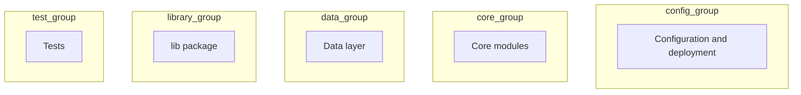

# Architecture report: expressjs/multer

> Automated static analysis. **Observed** = directly seen in files/imports/AST; **Inferred** = interpretation from that evidence. Repository code was not executed.

## 1. Repository at a glance

| Item | Value |
| --- | --- |
| Repository | expressjs/multer |
| Description | Node.js middleware for handling `multipart/form-data`. |
| Language | JavaScript |
| Stars | 12086 |
| Licence | MIT |
| Analysed commit / branch | 2c380d06cdaacc68bbef8b36244493a3d33d6b88 / main |
| Framework(s) | Express |
| Files analysed | 69 |
| Components | 5 |

## 2. Architecture in one minute

expressjs/multer - Node.js middleware for handling `multipart/form-data`.. This repository was analysed statically from 69 file(s) (0 Python). Detected technologies (observed from imports/manifests): GitHub Actions, Express. Files are grouped into 5 component(s): Configuration and deployment, Core modules, Data layer, lib package, Tests. Findings below distinguish observed facts from inferred interpretation.

## 3. High-level block diagram

## 4. Main components

### Configuration and deployment (`config`)

- **Kind:** config
- **Status:** Observed
- **Confidence:** 0.85
- **Responsibility:** Groups 1 file(s) under configuration and deployment (observed from repository paths and static analysis).
- **Paths:** `package.json`
- **Evidence:** [package.json](https://github.com/expressjs/multer/blob/2c380d06cdaacc68bbef8b36244493a3d33d6b88/package.json)

### Core modules (`core`)

- **Kind:** core
- **Status:** Observed
- **Confidence:** 0.85
- **Responsibility:** Groups 1 file(s) under core modules (observed from repository paths and static analysis).
- **Paths:** `index.js`
- **Evidence:** [index.js](https://github.com/expressjs/multer/blob/2c380d06cdaacc68bbef8b36244493a3d33d6b88/index.js)

### Data layer (`data_layer`)

- **Kind:** data
- **Status:** Observed
- **Confidence:** 0.85
- **Responsibility:** Groups 2 file(s) under data layer (observed from repository paths and static analysis).
- **Paths:** `storage/disk.js`, `storage/memory.js`
- **Evidence:** [storage/disk.js](https://github.com/expressjs/multer/blob/2c380d06cdaacc68bbef8b36244493a3d33d6b88/storage/disk.js); [storage/memory.js](https://github.com/expressjs/multer/blob/2c380d06cdaacc68bbef8b36244493a3d33d6b88/storage/memory.js)

### lib package (`lib`)

- **Kind:** library
- **Status:** Observed
- **Confidence:** 0.85
- **Responsibility:** Groups 6 file(s) under lib package (observed from repository paths and static analysis).
- **Paths:** `lib/counter.js`, `lib/file-appender.js`, `lib/make-middleware.js`, `lib/multer-error.js`, `lib/remove-uploaded-files.js`, `lib/validate-limits.js`
- **Evidence:** [lib/counter.js](https://github.com/expressjs/multer/blob/2c380d06cdaacc68bbef8b36244493a3d33d6b88/lib/counter.js); [lib/file-appender.js](https://github.com/expressjs/multer/blob/2c380d06cdaacc68bbef8b36244493a3d33d6b88/lib/file-appender.js); [lib/make-middleware.js](https://github.com/expressjs/multer/blob/2c380d06cdaacc68bbef8b36244493a3d33d6b88/lib/make-middleware.js); [lib/multer-error.js](https://github.com/expressjs/multer/blob/2c380d06cdaacc68bbef8b36244493a3d33d6b88/lib/multer-error.js); [lib/remove-uploaded-files.js](https://github.com/expressjs/multer/blob/2c380d06cdaacc68bbef8b36244493a3d33d6b88/lib/remove-uploaded-files.js); [lib/validate-limits.js](https://github.com/expressjs/multer/blob/2c380d06cdaacc68bbef8b36244493a3d33d6b88/lib/validate-limits.js)

### Tests (`tests`)

- **Kind:** test
- **Status:** Observed
- **Confidence:** 0.85
- **Responsibility:** Groups 38 file(s) under tests (observed from repository paths and static analysis).
- **Paths:** `test/_util.js`, `test/abort-destroyed-stream-callback.js`, `test/abort-fd-leak.js`, `test/abort-flush-fd-race.js`, `test/abort-storage-error-cleanup.js`, `test/abort-unlink-after-close.js`, `test/array-index-limit.js`, `test/async-file-filter-file-size.js`, `test/async-file-filter-orphan.js`, `test/async-file-filter-teardown-crash.js`, `test/busboy-options.js`, `test/crafted-field-names.js`, `test/def-param-charset.js`, `test/disk-storage.js`, `test/error-handling.js`, `test/expected-files.js`, `test/express-integration.js`, `test/fieldname-decoding.js`, `test/fields.js`, `test/file-filter.js`, `test/file-ordering.js`, `test/filename-decoding.js`, `test/functionality.js`, `test/issue-232.js`, `test/limits-function.js`, `test/maxcount-async-filefilter.js`, `test/memory-storage.js`, `test/nesting-depth.js`, `test/none.js`, `test/orphan-before-path-assignment.js`, `test/orphan-file-cleanup.js`, `test/pending-writes.js`, `test/preserve-path.js`, `test/remove-file.js`, `test/reuse-middleware.js`, `test/select-field.js`, `test/stream-handler.js`, `test/unicode.js`
- **Evidence:** [test/_util.js](https://github.com/expressjs/multer/blob/2c380d06cdaacc68bbef8b36244493a3d33d6b88/test/_util.js); [test/abort-destroyed-stream-callback.js](https://github.com/expressjs/multer/blob/2c380d06cdaacc68bbef8b36244493a3d33d6b88/test/abort-destroyed-stream-callback.js); [test/abort-fd-leak.js](https://github.com/expressjs/multer/blob/2c380d06cdaacc68bbef8b36244493a3d33d6b88/test/abort-fd-leak.js); [test/abort-flush-fd-race.js](https://github.com/expressjs/multer/blob/2c380d06cdaacc68bbef8b36244493a3d33d6b88/test/abort-flush-fd-race.js); [test/abort-storage-error-cleanup.js](https://github.com/expressjs/multer/blob/2c380d06cdaacc68bbef8b36244493a3d33d6b88/test/abort-storage-error-cleanup.js); [test/abort-unlink-after-close.js](https://github.com/expressjs/multer/blob/2c380d06cdaacc68bbef8b36244493a3d33d6b88/test/abort-unlink-after-close.js); [test/array-index-limit.js](https://github.com/expressjs/multer/blob/2c380d06cdaacc68bbef8b36244493a3d33d6b88/test/array-index-limit.js); [test/async-file-filter-file-size.js](https://github.com/expressjs/multer/blob/2c380d06cdaacc68bbef8b36244493a3d33d6b88/test/async-file-filter-file-size.js)

## 5. Execution flow

**Observed** entry point(s):

- [examples/FormDataBlob/index.js](https://github.com/expressjs/multer/blob/2c380d06cdaacc68bbef8b36244493a3d33d6b88/examples/FormDataBlob/index.js)
- [examples/FormDataImage/index.js](https://github.com/expressjs/multer/blob/2c380d06cdaacc68bbef8b36244493a3d33d6b88/examples/FormDataImage/index.js)
- [index.js](https://github.com/expressjs/multer/blob/2c380d06cdaacc68bbef8b36244493a3d33d6b88/index.js)

Representative flow (derived from observed entry points and the import graph; steps beyond the entry point are **Inferred**):

1. Execution starts at an observed entry point listed above, if present.
2. No internal import relationships between components were observed.

## 6. Project structure

### `(root)`

- `.gitattributes` - other (337 bytes)
- `.gitignore` - other (176 bytes)
- `CHANGELOG.md` - docs (10163 bytes)
- `LICENSE` - docs (1113 bytes)
- `README.md` - docs (16376 bytes)
- `StorageEngine.md` - docs (3238 bytes)
- `index.js` - source, JavaScript (9222 bytes)
- `package.json` - manifest (1384 bytes)

### `.github`

- `.github/dependabot.yml` - config (324 bytes)
- `.github/workflows/ci.yml` - ci, YAML (6461 bytes)
- `.github/workflows/codeql.yml` - ci, YAML (2477 bytes)
- `.github/workflows/npm-publish.yml` - ci, YAML (862 bytes)
- `.github/workflows/scorecard.yml` - ci, YAML (2991 bytes)

### `examples`

- `examples/FormDataBlob/.gitignore` - other (34 bytes)
- `examples/FormDataBlob/README.md` - docs (114 bytes)
- `examples/FormDataBlob/index.js` - source, JavaScript (379 bytes)
- `examples/FormDataBlob/package.json` - manifest (325 bytes)
- `examples/FormDataBlob/public/index.html` - other (1005 bytes)
- `examples/FormDataImage/.gitignore` - other (34 bytes)
- `examples/FormDataImage/README.md` - docs (154 bytes)
- `examples/FormDataImage/index.js` - source, JavaScript (379 bytes)
- `examples/FormDataImage/package.json` - manifest (325 bytes)
- `examples/FormDataImage/public/index.html` - other (968 bytes)

### `lib`

- `lib/counter.js` - source, JavaScript (570 bytes)
- `lib/file-appender.js` - source, JavaScript (1611 bytes)
- `lib/make-middleware.js` - source, JavaScript (16025 bytes)
- `lib/multer-error.js` - source, JavaScript (1624 bytes)
- `lib/remove-uploaded-files.js` - source, JavaScript (572 bytes)
- `lib/validate-limits.js` - source, JavaScript (511 bytes)

### `storage`

- `storage/disk.js` - source, JavaScript (5425 bytes)
- `storage/memory.js` - source, JavaScript (809 bytes)

### `test`

- `test/_util.js` - test, JavaScript (1320 bytes)
- `test/abort-destroyed-stream-callback.js` - test, JavaScript (1163 bytes)
- `test/abort-fd-leak.js` - test, JavaScript (3283 bytes)
- `test/abort-flush-fd-race.js` - test, JavaScript (6224 bytes)
- `test/abort-storage-error-cleanup.js` - test, JavaScript (2893 bytes)
- `test/abort-unlink-after-close.js` - test, JavaScript (3380 bytes)
- `test/array-index-limit.js` - test, JavaScript (3996 bytes)
- `test/async-file-filter-file-size.js` - test, JavaScript (4770 bytes)
- `test/async-file-filter-orphan.js` - test, JavaScript (2148 bytes)
- `test/async-file-filter-teardown-crash.js` - test, JavaScript (2405 bytes)
- `test/busboy-options.js` - test, JavaScript (3764 bytes)
- `test/crafted-field-names.js` - test, JavaScript (958 bytes)
- `test/def-param-charset.js` - test, JavaScript (9853 bytes)
- `test/disk-storage.js` - test, JavaScript (9024 bytes)
- `test/error-handling.js` - test, JavaScript (19368 bytes)
- `test/expected-files.js` - test, JavaScript (3275 bytes)
- `test/express-integration.js` - test, JavaScript (6287 bytes)
- `test/fieldname-decoding.js` - test, JavaScript (2606 bytes)
- `test/fields.js` - test, JavaScript (3601 bytes)
- `test/file-filter.js` - test, JavaScript (4971 bytes)
- `test/file-ordering.js` - test, JavaScript (1299 bytes)
- `test/filename-decoding.js` - test, JavaScript (3271 bytes)
- `test/functionality.js` - test, JavaScript (4712 bytes)
- `test/issue-232.js` - test, JavaScript (945 bytes)
- `test/limits-function.js` - test, JavaScript (2470 bytes)
- `test/maxcount-async-filefilter.js` - test, JavaScript (3397 bytes)
- `test/memory-storage.js` - test, JavaScript (3983 bytes)
- `test/nesting-depth.js` - test, JavaScript (2236 bytes)
- `test/none.js` - test, JavaScript (1162 bytes)
- `test/orphan-before-path-assignment.js` - test, JavaScript (10499 bytes)
- `test/orphan-file-cleanup.js` - test, JavaScript (4615 bytes)
- `test/pending-writes.js` - test, JavaScript (2903 bytes)
- `test/preserve-path.js` - test, JavaScript (1030 bytes)
- `test/remove-file.js` - test, JavaScript (5188 bytes)
- `test/reuse-middleware.js` - test, JavaScript (1448 bytes)
- `test/select-field.js` - test, JavaScript (2119 bytes)
- `test/stream-handler.js` - test, JavaScript (3790 bytes)
- `test/unicode.js` - test, JavaScript (1456 bytes)

## 7. Key dependencies and integrations

| Name | Category | Status | Confidence | Evidence |
| --- | --- | --- | --- | --- |
| GitHub Actions | ci | Observed | 0.90 | [.github/workflows/ci.yml](https://github.com/expressjs/multer/blob/2c380d06cdaacc68bbef8b36244493a3d33d6b88/.github/workflows/ci.yml); [.github/workflows/codeql.yml](https://github.com/expressjs/multer/blob/2c380d06cdaacc68bbef8b36244493a3d33d6b88/.github/workflows/codeql.yml); [.github/workflows/npm-publish.yml](https://github.com/expressjs/multer/blob/2c380d06cdaacc68bbef8b36244493a3d33d6b88/.github/workflows/npm-publish.yml); [.github/workflows/scorecard.yml](https://github.com/expressjs/multer/blob/2c380d06cdaacc68bbef8b36244493a3d33d6b88/.github/workflows/scorecard.yml) |
| Express | framework | Observed | 0.90 | [examples/FormDataBlob/package.json:14](https://github.com/expressjs/multer/blob/2c380d06cdaacc68bbef8b36244493a3d33d6b88/examples/FormDataBlob/package.json#L14); [examples/FormDataImage/package.json:14](https://github.com/expressjs/multer/blob/2c380d06cdaacc68bbef8b36244493a3d33d6b88/examples/FormDataImage/package.json#L14); [package.json:13](https://github.com/expressjs/multer/blob/2c380d06cdaacc68bbef8b36244493a3d33d6b88/package.json#L13) |

## 8. Data and state

- Data component `data_layer` (Observed): Groups 2 file(s) under data layer (observed from repository paths and static analysis).

## 9. Configuration and deployment clues

- `.github/dependabot.yml` (config)
- `.github/workflows/ci.yml` (ci)
- `.github/workflows/codeql.yml` (ci)
- `.github/workflows/npm-publish.yml` (ci)
- `.github/workflows/scorecard.yml` (ci)
- `examples/FormDataBlob/package.json` (manifest)
- `examples/FormDataImage/package.json` (manifest)
- `package.json` (manifest)

## 10. Design observations

- Data-related code is grouped separately, suggesting a data-layer boundary (Inferred).
- Tests are present alongside source code (Observed from test file paths).

These observations are interpretations (**Inferred**) of the observed structure, not guarantees about runtime design.

## 11. Limitations and unknowns

- Static analysis only: repository code was not executed, installed, or imported at runtime.
- Components and relationships are inferred from file paths, imports, and AST structure; runtime behaviour, dynamic imports, and reflection may not be visible.
- 1 file(s) were skipped during inventory (1 x likely secret file excluded).
- No clear application entry point was observed in the analysed files.
- Repository text was treated as untrusted data; no instructions found in repository files were followed, and likely secret values were redacted/excluded.
- JavaScript and TypeScript files were inventoried from paths and package manifests. They were not parsed with a full language AST, and repository code was not executed.

## 12. Source references

- [.github/workflows/ci.yml](https://github.com/expressjs/multer/blob/2c380d06cdaacc68bbef8b36244493a3d33d6b88/.github/workflows/ci.yml)
- [.github/workflows/codeql.yml](https://github.com/expressjs/multer/blob/2c380d06cdaacc68bbef8b36244493a3d33d6b88/.github/workflows/codeql.yml)
- [.github/workflows/npm-publish.yml](https://github.com/expressjs/multer/blob/2c380d06cdaacc68bbef8b36244493a3d33d6b88/.github/workflows/npm-publish.yml)
- [.github/workflows/scorecard.yml](https://github.com/expressjs/multer/blob/2c380d06cdaacc68bbef8b36244493a3d33d6b88/.github/workflows/scorecard.yml)
- [examples/FormDataBlob/index.js](https://github.com/expressjs/multer/blob/2c380d06cdaacc68bbef8b36244493a3d33d6b88/examples/FormDataBlob/index.js)
- [examples/FormDataBlob/package.json:14](https://github.com/expressjs/multer/blob/2c380d06cdaacc68bbef8b36244493a3d33d6b88/examples/FormDataBlob/package.json#L14)
- [examples/FormDataImage/index.js](https://github.com/expressjs/multer/blob/2c380d06cdaacc68bbef8b36244493a3d33d6b88/examples/FormDataImage/index.js)
- [examples/FormDataImage/package.json:14](https://github.com/expressjs/multer/blob/2c380d06cdaacc68bbef8b36244493a3d33d6b88/examples/FormDataImage/package.json#L14)
- [index.js](https://github.com/expressjs/multer/blob/2c380d06cdaacc68bbef8b36244493a3d33d6b88/index.js)
- [lib/counter.js](https://github.com/expressjs/multer/blob/2c380d06cdaacc68bbef8b36244493a3d33d6b88/lib/counter.js)
- [lib/file-appender.js](https://github.com/expressjs/multer/blob/2c380d06cdaacc68bbef8b36244493a3d33d6b88/lib/file-appender.js)
- [lib/make-middleware.js](https://github.com/expressjs/multer/blob/2c380d06cdaacc68bbef8b36244493a3d33d6b88/lib/make-middleware.js)
- [lib/multer-error.js](https://github.com/expressjs/multer/blob/2c380d06cdaacc68bbef8b36244493a3d33d6b88/lib/multer-error.js)
- [lib/remove-uploaded-files.js](https://github.com/expressjs/multer/blob/2c380d06cdaacc68bbef8b36244493a3d33d6b88/lib/remove-uploaded-files.js)
- [lib/validate-limits.js](https://github.com/expressjs/multer/blob/2c380d06cdaacc68bbef8b36244493a3d33d6b88/lib/validate-limits.js)
- [package.json](https://github.com/expressjs/multer/blob/2c380d06cdaacc68bbef8b36244493a3d33d6b88/package.json)
- [package.json:13](https://github.com/expressjs/multer/blob/2c380d06cdaacc68bbef8b36244493a3d33d6b88/package.json#L13)
- [storage/disk.js](https://github.com/expressjs/multer/blob/2c380d06cdaacc68bbef8b36244493a3d33d6b88/storage/disk.js)
- [storage/memory.js](https://github.com/expressjs/multer/blob/2c380d06cdaacc68bbef8b36244493a3d33d6b88/storage/memory.js)
- [test/_util.js](https://github.com/expressjs/multer/blob/2c380d06cdaacc68bbef8b36244493a3d33d6b88/test/_util.js)
- [test/abort-destroyed-stream-callback.js](https://github.com/expressjs/multer/blob/2c380d06cdaacc68bbef8b36244493a3d33d6b88/test/abort-destroyed-stream-callback.js)
- [test/abort-fd-leak.js](https://github.com/expressjs/multer/blob/2c380d06cdaacc68bbef8b36244493a3d33d6b88/test/abort-fd-leak.js)
- [test/abort-flush-fd-race.js](https://github.com/expressjs/multer/blob/2c380d06cdaacc68bbef8b36244493a3d33d6b88/test/abort-flush-fd-race.js)
- [test/abort-storage-error-cleanup.js](https://github.com/expressjs/multer/blob/2c380d06cdaacc68bbef8b36244493a3d33d6b88/test/abort-storage-error-cleanup.js)
- [test/abort-unlink-after-close.js](https://github.com/expressjs/multer/blob/2c380d06cdaacc68bbef8b36244493a3d33d6b88/test/abort-unlink-after-close.js)
- [test/array-index-limit.js](https://github.com/expressjs/multer/blob/2c380d06cdaacc68bbef8b36244493a3d33d6b88/test/array-index-limit.js)
- [test/async-file-filter-file-size.js](https://github.com/expressjs/multer/blob/2c380d06cdaacc68bbef8b36244493a3d33d6b88/test/async-file-filter-file-size.js)
