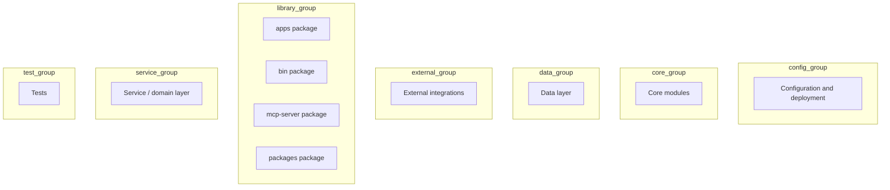

# Architecture report: eyaltoledano/claude-task-master

> Automated static analysis. **Observed** = directly seen in files/imports/AST; **Inferred** = interpretation from that evidence. Repository code was not executed.

## 1. Repository at a glance

| Item | Value |
| --- | --- |
| Repository | eyaltoledano/claude-task-master |
| Description | An AI-powered task-management system you can drop into Cursor, Lovable, Windsurf, Roo, and others. |
| Language | JavaScript |
| Stars | 28357 |
| Licence | Other |
| Analysed commit / branch | c0c98d367c55296bfe69e65680625b6db437af02 / main |
| Framework(s) | Express, React |
| Files analysed | 800 |
| Components | 10 |

## 2. Architecture in one minute

eyaltoledano/claude-task-master - An AI-powered task-management system you can drop into Cursor, Lovable, Windsurf, Roo, and others.. This repository was analysed statically from 800 file(s) (0 Python). Detected technologies (observed from imports/manifests): GitHub Actions, Express, React, Tailwind CSS, Docker, Jest. Files are grouped into 10 component(s): apps package, bin package, Configuration and deployment, Core modules, Data layer, External integrations, mcp-server package, packages package. Findings below distinguish observed facts from inferred interpretation.

## 3. High-level block diagram

## 4. Main components

### apps package (`apps`)

- **Kind:** library
- **Status:** Observed
- **Confidence:** 0.85
- **Responsibility:** Groups 164 file(s) under apps package (observed from repository paths and static analysis).
- **Paths:** `apps/cli/src/command-registry.ts`, `apps/cli/src/commands/auth.command.ts`, `apps/cli/src/commands/autopilot/abort.command.ts`, `apps/cli/src/commands/autopilot/commit.command.ts`, `apps/cli/src/commands/autopilot/complete.command.ts`, `apps/cli/src/commands/autopilot/finalize.command.ts`, `apps/cli/src/commands/autopilot/index.ts`, `apps/cli/src/commands/autopilot/next.command.ts`, `apps/cli/src/commands/autopilot/resume.command.ts`, `apps/cli/src/commands/autopilot/shared.ts`, `apps/cli/src/commands/autopilot/start.command.ts`, `apps/cli/src/commands/autopilot/status.command.ts`, `apps/cli/src/commands/briefs.command.ts`, `apps/cli/src/commands/context.command.ts`, `apps/cli/src/commands/export.command.ts`, `apps/cli/src/commands/generate.command.ts`, `apps/cli/src/commands/list.command.spec.ts`, `apps/cli/src/commands/list.command.ts`, `apps/cli/src/commands/login.command.ts`, `apps/cli/src/commands/logout.command.ts`, `apps/cli/src/commands/loop.command.spec.ts`, `apps/cli/src/commands/loop.command.ts`, `apps/cli/src/commands/next.command.ts`, `apps/cli/src/commands/set-status.command.ts`, `apps/cli/src/commands/show.command.ts`, `apps/cli/src/commands/start.command.ts`, `apps/cli/src/commands/tags.command.ts`, `apps/cli/src/export/export-validator.ts`, `apps/cli/src/export/index.ts`, `apps/cli/src/export/task-mapper.ts`, `apps/cli/src/export/task-selector.ts`, `apps/cli/src/export/types.ts`, `apps/cli/src/hamster/index.ts`, `apps/cli/src/hamster/parse-prd-to-hamster.ts`, `apps/cli/src/index.ts`, `apps/cli/src/lib/model-management.ts`, `apps/cli/src/types/tag-management.d.ts`, `apps/cli/src/ui/components/brand-banner.component.ts`, `apps/cli/src/ui/components/cardBox.component.ts`, `apps/cli/src/ui/components/dashboard.component.spec.ts`, `apps/cli/src/ui/components/dashboard.component.ts`, `apps/cli/src/ui/components/header.component.ts`, `apps/cli/src/ui/components/index.ts`, `apps/cli/src/ui/components/next-task.component.ts`, `apps/cli/src/ui/components/suggested-steps.component.ts`, `apps/cli/src/ui/components/task-detail.component.ts`, `apps/cli/src/ui/components/watch-footer.component.ts`, `apps/cli/src/ui/display/messages.ts`, `apps/cli/src/ui/display/tables.ts`, `apps/cli/src/ui/formatters/complexity-formatters.ts`, `apps/cli/src/ui/formatters/dependency-formatters.ts`, `apps/cli/src/ui/formatters/link-formatters.ts`, `apps/cli/src/ui/formatters/priority-formatters.ts`, `apps/cli/src/ui/formatters/status-formatters.spec.ts`, `apps/cli/src/ui/formatters/status-formatters.ts`, `apps/cli/src/ui/index.ts`, `apps/cli/src/ui/layout/helpers.spec.ts`, `apps/cli/src/ui/layout/helpers.ts`, `apps/cli/src/utils/auth-guard.ts`, `apps/cli/src/utils/auth-helpers.ts`, `apps/cli/src/utils/auth-ui.ts`, `apps/cli/src/utils/auto-update/changelog.ts`, `apps/cli/src/utils/auto-update/check-update.ts`, `apps/cli/src/utils/auto-update/display.ts`, `apps/cli/src/utils/auto-update/download.ts`, `apps/cli/src/utils/auto-update/index.ts`, `apps/cli/src/utils/auto-update/install.ts`, `apps/cli/src/utils/auto-update/restart.ts`, `apps/cli/src/utils/auto-update/types.ts`, `apps/cli/src/utils/auto-update/version.ts`, `apps/cli/src/utils/brief-selection.ts`, `apps/cli/src/utils/command-guard.ts`, `apps/cli/src/utils/content-renderer.ts`, `apps/cli/src/utils/display-helpers.ts`, `apps/cli/src/utils/error-handler.ts`, `apps/cli/src/utils/index.ts`, `apps/cli/src/utils/org-selection.ts`, `apps/cli/src/utils/project-root.ts`, `apps/cli/src/utils/task-status.ts`, `apps/cli/src/utils/ui.spec.ts`, `apps/cli/src/utils/ui.ts`, `apps/cli/vitest.config.ts`, `apps/extension/esbuild.js`, `apps/extension/package.mjs`, `apps/extension/src/components/ConfigView.tsx`, `apps/extension/src/components/TaskDetails/AIActionsSection.tsx`, `apps/extension/src/components/TaskDetails/DetailsSection.tsx`, `apps/extension/src/components/TaskDetails/PriorityBadge.tsx`, `apps/extension/src/components/TaskDetails/SubtasksSection.tsx`, `apps/extension/src/components/TaskDetails/TaskMetadataSidebar.tsx`, `apps/extension/src/components/TaskDetails/useTaskDetails.ts`, `apps/extension/src/components/TaskDetailsView.tsx`, `apps/extension/src/components/TaskMasterLogo.tsx`, `apps/extension/src/components/constants.ts`, `apps/extension/src/components/ui/CollapsibleSection.tsx`, `apps/extension/src/components/ui/badge.tsx`, `apps/extension/src/components/ui/breadcrumb.tsx`, `apps/extension/src/components/ui/button.tsx`, `apps/extension/src/components/ui/card.tsx`, `apps/extension/src/components/ui/collapsible.tsx`, `apps/extension/src/components/ui/dropdown-menu.tsx`, `apps/extension/src/components/ui/label.tsx`, `apps/extension/src/components/ui/scroll-area.tsx`, `apps/extension/src/components/ui/separator.tsx`, `apps/extension/src/components/ui/shadcn-io/kanban/index.tsx`, `apps/extension/src/components/ui/textarea.tsx`, `apps/extension/src/extension.ts`, `apps/extension/src/index.ts`, `apps/extension/src/lib/utils.ts`, `apps/extension/src/utils/configManager.ts`, `apps/extension/src/utils/connectionManager.ts`, `apps/extension/src/utils/errorHandler.ts`, `apps/extension/src/utils/event-emitter.ts`, `apps/extension/src/utils/logger.ts`, `apps/extension/src/utils/mcpClient.ts`, `apps/extension/src/utils/notificationPreferences.ts`, `apps/extension/src/utils/task-master-api/cache/cache-manager.ts`, `apps/extension/src/utils/task-master-api/index.ts`, `apps/extension/src/utils/task-master-api/mcp-client.ts`, `apps/extension/src/utils/task-master-api/transformers/task-transformer.ts`, `apps/extension/src/utils/task-master-api/types/index.ts`, `apps/extension/src/webview/App.tsx`, `apps/extension/src/webview/components/AppContent.tsx`, `apps/extension/src/webview/components/EmptyState.tsx`, `apps/extension/src/webview/components/ErrorBoundary.tsx`, `apps/extension/src/webview/components/PollingStatus.tsx`, `apps/extension/src/webview/components/PriorityBadge.tsx`, `apps/extension/src/webview/components/SidebarView.tsx`, `apps/extension/src/webview/components/TagDropdown.tsx`, `apps/extension/src/webview/components/TaskCard.tsx`, `apps/extension/src/webview/components/TaskEditModal.tsx`, `apps/extension/src/webview/components/TaskMasterKanban.tsx`, `apps/extension/src/webview/components/ToastContainer.tsx`, `apps/extension/src/webview/components/ToastNotification.tsx`, `apps/extension/src/webview/constants/index.ts`, `apps/extension/src/webview/contexts/VSCodeContext.tsx`, `apps/extension/src/webview/hooks/useTaskQueries.ts`, `apps/extension/src/webview/hooks/useVSCodeMessages.ts`, `apps/extension/src/webview/hooks/useWebviewHeight.ts`, `apps/extension/src/webview/index.tsx`, `apps/extension/src/webview/providers/QueryProvider.tsx`, `apps/extension/src/webview/reducers/appReducer.ts`, `apps/extension/src/webview/sidebar.tsx`, `apps/extension/src/webview/types/index.ts`, `apps/extension/src/webview/utils/logger.ts`, `apps/extension/src/webview/utils/toast.ts`, `apps/mcp/src/index.ts`, `apps/mcp/src/shared/types.ts`, `apps/mcp/src/shared/utils.ts`, `apps/mcp/src/tools/autopilot/abort.tool.ts`, `apps/mcp/src/tools/autopilot/commit.tool.ts`, `apps/mcp/src/tools/autopilot/complete.tool.ts`, `apps/mcp/src/tools/autopilot/finalize.tool.ts`, `apps/mcp/src/tools/autopilot/index.ts`, `apps/mcp/src/tools/autopilot/next.tool.ts`, `apps/mcp/src/tools/autopilot/resume.tool.ts`, `apps/mcp/src/tools/autopilot/start.tool.ts`, `apps/mcp/src/tools/autopilot/status.tool.ts`, `apps/mcp/src/tools/tasks/generate.tool.ts`, `apps/mcp/src/tools/tasks/get-task.tool.ts`, `apps/mcp/src/tools/tasks/get-tasks.tool.ts`, `apps/mcp/src/tools/tasks/index.ts`, `apps/mcp/src/tools/tasks/set-task-status.tool.ts`, `apps/mcp/vitest.config.ts`
- **Evidence:** [apps/cli/src/command-registry.ts](https://github.com/eyaltoledano/claude-task-master/blob/c0c98d367c55296bfe69e65680625b6db437af02/apps/cli/src/command-registry.ts); [apps/cli/src/commands/auth.command.ts](https://github.com/eyaltoledano/claude-task-master/blob/c0c98d367c55296bfe69e65680625b6db437af02/apps/cli/src/commands/auth.command.ts); [apps/cli/src/commands/autopilot/abort.command.ts](https://github.com/eyaltoledano/claude-task-master/blob/c0c98d367c55296bfe69e65680625b6db437af02/apps/cli/src/commands/autopilot/abort.command.ts); [apps/cli/src/commands/autopilot/commit.command.ts](https://github.com/eyaltoledano/claude-task-master/blob/c0c98d367c55296bfe69e65680625b6db437af02/apps/cli/src/commands/autopilot/commit.command.ts); [apps/cli/src/commands/autopilot/complete.command.ts](https://github.com/eyaltoledano/claude-task-master/blob/c0c98d367c55296bfe69e65680625b6db437af02/apps/cli/src/commands/autopilot/complete.command.ts); [apps/cli/src/commands/autopilot/finalize.command.ts](https://github.com/eyaltoledano/claude-task-master/blob/c0c98d367c55296bfe69e65680625b6db437af02/apps/cli/src/commands/autopilot/finalize.command.ts); [apps/cli/src/commands/autopilot/index.ts](https://github.com/eyaltoledano/claude-task-master/blob/c0c98d367c55296bfe69e65680625b6db437af02/apps/cli/src/commands/autopilot/index.ts); [apps/cli/src/commands/autopilot/next.command.ts](https://github.com/eyaltoledano/claude-task-master/blob/c0c98d367c55296bfe69e65680625b6db437af02/apps/cli/src/commands/autopilot/next.command.ts)

### bin package (`bin`)

- **Kind:** library
- **Status:** Observed
- **Confidence:** 0.85
- **Responsibility:** Groups 1 file(s) under bin package (observed from repository paths and static analysis).
- **Paths:** `bin/task-master.js`
- **Evidence:** [bin/task-master.js](https://github.com/eyaltoledano/claude-task-master/blob/c0c98d367c55296bfe69e65680625b6db437af02/bin/task-master.js)

### Configuration and deployment (`config`)

- **Kind:** config
- **Status:** Observed
- **Confidence:** 0.85
- **Responsibility:** Groups 41 file(s) under configuration and deployment (observed from repository paths and static analysis).
- **Paths:** `apps/cli/package.json`, `apps/cli/tsconfig.json`, `apps/docs/docs.json`, `apps/docs/package.json`, `apps/docs/vercel.json`, `apps/extension/components.json`, `apps/extension/package.json`, `apps/extension/package.publish.json`, `apps/extension/tsconfig.json`, `apps/mcp/package.json`, `apps/mcp/tsconfig.json`, `assets/config.json`, `biome.json`, `context/mcp-protocol-schema-03262025.json`, `context7.json`, `manifest.json`, `output.json`, `package.json`, `packages/ai-sdk-provider-grok-cli/package.json`, `packages/ai-sdk-provider-grok-cli/tsconfig.json`, `packages/build-config/package.json`, `packages/build-config/tsconfig.json`, `packages/claude-code-plugin/.claude-plugin/plugin.json`, `packages/claude-code-plugin/mcp.json`, `packages/claude-code-plugin/package.json`, `packages/tm-bridge/package.json`, `packages/tm-bridge/tsconfig.json`, `packages/tm-core/package.json`, `packages/tm-core/src/modules/config/config-domain.ts`, `packages/tm-core/src/modules/config/index.ts`, `packages/tm-core/src/modules/config/managers/config-manager.spec.ts`, `packages/tm-core/src/modules/config/managers/config-manager.ts`, `packages/tm-core/src/modules/config/services/config-loader.service.spec.ts`, `packages/tm-core/src/modules/config/services/config-loader.service.ts`, `packages/tm-core/src/modules/config/services/config-merger.service.spec.ts`, `packages/tm-core/src/modules/config/services/config-merger.service.ts`, `packages/tm-core/src/modules/config/services/config-persistence.service.ts`, `packages/tm-core/src/modules/config/services/environment-config-provider.service.ts`, `packages/tm-core/src/modules/config/services/index.ts`, `packages/tm-core/src/modules/config/services/runtime-state-manager.service.spec.ts`, `packages/tm-core/src/modules/config/services/runtime-state-manager.service.ts`
- **Evidence:** [apps/cli/package.json](https://github.com/eyaltoledano/claude-task-master/blob/c0c98d367c55296bfe69e65680625b6db437af02/apps/cli/package.json); [apps/cli/tsconfig.json](https://github.com/eyaltoledano/claude-task-master/blob/c0c98d367c55296bfe69e65680625b6db437af02/apps/cli/tsconfig.json); [apps/docs/docs.json](https://github.com/eyaltoledano/claude-task-master/blob/c0c98d367c55296bfe69e65680625b6db437af02/apps/docs/docs.json); [apps/docs/package.json](https://github.com/eyaltoledano/claude-task-master/blob/c0c98d367c55296bfe69e65680625b6db437af02/apps/docs/package.json); [apps/docs/vercel.json](https://github.com/eyaltoledano/claude-task-master/blob/c0c98d367c55296bfe69e65680625b6db437af02/apps/docs/vercel.json); [apps/extension/components.json](https://github.com/eyaltoledano/claude-task-master/blob/c0c98d367c55296bfe69e65680625b6db437af02/apps/extension/components.json); [apps/extension/package.json](https://github.com/eyaltoledano/claude-task-master/blob/c0c98d367c55296bfe69e65680625b6db437af02/apps/extension/package.json); [apps/extension/package.publish.json](https://github.com/eyaltoledano/claude-task-master/blob/c0c98d367c55296bfe69e65680625b6db437af02/apps/extension/package.publish.json)

### Core modules (`core`)

- **Kind:** core
- **Status:** Observed
- **Confidence:** 0.85
- **Responsibility:** Groups 4 file(s) under core modules (observed from repository paths and static analysis).
- **Paths:** `index.js`, `jest.config.js`, `jest.resolver.cjs`, `mcp-test.js`
- **Evidence:** [index.js](https://github.com/eyaltoledano/claude-task-master/blob/c0c98d367c55296bfe69e65680625b6db437af02/index.js); [jest.config.js](https://github.com/eyaltoledano/claude-task-master/blob/c0c98d367c55296bfe69e65680625b6db437af02/jest.config.js); [jest.resolver.cjs](https://github.com/eyaltoledano/claude-task-master/blob/c0c98d367c55296bfe69e65680625b6db437af02/jest.resolver.cjs); [mcp-test.js](https://github.com/eyaltoledano/claude-task-master/blob/c0c98d367c55296bfe69e65680625b6db437af02/mcp-test.js)

### Data layer (`data_layer`)

- **Kind:** data
- **Status:** Observed
- **Confidence:** 0.85
- **Responsibility:** Groups 21 file(s) under data layer (observed from repository paths and static analysis).
- **Paths:** `apps/cli/src/commands/models/custom-providers.ts`, `apps/cli/src/commands/models/fetchers.ts`, `apps/cli/src/commands/models/index.ts`, `apps/cli/src/commands/models/prompts.ts`, `apps/cli/src/commands/models/setup.ts`, `apps/cli/src/commands/models/types.ts`, `packages/tm-core/src/modules/storage/adapters/activity-logger.ts`, `packages/tm-core/src/modules/storage/adapters/api-storage.ts`, `packages/tm-core/src/modules/storage/adapters/file-storage/file-operations.spec.ts`, `packages/tm-core/src/modules/storage/adapters/file-storage/file-operations.ts`, `packages/tm-core/src/modules/storage/adapters/file-storage/file-storage.ts`, `packages/tm-core/src/modules/storage/adapters/file-storage/format-handler.ts`, `packages/tm-core/src/modules/storage/adapters/file-storage/index.ts`, `packages/tm-core/src/modules/storage/adapters/file-storage/path-resolver.ts`, `packages/tm-core/src/modules/storage/index.ts`, `packages/tm-core/src/modules/storage/services/storage-factory.ts`, `packages/tm-core/src/modules/storage/utils/api-client.ts`, `packages/tm-core/src/modules/tasks/repositories/supabase/dependency-fetcher.ts`, `packages/tm-core/src/modules/tasks/repositories/supabase/index.ts`, `packages/tm-core/src/modules/tasks/repositories/supabase/supabase-repository.ts`, `packages/tm-core/src/modules/tasks/repositories/task-repository.interface.ts`
- **Evidence:** [apps/cli/src/commands/models/custom-providers.ts](https://github.com/eyaltoledano/claude-task-master/blob/c0c98d367c55296bfe69e65680625b6db437af02/apps/cli/src/commands/models/custom-providers.ts); [apps/cli/src/commands/models/fetchers.ts](https://github.com/eyaltoledano/claude-task-master/blob/c0c98d367c55296bfe69e65680625b6db437af02/apps/cli/src/commands/models/fetchers.ts); [apps/cli/src/commands/models/index.ts](https://github.com/eyaltoledano/claude-task-master/blob/c0c98d367c55296bfe69e65680625b6db437af02/apps/cli/src/commands/models/index.ts); [apps/cli/src/commands/models/prompts.ts](https://github.com/eyaltoledano/claude-task-master/blob/c0c98d367c55296bfe69e65680625b6db437af02/apps/cli/src/commands/models/prompts.ts); [apps/cli/src/commands/models/setup.ts](https://github.com/eyaltoledano/claude-task-master/blob/c0c98d367c55296bfe69e65680625b6db437af02/apps/cli/src/commands/models/setup.ts); [apps/cli/src/commands/models/types.ts](https://github.com/eyaltoledano/claude-task-master/blob/c0c98d367c55296bfe69e65680625b6db437af02/apps/cli/src/commands/models/types.ts); [packages/tm-core/src/modules/storage/adapters/activity-logger.ts](https://github.com/eyaltoledano/claude-task-master/blob/c0c98d367c55296bfe69e65680625b6db437af02/packages/tm-core/src/modules/storage/adapters/activity-logger.ts); [packages/tm-core/src/modules/storage/adapters/api-storage.ts](https://github.com/eyaltoledano/claude-task-master/blob/c0c98d367c55296bfe69e65680625b6db437af02/packages/tm-core/src/modules/storage/adapters/api-storage.ts)

### External integrations (`external_integrations`)

- **Kind:** external
- **Status:** Observed
- **Confidence:** 0.85
- **Responsibility:** Groups 8 file(s) under external integrations (observed from repository paths and static analysis).
- **Paths:** `packages/tm-core/src/modules/git/adapters/git-adapter.ts`, `packages/tm-core/src/modules/integration/clients/index.ts`, `packages/tm-core/src/modules/integration/clients/supabase-client.spec.ts`, `packages/tm-core/src/modules/integration/clients/supabase-client.ts`, `packages/tm-core/src/modules/integration/integration-domain.ts`, `packages/tm-core/src/modules/integration/services/export.service.ts`, `packages/tm-core/src/modules/integration/services/task-expansion.service.ts`, `packages/tm-core/src/modules/integration/services/task-retrieval.service.ts`
- **Evidence:** [packages/tm-core/src/modules/git/adapters/git-adapter.ts](https://github.com/eyaltoledano/claude-task-master/blob/c0c98d367c55296bfe69e65680625b6db437af02/packages/tm-core/src/modules/git/adapters/git-adapter.ts); [packages/tm-core/src/modules/integration/clients/index.ts](https://github.com/eyaltoledano/claude-task-master/blob/c0c98d367c55296bfe69e65680625b6db437af02/packages/tm-core/src/modules/integration/clients/index.ts); [packages/tm-core/src/modules/integration/clients/supabase-client.spec.ts](https://github.com/eyaltoledano/claude-task-master/blob/c0c98d367c55296bfe69e65680625b6db437af02/packages/tm-core/src/modules/integration/clients/supabase-client.spec.ts); [packages/tm-core/src/modules/integration/clients/supabase-client.ts](https://github.com/eyaltoledano/claude-task-master/blob/c0c98d367c55296bfe69e65680625b6db437af02/packages/tm-core/src/modules/integration/clients/supabase-client.ts); [packages/tm-core/src/modules/integration/integration-domain.ts](https://github.com/eyaltoledano/claude-task-master/blob/c0c98d367c55296bfe69e65680625b6db437af02/packages/tm-core/src/modules/integration/integration-domain.ts); [packages/tm-core/src/modules/integration/services/export.service.ts](https://github.com/eyaltoledano/claude-task-master/blob/c0c98d367c55296bfe69e65680625b6db437af02/packages/tm-core/src/modules/integration/services/export.service.ts); [packages/tm-core/src/modules/integration/services/task-expansion.service.ts](https://github.com/eyaltoledano/claude-task-master/blob/c0c98d367c55296bfe69e65680625b6db437af02/packages/tm-core/src/modules/integration/services/task-expansion.service.ts); [packages/tm-core/src/modules/integration/services/task-retrieval.service.ts](https://github.com/eyaltoledano/claude-task-master/blob/c0c98d367c55296bfe69e65680625b6db437af02/packages/tm-core/src/modules/integration/services/task-retrieval.service.ts)

### mcp-server package (`mcp_server`)

- **Kind:** library
- **Status:** Observed
- **Confidence:** 0.85
- **Responsibility:** Groups 47 file(s) under mcp-server package (observed from repository paths and static analysis).
- **Paths:** `mcp-server/server.js`, `mcp-server/src/custom-sdk/errors.js`, `mcp-server/src/custom-sdk/index.js`, `mcp-server/src/custom-sdk/json-extractor.js`, `mcp-server/src/custom-sdk/language-model.js`, `mcp-server/src/custom-sdk/message-converter.js`, `mcp-server/src/custom-sdk/schema-converter.js`, `mcp-server/src/index.js`, `mcp-server/src/logger.js`, `mcp-server/src/providers/mcp-provider.js`, `mcp-server/src/tools/add-dependency.js`, `mcp-server/src/tools/add-subtask.js`, `mcp-server/src/tools/add-tag.js`, `mcp-server/src/tools/add-task.js`, `mcp-server/src/tools/analyze.js`, `mcp-server/src/tools/clear-subtasks.js`, `mcp-server/src/tools/complexity-report.js`, `mcp-server/src/tools/copy-tag.js`, `mcp-server/src/tools/delete-tag.js`, `mcp-server/src/tools/expand-all.js`, `mcp-server/src/tools/expand-task.js`, `mcp-server/src/tools/fix-dependencies.js`, `mcp-server/src/tools/get-operation-status.js`, `mcp-server/src/tools/index.js`, `mcp-server/src/tools/initialize-project.js`, `mcp-server/src/tools/list-tags.js`, `mcp-server/src/tools/models.js`, `mcp-server/src/tools/move-task.js`, `mcp-server/src/tools/next-task.js`, `mcp-server/src/tools/parse-prd.js`, `mcp-server/src/tools/remove-dependency.js`, `mcp-server/src/tools/remove-subtask.js`, `mcp-server/src/tools/remove-task.js`, `mcp-server/src/tools/rename-tag.js`, `mcp-server/src/tools/research.js`, `mcp-server/src/tools/response-language.js`, `mcp-server/src/tools/rules.js`, `mcp-server/src/tools/scope-down.js`, `mcp-server/src/tools/scope-up.js`, `mcp-server/src/tools/set-task-status.js`, `mcp-server/src/tools/tool-registry.js`, `mcp-server/src/tools/update-subtask.js`, `mcp-server/src/tools/update-task.js`, `mcp-server/src/tools/update.js`, `mcp-server/src/tools/use-tag.js`, `mcp-server/src/tools/utils.js`, `mcp-server/src/tools/validate-dependencies.js`
- **Evidence:** [mcp-server/server.js](https://github.com/eyaltoledano/claude-task-master/blob/c0c98d367c55296bfe69e65680625b6db437af02/mcp-server/server.js); [mcp-server/src/custom-sdk/errors.js](https://github.com/eyaltoledano/claude-task-master/blob/c0c98d367c55296bfe69e65680625b6db437af02/mcp-server/src/custom-sdk/errors.js); [mcp-server/src/custom-sdk/index.js](https://github.com/eyaltoledano/claude-task-master/blob/c0c98d367c55296bfe69e65680625b6db437af02/mcp-server/src/custom-sdk/index.js); [mcp-server/src/custom-sdk/json-extractor.js](https://github.com/eyaltoledano/claude-task-master/blob/c0c98d367c55296bfe69e65680625b6db437af02/mcp-server/src/custom-sdk/json-extractor.js); [mcp-server/src/custom-sdk/language-model.js](https://github.com/eyaltoledano/claude-task-master/blob/c0c98d367c55296bfe69e65680625b6db437af02/mcp-server/src/custom-sdk/language-model.js); [mcp-server/src/custom-sdk/message-converter.js](https://github.com/eyaltoledano/claude-task-master/blob/c0c98d367c55296bfe69e65680625b6db437af02/mcp-server/src/custom-sdk/message-converter.js); [mcp-server/src/custom-sdk/schema-converter.js](https://github.com/eyaltoledano/claude-task-master/blob/c0c98d367c55296bfe69e65680625b6db437af02/mcp-server/src/custom-sdk/schema-converter.js); [mcp-server/src/index.js](https://github.com/eyaltoledano/claude-task-master/blob/c0c98d367c55296bfe69e65680625b6db437af02/mcp-server/src/index.js)

### packages package (`packages`)

- **Kind:** library
- **Status:** Observed
- **Confidence:** 0.85
- **Responsibility:** Groups 104 file(s) under packages package (observed from repository paths and static analysis).
- **Paths:** `packages/ai-sdk-provider-grok-cli/src/errors.test.ts`, `packages/ai-sdk-provider-grok-cli/src/errors.ts`, `packages/ai-sdk-provider-grok-cli/src/grok-cli-language-model.ts`, `packages/ai-sdk-provider-grok-cli/src/grok-cli-provider.test.ts`, `packages/ai-sdk-provider-grok-cli/src/grok-cli-provider.ts`, `packages/ai-sdk-provider-grok-cli/src/index.ts`, `packages/ai-sdk-provider-grok-cli/src/json-extractor.test.ts`, `packages/ai-sdk-provider-grok-cli/src/json-extractor.ts`, `packages/ai-sdk-provider-grok-cli/src/message-converter.test.ts`, `packages/ai-sdk-provider-grok-cli/src/message-converter.ts`, `packages/ai-sdk-provider-grok-cli/src/types.ts`, `packages/build-config/scripts/fix-null-versions.ts`, `packages/build-config/src/tsdown.base.ts`, `packages/tm-bridge/src/add-tag-bridge.ts`, `packages/tm-bridge/src/bridge-types.ts`, `packages/tm-bridge/src/bridge-utils.ts`, `packages/tm-bridge/src/expand-bridge.ts`, `packages/tm-bridge/src/index.ts`, `packages/tm-bridge/src/tags-bridge.ts`, `packages/tm-bridge/src/update-bridge.ts`, `packages/tm-bridge/src/use-tag-bridge.ts`, `packages/tm-core/src/common/constants/index.ts`, `packages/tm-core/src/common/constants/paths.ts`, `packages/tm-core/src/common/constants/providers.ts`, `packages/tm-core/src/common/errors/index.ts`, `packages/tm-core/src/common/errors/task-master-error.ts`, `packages/tm-core/src/common/interfaces/configuration.interface.ts`, `packages/tm-core/src/common/interfaces/index.ts`, `packages/tm-core/src/common/interfaces/storage.interface.ts`, `packages/tm-core/src/common/logger/factory.ts`, `packages/tm-core/src/common/logger/index.ts`, `packages/tm-core/src/common/logger/logger.spec.ts`, `packages/tm-core/src/common/logger/logger.ts`, `packages/tm-core/src/common/mappers/TaskMapper.spec.ts`, `packages/tm-core/src/common/mappers/TaskMapper.ts`, `packages/tm-core/src/common/schemas/index.ts`, `packages/tm-core/src/common/schemas/task-id.schema.spec.ts`, `packages/tm-core/src/common/schemas/task-id.schema.ts`, `packages/tm-core/src/common/types/database.types.ts`, `packages/tm-core/src/common/types/index.ts`, `packages/tm-core/src/common/types/legacy.ts`, `packages/tm-core/src/common/types/repository-types.ts`, `packages/tm-core/src/common/utils/git-utils.ts`, `packages/tm-core/src/common/utils/id-generator.ts`, `packages/tm-core/src/common/utils/index.ts`, `packages/tm-core/src/common/utils/path-helpers.ts`, `packages/tm-core/src/common/utils/path-normalizer.spec.ts`, `packages/tm-core/src/common/utils/path-normalizer.ts`, `packages/tm-core/src/common/utils/project-root-finder.spec.ts`, `packages/tm-core/src/common/utils/project-root-finder.test.ts`, `packages/tm-core/src/common/utils/project-root-finder.ts`, `packages/tm-core/src/common/utils/run-id-generator.spec.ts`, `packages/tm-core/src/common/utils/run-id-generator.ts`, `packages/tm-core/src/index.ts`, `packages/tm-core/src/modules/ai/index.ts`, `packages/tm-core/src/modules/ai/interfaces/ai-provider.interface.ts`, `packages/tm-core/src/modules/ai/providers/base-provider.ts`, `packages/tm-core/src/modules/ai/providers/index.ts`, `packages/tm-core/src/modules/auth/auth-domain.spec.ts`, `packages/tm-core/src/modules/auth/auth-domain.ts`, `packages/tm-core/src/modules/auth/command.guard.ts`, `packages/tm-core/src/modules/auth/config.ts`, `packages/tm-core/src/modules/auth/constants.ts`, `packages/tm-core/src/modules/auth/index.ts`, `packages/tm-core/src/modules/auth/managers/auth-manager.spec.ts`, `packages/tm-core/src/modules/auth/managers/auth-manager.ts`, `packages/tm-core/src/modules/auth/types.ts`, `packages/tm-core/src/modules/auth/utils/auth-error-utils.ts`, `packages/tm-core/src/modules/auth/utils/cli-crypto.ts`, `packages/tm-core/src/modules/auth/utils/index.ts`, `packages/tm-core/src/modules/briefs/briefs-domain.ts`, `packages/tm-core/src/modules/briefs/index.ts`, `packages/tm-core/src/modules/briefs/types.ts`, `packages/tm-core/src/modules/briefs/utils/url-parser.ts`, `packages/tm-core/src/modules/commands/index.ts`, `packages/tm-core/src/modules/dependencies/index.ts`, `packages/tm-core/src/modules/execution/executors/base-executor.ts`, `packages/tm-core/src/modules/execution/executors/claude-executor.ts`, `packages/tm-core/src/modules/execution/executors/executor-factory.ts`, `packages/tm-core/src/modules/execution/index.ts`, `packages/tm-core/src/modules/execution/types.ts`, `packages/tm-core/src/modules/git/git-domain.ts`, `packages/tm-core/src/modules/git/index.ts`, `packages/tm-core/src/modules/loop/index.ts`, `packages/tm-core/src/modules/loop/loop-domain.spec.ts`, `packages/tm-core/src/modules/loop/loop-domain.ts`, `packages/tm-core/src/modules/loop/presets/default.ts`, `packages/tm-core/src/modules/loop/presets/duplication.ts`, `packages/tm-core/src/modules/loop/presets/entropy.ts`, `packages/tm-core/src/modules/loop/presets/index.ts`, `packages/tm-core/src/modules/loop/presets/linting.ts`, `packages/tm-core/src/modules/loop/presets/presets.spec.ts`, `packages/tm-core/src/modules/loop/presets/test-coverage.ts`, `packages/tm-core/src/modules/loop/types.spec.ts`, `packages/tm-core/src/modules/loop/types.ts`, `packages/tm-core/src/modules/prompts/constants.ts`, `packages/tm-core/src/modules/prompts/index.ts`, `packages/tm-core/src/modules/prompts/types.ts`, `packages/tm-core/src/modules/reports/index.ts`, `packages/tm-core/src/modules/reports/managers/complexity-report-manager.ts`, `packages/tm-core/src/modules/reports/types.ts`, `packages/tm-core/src/modules/tasks/entities/task.entity.spec.ts`, `packages/tm-core/src/modules/tasks/entities/task.entity.ts`, `packages/tm-core/src/modules/tasks/parser/index.ts`
- **Evidence:** [packages/ai-sdk-provider-grok-cli/src/errors.test.ts](https://github.com/eyaltoledano/claude-task-master/blob/c0c98d367c55296bfe69e65680625b6db437af02/packages/ai-sdk-provider-grok-cli/src/errors.test.ts); [packages/ai-sdk-provider-grok-cli/src/errors.ts](https://github.com/eyaltoledano/claude-task-master/blob/c0c98d367c55296bfe69e65680625b6db437af02/packages/ai-sdk-provider-grok-cli/src/errors.ts); [packages/ai-sdk-provider-grok-cli/src/grok-cli-language-model.ts](https://github.com/eyaltoledano/claude-task-master/blob/c0c98d367c55296bfe69e65680625b6db437af02/packages/ai-sdk-provider-grok-cli/src/grok-cli-language-model.ts); [packages/ai-sdk-provider-grok-cli/src/grok-cli-provider.test.ts](https://github.com/eyaltoledano/claude-task-master/blob/c0c98d367c55296bfe69e65680625b6db437af02/packages/ai-sdk-provider-grok-cli/src/grok-cli-provider.test.ts); [packages/ai-sdk-provider-grok-cli/src/grok-cli-provider.ts](https://github.com/eyaltoledano/claude-task-master/blob/c0c98d367c55296bfe69e65680625b6db437af02/packages/ai-sdk-provider-grok-cli/src/grok-cli-provider.ts); [packages/ai-sdk-provider-grok-cli/src/index.ts](https://github.com/eyaltoledano/claude-task-master/blob/c0c98d367c55296bfe69e65680625b6db437af02/packages/ai-sdk-provider-grok-cli/src/index.ts); [packages/ai-sdk-provider-grok-cli/src/json-extractor.test.ts](https://github.com/eyaltoledano/claude-task-master/blob/c0c98d367c55296bfe69e65680625b6db437af02/packages/ai-sdk-provider-grok-cli/src/json-extractor.test.ts); [packages/ai-sdk-provider-grok-cli/src/json-extractor.ts](https://github.com/eyaltoledano/claude-task-master/blob/c0c98d367c55296bfe69e65680625b6db437af02/packages/ai-sdk-provider-grok-cli/src/json-extractor.ts)

### Service / domain layer (`service_layer`)

- **Kind:** service
- **Status:** Observed
- **Confidence:** 0.85
- **Responsibility:** Groups 80 file(s) under service / domain layer (observed from repository paths and static analysis).
- **Paths:** `apps/extension/src/services/config-service.ts`, `apps/extension/src/services/error-handler.ts`, `apps/extension/src/services/notification-preferences.ts`, `apps/extension/src/services/polling-service.ts`, `apps/extension/src/services/polling-strategies.ts`, `apps/extension/src/services/sidebar-webview-manager.ts`, `apps/extension/src/services/task-repository.ts`, `apps/extension/src/services/terminal-manager.ts`, `apps/extension/src/services/webview-manager.ts`, `mcp-server/src/core/__tests__/context-manager.test.js`, `mcp-server/src/core/context-manager.js`, `mcp-server/src/core/direct-functions/add-dependency.js`, `mcp-server/src/core/direct-functions/add-subtask.js`, `mcp-server/src/core/direct-functions/add-tag.js`, `mcp-server/src/core/direct-functions/add-task.js`, `mcp-server/src/core/direct-functions/analyze-task-complexity.js`, `mcp-server/src/core/direct-functions/cache-stats.js`, `mcp-server/src/core/direct-functions/clear-subtasks.js`, `mcp-server/src/core/direct-functions/complexity-report.js`, `mcp-server/src/core/direct-functions/copy-tag.js`, `mcp-server/src/core/direct-functions/create-tag-from-branch.js`, `mcp-server/src/core/direct-functions/delete-tag.js`, `mcp-server/src/core/direct-functions/expand-all-tasks.js`, `mcp-server/src/core/direct-functions/expand-task.js`, `mcp-server/src/core/direct-functions/fix-dependencies.js`, `mcp-server/src/core/direct-functions/initialize-project.js`, `mcp-server/src/core/direct-functions/list-tags.js`, `mcp-server/src/core/direct-functions/models.js`, `mcp-server/src/core/direct-functions/move-task-cross-tag.js`, `mcp-server/src/core/direct-functions/move-task.js`, `mcp-server/src/core/direct-functions/next-task.js`, `mcp-server/src/core/direct-functions/parse-prd.js`, `mcp-server/src/core/direct-functions/remove-dependency.js`, `mcp-server/src/core/direct-functions/remove-subtask.js`, `mcp-server/src/core/direct-functions/remove-task.js`, `mcp-server/src/core/direct-functions/rename-tag.js`, `mcp-server/src/core/direct-functions/research.js`, `mcp-server/src/core/direct-functions/response-language.js`, `mcp-server/src/core/direct-functions/rules.js`, `mcp-server/src/core/direct-functions/scope-down.js`, `mcp-server/src/core/direct-functions/scope-up.js`, `mcp-server/src/core/direct-functions/set-task-status.js`, `mcp-server/src/core/direct-functions/update-subtask-by-id.js`, `mcp-server/src/core/direct-functions/update-task-by-id.js`, `mcp-server/src/core/direct-functions/update-tasks.js`, `mcp-server/src/core/direct-functions/use-tag.js`, `mcp-server/src/core/direct-functions/validate-dependencies.js`, `mcp-server/src/core/task-master-core.js`, `mcp-server/src/core/utils/env-utils.js`, `mcp-server/src/core/utils/path-utils.js`, `packages/tm-core/src/modules/auth/services/context-store.ts`, `packages/tm-core/src/modules/auth/services/oauth-service.ts`, `packages/tm-core/src/modules/auth/services/organization.service.ts`, `packages/tm-core/src/modules/auth/services/session-manager.spec.ts`, `packages/tm-core/src/modules/auth/services/session-manager.ts`, `packages/tm-core/src/modules/auth/services/supabase-session-storage.spec.ts`, `packages/tm-core/src/modules/auth/services/supabase-session-storage.ts`, `packages/tm-core/src/modules/briefs/services/brief-service.ts`, `packages/tm-core/src/modules/execution/services/executor-service.ts`, `packages/tm-core/src/modules/git/services/branch-name-generator.spec.ts`, `packages/tm-core/src/modules/git/services/branch-name-generator.ts`, `packages/tm-core/src/modules/git/services/commit-message-generator.test.ts`, `packages/tm-core/src/modules/git/services/commit-message-generator.ts`, `packages/tm-core/src/modules/git/services/scope-detector.test.ts`, `packages/tm-core/src/modules/git/services/scope-detector.ts`, `packages/tm-core/src/modules/git/services/template-engine.spec.ts`, `packages/tm-core/src/modules/git/services/template-engine.ts`, `packages/tm-core/src/modules/loop/services/index.ts`, `packages/tm-core/src/modules/loop/services/loop.service.spec.ts`, `packages/tm-core/src/modules/loop/services/loop.service.ts`, `packages/tm-core/src/modules/prompts/services/prompt-service.ts`, `packages/tm-core/src/modules/prompts/services/prompt-state-manager.ts`, `packages/tm-core/src/modules/prompts/services/trigger-evaluator.ts`, `packages/tm-core/src/modules/tasks/services/preflight-checker.service.ts`, `packages/tm-core/src/modules/tasks/services/tag.service.ts`, `packages/tm-core/src/modules/tasks/services/task-execution-service.ts`, `packages/tm-core/src/modules/tasks/services/task-file-generator.service.spec.ts`, `packages/tm-core/src/modules/tasks/services/task-file-generator.service.ts`, `packages/tm-core/src/modules/tasks/services/task-loader.service.ts`, `packages/tm-core/src/modules/tasks/services/task-service.ts`
- **Evidence:** [apps/extension/src/services/config-service.ts](https://github.com/eyaltoledano/claude-task-master/blob/c0c98d367c55296bfe69e65680625b6db437af02/apps/extension/src/services/config-service.ts); [apps/extension/src/services/error-handler.ts](https://github.com/eyaltoledano/claude-task-master/blob/c0c98d367c55296bfe69e65680625b6db437af02/apps/extension/src/services/error-handler.ts); [apps/extension/src/services/notification-preferences.ts](https://github.com/eyaltoledano/claude-task-master/blob/c0c98d367c55296bfe69e65680625b6db437af02/apps/extension/src/services/notification-preferences.ts); [apps/extension/src/services/polling-service.ts](https://github.com/eyaltoledano/claude-task-master/blob/c0c98d367c55296bfe69e65680625b6db437af02/apps/extension/src/services/polling-service.ts); [apps/extension/src/services/polling-strategies.ts](https://github.com/eyaltoledano/claude-task-master/blob/c0c98d367c55296bfe69e65680625b6db437af02/apps/extension/src/services/polling-strategies.ts); [apps/extension/src/services/sidebar-webview-manager.ts](https://github.com/eyaltoledano/claude-task-master/blob/c0c98d367c55296bfe69e65680625b6db437af02/apps/extension/src/services/sidebar-webview-manager.ts); [apps/extension/src/services/task-repository.ts](https://github.com/eyaltoledano/claude-task-master/blob/c0c98d367c55296bfe69e65680625b6db437af02/apps/extension/src/services/task-repository.ts); [apps/extension/src/services/terminal-manager.ts](https://github.com/eyaltoledano/claude-task-master/blob/c0c98d367c55296bfe69e65680625b6db437af02/apps/extension/src/services/terminal-manager.ts)

### Tests (`tests`)

- **Kind:** test
- **Status:** Observed
- **Confidence:** 0.85
- **Responsibility:** Groups 14 file(s) under tests (observed from repository paths and static analysis).
- **Paths:** `.cursor/rules/test_workflow.mdc`, `apps/cli/tests/helpers/test-utils.ts`, `apps/cli/tests/integration/commands/generate.command.test.ts`, `apps/cli/tests/integration/commands/list.command.test.ts`, `apps/cli/tests/integration/commands/loop.command.test.ts`, `apps/cli/tests/integration/commands/next.command.test.ts`, `apps/cli/tests/integration/commands/set-status.command.test.ts`, `apps/cli/tests/integration/commands/show.command.test.ts`, `apps/cli/tests/integration/task-lifecycle.test.ts`, `apps/cli/tests/unit/commands/autopilot/shared.test.ts`, `apps/cli/tests/unit/commands/show.command.spec.ts`, `apps/extension/src/test/extension.test.ts`, `apps/mcp/tests/integration/tools/generate.tool.test.ts`, `apps/mcp/tests/integration/tools/get-tasks.tool.test.ts`
- **Evidence:** [.cursor/rules/test_workflow.mdc](https://github.com/eyaltoledano/claude-task-master/blob/c0c98d367c55296bfe69e65680625b6db437af02/.cursor/rules/test_workflow.mdc); [apps/cli/tests/helpers/test-utils.ts](https://github.com/eyaltoledano/claude-task-master/blob/c0c98d367c55296bfe69e65680625b6db437af02/apps/cli/tests/helpers/test-utils.ts); [apps/cli/tests/integration/commands/generate.command.test.ts](https://github.com/eyaltoledano/claude-task-master/blob/c0c98d367c55296bfe69e65680625b6db437af02/apps/cli/tests/integration/commands/generate.command.test.ts); [apps/cli/tests/integration/commands/list.command.test.ts](https://github.com/eyaltoledano/claude-task-master/blob/c0c98d367c55296bfe69e65680625b6db437af02/apps/cli/tests/integration/commands/list.command.test.ts); [apps/cli/tests/integration/commands/loop.command.test.ts](https://github.com/eyaltoledano/claude-task-master/blob/c0c98d367c55296bfe69e65680625b6db437af02/apps/cli/tests/integration/commands/loop.command.test.ts); [apps/cli/tests/integration/commands/next.command.test.ts](https://github.com/eyaltoledano/claude-task-master/blob/c0c98d367c55296bfe69e65680625b6db437af02/apps/cli/tests/integration/commands/next.command.test.ts); [apps/cli/tests/integration/commands/set-status.command.test.ts](https://github.com/eyaltoledano/claude-task-master/blob/c0c98d367c55296bfe69e65680625b6db437af02/apps/cli/tests/integration/commands/set-status.command.test.ts); [apps/cli/tests/integration/commands/show.command.test.ts](https://github.com/eyaltoledano/claude-task-master/blob/c0c98d367c55296bfe69e65680625b6db437af02/apps/cli/tests/integration/commands/show.command.test.ts)

## 5. Execution flow

**Observed** entry point(s):

- [apps/cli/src/index.ts](https://github.com/eyaltoledano/claude-task-master/blob/c0c98d367c55296bfe69e65680625b6db437af02/apps/cli/src/index.ts)
- [apps/extension/src/index.ts](https://github.com/eyaltoledano/claude-task-master/blob/c0c98d367c55296bfe69e65680625b6db437af02/apps/extension/src/index.ts)
- [apps/mcp/src/index.ts](https://github.com/eyaltoledano/claude-task-master/blob/c0c98d367c55296bfe69e65680625b6db437af02/apps/mcp/src/index.ts)
- [index.js](https://github.com/eyaltoledano/claude-task-master/blob/c0c98d367c55296bfe69e65680625b6db437af02/index.js)
- [mcp-server/server.js](https://github.com/eyaltoledano/claude-task-master/blob/c0c98d367c55296bfe69e65680625b6db437af02/mcp-server/server.js)
- [mcp-server/src/custom-sdk/index.js](https://github.com/eyaltoledano/claude-task-master/blob/c0c98d367c55296bfe69e65680625b6db437af02/mcp-server/src/custom-sdk/index.js)
- [mcp-server/src/index.js](https://github.com/eyaltoledano/claude-task-master/blob/c0c98d367c55296bfe69e65680625b6db437af02/mcp-server/src/index.js)
- [mcp-server/src/tools/index.js](https://github.com/eyaltoledano/claude-task-master/blob/c0c98d367c55296bfe69e65680625b6db437af02/mcp-server/src/tools/index.js)
- [packages/ai-sdk-provider-grok-cli/src/index.ts](https://github.com/eyaltoledano/claude-task-master/blob/c0c98d367c55296bfe69e65680625b6db437af02/packages/ai-sdk-provider-grok-cli/src/index.ts)
- [packages/tm-bridge/src/index.ts](https://github.com/eyaltoledano/claude-task-master/blob/c0c98d367c55296bfe69e65680625b6db437af02/packages/tm-bridge/src/index.ts)
- [packages/tm-core/src/index.ts](https://github.com/eyaltoledano/claude-task-master/blob/c0c98d367c55296bfe69e65680625b6db437af02/packages/tm-core/src/index.ts)

Representative flow (derived from observed entry points and the import graph; steps beyond the entry point are **Inferred**):

1. Execution starts at an observed entry point listed above, if present.
2. No internal import relationships between components were observed.

## 6. Project structure

### `(root)`

- `.coderabbit.yaml` - config (105 bytes)
- `.cursorignore` - other (118 bytes)
- `.env.example` - config (932 bytes)
- `.gitignore` - other (1456 bytes)
- `.manypkg.json` - config (232 bytes)
- `.mcp.json` - config (176 bytes)
- `.mcpbignore` - other (328 bytes)
- `.npmignore` - other (452 bytes)
- `.nvmrc` - other (2 bytes)
- `CLAUDE.md` - docs (7610 bytes)
- `CLAUDE_CODE_PLUGIN.md` - docs (2892 bytes)
- `CONTRIBUTING.md` - docs (7758 bytes)
- `LICENSE` - docs (2191 bytes)
- `README-task-master.md` - docs (18401 bytes)
- `README.md` - docs (17421 bytes)
- `biome.json` - config (1119 bytes)
- `context7.json` - config (110 bytes)
- `index.js` - source, JavaScript (4593 bytes)
- `jest.config.js` - source, JavaScript (1784 bytes)
- `jest.resolver.cjs` - source, JavaScript (486 bytes)
- `llms-install.md` - docs (4852 bytes)
- `manifest.json` - config (2479 bytes)
- `mcp-test.js` - source, JavaScript (1951 bytes)
- `output.json` - config (52 bytes)
- `package.json` - manifest (5710 bytes)

### `.changeset`

- `.changeset/README.md` - docs (3347 bytes)
- `.changeset/config.json` - config (331 bytes)
- `.changeset/fix-sync-readme-dead-url.md` - docs (195 bytes)

### `.claude`

- `.claude/TM_COMMANDS_GUIDE.md` - docs (4097 bytes)
- `.claude/commands/dedupe.md` - docs (1850 bytes)
- `.claude/commands/go/ham.md` - docs (5530 bytes)
- `.claude/commands/go/pr-comments.md` - docs (4583 bytes)
- `.claude/hamster.md` - docs (4626 bytes)

### `.claude-plugin`

- `.claude-plugin/marketplace.json` - config (853 bytes)

### `.cursor`

- `.cursor/commands/goham.md` - docs (8589 bytes)
- `.cursor/mcp.json` - config (646 bytes)
- `.cursor/rules/ai_providers.mdc` - other (10747 bytes)
- `.cursor/rules/ai_services.mdc` - other (7303 bytes)
- `.cursor/rules/architecture.mdc` - other (19753 bytes)
- `.cursor/rules/changeset.mdc` - other (6762 bytes)
- `.cursor/rules/commands.mdc` - other (26852 bytes)
- `.cursor/rules/context_gathering.mdc` - other (9393 bytes)
- `.cursor/rules/cursor_rules.mdc` - other (1555 bytes)
- `.cursor/rules/dependencies.mdc` - other (7639 bytes)
- `.cursor/rules/dev_workflow.mdc` - other (31163 bytes)
- `.cursor/rules/git_workflow.mdc` - other (11973 bytes)
- `.cursor/rules/glossary.mdc` - other (2534 bytes)
- `.cursor/rules/hamster.mdc` - other (6148 bytes)
- `.cursor/rules/mcp.mdc` - other (32146 bytes)
- `.cursor/rules/new_features.mdc` - other (38649 bytes)
- `.cursor/rules/self_improve.mdc` - other (2426 bytes)
- `.cursor/rules/tags.mdc` - other (6649 bytes)
- `.cursor/rules/taskmaster.mdc` - other (42186 bytes)
- `.cursor/rules/taskmaster/dev_workflow.mdc` - other (30610 bytes)
- `.cursor/rules/taskmaster/taskmaster.mdc` - other (42021 bytes)
- `.cursor/rules/tasks.mdc` - other (11408 bytes)
- `.cursor/rules/telemetry.mdc` - other (10443 bytes)
- `.cursor/rules/test_workflow.mdc` - test (21838 bytes)
- `.cursor/rules/tests.mdc` - other (33780 bytes)
- `.cursor/rules/ui.mdc` - other (7367 bytes)
- `.cursor/rules/utilities.mdc` - other (41613 bytes)

### `.github`

- `.github/ISSUE_TEMPLATE/bug_report.md` - docs (784 bytes)
- `.github/ISSUE_TEMPLATE/enhancements---feature-requests.md` - docs (1319 bytes)
- `.github/ISSUE_TEMPLATE/feedback.md` - docs (685 bytes)
- `.github/PULL_REQUEST_TEMPLATE.md` - docs (1027 bytes)
- `.github/PULL_REQUEST_TEMPLATE/bugfix.md` - docs (697 bytes)
- `.github/PULL_REQUEST_TEMPLATE/config.yml` - config (561 bytes)
- `.github/PULL_REQUEST_TEMPLATE/feature.md` - docs (1014 bytes)
- `.github/PULL_REQUEST_TEMPLATE/integration.md` - docs (926 bytes)
- `.github/scripts/auto-close-duplicates.mjs` - source, JavaScript (6916 bytes)
- `.github/scripts/backfill-duplicate-comments.mjs` - source, JavaScript (4951 bytes)
- `.github/scripts/check-pre-release-mode.mjs` - source, JavaScript (3323 bytes)
- `.github/scripts/parse-metrics.mjs` - source, JavaScript (4474 bytes)
- `.github/scripts/release.mjs` - source, JavaScript (1047 bytes)
- `.github/scripts/sync-manifest-version.mjs` - source, JavaScript (2327 bytes)
- `.github/scripts/tag-extension.mjs` - source, JavaScript (994 bytes)
- `.github/scripts/utils.mjs` - source, JavaScript (2464 bytes)
- `.github/scripts/validate-changesets.mjs` - source, JavaScript (3574 bytes)
- `.github/workflows/auto-close-duplicates.yml` - ci, YAML (884 bytes)
- `.github/workflows/backfill-duplicate-comments.yml` - ci, YAML (1278 bytes)
- `.github/workflows/ci.yml` - ci, YAML (6084 bytes)
- `.github/workflows/claude-dedupe-issues.yml` - ci, YAML (2745 bytes)
- `.github/workflows/claude-docs-trigger.yml` - ci, YAML (2176 bytes)
- `.github/workflows/claude-docs-updater.yml` - ci, YAML (4332 bytes)
- `.github/workflows/claude-issue-triage.yml` - ci, YAML (4772 bytes)
- `.github/workflows/claude.yml` - ci, YAML (1145 bytes)
- `.github/workflows/extension-ci.yml` - ci, YAML (3229 bytes)
- `.github/workflows/extension-release.yml` - ci, YAML (3062 bytes)
- `.github/workflows/forward-port.yml` - ci, YAML (6206 bytes)
- `.github/workflows/log-issue-events.yml` - ci, YAML (6701 bytes)
- `.github/workflows/release-check.yml` - ci, YAML (407 bytes)
- `.github/workflows/release.yml` - ci, YAML (5236 bytes)
- `.github/workflows/update-models-md.yml` - ci, YAML (1080 bytes)
- `.github/workflows/weekly-metrics-discord.yml` - ci, YAML (3875 bytes)

### `.kiro`

- `.kiro/hooks/tm-code-change-task-tracker.kiro.hook` - other (1007 bytes)
- `.kiro/hooks/tm-complexity-analyzer.kiro.hook` - other (606 bytes)
- `.kiro/hooks/tm-daily-standup-assistant.kiro.hook` - other (600 bytes)
- `.kiro/hooks/tm-git-commit-task-linker.kiro.hook` - other (575 bytes)
- `.kiro/hooks/tm-pr-readiness-checker.kiro.hook` - other (597 bytes)
- `.kiro/hooks/tm-task-dependency-auto-progression.kiro.hook` - other (776 bytes)
- `.kiro/hooks/tm-test-success-task-completer.kiro.hook` - other (970 bytes)
- `.kiro/settings/mcp.json` - config (573 bytes)
- `.kiro/steering/dev_workflow.md` - docs (30478 bytes)
- `.kiro/steering/kiro_rules.md` - docs (1416 bytes)
- `.kiro/steering/self_improve.md` - docs (2284 bytes)
- `.kiro/steering/taskmaster.md` - docs (41905 bytes)
- `.kiro/steering/taskmaster_hooks_workflow.md` - docs (2152 bytes)

### `.taskmaster`

- `.taskmaster/CLAUDE.md` - docs (14398 bytes)
- `.taskmaster/ascii-art (6).txt` - docs (12081 bytes)
- `.taskmaster/config.json` - config (1029 bytes)
- `.taskmaster/docs/MIGRATION-ROADMAP.md` - docs (5842 bytes)
- `.taskmaster/docs/README.md` - docs (20874 bytes)
- `.taskmaster/docs/autonomous-tdd-git-workflow.md` - docs (33774 bytes)
- `.taskmaster/docs/loop-prd.md` - docs (16778 bytes)
- `.taskmaster/docs/prd-tm-start.txt` - docs (3711 bytes)
- `.taskmaster/docs/prd.txt` - docs (16731 bytes)
- `.taskmaster/docs/research/2025-06-14_how-can-i-improve-the-scope-up-and-scope-down-comm.md` - docs (7814 bytes)
- `.taskmaster/docs/research/2025-06-14_should-i-be-using-any-specific-libraries-for-this.md` - docs (5990 bytes)
- `.taskmaster/docs/research/2025-06-14_test-save-functionality.md` - docs (4021 bytes)
- `.taskmaster/docs/research/2025-06-14_test-the-fix-for-duplicate-saves-final-test.md` - docs (3812 bytes)
- `.taskmaster/docs/research/2025-08-01_do-we-need-to-add-new-commands-or-can-we-just-weap.md` - docs (12698 bytes)
- `.taskmaster/docs/research/2025-11-18_should-we-be-doing-the-taskmaster-gateway-even-tho.md` - docs (8950 bytes)
- `.taskmaster/docs/task-template-importing-prd.txt` - docs (18708 bytes)
- `.taskmaster/docs/tdd-workflow-phase-0-spike.md` - docs (4362 bytes)
- `.taskmaster/docs/tdd-workflow-phase-1-core-rails.md` - docs (37268 bytes)
- `.taskmaster/docs/tdd-workflow-phase-1-orchestrator.md` - docs (12128 bytes)
- `.taskmaster/docs/tdd-workflow-phase-2-pr-resumability.md` - docs (10765 bytes)
- `.taskmaster/docs/tdd-workflow-phase-3-extensibility-guardrails.md` - docs (14725 bytes)
- `.taskmaster/docs/test-prd.txt` - docs (173 bytes)
- `.taskmaster/docs/tm-core-phase-1.txt` - docs (13589 bytes)
- `.taskmaster/loop-progress.txt` - docs (772 bytes)
- `.taskmaster/reports/task-complexity-report.json` - config (1378 bytes)
- `.taskmaster/reports/task-complexity-report_autonomous-tdd-git-workflow.json` - config (16411 bytes)
- `.taskmaster/reports/task-complexity-report_cc-kiro-hooks.json` - config (6638 bytes)
- `.taskmaster/reports/task-complexity-report_loop.json` - config (12609 bytes)
- `.taskmaster/reports/task-complexity-report_tdd-phase-1-core-rails.json` - config (8681 bytes)
- `.taskmaster/reports/task-complexity-report_tdd-workflow-phase-0.json` - config (7337 bytes)
- `.taskmaster/reports/task-complexity-report_test-prd-tag.json` - config (3275 bytes)
- `.taskmaster/reports/task-complexity-report_tm-core-phase-1.json` - config (9219 bytes)
- `.taskmaster/reports/tm-core-complexity.json` - config (6187 bytes)
- `.taskmaster/state.json` - config (2082 bytes)
- `.taskmaster/tasks/task_001_tm-start.txt` - docs (1400 bytes)
- `.taskmaster/tasks/task_002_tm-start.txt` - docs (879 bytes)
- `.taskmaster/tasks/task_003_tm-start.txt` - docs (1894 bytes)
- `.taskmaster/tasks/task_004_tm-start.txt` - docs (1355 bytes)
- `.taskmaster/tasks/task_007_tm-start.txt` - docs (1719 bytes)
- `.taskmaster/templates/example_prd.md` - docs (1519 bytes)
- `.taskmaster/templates/example_prd.txt` - docs (1519 bytes)
- `.taskmaster/templates/example_prd_rpg.md` - docs (14618 bytes)
- `.taskmaster/templates/example_prd_rpg.txt` - docs (14618 bytes)

### `.vscode`

- `.vscode/extensions.json` - config (51 bytes)
- `.vscode/settings.json` - config (696 bytes)

### `apps`

- `apps/cli/CHANGELOG.md` - docs (2407 bytes)
- `apps/cli/package.json` - manifest (1534 bytes)
- `apps/cli/src/command-registry.ts` - source, TypeScript (8494 bytes)
- `apps/cli/src/commands/auth.command.ts` - source, TypeScript (17259 bytes)
- `apps/cli/src/commands/autopilot/abort.command.ts` - source, TypeScript (3062 bytes)
- `apps/cli/src/commands/autopilot/commit.command.ts` - source, TypeScript (4306 bytes)
- `apps/cli/src/commands/autopilot/complete.command.ts` - source, TypeScript (4334 bytes)
- `apps/cli/src/commands/autopilot/finalize.command.ts` - source, TypeScript (2679 bytes)
- `apps/cli/src/commands/autopilot/index.ts` - source, TypeScript (2278 bytes)
- `apps/cli/src/commands/autopilot/next.command.ts` - source, TypeScript (3029 bytes)
- `apps/cli/src/commands/autopilot/resume.command.ts` - source, TypeScript (2157 bytes)
- `apps/cli/src/commands/autopilot/shared.ts` - source, TypeScript (2719 bytes)
- `apps/cli/src/commands/autopilot/start.command.ts` - source, TypeScript (3866 bytes)
- `apps/cli/src/commands/autopilot/status.command.ts` - source, TypeScript (2820 bytes)
- `apps/cli/src/commands/briefs.command.ts` - source, TypeScript (18994 bytes)
- `apps/cli/src/commands/context.command.ts` - source, TypeScript (17463 bytes)
- `apps/cli/src/commands/export.command.ts` - source, TypeScript (32811 bytes)
- `apps/cli/src/commands/generate.command.ts` - source, TypeScript (5907 bytes)
- `apps/cli/src/commands/list.command.spec.ts` - source, TypeScript (25381 bytes)
- `apps/cli/src/commands/list.command.ts` - source, TypeScript (22819 bytes)
- `apps/cli/src/commands/login.command.ts` - source, TypeScript (1421 bytes)
- `apps/cli/src/commands/logout.command.ts` - source, TypeScript (1064 bytes)
- `apps/cli/src/commands/loop.command.spec.ts` - source, TypeScript (14177 bytes)
- `apps/cli/src/commands/loop.command.ts` - source, TypeScript (7335 bytes)
- `apps/cli/src/commands/models/custom-providers.ts` - source, TypeScript (7742 bytes)
- `apps/cli/src/commands/models/fetchers.ts` - source, TypeScript (3612 bytes)
- `apps/cli/src/commands/models/index.ts` - source, TypeScript (275 bytes)
- `apps/cli/src/commands/models/prompts.ts` - source, TypeScript (6181 bytes)
- `apps/cli/src/commands/models/setup.ts` - source, TypeScript (8206 bytes)
- `apps/cli/src/commands/models/types.ts` - source, TypeScript (2785 bytes)
- `apps/cli/src/commands/next.command.ts` - source, TypeScript (6552 bytes)
- `apps/cli/src/commands/set-status.command.ts` - source, TypeScript (8710 bytes)
- `apps/cli/src/commands/show.command.ts` - source, TypeScript (8934 bytes)
- `apps/cli/src/commands/start.command.ts` - source, TypeScript (12983 bytes)
- `apps/cli/src/commands/tags.command.ts` - source, TypeScript (13017 bytes)
- `apps/cli/src/export/export-validator.ts` - source, TypeScript (4456 bytes)
- `apps/cli/src/export/index.ts` - source, TypeScript (638 bytes)
- `apps/cli/src/export/task-mapper.ts` - source, TypeScript (3121 bytes)
- `apps/cli/src/export/task-selector.ts` - source, TypeScript (5115 bytes)
- `apps/cli/src/export/types.ts` - source, TypeScript (1459 bytes)
- `apps/cli/src/hamster/index.ts` - source, TypeScript (238 bytes)
- `apps/cli/src/hamster/parse-prd-to-hamster.ts` - source, TypeScript (8351 bytes)
- `apps/cli/src/index.ts` - source, TypeScript (1416 bytes)
- `apps/cli/src/lib/model-management.ts` - source, TypeScript (3687 bytes)
- `apps/cli/src/types/tag-management.d.ts` - source, TypeScript (1032 bytes)
- `apps/cli/src/ui/components/brand-banner.component.ts` - source, TypeScript (3462 bytes)
- `apps/cli/src/ui/components/cardBox.component.ts` - source, TypeScript (1936 bytes)
- `apps/cli/src/ui/components/dashboard.component.spec.ts` - source, TypeScript (7125 bytes)
- `apps/cli/src/ui/components/dashboard.component.ts` - source, TypeScript (16476 bytes)
- `apps/cli/src/ui/components/header.component.ts` - source, TypeScript (2343 bytes)
- `apps/cli/src/ui/components/index.ts` - source, TypeScript (393 bytes)
- `apps/cli/src/ui/components/next-task.component.ts` - source, TypeScript (4029 bytes)
- `apps/cli/src/ui/components/suggested-steps.component.ts` - source, TypeScript (920 bytes)
- `apps/cli/src/ui/components/task-detail.component.ts` - source, TypeScript (15799 bytes)
- `apps/cli/src/ui/components/watch-footer.component.ts` - source, TypeScript (1017 bytes)
- `apps/cli/src/ui/display/messages.ts` - source, TypeScript (2148 bytes)
- `apps/cli/src/ui/display/tables.ts` - source, TypeScript (6012 bytes)
- `apps/cli/src/ui/formatters/complexity-formatters.ts` - source, TypeScript (1253 bytes)
- `apps/cli/src/ui/formatters/dependency-formatters.ts` - source, TypeScript (840 bytes)
- `apps/cli/src/ui/formatters/link-formatters.ts` - source, TypeScript (1956 bytes)
- `apps/cli/src/ui/formatters/priority-formatters.ts` - source, TypeScript (617 bytes)
- `apps/cli/src/ui/formatters/status-formatters.spec.ts` - source, TypeScript (4671 bytes)
- `apps/cli/src/ui/formatters/status-formatters.ts` - source, TypeScript (3573 bytes)
- `apps/cli/src/ui/index.ts` - source, TypeScript (1447 bytes)
- `apps/cli/src/ui/layout/helpers.spec.ts` - source, TypeScript (4844 bytes)
- `apps/cli/src/ui/layout/helpers.ts` - source, TypeScript (1336 bytes)
- `apps/cli/src/utils/auth-guard.ts` - source, TypeScript (5573 bytes)
- `apps/cli/src/utils/auth-helpers.ts` - source, TypeScript (1830 bytes)
- `apps/cli/src/utils/auth-ui.ts` - source, TypeScript (9981 bytes)
- `apps/cli/src/utils/auto-update/changelog.ts` - source, TypeScript (2620 bytes)
- `apps/cli/src/utils/auto-update/check-update.ts` - source, TypeScript (4838 bytes)
- `apps/cli/src/utils/auto-update/display.ts` - source, TypeScript (939 bytes)
- `apps/cli/src/utils/auto-update/download.ts` - source, TypeScript (4539 bytes)
- `apps/cli/src/utils/auto-update/index.ts` - source, TypeScript (929 bytes)
- `apps/cli/src/utils/auto-update/install.ts` - source, TypeScript (10113 bytes)
- `apps/cli/src/utils/auto-update/restart.ts` - source, TypeScript (1087 bytes)
- `apps/cli/src/utils/auto-update/types.ts` - source, TypeScript (264 bytes)
- `apps/cli/src/utils/auto-update/version.ts` - source, TypeScript (1492 bytes)
- `apps/cli/src/utils/brief-selection.ts` - source, TypeScript (7937 bytes)
- `apps/cli/src/utils/command-guard.ts` - source, TypeScript (4657 bytes)
- `apps/cli/src/utils/content-renderer.ts` - source, TypeScript (2387 bytes)
- `apps/cli/src/utils/display-helpers.ts` - source, TypeScript (1187 bytes)
- `apps/cli/src/utils/error-handler.ts` - source, TypeScript (2709 bytes)
- `apps/cli/src/utils/index.ts` - source, TypeScript (1373 bytes)
- `apps/cli/src/utils/org-selection.ts` - source, TypeScript (4480 bytes)
- `apps/cli/src/utils/project-root.ts` - source, TypeScript (1469 bytes)
- `apps/cli/src/utils/task-status.ts` - source, TypeScript (283 bytes)
- `apps/cli/src/utils/ui.spec.ts` - source, TypeScript (1376 bytes)
- `apps/cli/src/utils/ui.ts` - source, TypeScript (557 bytes)
- `apps/cli/tests/helpers/test-utils.ts` - test, TypeScript (561 bytes)
- `apps/cli/tests/integration/commands/generate.command.test.ts` - test, TypeScript (6503 bytes)
- `apps/cli/tests/integration/commands/list.command.test.ts` - test, TypeScript (10687 bytes)
- `apps/cli/tests/integration/commands/loop.command.test.ts` - test, TypeScript (5886 bytes)
- `apps/cli/tests/integration/commands/next.command.test.ts` - test, TypeScript (7413 bytes)
- `apps/cli/tests/integration/commands/set-status.command.test.ts` - test, TypeScript (5671 bytes)
- `apps/cli/tests/integration/commands/show.command.test.ts` - test, TypeScript (6840 bytes)
- `apps/cli/tests/integration/task-lifecycle.test.ts` - test, TypeScript (11607 bytes)
- `apps/cli/tests/unit/commands/autopilot/shared.test.ts` - test, TypeScript (3285 bytes)
- `apps/cli/tests/unit/commands/show.command.spec.ts` - test, TypeScript (5017 bytes)
- `apps/cli/tsconfig.json` - config (940 bytes)
- `apps/cli/vitest.config.ts` - source, TypeScript (773 bytes)
- `apps/docs/CHANGELOG.md` - docs (174 bytes)
- `apps/docs/README.md` - docs (1128 bytes)
- `apps/docs/archive/Installation.mdx` - docs (3017 bytes)
- `apps/docs/archive/ai-client-utils-example.mdx` - docs (9201 bytes)
- `apps/docs/archive/ai-development-workflow.mdx` - docs (4989 bytes)
- `apps/docs/archive/command-reference.mdx` - docs (5942 bytes)
- `apps/docs/archive/configuration.mdx` - docs (2368 bytes)
- `apps/docs/archive/cursor-setup.mdx` - docs (2921 bytes)
- `apps/docs/archive/examples.mdx` - docs (1707 bytes)
- `apps/docs/best-practices/advanced-tasks.mdx` - docs (5727 bytes)
- `apps/docs/best-practices/configuration-advanced.mdx` - docs (13087 bytes)
- `apps/docs/best-practices/index.mdx` - docs (195 bytes)
- `apps/docs/capabilities/cli-root-commands.mdx` - docs (6252 bytes)
- `apps/docs/capabilities/index.mdx` - docs (12606 bytes)
- `apps/docs/capabilities/loop.mdx` - docs (16400 bytes)
- `apps/docs/capabilities/mcp.mdx` - docs (6256 bytes)
- `apps/docs/capabilities/rpg-method.mdx` - docs (8947 bytes)
- `apps/docs/capabilities/task-structure.mdx` - docs (10713 bytes)
- `apps/docs/command-reference.mdx` - docs (8229 bytes)
- `apps/docs/configuration.mdx` - docs (2760 bytes)
- `apps/docs/docs.json` - config (2141 bytes)
- `apps/docs/favicon.svg` - docs (2485 bytes)
- `apps/docs/getting-started/api-keys.mdx` - docs (8011 bytes)
- `apps/docs/getting-started/contribute.mdx` - docs (7757 bytes)
- `apps/docs/getting-started/faq.mdx` - docs (338 bytes)
- `apps/docs/getting-started/quick-start/configuration-quick.mdx` - docs (4377 bytes)
- `apps/docs/getting-started/quick-start/execute-quick.mdx` - docs (1880 bytes)
- `apps/docs/getting-started/quick-start/installation.mdx` - docs (6537 bytes)
- `apps/docs/getting-started/quick-start/moving-forward.mdx` - docs (60 bytes)
- `apps/docs/getting-started/quick-start/prd-quick.mdx` - docs (4096 bytes)
- `apps/docs/getting-started/quick-start/quick-start.mdx` - docs (987 bytes)
- `apps/docs/getting-started/quick-start/requirements.mdx` - docs (1542 bytes)
- `apps/docs/getting-started/quick-start/rules-quick.mdx` - docs (66 bytes)
- `apps/docs/getting-started/quick-start/tasks-quick.mdx` - docs (2679 bytes)
- `apps/docs/introduction.mdx` - docs (971 bytes)
- `apps/docs/licensing.md` - docs (486 bytes)
- `apps/docs/logo/dark.svg` - docs (13548 bytes)
- `apps/docs/logo/light.svg` - docs (13510 bytes)
- `apps/docs/package.json` - manifest (251 bytes)
- `apps/docs/providers/azure.mdx` - docs (3480 bytes)
- `apps/docs/style.css` - docs (338 bytes)
- `apps/docs/tdd-workflow/ai-agent-integration.mdx` - docs (24456 bytes)
- `apps/docs/tdd-workflow/quickstart.mdx` - docs (6613 bytes)
- `apps/docs/vercel.json` - config (222 bytes)
- `apps/docs/whats-new.mdx` - docs (94 bytes)
- `apps/extension/.vscodeignore` - other (392 bytes)
- `apps/extension/CHANGELOG.md` - docs (22620 bytes)
- `apps/extension/LICENSE` - docs (1072 bytes)
- `apps/extension/README.md` - docs (8335 bytes)
- `apps/extension/assets/icon-dark.svg` - other (2428 bytes)
- `apps/extension/assets/icon-light.svg` - other (2428 bytes)
- `apps/extension/assets/sidebar-icon.svg` - other (2433 bytes)
- `apps/extension/components.json` - config (353 bytes)
- `apps/extension/docs/extension-CI-setup.md` - docs (8056 bytes)
- `apps/extension/docs/extension-development-guide.md` - docs (7981 bytes)
- `apps/extension/esbuild.js` - source, JavaScript (4525 bytes)
- `apps/extension/package.json` - manifest (8012 bytes)
- `apps/extension/package.mjs` - source, JavaScript (5214 bytes)
- `apps/extension/package.publish.json` - config (6461 bytes)
- `apps/extension/src/components/ConfigView.tsx` - source, TypeScript (8635 bytes)
- `apps/extension/src/components/TaskDetails/AIActionsSection.tsx` - source, TypeScript (10565 bytes)
- `apps/extension/src/components/TaskDetails/DetailsSection.tsx` - source, TypeScript (5115 bytes)
- `apps/extension/src/components/TaskDetails/PriorityBadge.tsx` - source, TypeScript (1363 bytes)
- `apps/extension/src/components/TaskDetails/SubtasksSection.tsx` - source, TypeScript (6644 bytes)
- `apps/extension/src/components/TaskDetails/TaskMetadataSidebar.tsx` - source, TypeScript (10903 bytes)
- `apps/extension/src/components/TaskDetails/useTaskDetails.ts` - source, TypeScript (3404 bytes)
- `apps/extension/src/components/TaskDetailsView.tsx` - source, TypeScript (6201 bytes)
- `apps/extension/src/components/TaskMasterLogo.tsx` - source, TypeScript (2677 bytes)
- `apps/extension/src/components/constants.ts` - source, TypeScript (685 bytes)
- `apps/extension/src/components/ui/CollapsibleSection.tsx` - source, TypeScript (1533 bytes)
- `apps/extension/src/components/ui/badge.tsx` - source, TypeScript (1563 bytes)
- `apps/extension/src/components/ui/breadcrumb.tsx` - source, TypeScript (2222 bytes)
- `apps/extension/src/components/ui/button.tsx` - source, TypeScript (2017 bytes)
- `apps/extension/src/components/ui/card.tsx` - source, TypeScript (1858 bytes)
- `apps/extension/src/components/ui/collapsible.tsx` - source, TypeScript (763 bytes)
- `apps/extension/src/components/ui/dropdown-menu.tsx` - source, TypeScript (8035 bytes)
- `apps/extension/src/components/ui/label.tsx` - source, TypeScript (579 bytes)
- `apps/extension/src/components/ui/scroll-area.tsx` - source, TypeScript (1561 bytes)
- `apps/extension/src/components/ui/separator.tsx` - source, TypeScript (674 bytes)
- `apps/extension/src/components/ui/shadcn-io/kanban/index.tsx` - source, TypeScript (4016 bytes)
- `apps/extension/src/components/ui/textarea.tsx` - source, TypeScript (742 bytes)
- `apps/extension/src/extension.ts` - source, TypeScript (6416 bytes)
- `apps/extension/src/index.ts` - source, TypeScript (28 bytes)
- `apps/extension/src/lib/utils.ts` - source, TypeScript (168 bytes)
- `apps/extension/src/services/config-service.ts` - source, TypeScript (3311 bytes)
- `apps/extension/src/services/error-handler.ts` - source, TypeScript (8451 bytes)
- `apps/extension/src/services/notification-preferences.ts` - source, TypeScript (2860 bytes)
- `apps/extension/src/services/polling-service.ts` - source, TypeScript (2025 bytes)
- `apps/extension/src/services/polling-strategies.ts` - source, TypeScript (1572 bytes)
- `apps/extension/src/services/sidebar-webview-manager.ts` - source, TypeScript (2543 bytes)
- `apps/extension/src/services/task-repository.ts` - source, TypeScript (4039 bytes)
- `apps/extension/src/services/terminal-manager.ts` - source, TypeScript (3856 bytes)
- `apps/extension/src/services/webview-manager.ts` - source, TypeScript (13505 bytes)
- `apps/extension/src/test/extension.test.ts` - test, TypeScript (459 bytes)
- `apps/extension/src/utils/configManager.ts` - source, TypeScript (12647 bytes)
- `apps/extension/src/utils/connectionManager.ts` - source, TypeScript (8965 bytes)
- `apps/extension/src/utils/errorHandler.ts` - source, TypeScript (21155 bytes)
- `apps/extension/src/utils/event-emitter.ts` - source, TypeScript (824 bytes)
- `apps/extension/src/utils/logger.ts` - source, TypeScript (2835 bytes)
- `apps/extension/src/utils/mcpClient.ts` - source, TypeScript (13023 bytes)
- `apps/extension/src/utils/notificationPreferences.ts` - source, TypeScript (12028 bytes)
- `apps/extension/src/utils/task-master-api/cache/cache-manager.ts` - source, TypeScript (5915 bytes)
- `apps/extension/src/utils/task-master-api/index.ts` - source, TypeScript (11705 bytes)
- `apps/extension/src/utils/task-master-api/mcp-client.ts` - source, TypeScript (2549 bytes)
- `apps/extension/src/utils/task-master-api/transformers/task-transformer.ts` - source, TypeScript (12096 bytes)
- `apps/extension/src/utils/task-master-api/types/index.ts` - source, TypeScript (2891 bytes)
- `apps/extension/src/webview/App.tsx` - source, TypeScript (3005 bytes)
- `apps/extension/src/webview/components/AppContent.tsx` - source, TypeScript (930 bytes)
- `apps/extension/src/webview/components/EmptyState.tsx` - source, TypeScript (5095 bytes)
- `apps/extension/src/webview/components/ErrorBoundary.tsx` - source, TypeScript (3142 bytes)
- `apps/extension/src/webview/components/PollingStatus.tsx` - source, TypeScript (1863 bytes)
- `apps/extension/src/webview/components/PriorityBadge.tsx` - source, TypeScript (606 bytes)
- `apps/extension/src/webview/components/SidebarView.tsx` - source, TypeScript (1533 bytes)
- `apps/extension/src/webview/components/TagDropdown.tsx` - source, TypeScript (3729 bytes)
- `apps/extension/src/webview/components/TaskCard.tsx` - source, TypeScript (2425 bytes)
- `apps/extension/src/webview/components/TaskEditModal.tsx` - source, TypeScript (6919 bytes)
- `apps/extension/src/webview/components/TaskMasterKanban.tsx` - source, TypeScript (11893 bytes)
- `apps/extension/src/webview/components/ToastContainer.tsx` - source, TypeScript (723 bytes)
- `apps/extension/src/webview/components/ToastNotification.tsx` - source, TypeScript (4502 bytes)
- `apps/extension/src/webview/constants/index.ts` - source, TypeScript (875 bytes)
- `apps/extension/src/webview/contexts/VSCodeContext.tsx` - source, TypeScript (1088 bytes)
- `apps/extension/src/webview/hooks/useTaskQueries.ts` - source, TypeScript (8779 bytes)
- `apps/extension/src/webview/hooks/useVSCodeMessages.ts` - source, TypeScript (6078 bytes)
- `apps/extension/src/webview/hooks/useWebviewHeight.ts` - source, TypeScript (1077 bytes)
- `apps/extension/src/webview/index.css` - other (7445 bytes)
- `apps/extension/src/webview/index.tsx` - source, TypeScript (589 bytes)
- `apps/extension/src/webview/providers/QueryProvider.tsx` - source, TypeScript (890 bytes)
- `apps/extension/src/webview/reducers/appReducer.ts` - source, TypeScript (5006 bytes)
- `apps/extension/src/webview/sidebar.tsx` - source, TypeScript (389 bytes)
- `apps/extension/src/webview/types/index.ts` - source, TypeScript (3172 bytes)
- `apps/extension/src/webview/utils/logger.ts` - source, TypeScript (3854 bytes)
- `apps/extension/src/webview/utils/toast.ts` - source, TypeScript (1291 bytes)
- `apps/extension/tsconfig.json` - config (799 bytes)
- `apps/mcp/CHANGELOG.md` - docs (750 bytes)
- `apps/mcp/package.json` - manifest (1221 bytes)
- `apps/mcp/src/index.ts` - source, TypeScript (382 bytes)
- `apps/mcp/src/shared/types.ts` - source, TypeScript (1223 bytes)
- `apps/mcp/src/shared/utils.ts` - source, TypeScript (13636 bytes)
- `apps/mcp/src/tools/README-ZOD-V3.md` - docs (1960 bytes)
- `apps/mcp/src/tools/autopilot/abort.tool.ts` - source, TypeScript (2512 bytes)
- `apps/mcp/src/tools/autopilot/commit.tool.ts` - source, TypeScript (6728 bytes)
- `apps/mcp/src/tools/autopilot/complete.tool.ts` - source, TypeScript (4305 bytes)
- `apps/mcp/src/tools/autopilot/finalize.tool.ts` - source, TypeScript (2994 bytes)
- `apps/mcp/src/tools/autopilot/index.ts` - source, TypeScript (617 bytes)
- `apps/mcp/src/tools/autopilot/next.tool.ts` - source, TypeScript (2451 bytes)
- `apps/mcp/src/tools/autopilot/resume.tool.ts` - source, TypeScript (2423 bytes)
- `apps/mcp/src/tools/autopilot/start.tool.ts` - source, TypeScript (4867 bytes)
- `apps/mcp/src/tools/autopilot/status.tool.ts` - source, TypeScript (2175 bytes)
- `apps/mcp/src/tools/tasks/generate.tool.ts` - source, TypeScript (2901 bytes)
- `apps/mcp/src/tools/tasks/get-task.tool.ts` - source, TypeScript (3402 bytes)
- `apps/mcp/src/tools/tasks/get-tasks.tool.ts` - source, TypeScript (4397 bytes)
- `apps/mcp/src/tools/tasks/index.ts` - source, TypeScript (352 bytes)
- `apps/mcp/src/tools/tasks/set-task-status.tool.ts` - source, TypeScript (3061 bytes)
- `apps/mcp/tests/integration/tools/generate.tool.test.ts` - test, TypeScript (6113 bytes)
- `apps/mcp/tests/integration/tools/get-tasks.tool.test.ts` - test, TypeScript (7037 bytes)
- `apps/mcp/tsconfig.json` - config (940 bytes)
- `apps/mcp/vitest.config.ts` - source, TypeScript (429 bytes)

### `assets`

- `assets/.windsurfrules` - other (23435 bytes)
- `assets/AGENTS.md` - docs (14471 bytes)
- `assets/GEMINI.md` - docs (3107 bytes)
- `assets/claude/TM_COMMANDS_GUIDE.md` - docs (4097 bytes)
- `assets/config.json` - config (792 bytes)
- `assets/env.example` - other (1162 bytes)
- `assets/example_prd.txt` - docs (1519 bytes)
- `assets/example_prd_rpg.txt` - docs (14618 bytes)
- `assets/gitignore` - other (255 bytes)
- `assets/hamster-art.txt` - docs (12081 bytes)
- `assets/kiro-hooks/tm-code-change-task-tracker.kiro.hook` - other (1007 bytes)
- `assets/kiro-hooks/tm-complexity-analyzer.kiro.hook` - other (606 bytes)
- `assets/kiro-hooks/tm-daily-standup-assistant.kiro.hook` - other (600 bytes)
- `assets/kiro-hooks/tm-git-commit-task-linker.kiro.hook` - other (575 bytes)
- `assets/kiro-hooks/tm-pr-readiness-checker.kiro.hook` - other (597 bytes)
- `assets/kiro-hooks/tm-task-dependency-auto-progression.kiro.hook` - other (776 bytes)
- `assets/kiro-hooks/tm-test-success-task-completer.kiro.hook` - other (970 bytes)
- `assets/roocode/.roo/rules-architect/architect-rules` - other (7739 bytes)
- `assets/roocode/.roo/rules-ask/ask-rules` - other (7011 bytes)
- `assets/roocode/.roo/rules-code/code-rules` - other (4953 bytes)
- `assets/roocode/.roo/rules-debug/debug-rules` - other (5890 bytes)
- `assets/roocode/.roo/rules-orchestrator/orchestrator-rules` - other (14221 bytes)
- `assets/roocode/.roo/rules-test/test-rules` - other (5757 bytes)
- `assets/roocode/.roomodes` - other (6837 bytes)
- `assets/rules/cursor_rules.mdc` - other (1555 bytes)
- `assets/rules/dev_workflow.mdc` - other (30610 bytes)
- `assets/rules/hamster.mdc` - other (6148 bytes)
- `assets/rules/self_improve.mdc` - other (2426 bytes)
- `assets/rules/taskmaster.mdc` - other (42967 bytes)
- `assets/rules/taskmaster_hooks_workflow.mdc` - other (2152 bytes)
- `assets/scripts_README.md` - docs (16708 bytes)

### `bin`

- `bin/task-master.js` - source, JavaScript (839 bytes)

### `context`

- `context/MCP_INTEGRATION.md` - docs (8002 bytes)
- `context/chats/add-task-dependencies-1.md` - docs (68935 bytes)
- `context/chats/max-min-tokens.txt.md` - docs (21876 bytes)
- `context/fastmcp-core.txt` - docs (30087 bytes)
- `context/fastmcp-docs.txt` - docs (86291 bytes)
- `context/mcp-protocol-schema-03262025.json` - config (59555 bytes)

### `docs`

- `docs/CLI-COMMANDER-PATTERN.md` - docs (3843 bytes)
- `docs/README.md` - docs (1044 bytes)
- `docs/claude-code-integration.md` - docs (8677 bytes)
- `docs/command-reference.md` - docs (14581 bytes)
- `docs/configuration.md` - docs (25673 bytes)
- `docs/contributor-docs/testing-roo-integration.md` - docs (2283 bytes)
- `docs/contributor-docs/worktree-setup.md` - docs (9108 bytes)
- `docs/cross-tag-task-movement.md` - docs (7606 bytes)
- `docs/examples.md` - docs (6719 bytes)
- `docs/examples/claude-code-usage.md` - docs (4770 bytes)
- `docs/examples/codex-cli-usage.md` - docs (9774 bytes)
- `docs/licensing.md` - docs (478 bytes)
- `docs/mcp-provider-guide.md` - docs (16264 bytes)
- `docs/mcp-provider.md` - docs (9675 bytes)
- `docs/migration-guide.md` - docs (6328 bytes)
- `docs/models.md` - docs (29900 bytes)
- `docs/providers/codex-cli.md` - docs (14604 bytes)
- `docs/providers/gemini-cli.md` - docs (7252 bytes)
- `docs/scripts/models-json-to-markdown.js` - docs (4251 bytes)
- `docs/task-structure.md` - docs (14790 bytes)
- `docs/tutorial.md` - docs (16202 bytes)

### `mcp-server`

- `mcp-server/server.js` - source, JavaScript (755 bytes)
- `mcp-server/src/core/__tests__/context-manager.test.js` - source, JavaScript (2789 bytes)
- `mcp-server/src/core/context-manager.js` - source, JavaScript (4416 bytes)
- `mcp-server/src/core/direct-functions/add-dependency.js` - source, JavaScript (2972 bytes)
- `mcp-server/src/core/direct-functions/add-subtask.js` - source, JavaScript (4358 bytes)
- `mcp-server/src/core/direct-functions/add-tag.js` - source, JavaScript (5074 bytes)
- `mcp-server/src/core/direct-functions/add-task.js` - source, JavaScript (5799 bytes)
- `mcp-server/src/core/direct-functions/analyze-task-complexity.js` - source, JavaScript (6995 bytes)
- `mcp-server/src/core/direct-functions/cache-stats.js` - source, JavaScript (739 bytes)
- `mcp-server/src/core/direct-functions/clear-subtasks.js` - source, JavaScript (4100 bytes)
- `mcp-server/src/core/direct-functions/complexity-report.js` - source, JavaScript (2976 bytes)
- `mcp-server/src/core/direct-functions/copy-tag.js` - source, JavaScript (3353 bytes)
- `mcp-server/src/core/direct-functions/create-tag-from-branch.js` - source, JavaScript (4353 bytes)
- `mcp-server/src/core/direct-functions/delete-tag.js` - source, JavaScript (2907 bytes)
- `mcp-server/src/core/direct-functions/expand-all-tasks.js` - source, JavaScript (3976 bytes)
- `mcp-server/src/core/direct-functions/expand-task.js` - source, JavaScript (7443 bytes)
- `mcp-server/src/core/direct-functions/fix-dependencies.js` - source, JavaScript (2218 bytes)
- `mcp-server/src/core/direct-functions/initialize-project.js` - source, JavaScript (5290 bytes)
- `mcp-server/src/core/direct-functions/list-tags.js` - source, JavaScript (3490 bytes)
- `mcp-server/src/core/direct-functions/models.js` - source, JavaScript (3658 bytes)
- `mcp-server/src/core/direct-functions/move-task-cross-tag.js` - source, JavaScript (6547 bytes)
- `mcp-server/src/core/direct-functions/move-task.js` - source, JavaScript (2737 bytes)
- `mcp-server/src/core/direct-functions/next-task.js` - source, JavaScript (4771 bytes)
- `mcp-server/src/core/direct-functions/parse-prd.js` - source, JavaScript (6132 bytes)
- `mcp-server/src/core/direct-functions/remove-dependency.js` - source, JavaScript (2895 bytes)
- `mcp-server/src/core/direct-functions/remove-subtask.js` - source, JavaScript (3369 bytes)
- `mcp-server/src/core/direct-functions/remove-task.js` - source, JavaScript (3766 bytes)
- `mcp-server/src/core/direct-functions/rename-tag.js` - source, JavaScript (3166 bytes)
- `mcp-server/src/core/direct-functions/research.js` - source, JavaScript (6975 bytes)
- `mcp-server/src/core/direct-functions/response-language.js` - source, JavaScript (920 bytes)
- `mcp-server/src/core/direct-functions/rules.js` - source, JavaScript (6531 bytes)
- `mcp-server/src/core/direct-functions/scope-down.js` - source, JavaScript (3458 bytes)
- `mcp-server/src/core/direct-functions/scope-up.js` - source, JavaScript (3426 bytes)
- `mcp-server/src/core/direct-functions/set-task-status.js` - source, JavaScript (4680 bytes)
- `mcp-server/src/core/direct-functions/update-subtask-by-id.js` - source, JavaScript (5007 bytes)
- `mcp-server/src/core/direct-functions/update-task-by-id.js` - source, JavaScript (5746 bytes)
- `mcp-server/src/core/direct-functions/update-tasks.js` - source, JavaScript (3644 bytes)
- `mcp-server/src/core/direct-functions/use-tag.js` - source, JavaScript (2695 bytes)
- `mcp-server/src/core/direct-functions/validate-dependencies.js` - source, JavaScript (2186 bytes)
- `mcp-server/src/core/task-master-core.js` - source, JavaScript (5017 bytes)
- `mcp-server/src/core/utils/env-utils.js` - source, JavaScript (1442 bytes)
- `mcp-server/src/core/utils/path-utils.js` - source, JavaScript (8976 bytes)
- `mcp-server/src/custom-sdk/errors.js` - source, JavaScript (2445 bytes)
- `mcp-server/src/custom-sdk/index.js` - source, JavaScript (1385 bytes)
- `mcp-server/src/custom-sdk/json-extractor.js` - source, JavaScript (2929 bytes)
- `mcp-server/src/custom-sdk/language-model.js` - source, JavaScript (6668 bytes)
- `mcp-server/src/custom-sdk/message-converter.js` - source, JavaScript (2687 bytes)
- `mcp-server/src/custom-sdk/schema-converter.js` - source, JavaScript (5259 bytes)
- `mcp-server/src/index.js` - source, JavaScript (4610 bytes)
- `mcp-server/src/logger.js` - source, JavaScript (2980 bytes)
- `mcp-server/src/providers/mcp-provider.js` - source, JavaScript (2122 bytes)
- `mcp-server/src/tools/README-ZOD-V3.md` - docs (1804 bytes)
- `mcp-server/src/tools/add-dependency.js` - source, JavaScript (2862 bytes)
- `mcp-server/src/tools/add-subtask.js` - source, JavaScript (3415 bytes)
- `mcp-server/src/tools/add-tag.js` - source, JavaScript (2638 bytes)
- `mcp-server/src/tools/add-task.js` - source, JavaScript (3318 bytes)
- `mcp-server/src/tools/analyze.js` - source, JavaScript (4907 bytes)
- `mcp-server/src/tools/clear-subtasks.js` - source, JavaScript (2890 bytes)
- `mcp-server/src/tools/complexity-report.js` - source, JavaScript (2442 bytes)
- `mcp-server/src/tools/copy-tag.js` - source, JavaScript (2308 bytes)
- `mcp-server/src/tools/delete-tag.js` - source, JavaScript (2236 bytes)
- `mcp-server/src/tools/expand-all.js` - source, JavaScript (3518 bytes)
- `mcp-server/src/tools/expand-task.js` - source, JavaScript (2976 bytes)
- `mcp-server/src/tools/fix-dependencies.js` - source, JavaScript (2470 bytes)
- `mcp-server/src/tools/get-operation-status.js` - source, JavaScript (1639 bytes)
- `mcp-server/src/tools/index.js` - source, JavaScript (6391 bytes)
- `mcp-server/src/tools/initialize-project.js` - source, JavaScript (2571 bytes)
- `mcp-server/src/tools/list-tags.js` - source, JavaScript (2098 bytes)
- `mcp-server/src/tools/models.js` - source, JavaScript (3198 bytes)
- `mcp-server/src/tools/move-task.js` - source, JavaScript (6533 bytes)
- `mcp-server/src/tools/next-task.js` - source, JavaScript (2807 bytes)
- `mcp-server/src/tools/parse-prd.js` - source, JavaScript (3204 bytes)
- `mcp-server/src/tools/remove-dependency.js` - source, JavaScript (2726 bytes)
- `mcp-server/src/tools/remove-subtask.js` - source, JavaScript (2841 bytes)
- `mcp-server/src/tools/remove-task.js` - source, JavaScript (2772 bytes)
- `mcp-server/src/tools/rename-tag.js` - source, JavaScript (2097 bytes)
- `mcp-server/src/tools/research.js` - source, JavaScript (3118 bytes)
- `mcp-server/src/tools/response-language.js` - source, JavaScript (1425 bytes)
- `mcp-server/src/tools/rules.js` - source, JavaScript (1856 bytes)
- `mcp-server/src/tools/scope-down.js` - source, JavaScript (2798 bytes)
- `mcp-server/src/tools/scope-up.js` - source, JavaScript (2774 bytes)
- `mcp-server/src/tools/set-task-status.js` - source, JavaScript (3598 bytes)
- `mcp-server/src/tools/tool-registry.js` - source, JavaScript (6291 bytes)
- `mcp-server/src/tools/update-subtask.js` - source, JavaScript (3952 bytes)
- `mcp-server/src/tools/update-task.js` - source, JavaScript (4032 bytes)
- `mcp-server/src/tools/update.js` - source, JavaScript (3046 bytes)
- `mcp-server/src/tools/use-tag.js` - source, JavaScript (2013 bytes)
- `mcp-server/src/tools/utils.js` - source, JavaScript (27696 bytes)
- `mcp-server/src/tools/validate-dependencies.js` - source, JavaScript (2594 bytes)

### `packages`

- `packages/ai-sdk-provider-grok-cli/CHANGELOG.md` - docs (130 bytes)
- `packages/ai-sdk-provider-grok-cli/README.md` - docs (3727 bytes)
- `packages/ai-sdk-provider-grok-cli/package.json` - manifest (752 bytes)
- `packages/ai-sdk-provider-grok-cli/src/errors.test.ts` - source, TypeScript (5516 bytes)
- `packages/ai-sdk-provider-grok-cli/src/errors.ts` - source, TypeScript (4039 bytes)
- `packages/ai-sdk-provider-grok-cli/src/grok-cli-language-model.ts` - source, TypeScript (13460 bytes)
- `packages/ai-sdk-provider-grok-cli/src/grok-cli-provider.test.ts` - source, TypeScript (3380 bytes)
- `packages/ai-sdk-provider-grok-cli/src/grok-cli-provider.ts` - source, TypeScript (2789 bytes)
- `packages/ai-sdk-provider-grok-cli/src/index.ts` - source, TypeScript (1434 bytes)
- `packages/ai-sdk-provider-grok-cli/src/json-extractor.test.ts` - source, TypeScript (2756 bytes)
- `packages/ai-sdk-provider-grok-cli/src/json-extractor.ts` - source, TypeScript (3438 bytes)
- `packages/ai-sdk-provider-grok-cli/src/message-converter.test.ts` - source, TypeScript (4159 bytes)
- `packages/ai-sdk-provider-grok-cli/src/message-converter.ts` - source, TypeScript (3886 bytes)
- `packages/ai-sdk-provider-grok-cli/src/types.ts` - source, TypeScript (1666 bytes)
- `packages/ai-sdk-provider-grok-cli/tsconfig.json` - config (937 bytes)
- `packages/build-config/CHANGELOG.md` - docs (137 bytes)
- `packages/build-config/package.json` - manifest (662 bytes)
- `packages/build-config/scripts/fix-null-versions.ts` - source, TypeScript (969 bytes)
- `packages/build-config/src/tsdown.base.ts` - source, TypeScript (1238 bytes)
- `packages/build-config/tsconfig.json` - config (479 bytes)
- `packages/claude-code-plugin/.claude-plugin/plugin.json` - config (571 bytes)
- `packages/claude-code-plugin/.gitignore` - other (328 bytes)
- `packages/claude-code-plugin/CHANGELOG.md` - docs (126 bytes)
- `packages/claude-code-plugin/agents/task-checker.md` - docs (5849 bytes)
- `packages/claude-code-plugin/agents/task-executor.md` - docs (4655 bytes)
- `packages/claude-code-plugin/agents/task-orchestrator.md` - docs (7093 bytes)
- `packages/claude-code-plugin/commands/add-dependency.md` - docs (1238 bytes)
- `packages/claude-code-plugin/commands/add-subtask.md` - docs (1783 bytes)
- `packages/claude-code-plugin/commands/add-task.md` - docs (1875 bytes)
- `packages/claude-code-plugin/commands/analyze-complexity.md` - docs (2829 bytes)
- `packages/claude-code-plugin/commands/analyze-project.md` - docs (2223 bytes)
- `packages/claude-code-plugin/commands/auto-implement-tasks.md` - docs (2136 bytes)
- `packages/claude-code-plugin/commands/command-pipeline.md` - docs (1652 bytes)
- `packages/claude-code-plugin/commands/complexity-report.md` - docs (2569 bytes)
- `packages/claude-code-plugin/commands/convert-task-to-subtask.md` - docs (1563 bytes)
- `packages/claude-code-plugin/commands/expand-all-tasks.md` - docs (999 bytes)
- `packages/claude-code-plugin/commands/expand-task.md` - docs (1074 bytes)
- `packages/claude-code-plugin/commands/fix-dependencies.md` - docs (1868 bytes)
- `packages/claude-code-plugin/commands/help.md` - docs (3483 bytes)
- `packages/claude-code-plugin/commands/init-project-quick.md` - docs (870 bytes)
- `packages/claude-code-plugin/commands/init-project.md` - docs (1048 bytes)
- `packages/claude-code-plugin/commands/install-taskmaster.md` - docs (2555 bytes)
- `packages/claude-code-plugin/commands/learn.md` - docs (2723 bytes)
- `packages/claude-code-plugin/commands/list-tasks-by-status.md` - docs (966 bytes)
- `packages/claude-code-plugin/commands/list-tasks-with-subtasks.md` - docs (783 bytes)
- `packages/claude-code-plugin/commands/list-tasks.md` - docs (1637 bytes)
- `packages/claude-code-plugin/commands/next-task.md` - docs (1804 bytes)
- `packages/claude-code-plugin/commands/parse-prd-with-research.md` - docs (1069 bytes)
- `packages/claude-code-plugin/commands/parse-prd.md` - docs (1063 bytes)
- `packages/claude-code-plugin/commands/project-status.md` - docs (1797 bytes)
- `packages/claude-code-plugin/commands/quick-install-taskmaster.md` - docs (655 bytes)
- `packages/claude-code-plugin/commands/remove-all-subtasks.md` - docs (2019 bytes)
- `packages/claude-code-plugin/commands/remove-dependency.md` - docs (1358 bytes)
- `packages/claude-code-plugin/commands/remove-subtask.md` - docs (1796 bytes)
- `packages/claude-code-plugin/commands/remove-subtasks.md` - docs (1840 bytes)
- `packages/claude-code-plugin/commands/remove-task.md` - docs (2285 bytes)
- `packages/claude-code-plugin/commands/setup-models.md` - docs (1080 bytes)
- `packages/claude-code-plugin/commands/show-task.md` - docs (2225 bytes)
- `packages/claude-code-plugin/commands/smart-workflow.md` - docs (1444 bytes)
- `packages/claude-code-plugin/commands/sync-readme.md` - docs (2134 bytes)
- `packages/claude-code-plugin/commands/tm-main.md` - docs (4300 bytes)
- `packages/claude-code-plugin/commands/to-cancelled.md` - docs (1117 bytes)
- `packages/claude-code-plugin/commands/to-deferred.md` - docs (1006 bytes)
- `packages/claude-code-plugin/commands/to-done.md` - docs (928 bytes)
- `packages/claude-code-plugin/commands/to-in-progress.md` - docs (901 bytes)
- `packages/claude-code-plugin/commands/to-pending.md` - docs (726 bytes)
- `packages/claude-code-plugin/commands/to-review.md` - docs (940 bytes)
- `packages/claude-code-plugin/commands/update-single-task.md` - docs (2506 bytes)
- `packages/claude-code-plugin/commands/update-task.md` - docs (1957 bytes)
- `packages/claude-code-plugin/commands/update-tasks-from-id.md` - docs (2454 bytes)
- `packages/claude-code-plugin/commands/validate-dependencies.md` - docs (1569 bytes)
- `packages/claude-code-plugin/commands/view-models.md` - docs (1093 bytes)
- `packages/claude-code-plugin/mcp.json` - config (127 bytes)
- `packages/claude-code-plugin/package.json` - manifest (642 bytes)
- `packages/tm-bridge/CHANGELOG.md` - docs (605 bytes)
- `packages/tm-bridge/README.md` - docs (1639 bytes)
- `packages/tm-bridge/package.json` - manifest (791 bytes)
- `packages/tm-bridge/src/add-tag-bridge.ts` - source, TypeScript (2613 bytes)
- `packages/tm-bridge/src/bridge-types.ts` - source, TypeScript (1171 bytes)
- `packages/tm-bridge/src/bridge-utils.ts` - source, TypeScript (1751 bytes)
- `packages/tm-bridge/src/expand-bridge.ts` - source, TypeScript (4380 bytes)
- `packages/tm-bridge/src/index.ts` - source, TypeScript (1139 bytes)
- `packages/tm-bridge/src/tags-bridge.ts` - source, TypeScript (4776 bytes)
- `packages/tm-bridge/src/update-bridge.ts` - source, TypeScript (2933 bytes)
- `packages/tm-bridge/src/use-tag-bridge.ts` - source, TypeScript (3727 bytes)
- `packages/tm-bridge/tsconfig.json` - config (975 bytes)
- `packages/tm-core/.gitignore` - other (928 bytes)
- `packages/tm-core/CHANGELOG.md` - docs (2565 bytes)
- `packages/tm-core/POC-STATUS.md` - docs (5970 bytes)
- `packages/tm-core/README.md` - docs (6530 bytes)
- `packages/tm-core/docs/listTasks-architecture.md` - docs (7755 bytes)
- `packages/tm-core/package.json` - manifest (1710 bytes)
- `packages/tm-core/src/common/constants/index.ts` - source, TypeScript (3047 bytes)
- `packages/tm-core/src/common/constants/paths.ts` - source, TypeScript (6156 bytes)
- `packages/tm-core/src/common/constants/providers.ts` - source, TypeScript (1216 bytes)
- `packages/tm-core/src/common/errors/index.ts` - source, TypeScript (1809 bytes)
- `packages/tm-core/src/common/errors/task-master-error.ts` - source, TypeScript (8137 bytes)
- `packages/tm-core/src/common/interfaces/configuration.interface.ts` - source, TypeScript (14579 bytes)
- `packages/tm-core/src/common/interfaces/index.ts` - source, TypeScript (560 bytes)
- `packages/tm-core/src/common/interfaces/storage.interface.ts` - source, TypeScript (13860 bytes)
- `packages/tm-core/src/common/logger/factory.ts` - source, TypeScript (1116 bytes)
- `packages/tm-core/src/common/logger/index.ts` - source, TypeScript (327 bytes)
- `packages/tm-core/src/common/logger/logger.spec.ts` - source, TypeScript (9805 bytes)
- `packages/tm-core/src/common/logger/logger.ts` - source, TypeScript (7877 bytes)
- `packages/tm-core/src/common/mappers/TaskMapper.spec.ts` - source, TypeScript (12892 bytes)
- `packages/tm-core/src/common/mappers/TaskMapper.ts` - source, TypeScript (11757 bytes)
- `packages/tm-core/src/common/schemas/index.ts` - source, TypeScript (224 bytes)
- `packages/tm-core/src/common/schemas/task-id.schema.spec.ts` - source, TypeScript (6359 bytes)
- `packages/tm-core/src/common/schemas/task-id.schema.ts` - source, TypeScript (6375 bytes)
- `packages/tm-core/src/common/types/database.types.ts` - source, TypeScript (13604 bytes)
- `packages/tm-core/src/common/types/index.ts` - source, TypeScript (8805 bytes)
- `packages/tm-core/src/common/types/legacy.ts` - source, TypeScript (270 bytes)
- `packages/tm-core/src/common/types/repository-types.ts` - source, TypeScript (1618 bytes)
- `packages/tm-core/src/common/utils/git-utils.ts` - source, TypeScript (10130 bytes)
- `packages/tm-core/src/common/utils/id-generator.ts` - source, TypeScript (6337 bytes)
- `packages/tm-core/src/common/utils/index.ts` - source, TypeScript (1797 bytes)
- `packages/tm-core/src/common/utils/path-helpers.ts` - source, TypeScript (1196 bytes)
- `packages/tm-core/src/common/utils/path-normalizer.spec.ts` - source, TypeScript (9582 bytes)
- `packages/tm-core/src/common/utils/path-normalizer.ts` - source, TypeScript (2824 bytes)
- `packages/tm-core/src/common/utils/project-root-finder.spec.ts` - source, TypeScript (11594 bytes)
- `packages/tm-core/src/common/utils/project-root-finder.test.ts` - source, TypeScript (8892 bytes)
- `packages/tm-core/src/common/utils/project-root-finder.ts` - source, TypeScript (3361 bytes)
- `packages/tm-core/src/common/utils/run-id-generator.spec.ts` - source, TypeScript (7791 bytes)
- `packages/tm-core/src/common/utils/run-id-generator.ts` - source, TypeScript (3961 bytes)
- `packages/tm-core/src/index.ts` - source, TypeScript (6748 bytes)
- `packages/tm-core/src/modules/ai/index.ts` - source, TypeScript (228 bytes)
- `packages/tm-core/src/modules/ai/interfaces/ai-provider.interface.ts` - source, TypeScript (10735 bytes)
- `packages/tm-core/src/modules/ai/providers/base-provider.ts` - source, TypeScript (10299 bytes)
- `packages/tm-core/src/modules/ai/providers/index.ts` - source, TypeScript (554 bytes)
- `packages/tm-core/src/modules/auth/auth-domain.spec.ts` - source, TypeScript (3093 bytes)
- `packages/tm-core/src/modules/auth/auth-domain.ts` - source, TypeScript (8047 bytes)
- `packages/tm-core/src/modules/auth/command.guard.ts` - source, TypeScript (2199 bytes)
- `packages/tm-core/src/modules/auth/config.ts` - source, TypeScript (1771 bytes)
- `packages/tm-core/src/modules/auth/constants.ts` - source, TypeScript (687 bytes)
- `packages/tm-core/src/modules/auth/index.ts` - source, TypeScript (1188 bytes)
- `packages/tm-core/src/modules/auth/managers/auth-manager.spec.ts` - source, TypeScript (13995 bytes)
- `packages/tm-core/src/modules/auth/managers/auth-manager.ts` - source, TypeScript (10677 bytes)
- `packages/tm-core/src/modules/auth/services/context-store.ts` - source, TypeScript (3951 bytes)
- `packages/tm-core/src/modules/auth/services/oauth-service.ts` - source, TypeScript (12586 bytes)
- `packages/tm-core/src/modules/auth/services/organization.service.ts` - source, TypeScript (8684 bytes)
- `packages/tm-core/src/modules/auth/services/session-manager.spec.ts` - source, TypeScript (13028 bytes)
- `packages/tm-core/src/modules/auth/services/session-manager.ts` - source, TypeScript (10813 bytes)
- `packages/tm-core/src/modules/auth/services/supabase-session-storage.spec.ts` - source, TypeScript (7146 bytes)
- `packages/tm-core/src/modules/auth/services/supabase-session-storage.ts` - source, TypeScript (4140 bytes)
- `packages/tm-core/src/modules/auth/types.ts` - source, TypeScript (3247 bytes)
- `packages/tm-core/src/modules/auth/utils/auth-error-utils.ts` - source, TypeScript (3164 bytes)
- `packages/tm-core/src/modules/auth/utils/cli-crypto.ts` - source, TypeScript (2736 bytes)
- `packages/tm-core/src/modules/auth/utils/index.ts` - source, TypeScript (350 bytes)
- `packages/tm-core/src/modules/briefs/briefs-domain.ts` - source, TypeScript (4269 bytes)
- `packages/tm-core/src/modules/briefs/index.ts` - source, TypeScript (205 bytes)
- `packages/tm-core/src/modules/briefs/services/brief-service.ts` - source, TypeScript (5884 bytes)
- `packages/tm-core/src/modules/briefs/types.ts` - source, TypeScript (399 bytes)
- `packages/tm-core/src/modules/briefs/utils/url-parser.ts` - source, TypeScript (3811 bytes)
- `packages/tm-core/src/modules/commands/index.ts` - source, TypeScript (291 bytes)
- `packages/tm-core/src/modules/config/config-domain.ts` - source, TypeScript (2304 bytes)
- `packages/tm-core/src/modules/config/index.ts` - source, TypeScript (1045 bytes)
- `packages/tm-core/src/modules/config/managers/config-manager.spec.ts` - source, TypeScript (12350 bytes)
- `packages/tm-core/src/modules/config/managers/config-manager.ts` - source, TypeScript (7150 bytes)
- `packages/tm-core/src/modules/config/services/config-loader.service.spec.ts` - source, TypeScript (4037 bytes)
- `packages/tm-core/src/modules/config/services/config-loader.service.ts` - source, TypeScript (4735 bytes)
- `packages/tm-core/src/modules/config/services/config-merger.service.spec.ts` - source, TypeScript (5825 bytes)
- `packages/tm-core/src/modules/config/services/config-merger.service.ts` - source, TypeScript (2767 bytes)
- `packages/tm-core/src/modules/config/services/config-persistence.service.ts` - source, TypeScript (4703 bytes)
- `packages/tm-core/src/modules/config/services/environment-config-provider.service.ts` - source, TypeScript (4189 bytes)
- `packages/tm-core/src/modules/config/services/index.ts` - source, TypeScript (538 bytes)
- `packages/tm-core/src/modules/config/services/runtime-state-manager.service.spec.ts` - source, TypeScript (7926 bytes)
- `packages/tm-core/src/modules/config/services/runtime-state-manager.service.ts` - source, TypeScript (3807 bytes)
- `packages/tm-core/src/modules/dependencies/index.ts` - source, TypeScript (328 bytes)
- `packages/tm-core/src/modules/execution/executors/base-executor.ts` - source, TypeScript (2074 bytes)
- `packages/tm-core/src/modules/execution/executors/claude-executor.ts` - source, TypeScript (3568 bytes)
- `packages/tm-core/src/modules/execution/executors/executor-factory.ts` - source, TypeScript (1597 bytes)
- `packages/tm-core/src/modules/execution/index.ts` - source, TypeScript (366 bytes)
- `packages/tm-core/src/modules/execution/services/executor-service.ts` - source, TypeScript (2719 bytes)
- `packages/tm-core/src/modules/execution/types.ts` - source, TypeScript (1335 bytes)
- `packages/tm-core/src/modules/git/adapters/git-adapter.ts` - source, TypeScript (21519 bytes)
- `packages/tm-core/src/modules/git/git-domain.ts` - source, TypeScript (5189 bytes)
- `packages/tm-core/src/modules/git/index.ts` - source, TypeScript (337 bytes)
- `packages/tm-core/src/modules/git/services/branch-name-generator.spec.ts` - source, TypeScript (1833 bytes)
- `packages/tm-core/src/modules/git/services/branch-name-generator.ts` - source, TypeScript (2143 bytes)
- `packages/tm-core/src/modules/git/services/commit-message-generator.test.ts` - source, TypeScript (9442 bytes)
- `packages/tm-core/src/modules/git/services/commit-message-generator.ts` - source, TypeScript (4459 bytes)
- `packages/tm-core/src/modules/git/services/scope-detector.test.ts` - source, TypeScript (8150 bytes)
- `packages/tm-core/src/modules/git/services/scope-detector.ts` - source, TypeScript (5155 bytes)
- `packages/tm-core/src/modules/git/services/template-engine.spec.ts` - source, TypeScript (8684 bytes)
- `packages/tm-core/src/modules/git/services/template-engine.ts` - source, TypeScript (5109 bytes)
- `packages/tm-core/src/modules/integration/clients/index.ts` - source, TypeScript (86 bytes)
- `packages/tm-core/src/modules/integration/clients/supabase-client.spec.ts` - source, TypeScript (15601 bytes)
- `packages/tm-core/src/modules/integration/clients/supabase-client.ts` - source, TypeScript (15999 bytes)
- `packages/tm-core/src/modules/integration/integration-domain.ts` - source, TypeScript (2991 bytes)
- `packages/tm-core/src/modules/integration/services/export.service.ts` - source, TypeScript (41891 bytes)
- `packages/tm-core/src/modules/integration/services/task-expansion.service.ts` - source, TypeScript (6526 bytes)
- `packages/tm-core/src/modules/integration/services/task-retrieval.service.ts` - source, TypeScript (3357 bytes)
- `packages/tm-core/src/modules/loop/index.ts` - source, TypeScript (706 bytes)
- `packages/tm-core/src/modules/loop/loop-domain.spec.ts` - source, TypeScript (8268 bytes)
- `packages/tm-core/src/modules/loop/loop-domain.ts` - source, TypeScript (5958 bytes)
- `packages/tm-core/src/modules/loop/presets/__snapshots__/presets.spec.ts.snap` - other (6434 bytes)
- `packages/tm-core/src/modules/loop/presets/default.ts` - source, TypeScript (1110 bytes)
- `packages/tm-core/src/modules/loop/presets/duplication.ts` - source, TypeScript (1227 bytes)
- `packages/tm-core/src/modules/loop/presets/entropy.ts` - source, TypeScript (1439 bytes)
- `packages/tm-core/src/modules/loop/presets/index.ts` - source, TypeScript (1558 bytes)
- `packages/tm-core/src/modules/loop/presets/linting.ts` - source, TypeScript (1140 bytes)
- `packages/tm-core/src/modules/loop/presets/presets.spec.ts` - source, TypeScript (8695 bytes)
- `packages/tm-core/src/modules/loop/presets/test-coverage.ts` - source, TypeScript (1668 bytes)
- `packages/tm-core/src/modules/loop/services/index.ts` - source, TypeScript (164 bytes)
- `packages/tm-core/src/modules/loop/services/loop.service.spec.ts` - source, TypeScript (17405 bytes)
- `packages/tm-core/src/modules/loop/services/loop.service.ts` - source, TypeScript (17031 bytes)
- `packages/tm-core/src/modules/loop/types.spec.ts` - source, TypeScript (4002 bytes)
- `packages/tm-core/src/modules/loop/types.ts` - source, TypeScript (4395 bytes)
- `packages/tm-core/src/modules/prompts/constants.ts` - source, TypeScript (2788 bytes)
- `packages/tm-core/src/modules/prompts/index.ts` - source, TypeScript (779 bytes)
- `packages/tm-core/src/modules/prompts/services/prompt-service.ts` - source, TypeScript (5185 bytes)
- `packages/tm-core/src/modules/prompts/services/prompt-state-manager.ts` - source, TypeScript (6866 bytes)
- `packages/tm-core/src/modules/prompts/services/trigger-evaluator.ts` - source, TypeScript (7141 bytes)
- `packages/tm-core/src/modules/prompts/types.ts` - source, TypeScript (3885 bytes)
- `packages/tm-core/src/modules/reports/index.ts` - source, TypeScript (254 bytes)
- `packages/tm-core/src/modules/reports/managers/complexity-report-manager.ts` - source, TypeScript (4892 bytes)
- `packages/tm-core/src/modules/reports/types.ts` - source, TypeScript (1670 bytes)
- `packages/tm-core/src/modules/storage/adapters/activity-logger.ts` - source, TypeScript (4595 bytes)
- `packages/tm-core/src/modules/storage/adapters/api-storage.ts` - source, TypeScript (28061 bytes)
- `packages/tm-core/src/modules/storage/adapters/file-storage/file-operations.spec.ts` - source, TypeScript (7866 bytes)
- `packages/tm-core/src/modules/storage/adapters/file-storage/file-operations.ts` - source, TypeScript (8172 bytes)
- `packages/tm-core/src/modules/storage/adapters/file-storage/file-storage.ts` - source, TypeScript (27690 bytes)
- `packages/tm-core/src/modules/storage/adapters/file-storage/format-handler.ts` - source, TypeScript (5757 bytes)
- `packages/tm-core/src/modules/storage/adapters/file-storage/index.ts` - source, TypeScript (380 bytes)
- `packages/tm-core/src/modules/storage/adapters/file-storage/path-resolver.ts` - source, TypeScript (896 bytes)
- `packages/tm-core/src/modules/storage/index.ts` - source, TypeScript (1498 bytes)
- `packages/tm-core/src/modules/storage/services/storage-factory.ts` - source, TypeScript (8891 bytes)
- `packages/tm-core/src/modules/storage/utils/api-client.ts` - source, TypeScript (3541 bytes)
- `packages/tm-core/src/modules/tasks/entities/task.entity.spec.ts` - source, TypeScript (9421 bytes)
- `packages/tm-core/src/modules/tasks/entities/task.entity.ts` - source, TypeScript (6530 bytes)
- `packages/tm-core/src/modules/tasks/parser/index.ts` - source, TypeScript (1194 bytes)
- `packages/tm-core/src/modules/tasks/repositories/supabase/dependency-fetcher.ts` - source, TypeScript (1842 bytes)
- `packages/tm-core/src/modules/tasks/repositories/supabase/index.ts` - source, TypeScript (171 bytes)
- `packages/tm-core/src/modules/tasks/repositories/supabase/supabase-repository.ts` - source, TypeScript (8719 bytes)
- `packages/tm-core/src/modules/tasks/repositories/task-repository.interface.ts` - source, TypeScript (1481 bytes)
- `packages/tm-core/src/modules/tasks/services/preflight-checker.service.ts` - source, TypeScript (9736 bytes)
- `packages/tm-core/src/modules/tasks/services/tag.service.ts` - source, TypeScript (8152 bytes)
- `packages/tm-core/src/modules/tasks/services/task-execution-service.ts` - source, TypeScript (8341 bytes)
- `packages/tm-core/src/modules/tasks/services/task-file-generator.service.spec.ts` - source, TypeScript (10421 bytes)
- `packages/tm-core/src/modules/tasks/services/task-file-generator.service.ts` - source, TypeScript (9360 bytes)
- `packages/tm-core/src/modules/tasks/services/task-loader.service.ts` - source, TypeScript (9783 bytes)
- `packages/tm-core/src/modules/tasks/services/task-service.ts` - source, TypeScript (21493 bytes)

## 7. Key dependencies and integrations

| Name | Category | Status | Confidence | Evidence |
| --- | --- | --- | --- | --- |
| GitHub Actions | ci | Observed | 0.90 | [.github/workflows/auto-close-duplicates.yml](https://github.com/eyaltoledano/claude-task-master/blob/c0c98d367c55296bfe69e65680625b6db437af02/.github/workflows/auto-close-duplicates.yml); [.github/workflows/backfill-duplicate-comments.yml](https://github.com/eyaltoledano/claude-task-master/blob/c0c98d367c55296bfe69e65680625b6db437af02/.github/workflows/backfill-duplicate-comments.yml); [.github/workflows/ci.yml](https://github.com/eyaltoledano/claude-task-master/blob/c0c98d367c55296bfe69e65680625b6db437af02/.github/workflows/ci.yml); [.github/workflows/claude-dedupe-issues.yml](https://github.com/eyaltoledano/claude-task-master/blob/c0c98d367c55296bfe69e65680625b6db437af02/.github/workflows/claude-dedupe-issues.yml) |
| Express | framework | Observed | 0.85 | [package.json:99](https://github.com/eyaltoledano/claude-task-master/blob/c0c98d367c55296bfe69e65680625b6db437af02/package.json#L99) |
| React | framework | Observed | 0.90 | [apps/extension/package.json:246](https://github.com/eyaltoledano/claude-task-master/blob/c0c98d367c55296bfe69e65680625b6db437af02/apps/extension/package.json#L246); [apps/extension/package.json:258](https://github.com/eyaltoledano/claude-task-master/blob/c0c98d367c55296bfe69e65680625b6db437af02/apps/extension/package.json#L258) |
| Tailwind CSS | library | Observed | 0.85 | [apps/extension/package.json:231](https://github.com/eyaltoledano/claude-task-master/blob/c0c98d367c55296bfe69e65680625b6db437af02/apps/extension/package.json#L231) |
| Docker | tooling | Observed | 0.70 | [.github/workflows/claude-issue-triage.yml:81](https://github.com/eyaltoledano/claude-task-master/blob/c0c98d367c55296bfe69e65680625b6db437af02/.github/workflows/claude-issue-triage.yml#L81) |
| Jest | tooling | Observed | 0.85 | [package.json:27](https://github.com/eyaltoledano/claude-task-master/blob/c0c98d367c55296bfe69e65680625b6db437af02/package.json#L27) |
| TypeScript | tooling | Observed | 0.90 | [apps/cli/package.json:47](https://github.com/eyaltoledano/claude-task-master/blob/c0c98d367c55296bfe69e65680625b6db437af02/apps/cli/package.json#L47); [apps/extension/package.json:276](https://github.com/eyaltoledano/claude-task-master/blob/c0c98d367c55296bfe69e65680625b6db437af02/apps/extension/package.json#L276); [apps/mcp/package.json:3](https://github.com/eyaltoledano/claude-task-master/blob/c0c98d367c55296bfe69e65680625b6db437af02/apps/mcp/package.json#L3); [package.json:177](https://github.com/eyaltoledano/claude-task-master/blob/c0c98d367c55296bfe69e65680625b6db437af02/package.json#L177) |
| Vitest | tooling | Observed | 0.90 | [apps/cli/package.json:16](https://github.com/eyaltoledano/claude-task-master/blob/c0c98d367c55296bfe69e65680625b6db437af02/apps/cli/package.json#L16); [apps/mcp/package.json:17](https://github.com/eyaltoledano/claude-task-master/blob/c0c98d367c55296bfe69e65680625b6db437af02/apps/mcp/package.json#L17); [packages/ai-sdk-provider-grok-cli/package.json:12](https://github.com/eyaltoledano/claude-task-master/blob/c0c98d367c55296bfe69e65680625b6db437af02/packages/ai-sdk-provider-grok-cli/package.json#L12); [packages/tm-bridge/package.json:12](https://github.com/eyaltoledano/claude-task-master/blob/c0c98d367c55296bfe69e65680625b6db437af02/packages/tm-bridge/package.json#L12) |

## 8. Data and state

- Data component `data_layer` (Observed): Groups 21 file(s) under data layer (observed from repository paths and static analysis).

## 9. Configuration and deployment clues

- `.changeset/config.json` (config)
- `.claude-plugin/marketplace.json` (config)
- `.coderabbit.yaml` (config)
- `.cursor/mcp.json` (config)
- `.env.example` (config)
- `.github/PULL_REQUEST_TEMPLATE/config.yml` (config)
- `.github/workflows/auto-close-duplicates.yml` (ci)
- `.github/workflows/backfill-duplicate-comments.yml` (ci)
- `.github/workflows/ci.yml` (ci)
- `.github/workflows/claude-dedupe-issues.yml` (ci)
- `.github/workflows/claude-docs-trigger.yml` (ci)
- `.github/workflows/claude-docs-updater.yml` (ci)
- `.github/workflows/claude-issue-triage.yml` (ci)
- `.github/workflows/claude.yml` (ci)
- `.github/workflows/extension-ci.yml` (ci)
- `.github/workflows/extension-release.yml` (ci)
- `.github/workflows/forward-port.yml` (ci)
- `.github/workflows/log-issue-events.yml` (ci)
- `.github/workflows/release-check.yml` (ci)
- `.github/workflows/release.yml` (ci)
- `.github/workflows/update-models-md.yml` (ci)
- `.github/workflows/weekly-metrics-discord.yml` (ci)
- `.kiro/settings/mcp.json` (config)
- `.manypkg.json` (config)
- `.mcp.json` (config)
- `.taskmaster/config.json` (config)
- `.taskmaster/reports/task-complexity-report.json` (config)
- `.taskmaster/reports/task-complexity-report_autonomous-tdd-git-workflow.json` (config)
- `.taskmaster/reports/task-complexity-report_cc-kiro-hooks.json` (config)
- `.taskmaster/reports/task-complexity-report_loop.json` (config)
- `.taskmaster/reports/task-complexity-report_tdd-phase-1-core-rails.json` (config)
- `.taskmaster/reports/task-complexity-report_tdd-workflow-phase-0.json` (config)
- `.taskmaster/reports/task-complexity-report_test-prd-tag.json` (config)
- `.taskmaster/reports/task-complexity-report_tm-core-phase-1.json` (config)
- `.taskmaster/reports/tm-core-complexity.json` (config)
- `.taskmaster/state.json` (config)
- `.vscode/extensions.json` (config)
- `.vscode/settings.json` (config)
- `apps/cli/package.json` (manifest)
- `apps/cli/tsconfig.json` (config)
- `apps/docs/docs.json` (config)
- `apps/docs/package.json` (manifest)
- `apps/docs/vercel.json` (config)
- `apps/extension/components.json` (config)
- `apps/extension/package.json` (manifest)
- `apps/extension/package.publish.json` (config)
- `apps/extension/tsconfig.json` (config)
- `apps/mcp/package.json` (manifest)
- `apps/mcp/tsconfig.json` (config)
- `assets/config.json` (config)
- `biome.json` (config)
- `context/mcp-protocol-schema-03262025.json` (config)
- `context7.json` (config)
- `manifest.json` (config)
- `output.json` (config)
- `package.json` (manifest)
- `packages/ai-sdk-provider-grok-cli/package.json` (manifest)
- `packages/ai-sdk-provider-grok-cli/tsconfig.json` (config)
- `packages/build-config/package.json` (manifest)
- `packages/build-config/tsconfig.json` (config)
- `packages/claude-code-plugin/.claude-plugin/plugin.json` (config)
- `packages/claude-code-plugin/mcp.json` (config)
- `packages/claude-code-plugin/package.json` (manifest)
- `packages/tm-bridge/package.json` (manifest)
- `packages/tm-bridge/tsconfig.json` (config)
- `packages/tm-core/package.json` (manifest)

Environment variable *names* seen in example env files (values never recorded):

- `.env.example`: `ANTHROPIC_API_KEY`, `AZURE_OPENAI_API_KEY`, `GOOGLE_API_KEY`, `GOOGLE_APPLICATION_CREDENTIALS`, `GROQ_API_KEY`, `MISTRAL_API_KEY`, `OLLAMA_API_KEY`, `OPENAI_API_KEY`, `OPENROUTER_API_KEY`, `PERPLEXITY_API_KEY`, `TASKMASTER_ENABLE_PROXY`, `VERTEX_LOCATION`, `VERTEX_PROJECT_ID`, `XAI_API_KEY`

## 10. Design observations

- Data-related code is grouped separately, suggesting a data-layer boundary (Inferred).
- Service/domain code is distinct from entry and data code, suggesting layered separation (Inferred).
- Tests are present alongside source code (Observed from test file paths).
- External integrations appear isolated behind a boundary component (Inferred from imports/paths).

These observations are interpretations (**Inferred**) of the observed structure, not guarantees about runtime design.

## 11. Limitations and unknowns

- Static analysis only: repository code was not executed, installed, or imported at runtime.
- Components and relationships are inferred from file paths, imports, and AST structure; runtime behaviour, dynamic imports, and reflection may not be visible.
- No clear application entry point was observed in the analysed files.
- Repository text was treated as untrusted data; no instructions found in repository files were followed, and likely secret values were redacted/excluded.
- JavaScript and TypeScript files were inventoried from paths and package manifests. They were not parsed with a full language AST, and repository code was not executed.

## 12. Source references

- [.cursor/rules/test_workflow.mdc](https://github.com/eyaltoledano/claude-task-master/blob/c0c98d367c55296bfe69e65680625b6db437af02/.cursor/rules/test_workflow.mdc)
- [.github/workflows/auto-close-duplicates.yml](https://github.com/eyaltoledano/claude-task-master/blob/c0c98d367c55296bfe69e65680625b6db437af02/.github/workflows/auto-close-duplicates.yml)
- [.github/workflows/backfill-duplicate-comments.yml](https://github.com/eyaltoledano/claude-task-master/blob/c0c98d367c55296bfe69e65680625b6db437af02/.github/workflows/backfill-duplicate-comments.yml)
- [.github/workflows/ci.yml](https://github.com/eyaltoledano/claude-task-master/blob/c0c98d367c55296bfe69e65680625b6db437af02/.github/workflows/ci.yml)
- [.github/workflows/claude-dedupe-issues.yml](https://github.com/eyaltoledano/claude-task-master/blob/c0c98d367c55296bfe69e65680625b6db437af02/.github/workflows/claude-dedupe-issues.yml)
- [.github/workflows/claude-docs-trigger.yml](https://github.com/eyaltoledano/claude-task-master/blob/c0c98d367c55296bfe69e65680625b6db437af02/.github/workflows/claude-docs-trigger.yml)
- [.github/workflows/claude-docs-updater.yml](https://github.com/eyaltoledano/claude-task-master/blob/c0c98d367c55296bfe69e65680625b6db437af02/.github/workflows/claude-docs-updater.yml)
- [.github/workflows/claude-issue-triage.yml](https://github.com/eyaltoledano/claude-task-master/blob/c0c98d367c55296bfe69e65680625b6db437af02/.github/workflows/claude-issue-triage.yml)
- [.github/workflows/claude-issue-triage.yml:81](https://github.com/eyaltoledano/claude-task-master/blob/c0c98d367c55296bfe69e65680625b6db437af02/.github/workflows/claude-issue-triage.yml#L81)
- [.github/workflows/claude.yml](https://github.com/eyaltoledano/claude-task-master/blob/c0c98d367c55296bfe69e65680625b6db437af02/.github/workflows/claude.yml)
- [apps/cli/package.json](https://github.com/eyaltoledano/claude-task-master/blob/c0c98d367c55296bfe69e65680625b6db437af02/apps/cli/package.json)
- [apps/cli/package.json:16](https://github.com/eyaltoledano/claude-task-master/blob/c0c98d367c55296bfe69e65680625b6db437af02/apps/cli/package.json#L16)
- [apps/cli/package.json:47](https://github.com/eyaltoledano/claude-task-master/blob/c0c98d367c55296bfe69e65680625b6db437af02/apps/cli/package.json#L47)
- [apps/cli/src/command-registry.ts](https://github.com/eyaltoledano/claude-task-master/blob/c0c98d367c55296bfe69e65680625b6db437af02/apps/cli/src/command-registry.ts)
- [apps/cli/src/commands/auth.command.ts](https://github.com/eyaltoledano/claude-task-master/blob/c0c98d367c55296bfe69e65680625b6db437af02/apps/cli/src/commands/auth.command.ts)
- [apps/cli/src/commands/autopilot/abort.command.ts](https://github.com/eyaltoledano/claude-task-master/blob/c0c98d367c55296bfe69e65680625b6db437af02/apps/cli/src/commands/autopilot/abort.command.ts)
- [apps/cli/src/commands/autopilot/commit.command.ts](https://github.com/eyaltoledano/claude-task-master/blob/c0c98d367c55296bfe69e65680625b6db437af02/apps/cli/src/commands/autopilot/commit.command.ts)
- [apps/cli/src/commands/autopilot/complete.command.ts](https://github.com/eyaltoledano/claude-task-master/blob/c0c98d367c55296bfe69e65680625b6db437af02/apps/cli/src/commands/autopilot/complete.command.ts)
- [apps/cli/src/commands/autopilot/finalize.command.ts](https://github.com/eyaltoledano/claude-task-master/blob/c0c98d367c55296bfe69e65680625b6db437af02/apps/cli/src/commands/autopilot/finalize.command.ts)
- [apps/cli/src/commands/autopilot/index.ts](https://github.com/eyaltoledano/claude-task-master/blob/c0c98d367c55296bfe69e65680625b6db437af02/apps/cli/src/commands/autopilot/index.ts)
- [apps/cli/src/commands/autopilot/next.command.ts](https://github.com/eyaltoledano/claude-task-master/blob/c0c98d367c55296bfe69e65680625b6db437af02/apps/cli/src/commands/autopilot/next.command.ts)
- [apps/cli/src/commands/models/custom-providers.ts](https://github.com/eyaltoledano/claude-task-master/blob/c0c98d367c55296bfe69e65680625b6db437af02/apps/cli/src/commands/models/custom-providers.ts)
- [apps/cli/src/commands/models/fetchers.ts](https://github.com/eyaltoledano/claude-task-master/blob/c0c98d367c55296bfe69e65680625b6db437af02/apps/cli/src/commands/models/fetchers.ts)
- [apps/cli/src/commands/models/index.ts](https://github.com/eyaltoledano/claude-task-master/blob/c0c98d367c55296bfe69e65680625b6db437af02/apps/cli/src/commands/models/index.ts)
- [apps/cli/src/commands/models/prompts.ts](https://github.com/eyaltoledano/claude-task-master/blob/c0c98d367c55296bfe69e65680625b6db437af02/apps/cli/src/commands/models/prompts.ts)
- [apps/cli/src/commands/models/setup.ts](https://github.com/eyaltoledano/claude-task-master/blob/c0c98d367c55296bfe69e65680625b6db437af02/apps/cli/src/commands/models/setup.ts)
- [apps/cli/src/commands/models/types.ts](https://github.com/eyaltoledano/claude-task-master/blob/c0c98d367c55296bfe69e65680625b6db437af02/apps/cli/src/commands/models/types.ts)
- [apps/cli/src/index.ts](https://github.com/eyaltoledano/claude-task-master/blob/c0c98d367c55296bfe69e65680625b6db437af02/apps/cli/src/index.ts)
- [apps/cli/tests/helpers/test-utils.ts](https://github.com/eyaltoledano/claude-task-master/blob/c0c98d367c55296bfe69e65680625b6db437af02/apps/cli/tests/helpers/test-utils.ts)
- [apps/cli/tests/integration/commands/generate.command.test.ts](https://github.com/eyaltoledano/claude-task-master/blob/c0c98d367c55296bfe69e65680625b6db437af02/apps/cli/tests/integration/commands/generate.command.test.ts)
- [apps/cli/tests/integration/commands/list.command.test.ts](https://github.com/eyaltoledano/claude-task-master/blob/c0c98d367c55296bfe69e65680625b6db437af02/apps/cli/tests/integration/commands/list.command.test.ts)
- [apps/cli/tests/integration/commands/loop.command.test.ts](https://github.com/eyaltoledano/claude-task-master/blob/c0c98d367c55296bfe69e65680625b6db437af02/apps/cli/tests/integration/commands/loop.command.test.ts)
- [apps/cli/tests/integration/commands/next.command.test.ts](https://github.com/eyaltoledano/claude-task-master/blob/c0c98d367c55296bfe69e65680625b6db437af02/apps/cli/tests/integration/commands/next.command.test.ts)
- [apps/cli/tests/integration/commands/set-status.command.test.ts](https://github.com/eyaltoledano/claude-task-master/blob/c0c98d367c55296bfe69e65680625b6db437af02/apps/cli/tests/integration/commands/set-status.command.test.ts)
- [apps/cli/tests/integration/commands/show.command.test.ts](https://github.com/eyaltoledano/claude-task-master/blob/c0c98d367c55296bfe69e65680625b6db437af02/apps/cli/tests/integration/commands/show.command.test.ts)
- [apps/cli/tsconfig.json](https://github.com/eyaltoledano/claude-task-master/blob/c0c98d367c55296bfe69e65680625b6db437af02/apps/cli/tsconfig.json)
- [apps/docs/docs.json](https://github.com/eyaltoledano/claude-task-master/blob/c0c98d367c55296bfe69e65680625b6db437af02/apps/docs/docs.json)
- [apps/docs/package.json](https://github.com/eyaltoledano/claude-task-master/blob/c0c98d367c55296bfe69e65680625b6db437af02/apps/docs/package.json)
- [apps/docs/vercel.json](https://github.com/eyaltoledano/claude-task-master/blob/c0c98d367c55296bfe69e65680625b6db437af02/apps/docs/vercel.json)
- [apps/extension/components.json](https://github.com/eyaltoledano/claude-task-master/blob/c0c98d367c55296bfe69e65680625b6db437af02/apps/extension/components.json)
- [apps/extension/package.json](https://github.com/eyaltoledano/claude-task-master/blob/c0c98d367c55296bfe69e65680625b6db437af02/apps/extension/package.json)
- [apps/extension/package.json:231](https://github.com/eyaltoledano/claude-task-master/blob/c0c98d367c55296bfe69e65680625b6db437af02/apps/extension/package.json#L231)
- [apps/extension/package.json:246](https://github.com/eyaltoledano/claude-task-master/blob/c0c98d367c55296bfe69e65680625b6db437af02/apps/extension/package.json#L246)
- [apps/extension/package.json:258](https://github.com/eyaltoledano/claude-task-master/blob/c0c98d367c55296bfe69e65680625b6db437af02/apps/extension/package.json#L258)
- [apps/extension/package.json:276](https://github.com/eyaltoledano/claude-task-master/blob/c0c98d367c55296bfe69e65680625b6db437af02/apps/extension/package.json#L276)
- [apps/extension/package.publish.json](https://github.com/eyaltoledano/claude-task-master/blob/c0c98d367c55296bfe69e65680625b6db437af02/apps/extension/package.publish.json)
- [apps/extension/src/index.ts](https://github.com/eyaltoledano/claude-task-master/blob/c0c98d367c55296bfe69e65680625b6db437af02/apps/extension/src/index.ts)
- [apps/extension/src/services/config-service.ts](https://github.com/eyaltoledano/claude-task-master/blob/c0c98d367c55296bfe69e65680625b6db437af02/apps/extension/src/services/config-service.ts)
- [apps/extension/src/services/error-handler.ts](https://github.com/eyaltoledano/claude-task-master/blob/c0c98d367c55296bfe69e65680625b6db437af02/apps/extension/src/services/error-handler.ts)
- [apps/extension/src/services/notification-preferences.ts](https://github.com/eyaltoledano/claude-task-master/blob/c0c98d367c55296bfe69e65680625b6db437af02/apps/extension/src/services/notification-preferences.ts)
- [apps/extension/src/services/polling-service.ts](https://github.com/eyaltoledano/claude-task-master/blob/c0c98d367c55296bfe69e65680625b6db437af02/apps/extension/src/services/polling-service.ts)
- [apps/extension/src/services/polling-strategies.ts](https://github.com/eyaltoledano/claude-task-master/blob/c0c98d367c55296bfe69e65680625b6db437af02/apps/extension/src/services/polling-strategies.ts)
- [apps/extension/src/services/sidebar-webview-manager.ts](https://github.com/eyaltoledano/claude-task-master/blob/c0c98d367c55296bfe69e65680625b6db437af02/apps/extension/src/services/sidebar-webview-manager.ts)
- [apps/extension/src/services/task-repository.ts](https://github.com/eyaltoledano/claude-task-master/blob/c0c98d367c55296bfe69e65680625b6db437af02/apps/extension/src/services/task-repository.ts)
- [apps/extension/src/services/terminal-manager.ts](https://github.com/eyaltoledano/claude-task-master/blob/c0c98d367c55296bfe69e65680625b6db437af02/apps/extension/src/services/terminal-manager.ts)
- [apps/mcp/package.json:3](https://github.com/eyaltoledano/claude-task-master/blob/c0c98d367c55296bfe69e65680625b6db437af02/apps/mcp/package.json#L3)
- [apps/mcp/package.json:17](https://github.com/eyaltoledano/claude-task-master/blob/c0c98d367c55296bfe69e65680625b6db437af02/apps/mcp/package.json#L17)
- [apps/mcp/src/index.ts](https://github.com/eyaltoledano/claude-task-master/blob/c0c98d367c55296bfe69e65680625b6db437af02/apps/mcp/src/index.ts)
- [bin/task-master.js](https://github.com/eyaltoledano/claude-task-master/blob/c0c98d367c55296bfe69e65680625b6db437af02/bin/task-master.js)
- [index.js](https://github.com/eyaltoledano/claude-task-master/blob/c0c98d367c55296bfe69e65680625b6db437af02/index.js)
- [jest.config.js](https://github.com/eyaltoledano/claude-task-master/blob/c0c98d367c55296bfe69e65680625b6db437af02/jest.config.js)
- [jest.resolver.cjs](https://github.com/eyaltoledano/claude-task-master/blob/c0c98d367c55296bfe69e65680625b6db437af02/jest.resolver.cjs)
- [mcp-server/server.js](https://github.com/eyaltoledano/claude-task-master/blob/c0c98d367c55296bfe69e65680625b6db437af02/mcp-server/server.js)
- [mcp-server/src/custom-sdk/errors.js](https://github.com/eyaltoledano/claude-task-master/blob/c0c98d367c55296bfe69e65680625b6db437af02/mcp-server/src/custom-sdk/errors.js)
- [mcp-server/src/custom-sdk/index.js](https://github.com/eyaltoledano/claude-task-master/blob/c0c98d367c55296bfe69e65680625b6db437af02/mcp-server/src/custom-sdk/index.js)
- [mcp-server/src/custom-sdk/json-extractor.js](https://github.com/eyaltoledano/claude-task-master/blob/c0c98d367c55296bfe69e65680625b6db437af02/mcp-server/src/custom-sdk/json-extractor.js)
- [mcp-server/src/custom-sdk/language-model.js](https://github.com/eyaltoledano/claude-task-master/blob/c0c98d367c55296bfe69e65680625b6db437af02/mcp-server/src/custom-sdk/language-model.js)
- [mcp-server/src/custom-sdk/message-converter.js](https://github.com/eyaltoledano/claude-task-master/blob/c0c98d367c55296bfe69e65680625b6db437af02/mcp-server/src/custom-sdk/message-converter.js)
- [mcp-server/src/custom-sdk/schema-converter.js](https://github.com/eyaltoledano/claude-task-master/blob/c0c98d367c55296bfe69e65680625b6db437af02/mcp-server/src/custom-sdk/schema-converter.js)
- [mcp-server/src/index.js](https://github.com/eyaltoledano/claude-task-master/blob/c0c98d367c55296bfe69e65680625b6db437af02/mcp-server/src/index.js)
- [mcp-server/src/tools/index.js](https://github.com/eyaltoledano/claude-task-master/blob/c0c98d367c55296bfe69e65680625b6db437af02/mcp-server/src/tools/index.js)
- [mcp-test.js](https://github.com/eyaltoledano/claude-task-master/blob/c0c98d367c55296bfe69e65680625b6db437af02/mcp-test.js)
- [package.json:27](https://github.com/eyaltoledano/claude-task-master/blob/c0c98d367c55296bfe69e65680625b6db437af02/package.json#L27)
- [package.json:99](https://github.com/eyaltoledano/claude-task-master/blob/c0c98d367c55296bfe69e65680625b6db437af02/package.json#L99)
- [package.json:177](https://github.com/eyaltoledano/claude-task-master/blob/c0c98d367c55296bfe69e65680625b6db437af02/package.json#L177)
- [packages/ai-sdk-provider-grok-cli/package.json:12](https://github.com/eyaltoledano/claude-task-master/blob/c0c98d367c55296bfe69e65680625b6db437af02/packages/ai-sdk-provider-grok-cli/package.json#L12)
- [packages/ai-sdk-provider-grok-cli/package.json:24](https://github.com/eyaltoledano/claude-task-master/blob/c0c98d367c55296bfe69e65680625b6db437af02/packages/ai-sdk-provider-grok-cli/package.json#L24)
- [packages/ai-sdk-provider-grok-cli/src/errors.test.ts](https://github.com/eyaltoledano/claude-task-master/blob/c0c98d367c55296bfe69e65680625b6db437af02/packages/ai-sdk-provider-grok-cli/src/errors.test.ts)
- [packages/ai-sdk-provider-grok-cli/src/errors.ts](https://github.com/eyaltoledano/claude-task-master/blob/c0c98d367c55296bfe69e65680625b6db437af02/packages/ai-sdk-provider-grok-cli/src/errors.ts)
- [packages/ai-sdk-provider-grok-cli/src/grok-cli-language-model.ts](https://github.com/eyaltoledano/claude-task-master/blob/c0c98d367c55296bfe69e65680625b6db437af02/packages/ai-sdk-provider-grok-cli/src/grok-cli-language-model.ts)
- [packages/ai-sdk-provider-grok-cli/src/grok-cli-provider.test.ts](https://github.com/eyaltoledano/claude-task-master/blob/c0c98d367c55296bfe69e65680625b6db437af02/packages/ai-sdk-provider-grok-cli/src/grok-cli-provider.test.ts)
- [packages/ai-sdk-provider-grok-cli/src/grok-cli-provider.ts](https://github.com/eyaltoledano/claude-task-master/blob/c0c98d367c55296bfe69e65680625b6db437af02/packages/ai-sdk-provider-grok-cli/src/grok-cli-provider.ts)
- [packages/ai-sdk-provider-grok-cli/src/index.ts](https://github.com/eyaltoledano/claude-task-master/blob/c0c98d367c55296bfe69e65680625b6db437af02/packages/ai-sdk-provider-grok-cli/src/index.ts)
- [packages/ai-sdk-provider-grok-cli/src/json-extractor.test.ts](https://github.com/eyaltoledano/claude-task-master/blob/c0c98d367c55296bfe69e65680625b6db437af02/packages/ai-sdk-provider-grok-cli/src/json-extractor.test.ts)
- [packages/ai-sdk-provider-grok-cli/src/json-extractor.ts](https://github.com/eyaltoledano/claude-task-master/blob/c0c98d367c55296bfe69e65680625b6db437af02/packages/ai-sdk-provider-grok-cli/src/json-extractor.ts)
- [packages/build-config/package.json:24](https://github.com/eyaltoledano/claude-task-master/blob/c0c98d367c55296bfe69e65680625b6db437af02/packages/build-config/package.json#L24)
- [packages/tm-bridge/package.json:12](https://github.com/eyaltoledano/claude-task-master/blob/c0c98d367c55296bfe69e65680625b6db437af02/packages/tm-bridge/package.json#L12)
- [packages/tm-bridge/package.json:27](https://github.com/eyaltoledano/claude-task-master/blob/c0c98d367c55296bfe69e65680625b6db437af02/packages/tm-bridge/package.json#L27)
- [packages/tm-bridge/src/index.ts](https://github.com/eyaltoledano/claude-task-master/blob/c0c98d367c55296bfe69e65680625b6db437af02/packages/tm-bridge/src/index.ts)
- [packages/tm-core/package.json:4](https://github.com/eyaltoledano/claude-task-master/blob/c0c98d367c55296bfe69e65680625b6db437af02/packages/tm-core/package.json#L4)
- [packages/tm-core/package.json:23](https://github.com/eyaltoledano/claude-task-master/blob/c0c98d367c55296bfe69e65680625b6db437af02/packages/tm-core/package.json#L23)
- [packages/tm-core/src/index.ts](https://github.com/eyaltoledano/claude-task-master/blob/c0c98d367c55296bfe69e65680625b6db437af02/packages/tm-core/src/index.ts)
- [packages/tm-core/src/modules/git/adapters/git-adapter.ts](https://github.com/eyaltoledano/claude-task-master/blob/c0c98d367c55296bfe69e65680625b6db437af02/packages/tm-core/src/modules/git/adapters/git-adapter.ts)
- [packages/tm-core/src/modules/integration/clients/index.ts](https://github.com/eyaltoledano/claude-task-master/blob/c0c98d367c55296bfe69e65680625b6db437af02/packages/tm-core/src/modules/integration/clients/index.ts)
- [packages/tm-core/src/modules/integration/clients/supabase-client.spec.ts](https://github.com/eyaltoledano/claude-task-master/blob/c0c98d367c55296bfe69e65680625b6db437af02/packages/tm-core/src/modules/integration/clients/supabase-client.spec.ts)
- [packages/tm-core/src/modules/integration/clients/supabase-client.ts](https://github.com/eyaltoledano/claude-task-master/blob/c0c98d367c55296bfe69e65680625b6db437af02/packages/tm-core/src/modules/integration/clients/supabase-client.ts)
- [packages/tm-core/src/modules/integration/integration-domain.ts](https://github.com/eyaltoledano/claude-task-master/blob/c0c98d367c55296bfe69e65680625b6db437af02/packages/tm-core/src/modules/integration/integration-domain.ts)
- [packages/tm-core/src/modules/integration/services/export.service.ts](https://github.com/eyaltoledano/claude-task-master/blob/c0c98d367c55296bfe69e65680625b6db437af02/packages/tm-core/src/modules/integration/services/export.service.ts)
- [packages/tm-core/src/modules/integration/services/task-expansion.service.ts](https://github.com/eyaltoledano/claude-task-master/blob/c0c98d367c55296bfe69e65680625b6db437af02/packages/tm-core/src/modules/integration/services/task-expansion.service.ts)
- [packages/tm-core/src/modules/integration/services/task-retrieval.service.ts](https://github.com/eyaltoledano/claude-task-master/blob/c0c98d367c55296bfe69e65680625b6db437af02/packages/tm-core/src/modules/integration/services/task-retrieval.service.ts)
- [packages/tm-core/src/modules/storage/adapters/activity-logger.ts](https://github.com/eyaltoledano/claude-task-master/blob/c0c98d367c55296bfe69e65680625b6db437af02/packages/tm-core/src/modules/storage/adapters/activity-logger.ts)
- [packages/tm-core/src/modules/storage/adapters/api-storage.ts](https://github.com/eyaltoledano/claude-task-master/blob/c0c98d367c55296bfe69e65680625b6db437af02/packages/tm-core/src/modules/storage/adapters/api-storage.ts)
