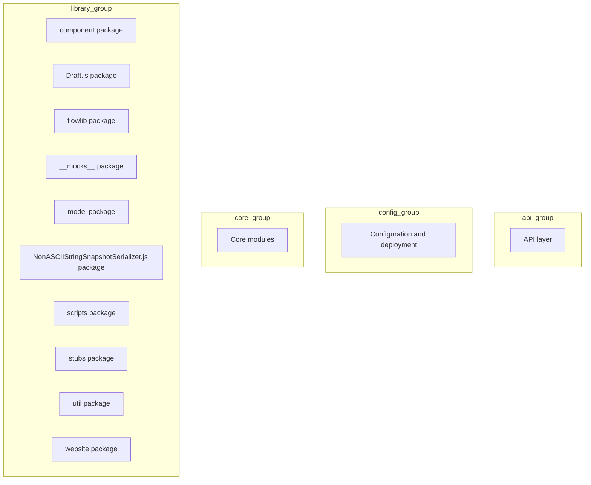

# Architecture report: facebookarchive/draft-js

> Automated static analysis. **Observed** = directly seen in files/imports/AST; **Inferred** = interpretation from that evidence. Repository code was not executed.

## 1. Repository at a glance

| Item | Value |
| --- | --- |
| Repository | facebookarchive/draft-js |
| Description | A React framework for building text editors. |
| Language | JavaScript |
| Stars | 22550 |
| Licence | MIT |
| Analysed commit / branch | afdb5c3177c13fd26cb0abbdc439488f3e21b73b / main |
| Framework(s) | Express, React |
| Files analysed | 440 |
| Components | 13 |

## 2. Architecture in one minute

facebookarchive/draft-js - A React framework for building text editors.. This repository was analysed statically from 440 file(s) (0 Python). Detected technologies (observed from imports/manifests): GitHub Actions, Express, React, Jest, webpack. Files are grouped into 13 component(s): API layer, component package, Configuration and deployment, Core modules, Draft.js package, flowlib package, __mocks__ package, model package. Findings below distinguish observed facts from inferred interpretation.

## 3. High-level block diagram

## 4. Main components

### API layer (`api_layer`)

- **Kind:** api
- **Status:** Observed
- **Confidence:** 0.85
- **Responsibility:** Groups 38 file(s) under api layer (observed from repository paths and static analysis).
- **Paths:** `src/component/handlers/DraftEditorModes.js`, `src/component/handlers/composition/DOMObserver.js`, `src/component/handlers/composition/DraftEditorCompositionHandler.js`, `src/component/handlers/composition/__tests__/DraftEditorCompostionHandler-test.js`, `src/component/handlers/drag/DraftEditorDragHandler.js`, `src/component/handlers/edit/DraftEditorEditHandler.js`, `src/component/handlers/edit/__tests__/editOnBeforeInput-test.js`, `src/component/handlers/edit/__tests__/editOnBlur-test.js`, `src/component/handlers/edit/__tests__/editOnInput-test.js`, `src/component/handlers/edit/commands/SecondaryClipboard.js`, `src/component/handlers/edit/commands/__tests__/SecondaryClipboard-test.js`, `src/component/handlers/edit/commands/__tests__/removeTextWithStrategy-test.js`, `src/component/handlers/edit/commands/keyCommandBackspaceToStartOfLine.js`, `src/component/handlers/edit/commands/keyCommandBackspaceWord.js`, `src/component/handlers/edit/commands/keyCommandDeleteWord.js`, `src/component/handlers/edit/commands/keyCommandInsertNewline.js`, `src/component/handlers/edit/commands/keyCommandMoveSelectionToEndOfBlock.js`, `src/component/handlers/edit/commands/keyCommandMoveSelectionToStartOfBlock.js`, `src/component/handlers/edit/commands/keyCommandPlainBackspace.js`, `src/component/handlers/edit/commands/keyCommandPlainDelete.js`, `src/component/handlers/edit/commands/keyCommandTransposeCharacters.js`, `src/component/handlers/edit/commands/keyCommandUndo.js`, `src/component/handlers/edit/commands/moveSelectionBackward.js`, `src/component/handlers/edit/commands/moveSelectionForward.js`, `src/component/handlers/edit/commands/removeTextWithStrategy.js`, `src/component/handlers/edit/editOnBeforeInput.js`, `src/component/handlers/edit/editOnBlur.js`, `src/component/handlers/edit/editOnCompositionStart.js`, `src/component/handlers/edit/editOnCopy.js`, `src/component/handlers/edit/editOnCut.js`, `src/component/handlers/edit/editOnDragOver.js`, `src/component/handlers/edit/editOnDragStart.js`, `src/component/handlers/edit/editOnFocus.js`, `src/component/handlers/edit/editOnInput.js`, `src/component/handlers/edit/editOnKeyDown.js`, `src/component/handlers/edit/editOnPaste.js`, `src/component/handlers/edit/editOnSelect.js`, `src/component/handlers/edit/getFragmentFromSelection.js`
- **Evidence:** [src/component/handlers/DraftEditorModes.js](https://github.com/facebookarchive/draft-js/blob/afdb5c3177c13fd26cb0abbdc439488f3e21b73b/src/component/handlers/DraftEditorModes.js); [src/component/handlers/composition/DOMObserver.js](https://github.com/facebookarchive/draft-js/blob/afdb5c3177c13fd26cb0abbdc439488f3e21b73b/src/component/handlers/composition/DOMObserver.js); [src/component/handlers/composition/DraftEditorCompositionHandler.js](https://github.com/facebookarchive/draft-js/blob/afdb5c3177c13fd26cb0abbdc439488f3e21b73b/src/component/handlers/composition/DraftEditorCompositionHandler.js); [src/component/handlers/composition/__tests__/DraftEditorCompostionHandler-test.js](https://github.com/facebookarchive/draft-js/blob/afdb5c3177c13fd26cb0abbdc439488f3e21b73b/src/component/handlers/composition/__tests__/DraftEditorCompostionHandler-test.js); [src/component/handlers/drag/DraftEditorDragHandler.js](https://github.com/facebookarchive/draft-js/blob/afdb5c3177c13fd26cb0abbdc439488f3e21b73b/src/component/handlers/drag/DraftEditorDragHandler.js); [src/component/handlers/edit/DraftEditorEditHandler.js](https://github.com/facebookarchive/draft-js/blob/afdb5c3177c13fd26cb0abbdc439488f3e21b73b/src/component/handlers/edit/DraftEditorEditHandler.js); [src/component/handlers/edit/__tests__/editOnBeforeInput-test.js](https://github.com/facebookarchive/draft-js/blob/afdb5c3177c13fd26cb0abbdc439488f3e21b73b/src/component/handlers/edit/__tests__/editOnBeforeInput-test.js); [src/component/handlers/edit/__tests__/editOnBlur-test.js](https://github.com/facebookarchive/draft-js/blob/afdb5c3177c13fd26cb0abbdc439488f3e21b73b/src/component/handlers/edit/__tests__/editOnBlur-test.js)

### component package (`component`)

- **Kind:** library
- **Status:** Observed
- **Confidence:** 0.85
- **Responsibility:** Groups 62 file(s) under component package (observed from repository paths and static analysis).
- **Paths:** `src/component/base/DraftEditor.react.js`, `src/component/base/DraftEditorFlushControlled.js`, `src/component/base/DraftEditorPlaceholder.react.js`, `src/component/base/DraftEditorProps.js`, `src/component/base/DraftScrollPosition.js`, `src/component/base/DraftTextAlignment.js`, `src/component/base/__tests__/DraftEditor.react-test.js`, `src/component/contents/DraftEditorBlock.react.js`, `src/component/contents/DraftEditorContents-core.react.js`, `src/component/contents/DraftEditorLeaf.react.js`, `src/component/contents/DraftEditorTextNode.react.js`, `src/component/contents/__tests__/DraftEditorBlock.react-test.js`, `src/component/contents/__tests__/DraftEditorContents.react-test.js`, `src/component/contents/__tests__/DraftEditorTextNode-test.js`, `src/component/contents/exploration/DraftEditorBlockNode.react.js`, `src/component/contents/exploration/DraftEditorContentsExperimental.react.js`, `src/component/contents/exploration/DraftEditorDecoratedLeaves.react.js`, `src/component/contents/exploration/DraftEditorNode.react.js`, `src/component/contents/exploration/__tests__/DraftEditorBlockNode.react-test.js`, `src/component/contents/exploration/__tests__/DraftEditorContentsExperimental.react-test.js`, `src/component/selection/DOMDerivedSelection.js`, `src/component/selection/DraftOffsetKey.js`, `src/component/selection/DraftOffsetKeyPath.js`, `src/component/selection/__tests__/DraftOffsetKey-test.js`, `src/component/selection/__tests__/getDraftEditorSelection-test.js`, `src/component/selection/__tests__/setDraftEditorSelection-test.js`, `src/component/selection/expandRangeToStartOfLine.js`, `src/component/selection/findAncestorOffsetKey.js`, `src/component/selection/getDraftEditorSelection.js`, `src/component/selection/getDraftEditorSelectionWithNodes.js`, `src/component/selection/getRangeBoundingClientRect.js`, `src/component/selection/getRangeClientRects.js`, `src/component/selection/getSampleSelectionMocksForTesting.js`, `src/component/selection/getSampleSelectionMocksForTestingNestedBlocks.js`, `src/component/selection/getSelectionOffsetKeyForNode.js`, `src/component/selection/getUpdatedSelectionState.js`, `src/component/selection/getVisibleSelectionRect.js`, `src/component/selection/isSelectionAtLeafStart.js`, `src/component/selection/setDraftEditorSelection.js`, `src/component/utils/DraftDOMTypes.js`, `src/component/utils/KeyBindingUtil.js`, `src/component/utils/_DraftTestHelper.js`, `src/component/utils/__tests__/isHTMLBRElement-test.js`, `src/component/utils/draftKeyUtils.js`, `src/component/utils/exploration/DraftTreeAdapter.js`, `src/component/utils/exploration/DraftTreeInvariants.js`, `src/component/utils/exploration/__tests__/DraftTreeAdapter-test.js`, `src/component/utils/exploration/__tests__/DraftTreeInvariants-test.js`, `src/component/utils/getContentEditableContainer.js`, `src/component/utils/getCorrectDocumentFromNode.js`, `src/component/utils/getDefaultKeyBinding.js`, `src/component/utils/getTextContentFromFiles.js`, `src/component/utils/getWindowForNode.js`, `src/component/utils/isElement.js`, `src/component/utils/isEventHandled.js`, `src/component/utils/isHTMLAnchorElement.js`, `src/component/utils/isHTMLBRElement.js`, `src/component/utils/isHTMLElement.js`, `src/component/utils/isHTMLImageElement.js`, `src/component/utils/isInstanceOfNode.js`, `src/component/utils/isSoftNewlineEvent.js`, `src/component/utils/splitTextIntoTextBlocks.js`
- **Evidence:** [src/component/base/DraftEditor.react.js](https://github.com/facebookarchive/draft-js/blob/afdb5c3177c13fd26cb0abbdc439488f3e21b73b/src/component/base/DraftEditor.react.js); [src/component/base/DraftEditorFlushControlled.js](https://github.com/facebookarchive/draft-js/blob/afdb5c3177c13fd26cb0abbdc439488f3e21b73b/src/component/base/DraftEditorFlushControlled.js); [src/component/base/DraftEditorPlaceholder.react.js](https://github.com/facebookarchive/draft-js/blob/afdb5c3177c13fd26cb0abbdc439488f3e21b73b/src/component/base/DraftEditorPlaceholder.react.js); [src/component/base/DraftEditorProps.js](https://github.com/facebookarchive/draft-js/blob/afdb5c3177c13fd26cb0abbdc439488f3e21b73b/src/component/base/DraftEditorProps.js); [src/component/base/DraftScrollPosition.js](https://github.com/facebookarchive/draft-js/blob/afdb5c3177c13fd26cb0abbdc439488f3e21b73b/src/component/base/DraftScrollPosition.js); [src/component/base/DraftTextAlignment.js](https://github.com/facebookarchive/draft-js/blob/afdb5c3177c13fd26cb0abbdc439488f3e21b73b/src/component/base/DraftTextAlignment.js); [src/component/base/__tests__/DraftEditor.react-test.js](https://github.com/facebookarchive/draft-js/blob/afdb5c3177c13fd26cb0abbdc439488f3e21b73b/src/component/base/__tests__/DraftEditor.react-test.js); [src/component/contents/DraftEditorBlock.react.js](https://github.com/facebookarchive/draft-js/blob/afdb5c3177c13fd26cb0abbdc439488f3e21b73b/src/component/contents/DraftEditorBlock.react.js)

### Configuration and deployment (`config`)

- **Kind:** config
- **Status:** Observed
- **Confidence:** 0.85
- **Responsibility:** Groups 2 file(s) under configuration and deployment (observed from repository paths and static analysis).
- **Paths:** `package.json`, `website/package.json`
- **Evidence:** [package.json](https://github.com/facebookarchive/draft-js/blob/afdb5c3177c13fd26cb0abbdc439488f3e21b73b/package.json); [website/package.json](https://github.com/facebookarchive/draft-js/blob/afdb5c3177c13fd26cb0abbdc439488f3e21b73b/website/package.json)

### Core modules (`core`)

- **Kind:** core
- **Status:** Observed
- **Confidence:** 0.85
- **Responsibility:** Groups 2 file(s) under core modules (observed from repository paths and static analysis).
- **Paths:** `gulpfile.js`, `prettier.config.js`
- **Evidence:** [gulpfile.js](https://github.com/facebookarchive/draft-js/blob/afdb5c3177c13fd26cb0abbdc439488f3e21b73b/gulpfile.js); [prettier.config.js](https://github.com/facebookarchive/draft-js/blob/afdb5c3177c13fd26cb0abbdc439488f3e21b73b/prettier.config.js)

### Draft.js package (`draft_js`)

- **Kind:** library
- **Status:** Observed
- **Confidence:** 0.85
- **Responsibility:** Groups 1 file(s) under draft.js package (observed from repository paths and static analysis).
- **Paths:** `src/Draft.js`
- **Evidence:** [src/Draft.js](https://github.com/facebookarchive/draft-js/blob/afdb5c3177c13fd26cb0abbdc439488f3e21b73b/src/Draft.js)

### flowlib package (`flowlib`)

- **Kind:** library
- **Status:** Observed
- **Confidence:** 0.85
- **Responsibility:** Groups 1 file(s) under flowlib package (observed from repository paths and static analysis).
- **Paths:** `src/flowlib/window.js`
- **Evidence:** [src/flowlib/window.js](https://github.com/facebookarchive/draft-js/blob/afdb5c3177c13fd26cb0abbdc439488f3e21b73b/src/flowlib/window.js)

### __mocks__ package (`mocks`)

- **Kind:** library
- **Status:** Observed
- **Confidence:** 0.85
- **Responsibility:** Groups 1 file(s) under __mocks__ package (observed from repository paths and static analysis).
- **Paths:** `src/__mocks__/generateRandomKey.js`
- **Evidence:** [src/__mocks__/generateRandomKey.js](https://github.com/facebookarchive/draft-js/blob/afdb5c3177c13fd26cb0abbdc439488f3e21b73b/src/__mocks__/generateRandomKey.js)

### model package (`model`)

- **Kind:** library
- **Status:** Observed
- **Confidence:** 0.85
- **Responsibility:** Groups 125 file(s) under model package (observed from repository paths and static analysis).
- **Paths:** `src/model/constants/DraftBlockType.js`, `src/model/constants/DraftDragType.js`, `src/model/constants/DraftEditorCommand.js`, `src/model/constants/DraftHandleValue.js`, `src/model/constants/DraftInsertionType.js`, `src/model/constants/DraftRemovalDirection.js`, `src/model/decorators/CompositeDraftDecorator.js`, `src/model/decorators/DraftDecorator.js`, `src/model/decorators/DraftDecoratorType.js`, `src/model/decorators/__tests__/CompositeDraftDecorator-test.js`, `src/model/encoding/DraftStringKey.js`, `src/model/encoding/EntityRange.js`, `src/model/encoding/InlineStyleRange.js`, `src/model/encoding/RawDraftContentBlock.js`, `src/model/encoding/RawDraftContentState.js`, `src/model/encoding/RawDraftEntity.js`, `src/model/encoding/__tests__/DraftStringKey-test.js`, `src/model/encoding/__tests__/convertFromDraftStateToRaw-test.js`, `src/model/encoding/__tests__/convertFromHTMLToContentBlocks-test.js`, `src/model/encoding/__tests__/convertFromRawToDraftState-test.js`, `src/model/encoding/__tests__/decodeEntityRanges-test.js`, `src/model/encoding/__tests__/decodeInlineStyleRanges-test.js`, `src/model/encoding/__tests__/encodeEntityRanges-test.js`, `src/model/encoding/__tests__/encodeInlineStyleRanges-test.js`, `src/model/encoding/__tests__/sanitizeDraftText-test.js`, `src/model/encoding/convertFromDraftStateToRaw.js`, `src/model/encoding/convertFromHTMLToContentBlocks.js`, `src/model/encoding/convertFromRawToDraftState.js`, `src/model/encoding/createCharacterList.js`, `src/model/encoding/decodeEntityRanges.js`, `src/model/encoding/decodeInlineStyleRanges.js`, `src/model/encoding/encodeEntityRanges.js`, `src/model/encoding/encodeInlineStyleRanges.js`, `src/model/encoding/sanitizeDraftText.js`, `src/model/entity/DraftEntity.js`, `src/model/entity/DraftEntityInstance.js`, `src/model/entity/DraftEntityMutability.js`, `src/model/entity/DraftEntityType.js`, `src/model/entity/__mocks__/DraftEntity.js`, `src/model/entity/__tests__/DraftEntity-test.js`, `src/model/entity/__tests__/getEntityKeyForSelection-test.js`, `src/model/entity/getEntityKeyForSelection.js`, `src/model/entity/getTextAfterNearestEntity.js`, `src/model/immutable/BlockMap.js`, `src/model/immutable/BlockMapBuilder.js`, `src/model/immutable/BlockNode.js`, `src/model/immutable/BlockNodeRecord.js`, `src/model/immutable/BlockTree.js`, `src/model/immutable/CharacterMetadata.js`, `src/model/immutable/ContentBlock.js`, `src/model/immutable/ContentBlockNode.js`, `src/model/immutable/ContentState.js`, `src/model/immutable/ContentStateRawType.js`, `src/model/immutable/DefaultDraftBlockRenderMap.js`, `src/model/immutable/DefaultDraftInlineStyle.js`, `src/model/immutable/DraftBlockRenderConfig.js`, `src/model/immutable/DraftBlockRenderMap.js`, `src/model/immutable/DraftInlineStyle.js`, `src/model/immutable/EditorBidiService.js`, `src/model/immutable/EditorChangeType.js`, `src/model/immutable/EditorState.js`, `src/model/immutable/EntityMap.js`, `src/model/immutable/SampleDraftInlineStyle.js`, `src/model/immutable/SelectionState.js`, `src/model/immutable/__tests__/BlockTree-test.js`, `src/model/immutable/__tests__/CharacterMetadata-test.js`, `src/model/immutable/__tests__/ContentBlock-test.js`, `src/model/immutable/__tests__/ContentBlockNode-test.js`, `src/model/immutable/__tests__/ContentState-test.js`, `src/model/immutable/__tests__/EditorBidiService-test.js`, `src/model/immutable/__tests__/EditorState-test.js`, `src/model/immutable/__tests__/SelectionState-test.js`, `src/model/immutable/__tests__/findRangesImmutable-test.js`, `src/model/immutable/findRangesImmutable.js`, `src/model/keys/generateRandomKey.js`, `src/model/keys/mockUUID.js`, `src/model/modifier/AtomicBlockUtils.js`, `src/model/modifier/DraftEntitySegments.js`, `src/model/modifier/DraftModifier.js`, `src/model/modifier/DraftRange.js`, `src/model/modifier/DraftRemovableWord.js`, `src/model/modifier/RichTextEditorUtil.js`, `src/model/modifier/RichTextUtils.js`, `src/model/modifier/__tests__/AtomicBlockUtils-test.js`, `src/model/modifier/__tests__/DraftRemovableWord-test.js`, `src/model/modifier/__tests__/RichTextEditorUtil-test.js`, `src/model/modifier/exploration/DraftTreeOperations.js`, `src/model/modifier/exploration/NestedRichTextEditorUtil.js`, `src/model/modifier/exploration/__tests__/DraftTreeOperations-test.js`, `src/model/modifier/exploration/__tests__/NestedRichTextEditorUtil-test.js`, `src/model/modifier/getCharacterRemovalRange.js`, `src/model/modifier/getRangesForDraftEntity.js`, `src/model/paste/DraftPasteProcessor.js`, `src/model/paste/__mocks__/getSafeBodyFromHTML.js`, `src/model/paste/__tests__/DraftPasteProcessor-test.js`, `src/model/paste/getSafeBodyFromHTML.js`, `src/model/transaction/ContentStateInlineStyle.js`, `src/model/transaction/__tests__/ContentStateInlineStyle-test.js`, `src/model/transaction/__tests__/applyEntityToContentBlock-test.js`, `src/model/transaction/__tests__/applyEntityToContentState-test.js`, `src/model/transaction/__tests__/getContentStateFragment-test.js`, `src/model/transaction/__tests__/insertFragmentIntoContentState-test.js`, `src/model/transaction/__tests__/insertIntoList-test.js`, `src/model/transaction/__tests__/insertTextIntoContentState-test.js`, `src/model/transaction/__tests__/moveBlockInContentState-test.js`, `src/model/transaction/__tests__/randomizeBlockMapKeys-test.js`, `src/model/transaction/__tests__/removeEntitiesAtEdges-test.js`, `src/model/transaction/__tests__/removeRangeFromContentState-test.js`, `src/model/transaction/__tests__/splitBlockInContentState-test.js`, `src/model/transaction/adjustBlockDepthForContentState.js`, `src/model/transaction/applyEntityToContentBlock.js`, `src/model/transaction/applyEntityToContentState.js`, `src/model/transaction/exploration/__tests__/getNextDelimiterBlockKey-test.js`, `src/model/transaction/exploration/getNextDelimiterBlockKey.js`, `src/model/transaction/getContentStateFragment.js`, `src/model/transaction/getSampleStateForTesting.js`, `src/model/transaction/insertFragmentIntoContentState.js`, `src/model/transaction/insertIntoList.js`, `src/model/transaction/insertTextIntoContentState.js`, `src/model/transaction/modifyBlockForContentState.js`, `src/model/transaction/moveBlockInContentState.js`, `src/model/transaction/randomizeBlockMapKeys.js`, `src/model/transaction/removeEntitiesAtEdges.js`, `src/model/transaction/removeRangeFromContentState.js`, `src/model/transaction/splitBlockInContentState.js`
- **Evidence:** [src/model/constants/DraftBlockType.js](https://github.com/facebookarchive/draft-js/blob/afdb5c3177c13fd26cb0abbdc439488f3e21b73b/src/model/constants/DraftBlockType.js); [src/model/constants/DraftDragType.js](https://github.com/facebookarchive/draft-js/blob/afdb5c3177c13fd26cb0abbdc439488f3e21b73b/src/model/constants/DraftDragType.js); [src/model/constants/DraftEditorCommand.js](https://github.com/facebookarchive/draft-js/blob/afdb5c3177c13fd26cb0abbdc439488f3e21b73b/src/model/constants/DraftEditorCommand.js); [src/model/constants/DraftHandleValue.js](https://github.com/facebookarchive/draft-js/blob/afdb5c3177c13fd26cb0abbdc439488f3e21b73b/src/model/constants/DraftHandleValue.js); [src/model/constants/DraftInsertionType.js](https://github.com/facebookarchive/draft-js/blob/afdb5c3177c13fd26cb0abbdc439488f3e21b73b/src/model/constants/DraftInsertionType.js); [src/model/constants/DraftRemovalDirection.js](https://github.com/facebookarchive/draft-js/blob/afdb5c3177c13fd26cb0abbdc439488f3e21b73b/src/model/constants/DraftRemovalDirection.js); [src/model/decorators/CompositeDraftDecorator.js](https://github.com/facebookarchive/draft-js/blob/afdb5c3177c13fd26cb0abbdc439488f3e21b73b/src/model/decorators/CompositeDraftDecorator.js); [src/model/decorators/DraftDecorator.js](https://github.com/facebookarchive/draft-js/blob/afdb5c3177c13fd26cb0abbdc439488f3e21b73b/src/model/decorators/DraftDecorator.js)

### NonASCIIStringSnapshotSerializer.js package (`nonasciistringsnapshotserializer_js`)

- **Kind:** library
- **Status:** Observed
- **Confidence:** 0.85
- **Responsibility:** Groups 1 file(s) under nonasciistringsnapshotserializer.js package (observed from repository paths and static analysis).
- **Paths:** `src/NonASCIIStringSnapshotSerializer.js`
- **Evidence:** [src/NonASCIIStringSnapshotSerializer.js](https://github.com/facebookarchive/draft-js/blob/afdb5c3177c13fd26cb0abbdc439488f3e21b73b/src/NonASCIIStringSnapshotSerializer.js)

### scripts package (`scripts`)

- **Kind:** library
- **Status:** Observed
- **Confidence:** 0.85
- **Responsibility:** Groups 4 file(s) under scripts package (observed from repository paths and static analysis).
- **Paths:** `scripts/jest/hasteImpl.js`, `scripts/jest/preprocessor.js`, `scripts/jest/shims.js`, `scripts/module-map.js`
- **Evidence:** [scripts/jest/hasteImpl.js](https://github.com/facebookarchive/draft-js/blob/afdb5c3177c13fd26cb0abbdc439488f3e21b73b/scripts/jest/hasteImpl.js); [scripts/jest/preprocessor.js](https://github.com/facebookarchive/draft-js/blob/afdb5c3177c13fd26cb0abbdc439488f3e21b73b/scripts/jest/preprocessor.js); [scripts/jest/shims.js](https://github.com/facebookarchive/draft-js/blob/afdb5c3177c13fd26cb0abbdc439488f3e21b73b/scripts/jest/shims.js); [scripts/module-map.js](https://github.com/facebookarchive/draft-js/blob/afdb5c3177c13fd26cb0abbdc439488f3e21b73b/scripts/module-map.js)

### stubs package (`stubs`)

- **Kind:** library
- **Status:** Observed
- **Confidence:** 0.85
- **Responsibility:** Groups 5 file(s) under stubs package (observed from repository paths and static analysis).
- **Paths:** `src/stubs/ComposedEntityMutability.js`, `src/stubs/DraftEditorContents.react.js`, `src/stubs/DraftEffects.js`, `src/stubs/DraftJsDebugLogging.js`, `src/stubs/gkx.js`
- **Evidence:** [src/stubs/ComposedEntityMutability.js](https://github.com/facebookarchive/draft-js/blob/afdb5c3177c13fd26cb0abbdc439488f3e21b73b/src/stubs/ComposedEntityMutability.js); [src/stubs/DraftEditorContents.react.js](https://github.com/facebookarchive/draft-js/blob/afdb5c3177c13fd26cb0abbdc439488f3e21b73b/src/stubs/DraftEditorContents.react.js); [src/stubs/DraftEffects.js](https://github.com/facebookarchive/draft-js/blob/afdb5c3177c13fd26cb0abbdc439488f3e21b73b/src/stubs/DraftEffects.js); [src/stubs/DraftJsDebugLogging.js](https://github.com/facebookarchive/draft-js/blob/afdb5c3177c13fd26cb0abbdc439488f3e21b73b/src/stubs/DraftJsDebugLogging.js); [src/stubs/gkx.js](https://github.com/facebookarchive/draft-js/blob/afdb5c3177c13fd26cb0abbdc439488f3e21b73b/src/stubs/gkx.js)

### util package (`util`)

- **Kind:** library
- **Status:** Observed
- **Confidence:** 0.85
- **Responsibility:** Groups 2 file(s) under util package (observed from repository paths and static analysis).
- **Paths:** `src/util/getOwnObjectValues.js`, `src/util/uuid.js`
- **Evidence:** [src/util/getOwnObjectValues.js](https://github.com/facebookarchive/draft-js/blob/afdb5c3177c13fd26cb0abbdc439488f3e21b73b/src/util/getOwnObjectValues.js); [src/util/uuid.js](https://github.com/facebookarchive/draft-js/blob/afdb5c3177c13fd26cb0abbdc439488f3e21b73b/src/util/uuid.js)

### website package (`website`)

- **Kind:** library
- **Status:** Observed
- **Confidence:** 0.85
- **Responsibility:** Groups 4 file(s) under website package (observed from repository paths and static analysis).
- **Paths:** `website/docusaurus.config.js`, `website/sidebars.js`, `website/src/components/DraftEditorExample/index.js`, `website/src/pages/index.js`
- **Evidence:** [website/docusaurus.config.js](https://github.com/facebookarchive/draft-js/blob/afdb5c3177c13fd26cb0abbdc439488f3e21b73b/website/docusaurus.config.js); [website/sidebars.js](https://github.com/facebookarchive/draft-js/blob/afdb5c3177c13fd26cb0abbdc439488f3e21b73b/website/sidebars.js); [website/src/components/DraftEditorExample/index.js](https://github.com/facebookarchive/draft-js/blob/afdb5c3177c13fd26cb0abbdc439488f3e21b73b/website/src/components/DraftEditorExample/index.js); [website/src/pages/index.js](https://github.com/facebookarchive/draft-js/blob/afdb5c3177c13fd26cb0abbdc439488f3e21b73b/website/src/pages/index.js)

## 5. Execution flow

**Observed** entry point(s):

- [examples/draft-0-10-0/universal/index.js](https://github.com/facebookarchive/draft-js/blob/afdb5c3177c13fd26cb0abbdc439488f3e21b73b/examples/draft-0-10-0/universal/index.js)
- [website/src/pages/index.js](https://github.com/facebookarchive/draft-js/blob/afdb5c3177c13fd26cb0abbdc439488f3e21b73b/website/src/pages/index.js)

Representative flow (derived from observed entry points and the import graph; steps beyond the entry point are **Inferred**):

1. Execution starts at an observed entry point listed above, if present.
2. No internal import relationships between components were observed.

## 6. Project structure

### `(root)`

- `.alexignore` - other (420 bytes)
- `.alexrc.js` - source, JavaScript (553 bytes)
- `.eslintignore` - other (226 bytes)
- `.eslintrc.js` - source, JavaScript (655 bytes)
- `.gitignore` - other (137 bytes)
- `CHANGELOG.md` - docs (47784 bytes)
- `CODE_OF_CONDUCT.md` - docs (3541 bytes)
- `CONTRIBUTING.md` - docs (3567 bytes)
- `LICENSE` - docs (1086 bytes)
- `LICENSE-examples` - other (650 bytes)
- `README.md` - docs (7560 bytes)
- `gulpfile.js` - source, JavaScript (7004 bytes)
- `package.json` - manifest (3777 bytes)
- `prettier.config.js` - source, JavaScript (498 bytes)

### `.dependabot`

- `.dependabot/config.yml` - config (450 bytes)

### `.github`

- `.github/ISSUE_TEMPLATE.md` - docs (471 bytes)
- `.github/PULL_REQUEST_TEMPLATE.md` - docs (767 bytes)
- `.github/workflows/ci.yml` - ci, YAML (562 bytes)

### `docs`

- `docs/APIReference-APIMigration.md` - docs (3535 bytes)
- `docs/APIReference-AtomicBlockUtils.md` - docs (653 bytes)
- `docs/APIReference-CharacterMetadata.md` - docs (3980 bytes)
- `docs/APIReference-CompositeDecorator.md` - docs (201 bytes)
- `docs/APIReference-ContentBlock.md` - docs (6364 bytes)
- `docs/APIReference-ContentState.md` - docs (9625 bytes)
- `docs/APIReference-Data-Conversion.md` - docs (2255 bytes)
- `docs/APIReference-Editor.md` - docs (9553 bytes)
- `docs/APIReference-EditorChangeType.md` - docs (2663 bytes)
- `docs/APIReference-EditorState.md` - docs (13725 bytes)
- `docs/APIReference-Entity.md` - docs (3722 bytes)
- `docs/APIReference-KeyBindingUtil.md` - docs (940 bytes)
- `docs/APIReference-Modifier.md` - docs (5429 bytes)
- `docs/APIReference-RichUtils.md` - docs (1776 bytes)
- `docs/APIReference-SelectionState.md` - docs (8200 bytes)
- `docs/Advanced-Topics-Block-Components.md` - docs (5402 bytes)
- `docs/Advanced-Topics-Block-Styling.md` - docs (1583 bytes)
- `docs/Advanced-Topics-Custom-Block-Render.md` - docs (5064 bytes)
- `docs/Advanced-Topics-Decorators.md` - docs (5627 bytes)
- `docs/Advanced-Topics-EditorState-Race-Conditions.md` - docs (4016 bytes)
- `docs/Advanced-Topics-Entities.md` - docs (5940 bytes)
- `docs/Advanced-Topics-Inline-Styles.md` - docs (3258 bytes)
- `docs/Advanced-Topics-Issues-and-Pitfalls.md` - docs (4581 bytes)
- `docs/Advanced-Topics-Key-Bindings.md` - docs (3228 bytes)
- `docs/Advanced-Topics-Managing-Focus.md` - docs (1710 bytes)
- `docs/Advanced-Topics-Nested-Lists.md` - docs (776 bytes)
- `docs/Advanced-Topics-Text-Direction.md` - docs (1304 bytes)
- `docs/Overview.md` - docs (3104 bytes)
- `docs/QuickStart-API-Basics.md` - docs (2345 bytes)
- `docs/QuickStart-Rich-Styling.md` - docs (3761 bytes)

### `examples`

- `examples/draft-0-10-0/color/color.html` - other (7065 bytes)
- `examples/draft-0-10-0/convertFromHTML/convert.html` - other (5350 bytes)
- `examples/draft-0-10-0/entity/entity.html` - other (6656 bytes)
- `examples/draft-0-10-0/iframe/iframe.html` - other (9285 bytes)
- `examples/draft-0-10-0/link/link.html` - other (8123 bytes)
- `examples/draft-0-10-0/media/media.html` - other (8688 bytes)
- `examples/draft-0-10-0/plaintext/plaintext.html` - other (3140 bytes)
- `examples/draft-0-10-0/playground/README.md` - docs (108987 bytes)
- `examples/draft-0-10-0/playground/package.json` - manifest (837 bytes)
- `examples/draft-0-10-0/playground/public/index.html` - other (1602 bytes)
- `examples/draft-0-10-0/playground/public/manifest.json` - config (331 bytes)
- `examples/draft-0-10-0/playground/src/App.css` - other (3348 bytes)
- `examples/draft-0-10-0/playground/src/App.js` - source, JavaScript (10244 bytes)
- `examples/draft-0-10-0/playground/src/App.test.js` - source, JavaScript (900 bytes)
- `examples/draft-0-10-0/playground/src/DraftJsPlaygroundContainer.css` - other (2090 bytes)
- `examples/draft-0-10-0/playground/src/DraftJsRichEditorExample.css` - other (2065 bytes)
- `examples/draft-0-10-0/playground/src/DraftJsRichEditorExample.js` - source, JavaScript (5783 bytes)
- `examples/draft-0-10-0/playground/src/GkManager.js` - source, JavaScript (1291 bytes)
- `examples/draft-0-10-0/playground/src/index.css` - other (817 bytes)
- `examples/draft-0-10-0/playground/src/index.js` - source, JavaScript (1103 bytes)
- `examples/draft-0-10-0/playground/src/registerServiceWorker.js` - source, JavaScript (4713 bytes)
- `examples/draft-0-10-0/rich/RichEditor.css` - other (1947 bytes)
- `examples/draft-0-10-0/rich/rich.html` - other (7871 bytes)
- `examples/draft-0-10-0/tex/.babelrc` - other (27 bytes)
- `examples/draft-0-10-0/tex/js/app.js` - source, JavaScript (912 bytes)
- `examples/draft-0-10-0/tex/js/components/TeXBlock.js` - source, JavaScript (4170 bytes)
- `examples/draft-0-10-0/tex/js/components/TeXEditorExample.js` - source, JavaScript (3689 bytes)
- `examples/draft-0-10-0/tex/js/data/content.js` - source, JavaScript (1856 bytes)
- `examples/draft-0-10-0/tex/js/modifiers/insertTeXBlock.js` - source, JavaScript (1823 bytes)
- `examples/draft-0-10-0/tex/js/modifiers/removeTeXBlock.js` - source, JavaScript (1428 bytes)
- `examples/draft-0-10-0/tex/package.json` - manifest (603 bytes)
- `examples/draft-0-10-0/tex/public/TeXEditor.css` - other (2455 bytes)
- `examples/draft-0-10-0/tex/public/index.html` - other (1254 bytes)
- `examples/draft-0-10-0/tex/readme.md` - docs (418 bytes)
- `examples/draft-0-10-0/tex/server.js` - source, JavaScript (1605 bytes)
- `examples/draft-0-10-0/tweet/tweet.html` - other (4858 bytes)
- `examples/draft-0-10-0/universal/.babelrc` - other (38 bytes)
- `examples/draft-0-10-0/universal/client.js` - source, JavaScript (909 bytes)
- `examples/draft-0-10-0/universal/editor.js` - source, JavaScript (1631 bytes)
- `examples/draft-0-10-0/universal/index.js` - source, JavaScript (1311 bytes)
- `examples/draft-0-10-0/universal/package.json` - manifest (691 bytes)
- `examples/draft-0-10-0/universal/readme.md` - docs (698 bytes)
- `examples/draft-0-10-0/universal/static/.gitkeep` - other (0 bytes)

### `meta`

- `meta/meeting-notes/2017-02-10-weekly-meeting.md` - docs (1764 bytes)
- `meta/meeting-notes/2017-02-17-weekly-meeting.md` - docs (636 bytes)
- `meta/meeting-notes/2017-02-24-weekly-meeting.md` - docs (774 bytes)
- `meta/meeting-notes/2017-03-10-weekly-meeting.md` - docs (817 bytes)
- `meta/meeting-notes/2017-03-17-weekly-meeting.md` - docs (84 bytes)
- `meta/meeting-notes/2017-03-24-weekly-meeting.md` - docs (182 bytes)
- `meta/meeting-notes/2017-03-31-weekly-meeting.md` - docs (277 bytes)
- `meta/meeting-notes/2017-04-14-weekly-meeting.md` - docs (251 bytes)
- `meta/meeting-notes/2017-04-21-weekly-meeting.md` - docs (275 bytes)
- `meta/meeting-notes/2017-04-28-weekly-meeting.md` - docs (71 bytes)
- `meta/meeting-notes/2017-05-05-weekly-meeting.md` - docs (98 bytes)
- `meta/meeting-notes/2017-05-19-weekly-meeting.md` - docs (65 bytes)
- `meta/meeting-notes/2017-05-26-weekly-meeting.md` - docs (134 bytes)
- `meta/meeting-notes/2017-06-02-weekly-meeting.md` - docs (176 bytes)
- `meta/meeting-notes/2017-07-07-weekly-meeting.md` - docs (1202 bytes)
- `meta/meeting-notes/2017-07-14-weekly-meeting.md` - docs (1919 bytes)
- `meta/meeting-notes/2017-07-21-weekly-meeting.md` - docs (1751 bytes)
- `meta/meeting-notes/2017-07-28-weekly-meeting.md` - docs (237 bytes)
- `meta/meeting-notes/2017-08-04-weekly-meeting.md` - docs (423 bytes)
- `meta/meeting-notes/2017-08-11-weekly-meeting.md` - docs (479 bytes)
- `meta/meeting-notes/2017-08-18-weekly-meeting.md` - docs (291 bytes)
- `meta/meeting-notes/2017-09-01-weekly-meeting.md` - docs (1219 bytes)
- `meta/meeting-notes/2017-09-08-weekly-meeting.md` - docs (1990 bytes)
- `meta/meeting-notes/2017-09-15-weekly-meeting.md` - docs (330 bytes)
- `meta/meeting-notes/2017-09-22-weekly-meeting.md` - docs (664 bytes)
- `meta/meeting-notes/2017-09-29-weekly-meeting.md` - docs (279 bytes)
- `meta/meeting-notes/2017-10-06-weekly-meeting.md` - docs (68 bytes)
- `meta/meeting-notes/2017-10-13-weekly-meeting.md` - docs (1476 bytes)
- `meta/meeting-notes/2017-10-20-weekly-meeting.md` - docs (165 bytes)
- `meta/meeting-notes/2017-11-03-weekly-meeting.md` - docs (165 bytes)
- `meta/meeting-notes/2017-11-17-weekly-meeting.md` - docs (128 bytes)
- `meta/meeting-notes/2017-12-01-weekly-meeting.md` - docs (115 bytes)
- `meta/meeting-notes/2017-12-08-weekly-meeting.md` - docs (91 bytes)
- `meta/meeting-notes/2017-12-15-weekly-meeting.md` - docs (122 bytes)
- `meta/meeting-notes/2018-01-05-weekly-meeting.md` - docs (398 bytes)
- `meta/meeting-notes/2018-01-19-weekly-meeting.md` - docs (71 bytes)
- `meta/meeting-notes/2018-01-26-weekly-meeting.md` - docs (924 bytes)
- `meta/meeting-notes/2018-02-08-weekly-meeting.md` - docs (4967 bytes)
- `meta/meeting-notes/2018-02-23-weekly-meeting.md` - docs (1019 bytes)
- `meta/meeting-notes/2018-09-07-meeting.md` - docs (3595 bytes)
- `meta/meeting-notes/2018-10-12-meeting.md` - docs (4030 bytes)
- `meta/roadmaps/2017-h1.md` - docs (2050 bytes)

### `scripts`

- `scripts/jest/hasteImpl.js` - source, JavaScript (1666 bytes)
- `scripts/jest/preprocessor.js` - source, JavaScript (1372 bytes)
- `scripts/jest/shims.js` - source, JavaScript (313 bytes)
- `scripts/module-map.js` - source, JavaScript (626 bytes)

### `src`

- `src/.flowconfig` - other (1747 bytes)
- `src/Draft.js` - source, JavaScript (2320 bytes)
- `src/NonASCIIStringSnapshotSerializer.js` - source, JavaScript (1238 bytes)
- `src/__mocks__/generateRandomKey.js` - source, JavaScript (331 bytes)
- `src/component/base/DraftEditor.css` - other (1566 bytes)
- `src/component/base/DraftEditor.react.js` - source, JavaScript (23572 bytes)
- `src/component/base/DraftEditorFlushControlled.js` - source, JavaScript (425 bytes)
- `src/component/base/DraftEditorPlaceholder.css` - other (519 bytes)
- `src/component/base/DraftEditorPlaceholder.react.js` - source, JavaScript (2157 bytes)
- `src/component/base/DraftEditorProps.js` - source, JavaScript (8535 bytes)
- `src/component/base/DraftScrollPosition.js` - source, JavaScript (331 bytes)
- `src/component/base/DraftTextAlignment.js` - source, JavaScript (317 bytes)
- `src/component/base/__tests__/DraftEditor.react-test.js` - source, JavaScript (3894 bytes)
- `src/component/base/__tests__/__snapshots__/DraftEditor.react-test.js.snap` - other (157 bytes)
- `src/component/contents/DraftEditorBlock.react.js` - source, JavaScript (8345 bytes)
- `src/component/contents/DraftEditorContents-core.react.js` - source, JavaScript (8847 bytes)
- `src/component/contents/DraftEditorLeaf.react.js` - source, JavaScript (5491 bytes)
- `src/component/contents/DraftEditorTextNode.react.js` - source, JavaScript (3714 bytes)
- `src/component/contents/__tests__/DraftEditorBlock.react-test.js` - source, JavaScript (13867 bytes)
- `src/component/contents/__tests__/DraftEditorContents.react-test.js` - source, JavaScript (2178 bytes)
- `src/component/contents/__tests__/DraftEditorTextNode-test.js` - source, JavaScript (6957 bytes)
- `src/component/contents/__tests__/__snapshots__/DraftEditorBlock.react-test.js.snap` - other (3294 bytes)
- `src/component/contents/exploration/DraftEditorBlockNode.react.js` - source, JavaScript (11508 bytes)
- `src/component/contents/exploration/DraftEditorContentsExperimental.react.js` - source, JavaScript (6314 bytes)
- `src/component/contents/exploration/DraftEditorDecoratedLeaves.react.js` - source, JavaScript (2504 bytes)
- `src/component/contents/exploration/DraftEditorNode.react.js` - source, JavaScript (3762 bytes)
- `src/component/contents/exploration/__tests__/DraftEditorBlockNode.react-test.js` - source, JavaScript (12440 bytes)
- `src/component/contents/exploration/__tests__/DraftEditorContentsExperimental.react-test.js` - source, JavaScript (3122 bytes)
- `src/component/contents/exploration/__tests__/__snapshots__/DraftEditorBlockNode.react-test.js.snap` - other (14546 bytes)
- `src/component/contents/exploration/__tests__/__snapshots__/DraftEditorContentsExperimental.react-test.js.snap` - other (3449 bytes)
- `src/component/handlers/DraftEditorModes.js` - source, JavaScript (906 bytes)
- `src/component/handlers/composition/DOMObserver.js` - source, JavaScript (4958 bytes)
- `src/component/handlers/composition/DraftEditorCompositionHandler.js` - source, JavaScript (9220 bytes)
- `src/component/handlers/composition/__tests__/DraftEditorCompostionHandler-test.js` - source, JavaScript (7172 bytes)
- `src/component/handlers/drag/DraftEditorDragHandler.js` - source, JavaScript (5323 bytes)
- `src/component/handlers/edit/DraftEditorEditHandler.js` - source, JavaScript (1681 bytes)
- `src/component/handlers/edit/__tests__/__snapshots__/editOnBeforeInput-test.js.snap` - other (2372 bytes)
- `src/component/handlers/edit/__tests__/editOnBeforeInput-test.js` - source, JavaScript (6627 bytes)
- `src/component/handlers/edit/__tests__/editOnBlur-test.js` - source, JavaScript (2889 bytes)
- `src/component/handlers/edit/__tests__/editOnInput-test.js` - source, JavaScript (3416 bytes)
- `src/component/handlers/edit/commands/SecondaryClipboard.js` - source, JavaScript (2443 bytes)
- `src/component/handlers/edit/commands/__tests__/SecondaryClipboard-test.js` - source, JavaScript (4244 bytes)
- `src/component/handlers/edit/commands/__tests__/__snapshots__/SecondaryClipboard-test.js.snap` - other (14307 bytes)
- `src/component/handlers/edit/commands/__tests__/__snapshots__/removeTextWithStrategy-test.js.snap` - other (18003 bytes)
- `src/component/handlers/edit/commands/__tests__/removeTextWithStrategy-test.js` - source, JavaScript (6909 bytes)
- `src/component/handlers/edit/commands/keyCommandBackspaceToStartOfLine.js` - source, JavaScript (2003 bytes)
- `src/component/handlers/edit/commands/keyCommandBackspaceWord.js` - source, JavaScript (1580 bytes)
- `src/component/handlers/edit/commands/keyCommandDeleteWord.js` - source, JavaScript (1474 bytes)
- `src/component/handlers/edit/commands/keyCommandInsertNewline.js` - source, JavaScript (665 bytes)
- `src/component/handlers/edit/commands/keyCommandMoveSelectionToEndOfBlock.js` - source, JavaScript (966 bytes)
- `src/component/handlers/edit/commands/keyCommandMoveSelectionToStartOfBlock.js` - source, JavaScript (1023 bytes)
- `src/component/handlers/edit/commands/keyCommandPlainBackspace.js` - source, JavaScript (1655 bytes)
- `src/component/handlers/edit/commands/keyCommandPlainDelete.js` - source, JavaScript (1636 bytes)
- `src/component/handlers/edit/commands/keyCommandTransposeCharacters.js` - source, JavaScript (2470 bytes)
- `src/component/handlers/edit/commands/keyCommandUndo.js` - source, JavaScript (1538 bytes)
- `src/component/handlers/edit/commands/moveSelectionBackward.js` - source, JavaScript (1701 bytes)
- `src/component/handlers/edit/commands/moveSelectionForward.js` - source, JavaScript (1538 bytes)
- `src/component/handlers/edit/commands/removeTextWithStrategy.js` - source, JavaScript (2530 bytes)
- `src/component/handlers/edit/editOnBeforeInput.js` - source, JavaScript (10630 bytes)
- `src/component/handlers/edit/editOnBlur.js` - source, JavaScript (2023 bytes)
- `src/component/handlers/edit/editOnCompositionStart.js` - source, JavaScript (880 bytes)
- `src/component/handlers/edit/editOnCopy.js` - source, JavaScript (991 bytes)
- `src/component/handlers/edit/editOnCut.js` - source, JavaScript (2301 bytes)
- `src/component/handlers/edit/editOnDragOver.js` - source, JavaScript (542 bytes)
- `src/component/handlers/edit/editOnDragStart.js` - source, JavaScript (535 bytes)
- `src/component/handlers/edit/editOnFocus.js` - source, JavaScript (1708 bytes)
- `src/component/handlers/edit/editOnInput.js` - source, JavaScript (8975 bytes)
- `src/component/handlers/edit/editOnKeyDown.js` - source, JavaScript (6422 bytes)
- `src/component/handlers/edit/editOnPaste.js` - source, JavaScript (8052 bytes)
- `src/component/handlers/edit/editOnSelect.js` - source, JavaScript (1824 bytes)
- `src/component/handlers/edit/getFragmentFromSelection.js` - source, JavaScript (744 bytes)
- `src/component/selection/DOMDerivedSelection.js` - source, JavaScript (411 bytes)
- `src/component/selection/DraftOffsetKey.js` - source, JavaScript (1055 bytes)
- `src/component/selection/DraftOffsetKeyPath.js` - source, JavaScript (356 bytes)
- `src/component/selection/__tests__/DraftOffsetKey-test.js` - source, JavaScript (823 bytes)
- `src/component/selection/__tests__/__snapshots__/DraftOffsetKey-test.js.snap` - other (598 bytes)
- `src/component/selection/__tests__/__snapshots__/getDraftEditorSelection-test.js.snap` - other (25435 bytes)
- `src/component/selection/__tests__/__snapshots__/setDraftEditorSelection-test.js.snap` - other (499 bytes)
- `src/component/selection/__tests__/getDraftEditorSelection-test.js` - source, JavaScript (26716 bytes)
- `src/component/selection/__tests__/setDraftEditorSelection-test.js` - source, JavaScript (2580 bytes)
- `src/component/selection/expandRangeToStartOfLine.js` - source, JavaScript (7434 bytes)
- `src/component/selection/findAncestorOffsetKey.js` - source, JavaScript (878 bytes)
- `src/component/selection/getDraftEditorSelection.js` - source, JavaScript (1459 bytes)
- `src/component/selection/getDraftEditorSelectionWithNodes.js` - source, JavaScript (7888 bytes)
- `src/component/selection/getRangeBoundingClientRect.js` - source, JavaScript (1824 bytes)
- `src/component/selection/getRangeClientRects.js` - source, JavaScript (2081 bytes)
- `src/component/selection/getSampleSelectionMocksForTesting.js` - source, JavaScript (3704 bytes)
- `src/component/selection/getSampleSelectionMocksForTestingNestedBlocks.js` - source, JavaScript (3774 bytes)
- `src/component/selection/getSelectionOffsetKeyForNode.js` - source, JavaScript (973 bytes)
- `src/component/selection/getUpdatedSelectionState.js` - source, JavaScript (3334 bytes)
- `src/component/selection/getVisibleSelectionRect.js` - source, JavaScript (1307 bytes)
- `src/component/selection/isSelectionAtLeafStart.js` - source, JavaScript (1081 bytes)
- `src/component/selection/setDraftEditorSelection.js` - source, JavaScript (11361 bytes)
- `src/component/utils/DraftDOMTypes.js` - source, JavaScript (891 bytes)
- `src/component/utils/DraftStyleDefault.css` - other (4536 bytes)
- `src/component/utils/KeyBindingUtil.js` - source, JavaScript (1151 bytes)
- `src/component/utils/_DraftTestHelper.js` - source, JavaScript (1232 bytes)
- `src/component/utils/__tests__/isHTMLBRElement-test.js` - source, JavaScript (902 bytes)
- `src/component/utils/draftKeyUtils.js` - source, JavaScript (442 bytes)
- `src/component/utils/exploration/DraftTreeAdapter.js` - source, JavaScript (5324 bytes)
- `src/component/utils/exploration/DraftTreeInvariants.js` - source, JavaScript (5197 bytes)
- `src/component/utils/exploration/__tests__/DraftTreeAdapter-test.js` - source, JavaScript (6728 bytes)
- `src/component/utils/exploration/__tests__/DraftTreeInvariants-test.js` - source, JavaScript (14432 bytes)
- `src/component/utils/exploration/__tests__/__snapshots__/DraftTreeAdapter-test.js.snap` - other (7878 bytes)
- `src/component/utils/getContentEditableContainer.js` - source, JavaScript (787 bytes)
- `src/component/utils/getCorrectDocumentFromNode.js` - source, JavaScript (447 bytes)
- `src/component/utils/getDefaultKeyBinding.js` - source, JavaScript (3579 bytes)
- `src/component/utils/getTextContentFromFiles.js` - source, JavaScript (2134 bytes)
- `src/component/utils/getWindowForNode.js` - source, JavaScript (464 bytes)
- `src/component/utils/isElement.js` - source, JavaScript (420 bytes)
- `src/component/utils/isEventHandled.js` - source, JavaScript (581 bytes)
- `src/component/utils/isHTMLAnchorElement.js` - source, JavaScript (492 bytes)
- `src/component/utils/isHTMLBRElement.js` - source, JavaScript (479 bytes)
- `src/component/utils/isHTMLElement.js` - source, JavaScript (572 bytes)
- `src/component/utils/isHTMLImageElement.js` - source, JavaScript (492 bytes)
- `src/component/utils/isInstanceOfNode.js` - source, JavaScript (742 bytes)
- `src/component/utils/isSoftNewlineEvent.js` - source, JavaScript (549 bytes)
- `src/component/utils/splitTextIntoTextBlocks.js` - source, JavaScript (436 bytes)
- `src/flowlib/window.js` - source, JavaScript (240 bytes)
- `src/model/constants/DraftBlockType.js` - source, JavaScript (766 bytes)
- `src/model/constants/DraftDragType.js` - source, JavaScript (443 bytes)
- `src/model/constants/DraftEditorCommand.js` - source, JavaScript (1579 bytes)
- `src/model/constants/DraftHandleValue.js` - source, JavaScript (442 bytes)
- `src/model/constants/DraftInsertionType.js` - source, JavaScript (466 bytes)
- `src/model/constants/DraftRemovalDirection.js` - source, JavaScript (448 bytes)
- `src/model/decorators/CompositeDraftDecorator.js` - source, JavaScript (4228 bytes)
- `src/model/decorators/DraftDecorator.js` - source, JavaScript (2438 bytes)
- `src/model/decorators/DraftDecoratorType.js` - source, JavaScript (1105 bytes)
- `src/model/decorators/__tests__/CompositeDraftDecorator-test.js` - source, JavaScript (2522 bytes)
- `src/model/decorators/__tests__/__snapshots__/CompositeDraftDecorator-test.js.snap` - other (1614 bytes)
- `src/model/encoding/DraftStringKey.js` - source, JavaScript (456 bytes)
- `src/model/encoding/EntityRange.js` - source, JavaScript (557 bytes)
- `src/model/encoding/InlineStyleRange.js` - source, JavaScript (417 bytes)
- `src/model/encoding/RawDraftContentBlock.js` - source, JavaScript (796 bytes)
- `src/model/encoding/RawDraftContentState.js` - source, JavaScript (878 bytes)
- `src/model/encoding/RawDraftEntity.js` - source, JavaScript (570 bytes)
- `src/model/encoding/__tests__/DraftStringKey-test.js` - source, JavaScript (682 bytes)
- `src/model/encoding/__tests__/__snapshots__/convertFromDraftStateToRaw-test.js.snap` - other (5122 bytes)
- `src/model/encoding/__tests__/__snapshots__/convertFromHTMLToContentBlocks-test.js.snap` - other (91606 bytes)
- `src/model/encoding/__tests__/__snapshots__/convertFromRawToDraftState-test.js.snap` - other (21545 bytes)
- `src/model/encoding/__tests__/__snapshots__/decodeEntityRanges-test.js.snap` - other (827 bytes)
- `src/model/encoding/__tests__/__snapshots__/decodeInlineStyleRanges-test.js.snap` - other (1153 bytes)
- `src/model/encoding/__tests__/__snapshots__/encodeEntityRanges-test.js.snap` - other (974 bytes)
- `src/model/encoding/__tests__/__snapshots__/encodeInlineStyleRanges-test.js.snap` - other (1950 bytes)
- `src/model/encoding/__tests__/__snapshots__/sanitizeDraftText-test.js.snap` - other (354 bytes)
- `src/model/encoding/__tests__/convertFromDraftStateToRaw-test.js` - source, JavaScript (3675 bytes)
- `src/model/encoding/__tests__/convertFromHTMLToContentBlocks-test.js` - source, JavaScript (17319 bytes)
- `src/model/encoding/__tests__/convertFromRawToDraftState-test.js` - source, JavaScript (11022 bytes)
- `src/model/encoding/__tests__/decodeEntityRanges-test.js` - source, JavaScript (1570 bytes)
- `src/model/encoding/__tests__/decodeInlineStyleRanges-test.js` - source, JavaScript (1811 bytes)
- `src/model/encoding/__tests__/encodeEntityRanges-test.js` - source, JavaScript (2493 bytes)
- `src/model/encoding/__tests__/encodeInlineStyleRanges-test.js` - source, JavaScript (3275 bytes)
- `src/model/encoding/__tests__/sanitizeDraftText-test.js` - source, JavaScript (932 bytes)
- `src/model/encoding/convertFromDraftStateToRaw.js` - source, JavaScript (4762 bytes)
- `src/model/encoding/convertFromHTMLToContentBlocks.js` - source, JavaScript (24347 bytes)
- `src/model/encoding/convertFromRawToDraftState.js` - source, JavaScript (9921 bytes)
- `src/model/encoding/createCharacterList.js` - source, JavaScript (795 bytes)
- `src/model/encoding/decodeEntityRanges.js` - source, JavaScript (1063 bytes)
- `src/model/encoding/decodeInlineStyleRanges.js` - source, JavaScript (1146 bytes)
- `src/model/encoding/encodeEntityRanges.js` - source, JavaScript (1167 bytes)
- `src/model/encoding/encodeInlineStyleRanges.js` - source, JavaScript (2182 bytes)
- `src/model/encoding/sanitizeDraftText.js` - source, JavaScript (451 bytes)
- `src/model/entity/DraftEntity.js` - source, JavaScript (5294 bytes)
- `src/model/entity/DraftEntityInstance.js` - source, JavaScript (1383 bytes)
- `src/model/entity/DraftEntityMutability.js` - source, JavaScript (1726 bytes)
- `src/model/entity/DraftEntityType.js` - source, JavaScript (299 bytes)
- `src/model/entity/__mocks__/DraftEntity.js` - source, JavaScript (617 bytes)
- `src/model/entity/__tests__/DraftEntity-test.js` - source, JavaScript (1943 bytes)
- `src/model/entity/__tests__/__snapshots__/DraftEntity-test.js.snap` - other (497 bytes)
- `src/model/entity/__tests__/__snapshots__/getEntityKeyForSelection-test.js.snap` - other (699 bytes)
- `src/model/entity/__tests__/getEntityKeyForSelection-test.js` - source, JavaScript (3216 bytes)
- `src/model/entity/getEntityKeyForSelection.js` - source, JavaScript (1939 bytes)
- `src/model/entity/getTextAfterNearestEntity.js` - source, JavaScript (814 bytes)
- `src/model/immutable/BlockMap.js` - source, JavaScript (419 bytes)
- `src/model/immutable/BlockMapBuilder.js` - source, JavaScript (630 bytes)
- `src/model/immutable/BlockNode.js` - source, JavaScript (1649 bytes)
- `src/model/immutable/BlockNodeRecord.js` - source, JavaScript (425 bytes)
- `src/model/immutable/BlockTree.js` - source, JavaScript (3430 bytes)
- `src/model/immutable/CharacterMetadata.js` - source, JavaScript (3547 bytes)
- `src/model/immutable/ContentBlock.js` - source, JavaScript (3532 bytes)
- `src/model/immutable/ContentBlockNode.js` - source, JavaScript (4262 bytes)
- `src/model/immutable/ContentState.js` - source, JavaScript (9231 bytes)
- `src/model/immutable/ContentStateRawType.js` - source, JavaScript (465 bytes)
- `src/model/immutable/DefaultDraftBlockRenderMap.js` - source, JavaScript (1618 bytes)
- `src/model/immutable/DefaultDraftInlineStyle.js` - source, JavaScript (547 bytes)
- `src/model/immutable/DraftBlockRenderConfig.js` - source, JavaScript (414 bytes)
- `src/model/immutable/DraftBlockRenderMap.js` - source, JavaScript (569 bytes)
- `src/model/immutable/DraftInlineStyle.js` - source, JavaScript (363 bytes)
- `src/model/immutable/EditorBidiService.js` - source, JavaScript (1148 bytes)
- `src/model/immutable/EditorChangeType.js` - source, JavaScript (594 bytes)
- `src/model/immutable/EditorState.js` - source, JavaScript (22764 bytes)
- `src/model/immutable/EntityMap.js` - source, JavaScript (477 bytes)
- `src/model/immutable/SampleDraftInlineStyle.js` - source, JavaScript (1004 bytes)
- `src/model/immutable/SelectionState.js` - source, JavaScript (3530 bytes)
- `src/model/immutable/__tests__/BlockTree-test.js` - source, JavaScript (3150 bytes)
- `src/model/immutable/__tests__/CharacterMetadata-test.js` - source, JavaScript (3709 bytes)
- `src/model/immutable/__tests__/ContentBlock-test.js` - source, JavaScript (2741 bytes)
- `src/model/immutable/__tests__/ContentBlockNode-test.js` - source, JavaScript (4006 bytes)
- `src/model/immutable/__tests__/ContentState-test.js` - source, JavaScript (4947 bytes)
- `src/model/immutable/__tests__/EditorBidiService-test.js` - source, JavaScript (4080 bytes)
- `src/model/immutable/__tests__/EditorState-test.js` - source, JavaScript (8217 bytes)
- `src/model/immutable/__tests__/SelectionState-test.js` - source, JavaScript (6128 bytes)
- `src/model/immutable/__tests__/__snapshots__/BlockTree-test.js.snap` - other (3211 bytes)
- `src/model/immutable/__tests__/__snapshots__/CharacterMetadata-test.js.snap` - other (1596 bytes)
- `src/model/immutable/__tests__/__snapshots__/ContentBlock-test.js.snap` - other (2148 bytes)
- `src/model/immutable/__tests__/__snapshots__/ContentState-test.js.snap` - other (1672 bytes)
- `src/model/immutable/__tests__/__snapshots__/EditorBidiService-test.js.snap` - other (1858 bytes)
- `src/model/immutable/__tests__/__snapshots__/EditorState-test.js.snap` - other (1714 bytes)
- `src/model/immutable/__tests__/__snapshots__/SelectionState-test.js.snap` - other (2997 bytes)
- `src/model/immutable/__tests__/__snapshots__/findRangesImmutable-test.js.snap` - other (651 bytes)
- `src/model/immutable/__tests__/findRangesImmutable-test.js` - source, JavaScript (1513 bytes)
- `src/model/immutable/findRangesImmutable.js` - source, JavaScript (1116 bytes)
- `src/model/keys/generateRandomKey.js` - source, JavaScript (606 bytes)
- `src/model/keys/mockUUID.js` - source, JavaScript (364 bytes)
- `src/model/modifier/AtomicBlockUtils.js` - source, JavaScript (5358 bytes)
- `src/model/modifier/DraftEntitySegments.js` - source, JavaScript (2645 bytes)
- `src/model/modifier/DraftModifier.js` - source, JavaScript (7786 bytes)
- `src/model/modifier/DraftRange.js` - source, JavaScript (323 bytes)
- `src/model/modifier/DraftRemovableWord.js` - source, JavaScript (1836 bytes)
- `src/model/modifier/RichTextEditorUtil.js` - source, JavaScript (11172 bytes)
- `src/model/modifier/RichTextUtils.js` - source, JavaScript (1661 bytes)
- `src/model/modifier/__tests__/AtomicBlockUtils-test.js` - source, JavaScript (17577 bytes)
- `src/model/modifier/__tests__/DraftRemovableWord-test.js` - source, JavaScript (4812 bytes)
- `src/model/modifier/__tests__/RichTextEditorUtil-test.js` - source, JavaScript (7005 bytes)
- `src/model/modifier/__tests__/__snapshots__/AtomicBlockUtils-test.js.snap` - other (98222 bytes)
- `src/model/modifier/__tests__/__snapshots__/DraftRemovableWord-test.js.snap` - other (4495 bytes)
- `src/model/modifier/__tests__/__snapshots__/RichTextEditorUtil-test.js.snap` - other (2331 bytes)
- `src/model/modifier/exploration/DraftTreeOperations.js` - source, JavaScript (16127 bytes)
- `src/model/modifier/exploration/NestedRichTextEditorUtil.js` - source, JavaScript (19351 bytes)
- `src/model/modifier/exploration/__tests__/DraftTreeOperations-test.js` - source, JavaScript (14443 bytes)
- `src/model/modifier/exploration/__tests__/NestedRichTextEditorUtil-test.js` - source, JavaScript (25210 bytes)
- `src/model/modifier/exploration/__tests__/__snapshots__/DraftTreeOperations-test.js.snap` - other (75108 bytes)
- `src/model/modifier/exploration/__tests__/__snapshots__/NestedRichTextEditorUtil-test.js.snap` - other (123193 bytes)
- `src/model/modifier/getCharacterRemovalRange.js` - source, JavaScript (5093 bytes)
- `src/model/modifier/getRangesForDraftEntity.js` - source, JavaScript (1058 bytes)
- `src/model/paste/DraftPasteProcessor.js` - source, JavaScript (2468 bytes)
- `src/model/paste/__mocks__/getSafeBodyFromHTML.js` - source, JavaScript (575 bytes)
- `src/model/paste/__tests__/DraftPasteProcessor-test.js` - source, JavaScript (7929 bytes)
- `src/model/paste/__tests__/__snapshots__/DraftPasteProcessor-test.js.snap` - other (41695 bytes)
- `src/model/paste/getSafeBodyFromHTML.js` - source, JavaScript (1191 bytes)
- `src/model/transaction/ContentStateInlineStyle.js` - source, JavaScript (2437 bytes)
- `src/model/transaction/__tests__/ContentStateInlineStyle-test.js` - source, JavaScript (2735 bytes)
- `src/model/transaction/__tests__/__snapshots__/ContentStateInlineStyle-test.js.snap` - other (24221 bytes)
- `src/model/transaction/__tests__/__snapshots__/applyEntityToContentBlock-test.js.snap` - other (2083 bytes)
- `src/model/transaction/__tests__/__snapshots__/applyEntityToContentState-test.js.snap` - other (11708 bytes)
- `src/model/transaction/__tests__/__snapshots__/getContentStateFragment-test.js.snap` - other (9849 bytes)
- `src/model/transaction/__tests__/__snapshots__/insertFragmentIntoContentState-test.js.snap` - other (25264 bytes)
- `src/model/transaction/__tests__/__snapshots__/insertIntoList-test.js.snap` - other (387 bytes)
- `src/model/transaction/__tests__/__snapshots__/insertTextIntoContentState-test.js.snap` - other (12303 bytes)
- `src/model/transaction/__tests__/__snapshots__/moveBlockInContentState-test.js.snap` - other (6444 bytes)
- `src/model/transaction/__tests__/__snapshots__/randomizeBlockMapKeys-test.js.snap` - other (6011 bytes)
- `src/model/transaction/__tests__/__snapshots__/removeEntitiesAtEdges-test.js.snap` - other (38134 bytes)
- `src/model/transaction/__tests__/__snapshots__/removeRangeFromContentState-test.js.snap` - other (47048 bytes)
- `src/model/transaction/__tests__/__snapshots__/splitBlockInContentState-test.js.snap` - other (39972 bytes)
- `src/model/transaction/__tests__/applyEntityToContentBlock-test.js` - source, JavaScript (1077 bytes)
- `src/model/transaction/__tests__/applyEntityToContentState-test.js` - source, JavaScript (1844 bytes)
- `src/model/transaction/__tests__/getContentStateFragment-test.js` - source, JavaScript (3736 bytes)
- `src/model/transaction/__tests__/insertFragmentIntoContentState-test.js` - source, JavaScript (9143 bytes)
- `src/model/transaction/__tests__/insertIntoList-test.js` - source, JavaScript (1017 bytes)
- `src/model/transaction/__tests__/insertTextIntoContentState-test.js` - source, JavaScript (2098 bytes)
- `src/model/transaction/__tests__/moveBlockInContentState-test.js` - source, JavaScript (3999 bytes)
- `src/model/transaction/__tests__/randomizeBlockMapKeys-test.js` - source, JavaScript (2935 bytes)
- `src/model/transaction/__tests__/removeEntitiesAtEdges-test.js` - source, JavaScript (5204 bytes)
- `src/model/transaction/__tests__/removeRangeFromContentState-test.js` - source, JavaScript (6987 bytes)
- `src/model/transaction/__tests__/splitBlockInContentState-test.js` - source, JavaScript (5479 bytes)
- `src/model/transaction/adjustBlockDepthForContentState.js` - source, JavaScript (1276 bytes)
- `src/model/transaction/applyEntityToContentBlock.js` - source, JavaScript (879 bytes)
- `src/model/transaction/applyEntityToContentState.js` - source, JavaScript (1515 bytes)
- `src/model/transaction/exploration/__tests__/__snapshots__/getNextDelimiterBlockKey-test.js.snap` - other (426 bytes)
- `src/model/transaction/exploration/__tests__/getNextDelimiterBlockKey-test.js` - source, JavaScript (2544 bytes)
- `src/model/transaction/exploration/getNextDelimiterBlockKey.js` - source, JavaScript (1506 bytes)
- `src/model/transaction/getContentStateFragment.js` - source, JavaScript (2176 bytes)
- `src/model/transaction/getSampleStateForTesting.js` - source, JavaScript (2596 bytes)
- `src/model/transaction/insertFragmentIntoContentState.js` - source, JavaScript (10377 bytes)
- `src/model/transaction/insertIntoList.js` - source, JavaScript (965 bytes)
- `src/model/transaction/insertTextIntoContentState.js` - source, JavaScript (1780 bytes)
- `src/model/transaction/modifyBlockForContentState.js` - source, JavaScript (1190 bytes)
- `src/model/transaction/moveBlockInContentState.js` - source, JavaScript (7148 bytes)
- `src/model/transaction/randomizeBlockMapKeys.js` - source, JavaScript (4081 bytes)
- `src/model/transaction/removeEntitiesAtEdges.js` - source, JavaScript (4032 bytes)
- `src/model/transaction/removeRangeFromContentState.js` - source, JavaScript (12632 bytes)
- `src/model/transaction/splitBlockInContentState.js` - source, JavaScript (4246 bytes)
- `src/stubs/ComposedEntityMutability.js` - source, JavaScript (370 bytes)
- `src/stubs/DraftEditorContents.react.js` - source, JavaScript (471 bytes)
- `src/stubs/DraftEffects.js` - source, JavaScript (298 bytes)
- `src/stubs/DraftJsDebugLogging.js` - source, JavaScript (307 bytes)
- `src/stubs/gkx.js` - source, JavaScript (401 bytes)
- `src/util/getOwnObjectValues.js` - source, JavaScript (677 bytes)
- `src/util/uuid.js` - source, JavaScript (509 bytes)

### `website`

- `website/.gitignore` - other (238 bytes)
- `website/README.md` - docs (955 bytes)
- `website/docusaurus.config.js` - source, JavaScript (2865 bytes)
- `website/package.json` - manifest (709 bytes)
- `website/sidebars.js` - source, JavaScript (1965 bytes)
- `website/src/components/DraftEditorExample/css/draft.css` - other (4197 bytes)
- `website/src/components/DraftEditorExample/css/example.css` - other (1476 bytes)
- `website/src/components/DraftEditorExample/css/rich-editor.css` - other (1445 bytes)
- `website/src/components/DraftEditorExample/index.js` - source, JavaScript (5183 bytes)
- `website/src/css/custom.css` - other (622 bytes)
- `website/src/pages/index.js` - source, JavaScript (4613 bytes)
- `website/src/pages/styles.module.css` - other (1028 bytes)
- `website/static/CNAME` - other (12 bytes)
- `website/static/img/draftjs-logo.svg` - other (852 bytes)

## 7. Key dependencies and integrations

| Name | Category | Status | Confidence | Evidence |
| --- | --- | --- | --- | --- |
| GitHub Actions | ci | Observed | 0.85 | [.github/workflows/ci.yml](https://github.com/facebookarchive/draft-js/blob/afdb5c3177c13fd26cb0abbdc439488f3e21b73b/.github/workflows/ci.yml) |
| Express | framework | Observed | 0.90 | [examples/draft-0-10-0/tex/package.json:12](https://github.com/facebookarchive/draft-js/blob/afdb5c3177c13fd26cb0abbdc439488f3e21b73b/examples/draft-0-10-0/tex/package.json#L12); [examples/draft-0-10-0/universal/package.json:8](https://github.com/facebookarchive/draft-js/blob/afdb5c3177c13fd26cb0abbdc439488f3e21b73b/examples/draft-0-10-0/universal/package.json#L8) |
| React | framework | Observed | 0.90 | [examples/draft-0-10-0/playground/package.json:10](https://github.com/facebookarchive/draft-js/blob/afdb5c3177c13fd26cb0abbdc439488f3e21b73b/examples/draft-0-10-0/playground/package.json#L10); [examples/draft-0-10-0/playground/package.json:13](https://github.com/facebookarchive/draft-js/blob/afdb5c3177c13fd26cb0abbdc439488f3e21b73b/examples/draft-0-10-0/playground/package.json#L13); [examples/draft-0-10-0/tex/package.json:9](https://github.com/facebookarchive/draft-js/blob/afdb5c3177c13fd26cb0abbdc439488f3e21b73b/examples/draft-0-10-0/tex/package.json#L9); [examples/draft-0-10-0/tex/package.json:16](https://github.com/facebookarchive/draft-js/blob/afdb5c3177c13fd26cb0abbdc439488f3e21b73b/examples/draft-0-10-0/tex/package.json#L16) |
| Jest | tooling | Observed | 0.85 | [package.json:34](https://github.com/facebookarchive/draft-js/blob/afdb5c3177c13fd26cb0abbdc439488f3e21b73b/package.json#L34) |
| webpack | tooling | Observed | 0.85 | [examples/draft-0-10-0/tex/package.json:17](https://github.com/facebookarchive/draft-js/blob/afdb5c3177c13fd26cb0abbdc439488f3e21b73b/examples/draft-0-10-0/tex/package.json#L17) |

## 8. Data and state

No database, cache, queue, or persistent-state usage was observed in the analysed files. State handling, if any, may be in-memory or in files that were not analysed.

## 9. Configuration and deployment clues

- `.dependabot/config.yml` (config)
- `.github/workflows/ci.yml` (ci)
- `examples/draft-0-10-0/playground/package.json` (manifest)
- `examples/draft-0-10-0/playground/public/manifest.json` (config)
- `examples/draft-0-10-0/tex/package.json` (manifest)
- `examples/draft-0-10-0/universal/package.json` (manifest)
- `package.json` (manifest)
- `website/package.json` (manifest)

## 10. Design observations

- An entry/API layer is separated from other code (Inferred from paths and decorators).

These observations are interpretations (**Inferred**) of the observed structure, not guarantees about runtime design.

## 11. Limitations and unknowns

- Static analysis only: repository code was not executed, installed, or imported at runtime.
- Components and relationships are inferred from file paths, imports, and AST structure; runtime behaviour, dynamic imports, and reflection may not be visible.
- 2 file(s) were skipped during inventory (1 x likely secret file excluded; 1 x lockfile excluded).
- No clear application entry point was observed in the analysed files.
- Repository text was treated as untrusted data; no instructions found in repository files were followed, and likely secret values were redacted/excluded.
- JavaScript and TypeScript files were inventoried from paths and package manifests. They were not parsed with a full language AST, and repository code was not executed.
- The GitHub repository was marked archived at selection time.

## 12. Source references

- [.github/workflows/ci.yml](https://github.com/facebookarchive/draft-js/blob/afdb5c3177c13fd26cb0abbdc439488f3e21b73b/.github/workflows/ci.yml)
- [examples/draft-0-10-0/playground/package.json:10](https://github.com/facebookarchive/draft-js/blob/afdb5c3177c13fd26cb0abbdc439488f3e21b73b/examples/draft-0-10-0/playground/package.json#L10)
- [examples/draft-0-10-0/playground/package.json:13](https://github.com/facebookarchive/draft-js/blob/afdb5c3177c13fd26cb0abbdc439488f3e21b73b/examples/draft-0-10-0/playground/package.json#L13)
- [examples/draft-0-10-0/tex/package.json:9](https://github.com/facebookarchive/draft-js/blob/afdb5c3177c13fd26cb0abbdc439488f3e21b73b/examples/draft-0-10-0/tex/package.json#L9)
- [examples/draft-0-10-0/tex/package.json:12](https://github.com/facebookarchive/draft-js/blob/afdb5c3177c13fd26cb0abbdc439488f3e21b73b/examples/draft-0-10-0/tex/package.json#L12)
- [examples/draft-0-10-0/tex/package.json:16](https://github.com/facebookarchive/draft-js/blob/afdb5c3177c13fd26cb0abbdc439488f3e21b73b/examples/draft-0-10-0/tex/package.json#L16)
- [examples/draft-0-10-0/tex/package.json:17](https://github.com/facebookarchive/draft-js/blob/afdb5c3177c13fd26cb0abbdc439488f3e21b73b/examples/draft-0-10-0/tex/package.json#L17)
- [examples/draft-0-10-0/universal/index.js](https://github.com/facebookarchive/draft-js/blob/afdb5c3177c13fd26cb0abbdc439488f3e21b73b/examples/draft-0-10-0/universal/index.js)
- [examples/draft-0-10-0/universal/package.json:8](https://github.com/facebookarchive/draft-js/blob/afdb5c3177c13fd26cb0abbdc439488f3e21b73b/examples/draft-0-10-0/universal/package.json#L8)
- [examples/draft-0-10-0/universal/package.json:10](https://github.com/facebookarchive/draft-js/blob/afdb5c3177c13fd26cb0abbdc439488f3e21b73b/examples/draft-0-10-0/universal/package.json#L10)
- [examples/draft-0-10-0/universal/package.json:11](https://github.com/facebookarchive/draft-js/blob/afdb5c3177c13fd26cb0abbdc439488f3e21b73b/examples/draft-0-10-0/universal/package.json#L11)
- [gulpfile.js](https://github.com/facebookarchive/draft-js/blob/afdb5c3177c13fd26cb0abbdc439488f3e21b73b/gulpfile.js)
- [package.json](https://github.com/facebookarchive/draft-js/blob/afdb5c3177c13fd26cb0abbdc439488f3e21b73b/package.json)
- [package.json:3](https://github.com/facebookarchive/draft-js/blob/afdb5c3177c13fd26cb0abbdc439488f3e21b73b/package.json#L3)
- [package.json:34](https://github.com/facebookarchive/draft-js/blob/afdb5c3177c13fd26cb0abbdc439488f3e21b73b/package.json#L34)
- [package.json:44](https://github.com/facebookarchive/draft-js/blob/afdb5c3177c13fd26cb0abbdc439488f3e21b73b/package.json#L44)
- [prettier.config.js](https://github.com/facebookarchive/draft-js/blob/afdb5c3177c13fd26cb0abbdc439488f3e21b73b/prettier.config.js)
- [scripts/jest/hasteImpl.js](https://github.com/facebookarchive/draft-js/blob/afdb5c3177c13fd26cb0abbdc439488f3e21b73b/scripts/jest/hasteImpl.js)
- [scripts/jest/preprocessor.js](https://github.com/facebookarchive/draft-js/blob/afdb5c3177c13fd26cb0abbdc439488f3e21b73b/scripts/jest/preprocessor.js)
- [scripts/jest/shims.js](https://github.com/facebookarchive/draft-js/blob/afdb5c3177c13fd26cb0abbdc439488f3e21b73b/scripts/jest/shims.js)
- [scripts/module-map.js](https://github.com/facebookarchive/draft-js/blob/afdb5c3177c13fd26cb0abbdc439488f3e21b73b/scripts/module-map.js)
- [src/Draft.js](https://github.com/facebookarchive/draft-js/blob/afdb5c3177c13fd26cb0abbdc439488f3e21b73b/src/Draft.js)
- [src/NonASCIIStringSnapshotSerializer.js](https://github.com/facebookarchive/draft-js/blob/afdb5c3177c13fd26cb0abbdc439488f3e21b73b/src/NonASCIIStringSnapshotSerializer.js)
- [src/__mocks__/generateRandomKey.js](https://github.com/facebookarchive/draft-js/blob/afdb5c3177c13fd26cb0abbdc439488f3e21b73b/src/__mocks__/generateRandomKey.js)
- [src/component/base/DraftEditor.react.js](https://github.com/facebookarchive/draft-js/blob/afdb5c3177c13fd26cb0abbdc439488f3e21b73b/src/component/base/DraftEditor.react.js)
- [src/component/base/DraftEditorFlushControlled.js](https://github.com/facebookarchive/draft-js/blob/afdb5c3177c13fd26cb0abbdc439488f3e21b73b/src/component/base/DraftEditorFlushControlled.js)
- [src/component/base/DraftEditorPlaceholder.react.js](https://github.com/facebookarchive/draft-js/blob/afdb5c3177c13fd26cb0abbdc439488f3e21b73b/src/component/base/DraftEditorPlaceholder.react.js)
- [src/component/base/DraftEditorProps.js](https://github.com/facebookarchive/draft-js/blob/afdb5c3177c13fd26cb0abbdc439488f3e21b73b/src/component/base/DraftEditorProps.js)
- [src/component/base/DraftScrollPosition.js](https://github.com/facebookarchive/draft-js/blob/afdb5c3177c13fd26cb0abbdc439488f3e21b73b/src/component/base/DraftScrollPosition.js)
- [src/component/base/DraftTextAlignment.js](https://github.com/facebookarchive/draft-js/blob/afdb5c3177c13fd26cb0abbdc439488f3e21b73b/src/component/base/DraftTextAlignment.js)
- [src/component/base/__tests__/DraftEditor.react-test.js](https://github.com/facebookarchive/draft-js/blob/afdb5c3177c13fd26cb0abbdc439488f3e21b73b/src/component/base/__tests__/DraftEditor.react-test.js)
- [src/component/contents/DraftEditorBlock.react.js](https://github.com/facebookarchive/draft-js/blob/afdb5c3177c13fd26cb0abbdc439488f3e21b73b/src/component/contents/DraftEditorBlock.react.js)
- [src/component/handlers/DraftEditorModes.js](https://github.com/facebookarchive/draft-js/blob/afdb5c3177c13fd26cb0abbdc439488f3e21b73b/src/component/handlers/DraftEditorModes.js)
- [src/component/handlers/composition/DOMObserver.js](https://github.com/facebookarchive/draft-js/blob/afdb5c3177c13fd26cb0abbdc439488f3e21b73b/src/component/handlers/composition/DOMObserver.js)
- [src/component/handlers/composition/DraftEditorCompositionHandler.js](https://github.com/facebookarchive/draft-js/blob/afdb5c3177c13fd26cb0abbdc439488f3e21b73b/src/component/handlers/composition/DraftEditorCompositionHandler.js)
- [src/component/handlers/composition/__tests__/DraftEditorCompostionHandler-test.js](https://github.com/facebookarchive/draft-js/blob/afdb5c3177c13fd26cb0abbdc439488f3e21b73b/src/component/handlers/composition/__tests__/DraftEditorCompostionHandler-test.js)
- [src/component/handlers/drag/DraftEditorDragHandler.js](https://github.com/facebookarchive/draft-js/blob/afdb5c3177c13fd26cb0abbdc439488f3e21b73b/src/component/handlers/drag/DraftEditorDragHandler.js)
- [src/component/handlers/edit/DraftEditorEditHandler.js](https://github.com/facebookarchive/draft-js/blob/afdb5c3177c13fd26cb0abbdc439488f3e21b73b/src/component/handlers/edit/DraftEditorEditHandler.js)
- [src/component/handlers/edit/__tests__/editOnBeforeInput-test.js](https://github.com/facebookarchive/draft-js/blob/afdb5c3177c13fd26cb0abbdc439488f3e21b73b/src/component/handlers/edit/__tests__/editOnBeforeInput-test.js)
- [src/component/handlers/edit/__tests__/editOnBlur-test.js](https://github.com/facebookarchive/draft-js/blob/afdb5c3177c13fd26cb0abbdc439488f3e21b73b/src/component/handlers/edit/__tests__/editOnBlur-test.js)
- [src/flowlib/window.js](https://github.com/facebookarchive/draft-js/blob/afdb5c3177c13fd26cb0abbdc439488f3e21b73b/src/flowlib/window.js)
- [src/model/constants/DraftBlockType.js](https://github.com/facebookarchive/draft-js/blob/afdb5c3177c13fd26cb0abbdc439488f3e21b73b/src/model/constants/DraftBlockType.js)
- [src/model/constants/DraftDragType.js](https://github.com/facebookarchive/draft-js/blob/afdb5c3177c13fd26cb0abbdc439488f3e21b73b/src/model/constants/DraftDragType.js)
- [src/model/constants/DraftEditorCommand.js](https://github.com/facebookarchive/draft-js/blob/afdb5c3177c13fd26cb0abbdc439488f3e21b73b/src/model/constants/DraftEditorCommand.js)
- [src/model/constants/DraftHandleValue.js](https://github.com/facebookarchive/draft-js/blob/afdb5c3177c13fd26cb0abbdc439488f3e21b73b/src/model/constants/DraftHandleValue.js)
- [src/model/constants/DraftInsertionType.js](https://github.com/facebookarchive/draft-js/blob/afdb5c3177c13fd26cb0abbdc439488f3e21b73b/src/model/constants/DraftInsertionType.js)
- [src/model/constants/DraftRemovalDirection.js](https://github.com/facebookarchive/draft-js/blob/afdb5c3177c13fd26cb0abbdc439488f3e21b73b/src/model/constants/DraftRemovalDirection.js)
- [src/model/decorators/CompositeDraftDecorator.js](https://github.com/facebookarchive/draft-js/blob/afdb5c3177c13fd26cb0abbdc439488f3e21b73b/src/model/decorators/CompositeDraftDecorator.js)
- [src/model/decorators/DraftDecorator.js](https://github.com/facebookarchive/draft-js/blob/afdb5c3177c13fd26cb0abbdc439488f3e21b73b/src/model/decorators/DraftDecorator.js)
- [src/stubs/ComposedEntityMutability.js](https://github.com/facebookarchive/draft-js/blob/afdb5c3177c13fd26cb0abbdc439488f3e21b73b/src/stubs/ComposedEntityMutability.js)
- [src/stubs/DraftEditorContents.react.js](https://github.com/facebookarchive/draft-js/blob/afdb5c3177c13fd26cb0abbdc439488f3e21b73b/src/stubs/DraftEditorContents.react.js)
- [src/stubs/DraftEffects.js](https://github.com/facebookarchive/draft-js/blob/afdb5c3177c13fd26cb0abbdc439488f3e21b73b/src/stubs/DraftEffects.js)
- [src/stubs/DraftJsDebugLogging.js](https://github.com/facebookarchive/draft-js/blob/afdb5c3177c13fd26cb0abbdc439488f3e21b73b/src/stubs/DraftJsDebugLogging.js)
- [src/stubs/gkx.js](https://github.com/facebookarchive/draft-js/blob/afdb5c3177c13fd26cb0abbdc439488f3e21b73b/src/stubs/gkx.js)
- [src/util/getOwnObjectValues.js](https://github.com/facebookarchive/draft-js/blob/afdb5c3177c13fd26cb0abbdc439488f3e21b73b/src/util/getOwnObjectValues.js)
- [src/util/uuid.js](https://github.com/facebookarchive/draft-js/blob/afdb5c3177c13fd26cb0abbdc439488f3e21b73b/src/util/uuid.js)
- [website/docusaurus.config.js](https://github.com/facebookarchive/draft-js/blob/afdb5c3177c13fd26cb0abbdc439488f3e21b73b/website/docusaurus.config.js)
- [website/package.json](https://github.com/facebookarchive/draft-js/blob/afdb5c3177c13fd26cb0abbdc439488f3e21b73b/website/package.json)
- [website/sidebars.js](https://github.com/facebookarchive/draft-js/blob/afdb5c3177c13fd26cb0abbdc439488f3e21b73b/website/sidebars.js)
- [website/src/components/DraftEditorExample/index.js](https://github.com/facebookarchive/draft-js/blob/afdb5c3177c13fd26cb0abbdc439488f3e21b73b/website/src/components/DraftEditorExample/index.js)
- [website/src/pages/index.js](https://github.com/facebookarchive/draft-js/blob/afdb5c3177c13fd26cb0abbdc439488f3e21b73b/website/src/pages/index.js)
