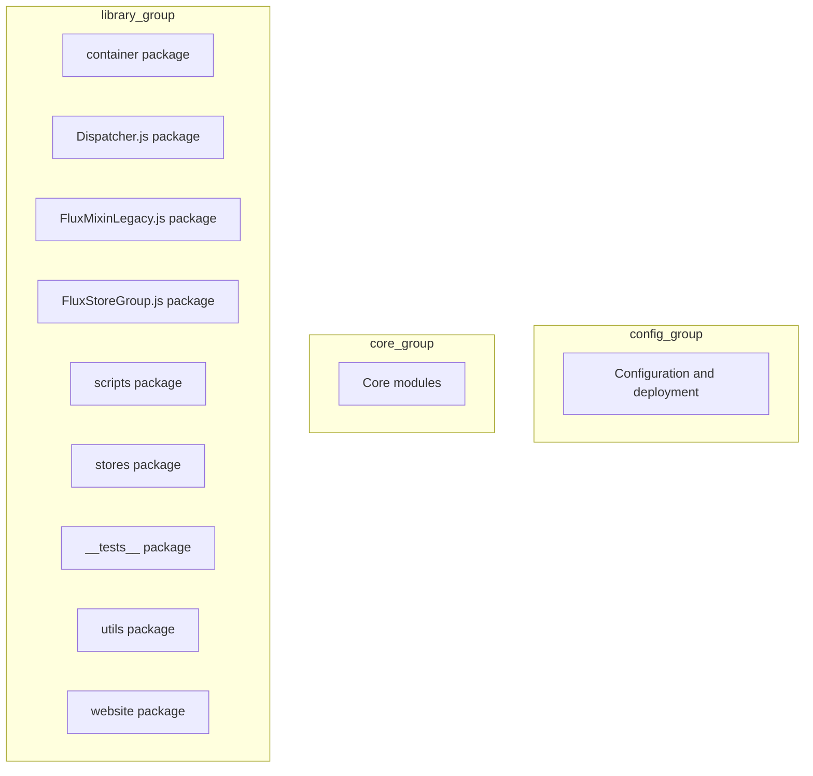

# Architecture report: facebookarchive/flux

> Automated static analysis. **Observed** = directly seen in files/imports/AST; **Inferred** = interpretation from that evidence. Repository code was not executed.

## 1. Repository at a glance

| Item | Value |
| --- | --- |
| Repository | facebookarchive/flux |
| Description | Application Architecture for Building User Interfaces |
| Language | JavaScript |
| Stars | 17435 |
| Licence | Other |
| Analysed commit / branch | 4ee8c50865c357e005cb40ea03cdd403533aad26 / main |
| Framework(s) | Express, React |
| Files analysed | 158 |
| Components | 11 |

## 2. Architecture in one minute

facebookarchive/flux - Application Architecture for Building User Interfaces. This repository was analysed statically from 158 file(s) (0 Python). Detected technologies (observed from imports/manifests): GitHub Actions, Express, React, Jest, webpack. Files are grouped into 11 component(s): Configuration and deployment, container package, Core modules, Dispatcher.js package, FluxMixinLegacy.js package, FluxStoreGroup.js package, scripts package, stores package. Findings below distinguish observed facts from inferred interpretation.

## 3. High-level block diagram

## 4. Main components

### Configuration and deployment (`config`)

- **Kind:** config
- **Status:** Observed
- **Confidence:** 0.85
- **Responsibility:** Groups 3 file(s) under configuration and deployment (observed from repository paths and static analysis).
- **Paths:** `bower.json`, `package.json`, `website/package.json`
- **Evidence:** [bower.json](https://github.com/facebookarchive/flux/blob/4ee8c50865c357e005cb40ea03cdd403533aad26/bower.json); [package.json](https://github.com/facebookarchive/flux/blob/4ee8c50865c357e005cb40ea03cdd403533aad26/package.json); [website/package.json](https://github.com/facebookarchive/flux/blob/4ee8c50865c357e005cb40ea03cdd403533aad26/website/package.json)

### container package (`container`)

- **Kind:** library
- **Status:** Observed
- **Confidence:** 0.85
- **Responsibility:** Groups 3 file(s) under container package (observed from repository paths and static analysis).
- **Paths:** `src/container/FluxContainer.js`, `src/container/FluxContainerSubscriptions.js`, `src/container/__tests__/FluxContainer-test.js`
- **Evidence:** [src/container/FluxContainer.js](https://github.com/facebookarchive/flux/blob/4ee8c50865c357e005cb40ea03cdd403533aad26/src/container/FluxContainer.js); [src/container/FluxContainerSubscriptions.js](https://github.com/facebookarchive/flux/blob/4ee8c50865c357e005cb40ea03cdd403533aad26/src/container/FluxContainerSubscriptions.js); [src/container/__tests__/FluxContainer-test.js](https://github.com/facebookarchive/flux/blob/4ee8c50865c357e005cb40ea03cdd403533aad26/src/container/__tests__/FluxContainer-test.js)

### Core modules (`core`)

- **Kind:** core
- **Status:** Observed
- **Confidence:** 0.85
- **Responsibility:** Groups 4 file(s) under core modules (observed from repository paths and static analysis).
- **Paths:** `Gulpfile.js`, `index.js`, `jest.config.js`, `utils.js`
- **Evidence:** [Gulpfile.js](https://github.com/facebookarchive/flux/blob/4ee8c50865c357e005cb40ea03cdd403533aad26/Gulpfile.js); [index.js](https://github.com/facebookarchive/flux/blob/4ee8c50865c357e005cb40ea03cdd403533aad26/index.js); [jest.config.js](https://github.com/facebookarchive/flux/blob/4ee8c50865c357e005cb40ea03cdd403533aad26/jest.config.js); [utils.js](https://github.com/facebookarchive/flux/blob/4ee8c50865c357e005cb40ea03cdd403533aad26/utils.js)

### Dispatcher.js package (`dispatcher_js`)

- **Kind:** library
- **Status:** Observed
- **Confidence:** 0.85
- **Responsibility:** Groups 1 file(s) under dispatcher.js package (observed from repository paths and static analysis).
- **Paths:** `src/Dispatcher.js`
- **Evidence:** [src/Dispatcher.js](https://github.com/facebookarchive/flux/blob/4ee8c50865c357e005cb40ea03cdd403533aad26/src/Dispatcher.js)

### FluxMixinLegacy.js package (`fluxmixinlegacy_js`)

- **Kind:** library
- **Status:** Observed
- **Confidence:** 0.85
- **Responsibility:** Groups 1 file(s) under fluxmixinlegacy.js package (observed from repository paths and static analysis).
- **Paths:** `src/FluxMixinLegacy.js`
- **Evidence:** [src/FluxMixinLegacy.js](https://github.com/facebookarchive/flux/blob/4ee8c50865c357e005cb40ea03cdd403533aad26/src/FluxMixinLegacy.js)

### FluxStoreGroup.js package (`fluxstoregroup_js`)

- **Kind:** library
- **Status:** Observed
- **Confidence:** 0.85
- **Responsibility:** Groups 1 file(s) under fluxstoregroup.js package (observed from repository paths and static analysis).
- **Paths:** `src/FluxStoreGroup.js`
- **Evidence:** [src/FluxStoreGroup.js](https://github.com/facebookarchive/flux/blob/4ee8c50865c357e005cb40ea03cdd403533aad26/src/FluxStoreGroup.js)

### scripts package (`scripts`)

- **Kind:** library
- **Status:** Observed
- **Confidence:** 0.85
- **Responsibility:** Groups 3 file(s) under scripts package (observed from repository paths and static analysis).
- **Paths:** `scripts/babel/default-options.js`, `scripts/jest/environment.js`, `scripts/jest/preprocessor.js`
- **Evidence:** [scripts/babel/default-options.js](https://github.com/facebookarchive/flux/blob/4ee8c50865c357e005cb40ea03cdd403533aad26/scripts/babel/default-options.js); [scripts/jest/environment.js](https://github.com/facebookarchive/flux/blob/4ee8c50865c357e005cb40ea03cdd403533aad26/scripts/jest/environment.js); [scripts/jest/preprocessor.js](https://github.com/facebookarchive/flux/blob/4ee8c50865c357e005cb40ea03cdd403533aad26/scripts/jest/preprocessor.js)

### stores package (`stores`)

- **Kind:** library
- **Status:** Observed
- **Confidence:** 0.85
- **Responsibility:** Groups 4 file(s) under stores package (observed from repository paths and static analysis).
- **Paths:** `src/stores/FluxReduceStore.js`, `src/stores/FluxStore.js`, `src/stores/__tests__/FluxReduceStore-test.js`, `src/stores/__tests__/FluxStore-test.js`
- **Evidence:** [src/stores/FluxReduceStore.js](https://github.com/facebookarchive/flux/blob/4ee8c50865c357e005cb40ea03cdd403533aad26/src/stores/FluxReduceStore.js); [src/stores/FluxStore.js](https://github.com/facebookarchive/flux/blob/4ee8c50865c357e005cb40ea03cdd403533aad26/src/stores/FluxStore.js); [src/stores/__tests__/FluxReduceStore-test.js](https://github.com/facebookarchive/flux/blob/4ee8c50865c357e005cb40ea03cdd403533aad26/src/stores/__tests__/FluxReduceStore-test.js); [src/stores/__tests__/FluxStore-test.js](https://github.com/facebookarchive/flux/blob/4ee8c50865c357e005cb40ea03cdd403533aad26/src/stores/__tests__/FluxStore-test.js)

### __tests__ package (`tests`)

- **Kind:** library
- **Status:** Observed
- **Confidence:** 0.85
- **Responsibility:** Groups 2 file(s) under __tests__ package (observed from repository paths and static analysis).
- **Paths:** `src/__tests__/Dispatcher-test.js`, `src/__tests__/FluxStoreGroup-test.js`
- **Evidence:** [src/__tests__/Dispatcher-test.js](https://github.com/facebookarchive/flux/blob/4ee8c50865c357e005cb40ea03cdd403533aad26/src/__tests__/Dispatcher-test.js); [src/__tests__/FluxStoreGroup-test.js](https://github.com/facebookarchive/flux/blob/4ee8c50865c357e005cb40ea03cdd403533aad26/src/__tests__/FluxStoreGroup-test.js)

### utils package (`utils`)

- **Kind:** library
- **Status:** Observed
- **Confidence:** 0.85
- **Responsibility:** Groups 1 file(s) under utils package (observed from repository paths and static analysis).
- **Paths:** `src/utils/abstractMethod.js`
- **Evidence:** [src/utils/abstractMethod.js](https://github.com/facebookarchive/flux/blob/4ee8c50865c357e005cb40ea03cdd403533aad26/src/utils/abstractMethod.js)

### website package (`website`)

- **Kind:** library
- **Status:** Observed
- **Confidence:** 0.85
- **Responsibility:** Groups 4 file(s) under website package (observed from repository paths and static analysis).
- **Paths:** `website/docusaurus.config.js`, `website/sidebars.js`, `website/src/pages/index.js`, `website/src/pages/support.js`
- **Evidence:** [website/docusaurus.config.js](https://github.com/facebookarchive/flux/blob/4ee8c50865c357e005cb40ea03cdd403533aad26/website/docusaurus.config.js); [website/sidebars.js](https://github.com/facebookarchive/flux/blob/4ee8c50865c357e005cb40ea03cdd403533aad26/website/sidebars.js); [website/src/pages/index.js](https://github.com/facebookarchive/flux/blob/4ee8c50865c357e005cb40ea03cdd403533aad26/website/src/pages/index.js); [website/src/pages/support.js](https://github.com/facebookarchive/flux/blob/4ee8c50865c357e005cb40ea03cdd403533aad26/website/src/pages/support.js)

## 5. Execution flow

**Observed** entry point(s):

- [index.js](https://github.com/facebookarchive/flux/blob/4ee8c50865c357e005cb40ea03cdd403533aad26/index.js)
- [website/src/pages/index.js](https://github.com/facebookarchive/flux/blob/4ee8c50865c357e005cb40ea03cdd403533aad26/website/src/pages/index.js)

Representative flow (derived from observed entry points and the import graph; steps beyond the entry point are **Inferred**):

1. Execution starts at an observed entry point listed above, if present.
2. No internal import relationships between components were observed.

## 6. Project structure

### `(root)`

- `.gitignore` - other (84 bytes)
- `.npmignore` - other (50 bytes)
- `.prettierrc` - other (150 bytes)
- `.watchmanconfig` - other (3 bytes)
- `CHANGELOG.md` - docs (1919 bytes)
- `CODE_OF_CONDUCT.md` - docs (249 bytes)
- `CONTRIBUTING.md` - docs (1985 bytes)
- `Gulpfile.js` - source, JavaScript (4668 bytes)
- `LICENSE` - docs (1510 bytes)
- `README.md` - docs (3980 bytes)
- `bower.json` - config (843 bytes)
- `index.js` - source, JavaScript (375 bytes)
- `jest.config.js` - source, JavaScript (610 bytes)
- `package.json` - manifest (1714 bytes)
- `utils.js` - source, JavaScript (548 bytes)

### `.github`

- `.github/workflows/node.js.yml` - ci, YAML (734 bytes)

### `docs`

- `docs/Dispatcher.ko-KR.md` - docs (3764 bytes)
- `docs/Dispatcher.md` - docs (3597 bytes)
- `docs/Flux-Utils.md` - docs (6466 bytes)
- `docs/In-Depth-Overview.md` - docs (12528 bytes)
- `docs/Overview.ko-KR.md` - docs (16730 bytes)
- `docs/Overview.md` - docs (536 bytes)
- `docs/Related-Libraries.md` - docs (7292 bytes)
- `docs/Videos.ko-KR.md` - docs (1254 bytes)
- `docs/Videos.md` - docs (1132 bytes)

### `examples`

- `examples/README.md` - docs (2069 bytes)
- `examples/flux-async/.babelrc` - other (402 bytes)
- `examples/flux-async/.flowconfig` - other (137 bytes)
- `examples/flux-async/.gitignore` - other (24 bytes)
- `examples/flux-async/README.md` - docs (4001 bytes)
- `examples/flux-async/flow/flux-utils.js` - source, JavaScript (1691 bytes)
- `examples/flux-async/flow/flux.js` - source, JavaScript (653 bytes)
- `examples/flux-async/flow/immutable.js` - source, JavaScript (590 bytes)
- `examples/flux-async/flow/misc.js` - source, JavaScript (487 bytes)
- `examples/flux-async/index.html` - other (381 bytes)
- `examples/flux-async/package.json` - manifest (1456 bytes)
- `examples/flux-async/server/app.js` - source, JavaScript (9802 bytes)
- `examples/flux-async/src/TodoActions.js` - source, JavaScript (1802 bytes)
- `examples/flux-async/src/TodoDispatcher.js` - source, JavaScript (508 bytes)
- `examples/flux-async/src/containers/AppContainer.js` - source, JavaScript (2539 bytes)
- `examples/flux-async/src/data_managers/TodoAPI.js` - source, JavaScript (3037 bytes)
- `examples/flux-async/src/data_managers/TodoDataManager.js` - source, JavaScript (2532 bytes)
- `examples/flux-async/src/load_object/LoadObject.js` - source, JavaScript (6117 bytes)
- `examples/flux-async/src/load_object/LoadObjectMap.js` - source, JavaScript (4365 bytes)
- `examples/flux-async/src/load_object/LoadObjectState.js` - source, JavaScript (1900 bytes)
- `examples/flux-async/src/records/Todo.js` - source, JavaScript (829 bytes)
- `examples/flux-async/src/root.js` - source, JavaScript (589 bytes)
- `examples/flux-async/src/stores/TodoDraftStore.js` - source, JavaScript (990 bytes)
- `examples/flux-async/src/stores/TodoListStore.js` - source, JavaScript (2819 bytes)
- `examples/flux-async/src/stores/TodoLoggerStore.js` - source, JavaScript (870 bytes)
- `examples/flux-async/src/stores/TodoStore.js` - source, JavaScript (4679 bytes)
- `examples/flux-async/src/utils/FakeID.js` - source, JavaScript (862 bytes)
- `examples/flux-async/src/views/AppView.js` - source, JavaScript (6360 bytes)
- `examples/flux-async/todomvc-common/.bower.json` - config (382 bytes)
- `examples/flux-async/todomvc-common/base.css` - other (11110 bytes)
- `examples/flux-async/todomvc-common/bower.json` - config (53 bytes)
- `examples/flux-async/todomvc-common/readme.md` - docs (99 bytes)
- `examples/flux-async/webpack.config.js` - source, JavaScript (312 bytes)
- `examples/flux-concepts/README.md` - docs (4379 bytes)
- `examples/flux-flow/.babelrc` - other (337 bytes)
- `examples/flux-flow/.flowconfig` - other (137 bytes)
- `examples/flux-flow/.gitignore` - other (14 bytes)
- `examples/flux-flow/README.md` - docs (1398 bytes)
- `examples/flux-flow/flow/flux-utils.js` - source, JavaScript (1691 bytes)
- `examples/flux-flow/flow/flux.js` - source, JavaScript (653 bytes)
- `examples/flux-flow/index.html` - other (208 bytes)
- `examples/flux-flow/package.json` - manifest (1227 bytes)
- `examples/flux-flow/src/AppActions.js` - source, JavaScript (467 bytes)
- `examples/flux-flow/src/AppContainer.js` - source, JavaScript (876 bytes)
- `examples/flux-flow/src/AppDispatcher.js` - source, JavaScript (507 bytes)
- `examples/flux-flow/src/AppStore.js` - source, JavaScript (1140 bytes)
- `examples/flux-flow/src/AppView.js` - source, JavaScript (524 bytes)
- `examples/flux-flow/src/__flowtests__/App-flowtest.js` - source, JavaScript (1472 bytes)
- `examples/flux-flow/src/root.js` - source, JavaScript (518 bytes)
- `examples/flux-flow/webpack.config.js` - source, JavaScript (312 bytes)
- `examples/flux-jest-container/.babelrc` - other (337 bytes)
- `examples/flux-jest-container/.gitignore` - other (14 bytes)
- `examples/flux-jest-container/README.md` - docs (1674 bytes)
- `examples/flux-jest-container/package.json` - manifest (1331 bytes)
- `examples/flux-jest-container/src/__tests__/AppContainer-test.js` - source, JavaScript (4997 bytes)
- `examples/flux-jest-container/src/__tests__/__snapshots__/AppContainer-test.js.snap` - other (14586 bytes)
- `examples/flux-jest/.babelrc` - other (337 bytes)
- `examples/flux-jest/.gitignore` - other (14 bytes)
- `examples/flux-jest/README.md` - docs (986 bytes)
- `examples/flux-jest/package.json` - manifest (1293 bytes)
- `examples/flux-jest/src/__tests__/TodoStore-test.js` - source, JavaScript (6193 bytes)
- `examples/flux-logging/.babelrc` - other (337 bytes)
- `examples/flux-logging/.gitignore` - other (14 bytes)
- `examples/flux-logging/README.md` - docs (874 bytes)
- `examples/flux-logging/index.html` - other (438 bytes)
- `examples/flux-logging/package.json` - manifest (1230 bytes)
- `examples/flux-logging/src/TodoDispatcher.js` - source, JavaScript (693 bytes)
- `examples/flux-logging/src/TodoLoggerStore.js` - source, JavaScript (1683 bytes)
- `examples/flux-logging/src/root.js` - source, JavaScript (709 bytes)
- `examples/flux-logging/webpack.config.js` - source, JavaScript (312 bytes)
- `examples/flux-shell/.babelrc` - other (337 bytes)
- `examples/flux-shell/.gitignore` - other (14 bytes)
- `examples/flux-shell/README.md` - docs (470 bytes)
- `examples/flux-shell/index.html` - other (208 bytes)
- `examples/flux-shell/package.json` - manifest (1257 bytes)
- `examples/flux-shell/src/root.js` - source, JavaScript (470 bytes)
- `examples/flux-shell/webpack.config.js` - source, JavaScript (312 bytes)
- `examples/flux-todomvc/.babelrc` - other (337 bytes)
- `examples/flux-todomvc/.gitignore` - other (14 bytes)
- `examples/flux-todomvc/README.md` - docs (13215 bytes)
- `examples/flux-todomvc/index.html` - other (422 bytes)
- `examples/flux-todomvc/package.json` - manifest (1230 bytes)
- `examples/flux-todomvc/src/containers/AppContainer.js` - source, JavaScript (1326 bytes)
- `examples/flux-todomvc/src/data/Counter.js` - source, JavaScript (519 bytes)
- `examples/flux-todomvc/src/data/Todo.js` - source, JavaScript (468 bytes)
- `examples/flux-todomvc/src/data/TodoActionTypes.js` - source, JavaScript (707 bytes)
- `examples/flux-todomvc/src/data/TodoActions.js` - source, JavaScript (1537 bytes)
- `examples/flux-todomvc/src/data/TodoDispatcher.js` - source, JavaScript (416 bytes)
- `examples/flux-todomvc/src/data/TodoDraftStore.js` - source, JavaScript (872 bytes)
- `examples/flux-todomvc/src/data/TodoEditStore.js` - source, JavaScript (883 bytes)
- `examples/flux-todomvc/src/data/TodoStore.js` - source, JavaScript (1821 bytes)
- `examples/flux-todomvc/src/root.js` - source, JavaScript (520 bytes)
- `examples/flux-todomvc/src/views/AppView.js` - source, JavaScript (4229 bytes)
- `examples/flux-todomvc/todomvc-common/.bower.json` - config (382 bytes)
- `examples/flux-todomvc/todomvc-common/base.css` - other (9850 bytes)
- `examples/flux-todomvc/todomvc-common/bower.json` - config (53 bytes)
- `examples/flux-todomvc/todomvc-common/readme.md` - docs (99 bytes)
- `examples/flux-todomvc/webpack.config.js` - source, JavaScript (312 bytes)
- `examples/todomvc-common/.bower.json` - config (382 bytes)
- `examples/todomvc-common/base.css` - other (9850 bytes)
- `examples/todomvc-common/bower.json` - config (53 bytes)
- `examples/todomvc-common/readme.md` - docs (99 bytes)

### `scripts`

- `scripts/babel/default-options.js` - source, JavaScript (669 bytes)
- `scripts/jest/environment.js` - source, JavaScript (317 bytes)
- `scripts/jest/preprocessor.js` - source, JavaScript (484 bytes)

### `src`

- `src/.flowconfig` - other (767 bytes)
- `src/Dispatcher.js` - source, JavaScript (6834 bytes)
- `src/FluxMixinLegacy.js` - source, JavaScript (3493 bytes)
- `src/FluxStoreGroup.js` - source, JavaScript (1717 bytes)
- `src/__tests__/Dispatcher-test.js` - source, JavaScript (5237 bytes)
- `src/__tests__/FluxStoreGroup-test.js` - source, JavaScript (2039 bytes)
- `src/container/FluxContainer.js` - source, JavaScript (7706 bytes)
- `src/container/FluxContainerSubscriptions.js` - source, JavaScript (2681 bytes)
- `src/container/__tests__/FluxContainer-test.js` - source, JavaScript (7441 bytes)
- `src/stores/FluxReduceStore.js` - source, JavaScript (3145 bytes)
- `src/stores/FluxStore.js` - source, JavaScript (3071 bytes)
- `src/stores/__tests__/FluxReduceStore-test.js` - source, JavaScript (2804 bytes)
- `src/stores/__tests__/FluxStore-test.js` - source, JavaScript (3405 bytes)
- `src/utils/abstractMethod.js` - source, JavaScript (659 bytes)

### `website`

- `website/.gitignore` - other (232 bytes)
- `website/README.md` - docs (689 bytes)
- `website/docusaurus.config.js` - source, JavaScript (3160 bytes)
- `website/package.json` - manifest (670 bytes)
- `website/sidebars.js` - source, JavaScript (376 bytes)
- `website/src/css/custom.css` - other (1127 bytes)
- `website/src/pages/index.js` - source, JavaScript (5045 bytes)
- `website/src/pages/styles.module.css` - other (1502 bytes)
- `website/src/pages/support.js` - source, JavaScript (2448 bytes)
- `website/static/img/flux-logo-color.svg` - other (1049 bytes)
- `website/static/img/flux-logo-white.svg` - other (1049 bytes)
- `website/static/img/undraw_building_blocks.svg` - other (19684 bytes)
- `website/static/img/undraw_programming.svg` - other (20904 bytes)
- `website/static/img/undraw_react.svg` - other (24272 bytes)

## 7. Key dependencies and integrations

| Name | Category | Status | Confidence | Evidence |
| --- | --- | --- | --- | --- |
| GitHub Actions | ci | Observed | 0.85 | [.github/workflows/node.js.yml](https://github.com/facebookarchive/flux/blob/4ee8c50865c357e005cb40ea03cdd403533aad26/.github/workflows/node.js.yml) |
| Express | framework | Observed | 0.85 | [examples/flux-async/package.json:17](https://github.com/facebookarchive/flux/blob/4ee8c50865c357e005cb40ea03cdd403533aad26/examples/flux-async/package.json#L17) |
| React | framework | Observed | 0.90 | [examples/flux-async/package.json:20](https://github.com/facebookarchive/flux/blob/4ee8c50865c357e005cb40ea03cdd403533aad26/examples/flux-async/package.json#L20); [examples/flux-async/package.json:21](https://github.com/facebookarchive/flux/blob/4ee8c50865c357e005cb40ea03cdd403533aad26/examples/flux-async/package.json#L21); [examples/flux-flow/package.json:17](https://github.com/facebookarchive/flux/blob/4ee8c50865c357e005cb40ea03cdd403533aad26/examples/flux-flow/package.json#L17); [examples/flux-flow/package.json:18](https://github.com/facebookarchive/flux/blob/4ee8c50865c357e005cb40ea03cdd403533aad26/examples/flux-flow/package.json#L18) |
| Jest | tooling | Observed | 0.90 | [examples/flux-jest-container/package.json:2](https://github.com/facebookarchive/flux/blob/4ee8c50865c357e005cb40ea03cdd403533aad26/examples/flux-jest-container/package.json#L2); [examples/flux-jest/package.json:2](https://github.com/facebookarchive/flux/blob/4ee8c50865c357e005cb40ea03cdd403533aad26/examples/flux-jest/package.json#L2); [package.json:26](https://github.com/facebookarchive/flux/blob/4ee8c50865c357e005cb40ea03cdd403533aad26/package.json#L26) |
| webpack | tooling | Observed | 0.90 | [examples/flux-async/package.json:9](https://github.com/facebookarchive/flux/blob/4ee8c50865c357e005cb40ea03cdd403533aad26/examples/flux-async/package.json#L9); [examples/flux-flow/package.json:9](https://github.com/facebookarchive/flux/blob/4ee8c50865c357e005cb40ea03cdd403533aad26/examples/flux-flow/package.json#L9); [examples/flux-logging/package.json:9](https://github.com/facebookarchive/flux/blob/4ee8c50865c357e005cb40ea03cdd403533aad26/examples/flux-logging/package.json#L9); [examples/flux-shell/package.json:10](https://github.com/facebookarchive/flux/blob/4ee8c50865c357e005cb40ea03cdd403533aad26/examples/flux-shell/package.json#L10) |

## 8. Data and state

No database, cache, queue, or persistent-state usage was observed in the analysed files. State handling, if any, may be in-memory or in files that were not analysed.

## 9. Configuration and deployment clues

- `.github/workflows/node.js.yml` (ci)
- `bower.json` (config)
- `examples/flux-async/package.json` (manifest)
- `examples/flux-async/todomvc-common/.bower.json` (config)
- `examples/flux-async/todomvc-common/bower.json` (config)
- `examples/flux-flow/package.json` (manifest)
- `examples/flux-jest-container/package.json` (manifest)
- `examples/flux-jest/package.json` (manifest)
- `examples/flux-logging/package.json` (manifest)
- `examples/flux-shell/package.json` (manifest)
- `examples/flux-todomvc/package.json` (manifest)
- `examples/flux-todomvc/todomvc-common/.bower.json` (config)
- `examples/flux-todomvc/todomvc-common/bower.json` (config)
- `examples/todomvc-common/.bower.json` (config)
- `examples/todomvc-common/bower.json` (config)
- `package.json` (manifest)
- `website/package.json` (manifest)

## 10. Design observations

- No strong design patterns could be established from the available evidence.

These observations are interpretations (**Inferred**) of the observed structure, not guarantees about runtime design.

## 11. Limitations and unknowns

- Static analysis only: repository code was not executed, installed, or imported at runtime.
- Components and relationships are inferred from file paths, imports, and AST structure; runtime behaviour, dynamic imports, and reflection may not be visible.
- 2 file(s) were skipped during inventory (2 x vendored/generated directory excluded).
- No clear application entry point was observed in the analysed files.
- Repository text was treated as untrusted data; no instructions found in repository files were followed, and likely secret values were redacted/excluded.
- JavaScript and TypeScript files were inventoried from paths and package manifests. They were not parsed with a full language AST, and repository code was not executed.
- The GitHub repository was marked archived at selection time.

## 12. Source references

- [.github/workflows/node.js.yml](https://github.com/facebookarchive/flux/blob/4ee8c50865c357e005cb40ea03cdd403533aad26/.github/workflows/node.js.yml)
- [Gulpfile.js](https://github.com/facebookarchive/flux/blob/4ee8c50865c357e005cb40ea03cdd403533aad26/Gulpfile.js)
- [bower.json](https://github.com/facebookarchive/flux/blob/4ee8c50865c357e005cb40ea03cdd403533aad26/bower.json)
- [examples/flux-async/package.json:9](https://github.com/facebookarchive/flux/blob/4ee8c50865c357e005cb40ea03cdd403533aad26/examples/flux-async/package.json#L9)
- [examples/flux-async/package.json:17](https://github.com/facebookarchive/flux/blob/4ee8c50865c357e005cb40ea03cdd403533aad26/examples/flux-async/package.json#L17)
- [examples/flux-async/package.json:20](https://github.com/facebookarchive/flux/blob/4ee8c50865c357e005cb40ea03cdd403533aad26/examples/flux-async/package.json#L20)
- [examples/flux-async/package.json:21](https://github.com/facebookarchive/flux/blob/4ee8c50865c357e005cb40ea03cdd403533aad26/examples/flux-async/package.json#L21)
- [examples/flux-flow/package.json:9](https://github.com/facebookarchive/flux/blob/4ee8c50865c357e005cb40ea03cdd403533aad26/examples/flux-flow/package.json#L9)
- [examples/flux-flow/package.json:17](https://github.com/facebookarchive/flux/blob/4ee8c50865c357e005cb40ea03cdd403533aad26/examples/flux-flow/package.json#L17)
- [examples/flux-flow/package.json:18](https://github.com/facebookarchive/flux/blob/4ee8c50865c357e005cb40ea03cdd403533aad26/examples/flux-flow/package.json#L18)
- [examples/flux-jest-container/package.json:2](https://github.com/facebookarchive/flux/blob/4ee8c50865c357e005cb40ea03cdd403533aad26/examples/flux-jest-container/package.json#L2)
- [examples/flux-jest-container/package.json:15](https://github.com/facebookarchive/flux/blob/4ee8c50865c357e005cb40ea03cdd403533aad26/examples/flux-jest-container/package.json#L15)
- [examples/flux-jest-container/package.json:16](https://github.com/facebookarchive/flux/blob/4ee8c50865c357e005cb40ea03cdd403533aad26/examples/flux-jest-container/package.json#L16)
- [examples/flux-jest/package.json:2](https://github.com/facebookarchive/flux/blob/4ee8c50865c357e005cb40ea03cdd403533aad26/examples/flux-jest/package.json#L2)
- [examples/flux-jest/package.json:15](https://github.com/facebookarchive/flux/blob/4ee8c50865c357e005cb40ea03cdd403533aad26/examples/flux-jest/package.json#L15)
- [examples/flux-jest/package.json:16](https://github.com/facebookarchive/flux/blob/4ee8c50865c357e005cb40ea03cdd403533aad26/examples/flux-jest/package.json#L16)
- [examples/flux-logging/package.json:9](https://github.com/facebookarchive/flux/blob/4ee8c50865c357e005cb40ea03cdd403533aad26/examples/flux-logging/package.json#L9)
- [examples/flux-shell/package.json:10](https://github.com/facebookarchive/flux/blob/4ee8c50865c357e005cb40ea03cdd403533aad26/examples/flux-shell/package.json#L10)
- [examples/flux-todomvc/package.json:9](https://github.com/facebookarchive/flux/blob/4ee8c50865c357e005cb40ea03cdd403533aad26/examples/flux-todomvc/package.json#L9)
- [index.js](https://github.com/facebookarchive/flux/blob/4ee8c50865c357e005cb40ea03cdd403533aad26/index.js)
- [jest.config.js](https://github.com/facebookarchive/flux/blob/4ee8c50865c357e005cb40ea03cdd403533aad26/jest.config.js)
- [package.json](https://github.com/facebookarchive/flux/blob/4ee8c50865c357e005cb40ea03cdd403533aad26/package.json)
- [package.json:26](https://github.com/facebookarchive/flux/blob/4ee8c50865c357e005cb40ea03cdd403533aad26/package.json#L26)
- [package.json:60](https://github.com/facebookarchive/flux/blob/4ee8c50865c357e005cb40ea03cdd403533aad26/package.json#L60)
- [scripts/babel/default-options.js](https://github.com/facebookarchive/flux/blob/4ee8c50865c357e005cb40ea03cdd403533aad26/scripts/babel/default-options.js)
- [scripts/jest/environment.js](https://github.com/facebookarchive/flux/blob/4ee8c50865c357e005cb40ea03cdd403533aad26/scripts/jest/environment.js)
- [scripts/jest/preprocessor.js](https://github.com/facebookarchive/flux/blob/4ee8c50865c357e005cb40ea03cdd403533aad26/scripts/jest/preprocessor.js)
- [src/Dispatcher.js](https://github.com/facebookarchive/flux/blob/4ee8c50865c357e005cb40ea03cdd403533aad26/src/Dispatcher.js)
- [src/FluxMixinLegacy.js](https://github.com/facebookarchive/flux/blob/4ee8c50865c357e005cb40ea03cdd403533aad26/src/FluxMixinLegacy.js)
- [src/FluxStoreGroup.js](https://github.com/facebookarchive/flux/blob/4ee8c50865c357e005cb40ea03cdd403533aad26/src/FluxStoreGroup.js)
- [src/__tests__/Dispatcher-test.js](https://github.com/facebookarchive/flux/blob/4ee8c50865c357e005cb40ea03cdd403533aad26/src/__tests__/Dispatcher-test.js)
- [src/__tests__/FluxStoreGroup-test.js](https://github.com/facebookarchive/flux/blob/4ee8c50865c357e005cb40ea03cdd403533aad26/src/__tests__/FluxStoreGroup-test.js)
- [src/container/FluxContainer.js](https://github.com/facebookarchive/flux/blob/4ee8c50865c357e005cb40ea03cdd403533aad26/src/container/FluxContainer.js)
- [src/container/FluxContainerSubscriptions.js](https://github.com/facebookarchive/flux/blob/4ee8c50865c357e005cb40ea03cdd403533aad26/src/container/FluxContainerSubscriptions.js)
- [src/container/__tests__/FluxContainer-test.js](https://github.com/facebookarchive/flux/blob/4ee8c50865c357e005cb40ea03cdd403533aad26/src/container/__tests__/FluxContainer-test.js)
- [src/stores/FluxReduceStore.js](https://github.com/facebookarchive/flux/blob/4ee8c50865c357e005cb40ea03cdd403533aad26/src/stores/FluxReduceStore.js)
- [src/stores/FluxStore.js](https://github.com/facebookarchive/flux/blob/4ee8c50865c357e005cb40ea03cdd403533aad26/src/stores/FluxStore.js)
- [src/stores/__tests__/FluxReduceStore-test.js](https://github.com/facebookarchive/flux/blob/4ee8c50865c357e005cb40ea03cdd403533aad26/src/stores/__tests__/FluxReduceStore-test.js)
- [src/stores/__tests__/FluxStore-test.js](https://github.com/facebookarchive/flux/blob/4ee8c50865c357e005cb40ea03cdd403533aad26/src/stores/__tests__/FluxStore-test.js)
- [src/utils/abstractMethod.js](https://github.com/facebookarchive/flux/blob/4ee8c50865c357e005cb40ea03cdd403533aad26/src/utils/abstractMethod.js)
- [utils.js](https://github.com/facebookarchive/flux/blob/4ee8c50865c357e005cb40ea03cdd403533aad26/utils.js)
- [website/docusaurus.config.js](https://github.com/facebookarchive/flux/blob/4ee8c50865c357e005cb40ea03cdd403533aad26/website/docusaurus.config.js)
- [website/package.json](https://github.com/facebookarchive/flux/blob/4ee8c50865c357e005cb40ea03cdd403533aad26/website/package.json)
- [website/sidebars.js](https://github.com/facebookarchive/flux/blob/4ee8c50865c357e005cb40ea03cdd403533aad26/website/sidebars.js)
- [website/src/pages/index.js](https://github.com/facebookarchive/flux/blob/4ee8c50865c357e005cb40ea03cdd403533aad26/website/src/pages/index.js)
- [website/src/pages/support.js](https://github.com/facebookarchive/flux/blob/4ee8c50865c357e005cb40ea03cdd403533aad26/website/src/pages/support.js)
