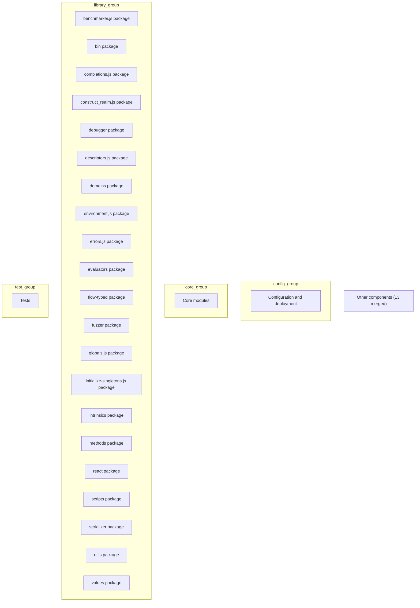

# Architecture report: facebookarchive/prepack

> Automated static analysis. **Observed** = directly seen in files/imports/AST; **Inferred** = interpretation from that evidence. Repository code was not executed.

## 1. Repository at a glance

| Item | Value |
| --- | --- |
| Repository | facebookarchive/prepack |
| Description | A JavaScript bundle optimizer. |
| Language | JavaScript |
| Stars | 14086 |
| Licence | Other |
| Analysed commit / branch | 5beedbe85bd5b9d2de1264abafbb3b76f8584297 / main |
| Framework(s) | React |
| Files analysed | 799 |
| Components | 37 |

## 2. Architecture in one minute

facebookarchive/prepack - A JavaScript bundle optimizer.. This repository was analysed statically from 799 file(s) (0 Python). Detected technologies (observed from imports/manifests): SQLite, React, Jest, webpack. Files are grouped into 37 component(s): benchmarker.js package, bin package, completions.js package, Configuration and deployment, construct_realm.js package, Core modules, Data layer, debugger package. Findings below distinguish observed facts from inferred interpretation.

## 3. High-level block diagram

## 4. Main components

### benchmarker.js package (`benchmarker_js`)

- **Kind:** library
- **Status:** Observed
- **Confidence:** 0.85
- **Responsibility:** Groups 1 file(s) under benchmarker.js package (observed from repository paths and static analysis).
- **Paths:** `src/benchmarker.js`
- **Evidence:** [src/benchmarker.js](https://github.com/facebookarchive/prepack/blob/5beedbe85bd5b9d2de1264abafbb3b76f8584297/src/benchmarker.js)

### bin package (`bin`)

- **Kind:** library
- **Status:** Observed
- **Confidence:** 0.85
- **Responsibility:** Groups 2 file(s) under bin package (observed from repository paths and static analysis).
- **Paths:** `bin/prepack-repl.js`, `bin/prepack.js`
- **Evidence:** [bin/prepack-repl.js](https://github.com/facebookarchive/prepack/blob/5beedbe85bd5b9d2de1264abafbb3b76f8584297/bin/prepack-repl.js); [bin/prepack.js](https://github.com/facebookarchive/prepack/blob/5beedbe85bd5b9d2de1264abafbb3b76f8584297/bin/prepack.js)

### completions.js package (`completions_js`)

- **Kind:** library
- **Status:** Observed
- **Confidence:** 0.85
- **Responsibility:** Groups 1 file(s) under completions.js package (observed from repository paths and static analysis).
- **Paths:** `src/completions.js`
- **Evidence:** [src/completions.js](https://github.com/facebookarchive/prepack/blob/5beedbe85bd5b9d2de1264abafbb3b76f8584297/src/completions.js)

### Configuration and deployment (`config`)

- **Kind:** config
- **Status:** Observed
- **Confidence:** 0.85
- **Responsibility:** Groups 3 file(s) under configuration and deployment (observed from repository paths and static analysis).
- **Paths:** `fuzzer/package.json`, `package.json`, `scripts/test262-filters.yml`
- **Evidence:** [fuzzer/package.json](https://github.com/facebookarchive/prepack/blob/5beedbe85bd5b9d2de1264abafbb3b76f8584297/fuzzer/package.json); [package.json](https://github.com/facebookarchive/prepack/blob/5beedbe85bd5b9d2de1264abafbb3b76f8584297/package.json); [scripts/test262-filters.yml](https://github.com/facebookarchive/prepack/blob/5beedbe85bd5b9d2de1264abafbb3b76f8584297/scripts/test262-filters.yml)

### construct_realm.js package (`construct_realm_js`)

- **Kind:** library
- **Status:** Observed
- **Confidence:** 0.85
- **Responsibility:** Groups 1 file(s) under construct_realm.js package (observed from repository paths and static analysis).
- **Paths:** `src/construct_realm.js`
- **Evidence:** [src/construct_realm.js](https://github.com/facebookarchive/prepack/blob/5beedbe85bd5b9d2de1264abafbb3b76f8584297/src/construct_realm.js)

### Core modules (`core`)

- **Kind:** core
- **Status:** Observed
- **Confidence:** 0.85
- **Responsibility:** Groups 1 file(s) under core modules (observed from repository paths and static analysis).
- **Paths:** `babel.config.js`
- **Evidence:** [babel.config.js](https://github.com/facebookarchive/prepack/blob/5beedbe85bd5b9d2de1264abafbb3b76f8584297/babel.config.js)

### Data layer (`data_layer`)

- **Kind:** data
- **Status:** Inferred
- **Confidence:** 0.70
- **Responsibility:** Groups 0 file(s) under data layer (observed from repository paths and static analysis).
- **Evidence:** [fuzzer/package.json:17](https://github.com/facebookarchive/prepack/blob/5beedbe85bd5b9d2de1264abafbb3b76f8584297/fuzzer/package.json#L17)

### debugger package (`debugger`)

- **Kind:** library
- **Status:** Observed
- **Confidence:** 0.85
- **Responsibility:** Groups 23 file(s) under debugger package (observed from repository paths and static analysis).
- **Paths:** `src/debugger/adapter/DebugAdapter.js`, `src/debugger/adapter/channel/AdapterChannel.js`, `src/debugger/common/DebuggerConstants.js`, `src/debugger/common/DebuggerError.js`, `src/debugger/common/channel/DebugMessage.js`, `src/debugger/common/channel/FileIOWrapper.js`, `src/debugger/common/channel/MessageMarshaller.js`, `src/debugger/common/channel/MessagePackager.js`, `src/debugger/common/invariant.js`, `src/debugger/common/types.js`, `src/debugger/mock-ui/DataHandler.js`, `src/debugger/mock-ui/UISession.js`, `src/debugger/mock-ui/debugger-cli.js`, `src/debugger/server/Breakpoint.js`, `src/debugger/server/BreakpointManager.js`, `src/debugger/server/Debugger.js`, `src/debugger/server/PerFileBreakpointMap.js`, `src/debugger/server/ReferenceMap.js`, `src/debugger/server/Stepper.js`, `src/debugger/server/SteppingManager.js`, `src/debugger/server/StopEventManager.js`, `src/debugger/server/VariableManager.js`, `src/debugger/server/channel/DebugChannel.js`
- **Evidence:** [src/debugger/adapter/DebugAdapter.js](https://github.com/facebookarchive/prepack/blob/5beedbe85bd5b9d2de1264abafbb3b76f8584297/src/debugger/adapter/DebugAdapter.js); [src/debugger/adapter/channel/AdapterChannel.js](https://github.com/facebookarchive/prepack/blob/5beedbe85bd5b9d2de1264abafbb3b76f8584297/src/debugger/adapter/channel/AdapterChannel.js); [src/debugger/common/DebuggerConstants.js](https://github.com/facebookarchive/prepack/blob/5beedbe85bd5b9d2de1264abafbb3b76f8584297/src/debugger/common/DebuggerConstants.js); [src/debugger/common/DebuggerError.js](https://github.com/facebookarchive/prepack/blob/5beedbe85bd5b9d2de1264abafbb3b76f8584297/src/debugger/common/DebuggerError.js); [src/debugger/common/channel/DebugMessage.js](https://github.com/facebookarchive/prepack/blob/5beedbe85bd5b9d2de1264abafbb3b76f8584297/src/debugger/common/channel/DebugMessage.js); [src/debugger/common/channel/FileIOWrapper.js](https://github.com/facebookarchive/prepack/blob/5beedbe85bd5b9d2de1264abafbb3b76f8584297/src/debugger/common/channel/FileIOWrapper.js); [src/debugger/common/channel/MessageMarshaller.js](https://github.com/facebookarchive/prepack/blob/5beedbe85bd5b9d2de1264abafbb3b76f8584297/src/debugger/common/channel/MessageMarshaller.js); [src/debugger/common/channel/MessagePackager.js](https://github.com/facebookarchive/prepack/blob/5beedbe85bd5b9d2de1264abafbb3b76f8584297/src/debugger/common/channel/MessagePackager.js)

### descriptors.js package (`descriptors_js`)

- **Kind:** library
- **Status:** Observed
- **Confidence:** 0.85
- **Responsibility:** Groups 1 file(s) under descriptors.js package (observed from repository paths and static analysis).
- **Paths:** `src/descriptors.js`
- **Evidence:** [src/descriptors.js](https://github.com/facebookarchive/prepack/blob/5beedbe85bd5b9d2de1264abafbb3b76f8584297/src/descriptors.js)

### domains package (`domains`)

- **Kind:** library
- **Status:** Observed
- **Confidence:** 0.85
- **Responsibility:** Groups 3 file(s) under domains package (observed from repository paths and static analysis).
- **Paths:** `src/domains/TypesDomain.js`, `src/domains/ValuesDomain.js`, `src/domains/index.js`
- **Evidence:** [src/domains/TypesDomain.js](https://github.com/facebookarchive/prepack/blob/5beedbe85bd5b9d2de1264abafbb3b76f8584297/src/domains/TypesDomain.js); [src/domains/ValuesDomain.js](https://github.com/facebookarchive/prepack/blob/5beedbe85bd5b9d2de1264abafbb3b76f8584297/src/domains/ValuesDomain.js); [src/domains/index.js](https://github.com/facebookarchive/prepack/blob/5beedbe85bd5b9d2de1264abafbb3b76f8584297/src/domains/index.js)

### environment.js package (`environment_js`)

- **Kind:** library
- **Status:** Observed
- **Confidence:** 0.85
- **Responsibility:** Groups 1 file(s) under environment.js package (observed from repository paths and static analysis).
- **Paths:** `src/environment.js`
- **Evidence:** [src/environment.js](https://github.com/facebookarchive/prepack/blob/5beedbe85bd5b9d2de1264abafbb3b76f8584297/src/environment.js)

### errors.js package (`errors_js`)

- **Kind:** library
- **Status:** Observed
- **Confidence:** 0.85
- **Responsibility:** Groups 1 file(s) under errors.js package (observed from repository paths and static analysis).
- **Paths:** `src/errors.js`
- **Evidence:** [src/errors.js](https://github.com/facebookarchive/prepack/blob/5beedbe85bd5b9d2de1264abafbb3b76f8584297/src/errors.js)

### evaluators package (`evaluators`)

- **Kind:** library
- **Status:** Observed
- **Confidence:** 0.85
- **Responsibility:** Groups 57 file(s) under evaluators package (observed from repository paths and static analysis).
- **Paths:** `src/evaluators/ArrayExpression.js`, `src/evaluators/ArrowFunctionExpression.js`, `src/evaluators/AssignmentExpression.js`, `src/evaluators/AwaitExpression.js`, `src/evaluators/BinaryExpression.js`, `src/evaluators/BlockStatement.js`, `src/evaluators/BooleanLiteral.js`, `src/evaluators/BreakStatement.js`, `src/evaluators/CallExpression.js`, `src/evaluators/CatchClause.js`, `src/evaluators/ClassDeclaration.js`, `src/evaluators/ClassExpression.js`, `src/evaluators/ConditionalExpression.js`, `src/evaluators/ContinueStatement.js`, `src/evaluators/Directive.js`, `src/evaluators/DirectiveLiteral.js`, `src/evaluators/DoExpression.js`, `src/evaluators/DoWhileStatement.js`, `src/evaluators/EmptyStatement.js`, `src/evaluators/ExpressionStatement.js`, `src/evaluators/File.js`, `src/evaluators/ForInStatement.js`, `src/evaluators/ForOfStatement.js`, `src/evaluators/ForStatement.js`, `src/evaluators/FunctionDeclaration.js`, `src/evaluators/FunctionExpression.js`, `src/evaluators/Identifier.js`, `src/evaluators/IfStatement.js`, `src/evaluators/JSXElement.js`, `src/evaluators/LabeledStatement.js`, `src/evaluators/LogicalExpression.js`, `src/evaluators/MemberExpression.js`, `src/evaluators/MetaProperty.js`, `src/evaluators/NewExpression.js`, `src/evaluators/NullLiteral.js`, `src/evaluators/NumericLiteral.js`, `src/evaluators/ObjectExpression.js`, `src/evaluators/Program.js`, `src/evaluators/RegExpLiteral.js`, `src/evaluators/ReturnStatement.js`, `src/evaluators/SequenceExpression.js`, `src/evaluators/StringLiteral.js`, `src/evaluators/SuperCall.js`, `src/evaluators/SuperProperty.js`, `src/evaluators/SwitchStatement.js`, `src/evaluators/TaggedTemplateExpression.js`, `src/evaluators/TemplateLiteral.js`, `src/evaluators/ThisExpression.js`, `src/evaluators/ThrowStatement.js`, `src/evaluators/TryStatement.js`, `src/evaluators/UnaryExpression.js`, `src/evaluators/UpdateExpression.js`, `src/evaluators/VariableDeclaration.js`, `src/evaluators/WhileStatement.js`, `src/evaluators/WithStatement.js`, `src/evaluators/YieldExpression.js`, `src/evaluators/index.js`
- **Evidence:** [src/evaluators/ArrayExpression.js](https://github.com/facebookarchive/prepack/blob/5beedbe85bd5b9d2de1264abafbb3b76f8584297/src/evaluators/ArrayExpression.js); [src/evaluators/ArrowFunctionExpression.js](https://github.com/facebookarchive/prepack/blob/5beedbe85bd5b9d2de1264abafbb3b76f8584297/src/evaluators/ArrowFunctionExpression.js); [src/evaluators/AssignmentExpression.js](https://github.com/facebookarchive/prepack/blob/5beedbe85bd5b9d2de1264abafbb3b76f8584297/src/evaluators/AssignmentExpression.js); [src/evaluators/AwaitExpression.js](https://github.com/facebookarchive/prepack/blob/5beedbe85bd5b9d2de1264abafbb3b76f8584297/src/evaluators/AwaitExpression.js); [src/evaluators/BinaryExpression.js](https://github.com/facebookarchive/prepack/blob/5beedbe85bd5b9d2de1264abafbb3b76f8584297/src/evaluators/BinaryExpression.js); [src/evaluators/BlockStatement.js](https://github.com/facebookarchive/prepack/blob/5beedbe85bd5b9d2de1264abafbb3b76f8584297/src/evaluators/BlockStatement.js); [src/evaluators/BooleanLiteral.js](https://github.com/facebookarchive/prepack/blob/5beedbe85bd5b9d2de1264abafbb3b76f8584297/src/evaluators/BooleanLiteral.js); [src/evaluators/BreakStatement.js](https://github.com/facebookarchive/prepack/blob/5beedbe85bd5b9d2de1264abafbb3b76f8584297/src/evaluators/BreakStatement.js)

### flow-typed package (`flow_typed`)

- **Kind:** library
- **Status:** Observed
- **Confidence:** 0.85
- **Responsibility:** Groups 70 file(s) under flow-typed package (observed from repository paths and static analysis).
- **Paths:** `flow-typed/npm/@babel/cli_vx.x.x.js`, `flow-typed/npm/@babel/core_vx.x.x.js`, `flow-typed/npm/@babel/generator_vx.x.x.js`, `flow-typed/npm/@babel/node_vx.x.x.js`, `flow-typed/npm/@babel/parser_vx.x.x.js`, `flow-typed/npm/@babel/plugin-proposal-class-properties_vx.x.x.js`, `flow-typed/npm/@babel/plugin-proposal-export-default-from_vx.x.x.js`, `flow-typed/npm/@babel/plugin-proposal-object-rest-spread_vx.x.x.js`, `flow-typed/npm/@babel/plugin-syntax-flow_vx.x.x.js`, `flow-typed/npm/@babel/plugin-transform-flow-strip-types_vx.x.x.js`, `flow-typed/npm/@babel/plugin-transform-modules-commonjs_vx.x.x.js`, `flow-typed/npm/@babel/plugin-transform-react-jsx_vx.x.x.js`, `flow-typed/npm/@babel/preset-env_vx.x.x.js`, `flow-typed/npm/@babel/preset-flow_vx.x.x.js`, `flow-typed/npm/@babel/preset-react_vx.x.x.js`, `flow-typed/npm/@babel/register_vx.x.x.js`, `flow-typed/npm/@babel/template_vx.x.x.js`, `flow-typed/npm/@babel/traverse_vx.x.x.js`, `flow-typed/npm/babel-cli_vx.x.x.js`, `flow-typed/npm/babel-core_vx.x.x.js`, `flow-typed/npm/babel-eslint_vx.x.x.js`, `flow-typed/npm/babel-generator_vx.x.x.js`, `flow-typed/npm/babel-helper-function-name_vx.x.x.js`, `flow-typed/npm/babel-helper-get-function-arity_vx.x.x.js`, `flow-typed/npm/babel-jest_vx.x.x.js`, `flow-typed/npm/babel-plugin-jest-hoist_vx.x.x.js`, `flow-typed/npm/babel-plugin-transform-class-properties_vx.x.x.js`, `flow-typed/npm/babel-plugin-transform-object-rest-spread_vx.x.x.js`, `flow-typed/npm/babel-preset-es2015_vx.x.x.js`, `flow-typed/npm/babel-preset-react_vx.x.x.js`, `flow-typed/npm/babel-template_vx.x.x.js`, `flow-typed/npm/babel-traverse_vx.x.x.js`, `flow-typed/npm/babel-types_vx.x.x.js`, `flow-typed/npm/babylon_vx.x.x.js`, `flow-typed/npm/chalk_v1.x.x.js`, `flow-typed/npm/eslint-config-kittens_vx.x.x.js`, `flow-typed/npm/eslint-plugin-babel_vx.x.x.js`, `flow-typed/npm/eslint-plugin-flow-header_vx.x.x.js`, `flow-typed/npm/eslint-plugin-flowtype_vx.x.x.js`, `flow-typed/npm/eslint-plugin-header_vx.x.x.js`, `flow-typed/npm/eslint-plugin-prettier_vx.x.x.js`, `flow-typed/npm/eslint_vx.x.x.js`, `flow-typed/npm/flow-typed_vx.x.x.js`, `flow-typed/npm/graceful-fs_v4.1.x.js`, `flow-typed/npm/invariant_v2.x.x.js`, `flow-typed/npm/istanbul_vx.x.x.js`, `flow-typed/npm/jest_v23.x.x.js`, `flow-typed/npm/js-beautify_v1.6.x.js`, `flow-typed/npm/js-yaml_vx.x.x.js`, `flow-typed/npm/jsdom_vx.x.x.js`, `flow-typed/npm/madge_vx.x.x.js`, `flow-typed/npm/minimist_v1.x.x.js`, `flow-typed/npm/node-zip_vx.x.x.js`, `flow-typed/npm/prettier_v1.x.x.js`, `flow-typed/npm/prop-types_v15.x.x.js`, `flow-typed/npm/queue-fifo_vx.x.x.js`, `flow-typed/npm/react-native_vx.x.x.js`, `flow-typed/npm/react-relay_v1.x.x.js`, `flow-typed/npm/regenerator-runtime_vx.x.x.js`, `flow-typed/npm/remap-istanbul_vx.x.x.js`, `flow-typed/npm/repeating_vx.x.x.js`, `flow-typed/npm/seedrandom_vx.x.x.js`, `flow-typed/npm/source-map-support_vx.x.x.js`, `flow-typed/npm/source-map_vx.x.x.js`, `flow-typed/npm/uglify-js_vx.x.x.js`, `flow-typed/npm/v8-profiler-node8_vx.x.x.js`, `flow-typed/npm/vscode-debugadapter_vx.x.x.js`, `flow-typed/npm/vscode-debugprotocol_vx.x.x.js`, `flow-typed/npm/webpack-cli_vx.x.x.js`, `flow-typed/npm/webpack_vx.x.x.js`
- **Evidence:** [flow-typed/npm/@babel/cli_vx.x.x.js](https://github.com/facebookarchive/prepack/blob/5beedbe85bd5b9d2de1264abafbb3b76f8584297/flow-typed/npm/%40babel/cli_vx.x.x.js); [flow-typed/npm/@babel/core_vx.x.x.js](https://github.com/facebookarchive/prepack/blob/5beedbe85bd5b9d2de1264abafbb3b76f8584297/flow-typed/npm/%40babel/core_vx.x.x.js); [flow-typed/npm/@babel/generator_vx.x.x.js](https://github.com/facebookarchive/prepack/blob/5beedbe85bd5b9d2de1264abafbb3b76f8584297/flow-typed/npm/%40babel/generator_vx.x.x.js); [flow-typed/npm/@babel/node_vx.x.x.js](https://github.com/facebookarchive/prepack/blob/5beedbe85bd5b9d2de1264abafbb3b76f8584297/flow-typed/npm/%40babel/node_vx.x.x.js); [flow-typed/npm/@babel/parser_vx.x.x.js](https://github.com/facebookarchive/prepack/blob/5beedbe85bd5b9d2de1264abafbb3b76f8584297/flow-typed/npm/%40babel/parser_vx.x.x.js); [flow-typed/npm/@babel/plugin-proposal-class-properties_vx.x.x.js](https://github.com/facebookarchive/prepack/blob/5beedbe85bd5b9d2de1264abafbb3b76f8584297/flow-typed/npm/%40babel/plugin-proposal-class-properties_vx.x.x.js); [flow-typed/npm/@babel/plugin-proposal-export-default-from_vx.x.x.js](https://github.com/facebookarchive/prepack/blob/5beedbe85bd5b9d2de1264abafbb3b76f8584297/flow-typed/npm/%40babel/plugin-proposal-export-default-from_vx.x.x.js); [flow-typed/npm/@babel/plugin-proposal-object-rest-spread_vx.x.x.js](https://github.com/facebookarchive/prepack/blob/5beedbe85bd5b9d2de1264abafbb3b76f8584297/flow-typed/npm/%40babel/plugin-proposal-object-rest-spread_vx.x.x.js)

### fuzzer package (`fuzzer`)

- **Kind:** library
- **Status:** Observed
- **Confidence:** 0.85
- **Responsibility:** Groups 7 file(s) under fuzzer package (observed from repository paths and static analysis).
- **Paths:** `fuzzer/src/execute.js`, `fuzzer/src/gen.js`, `fuzzer/src/overnight.js`, `fuzzer/src/property.js`, `fuzzer/src/report.js`, `fuzzer/src/sample.js`, `fuzzer/src/test.js`
- **Evidence:** [fuzzer/src/execute.js](https://github.com/facebookarchive/prepack/blob/5beedbe85bd5b9d2de1264abafbb3b76f8584297/fuzzer/src/execute.js); [fuzzer/src/gen.js](https://github.com/facebookarchive/prepack/blob/5beedbe85bd5b9d2de1264abafbb3b76f8584297/fuzzer/src/gen.js); [fuzzer/src/overnight.js](https://github.com/facebookarchive/prepack/blob/5beedbe85bd5b9d2de1264abafbb3b76f8584297/fuzzer/src/overnight.js); [fuzzer/src/property.js](https://github.com/facebookarchive/prepack/blob/5beedbe85bd5b9d2de1264abafbb3b76f8584297/fuzzer/src/property.js); [fuzzer/src/report.js](https://github.com/facebookarchive/prepack/blob/5beedbe85bd5b9d2de1264abafbb3b76f8584297/fuzzer/src/report.js); [fuzzer/src/sample.js](https://github.com/facebookarchive/prepack/blob/5beedbe85bd5b9d2de1264abafbb3b76f8584297/fuzzer/src/sample.js); [fuzzer/src/test.js](https://github.com/facebookarchive/prepack/blob/5beedbe85bd5b9d2de1264abafbb3b76f8584297/fuzzer/src/test.js)

### globals.js package (`globals_js`)

- **Kind:** library
- **Status:** Observed
- **Confidence:** 0.85
- **Responsibility:** Groups 1 file(s) under globals.js package (observed from repository paths and static analysis).
- **Paths:** `src/globals.js`
- **Evidence:** [src/globals.js](https://github.com/facebookarchive/prepack/blob/5beedbe85bd5b9d2de1264abafbb3b76f8584297/src/globals.js)

### initialize-singletons.js package (`initialize_singletons_js`)

- **Kind:** library
- **Status:** Observed
- **Confidence:** 0.85
- **Responsibility:** Groups 1 file(s) under initialize-singletons.js package (observed from repository paths and static analysis).
- **Paths:** `src/initialize-singletons.js`
- **Evidence:** [src/initialize-singletons.js](https://github.com/facebookarchive/prepack/blob/5beedbe85bd5b9d2de1264abafbb3b76f8584297/src/initialize-singletons.js)

### intrinsics package (`intrinsics`)

- **Kind:** library
- **Status:** Observed
- **Confidence:** 0.85
- **Responsibility:** Groups 111 file(s) under intrinsics package (observed from repository paths and static analysis).
- **Paths:** `src/intrinsics/common/console.js`, `src/intrinsics/dom/document.js`, `src/intrinsics/dom/global.js`, `src/intrinsics/dom/setInterval.js`, `src/intrinsics/dom/setTimeout.js`, `src/intrinsics/ecma262/Array.js`, `src/intrinsics/ecma262/ArrayBuffer.js`, `src/intrinsics/ecma262/ArrayBufferPrototype.js`, `src/intrinsics/ecma262/ArrayIteratorPrototype.js`, `src/intrinsics/ecma262/ArrayProto_toString.js`, `src/intrinsics/ecma262/ArrayProto_values.js`, `src/intrinsics/ecma262/ArrayPrototype.js`, `src/intrinsics/ecma262/Boolean.js`, `src/intrinsics/ecma262/BooleanPrototype.js`, `src/intrinsics/ecma262/DataView.js`, `src/intrinsics/ecma262/DataViewPrototype.js`, `src/intrinsics/ecma262/Date.js`, `src/intrinsics/ecma262/DatePrototype.js`, `src/intrinsics/ecma262/Error.js`, `src/intrinsics/ecma262/ErrorPrototype.js`, `src/intrinsics/ecma262/EvalError.js`, `src/intrinsics/ecma262/EvalErrorPrototype.js`, `src/intrinsics/ecma262/Float32Array.js`, `src/intrinsics/ecma262/Float32ArrayPrototype.js`, `src/intrinsics/ecma262/Float64Array.js`, `src/intrinsics/ecma262/Float64ArrayPrototype.js`, `src/intrinsics/ecma262/Function.js`, `src/intrinsics/ecma262/FunctionPrototype.js`, `src/intrinsics/ecma262/Generator.js`, `src/intrinsics/ecma262/GeneratorFunction.js`, `src/intrinsics/ecma262/GeneratorPrototype.js`, `src/intrinsics/ecma262/Int16Array.js`, `src/intrinsics/ecma262/Int16ArrayPrototype.js`, `src/intrinsics/ecma262/Int32Array.js`, `src/intrinsics/ecma262/Int32ArrayPrototype.js`, `src/intrinsics/ecma262/Int8Array.js`, `src/intrinsics/ecma262/Int8ArrayPrototype.js`, `src/intrinsics/ecma262/IteratorPrototype.js`, `src/intrinsics/ecma262/JSON.js`, `src/intrinsics/ecma262/Map.js`, `src/intrinsics/ecma262/MapIteratorPrototype.js`, `src/intrinsics/ecma262/MapPrototype.js`, `src/intrinsics/ecma262/Math.js`, `src/intrinsics/ecma262/Number.js`, `src/intrinsics/ecma262/NumberPrototype.js`, `src/intrinsics/ecma262/Object.js`, `src/intrinsics/ecma262/ObjectProto_toString.js`, `src/intrinsics/ecma262/ObjectPrototype.js`, `src/intrinsics/ecma262/Promise.js`, `src/intrinsics/ecma262/PromisePrototype.js`, `src/intrinsics/ecma262/Proxy.js`, `src/intrinsics/ecma262/RangeError.js`, `src/intrinsics/ecma262/RangeErrorPrototype.js`, `src/intrinsics/ecma262/ReferenceError.js`, `src/intrinsics/ecma262/ReferenceErrorPrototype.js`, `src/intrinsics/ecma262/Reflect.js`, `src/intrinsics/ecma262/RegExp.js`, `src/intrinsics/ecma262/RegExpPrototype.js`, `src/intrinsics/ecma262/Set.js`, `src/intrinsics/ecma262/SetIteratorPrototype.js`, `src/intrinsics/ecma262/SetPrototype.js`, `src/intrinsics/ecma262/String.js`, `src/intrinsics/ecma262/StringIteratorPrototype.js`, `src/intrinsics/ecma262/StringPrototype.js`, `src/intrinsics/ecma262/Symbol.js`, `src/intrinsics/ecma262/SymbolPrototype.js`, `src/intrinsics/ecma262/SyntaxError.js`, `src/intrinsics/ecma262/SyntaxErrorPrototype.js`, `src/intrinsics/ecma262/ThrowTypeError.js`, `src/intrinsics/ecma262/TypeError.js`, `src/intrinsics/ecma262/TypeErrorPrototype.js`, `src/intrinsics/ecma262/TypedArray.js`, `src/intrinsics/ecma262/TypedArrayProto_values.js`, `src/intrinsics/ecma262/TypedArrayPrototype.js`, `src/intrinsics/ecma262/URIError.js`, `src/intrinsics/ecma262/URIErrorPrototype.js`, `src/intrinsics/ecma262/Uint16Array.js`, `src/intrinsics/ecma262/Uint16ArrayPrototype.js`, `src/intrinsics/ecma262/Uint32Array.js`, `src/intrinsics/ecma262/Uint32ArrayPrototype.js`, `src/intrinsics/ecma262/Uint8Array.js`, `src/intrinsics/ecma262/Uint8ArrayPrototype.js`, `src/intrinsics/ecma262/Uint8ClampedArray.js`, `src/intrinsics/ecma262/Uint8ClampedArrayPrototype.js`, `src/intrinsics/ecma262/WeakMap.js`, `src/intrinsics/ecma262/WeakMapPrototype.js`, `src/intrinsics/ecma262/WeakSet.js`, `src/intrinsics/ecma262/WeakSetPrototype.js`, `src/intrinsics/ecma262/decodeURI.js`, `src/intrinsics/ecma262/decodeURIComponent.js`, `src/intrinsics/ecma262/encodeURI.js`, `src/intrinsics/ecma262/encodeURIComponent.js`, `src/intrinsics/ecma262/eval.js`, `src/intrinsics/ecma262/global.js`, `src/intrinsics/ecma262/isFinite.js`, `src/intrinsics/ecma262/isNaN.js`, `src/intrinsics/ecma262/parseFloat.js`, `src/intrinsics/ecma262/parseInt.js`, `src/intrinsics/fb-www/fb-mocks.js`, `src/intrinsics/fb-www/global.js`, `src/intrinsics/fb-www/react-dom-mocks.js`, `src/intrinsics/fb-www/react-mocks.js`, `src/intrinsics/fb-www/react-native-mocks.js`, `src/intrinsics/fb-www/relay-mocks.js`, `src/intrinsics/fb-www/utils.js`, `src/intrinsics/index.js`, `src/intrinsics/prepack/__IntrospectionError.js`, `src/intrinsics/prepack/__IntrospectionErrorPrototype.js`, `src/intrinsics/prepack/global.js`, `src/intrinsics/prepack/utils.js`, `src/intrinsics/react-native/global.js`
- **Evidence:** [src/intrinsics/common/console.js](https://github.com/facebookarchive/prepack/blob/5beedbe85bd5b9d2de1264abafbb3b76f8584297/src/intrinsics/common/console.js); [src/intrinsics/dom/document.js](https://github.com/facebookarchive/prepack/blob/5beedbe85bd5b9d2de1264abafbb3b76f8584297/src/intrinsics/dom/document.js); [src/intrinsics/dom/global.js](https://github.com/facebookarchive/prepack/blob/5beedbe85bd5b9d2de1264abafbb3b76f8584297/src/intrinsics/dom/global.js); [src/intrinsics/dom/setInterval.js](https://github.com/facebookarchive/prepack/blob/5beedbe85bd5b9d2de1264abafbb3b76f8584297/src/intrinsics/dom/setInterval.js); [src/intrinsics/dom/setTimeout.js](https://github.com/facebookarchive/prepack/blob/5beedbe85bd5b9d2de1264abafbb3b76f8584297/src/intrinsics/dom/setTimeout.js); [src/intrinsics/ecma262/Array.js](https://github.com/facebookarchive/prepack/blob/5beedbe85bd5b9d2de1264abafbb3b76f8584297/src/intrinsics/ecma262/Array.js); [src/intrinsics/ecma262/ArrayBuffer.js](https://github.com/facebookarchive/prepack/blob/5beedbe85bd5b9d2de1264abafbb3b76f8584297/src/intrinsics/ecma262/ArrayBuffer.js); [src/intrinsics/ecma262/ArrayBufferPrototype.js](https://github.com/facebookarchive/prepack/blob/5beedbe85bd5b9d2de1264abafbb3b76f8584297/src/intrinsics/ecma262/ArrayBufferPrototype.js)

### invariant.js package (`invariant_js`)

- **Kind:** library
- **Status:** Observed
- **Confidence:** 0.85
- **Responsibility:** Groups 1 file(s) under invariant.js package (observed from repository paths and static analysis).
- **Paths:** `src/invariant.js`
- **Evidence:** [src/invariant.js](https://github.com/facebookarchive/prepack/blob/5beedbe85bd5b9d2de1264abafbb3b76f8584297/src/invariant.js)

### methods package (`methods`)

- **Kind:** library
- **Status:** Observed
- **Confidence:** 0.85
- **Responsibility:** Groups 28 file(s) under methods package (observed from repository paths and static analysis).
- **Paths:** `src/methods/abstract.js`, `src/methods/arraybuffer.js`, `src/methods/call.js`, `src/methods/construct.js`, `src/methods/create.js`, `src/methods/date.js`, `src/methods/destructuring.js`, `src/methods/environment.js`, `src/methods/function.js`, `src/methods/generator.js`, `src/methods/get.js`, `src/methods/has.js`, `src/methods/hash.js`, `src/methods/index.js`, `src/methods/integerindexed.js`, `src/methods/integrity.js`, `src/methods/is.js`, `src/methods/iterator.js`, `src/methods/join.js`, `src/methods/json.js`, `src/methods/own.js`, `src/methods/promise.js`, `src/methods/properties.js`, `src/methods/proxy.js`, `src/methods/regexp.js`, `src/methods/to.js`, `src/methods/typedarray.js`, `src/methods/widen.js`
- **Evidence:** [src/methods/abstract.js](https://github.com/facebookarchive/prepack/blob/5beedbe85bd5b9d2de1264abafbb3b76f8584297/src/methods/abstract.js); [src/methods/arraybuffer.js](https://github.com/facebookarchive/prepack/blob/5beedbe85bd5b9d2de1264abafbb3b76f8584297/src/methods/arraybuffer.js); [src/methods/call.js](https://github.com/facebookarchive/prepack/blob/5beedbe85bd5b9d2de1264abafbb3b76f8584297/src/methods/call.js); [src/methods/construct.js](https://github.com/facebookarchive/prepack/blob/5beedbe85bd5b9d2de1264abafbb3b76f8584297/src/methods/construct.js); [src/methods/create.js](https://github.com/facebookarchive/prepack/blob/5beedbe85bd5b9d2de1264abafbb3b76f8584297/src/methods/create.js); [src/methods/date.js](https://github.com/facebookarchive/prepack/blob/5beedbe85bd5b9d2de1264abafbb3b76f8584297/src/methods/date.js); [src/methods/destructuring.js](https://github.com/facebookarchive/prepack/blob/5beedbe85bd5b9d2de1264abafbb3b76f8584297/src/methods/destructuring.js); [src/methods/environment.js](https://github.com/facebookarchive/prepack/blob/5beedbe85bd5b9d2de1264abafbb3b76f8584297/src/methods/environment.js)

### options.js package (`options_js`)

- **Kind:** library
- **Status:** Observed
- **Confidence:** 0.85
- **Responsibility:** Groups 1 file(s) under options.js package (observed from repository paths and static analysis).
- **Paths:** `src/options.js`
- **Evidence:** [src/options.js](https://github.com/facebookarchive/prepack/blob/5beedbe85bd5b9d2de1264abafbb3b76f8584297/src/options.js)

### prepack-cli.js package (`prepack_cli_js`)

- **Kind:** library
- **Status:** Observed
- **Confidence:** 0.85
- **Responsibility:** Groups 1 file(s) under prepack-cli.js package (observed from repository paths and static analysis).
- **Paths:** `src/prepack-cli.js`
- **Evidence:** [src/prepack-cli.js](https://github.com/facebookarchive/prepack/blob/5beedbe85bd5b9d2de1264abafbb3b76f8584297/src/prepack-cli.js)

### prepack-node.js package (`prepack_node_js`)

- **Kind:** library
- **Status:** Observed
- **Confidence:** 0.85
- **Responsibility:** Groups 1 file(s) under prepack-node.js package (observed from repository paths and static analysis).
- **Paths:** `src/prepack-node.js`
- **Evidence:** [src/prepack-node.js](https://github.com/facebookarchive/prepack/blob/5beedbe85bd5b9d2de1264abafbb3b76f8584297/src/prepack-node.js)

### prepack-options.js package (`prepack_options_js`)

- **Kind:** library
- **Status:** Observed
- **Confidence:** 0.85
- **Responsibility:** Groups 1 file(s) under prepack-options.js package (observed from repository paths and static analysis).
- **Paths:** `src/prepack-options.js`
- **Evidence:** [src/prepack-options.js](https://github.com/facebookarchive/prepack/blob/5beedbe85bd5b9d2de1264abafbb3b76f8584297/src/prepack-options.js)

### prepack-standalone.js package (`prepack_standalone_js`)

- **Kind:** library
- **Status:** Observed
- **Confidence:** 0.85
- **Responsibility:** Groups 1 file(s) under prepack-standalone.js package (observed from repository paths and static analysis).
- **Paths:** `src/prepack-standalone.js`
- **Evidence:** [src/prepack-standalone.js](https://github.com/facebookarchive/prepack/blob/5beedbe85bd5b9d2de1264abafbb3b76f8584297/src/prepack-standalone.js)

### react package (`react`)

- **Kind:** library
- **Status:** Observed
- **Confidence:** 0.85
- **Responsibility:** Groups 15 file(s) under react package (observed from repository paths and static analysis).
- **Paths:** `src/react/ReactElementSet.js`, `src/react/ReactEquivalenceSet.js`, `src/react/ReactPropsSet.js`, `src/react/branching.js`, `src/react/components.js`, `src/react/elements.js`, `src/react/errors.js`, `src/react/experimental-server-rendering/dom-config.js`, `src/react/experimental-server-rendering/rendering.js`, `src/react/experimental-server-rendering/utils.js`, `src/react/hoisting.js`, `src/react/jsx.js`, `src/react/optimizing.js`, `src/react/reconcilation.js`, `src/react/utils.js`
- **Evidence:** [src/react/ReactElementSet.js](https://github.com/facebookarchive/prepack/blob/5beedbe85bd5b9d2de1264abafbb3b76f8584297/src/react/ReactElementSet.js); [src/react/ReactEquivalenceSet.js](https://github.com/facebookarchive/prepack/blob/5beedbe85bd5b9d2de1264abafbb3b76f8584297/src/react/ReactEquivalenceSet.js); [src/react/ReactPropsSet.js](https://github.com/facebookarchive/prepack/blob/5beedbe85bd5b9d2de1264abafbb3b76f8584297/src/react/ReactPropsSet.js); [src/react/branching.js](https://github.com/facebookarchive/prepack/blob/5beedbe85bd5b9d2de1264abafbb3b76f8584297/src/react/branching.js); [src/react/components.js](https://github.com/facebookarchive/prepack/blob/5beedbe85bd5b9d2de1264abafbb3b76f8584297/src/react/components.js); [src/react/elements.js](https://github.com/facebookarchive/prepack/blob/5beedbe85bd5b9d2de1264abafbb3b76f8584297/src/react/elements.js); [src/react/errors.js](https://github.com/facebookarchive/prepack/blob/5beedbe85bd5b9d2de1264abafbb3b76f8584297/src/react/errors.js); [src/react/experimental-server-rendering/dom-config.js](https://github.com/facebookarchive/prepack/blob/5beedbe85bd5b9d2de1264abafbb3b76f8584297/src/react/experimental-server-rendering/dom-config.js)

### realm.js package (`realm_js`)

- **Kind:** library
- **Status:** Observed
- **Confidence:** 0.85
- **Responsibility:** Groups 1 file(s) under realm.js package (observed from repository paths and static analysis).
- **Paths:** `src/realm.js`
- **Evidence:** [src/realm.js](https://github.com/facebookarchive/prepack/blob/5beedbe85bd5b9d2de1264abafbb3b76f8584297/src/realm.js)

### repl-cli.js package (`repl_cli_js`)

- **Kind:** library
- **Status:** Observed
- **Confidence:** 0.85
- **Responsibility:** Groups 1 file(s) under repl-cli.js package (observed from repository paths and static analysis).
- **Paths:** `src/repl-cli.js`
- **Evidence:** [src/repl-cli.js](https://github.com/facebookarchive/prepack/blob/5beedbe85bd5b9d2de1264abafbb3b76f8584297/src/repl-cli.js)

### scripts package (`scripts`)

- **Kind:** library
- **Status:** Observed
- **Confidence:** 0.85
- **Responsibility:** Groups 16 file(s) under scripts package (observed from repository paths and static analysis).
- **Paths:** `scripts/debug-fb-www.js`, `scripts/detect_bad_deps.js`, `scripts/generate-sourcemaps-test.js`, `scripts/instrumentor.js`, `scripts/lint-config.js`, `scripts/multi-runner.js`, `scripts/prettier.js`, `scripts/publish-gh-pages.sh`, `scripts/test-error-handler.js`, `scripts/test-internal-react.js`, `scripts/test-internal.js`, `scripts/test-runner.js`, `scripts/test-sourcemaps.sh`, `scripts/test-std-in.sh`, `scripts/test262-runner.js`, `scripts/test262.js`
- **Evidence:** [scripts/debug-fb-www.js](https://github.com/facebookarchive/prepack/blob/5beedbe85bd5b9d2de1264abafbb3b76f8584297/scripts/debug-fb-www.js); [scripts/detect_bad_deps.js](https://github.com/facebookarchive/prepack/blob/5beedbe85bd5b9d2de1264abafbb3b76f8584297/scripts/detect_bad_deps.js); [scripts/generate-sourcemaps-test.js](https://github.com/facebookarchive/prepack/blob/5beedbe85bd5b9d2de1264abafbb3b76f8584297/scripts/generate-sourcemaps-test.js); [scripts/instrumentor.js](https://github.com/facebookarchive/prepack/blob/5beedbe85bd5b9d2de1264abafbb3b76f8584297/scripts/instrumentor.js); [scripts/lint-config.js](https://github.com/facebookarchive/prepack/blob/5beedbe85bd5b9d2de1264abafbb3b76f8584297/scripts/lint-config.js); [scripts/multi-runner.js](https://github.com/facebookarchive/prepack/blob/5beedbe85bd5b9d2de1264abafbb3b76f8584297/scripts/multi-runner.js); [scripts/prettier.js](https://github.com/facebookarchive/prepack/blob/5beedbe85bd5b9d2de1264abafbb3b76f8584297/scripts/prettier.js); [scripts/publish-gh-pages.sh](https://github.com/facebookarchive/prepack/blob/5beedbe85bd5b9d2de1264abafbb3b76f8584297/scripts/publish-gh-pages.sh)

### serializer package (`serializer`)

- **Kind:** library
- **Status:** Observed
- **Confidence:** 0.85
- **Responsibility:** Groups 25 file(s) under serializer package (observed from repository paths and static analysis).
- **Paths:** `src/serializer/Emitter.js`, `src/serializer/GeneratorTree.js`, `src/serializer/LazyObjectsSerializer.js`, `src/serializer/LoggingTracer.js`, `src/serializer/Referentializer.js`, `src/serializer/ResidualFunctionInitializers.js`, `src/serializer/ResidualFunctionInstantiator.js`, `src/serializer/ResidualFunctions.js`, `src/serializer/ResidualHeapGraphGenerator.js`, `src/serializer/ResidualHeapRefCounter.js`, `src/serializer/ResidualHeapSerializer.js`, `src/serializer/ResidualHeapValueIdentifiers.js`, `src/serializer/ResidualHeapVisitor.js`, `src/serializer/ResidualOperationSerializer.js`, `src/serializer/ResidualOptimizedFunctions.js`, `src/serializer/ResidualReactElementSerializer.js`, `src/serializer/ResidualReactElementVisitor.js`, `src/serializer/factorify.js`, `src/serializer/functions.js`, `src/serializer/index.js`, `src/serializer/serializer.js`, `src/serializer/statistics.js`, `src/serializer/types.js`, `src/serializer/utils.js`, `src/serializer/visitors.js`
- **Evidence:** [src/serializer/Emitter.js](https://github.com/facebookarchive/prepack/blob/5beedbe85bd5b9d2de1264abafbb3b76f8584297/src/serializer/Emitter.js); [src/serializer/GeneratorTree.js](https://github.com/facebookarchive/prepack/blob/5beedbe85bd5b9d2de1264abafbb3b76f8584297/src/serializer/GeneratorTree.js); [src/serializer/LazyObjectsSerializer.js](https://github.com/facebookarchive/prepack/blob/5beedbe85bd5b9d2de1264abafbb3b76f8584297/src/serializer/LazyObjectsSerializer.js); [src/serializer/LoggingTracer.js](https://github.com/facebookarchive/prepack/blob/5beedbe85bd5b9d2de1264abafbb3b76f8584297/src/serializer/LoggingTracer.js); [src/serializer/Referentializer.js](https://github.com/facebookarchive/prepack/blob/5beedbe85bd5b9d2de1264abafbb3b76f8584297/src/serializer/Referentializer.js); [src/serializer/ResidualFunctionInitializers.js](https://github.com/facebookarchive/prepack/blob/5beedbe85bd5b9d2de1264abafbb3b76f8584297/src/serializer/ResidualFunctionInitializers.js); [src/serializer/ResidualFunctionInstantiator.js](https://github.com/facebookarchive/prepack/blob/5beedbe85bd5b9d2de1264abafbb3b76f8584297/src/serializer/ResidualFunctionInstantiator.js); [src/serializer/ResidualFunctions.js](https://github.com/facebookarchive/prepack/blob/5beedbe85bd5b9d2de1264abafbb3b76f8584297/src/serializer/ResidualFunctions.js)

### singletons.js package (`singletons_js`)

- **Kind:** library
- **Status:** Observed
- **Confidence:** 0.85
- **Responsibility:** Groups 1 file(s) under singletons.js package (observed from repository paths and static analysis).
- **Paths:** `src/singletons.js`
- **Evidence:** [src/singletons.js](https://github.com/facebookarchive/prepack/blob/5beedbe85bd5b9d2de1264abafbb3b76f8584297/src/singletons.js)

### statistics.js package (`statistics_js`)

- **Kind:** library
- **Status:** Observed
- **Confidence:** 0.85
- **Responsibility:** Groups 1 file(s) under statistics.js package (observed from repository paths and static analysis).
- **Paths:** `src/statistics.js`
- **Evidence:** [src/statistics.js](https://github.com/facebookarchive/prepack/blob/5beedbe85bd5b9d2de1264abafbb3b76f8584297/src/statistics.js)

### Tests (`tests`)

- **Kind:** test
- **Status:** Observed
- **Confidence:** 0.85
- **Responsibility:** Groups 344 file(s) under tests (observed from repository paths and static analysis).
- **Paths:** `test/error-handler/EmptyBuiltInArrayCycle.js`, `test/error-handler/EmptyBuiltInPropsCycle.js`, `test/error-handler/FinalObjectCannotBeMutated.js`, `test/error-handler/InstantRenderArrayOps3.js`, `test/error-handler/ModifiedObjectPropertyLimitation.js`, `test/error-handler/PropertyAttributeConflict.js`, `test/error-handler/Set.js`, `test/error-handler/abstract-value-check-dup-name-string.js`, `test/error-handler/bad-functions.js`, `test/error-handler/binaryExpression.js`, `test/error-handler/call.js`, `test/error-handler/call2.js`, `test/error-handler/class.js`, `test/error-handler/conditional-return.js`, `test/error-handler/forInStatement.js`, `test/error-handler/forOfStatement.js`, `test/error-handler/in1.js`, `test/error-handler/in2.js`, `test/error-handler/instanceof.js`, `test/error-handler/member.js`, `test/error-handler/member2.js`, `test/error-handler/object-assign.js`, `test/error-handler/objectExpression.js`, `test/error-handler/objectExpression2.js`, `test/error-handler/objectpattern.js`, `test/error-handler/stackOverflow.js`, `test/error-handler/syntaxError.js`, `test/error-handler/testErrorHandlerCalled.js`, `test/error-handler/try-and-access-abstract-property.js`, `test/error-handler/try-and-call-abstract-function.js`, `test/error-handler/unaryExpression.js`, `test/error-handler/updateExpression.js`, `test/error-handler/with.js`, `test/error-handler/with2.js`, `test/error-handler/write-forin-conflict.js`, `test/error-handler/write-in-conflict.js`, `test/error-handler/write-reflect-conflict.js`, `test/error-handler/write-write-conflict.js`, `test/error-handler/write-write-conflict2.js`, `test/error-handler/write-write-conflict3.js`, `test/error-handler/write-write-conflict4.js`, `test/error-handler/write-write-unknown-prop-conflict.js`, `test/react/AssignSpread-test.js`, `test/react/AssignSpread/simple-assign.js`, `test/react/AssignSpread/simple-assign2.js`, `test/react/AssignSpread/simple-assign3.js`, `test/react/AssignSpread/simple-assign4.js`, `test/react/AssignSpread/simple-assign5.js`, `test/react/AssignSpread/simple-with-jsx-spread.js`, `test/react/AssignSpread/simple-with-jsx-spread10.js`, `test/react/AssignSpread/simple-with-jsx-spread11.js`, `test/react/AssignSpread/simple-with-jsx-spread12.js`, `test/react/AssignSpread/simple-with-jsx-spread13.js`, `test/react/AssignSpread/simple-with-jsx-spread2.js`, `test/react/AssignSpread/simple-with-jsx-spread3.js`, `test/react/AssignSpread/simple-with-jsx-spread4.js`, `test/react/AssignSpread/simple-with-jsx-spread5.js`, `test/react/AssignSpread/simple-with-jsx-spread6.js`, `test/react/AssignSpread/simple-with-jsx-spread7.js`, `test/react/AssignSpread/simple-with-jsx-spread8.js`, `test/react/AssignSpread/simple-with-jsx-spread9.js`, `test/react/AssignSpread/unsafe-spread.js`, `test/react/ClassComponents-test.js`, `test/react/ClassComponents/array-from.js`, `test/react/ClassComponents/array-from2.js`, `test/react/ClassComponents/classes-with-state.js`, `test/react/ClassComponents/complex-class-into-functional-root.js`, `test/react/ClassComponents/complex-class-into-functional-root2.js`, `test/react/ClassComponents/complex-class-into-functional-root3.js`, `test/react/ClassComponents/complex-class-into-functional-root4.js`, `test/react/ClassComponents/complex-class-into-functional-root5.js`, `test/react/ClassComponents/complex-class-proper-hoisting.js`, `test/react/ClassComponents/complex-class-with-equivalent-node.js`, `test/react/ClassComponents/inheritance-chain.js`, `test/react/ClassComponents/simple-classes-2.js`, `test/react/ClassComponents/simple-classes-3.js`, `test/react/ClassComponents/simple-classes.js`, `test/react/ClassComponents/simple.js`, `test/react/FBMocks-test.js`, `test/react/FBMocks/fb1.js`, `test/react/FBMocks/fb10.js`, `test/react/FBMocks/fb11.js`, `test/react/FBMocks/fb12.js`, `test/react/FBMocks/fb13.js`, `test/react/FBMocks/fb14.js`, `test/react/FBMocks/fb15.js`, `test/react/FBMocks/fb16.js`, `test/react/FBMocks/fb17.js`, `test/react/FBMocks/fb18.js`, `test/react/FBMocks/fb19.js`, `test/react/FBMocks/fb2.js`, `test/react/FBMocks/fb20.js`, `test/react/FBMocks/fb21.js`, `test/react/FBMocks/fb22.js`, `test/react/FBMocks/fb23.js`, `test/react/FBMocks/fb24.js`, `test/react/FBMocks/fb25.js`, `test/react/FBMocks/fb3.js`, `test/react/FBMocks/fb4.js`, `test/react/FBMocks/fb5.js`, `test/react/FBMocks/fb6.js`, `test/react/FBMocks/fb7.js`, `test/react/FBMocks/fb8.js`, `test/react/FBMocks/fb9.js`, `test/react/FBMocks/function-bind.js`, `test/react/FBMocks/hacker-news.js`, `test/react/FBMocks/hacker-news.json`, `test/react/FBMocks/pe-functional-benchmark.js`, `test/react/FBMocks/repl-example.js`, `test/react/FactoryComponents-test.js`, `test/react/FactoryComponents/simple.js`, `test/react/FactoryComponents/simple2.js`, `test/react/FirstRenderOnly-test.js`, `test/react/FirstRenderOnly/equivalence.js`, `test/react/FirstRenderOnly/equivalence2.js`, `test/react/FirstRenderOnly/equivalence3.js`, `test/react/FirstRenderOnly/equivalence4.js`, `test/react/FirstRenderOnly/equivalence5.js`, `test/react/FirstRenderOnly/get-derived-state-from-props.js`, `test/react/FirstRenderOnly/get-derived-state-from-props2.js`, `test/react/FirstRenderOnly/get-derived-state-from-props3.js`, `test/react/FirstRenderOnly/get-derived-state-from-props4.js`, `test/react/FirstRenderOnly/get-derived-state-from-props5.js`, `test/react/FirstRenderOnly/react-context.js`, `test/react/FirstRenderOnly/react-context2.js`, `test/react/FirstRenderOnly/react-context3.js`, `test/react/FirstRenderOnly/react-context4.js`, `test/react/FirstRenderOnly/react-context5.js`, `test/react/FirstRenderOnly/react-context6.js`, `test/react/FirstRenderOnly/replace-this-in-callbacks.js`, `test/react/FirstRenderOnly/replace-this-in-callbacks2.js`, `test/react/FirstRenderOnly/replace-this-in-callbacks3.js`, `test/react/FirstRenderOnly/simple-2.js`, `test/react/FirstRenderOnly/simple-3.js`, `test/react/FirstRenderOnly/simple-4.js`, `test/react/FirstRenderOnly/simple.js`, `test/react/FirstRenderOnly/will-mount.js`, `test/react/FunctionalComponents-test.js`, `test/react/FunctionalComponents/additional-function-regression.js`, `test/react/FunctionalComponents/array-from.js`, `test/react/FunctionalComponents/array-map.js`, `test/react/FunctionalComponents/array-map2.js`, `test/react/FunctionalComponents/array-map3.js`, `test/react/FunctionalComponents/array-twice.js`, `test/react/FunctionalComponents/bound-type.js`, `test/react/FunctionalComponents/bound-type2.js`, `test/react/FunctionalComponents/circular-reference.js`, `test/react/FunctionalComponents/class-root-with-instance-vars-2.js`, `test/react/FunctionalComponents/class-root-with-instance-vars.js`, `test/react/FunctionalComponents/class-root-with-props.js`, `test/react/FunctionalComponents/class-root-with-refs.js`, `test/react/FunctionalComponents/class-root-with-render-methods.js`, `test/react/FunctionalComponents/class-root-with-state.js`, `test/react/FunctionalComponents/class-root.js`, `test/react/FunctionalComponents/clone-element.js`, `test/react/FunctionalComponents/clone-element2.js`, `test/react/FunctionalComponents/conditional.js`, `test/react/FunctionalComponents/default-props.js`, `test/react/FunctionalComponents/default-props2.js`, `test/react/FunctionalComponents/delete-element-prop-key.js`, `test/react/FunctionalComponents/do-not-optimize.js`, `test/react/FunctionalComponents/dynamic-context.js`, `test/react/FunctionalComponents/dynamic-props.js`, `test/react/FunctionalComponents/dynamic-type.js`, `test/react/FunctionalComponents/dynamic-type2.js`, `test/react/FunctionalComponents/dynamic-type3.js`, `test/react/FunctionalComponents/dynamic-type4.js`, `test/react/FunctionalComponents/equivalence.js`, `test/react/FunctionalComponents/event-handlers.js`, `test/react/FunctionalComponents/hoist-fragment.js`, `test/react/FunctionalComponents/keyed-non-element.js`, `test/react/FunctionalComponents/keyed-unnecessarily.js`, `test/react/FunctionalComponents/keyed.js`, `test/react/FunctionalComponents/model-props.js`, `test/react/FunctionalComponents/nested-array-children.js`, `test/react/FunctionalComponents/not-safe.js`, `test/react/FunctionalComponents/not-safe2.js`, `test/react/FunctionalComponents/null-or-undefined-props.js`, `test/react/FunctionalComponents/pathological-case.js`, `test/react/FunctionalComponents/react-children-map.js`, `test/react/FunctionalComponents/react-element-havoc.js`, `test/react/FunctionalComponents/refs-typeof.js`, `test/react/FunctionalComponents/refs.js`, `test/react/FunctionalComponents/refs2.js`, `test/react/FunctionalComponents/refs3.js`, `test/react/FunctionalComponents/return-text.js`, `test/react/FunctionalComponents/return-undefined.js`, `test/react/FunctionalComponents/runtime-error.js`, `test/react/FunctionalComponents/safe.js`, `test/react/FunctionalComponents/safe2.js`, `test/react/FunctionalComponents/safe3.js`, `test/react/FunctionalComponents/simple-10.js`, `test/react/FunctionalComponents/simple-11.js`, `test/react/FunctionalComponents/simple-12.js`, `test/react/FunctionalComponents/simple-13.js`, `test/react/FunctionalComponents/simple-14.js`, `test/react/FunctionalComponents/simple-15.js`, `test/react/FunctionalComponents/simple-16.js`, `test/react/FunctionalComponents/simple-17.js`, `test/react/FunctionalComponents/simple-18.js`, `test/react/FunctionalComponents/simple-19.js`, `test/react/FunctionalComponents/simple-2.js`, `test/react/FunctionalComponents/simple-20.js`, `test/react/FunctionalComponents/simple-21.js`, `test/react/FunctionalComponents/simple-22.js`, `test/react/FunctionalComponents/simple-23.js`, `test/react/FunctionalComponents/simple-24.js`, `test/react/FunctionalComponents/simple-25.js`, `test/react/FunctionalComponents/simple-26.js`, `test/react/FunctionalComponents/simple-27.js`, `test/react/FunctionalComponents/simple-28.js`, `test/react/FunctionalComponents/simple-29.js`, `test/react/FunctionalComponents/simple-3.js`, `test/react/FunctionalComponents/simple-4.js`, `test/react/FunctionalComponents/simple-5.js`, `test/react/FunctionalComponents/simple-6.js`, `test/react/FunctionalComponents/simple-7.js`, `test/react/FunctionalComponents/simple-8.js`, `test/react/FunctionalComponents/simple-9.js`, `test/react/FunctionalComponents/simple-children.js`, `test/react/FunctionalComponents/simple-fragments.js`, `test/react/FunctionalComponents/simple-refs.js`, `test/react/FunctionalComponents/simple-with-abstract-props.js`, `test/react/FunctionalComponents/simple-with-new-expression.js`, `test/react/FunctionalComponents/simple-with-unary.js`, `test/react/FunctionalComponents/simple.js`, `test/react/FunctionalComponents/two-roots.js`, `test/react/ReactDOM-test.js`, `test/react/ReactDOM/create-portal.js`, `test/react/ReactNative-test.js`, `test/react/ReactNative/simple.js`, `test/react/ReactNative/simple2.js`, `test/react/Reconciliation-test.js`, `test/react/Reconciliation/key-change-fragments.js`, `test/react/Reconciliation/key-change.js`, `test/react/Reconciliation/key-nesting-2.js`, `test/react/Reconciliation/key-nesting-3.js`, `test/react/Reconciliation/key-nesting-4.js`, `test/react/Reconciliation/key-nesting-5.js`, `test/react/Reconciliation/key-nesting-6.js`, `test/react/Reconciliation/key-nesting-7.js`, `test/react/Reconciliation/key-nesting-8.js`, `test/react/Reconciliation/key-nesting-9.js`, `test/react/Reconciliation/key-nesting.js`, `test/react/Reconciliation/key-not-change-fragments.js`, `test/react/Reconciliation/lazy-branched-elements.js`, `test/react/Reconciliation/lazy-branched-elements2.js`, `test/react/Reconciliation/type-change.js`, `test/react/Reconciliation/type-change10.js`, `test/react/Reconciliation/type-change11.js`, `test/react/Reconciliation/type-change2.js`, `test/react/Reconciliation/type-change3.js`, `test/react/Reconciliation/type-change4.js`, `test/react/Reconciliation/type-change5.js`, `test/react/Reconciliation/type-change6.js`, `test/react/Reconciliation/type-change7.js`, `test/react/Reconciliation/type-change8.js`, `test/react/Reconciliation/type-change9.js`, `test/react/Reconciliation/type-same.js`, `test/react/RenderProps-test.js`, `test/react/RenderProps/react-context.js`, `test/react/RenderProps/react-context2.js`, `test/react/RenderProps/react-context3.js`, `test/react/RenderProps/react-context4.js`, `test/react/RenderProps/react-context5.js`, `test/react/RenderProps/react-context6.js`, `test/react/RenderProps/react-context7.js`, `test/react/RenderProps/react-root-context.js`, `test/react/RenderProps/react-root-context2.js`, `test/react/RenderProps/react-root-context3.js`, `test/react/RenderProps/react-root-context4.js`, `test/react/RenderProps/relay-query-renderer.js`, `test/react/RenderProps/relay-query-renderer2.js`, `test/react/RenderProps/relay-query-renderer3.js`, `test/react/ServerRendering-test.js`, `test/react/ServerRendering/hacker-news.js`, `test/react/ServerRendering/hacker-news.json`, `test/react/ServerRendering/pe-functional-benchmark.js`, `test/react/Throw-test.js`, `test/react/Throw/throw-conditional.js`, `test/react/Throw/throw.js`, `test/react/__snapshots__/AssignSpread-test.js.snap`, `test/react/__snapshots__/ClassComponents-test.js.snap`, `test/react/__snapshots__/FactoryComponents-test.js.snap`, `test/react/__snapshots__/FirstRenderOnly-test.js.snap`, `test/react/__snapshots__/ReactDOM-test.js.snap`, `test/react/__snapshots__/ReactNative-test.js.snap`, `test/react/__snapshots__/Reconciliation-test.js.snap`, `test/react/__snapshots__/RenderProps-test.js.snap`, `test/react/__snapshots__/ServerRendering-test.js.snap`, `test/react/__snapshots__/Throw-test.js.snap`, `test/react/setupReactTests.js`, `test/serializer/abstract/AbstractFunctionWithResultType.js`, `test/serializer/abstract/AbstractNumericProperty.js`, `test/serializer/abstract/AbstractOrNullOrUndefined.js`, `test/serializer/abstract/AbstractPropertyDelete.js`, `test/serializer/abstract/AbstractPropertyDelete2.js`, `test/serializer/abstract/AbstractPropertyDelete3.js`, `test/serializer/abstract/AbstractPrototype.js`, `test/serializer/abstract/Array.js`, `test/serializer/abstract/ArrayConcat.js`, `test/serializer/abstract/ArrayInitializer.js`, `test/serializer/abstract/ArrayLength.js`, `test/serializer/abstract/ArrayLength2.js`, `test/serializer/abstract/ArrayLength3.js`, `test/serializer/abstract/ArrayMap.js`, `test/serializer/abstract/ArrayMap1.js`, `test/serializer/abstract/ArrayMap2.js`, `test/serializer/abstract/BinaryExpression.js`, `test/serializer/abstract/BinaryExpression2.js`, `test/serializer/abstract/BinaryExpression3.js`, `test/serializer/abstract/Branching.js`, `test/serializer/abstract/BranchingConsoleLog.js`, `test/serializer/abstract/Break.js`, `test/serializer/abstract/Break2.js`, `test/serializer/abstract/Break3.js`, `test/serializer/abstract/Call.js`, `test/serializer/abstract/Call2.js`, `test/serializer/abstract/Call3.js`, `test/serializer/abstract/Call4.js`, `test/serializer/abstract/CantCatchIntrospectionError.js`, `test/serializer/abstract/CantCatchIntrospectionError1.js`, `test/serializer/abstract/CompareObjects.js`, `test/serializer/abstract/Compose.js`, `test/serializer/abstract/ComposedCompletions.js`, `test/serializer/abstract/ConcreteModel1.js`, `test/serializer/abstract/ConcreteModel2.js`, `test/serializer/abstract/Conditional.js`, `test/serializer/abstract/ConditionalAbstractObjectValueDefineProperty.js`, `test/serializer/abstract/ConditionalAbstractObjectValueDefineProperty2.js`, `test/serializer/abstract/ConditionalAbstractObjectValueDelete.js`, `test/serializer/abstract/ConditionalAbstractObjectValueGet.js`, `test/serializer/abstract/ConditionalAbstractObjectValueGetOwnProperty.js`, `test/serializer/abstract/ConditionalAbstractObjectValueGetPartial.js`, `test/serializer/abstract/ConditionalAbstractObjectValueGetWithPrototype.js`, `test/serializer/abstract/ConditionalAbstractObjectValueSet.js`, `test/serializer/abstract/ConditionalAbstractObjectValueSetNewProperty.js`, `test/serializer/abstract/ConditionalAbstractObjectValueSetPartial.js`, `test/serializer/abstract/ConditionalEmptyProperty.js`, `test/serializer/abstract/ConditionalImpliedPropertyAssignment.js`, `test/serializer/abstract/ConstructFunctionReturnsAbstract.js`, `test/serializer/abstract/Continue.js`, `test/serializer/abstract/Continue2.js`, `test/serializer/abstract/DebugValue.js`
- **Evidence:** [test/error-handler/EmptyBuiltInArrayCycle.js](https://github.com/facebookarchive/prepack/blob/5beedbe85bd5b9d2de1264abafbb3b76f8584297/test/error-handler/EmptyBuiltInArrayCycle.js); [test/error-handler/EmptyBuiltInPropsCycle.js](https://github.com/facebookarchive/prepack/blob/5beedbe85bd5b9d2de1264abafbb3b76f8584297/test/error-handler/EmptyBuiltInPropsCycle.js); [test/error-handler/FinalObjectCannotBeMutated.js](https://github.com/facebookarchive/prepack/blob/5beedbe85bd5b9d2de1264abafbb3b76f8584297/test/error-handler/FinalObjectCannotBeMutated.js); [test/error-handler/InstantRenderArrayOps3.js](https://github.com/facebookarchive/prepack/blob/5beedbe85bd5b9d2de1264abafbb3b76f8584297/test/error-handler/InstantRenderArrayOps3.js); [test/error-handler/ModifiedObjectPropertyLimitation.js](https://github.com/facebookarchive/prepack/blob/5beedbe85bd5b9d2de1264abafbb3b76f8584297/test/error-handler/ModifiedObjectPropertyLimitation.js); [test/error-handler/PropertyAttributeConflict.js](https://github.com/facebookarchive/prepack/blob/5beedbe85bd5b9d2de1264abafbb3b76f8584297/test/error-handler/PropertyAttributeConflict.js); [test/error-handler/Set.js](https://github.com/facebookarchive/prepack/blob/5beedbe85bd5b9d2de1264abafbb3b76f8584297/test/error-handler/Set.js); [test/error-handler/abstract-value-check-dup-name-string.js](https://github.com/facebookarchive/prepack/blob/5beedbe85bd5b9d2de1264abafbb3b76f8584297/test/error-handler/abstract-value-check-dup-name-string.js)

### types.js package (`types_js`)

- **Kind:** library
- **Status:** Observed
- **Confidence:** 0.85
- **Responsibility:** Groups 1 file(s) under types.js package (observed from repository paths and static analysis).
- **Paths:** `src/types.js`
- **Evidence:** [src/types.js](https://github.com/facebookarchive/prepack/blob/5beedbe85bd5b9d2de1264abafbb3b76f8584297/src/types.js)

### utils package (`utils`)

- **Kind:** library
- **Status:** Observed
- **Confidence:** 0.85
- **Responsibility:** Groups 26 file(s) under utils package (observed from repository paths and static analysis).
- **Paths:** `src/utils/ConcreteModelConverter.js`, `src/utils/DebugReproManager.js`, `src/utils/DebugReproPackager.js`, `src/utils/HeapInspector.js`, `src/utils/JSONTokenizer.js`, `src/utils/NameGenerator.js`, `src/utils/PreludeGenerator.js`, `src/utils/ShapeInformation.js`, `src/utils/SourceMapManager.js`, `src/utils/TextPrinter.js`, `src/utils/babelhelpers.js`, `src/utils/errors.js`, `src/utils/flow.js`, `src/utils/generator.js`, `src/utils/internalizer.js`, `src/utils/json.js`, `src/utils/leak.js`, `src/utils/logger.js`, `src/utils/modules.js`, `src/utils/native-to-interp.js`, `src/utils/parse.js`, `src/utils/paths.js`, `src/utils/reachability.js`, `src/utils/simplifier.js`, `src/utils/strict.js`, `src/utils/traverse-fast.js`
- **Evidence:** [src/utils/ConcreteModelConverter.js](https://github.com/facebookarchive/prepack/blob/5beedbe85bd5b9d2de1264abafbb3b76f8584297/src/utils/ConcreteModelConverter.js); [src/utils/DebugReproManager.js](https://github.com/facebookarchive/prepack/blob/5beedbe85bd5b9d2de1264abafbb3b76f8584297/src/utils/DebugReproManager.js); [src/utils/DebugReproPackager.js](https://github.com/facebookarchive/prepack/blob/5beedbe85bd5b9d2de1264abafbb3b76f8584297/src/utils/DebugReproPackager.js); [src/utils/HeapInspector.js](https://github.com/facebookarchive/prepack/blob/5beedbe85bd5b9d2de1264abafbb3b76f8584297/src/utils/HeapInspector.js); [src/utils/JSONTokenizer.js](https://github.com/facebookarchive/prepack/blob/5beedbe85bd5b9d2de1264abafbb3b76f8584297/src/utils/JSONTokenizer.js); [src/utils/NameGenerator.js](https://github.com/facebookarchive/prepack/blob/5beedbe85bd5b9d2de1264abafbb3b76f8584297/src/utils/NameGenerator.js); [src/utils/PreludeGenerator.js](https://github.com/facebookarchive/prepack/blob/5beedbe85bd5b9d2de1264abafbb3b76f8584297/src/utils/PreludeGenerator.js); [src/utils/ShapeInformation.js](https://github.com/facebookarchive/prepack/blob/5beedbe85bd5b9d2de1264abafbb3b76f8584297/src/utils/ShapeInformation.js)

### utils.js package (`utils_js`)

- **Kind:** library
- **Status:** Observed
- **Confidence:** 0.85
- **Responsibility:** Groups 1 file(s) under utils.js package (observed from repository paths and static analysis).
- **Paths:** `src/utils.js`
- **Evidence:** [src/utils.js](https://github.com/facebookarchive/prepack/blob/5beedbe85bd5b9d2de1264abafbb3b76f8584297/src/utils.js)

### values package (`values`)

- **Kind:** library
- **Status:** Observed
- **Confidence:** 0.85
- **Responsibility:** Groups 24 file(s) under values package (observed from repository paths and static analysis).
- **Paths:** `src/values/AbstractObjectValue.js`, `src/values/AbstractValue.js`, `src/values/ArgumentsExotic.js`, `src/values/ArrayValue.js`, `src/values/BooleanValue.js`, `src/values/BoundFunctionValue.js`, `src/values/ConcreteValue.js`, `src/values/ECMAScriptFunctionValue.js`, `src/values/ECMAScriptSourceFunctionValue.js`, `src/values/EmptyValue.js`, `src/values/FunctionValue.js`, `src/values/IntegerIndexedExotic.js`, `src/values/NativeFunctionValue.js`, `src/values/NullValue.js`, `src/values/NumberValue.js`, `src/values/ObjectValue.js`, `src/values/PrimitiveValue.js`, `src/values/ProxyValue.js`, `src/values/StringExotic.js`, `src/values/StringValue.js`, `src/values/SymbolValue.js`, `src/values/UndefinedValue.js`, `src/values/Value.js`, `src/values/index.js`
- **Evidence:** [src/values/AbstractObjectValue.js](https://github.com/facebookarchive/prepack/blob/5beedbe85bd5b9d2de1264abafbb3b76f8584297/src/values/AbstractObjectValue.js); [src/values/AbstractValue.js](https://github.com/facebookarchive/prepack/blob/5beedbe85bd5b9d2de1264abafbb3b76f8584297/src/values/AbstractValue.js); [src/values/ArgumentsExotic.js](https://github.com/facebookarchive/prepack/blob/5beedbe85bd5b9d2de1264abafbb3b76f8584297/src/values/ArgumentsExotic.js); [src/values/ArrayValue.js](https://github.com/facebookarchive/prepack/blob/5beedbe85bd5b9d2de1264abafbb3b76f8584297/src/values/ArrayValue.js); [src/values/BooleanValue.js](https://github.com/facebookarchive/prepack/blob/5beedbe85bd5b9d2de1264abafbb3b76f8584297/src/values/BooleanValue.js); [src/values/BoundFunctionValue.js](https://github.com/facebookarchive/prepack/blob/5beedbe85bd5b9d2de1264abafbb3b76f8584297/src/values/BoundFunctionValue.js); [src/values/ConcreteValue.js](https://github.com/facebookarchive/prepack/blob/5beedbe85bd5b9d2de1264abafbb3b76f8584297/src/values/ConcreteValue.js); [src/values/ECMAScriptFunctionValue.js](https://github.com/facebookarchive/prepack/blob/5beedbe85bd5b9d2de1264abafbb3b76f8584297/src/values/ECMAScriptFunctionValue.js)

## 5. Execution flow

**Observed** entry point(s):

- [bin/prepack-repl.js](https://github.com/facebookarchive/prepack/blob/5beedbe85bd5b9d2de1264abafbb3b76f8584297/bin/prepack-repl.js)
- [bin/prepack.js](https://github.com/facebookarchive/prepack/blob/5beedbe85bd5b9d2de1264abafbb3b76f8584297/bin/prepack.js)
- [src/domains/index.js](https://github.com/facebookarchive/prepack/blob/5beedbe85bd5b9d2de1264abafbb3b76f8584297/src/domains/index.js)
- [src/evaluators/index.js](https://github.com/facebookarchive/prepack/blob/5beedbe85bd5b9d2de1264abafbb3b76f8584297/src/evaluators/index.js)
- [src/intrinsics/index.js](https://github.com/facebookarchive/prepack/blob/5beedbe85bd5b9d2de1264abafbb3b76f8584297/src/intrinsics/index.js)
- [src/methods/index.js](https://github.com/facebookarchive/prepack/blob/5beedbe85bd5b9d2de1264abafbb3b76f8584297/src/methods/index.js)
- [src/serializer/index.js](https://github.com/facebookarchive/prepack/blob/5beedbe85bd5b9d2de1264abafbb3b76f8584297/src/serializer/index.js)
- [src/values/index.js](https://github.com/facebookarchive/prepack/blob/5beedbe85bd5b9d2de1264abafbb3b76f8584297/src/values/index.js)

Representative flow (derived from observed entry points and the import graph; steps beyond the entry point are **Inferred**):

1. Execution starts at an observed entry point listed above, if present.
2. No internal import relationships between components were observed.

## 6. Project structure

### `(root)`

- `.eslintignore` - other (85 bytes)
- `.eslintrc` - other (14876 bytes)
- `.flowconfig` - other (556 bytes)
- `.gitignore` - other (208 bytes)
- `.gitmodules` - other (99 bytes)
- `.prettierrc` - other (72 bytes)
- `.watchmanconfig` - other (0 bytes)
- `CODE_OF_CONDUCT.md` - docs (244 bytes)
- `CONTRIBUTING.md` - docs (3198 bytes)
- `LICENSE` - docs (1528 bytes)
- `PATENTS` - other (1978 bytes)
- `README.md` - docs (5477 bytes)
- `babel.config.js` - source, JavaScript (1350 bytes)
- `package.json` - manifest (7286 bytes)

### `.circleci`

- `.circleci/config.yml` - ci, YAML (2581 bytes)

### `assets`

- `assets/PrepackLogo.svg` - other (1341 bytes)
- `assets/PrepackLogoAlt.svg` - other (766 bytes)
- `assets/PrepackLogoWithText.svg` - other (2635 bytes)
- `assets/PrepackLogoWithTextAlt.svg` - other (2623 bytes)
- `assets/PrepackLogoWithTextOnDark.svg` - other (2627 bytes)

### `bin`

- `bin/prepack-repl.js` - source, JavaScript (49 bytes)
- `bin/prepack.js` - source, JavaScript (52 bytes)

### `fb-www`

- `fb-www/README.md` - docs (3940 bytes)

### `flow-libs`

- `flow-libs/vscode-debugadapter.js.flow` - other (9127 bytes)
- `flow-libs/vscode-debugprotocol.js.flow` - other (59629 bytes)

### `flow-typed`

- `flow-typed/npm/@babel/cli_vx.x.x.js` - source, JavaScript (2471 bytes)
- `flow-typed/npm/@babel/core_vx.x.x.js` - source, JavaScript (9647 bytes)
- `flow-typed/npm/@babel/generator_vx.x.x.js` - source, JavaScript (5023 bytes)
- `flow-typed/npm/@babel/node_vx.x.x.js` - source, JavaScript (1271 bytes)
- `flow-typed/npm/@babel/parser_vx.x.x.js` - source, JavaScript (1080 bytes)
- `flow-typed/npm/@babel/plugin-proposal-class-properties_vx.x.x.js` - source, JavaScript (1027 bytes)
- `flow-typed/npm/@babel/plugin-proposal-export-default-from_vx.x.x.js` - source, JavaScript (1045 bytes)
- `flow-typed/npm/@babel/plugin-proposal-object-rest-spread_vx.x.x.js` - source, JavaScript (1039 bytes)
- `flow-typed/npm/@babel/plugin-syntax-flow_vx.x.x.js` - source, JavaScript (943 bytes)
- `flow-typed/npm/@babel/plugin-transform-flow-strip-types_vx.x.x.js` - source, JavaScript (1033 bytes)
- `flow-typed/npm/@babel/plugin-transform-modules-commonjs_vx.x.x.js` - source, JavaScript (1033 bytes)
- `flow-typed/npm/@babel/plugin-transform-react-jsx_vx.x.x.js` - source, JavaScript (991 bytes)
- `flow-typed/npm/@babel/preset-env_vx.x.x.js` - source, JavaScript (4596 bytes)
- `flow-typed/npm/@babel/preset-flow_vx.x.x.js` - source, JavaScript (900 bytes)
- `flow-typed/npm/@babel/preset-react_vx.x.x.js` - source, JavaScript (907 bytes)
- `flow-typed/npm/@babel/register_vx.x.x.js` - source, JavaScript (1468 bytes)
- `flow-typed/npm/@babel/template_vx.x.x.js` - source, JavaScript (2286 bytes)
- `flow-typed/npm/@babel/traverse_vx.x.x.js` - source, JavaScript (6232 bytes)
- `flow-typed/npm/babel-cli_vx.x.x.js` - source, JavaScript (3008 bytes)
- `flow-typed/npm/babel-core_vx.x.x.js` - source, JavaScript (855 bytes)
- `flow-typed/npm/babel-eslint_vx.x.x.js` - source, JavaScript (2307 bytes)
- `flow-typed/npm/babel-generator_vx.x.x.js` - source, JavaScript (4941 bytes)
- `flow-typed/npm/babel-helper-function-name_vx.x.x.js` - source, JavaScript (943 bytes)
- `flow-typed/npm/babel-helper-get-function-arity_vx.x.x.js` - source, JavaScript (973 bytes)
- `flow-typed/npm/babel-jest_vx.x.x.js` - source, JavaScript (852 bytes)
- `flow-typed/npm/babel-plugin-jest-hoist_vx.x.x.js` - source, JavaScript (930 bytes)
- `flow-typed/npm/babel-plugin-transform-class-properties_vx.x.x.js` - source, JavaScript (1021 bytes)
- `flow-typed/npm/babel-plugin-transform-object-rest-spread_vx.x.x.js` - source, JavaScript (1033 bytes)
- `flow-typed/npm/babel-preset-es2015_vx.x.x.js` - source, JavaScript (901 bytes)
- `flow-typed/npm/babel-preset-react_vx.x.x.js` - source, JavaScript (895 bytes)
- `flow-typed/npm/babel-template_vx.x.x.js` - source, JavaScript (980 bytes)
- `flow-typed/npm/babel-traverse_vx.x.x.js` - source, JavaScript (6839 bytes)
- `flow-typed/npm/babel-types_vx.x.x.js` - source, JavaScript (137509 bytes)
- `flow-typed/npm/babylon_vx.x.x.js` - source, JavaScript (1235 bytes)
- `flow-typed/npm/chalk_v1.x.x.js` - source, JavaScript (3273 bytes)
- `flow-typed/npm/eslint-config-kittens_vx.x.x.js` - source, JavaScript (926 bytes)
- `flow-typed/npm/eslint-plugin-babel_vx.x.x.js` - source, JavaScript (5378 bytes)
- `flow-typed/npm/eslint-plugin-flow-header_vx.x.x.js` - source, JavaScript (1473 bytes)
- `flow-typed/npm/eslint-plugin-flowtype_vx.x.x.js` - source, JavaScript (14995 bytes)
- `flow-typed/npm/eslint-plugin-header_vx.x.x.js` - source, JavaScript (2373 bytes)
- `flow-typed/npm/eslint-plugin-prettier_vx.x.x.js` - source, JavaScript (956 bytes)
- `flow-typed/npm/eslint_vx.x.x.js` - source, JavaScript (73344 bytes)
- `flow-typed/npm/flow-typed_vx.x.x.js` - source, JavaScript (5763 bytes)
- `flow-typed/npm/graceful-fs_v4.1.x.js` - source, JavaScript (9503 bytes)
- `flow-typed/npm/invariant_v2.x.x.js` - source, JavaScript (227 bytes)
- `flow-typed/npm/istanbul_vx.x.x.js` - source, JavaScript (10028 bytes)
- `flow-typed/npm/jest_v23.x.x.js` - source, JavaScript (32855 bytes)
- `flow-typed/npm/js-beautify_v1.6.x.js` - source, JavaScript (2499 bytes)
- `flow-typed/npm/js-yaml_vx.x.x.js` - source, JavaScript (7413 bytes)
- `flow-typed/npm/jsdom_vx.x.x.js` - source, JavaScript (81908 bytes)
- `flow-typed/npm/madge_vx.x.x.js` - source, JavaScript (1784 bytes)
- `flow-typed/npm/minimist_v1.x.x.js` - source, JavaScript (694 bytes)
- `flow-typed/npm/node-zip_vx.x.x.js` - source, JavaScript (1227 bytes)
- `flow-typed/npm/prettier_v1.x.x.js` - source, JavaScript (4786 bytes)
- `flow-typed/npm/prop-types_v15.x.x.js` - source, JavaScript (1362 bytes)
- `flow-typed/npm/queue-fifo_vx.x.x.js` - source, JavaScript (1218 bytes)
- `flow-typed/npm/react-native_vx.x.x.js` - source, JavaScript (166213 bytes)
- `flow-typed/npm/react-relay_v1.x.x.js` - source, JavaScript (55622 bytes)
- `flow-typed/npm/regenerator-runtime_vx.x.x.js` - source, JavaScript (1306 bytes)
- `flow-typed/npm/remap-istanbul_vx.x.x.js` - source, JavaScript (7481 bytes)
- `flow-typed/npm/repeating_vx.x.x.js` - source, JavaScript (842 bytes)
- `flow-typed/npm/seedrandom_vx.x.x.js` - source, JavaScript (5411 bytes)
- `flow-typed/npm/source-map-support_vx.x.x.js` - source, JavaScript (1374 bytes)
- `flow-typed/npm/source-map_vx.x.x.js` - source, JavaScript (9801 bytes)
- `flow-typed/npm/uglify-js_vx.x.x.js` - source, JavaScript (3055 bytes)
- `flow-typed/npm/v8-profiler-node8_vx.x.x.js` - source, JavaScript (3389 bytes)
- `flow-typed/npm/vscode-debugadapter_vx.x.x.js` - source, JavaScript (2223 bytes)
- `flow-typed/npm/vscode-debugprotocol_vx.x.x.js` - source, JavaScript (930 bytes)
- `flow-typed/npm/webpack-cli_vx.x.x.js` - source, JavaScript (20145 bytes)
- `flow-typed/npm/webpack_vx.x.x.js` - source, JavaScript (68695 bytes)

### `fuzzer`

- `fuzzer/.eslintrc` - other (91 bytes)
- `fuzzer/.gitignore` - other (55 bytes)
- `fuzzer/package.json` - manifest (501 bytes)
- `fuzzer/src/execute.js` - source, JavaScript (1970 bytes)
- `fuzzer/src/gen.js` - source, JavaScript (15271 bytes)
- `fuzzer/src/overnight.js` - source, JavaScript (3716 bytes)
- `fuzzer/src/property.js` - source, JavaScript (1536 bytes)
- `fuzzer/src/report.js` - source, JavaScript (1014 bytes)
- `fuzzer/src/sample.js` - source, JavaScript (716 bytes)
- `fuzzer/src/test.js` - source, JavaScript (1686 bytes)

### `scripts`

- `scripts/.eslintrc` - other (56 bytes)
- `scripts/debug-fb-www.js` - source, JavaScript (7181 bytes)
- `scripts/detect_bad_deps.js` - source, JavaScript (3294 bytes)
- `scripts/generate-sourcemaps-test.js` - source, JavaScript (3497 bytes)
- `scripts/instrumentor.js` - source, JavaScript (2227 bytes)
- `scripts/lint-config.js` - source, JavaScript (1792 bytes)
- `scripts/multi-runner.js` - source, JavaScript (498 bytes)
- `scripts/prettier.js` - source, JavaScript (2972 bytes)
- `scripts/publish-gh-pages.sh` - source, Shell (3373 bytes)
- `scripts/test-error-handler.js` - source, JavaScript (3741 bytes)
- `scripts/test-internal-react.js` - source, JavaScript (3371 bytes)
- `scripts/test-internal.js` - source, JavaScript (3774 bytes)
- `scripts/test-runner.js` - source, JavaScript (37323 bytes)
- `scripts/test-sourcemaps.sh` - source, Shell (201 bytes)
- `scripts/test-std-in.sh` - source, Shell (5074 bytes)
- `scripts/test262-filters.yml` - config (1546 bytes)
- `scripts/test262-runner.js` - source, JavaScript (51085 bytes)
- `scripts/test262.js` - source, JavaScript (12308 bytes)

### `src`

- `src/benchmarker.js` - source, JavaScript (8747 bytes)
- `src/completions.js` - source, JavaScript (11589 bytes)
- `src/construct_realm.js` - source, JavaScript (2527 bytes)
- `src/debugger/adapter/DebugAdapter.js` - source, JavaScript (14158 bytes)
- `src/debugger/adapter/channel/AdapterChannel.js` - source, JavaScript (7707 bytes)
- `src/debugger/common/DebuggerConstants.js` - source, JavaScript (902 bytes)
- `src/debugger/common/DebuggerError.js` - source, JavaScript (745 bytes)
- `src/debugger/common/channel/DebugMessage.js` - source, JavaScript (3315 bytes)
- `src/debugger/common/channel/FileIOWrapper.js` - source, JavaScript (2654 bytes)
- `src/debugger/common/channel/MessageMarshaller.js` - source, JavaScript (13351 bytes)
- `src/debugger/common/channel/MessagePackager.js` - source, JavaScript (1861 bytes)
- `src/debugger/common/invariant.js` - source, JavaScript (522 bytes)
- `src/debugger/common/types.js` - source, JavaScript (3430 bytes)
- `src/debugger/mock-ui/DataHandler.js` - source, JavaScript (2385 bytes)
- `src/debugger/mock-ui/UISession.js` - source, JavaScript (17550 bytes)
- `src/debugger/mock-ui/debugger-cli.js` - source, JavaScript (2824 bytes)
- `src/debugger/server/Breakpoint.js` - source, JavaScript (785 bytes)
- `src/debugger/server/BreakpointManager.js` - source, JavaScript (3656 bytes)
- `src/debugger/server/Debugger.js` - source, JavaScript (14210 bytes)
- `src/debugger/server/PerFileBreakpointMap.js` - source, JavaScript (2332 bytes)
- `src/debugger/server/ReferenceMap.js` - source, JavaScript (950 bytes)
- `src/debugger/server/Stepper.js` - source, JavaScript (3655 bytes)
- `src/debugger/server/SteppingManager.js` - source, JavaScript (2795 bytes)
- `src/debugger/server/StopEventManager.js` - source, JavaScript (1729 bytes)
- `src/debugger/server/VariableManager.js` - source, JavaScript (8199 bytes)
- `src/debugger/server/channel/DebugChannel.js` - source, JavaScript (3663 bytes)
- `src/descriptors.js` - source, JavaScript (4443 bytes)
- `src/domains/TypesDomain.js` - source, JavaScript (5278 bytes)
- `src/domains/ValuesDomain.js` - source, JavaScript (21713 bytes)
- `src/domains/index.js` - source, JavaScript (456 bytes)
- `src/environment.js` - source, JavaScript (48705 bytes)
- `src/errors.js` - source, JavaScript (3477 bytes)
- `src/evaluators/ArrayExpression.js` - source, JavaScript (3741 bytes)
- `src/evaluators/ArrowFunctionExpression.js` - source, JavaScript (1727 bytes)
- `src/evaluators/AssignmentExpression.js` - source, JavaScript (4897 bytes)
- `src/evaluators/AwaitExpression.js` - source, JavaScript (784 bytes)
- `src/evaluators/BinaryExpression.js` - source, JavaScript (12666 bytes)
- `src/evaluators/BlockStatement.js` - source, JavaScript (1879 bytes)
- `src/evaluators/BooleanLiteral.js` - source, JavaScript (781 bytes)
- `src/evaluators/BreakStatement.js` - source, JavaScript (829 bytes)
- `src/evaluators/CallExpression.js` - source, JavaScript (15797 bytes)
- `src/evaluators/CatchClause.js` - source, JavaScript (2494 bytes)
- `src/evaluators/ClassDeclaration.js` - source, JavaScript (12283 bytes)
- `src/evaluators/ClassExpression.js` - source, JavaScript (1800 bytes)
- `src/evaluators/ConditionalExpression.js` - source, JavaScript (1805 bytes)
- `src/evaluators/ContinueStatement.js` - source, JavaScript (841 bytes)
- `src/evaluators/Directive.js` - source, JavaScript (793 bytes)
- `src/evaluators/DirectiveLiteral.js` - source, JavaScript (379 bytes)
- `src/evaluators/DoExpression.js` - source, JavaScript (383 bytes)
- `src/evaluators/DoWhileStatement.js` - source, JavaScript (3943 bytes)
- `src/evaluators/EmptyStatement.js` - source, JavaScript (718 bytes)
- `src/evaluators/ExpressionStatement.js` - source, JavaScript (965 bytes)
- `src/evaluators/File.js` - source, JavaScript (785 bytes)
- `src/evaluators/ForInStatement.js` - source, JavaScript (9827 bytes)
- `src/evaluators/ForOfStatement.js` - source, JavaScript (15376 bytes)
- `src/evaluators/ForStatement.js` - source, JavaScript (20291 bytes)
- `src/evaluators/FunctionDeclaration.js` - source, JavaScript (3085 bytes)
- `src/evaluators/FunctionExpression.js` - source, JavaScript (6476 bytes)
- `src/evaluators/Identifier.js` - source, JavaScript (881 bytes)
- `src/evaluators/IfStatement.js` - source, JavaScript (3612 bytes)
- `src/evaluators/JSXElement.js` - source, JavaScript (9979 bytes)
- `src/evaluators/LabeledStatement.js` - source, JavaScript (3426 bytes)
- `src/evaluators/LogicalExpression.js` - source, JavaScript (4982 bytes)
- `src/evaluators/MemberExpression.js` - source, JavaScript (2396 bytes)
- `src/evaluators/MetaProperty.js` - source, JavaScript (768 bytes)
- `src/evaluators/NewExpression.js` - source, JavaScript (4666 bytes)
- `src/evaluators/NullLiteral.js` - source, JavaScript (701 bytes)
- `src/evaluators/NumericLiteral.js` - source, JavaScript (801 bytes)
- `src/evaluators/ObjectExpression.js` - source, JavaScript (5580 bytes)
- `src/evaluators/Program.js` - source, JavaScript (10598 bytes)
- `src/evaluators/RegExpLiteral.js` - source, JavaScript (899 bytes)
- `src/evaluators/ReturnStatement.js` - source, JavaScript (998 bytes)
- `src/evaluators/SequenceExpression.js` - source, JavaScript (993 bytes)
- `src/evaluators/StringLiteral.js` - source, JavaScript (777 bytes)
- `src/evaluators/SuperCall.js` - source, JavaScript (2902 bytes)
- `src/evaluators/SuperProperty.js` - source, JavaScript (3434 bytes)
- `src/evaluators/SwitchStatement.js` - source, JavaScript (13527 bytes)
- `src/evaluators/TaggedTemplateExpression.js` - source, JavaScript (1123 bytes)
- `src/evaluators/TemplateLiteral.js` - source, JavaScript (1173 bytes)
- `src/evaluators/ThisExpression.js` - source, JavaScript (841 bytes)
- `src/evaluators/ThrowStatement.js` - source, JavaScript (947 bytes)
- `src/evaluators/TryStatement.js` - source, JavaScript (4593 bytes)
- `src/evaluators/UnaryExpression.js` - source, JavaScript (10225 bytes)
- `src/evaluators/UpdateExpression.js` - source, JavaScript (4711 bytes)
- `src/evaluators/VariableDeclaration.js` - source, JavaScript (5822 bytes)
- `src/evaluators/WhileStatement.js` - source, JavaScript (993 bytes)
- `src/evaluators/WithStatement.js` - source, JavaScript (2713 bytes)
- `src/evaluators/YieldExpression.js` - source, JavaScript (784 bytes)
- `src/evaluators/index.js` - source, JavaScript (3915 bytes)
- `src/globals.js` - source, JavaScript (1129 bytes)
- `src/initialize-singletons.js` - source, JavaScript (2158 bytes)
- `src/intrinsics/common/console.js` - source, JavaScript (1289 bytes)
- `src/intrinsics/dom/document.js` - source, JavaScript (1708 bytes)
- `src/intrinsics/dom/global.js` - source, JavaScript (4488 bytes)
- `src/intrinsics/dom/setInterval.js` - source, JavaScript (0 bytes)
- `src/intrinsics/dom/setTimeout.js` - source, JavaScript (0 bytes)
- `src/intrinsics/ecma262/Array.js` - source, JavaScript (14577 bytes)
- `src/intrinsics/ecma262/ArrayBuffer.js` - source, JavaScript (1845 bytes)
- `src/intrinsics/ecma262/ArrayBufferPrototype.js` - source, JavaScript (5946 bytes)
- `src/intrinsics/ecma262/ArrayIteratorPrototype.js` - source, JavaScript (4166 bytes)
- `src/intrinsics/ecma262/ArrayProto_toString.js` - source, JavaScript (2091 bytes)
- `src/intrinsics/ecma262/ArrayProto_values.js` - source, JavaScript (1645 bytes)
- `src/intrinsics/ecma262/ArrayPrototype.js` - source, JavaScript (81923 bytes)
- `src/intrinsics/ecma262/Boolean.js` - source, JavaScript (1268 bytes)
- `src/intrinsics/ecma262/BooleanPrototype.js` - source, JavaScript (1433 bytes)
- `src/intrinsics/ecma262/DataView.js` - source, JavaScript (3795 bytes)
- `src/intrinsics/ecma262/DataViewPrototype.js` - source, JavaScript (11399 bytes)
- `src/intrinsics/ecma262/Date.js` - source, JavaScript (9688 bytes)
- `src/intrinsics/ecma262/DatePrototype.js` - source, JavaScript (29125 bytes)
- `src/intrinsics/ecma262/Error.js` - source, JavaScript (5665 bytes)
- `src/intrinsics/ecma262/ErrorPrototype.js` - source, JavaScript (2341 bytes)
- `src/intrinsics/ecma262/EvalError.js` - source, JavaScript (583 bytes)
- `src/intrinsics/ecma262/EvalErrorPrototype.js` - source, JavaScript (656 bytes)
- `src/intrinsics/ecma262/Float32Array.js` - source, JavaScript (581 bytes)
- `src/intrinsics/ecma262/Float32ArrayPrototype.js` - source, JavaScript (588 bytes)
- `src/intrinsics/ecma262/Float64Array.js` - source, JavaScript (581 bytes)
- `src/intrinsics/ecma262/Float64ArrayPrototype.js` - source, JavaScript (588 bytes)
- `src/intrinsics/ecma262/Function.js` - source, JavaScript (1087 bytes)
- `src/intrinsics/ecma262/FunctionPrototype.js` - source, JavaScript (8235 bytes)
- `src/intrinsics/ecma262/Generator.js` - source, JavaScript (673 bytes)
- `src/intrinsics/ecma262/GeneratorFunction.js` - source, JavaScript (1151 bytes)
- `src/intrinsics/ecma262/GeneratorPrototype.js` - source, JavaScript (1842 bytes)
- `src/intrinsics/ecma262/Int16Array.js` - source, JavaScript (579 bytes)
- `src/intrinsics/ecma262/Int16ArrayPrototype.js` - source, JavaScript (586 bytes)
- `src/intrinsics/ecma262/Int32Array.js` - source, JavaScript (579 bytes)
- `src/intrinsics/ecma262/Int32ArrayPrototype.js` - source, JavaScript (586 bytes)
- `src/intrinsics/ecma262/Int8Array.js` - source, JavaScript (578 bytes)
- `src/intrinsics/ecma262/Int8ArrayPrototype.js` - source, JavaScript (585 bytes)
- `src/intrinsics/ecma262/IteratorPrototype.js` - source, JavaScript (656 bytes)
- `src/intrinsics/ecma262/JSON.js` - source, JavaScript (22814 bytes)
- `src/intrinsics/ecma262/Map.js` - source, JavaScript (4857 bytes)
- `src/intrinsics/ecma262/MapIteratorPrototype.js` - source, JavaScript (3745 bytes)
- `src/intrinsics/ecma262/MapPrototype.js` - source, JavaScript (10890 bytes)
- `src/intrinsics/ecma262/Math.js` - source, JavaScript (5862 bytes)
- `src/intrinsics/ecma262/Number.js` - source, JavaScript (5712 bytes)
- `src/intrinsics/ecma262/NumberPrototype.js` - source, JavaScript (6988 bytes)
- `src/intrinsics/ecma262/Object.js` - source, JavaScript (26429 bytes)
- `src/intrinsics/ecma262/ObjectProto_toString.js` - source, JavaScript (3268 bytes)
- `src/intrinsics/ecma262/ObjectPrototype.js` - source, JavaScript (5833 bytes)
- `src/intrinsics/ecma262/Promise.js` - source, JavaScript (9598 bytes)
- `src/intrinsics/ecma262/PromisePrototype.js` - source, JavaScript (2072 bytes)
- `src/intrinsics/ecma262/Proxy.js` - source, JavaScript (2959 bytes)
- `src/intrinsics/ecma262/RangeError.js` - source, JavaScript (584 bytes)
- `src/intrinsics/ecma262/RangeErrorPrototype.js` - source, JavaScript (657 bytes)
- `src/intrinsics/ecma262/ReferenceError.js` - source, JavaScript (588 bytes)
- `src/intrinsics/ecma262/ReferenceErrorPrototype.js` - source, JavaScript (661 bytes)
- `src/intrinsics/ecma262/Reflect.js` - source, JavaScript (8882 bytes)
- `src/intrinsics/ecma262/RegExp.js` - source, JavaScript (3592 bytes)
- `src/intrinsics/ecma262/RegExpPrototype.js` - source, JavaScript (25363 bytes)
- `src/intrinsics/ecma262/Set.js` - source, JavaScript (3678 bytes)
- `src/intrinsics/ecma262/SetIteratorPrototype.js` - source, JavaScript (3348 bytes)
- `src/intrinsics/ecma262/SetPrototype.js` - source, JavaScript (9016 bytes)
- `src/intrinsics/ecma262/String.js` - source, JavaScript (7489 bytes)
- `src/intrinsics/ecma262/StringIteratorPrototype.js` - source, JavaScript (3619 bytes)
- `src/intrinsics/ecma262/StringPrototype.js` - source, JavaScript (39378 bytes)
- `src/intrinsics/ecma262/Symbol.js` - source, JavaScript (4448 bytes)
- `src/intrinsics/ecma262/SymbolPrototype.js` - source, JavaScript (3662 bytes)
- `src/intrinsics/ecma262/SyntaxError.js` - source, JavaScript (585 bytes)
- `src/intrinsics/ecma262/SyntaxErrorPrototype.js` - source, JavaScript (658 bytes)
- `src/intrinsics/ecma262/ThrowTypeError.js` - source, JavaScript (1053 bytes)
- `src/intrinsics/ecma262/TypeError.js` - source, JavaScript (583 bytes)
- `src/intrinsics/ecma262/TypeErrorPrototype.js` - source, JavaScript (656 bytes)
- `src/intrinsics/ecma262/TypedArray.js` - source, JavaScript (21730 bytes)
- `src/intrinsics/ecma262/TypedArrayProto_values.js` - source, JavaScript (1041 bytes)
- `src/intrinsics/ecma262/TypedArrayPrototype.js` - source, JavaScript (64386 bytes)
- `src/intrinsics/ecma262/URIError.js` - source, JavaScript (582 bytes)
- `src/intrinsics/ecma262/URIErrorPrototype.js` - source, JavaScript (655 bytes)
- `src/intrinsics/ecma262/Uint16Array.js` - source, JavaScript (580 bytes)
- `src/intrinsics/ecma262/Uint16ArrayPrototype.js` - source, JavaScript (587 bytes)
- `src/intrinsics/ecma262/Uint32Array.js` - source, JavaScript (580 bytes)
- `src/intrinsics/ecma262/Uint32ArrayPrototype.js` - source, JavaScript (587 bytes)
- `src/intrinsics/ecma262/Uint8Array.js` - source, JavaScript (579 bytes)
- `src/intrinsics/ecma262/Uint8ArrayPrototype.js` - source, JavaScript (586 bytes)
- `src/intrinsics/ecma262/Uint8ClampedArray.js` - source, JavaScript (586 bytes)
- `src/intrinsics/ecma262/Uint8ClampedArrayPrototype.js` - source, JavaScript (593 bytes)
- `src/intrinsics/ecma262/WeakMap.js` - source, JavaScript (4550 bytes)
- `src/intrinsics/ecma262/WeakMapPrototype.js` - source, JavaScript (6456 bytes)
- `src/intrinsics/ecma262/WeakSet.js` - source, JavaScript (3116 bytes)
- `src/intrinsics/ecma262/WeakSetPrototype.js` - source, JavaScript (5077 bytes)
- `src/intrinsics/ecma262/decodeURI.js` - source, JavaScript (1413 bytes)
- `src/intrinsics/ecma262/decodeURIComponent.js` - source, JavaScript (1459 bytes)
- `src/intrinsics/ecma262/encodeURI.js` - source, JavaScript (1383 bytes)
- `src/intrinsics/ecma262/encodeURIComponent.js` - source, JavaScript (1474 bytes)
- `src/intrinsics/ecma262/eval.js` - source, JavaScript (1223 bytes)
- `src/intrinsics/ecma262/global.js` - source, JavaScript (2795 bytes)
- `src/intrinsics/ecma262/isFinite.js` - source, JavaScript (1015 bytes)
- `src/intrinsics/ecma262/isNaN.js` - source, JavaScript (952 bytes)
- `src/intrinsics/ecma262/parseFloat.js` - source, JavaScript (982 bytes)
- `src/intrinsics/ecma262/parseInt.js` - source, JavaScript (4424 bytes)
- `src/intrinsics/fb-www/fb-mocks.js` - source, JavaScript (9434 bytes)
- `src/intrinsics/fb-www/global.js` - source, JavaScript (5576 bytes)
- `src/intrinsics/fb-www/react-dom-mocks.js` - source, JavaScript (4353 bytes)
- `src/intrinsics/fb-www/react-mocks.js` - source, JavaScript (17638 bytes)
- `src/intrinsics/fb-www/react-native-mocks.js` - source, JavaScript (52304 bytes)
- `src/intrinsics/fb-www/relay-mocks.js` - source, JavaScript (7148 bytes)
- `src/intrinsics/fb-www/utils.js` - source, JavaScript (2050 bytes)
- `src/intrinsics/index.js` - source, JavaScript (21620 bytes)
- `src/intrinsics/prepack/__IntrospectionError.js` - source, JavaScript (610 bytes)
- `src/intrinsics/prepack/__IntrospectionErrorPrototype.js` - source, JavaScript (667 bytes)
- `src/intrinsics/prepack/global.js` - source, JavaScript (25906 bytes)
- `src/intrinsics/prepack/utils.js` - source, JavaScript (5019 bytes)
- `src/intrinsics/react-native/global.js` - source, JavaScript (1692 bytes)
- `src/invariant.js` - source, JavaScript (700 bytes)
- `src/methods/abstract.js` - source, JavaScript (21012 bytes)
- `src/methods/arraybuffer.js` - source, JavaScript (20181 bytes)
- `src/methods/call.js` - source, JavaScript (23344 bytes)
- `src/methods/construct.js` - source, JavaScript (8742 bytes)
- `src/methods/create.js` - source, JavaScript (33845 bytes)
- `src/methods/date.js` - source, JavaScript (9872 bytes)
- `src/methods/destructuring.js` - source, JavaScript (24585 bytes)
- `src/methods/environment.js` - source, JavaScript (46503 bytes)
- `src/methods/function.js` - source, JavaScript (62431 bytes)
- `src/methods/generator.js` - source, JavaScript (8225 bytes)
- `src/methods/get.js` - source, JavaScript (29887 bytes)
- `src/methods/has.js` - source, JavaScript (4625 bytes)
- `src/methods/hash.js` - source, JavaScript (4036 bytes)
- `src/methods/index.js` - source, JavaScript (775 bytes)
- `src/methods/integerindexed.js` - source, JavaScript (0 bytes)
- `src/methods/integrity.js` - source, JavaScript (4674 bytes)
- `src/methods/is.js` - source, JavaScript (12882 bytes)
- `src/methods/iterator.js` - source, JavaScript (10877 bytes)
- `src/methods/join.js` - source, JavaScript (23615 bytes)
- `src/methods/json.js` - source, JavaScript (3426 bytes)
- `src/methods/own.js` - source, JavaScript (4583 bytes)
- `src/methods/promise.js` - source, JavaScript (24516 bytes)
- `src/methods/properties.js` - source, JavaScript (77592 bytes)
- `src/methods/proxy.js` - source, JavaScript (5916 bytes)
- `src/methods/regexp.js` - source, JavaScript (14241 bytes)
- `src/methods/to.js` - source, JavaScript (30351 bytes)
- `src/methods/typedarray.js` - source, JavaScript (13876 bytes)
- `src/methods/widen.js` - source, JavaScript (21154 bytes)
- `src/options.js` - source, JavaScript (2483 bytes)
- `src/prepack-cli.js` - source, JavaScript (28882 bytes)
- `src/prepack-node.js` - source, JavaScript (6446 bytes)
- `src/prepack-options.js` - source, JavaScript (4292 bytes)
- `src/prepack-standalone.js` - source, JavaScript (5383 bytes)
- `src/react/ReactElementSet.js` - source, JavaScript (2070 bytes)
- `src/react/ReactEquivalenceSet.js` - source, JavaScript (10637 bytes)
- `src/react/ReactPropsSet.js` - source, JavaScript (2056 bytes)
- `src/react/branching.js` - source, JavaScript (10680 bytes)
- `src/react/components.js` - source, JavaScript (17706 bytes)
- `src/react/elements.js` - source, JavaScript (19969 bytes)
- `src/react/errors.js` - source, JavaScript (2472 bytes)
- `src/react/experimental-server-rendering/dom-config.js` - source, JavaScript (11384 bytes)
- `src/react/experimental-server-rendering/rendering.js` - source, JavaScript (19654 bytes)
- `src/react/experimental-server-rendering/utils.js` - source, JavaScript (5884 bytes)
- `src/react/hoisting.js` - source, JavaScript (7168 bytes)
- `src/react/jsx.js` - source, JavaScript (3047 bytes)
- `src/react/optimizing.js` - source, JavaScript (9605 bytes)
- `src/react/reconcilation.js` - source, JavaScript (60113 bytes)
- `src/react/utils.js` - source, JavaScript (41900 bytes)
- `src/realm.js` - source, JavaScript (69256 bytes)
- `src/repl-cli.js` - source, JavaScript (2084 bytes)
- `src/serializer/Emitter.js` - source, JavaScript (22721 bytes)
- `src/serializer/GeneratorTree.js` - source, JavaScript (2829 bytes)
- `src/serializer/LazyObjectsSerializer.js` - source, JavaScript (8412 bytes)
- `src/serializer/LoggingTracer.js` - source, JavaScript (3255 bytes)
- `src/serializer/Referentializer.js` - source, JavaScript (15139 bytes)
- `src/serializer/ResidualFunctionInitializers.js` - source, JavaScript (8154 bytes)
- `src/serializer/ResidualFunctionInstantiator.js` - source, JavaScript (12719 bytes)
- `src/serializer/ResidualFunctions.js` - source, JavaScript (33866 bytes)
- `src/serializer/ResidualHeapGraphGenerator.js` - source, JavaScript (5989 bytes)
- `src/serializer/ResidualHeapRefCounter.js` - source, JavaScript (2789 bytes)
- `src/serializer/ResidualHeapSerializer.js` - source, JavaScript (105484 bytes)
- `src/serializer/ResidualHeapValueIdentifiers.js` - source, JavaScript (3307 bytes)
- `src/serializer/ResidualHeapVisitor.js` - source, JavaScript (55920 bytes)
- `src/serializer/ResidualOperationSerializer.js` - source, JavaScript (39585 bytes)
- `src/serializer/ResidualOptimizedFunctions.js` - source, JavaScript (4983 bytes)
- `src/serializer/ResidualReactElementSerializer.js` - source, JavaScript (19560 bytes)
- `src/serializer/ResidualReactElementVisitor.js` - source, JavaScript (9876 bytes)
- `src/serializer/factorify.js` - source, JavaScript (8109 bytes)
- `src/serializer/functions.js` - source, JavaScript (18599 bytes)
- `src/serializer/index.js` - source, JavaScript (409 bytes)
- `src/serializer/serializer.js` - source, JavaScript (13700 bytes)
- `src/serializer/statistics.js` - source, JavaScript (5718 bytes)
- `src/serializer/types.js` - source, JavaScript (8214 bytes)
- `src/serializer/utils.js` - source, JavaScript (9287 bytes)
- `src/serializer/visitors.js` - source, JavaScript (4109 bytes)
- `src/singletons.js` - source, JavaScript (2713 bytes)
- `src/statistics.js` - source, JavaScript (3191 bytes)
- `src/types.js` - source, JavaScript (32036 bytes)
- `src/utils.js` - source, JavaScript (9191 bytes)
- `src/utils/ConcreteModelConverter.js` - source, JavaScript (4055 bytes)
- `src/utils/DebugReproManager.js` - source, JavaScript (2061 bytes)
- `src/utils/DebugReproPackager.js` - source, JavaScript (5608 bytes)
- `src/utils/HeapInspector.js` - source, JavaScript (10314 bytes)
- `src/utils/JSONTokenizer.js` - source, JavaScript (2422 bytes)
- `src/utils/NameGenerator.js` - source, JavaScript (1798 bytes)
- `src/utils/PreludeGenerator.js` - source, JavaScript (4882 bytes)
- `src/utils/ShapeInformation.js` - source, JavaScript (7531 bytes)
- `src/utils/SourceMapManager.js` - source, JavaScript (9133 bytes)
- `src/utils/TextPrinter.js` - source, JavaScript (28715 bytes)
- `src/utils/babelhelpers.js` - source, JavaScript (2714 bytes)
- `src/utils/errors.js` - source, JavaScript (738 bytes)
- `src/utils/flow.js` - source, JavaScript (2397 bytes)
- `src/utils/generator.js` - source, JavaScript (48877 bytes)
- `src/utils/internalizer.js` - source, JavaScript (0 bytes)
- `src/utils/json.js` - source, JavaScript (2074 bytes)
- `src/utils/leak.js` - source, JavaScript (7639 bytes)
- `src/utils/logger.js` - source, JavaScript (4822 bytes)
- `src/utils/modules.js` - source, JavaScript (19129 bytes)
- `src/utils/native-to-interp.js` - source, JavaScript (1669 bytes)
- `src/utils/parse.js` - source, JavaScript (2606 bytes)
- `src/utils/paths.js` - source, JavaScript (19414 bytes)
- `src/utils/reachability.js` - source, JavaScript (13313 bytes)
- `src/utils/simplifier.js` - source, JavaScript (24164 bytes)
- `src/utils/strict.js` - source, JavaScript (924 bytes)
- `src/utils/traverse-fast.js` - source, JavaScript (1218 bytes)
- `src/values/AbstractObjectValue.js` - source, JavaScript (39362 bytes)
- `src/values/AbstractValue.js` - source, JavaScript (45476 bytes)
- `src/values/ArgumentsExotic.js` - source, JavaScript (6708 bytes)
- `src/values/ArrayValue.js` - source, JavaScript (13554 bytes)
- `src/values/BooleanValue.js` - source, JavaScript (1222 bytes)
- `src/values/BoundFunctionValue.js` - source, JavaScript (1125 bytes)
- `src/values/ConcreteValue.js` - source, JavaScript (2737 bytes)
- `src/values/ECMAScriptFunctionValue.js` - source, JavaScript (1166 bytes)
- `src/values/ECMAScriptSourceFunctionValue.js` - source, JavaScript (2183 bytes)
- `src/values/EmptyValue.js` - source, JavaScript (574 bytes)
- `src/values/FunctionValue.js` - source, JavaScript (1924 bytes)
- `src/values/IntegerIndexedExotic.js` - source, JavaScript (10594 bytes)
- `src/values/NativeFunctionValue.js` - source, JavaScript (4111 bytes)
- `src/values/NullValue.js` - source, JavaScript (721 bytes)
- `src/values/NumberValue.js` - source, JavaScript (1613 bytes)
- `src/values/ObjectValue.js` - source, JavaScript (24423 bytes)
- `src/values/PrimitiveValue.js` - source, JavaScript (822 bytes)
- `src/values/ProxyValue.js` - source, JavaScript (30702 bytes)
- `src/values/StringExotic.js` - source, JavaScript (4629 bytes)
- `src/values/StringValue.js` - source, JavaScript (1111 bytes)
- `src/values/SymbolValue.js` - source, JavaScript (1323 bytes)
- `src/values/UndefinedValue.js` - source, JavaScript (776 bytes)
- `src/values/Value.js` - source, JavaScript (5300 bytes)
- `src/values/index.js` - source, JavaScript (1927 bytes)

### `test`

- `test/error-handler/EmptyBuiltInArrayCycle.js` - test, JavaScript (425 bytes)
- `test/error-handler/EmptyBuiltInPropsCycle.js` - test, JavaScript (426 bytes)
- `test/error-handler/FinalObjectCannotBeMutated.js` - test, JavaScript (403 bytes)
- `test/error-handler/InstantRenderArrayOps3.js` - test, JavaScript (472 bytes)
- `test/error-handler/ModifiedObjectPropertyLimitation.js` - test, JavaScript (396 bytes)
- `test/error-handler/PropertyAttributeConflict.js` - test, JavaScript (510 bytes)
- `test/error-handler/Set.js` - test, JavaScript (295 bytes)
- `test/error-handler/abstract-value-check-dup-name-string.js` - test, JavaScript (327 bytes)
- `test/error-handler/bad-functions.js` - test, JavaScript (988 bytes)
- `test/error-handler/binaryExpression.js` - test, JavaScript (1510 bytes)
- `test/error-handler/call.js` - test, JavaScript (890 bytes)
- `test/error-handler/call2.js` - test, JavaScript (503 bytes)
- `test/error-handler/class.js` - test, JavaScript (604 bytes)
- `test/error-handler/conditional-return.js` - test, JavaScript (730 bytes)
- `test/error-handler/forInStatement.js` - test, JavaScript (326 bytes)
- `test/error-handler/forOfStatement.js` - test, JavaScript (314 bytes)
- `test/error-handler/in1.js` - test, JavaScript (789 bytes)
- `test/error-handler/in2.js` - test, JavaScript (582 bytes)
- `test/error-handler/instanceof.js` - test, JavaScript (1116 bytes)
- `test/error-handler/member.js` - test, JavaScript (393 bytes)
- `test/error-handler/member2.js` - test, JavaScript (392 bytes)
- `test/error-handler/object-assign.js` - test, JavaScript (387 bytes)
- `test/error-handler/objectExpression.js` - test, JavaScript (489 bytes)
- `test/error-handler/objectExpression2.js` - test, JavaScript (296 bytes)
- `test/error-handler/objectpattern.js` - test, JavaScript (332 bytes)
- `test/error-handler/stackOverflow.js` - test, JavaScript (237 bytes)
- `test/error-handler/syntaxError.js` - test, JavaScript (267 bytes)
- `test/error-handler/testErrorHandlerCalled.js` - test, JavaScript (120 bytes)
- `test/error-handler/try-and-access-abstract-property.js` - test, JavaScript (1324 bytes)
- `test/error-handler/try-and-call-abstract-function.js` - test, JavaScript (1050 bytes)
- `test/error-handler/unaryExpression.js` - test, JavaScript (1133 bytes)
- `test/error-handler/updateExpression.js` - test, JavaScript (764 bytes)
- `test/error-handler/with.js` - test, JavaScript (452 bytes)
- `test/error-handler/with2.js` - test, JavaScript (581 bytes)
- `test/error-handler/write-forin-conflict.js` - test, JavaScript (598 bytes)
- `test/error-handler/write-in-conflict.js` - test, JavaScript (654 bytes)
- `test/error-handler/write-reflect-conflict.js` - test, JavaScript (677 bytes)
- `test/error-handler/write-write-conflict.js` - test, JavaScript (821 bytes)
- `test/error-handler/write-write-conflict2.js` - test, JavaScript (847 bytes)
- `test/error-handler/write-write-conflict3.js` - test, JavaScript (847 bytes)
- `test/error-handler/write-write-conflict4.js` - test, JavaScript (834 bytes)
- `test/error-handler/write-write-unknown-prop-conflict.js` - test, JavaScript (1063 bytes)
- `test/react/AssignSpread-test.js` - test, JavaScript (2838 bytes)
- `test/react/AssignSpread/simple-assign.js` - test, JavaScript (483 bytes)
- `test/react/AssignSpread/simple-assign2.js` - test, JavaScript (641 bytes)
- `test/react/AssignSpread/simple-assign3.js` - test, JavaScript (465 bytes)
- `test/react/AssignSpread/simple-assign4.js` - test, JavaScript (388 bytes)
- `test/react/AssignSpread/simple-assign5.js` - test, JavaScript (476 bytes)
- `test/react/AssignSpread/simple-with-jsx-spread.js` - test, JavaScript (674 bytes)
- `test/react/AssignSpread/simple-with-jsx-spread10.js` - test, JavaScript (637 bytes)
- `test/react/AssignSpread/simple-with-jsx-spread11.js` - test, JavaScript (752 bytes)
- `test/react/AssignSpread/simple-with-jsx-spread12.js` - test, JavaScript (525 bytes)
- `test/react/AssignSpread/simple-with-jsx-spread13.js` - test, JavaScript (624 bytes)
- `test/react/AssignSpread/simple-with-jsx-spread2.js` - test, JavaScript (665 bytes)
- `test/react/AssignSpread/simple-with-jsx-spread3.js` - test, JavaScript (481 bytes)
- `test/react/AssignSpread/simple-with-jsx-spread4.js` - test, JavaScript (448 bytes)
- `test/react/AssignSpread/simple-with-jsx-spread5.js` - test, JavaScript (360 bytes)
- `test/react/AssignSpread/simple-with-jsx-spread6.js` - test, JavaScript (366 bytes)
- `test/react/AssignSpread/simple-with-jsx-spread7.js` - test, JavaScript (726 bytes)
- `test/react/AssignSpread/simple-with-jsx-spread8.js` - test, JavaScript (798 bytes)
- `test/react/AssignSpread/simple-with-jsx-spread9.js` - test, JavaScript (568 bytes)
- `test/react/AssignSpread/unsafe-spread.js` - test, JavaScript (555 bytes)
- `test/react/ClassComponents-test.js` - test, JavaScript (2458 bytes)
- `test/react/ClassComponents/array-from.js` - test, JavaScript (799 bytes)
- `test/react/ClassComponents/array-from2.js` - test, JavaScript (775 bytes)
- `test/react/ClassComponents/classes-with-state.js` - test, JavaScript (469 bytes)
- `test/react/ClassComponents/complex-class-into-functional-root.js` - test, JavaScript (885 bytes)
- `test/react/ClassComponents/complex-class-into-functional-root2.js` - test, JavaScript (910 bytes)
- `test/react/ClassComponents/complex-class-into-functional-root3.js` - test, JavaScript (1234 bytes)
- `test/react/ClassComponents/complex-class-into-functional-root4.js` - test, JavaScript (931 bytes)
- `test/react/ClassComponents/complex-class-into-functional-root5.js` - test, JavaScript (1133 bytes)
- `test/react/ClassComponents/complex-class-proper-hoisting.js` - test, JavaScript (1058 bytes)
- `test/react/ClassComponents/complex-class-with-equivalent-node.js` - test, JavaScript (1078 bytes)
- `test/react/ClassComponents/inheritance-chain.js` - test, JavaScript (748 bytes)
- `test/react/ClassComponents/simple-classes-2.js` - test, JavaScript (358 bytes)
- `test/react/ClassComponents/simple-classes-3.js` - test, JavaScript (656 bytes)
- `test/react/ClassComponents/simple-classes.js` - test, JavaScript (1035 bytes)
- `test/react/ClassComponents/simple.js` - test, JavaScript (375 bytes)
- `test/react/FBMocks-test.js` - test, JavaScript (3200 bytes)
- `test/react/FBMocks/fb1.js` - test, JavaScript (872 bytes)
- `test/react/FBMocks/fb10.js` - test, JavaScript (951 bytes)
- `test/react/FBMocks/fb11.js` - test, JavaScript (1243 bytes)
- `test/react/FBMocks/fb12.js` - test, JavaScript (1132 bytes)
- `test/react/FBMocks/fb13.js` - test, JavaScript (355 bytes)
- `test/react/FBMocks/fb14.js` - test, JavaScript (2125 bytes)
- `test/react/FBMocks/fb15.js` - test, JavaScript (1733 bytes)
- `test/react/FBMocks/fb16.js` - test, JavaScript (2327 bytes)
- `test/react/FBMocks/fb17.js` - test, JavaScript (1026 bytes)
- `test/react/FBMocks/fb18.js` - test, JavaScript (715 bytes)
- `test/react/FBMocks/fb19.js` - test, JavaScript (854 bytes)
- `test/react/FBMocks/fb2.js` - test, JavaScript (876 bytes)
- `test/react/FBMocks/fb20.js` - test, JavaScript (891 bytes)
- `test/react/FBMocks/fb21.js` - test, JavaScript (602 bytes)
- `test/react/FBMocks/fb22.js` - test, JavaScript (579 bytes)
- `test/react/FBMocks/fb23.js` - test, JavaScript (736 bytes)
- `test/react/FBMocks/fb24.js` - test, JavaScript (640 bytes)
- `test/react/FBMocks/fb25.js` - test, JavaScript (626 bytes)
- `test/react/FBMocks/fb3.js` - test, JavaScript (306 bytes)
- `test/react/FBMocks/fb4.js` - test, JavaScript (370 bytes)
- `test/react/FBMocks/fb5.js` - test, JavaScript (1790 bytes)
- `test/react/FBMocks/fb6.js` - test, JavaScript (1092 bytes)
- `test/react/FBMocks/fb7.js` - test, JavaScript (2020 bytes)
- `test/react/FBMocks/fb8.js` - test, JavaScript (2141 bytes)
- `test/react/FBMocks/fb9.js` - test, JavaScript (860 bytes)
- `test/react/FBMocks/function-bind.js` - test, JavaScript (872 bytes)
- `test/react/FBMocks/hacker-news.js` - test, JavaScript (5638 bytes)
- `test/react/FBMocks/hacker-news.json` - test (18908 bytes)
- `test/react/FBMocks/pe-functional-benchmark.js` - test, JavaScript (127999 bytes)
- `test/react/FBMocks/repl-example.js` - test, JavaScript (855 bytes)
- `test/react/FactoryComponents-test.js` - test, JavaScript (667 bytes)
- `test/react/FactoryComponents/simple.js` - test, JavaScript (429 bytes)
- `test/react/FactoryComponents/simple2.js` - test, JavaScript (509 bytes)
- `test/react/FirstRenderOnly-test.js` - test, JavaScript (3838 bytes)
- `test/react/FirstRenderOnly/equivalence.js` - test, JavaScript (605 bytes)
- `test/react/FirstRenderOnly/equivalence2.js` - test, JavaScript (648 bytes)
- `test/react/FirstRenderOnly/equivalence3.js` - test, JavaScript (723 bytes)
- `test/react/FirstRenderOnly/equivalence4.js` - test, JavaScript (523 bytes)
- `test/react/FirstRenderOnly/equivalence5.js` - test, JavaScript (726 bytes)
- `test/react/FirstRenderOnly/get-derived-state-from-props.js` - test, JavaScript (1548 bytes)
- `test/react/FirstRenderOnly/get-derived-state-from-props2.js` - test, JavaScript (1839 bytes)
- `test/react/FirstRenderOnly/get-derived-state-from-props3.js` - test, JavaScript (1880 bytes)
- `test/react/FirstRenderOnly/get-derived-state-from-props4.js` - test, JavaScript (1796 bytes)
- `test/react/FirstRenderOnly/get-derived-state-from-props5.js` - test, JavaScript (1505 bytes)
- `test/react/FirstRenderOnly/react-context.js` - test, JavaScript (612 bytes)
- `test/react/FirstRenderOnly/react-context2.js` - test, JavaScript (624 bytes)
- `test/react/FirstRenderOnly/react-context3.js` - test, JavaScript (677 bytes)
- `test/react/FirstRenderOnly/react-context4.js` - test, JavaScript (692 bytes)
- `test/react/FirstRenderOnly/react-context5.js` - test, JavaScript (664 bytes)
- `test/react/FirstRenderOnly/react-context6.js` - test, JavaScript (803 bytes)
- `test/react/FirstRenderOnly/replace-this-in-callbacks.js` - test, JavaScript (809 bytes)
- `test/react/FirstRenderOnly/replace-this-in-callbacks2.js` - test, JavaScript (835 bytes)
- `test/react/FirstRenderOnly/replace-this-in-callbacks3.js` - test, JavaScript (825 bytes)
- `test/react/FirstRenderOnly/simple-2.js` - test, JavaScript (457 bytes)
- `test/react/FirstRenderOnly/simple-3.js` - test, JavaScript (751 bytes)
- `test/react/FirstRenderOnly/simple-4.js` - test, JavaScript (918 bytes)
- `test/react/FirstRenderOnly/simple.js` - test, JavaScript (1310 bytes)
- `test/react/FirstRenderOnly/will-mount.js` - test, JavaScript (1475 bytes)
- `test/react/FunctionalComponents-test.js` - test, JavaScript (10039 bytes)
- `test/react/FunctionalComponents/additional-function-regression.js` - test, JavaScript (418 bytes)
- `test/react/FunctionalComponents/array-from.js` - test, JavaScript (788 bytes)
- `test/react/FunctionalComponents/array-map.js` - test, JavaScript (588 bytes)
- `test/react/FunctionalComponents/array-map2.js` - test, JavaScript (584 bytes)
- `test/react/FunctionalComponents/array-map3.js` - test, JavaScript (453 bytes)
- `test/react/FunctionalComponents/array-twice.js` - test, JavaScript (452 bytes)
- `test/react/FunctionalComponents/bound-type.js` - test, JavaScript (488 bytes)
- `test/react/FunctionalComponents/bound-type2.js` - test, JavaScript (447 bytes)
- `test/react/FunctionalComponents/circular-reference.js` - test, JavaScript (805 bytes)
- `test/react/FunctionalComponents/class-root-with-instance-vars-2.js` - test, JavaScript (1091 bytes)
- `test/react/FunctionalComponents/class-root-with-instance-vars.js` - test, JavaScript (1246 bytes)
- `test/react/FunctionalComponents/class-root-with-props.js` - test, JavaScript (970 bytes)
- `test/react/FunctionalComponents/class-root-with-refs.js` - test, JavaScript (1239 bytes)
- `test/react/FunctionalComponents/class-root-with-render-methods.js` - test, JavaScript (977 bytes)
- `test/react/FunctionalComponents/class-root-with-state.js` - test, JavaScript (650 bytes)
- `test/react/FunctionalComponents/class-root.js` - test, JavaScript (883 bytes)
- `test/react/FunctionalComponents/clone-element.js` - test, JavaScript (854 bytes)
- `test/react/FunctionalComponents/clone-element2.js` - test, JavaScript (384 bytes)
- `test/react/FunctionalComponents/conditional.js` - test, JavaScript (460 bytes)
- `test/react/FunctionalComponents/default-props.js` - test, JavaScript (824 bytes)
- `test/react/FunctionalComponents/default-props2.js` - test, JavaScript (695 bytes)
- `test/react/FunctionalComponents/delete-element-prop-key.js` - test, JavaScript (570 bytes)
- `test/react/FunctionalComponents/do-not-optimize.js` - test, JavaScript (473 bytes)
- `test/react/FunctionalComponents/dynamic-context.js` - test, JavaScript (1307 bytes)
- `test/react/FunctionalComponents/dynamic-props.js` - test, JavaScript (455 bytes)
- `test/react/FunctionalComponents/dynamic-type.js` - test, JavaScript (780 bytes)
- `test/react/FunctionalComponents/dynamic-type2.js` - test, JavaScript (799 bytes)
- `test/react/FunctionalComponents/dynamic-type3.js` - test, JavaScript (863 bytes)
- `test/react/FunctionalComponents/dynamic-type4.js` - test, JavaScript (863 bytes)
- `test/react/FunctionalComponents/equivalence.js` - test, JavaScript (1038 bytes)
- `test/react/FunctionalComponents/event-handlers.js` - test, JavaScript (692 bytes)
- `test/react/FunctionalComponents/hoist-fragment.js` - test, JavaScript (421 bytes)
- `test/react/FunctionalComponents/keyed-non-element.js` - test, JavaScript (378 bytes)
- `test/react/FunctionalComponents/keyed-unnecessarily.js` - test, JavaScript (643 bytes)
- `test/react/FunctionalComponents/keyed.js` - test, JavaScript (475 bytes)
- `test/react/FunctionalComponents/model-props.js` - test, JavaScript (1720 bytes)
- `test/react/FunctionalComponents/nested-array-children.js` - test, JavaScript (467 bytes)
- `test/react/FunctionalComponents/not-safe.js` - test, JavaScript (174 bytes)
- `test/react/FunctionalComponents/not-safe2.js` - test, JavaScript (210 bytes)
- `test/react/FunctionalComponents/null-or-undefined-props.js` - test, JavaScript (448 bytes)
- `test/react/FunctionalComponents/pathological-case.js` - test, JavaScript (8252 bytes)
- `test/react/FunctionalComponents/react-children-map.js` - test, JavaScript (484 bytes)
- `test/react/FunctionalComponents/react-element-havoc.js` - test, JavaScript (583 bytes)
- `test/react/FunctionalComponents/refs-typeof.js` - test, JavaScript (613 bytes)
- `test/react/FunctionalComponents/refs.js` - test, JavaScript (543 bytes)
- `test/react/FunctionalComponents/refs2.js` - test, JavaScript (673 bytes)
- `test/react/FunctionalComponents/refs3.js` - test, JavaScript (964 bytes)
- `test/react/FunctionalComponents/return-text.js` - test, JavaScript (403 bytes)
- `test/react/FunctionalComponents/return-undefined.js` - test, JavaScript (415 bytes)
- `test/react/FunctionalComponents/runtime-error.js` - test, JavaScript (312 bytes)
- `test/react/FunctionalComponents/safe.js` - test, JavaScript (207 bytes)
- `test/react/FunctionalComponents/safe2.js` - test, JavaScript (234 bytes)
- `test/react/FunctionalComponents/safe3.js` - test, JavaScript (166 bytes)
- `test/react/FunctionalComponents/simple-10.js` - test, JavaScript (675 bytes)
- `test/react/FunctionalComponents/simple-11.js` - test, JavaScript (803 bytes)
- `test/react/FunctionalComponents/simple-12.js` - test, JavaScript (893 bytes)
- `test/react/FunctionalComponents/simple-13.js` - test, JavaScript (661 bytes)
- `test/react/FunctionalComponents/simple-14.js` - test, JavaScript (384 bytes)
- `test/react/FunctionalComponents/simple-15.js` - test, JavaScript (352 bytes)
- `test/react/FunctionalComponents/simple-16.js` - test, JavaScript (338 bytes)
- `test/react/FunctionalComponents/simple-17.js` - test, JavaScript (507 bytes)
- `test/react/FunctionalComponents/simple-18.js` - test, JavaScript (702 bytes)
- `test/react/FunctionalComponents/simple-19.js` - test, JavaScript (910 bytes)
- `test/react/FunctionalComponents/simple-2.js` - test, JavaScript (423 bytes)
- `test/react/FunctionalComponents/simple-20.js` - test, JavaScript (1098 bytes)
- `test/react/FunctionalComponents/simple-21.js` - test, JavaScript (715 bytes)
- `test/react/FunctionalComponents/simple-22.js` - test, JavaScript (491 bytes)
- `test/react/FunctionalComponents/simple-23.js` - test, JavaScript (424 bytes)
- `test/react/FunctionalComponents/simple-24.js` - test, JavaScript (401 bytes)
- `test/react/FunctionalComponents/simple-25.js` - test, JavaScript (420 bytes)
- `test/react/FunctionalComponents/simple-26.js` - test, JavaScript (668 bytes)
- `test/react/FunctionalComponents/simple-27.js` - test, JavaScript (672 bytes)
- `test/react/FunctionalComponents/simple-28.js` - test, JavaScript (723 bytes)
- `test/react/FunctionalComponents/simple-29.js` - test, JavaScript (831 bytes)
- `test/react/FunctionalComponents/simple-3.js` - test, JavaScript (421 bytes)
- `test/react/FunctionalComponents/simple-4.js` - test, JavaScript (498 bytes)
- `test/react/FunctionalComponents/simple-5.js` - test, JavaScript (588 bytes)
- `test/react/FunctionalComponents/simple-6.js` - test, JavaScript (327 bytes)
- `test/react/FunctionalComponents/simple-7.js` - test, JavaScript (325 bytes)
- `test/react/FunctionalComponents/simple-8.js` - test, JavaScript (494 bytes)
- `test/react/FunctionalComponents/simple-9.js` - test, JavaScript (536 bytes)
- `test/react/FunctionalComponents/simple-children.js` - test, JavaScript (383 bytes)
- `test/react/FunctionalComponents/simple-fragments.js` - test, JavaScript (528 bytes)
- `test/react/FunctionalComponents/simple-refs.js` - test, JavaScript (720 bytes)
- `test/react/FunctionalComponents/simple-with-abstract-props.js` - test, JavaScript (487 bytes)
- `test/react/FunctionalComponents/simple-with-new-expression.js` - test, JavaScript (1049 bytes)
- `test/react/FunctionalComponents/simple-with-unary.js` - test, JavaScript (729 bytes)
- `test/react/FunctionalComponents/simple.js` - test, JavaScript (496 bytes)
- `test/react/FunctionalComponents/two-roots.js` - test, JavaScript (238 bytes)
- `test/react/ReactDOM-test.js` - test, JavaScript (555 bytes)
- `test/react/ReactDOM/create-portal.js` - test, JavaScript (660 bytes)
- `test/react/ReactNative-test.js` - test, JavaScript (885 bytes)
- `test/react/ReactNative/simple.js` - test, JavaScript (945 bytes)
- `test/react/ReactNative/simple2.js` - test, JavaScript (992 bytes)
- `test/react/Reconciliation-test.js` - test, JavaScript (3435 bytes)
- `test/react/Reconciliation/key-change-fragments.js` - test, JavaScript (1807 bytes)
- `test/react/Reconciliation/key-change.js` - test, JavaScript (1811 bytes)
- `test/react/Reconciliation/key-nesting-2.js` - test, JavaScript (447 bytes)
- `test/react/Reconciliation/key-nesting-3.js` - test, JavaScript (494 bytes)
- `test/react/Reconciliation/key-nesting-4.js` - test, JavaScript (1122 bytes)
- `test/react/Reconciliation/key-nesting-5.js` - test, JavaScript (1120 bytes)
- `test/react/Reconciliation/key-nesting-6.js` - test, JavaScript (1126 bytes)
- `test/react/Reconciliation/key-nesting-7.js` - test, JavaScript (1124 bytes)
- `test/react/Reconciliation/key-nesting-8.js` - test, JavaScript (1175 bytes)
- `test/react/Reconciliation/key-nesting-9.js` - test, JavaScript (1256 bytes)
- `test/react/Reconciliation/key-nesting.js` - test, JavaScript (1905 bytes)
- `test/react/Reconciliation/key-not-change-fragments.js` - test, JavaScript (1820 bytes)
- `test/react/Reconciliation/lazy-branched-elements.js` - test, JavaScript (536 bytes)
- `test/react/Reconciliation/lazy-branched-elements2.js` - test, JavaScript (618 bytes)
- `test/react/Reconciliation/type-change.js` - test, JavaScript (1904 bytes)
- `test/react/Reconciliation/type-change10.js` - test, JavaScript (1190 bytes)
- `test/react/Reconciliation/type-change11.js` - test, JavaScript (1126 bytes)
- `test/react/Reconciliation/type-change2.js` - test, JavaScript (1054 bytes)
- `test/react/Reconciliation/type-change3.js` - test, JavaScript (781 bytes)
- `test/react/Reconciliation/type-change4.js` - test, JavaScript (937 bytes)
- `test/react/Reconciliation/type-change5.js` - test, JavaScript (934 bytes)
- `test/react/Reconciliation/type-change6.js` - test, JavaScript (813 bytes)
- `test/react/Reconciliation/type-change7.js` - test, JavaScript (759 bytes)
- `test/react/Reconciliation/type-change8.js` - test, JavaScript (1108 bytes)
- `test/react/Reconciliation/type-change9.js` - test, JavaScript (1081 bytes)
- `test/react/Reconciliation/type-same.js` - test, JavaScript (473 bytes)
- `test/react/RenderProps-test.js` - test, JavaScript (1868 bytes)
- `test/react/RenderProps/react-context.js` - test, JavaScript (732 bytes)
- `test/react/RenderProps/react-context2.js` - test, JavaScript (724 bytes)
- `test/react/RenderProps/react-context3.js` - test, JavaScript (845 bytes)
- `test/react/RenderProps/react-context4.js` - test, JavaScript (791 bytes)
- `test/react/RenderProps/react-context5.js` - test, JavaScript (763 bytes)
- `test/react/RenderProps/react-context6.js` - test, JavaScript (779 bytes)
- `test/react/RenderProps/react-context7.js` - test, JavaScript (785 bytes)
- `test/react/RenderProps/react-root-context.js` - test, JavaScript (862 bytes)
- `test/react/RenderProps/react-root-context2.js` - test, JavaScript (812 bytes)
- `test/react/RenderProps/react-root-context3.js` - test, JavaScript (810 bytes)
- `test/react/RenderProps/react-root-context4.js` - test, JavaScript (810 bytes)
- `test/react/RenderProps/relay-query-renderer.js` - test, JavaScript (547 bytes)
- `test/react/RenderProps/relay-query-renderer2.js` - test, JavaScript (559 bytes)
- `test/react/RenderProps/relay-query-renderer3.js` - test, JavaScript (769 bytes)
- `test/react/ServerRendering-test.js` - test, JavaScript (825 bytes)
- `test/react/ServerRendering/hacker-news.js` - test, JavaScript (5722 bytes)
- `test/react/ServerRendering/hacker-news.json` - test (18908 bytes)
- `test/react/ServerRendering/pe-functional-benchmark.js` - test, JavaScript (128782 bytes)
- `test/react/Throw-test.js` - test, JavaScript (681 bytes)
- `test/react/Throw/throw-conditional.js` - test, JavaScript (380 bytes)
- `test/react/Throw/throw.js` - test, JavaScript (386 bytes)
- `test/react/__snapshots__/AssignSpread-test.js.snap` - test (39713 bytes)
- `test/react/__snapshots__/ClassComponents-test.js.snap` - test (38763 bytes)
- `test/react/__snapshots__/FactoryComponents-test.js.snap` - test (3735 bytes)
- `test/react/__snapshots__/FirstRenderOnly-test.js.snap` - test (71819 bytes)
- `test/react/__snapshots__/ReactDOM-test.js.snap` - test (3587 bytes)
- `test/react/__snapshots__/ReactNative-test.js.snap` - test (17931 bytes)
- `test/react/__snapshots__/Reconciliation-test.js.snap` - test (71259 bytes)
- `test/react/__snapshots__/RenderProps-test.js.snap` - test (56095 bytes)
- `test/react/__snapshots__/ServerRendering-test.js.snap` - test (1911 bytes)
- `test/react/__snapshots__/Throw-test.js.snap` - test (2827 bytes)
- `test/react/setupReactTests.js` - test, JavaScript (10612 bytes)
- `test/serializer/abstract/AbstractFunctionWithResultType.js` - test, JavaScript (242 bytes)
- `test/serializer/abstract/AbstractNumericProperty.js` - test, JavaScript (281 bytes)
- `test/serializer/abstract/AbstractOrNullOrUndefined.js` - test, JavaScript (296 bytes)
- `test/serializer/abstract/AbstractPropertyDelete.js` - test, JavaScript (800 bytes)
- `test/serializer/abstract/AbstractPropertyDelete2.js` - test, JavaScript (916 bytes)
- `test/serializer/abstract/AbstractPropertyDelete3.js` - test, JavaScript (956 bytes)
- `test/serializer/abstract/AbstractPrototype.js` - test, JavaScript (225 bytes)
- `test/serializer/abstract/Array.js` - test, JavaScript (101 bytes)
- `test/serializer/abstract/ArrayConcat.js` - test, JavaScript (265 bytes)
- `test/serializer/abstract/ArrayInitializer.js` - test, JavaScript (239 bytes)
- `test/serializer/abstract/ArrayLength.js` - test, JavaScript (142 bytes)
- `test/serializer/abstract/ArrayLength2.js` - test, JavaScript (174 bytes)
- `test/serializer/abstract/ArrayLength3.js` - test, JavaScript (271 bytes)
- `test/serializer/abstract/ArrayMap.js` - test, JavaScript (181 bytes)
- `test/serializer/abstract/ArrayMap1.js` - test, JavaScript (226 bytes)
- `test/serializer/abstract/ArrayMap2.js` - test, JavaScript (266 bytes)
- `test/serializer/abstract/BinaryExpression.js` - test, JavaScript (77 bytes)
- `test/serializer/abstract/BinaryExpression2.js` - test, JavaScript (442 bytes)
- `test/serializer/abstract/BinaryExpression3.js` - test, JavaScript (314 bytes)
- `test/serializer/abstract/Branching.js` - test, JavaScript (75 bytes)
- `test/serializer/abstract/BranchingConsoleLog.js` - test, JavaScript (287 bytes)
- `test/serializer/abstract/Break.js` - test, JavaScript (216 bytes)
- `test/serializer/abstract/Break2.js` - test, JavaScript (237 bytes)
- `test/serializer/abstract/Break3.js` - test, JavaScript (227 bytes)
- `test/serializer/abstract/Call.js` - test, JavaScript (76 bytes)
- `test/serializer/abstract/Call2.js` - test, JavaScript (156 bytes)
- `test/serializer/abstract/Call3.js` - test, JavaScript (385 bytes)
- `test/serializer/abstract/Call4.js` - test, JavaScript (176 bytes)
- `test/serializer/abstract/CantCatchIntrospectionError.js` - test, JavaScript (246 bytes)
- `test/serializer/abstract/CantCatchIntrospectionError1.js` - test, JavaScript (257 bytes)
- `test/serializer/abstract/CompareObjects.js` - test, JavaScript (153 bytes)
- `test/serializer/abstract/Compose.js` - test, JavaScript (231 bytes)
- `test/serializer/abstract/ComposedCompletions.js` - test, JavaScript (252 bytes)
- `test/serializer/abstract/ConcreteModel1.js` - test, JavaScript (612 bytes)
- `test/serializer/abstract/ConcreteModel2.js` - test, JavaScript (2670 bytes)
- `test/serializer/abstract/Conditional.js` - test, JavaScript (193 bytes)
- `test/serializer/abstract/ConditionalAbstractObjectValueDefineProperty.js` - test, JavaScript (627 bytes)
- `test/serializer/abstract/ConditionalAbstractObjectValueDefineProperty2.js` - test, JavaScript (376 bytes)
- `test/serializer/abstract/ConditionalAbstractObjectValueDelete.js` - test, JavaScript (522 bytes)
- `test/serializer/abstract/ConditionalAbstractObjectValueGet.js` - test, JavaScript (188 bytes)
- `test/serializer/abstract/ConditionalAbstractObjectValueGetOwnProperty.js` - test, JavaScript (292 bytes)
- `test/serializer/abstract/ConditionalAbstractObjectValueGetPartial.js` - test, JavaScript (580 bytes)
- `test/serializer/abstract/ConditionalAbstractObjectValueGetWithPrototype.js` - test, JavaScript (248 bytes)
- `test/serializer/abstract/ConditionalAbstractObjectValueSet.js` - test, JavaScript (518 bytes)
- `test/serializer/abstract/ConditionalAbstractObjectValueSetNewProperty.js` - test, JavaScript (350 bytes)
- `test/serializer/abstract/ConditionalAbstractObjectValueSetPartial.js` - test, JavaScript (612 bytes)
- `test/serializer/abstract/ConditionalEmptyProperty.js` - test, JavaScript (332 bytes)
- `test/serializer/abstract/ConditionalImpliedPropertyAssignment.js` - test, JavaScript (170 bytes)
- `test/serializer/abstract/ConstructFunctionReturnsAbstract.js` - test, JavaScript (193 bytes)
- `test/serializer/abstract/Continue.js` - test, JavaScript (227 bytes)
- `test/serializer/abstract/Continue2.js` - test, JavaScript (220 bytes)
- `test/serializer/abstract/DebugValue.js` - test, JavaScript (234 bytes)

## 7. Key dependencies and integrations

| Name | Category | Status | Confidence | Evidence |
| --- | --- | --- | --- | --- |
| SQLite | database | Observed | 0.85 | [fuzzer/package.json:17](https://github.com/facebookarchive/prepack/blob/5beedbe85bd5b9d2de1264abafbb3b76f8584297/fuzzer/package.json#L17) |
| React | framework | Observed | 0.90 | [package.json:42](https://github.com/facebookarchive/prepack/blob/5beedbe85bd5b9d2de1264abafbb3b76f8584297/package.json#L42); [package.json:122](https://github.com/facebookarchive/prepack/blob/5beedbe85bd5b9d2de1264abafbb3b76f8584297/package.json#L122) |
| Jest | tooling | Observed | 0.85 | [package.json:46](https://github.com/facebookarchive/prepack/blob/5beedbe85bd5b9d2de1264abafbb3b76f8584297/package.json#L46) |
| webpack | tooling | Observed | 0.85 | [package.json:28](https://github.com/facebookarchive/prepack/blob/5beedbe85bd5b9d2de1264abafbb3b76f8584297/package.json#L28) |

## 8. Data and state

- **SQLite** (Observed, confidence 0.85) - evidence: [fuzzer/package.json:17](https://github.com/facebookarchive/prepack/blob/5beedbe85bd5b9d2de1264abafbb3b76f8584297/fuzzer/package.json#L17)
- Data component `data_layer` (Inferred): Groups 0 file(s) under data layer (observed from repository paths and static analysis).

## 9. Configuration and deployment clues

- `.circleci/config.yml` (ci)
- `fuzzer/package.json` (manifest)
- `package.json` (manifest)
- `scripts/test262-filters.yml` (config)

## 10. Design observations

- Data-related code is grouped separately, suggesting a data-layer boundary (Inferred).
- Tests are present alongside source code (Observed from test file paths).

These observations are interpretations (**Inferred**) of the observed structure, not guarantees about runtime design.

## 11. Limitations and unknowns

- Static analysis only: repository code was not executed, installed, or imported at runtime.
- Components and relationships are inferred from file paths, imports, and AST structure; runtime behaviour, dynamic imports, and reflection may not be visible.
- 1 file(s) were skipped during inventory (1 x lockfile excluded).
- No clear application entry point was observed in the analysed files.
- Repository text was treated as untrusted data; no instructions found in repository files were followed, and likely secret values were redacted/excluded.
- JavaScript and TypeScript files were inventoried from paths and package manifests. They were not parsed with a full language AST, and repository code was not executed.
- The GitHub repository was marked archived at selection time.

## 12. Source references

- [babel.config.js](https://github.com/facebookarchive/prepack/blob/5beedbe85bd5b9d2de1264abafbb3b76f8584297/babel.config.js)
- [bin/prepack-repl.js](https://github.com/facebookarchive/prepack/blob/5beedbe85bd5b9d2de1264abafbb3b76f8584297/bin/prepack-repl.js)
- [bin/prepack.js](https://github.com/facebookarchive/prepack/blob/5beedbe85bd5b9d2de1264abafbb3b76f8584297/bin/prepack.js)
- [flow-typed/npm/@babel/cli_vx.x.x.js](https://github.com/facebookarchive/prepack/blob/5beedbe85bd5b9d2de1264abafbb3b76f8584297/flow-typed/npm/%40babel/cli_vx.x.x.js)
- [flow-typed/npm/@babel/core_vx.x.x.js](https://github.com/facebookarchive/prepack/blob/5beedbe85bd5b9d2de1264abafbb3b76f8584297/flow-typed/npm/%40babel/core_vx.x.x.js)
- [flow-typed/npm/@babel/generator_vx.x.x.js](https://github.com/facebookarchive/prepack/blob/5beedbe85bd5b9d2de1264abafbb3b76f8584297/flow-typed/npm/%40babel/generator_vx.x.x.js)
- [flow-typed/npm/@babel/node_vx.x.x.js](https://github.com/facebookarchive/prepack/blob/5beedbe85bd5b9d2de1264abafbb3b76f8584297/flow-typed/npm/%40babel/node_vx.x.x.js)
- [flow-typed/npm/@babel/parser_vx.x.x.js](https://github.com/facebookarchive/prepack/blob/5beedbe85bd5b9d2de1264abafbb3b76f8584297/flow-typed/npm/%40babel/parser_vx.x.x.js)
- [flow-typed/npm/@babel/plugin-proposal-class-properties_vx.x.x.js](https://github.com/facebookarchive/prepack/blob/5beedbe85bd5b9d2de1264abafbb3b76f8584297/flow-typed/npm/%40babel/plugin-proposal-class-properties_vx.x.x.js)
- [flow-typed/npm/@babel/plugin-proposal-export-default-from_vx.x.x.js](https://github.com/facebookarchive/prepack/blob/5beedbe85bd5b9d2de1264abafbb3b76f8584297/flow-typed/npm/%40babel/plugin-proposal-export-default-from_vx.x.x.js)
- [flow-typed/npm/@babel/plugin-proposal-object-rest-spread_vx.x.x.js](https://github.com/facebookarchive/prepack/blob/5beedbe85bd5b9d2de1264abafbb3b76f8584297/flow-typed/npm/%40babel/plugin-proposal-object-rest-spread_vx.x.x.js)
- [fuzzer/package.json](https://github.com/facebookarchive/prepack/blob/5beedbe85bd5b9d2de1264abafbb3b76f8584297/fuzzer/package.json)
- [fuzzer/package.json:17](https://github.com/facebookarchive/prepack/blob/5beedbe85bd5b9d2de1264abafbb3b76f8584297/fuzzer/package.json#L17)
- [fuzzer/src/execute.js](https://github.com/facebookarchive/prepack/blob/5beedbe85bd5b9d2de1264abafbb3b76f8584297/fuzzer/src/execute.js)
- [fuzzer/src/gen.js](https://github.com/facebookarchive/prepack/blob/5beedbe85bd5b9d2de1264abafbb3b76f8584297/fuzzer/src/gen.js)
- [fuzzer/src/overnight.js](https://github.com/facebookarchive/prepack/blob/5beedbe85bd5b9d2de1264abafbb3b76f8584297/fuzzer/src/overnight.js)
- [fuzzer/src/property.js](https://github.com/facebookarchive/prepack/blob/5beedbe85bd5b9d2de1264abafbb3b76f8584297/fuzzer/src/property.js)
- [fuzzer/src/report.js](https://github.com/facebookarchive/prepack/blob/5beedbe85bd5b9d2de1264abafbb3b76f8584297/fuzzer/src/report.js)
- [fuzzer/src/sample.js](https://github.com/facebookarchive/prepack/blob/5beedbe85bd5b9d2de1264abafbb3b76f8584297/fuzzer/src/sample.js)
- [fuzzer/src/test.js](https://github.com/facebookarchive/prepack/blob/5beedbe85bd5b9d2de1264abafbb3b76f8584297/fuzzer/src/test.js)
- [package.json](https://github.com/facebookarchive/prepack/blob/5beedbe85bd5b9d2de1264abafbb3b76f8584297/package.json)
- [package.json:28](https://github.com/facebookarchive/prepack/blob/5beedbe85bd5b9d2de1264abafbb3b76f8584297/package.json#L28)
- [package.json:42](https://github.com/facebookarchive/prepack/blob/5beedbe85bd5b9d2de1264abafbb3b76f8584297/package.json#L42)
- [package.json:46](https://github.com/facebookarchive/prepack/blob/5beedbe85bd5b9d2de1264abafbb3b76f8584297/package.json#L46)
- [package.json:122](https://github.com/facebookarchive/prepack/blob/5beedbe85bd5b9d2de1264abafbb3b76f8584297/package.json#L122)
- [scripts/debug-fb-www.js](https://github.com/facebookarchive/prepack/blob/5beedbe85bd5b9d2de1264abafbb3b76f8584297/scripts/debug-fb-www.js)
- [scripts/detect_bad_deps.js](https://github.com/facebookarchive/prepack/blob/5beedbe85bd5b9d2de1264abafbb3b76f8584297/scripts/detect_bad_deps.js)
- [scripts/generate-sourcemaps-test.js](https://github.com/facebookarchive/prepack/blob/5beedbe85bd5b9d2de1264abafbb3b76f8584297/scripts/generate-sourcemaps-test.js)
- [scripts/instrumentor.js](https://github.com/facebookarchive/prepack/blob/5beedbe85bd5b9d2de1264abafbb3b76f8584297/scripts/instrumentor.js)
- [scripts/lint-config.js](https://github.com/facebookarchive/prepack/blob/5beedbe85bd5b9d2de1264abafbb3b76f8584297/scripts/lint-config.js)
- [scripts/multi-runner.js](https://github.com/facebookarchive/prepack/blob/5beedbe85bd5b9d2de1264abafbb3b76f8584297/scripts/multi-runner.js)
- [scripts/prettier.js](https://github.com/facebookarchive/prepack/blob/5beedbe85bd5b9d2de1264abafbb3b76f8584297/scripts/prettier.js)
- [scripts/publish-gh-pages.sh](https://github.com/facebookarchive/prepack/blob/5beedbe85bd5b9d2de1264abafbb3b76f8584297/scripts/publish-gh-pages.sh)
- [scripts/test262-filters.yml](https://github.com/facebookarchive/prepack/blob/5beedbe85bd5b9d2de1264abafbb3b76f8584297/scripts/test262-filters.yml)
- [src/benchmarker.js](https://github.com/facebookarchive/prepack/blob/5beedbe85bd5b9d2de1264abafbb3b76f8584297/src/benchmarker.js)
- [src/completions.js](https://github.com/facebookarchive/prepack/blob/5beedbe85bd5b9d2de1264abafbb3b76f8584297/src/completions.js)
- [src/construct_realm.js](https://github.com/facebookarchive/prepack/blob/5beedbe85bd5b9d2de1264abafbb3b76f8584297/src/construct_realm.js)
- [src/debugger/adapter/DebugAdapter.js](https://github.com/facebookarchive/prepack/blob/5beedbe85bd5b9d2de1264abafbb3b76f8584297/src/debugger/adapter/DebugAdapter.js)
- [src/debugger/adapter/channel/AdapterChannel.js](https://github.com/facebookarchive/prepack/blob/5beedbe85bd5b9d2de1264abafbb3b76f8584297/src/debugger/adapter/channel/AdapterChannel.js)
- [src/debugger/common/DebuggerConstants.js](https://github.com/facebookarchive/prepack/blob/5beedbe85bd5b9d2de1264abafbb3b76f8584297/src/debugger/common/DebuggerConstants.js)
- [src/debugger/common/DebuggerError.js](https://github.com/facebookarchive/prepack/blob/5beedbe85bd5b9d2de1264abafbb3b76f8584297/src/debugger/common/DebuggerError.js)
- [src/debugger/common/channel/DebugMessage.js](https://github.com/facebookarchive/prepack/blob/5beedbe85bd5b9d2de1264abafbb3b76f8584297/src/debugger/common/channel/DebugMessage.js)
- [src/debugger/common/channel/FileIOWrapper.js](https://github.com/facebookarchive/prepack/blob/5beedbe85bd5b9d2de1264abafbb3b76f8584297/src/debugger/common/channel/FileIOWrapper.js)
- [src/debugger/common/channel/MessageMarshaller.js](https://github.com/facebookarchive/prepack/blob/5beedbe85bd5b9d2de1264abafbb3b76f8584297/src/debugger/common/channel/MessageMarshaller.js)
- [src/debugger/common/channel/MessagePackager.js](https://github.com/facebookarchive/prepack/blob/5beedbe85bd5b9d2de1264abafbb3b76f8584297/src/debugger/common/channel/MessagePackager.js)
- [src/descriptors.js](https://github.com/facebookarchive/prepack/blob/5beedbe85bd5b9d2de1264abafbb3b76f8584297/src/descriptors.js)
- [src/domains/TypesDomain.js](https://github.com/facebookarchive/prepack/blob/5beedbe85bd5b9d2de1264abafbb3b76f8584297/src/domains/TypesDomain.js)
- [src/domains/ValuesDomain.js](https://github.com/facebookarchive/prepack/blob/5beedbe85bd5b9d2de1264abafbb3b76f8584297/src/domains/ValuesDomain.js)
- [src/domains/index.js](https://github.com/facebookarchive/prepack/blob/5beedbe85bd5b9d2de1264abafbb3b76f8584297/src/domains/index.js)
- [src/environment.js](https://github.com/facebookarchive/prepack/blob/5beedbe85bd5b9d2de1264abafbb3b76f8584297/src/environment.js)
- [src/errors.js](https://github.com/facebookarchive/prepack/blob/5beedbe85bd5b9d2de1264abafbb3b76f8584297/src/errors.js)
- [src/evaluators/ArrayExpression.js](https://github.com/facebookarchive/prepack/blob/5beedbe85bd5b9d2de1264abafbb3b76f8584297/src/evaluators/ArrayExpression.js)
- [src/evaluators/ArrowFunctionExpression.js](https://github.com/facebookarchive/prepack/blob/5beedbe85bd5b9d2de1264abafbb3b76f8584297/src/evaluators/ArrowFunctionExpression.js)
- [src/evaluators/AssignmentExpression.js](https://github.com/facebookarchive/prepack/blob/5beedbe85bd5b9d2de1264abafbb3b76f8584297/src/evaluators/AssignmentExpression.js)
- [src/evaluators/AwaitExpression.js](https://github.com/facebookarchive/prepack/blob/5beedbe85bd5b9d2de1264abafbb3b76f8584297/src/evaluators/AwaitExpression.js)
- [src/evaluators/BinaryExpression.js](https://github.com/facebookarchive/prepack/blob/5beedbe85bd5b9d2de1264abafbb3b76f8584297/src/evaluators/BinaryExpression.js)
- [src/evaluators/BlockStatement.js](https://github.com/facebookarchive/prepack/blob/5beedbe85bd5b9d2de1264abafbb3b76f8584297/src/evaluators/BlockStatement.js)
- [src/evaluators/BooleanLiteral.js](https://github.com/facebookarchive/prepack/blob/5beedbe85bd5b9d2de1264abafbb3b76f8584297/src/evaluators/BooleanLiteral.js)
- [src/evaluators/BreakStatement.js](https://github.com/facebookarchive/prepack/blob/5beedbe85bd5b9d2de1264abafbb3b76f8584297/src/evaluators/BreakStatement.js)
- [src/evaluators/index.js](https://github.com/facebookarchive/prepack/blob/5beedbe85bd5b9d2de1264abafbb3b76f8584297/src/evaluators/index.js)
- [src/globals.js](https://github.com/facebookarchive/prepack/blob/5beedbe85bd5b9d2de1264abafbb3b76f8584297/src/globals.js)
- [src/initialize-singletons.js](https://github.com/facebookarchive/prepack/blob/5beedbe85bd5b9d2de1264abafbb3b76f8584297/src/initialize-singletons.js)
- [src/intrinsics/common/console.js](https://github.com/facebookarchive/prepack/blob/5beedbe85bd5b9d2de1264abafbb3b76f8584297/src/intrinsics/common/console.js)
- [src/intrinsics/dom/document.js](https://github.com/facebookarchive/prepack/blob/5beedbe85bd5b9d2de1264abafbb3b76f8584297/src/intrinsics/dom/document.js)
- [src/intrinsics/dom/global.js](https://github.com/facebookarchive/prepack/blob/5beedbe85bd5b9d2de1264abafbb3b76f8584297/src/intrinsics/dom/global.js)
- [src/intrinsics/dom/setInterval.js](https://github.com/facebookarchive/prepack/blob/5beedbe85bd5b9d2de1264abafbb3b76f8584297/src/intrinsics/dom/setInterval.js)
- [src/intrinsics/dom/setTimeout.js](https://github.com/facebookarchive/prepack/blob/5beedbe85bd5b9d2de1264abafbb3b76f8584297/src/intrinsics/dom/setTimeout.js)
- [src/intrinsics/ecma262/Array.js](https://github.com/facebookarchive/prepack/blob/5beedbe85bd5b9d2de1264abafbb3b76f8584297/src/intrinsics/ecma262/Array.js)
- [src/intrinsics/ecma262/ArrayBuffer.js](https://github.com/facebookarchive/prepack/blob/5beedbe85bd5b9d2de1264abafbb3b76f8584297/src/intrinsics/ecma262/ArrayBuffer.js)
- [src/intrinsics/ecma262/ArrayBufferPrototype.js](https://github.com/facebookarchive/prepack/blob/5beedbe85bd5b9d2de1264abafbb3b76f8584297/src/intrinsics/ecma262/ArrayBufferPrototype.js)
- [src/intrinsics/index.js](https://github.com/facebookarchive/prepack/blob/5beedbe85bd5b9d2de1264abafbb3b76f8584297/src/intrinsics/index.js)
- [src/invariant.js](https://github.com/facebookarchive/prepack/blob/5beedbe85bd5b9d2de1264abafbb3b76f8584297/src/invariant.js)
- [src/methods/abstract.js](https://github.com/facebookarchive/prepack/blob/5beedbe85bd5b9d2de1264abafbb3b76f8584297/src/methods/abstract.js)
- [src/methods/arraybuffer.js](https://github.com/facebookarchive/prepack/blob/5beedbe85bd5b9d2de1264abafbb3b76f8584297/src/methods/arraybuffer.js)
- [src/methods/call.js](https://github.com/facebookarchive/prepack/blob/5beedbe85bd5b9d2de1264abafbb3b76f8584297/src/methods/call.js)
- [src/methods/construct.js](https://github.com/facebookarchive/prepack/blob/5beedbe85bd5b9d2de1264abafbb3b76f8584297/src/methods/construct.js)
- [src/methods/create.js](https://github.com/facebookarchive/prepack/blob/5beedbe85bd5b9d2de1264abafbb3b76f8584297/src/methods/create.js)
- [src/methods/date.js](https://github.com/facebookarchive/prepack/blob/5beedbe85bd5b9d2de1264abafbb3b76f8584297/src/methods/date.js)
- [src/methods/destructuring.js](https://github.com/facebookarchive/prepack/blob/5beedbe85bd5b9d2de1264abafbb3b76f8584297/src/methods/destructuring.js)
- [src/methods/environment.js](https://github.com/facebookarchive/prepack/blob/5beedbe85bd5b9d2de1264abafbb3b76f8584297/src/methods/environment.js)
- [src/methods/index.js](https://github.com/facebookarchive/prepack/blob/5beedbe85bd5b9d2de1264abafbb3b76f8584297/src/methods/index.js)
- [src/options.js](https://github.com/facebookarchive/prepack/blob/5beedbe85bd5b9d2de1264abafbb3b76f8584297/src/options.js)
- [src/prepack-cli.js](https://github.com/facebookarchive/prepack/blob/5beedbe85bd5b9d2de1264abafbb3b76f8584297/src/prepack-cli.js)
- [src/prepack-node.js](https://github.com/facebookarchive/prepack/blob/5beedbe85bd5b9d2de1264abafbb3b76f8584297/src/prepack-node.js)
- [src/prepack-options.js](https://github.com/facebookarchive/prepack/blob/5beedbe85bd5b9d2de1264abafbb3b76f8584297/src/prepack-options.js)
- [src/prepack-standalone.js](https://github.com/facebookarchive/prepack/blob/5beedbe85bd5b9d2de1264abafbb3b76f8584297/src/prepack-standalone.js)
- [src/react/ReactElementSet.js](https://github.com/facebookarchive/prepack/blob/5beedbe85bd5b9d2de1264abafbb3b76f8584297/src/react/ReactElementSet.js)
- [src/react/ReactEquivalenceSet.js](https://github.com/facebookarchive/prepack/blob/5beedbe85bd5b9d2de1264abafbb3b76f8584297/src/react/ReactEquivalenceSet.js)
- [src/react/ReactPropsSet.js](https://github.com/facebookarchive/prepack/blob/5beedbe85bd5b9d2de1264abafbb3b76f8584297/src/react/ReactPropsSet.js)
- [src/react/branching.js](https://github.com/facebookarchive/prepack/blob/5beedbe85bd5b9d2de1264abafbb3b76f8584297/src/react/branching.js)
- [src/react/components.js](https://github.com/facebookarchive/prepack/blob/5beedbe85bd5b9d2de1264abafbb3b76f8584297/src/react/components.js)
- [src/react/elements.js](https://github.com/facebookarchive/prepack/blob/5beedbe85bd5b9d2de1264abafbb3b76f8584297/src/react/elements.js)
- [src/react/errors.js](https://github.com/facebookarchive/prepack/blob/5beedbe85bd5b9d2de1264abafbb3b76f8584297/src/react/errors.js)
- [src/react/experimental-server-rendering/dom-config.js](https://github.com/facebookarchive/prepack/blob/5beedbe85bd5b9d2de1264abafbb3b76f8584297/src/react/experimental-server-rendering/dom-config.js)
- [src/realm.js](https://github.com/facebookarchive/prepack/blob/5beedbe85bd5b9d2de1264abafbb3b76f8584297/src/realm.js)
- [src/repl-cli.js](https://github.com/facebookarchive/prepack/blob/5beedbe85bd5b9d2de1264abafbb3b76f8584297/src/repl-cli.js)
- [src/serializer/Emitter.js](https://github.com/facebookarchive/prepack/blob/5beedbe85bd5b9d2de1264abafbb3b76f8584297/src/serializer/Emitter.js)
- [src/serializer/GeneratorTree.js](https://github.com/facebookarchive/prepack/blob/5beedbe85bd5b9d2de1264abafbb3b76f8584297/src/serializer/GeneratorTree.js)
- [src/serializer/LazyObjectsSerializer.js](https://github.com/facebookarchive/prepack/blob/5beedbe85bd5b9d2de1264abafbb3b76f8584297/src/serializer/LazyObjectsSerializer.js)
- [src/serializer/LoggingTracer.js](https://github.com/facebookarchive/prepack/blob/5beedbe85bd5b9d2de1264abafbb3b76f8584297/src/serializer/LoggingTracer.js)
- [src/serializer/Referentializer.js](https://github.com/facebookarchive/prepack/blob/5beedbe85bd5b9d2de1264abafbb3b76f8584297/src/serializer/Referentializer.js)
- [src/serializer/ResidualFunctionInitializers.js](https://github.com/facebookarchive/prepack/blob/5beedbe85bd5b9d2de1264abafbb3b76f8584297/src/serializer/ResidualFunctionInitializers.js)
- [src/serializer/ResidualFunctionInstantiator.js](https://github.com/facebookarchive/prepack/blob/5beedbe85bd5b9d2de1264abafbb3b76f8584297/src/serializer/ResidualFunctionInstantiator.js)
- [src/serializer/ResidualFunctions.js](https://github.com/facebookarchive/prepack/blob/5beedbe85bd5b9d2de1264abafbb3b76f8584297/src/serializer/ResidualFunctions.js)
- [src/serializer/index.js](https://github.com/facebookarchive/prepack/blob/5beedbe85bd5b9d2de1264abafbb3b76f8584297/src/serializer/index.js)
- [src/singletons.js](https://github.com/facebookarchive/prepack/blob/5beedbe85bd5b9d2de1264abafbb3b76f8584297/src/singletons.js)
- [src/statistics.js](https://github.com/facebookarchive/prepack/blob/5beedbe85bd5b9d2de1264abafbb3b76f8584297/src/statistics.js)
- [src/types.js](https://github.com/facebookarchive/prepack/blob/5beedbe85bd5b9d2de1264abafbb3b76f8584297/src/types.js)
- [src/utils.js](https://github.com/facebookarchive/prepack/blob/5beedbe85bd5b9d2de1264abafbb3b76f8584297/src/utils.js)
- [src/utils/ConcreteModelConverter.js](https://github.com/facebookarchive/prepack/blob/5beedbe85bd5b9d2de1264abafbb3b76f8584297/src/utils/ConcreteModelConverter.js)
- [src/utils/DebugReproManager.js](https://github.com/facebookarchive/prepack/blob/5beedbe85bd5b9d2de1264abafbb3b76f8584297/src/utils/DebugReproManager.js)
- [src/utils/DebugReproPackager.js](https://github.com/facebookarchive/prepack/blob/5beedbe85bd5b9d2de1264abafbb3b76f8584297/src/utils/DebugReproPackager.js)
- [src/utils/HeapInspector.js](https://github.com/facebookarchive/prepack/blob/5beedbe85bd5b9d2de1264abafbb3b76f8584297/src/utils/HeapInspector.js)
- [src/utils/JSONTokenizer.js](https://github.com/facebookarchive/prepack/blob/5beedbe85bd5b9d2de1264abafbb3b76f8584297/src/utils/JSONTokenizer.js)
- [src/utils/NameGenerator.js](https://github.com/facebookarchive/prepack/blob/5beedbe85bd5b9d2de1264abafbb3b76f8584297/src/utils/NameGenerator.js)
- [src/utils/PreludeGenerator.js](https://github.com/facebookarchive/prepack/blob/5beedbe85bd5b9d2de1264abafbb3b76f8584297/src/utils/PreludeGenerator.js)
- [src/utils/ShapeInformation.js](https://github.com/facebookarchive/prepack/blob/5beedbe85bd5b9d2de1264abafbb3b76f8584297/src/utils/ShapeInformation.js)
- [src/values/AbstractObjectValue.js](https://github.com/facebookarchive/prepack/blob/5beedbe85bd5b9d2de1264abafbb3b76f8584297/src/values/AbstractObjectValue.js)
- [src/values/AbstractValue.js](https://github.com/facebookarchive/prepack/blob/5beedbe85bd5b9d2de1264abafbb3b76f8584297/src/values/AbstractValue.js)
- [src/values/ArgumentsExotic.js](https://github.com/facebookarchive/prepack/blob/5beedbe85bd5b9d2de1264abafbb3b76f8584297/src/values/ArgumentsExotic.js)
- [src/values/ArrayValue.js](https://github.com/facebookarchive/prepack/blob/5beedbe85bd5b9d2de1264abafbb3b76f8584297/src/values/ArrayValue.js)
- [src/values/BooleanValue.js](https://github.com/facebookarchive/prepack/blob/5beedbe85bd5b9d2de1264abafbb3b76f8584297/src/values/BooleanValue.js)
- [src/values/BoundFunctionValue.js](https://github.com/facebookarchive/prepack/blob/5beedbe85bd5b9d2de1264abafbb3b76f8584297/src/values/BoundFunctionValue.js)
- [src/values/ConcreteValue.js](https://github.com/facebookarchive/prepack/blob/5beedbe85bd5b9d2de1264abafbb3b76f8584297/src/values/ConcreteValue.js)
- [src/values/ECMAScriptFunctionValue.js](https://github.com/facebookarchive/prepack/blob/5beedbe85bd5b9d2de1264abafbb3b76f8584297/src/values/ECMAScriptFunctionValue.js)
- [src/values/index.js](https://github.com/facebookarchive/prepack/blob/5beedbe85bd5b9d2de1264abafbb3b76f8584297/src/values/index.js)
- [test/error-handler/EmptyBuiltInArrayCycle.js](https://github.com/facebookarchive/prepack/blob/5beedbe85bd5b9d2de1264abafbb3b76f8584297/test/error-handler/EmptyBuiltInArrayCycle.js)
- [test/error-handler/EmptyBuiltInPropsCycle.js](https://github.com/facebookarchive/prepack/blob/5beedbe85bd5b9d2de1264abafbb3b76f8584297/test/error-handler/EmptyBuiltInPropsCycle.js)
- [test/error-handler/FinalObjectCannotBeMutated.js](https://github.com/facebookarchive/prepack/blob/5beedbe85bd5b9d2de1264abafbb3b76f8584297/test/error-handler/FinalObjectCannotBeMutated.js)
- [test/error-handler/InstantRenderArrayOps3.js](https://github.com/facebookarchive/prepack/blob/5beedbe85bd5b9d2de1264abafbb3b76f8584297/test/error-handler/InstantRenderArrayOps3.js)
- [test/error-handler/ModifiedObjectPropertyLimitation.js](https://github.com/facebookarchive/prepack/blob/5beedbe85bd5b9d2de1264abafbb3b76f8584297/test/error-handler/ModifiedObjectPropertyLimitation.js)
- [test/error-handler/PropertyAttributeConflict.js](https://github.com/facebookarchive/prepack/blob/5beedbe85bd5b9d2de1264abafbb3b76f8584297/test/error-handler/PropertyAttributeConflict.js)
- [test/error-handler/Set.js](https://github.com/facebookarchive/prepack/blob/5beedbe85bd5b9d2de1264abafbb3b76f8584297/test/error-handler/Set.js)
- [test/error-handler/abstract-value-check-dup-name-string.js](https://github.com/facebookarchive/prepack/blob/5beedbe85bd5b9d2de1264abafbb3b76f8584297/test/error-handler/abstract-value-check-dup-name-string.js)
