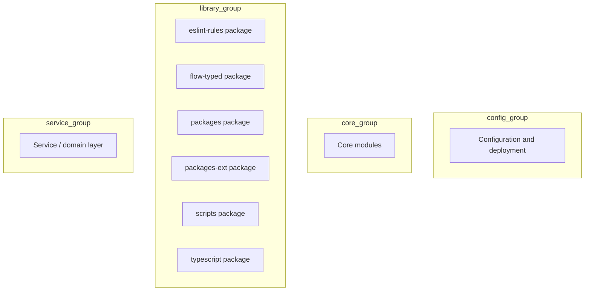

# Architecture report: facebookexperimental/Recoil

> Automated static analysis. **Observed** = directly seen in files/imports/AST; **Inferred** = interpretation from that evidence. Repository code was not executed.

## 1. Repository at a glance

| Item | Value |
| --- | --- |
| Repository | facebookexperimental/Recoil |
| Description | Recoil is an experimental state management library for React apps. It provides several capabilities that are difficult to achieve with React alone, while being compatible with the newest features of React. |
| Language | JavaScript |
| Stars | 19400 |
| Licence | MIT |
| Analysed commit / branch | c1b97f3a0117cad76cbc6ab3cb06d89a9ce717af / main |
| Framework(s) | React |
| Files analysed | 345 |
| Components | 9 |

## 2. Architecture in one minute

facebookexperimental/Recoil - Recoil is an experimental state management library for React apps. It provides several capabilities that are difficult to achieve with React alone, while being compatible with the newest features of…. This repository was analysed statically from 345 file(s) (0 Python). Detected technologies (observed from imports/manifests): GitHub Actions, React, Jest, TypeScript, webpack. Files are grouped into 9 component(s): Configuration and deployment, Core modules, eslint-rules package, flow-typed package, packages package, packages-ext package, scripts package, Service / domain layer. Findings below distinguish observed facts from inferred interpretation.

## 3. High-level block diagram

## 4. Main components

### Configuration and deployment (`config`)

- **Kind:** config
- **Status:** Observed
- **Confidence:** 0.85
- **Responsibility:** Groups 17 file(s) under configuration and deployment (observed from repository paths and static analysis).
- **Paths:** `babel.config.json`, `package.json`, `packages-ext/recoil-devtools/package.json`, `packages-ext/recoil-devtools/src/manifest.json`, `packages-ext/todo-example/package.json`, `packages-ext/todo-example/public/manifest.json`, `packages/recoil-relay/package-for-release.json`, `packages/recoil-relay/package.json`, `packages/recoil-sync/package-for-release.json`, `packages/recoil-sync/package.json`, `packages/recoil/package-for-release.json`, `packages/recoil/package.json`, `packages/refine/package-for-release.json`, `packages/refine/package.json`, `packages/shared/package.json`, `typescript/tsconfig.json`, `typescript/tslint.json`
- **Evidence:** [babel.config.json](https://github.com/facebookexperimental/Recoil/blob/c1b97f3a0117cad76cbc6ab3cb06d89a9ce717af/babel.config.json); [package.json](https://github.com/facebookexperimental/Recoil/blob/c1b97f3a0117cad76cbc6ab3cb06d89a9ce717af/package.json); [packages-ext/recoil-devtools/package.json](https://github.com/facebookexperimental/Recoil/blob/c1b97f3a0117cad76cbc6ab3cb06d89a9ce717af/packages-ext/recoil-devtools/package.json); [packages-ext/recoil-devtools/src/manifest.json](https://github.com/facebookexperimental/Recoil/blob/c1b97f3a0117cad76cbc6ab3cb06d89a9ce717af/packages-ext/recoil-devtools/src/manifest.json); [packages-ext/todo-example/package.json](https://github.com/facebookexperimental/Recoil/blob/c1b97f3a0117cad76cbc6ab3cb06d89a9ce717af/packages-ext/todo-example/package.json); [packages-ext/todo-example/public/manifest.json](https://github.com/facebookexperimental/Recoil/blob/c1b97f3a0117cad76cbc6ab3cb06d89a9ce717af/packages-ext/todo-example/public/manifest.json); [packages/recoil-relay/package-for-release.json](https://github.com/facebookexperimental/Recoil/blob/c1b97f3a0117cad76cbc6ab3cb06d89a9ce717af/packages/recoil-relay/package-for-release.json); [packages/recoil-relay/package.json](https://github.com/facebookexperimental/Recoil/blob/c1b97f3a0117cad76cbc6ab3cb06d89a9ce717af/packages/recoil-relay/package.json)

### Core modules (`core`)

- **Kind:** core
- **Status:** Observed
- **Confidence:** 0.85
- **Responsibility:** Groups 4 file(s) under core modules (observed from repository paths and static analysis).
- **Paths:** `jest.config.js`, `relay.config.js`, `rollup.config.js`, `setupJestMock.js`
- **Evidence:** [jest.config.js](https://github.com/facebookexperimental/Recoil/blob/c1b97f3a0117cad76cbc6ab3cb06d89a9ce717af/jest.config.js); [relay.config.js](https://github.com/facebookexperimental/Recoil/blob/c1b97f3a0117cad76cbc6ab3cb06d89a9ce717af/relay.config.js); [rollup.config.js](https://github.com/facebookexperimental/Recoil/blob/c1b97f3a0117cad76cbc6ab3cb06d89a9ce717af/rollup.config.js); [setupJestMock.js](https://github.com/facebookexperimental/Recoil/blob/c1b97f3a0117cad76cbc6ab3cb06d89a9ce717af/setupJestMock.js)

### eslint-rules package (`eslint_rules`)

- **Kind:** library
- **Status:** Observed
- **Confidence:** 0.85
- **Responsibility:** Groups 1 file(s) under eslint-rules package (observed from repository paths and static analysis).
- **Paths:** `eslint-rules/no-fb-only.js`
- **Evidence:** [eslint-rules/no-fb-only.js](https://github.com/facebookexperimental/Recoil/blob/c1b97f3a0117cad76cbc6ab3cb06d89a9ce717af/eslint-rules/no-fb-only.js)

### flow-typed package (`flow_typed`)

- **Kind:** library
- **Status:** Observed
- **Confidence:** 0.85
- **Responsibility:** Groups 18 file(s) under flow-typed package (observed from repository paths and static analysis).
- **Paths:** `flow-typed/jest.js`, `flow-typed/npm/ReactDOM_vx.x.x.js`, `flow-typed/npm/ReactTestUtils_vx.x.x.js`, `flow-typed/npm/d3-array_vx.x.x.js`, `flow-typed/npm/d3-collection_vx.x.x.js`, `flow-typed/npm/d3-interpolate_vx.x.x.js`, `flow-typed/npm/d3-scale_vx.x.x.js`, `flow-typed/npm/d3-selection_vx.x.x.js`, `flow-typed/npm/d3-transition_vx.x.x.js`, `flow-typed/npm/d3_vx.x.x.js`, `flow-typed/npm/hamt_plus_vx.x.x.js`, `flow-typed/npm/immutable_vx.x.x.js`, `flow-typed/npm/jest_v26.x.x.js`, `flow-typed/npm/jsondiffpatch-for-react_vx.x.x.js`, `flow-typed/npm/nullthrows_vx.x.x.js`, `flow-typed/npm/react-dom_v18.x.x.js`, `flow-typed/package.json.js`, `flow-typed/public-stubs.js`
- **Evidence:** [flow-typed/jest.js](https://github.com/facebookexperimental/Recoil/blob/c1b97f3a0117cad76cbc6ab3cb06d89a9ce717af/flow-typed/jest.js); [flow-typed/npm/ReactDOM_vx.x.x.js](https://github.com/facebookexperimental/Recoil/blob/c1b97f3a0117cad76cbc6ab3cb06d89a9ce717af/flow-typed/npm/ReactDOM_vx.x.x.js); [flow-typed/npm/ReactTestUtils_vx.x.x.js](https://github.com/facebookexperimental/Recoil/blob/c1b97f3a0117cad76cbc6ab3cb06d89a9ce717af/flow-typed/npm/ReactTestUtils_vx.x.x.js); [flow-typed/npm/d3-array_vx.x.x.js](https://github.com/facebookexperimental/Recoil/blob/c1b97f3a0117cad76cbc6ab3cb06d89a9ce717af/flow-typed/npm/d3-array_vx.x.x.js); [flow-typed/npm/d3-collection_vx.x.x.js](https://github.com/facebookexperimental/Recoil/blob/c1b97f3a0117cad76cbc6ab3cb06d89a9ce717af/flow-typed/npm/d3-collection_vx.x.x.js); [flow-typed/npm/d3-interpolate_vx.x.x.js](https://github.com/facebookexperimental/Recoil/blob/c1b97f3a0117cad76cbc6ab3cb06d89a9ce717af/flow-typed/npm/d3-interpolate_vx.x.x.js); [flow-typed/npm/d3-scale_vx.x.x.js](https://github.com/facebookexperimental/Recoil/blob/c1b97f3a0117cad76cbc6ab3cb06d89a9ce717af/flow-typed/npm/d3-scale_vx.x.x.js); [flow-typed/npm/d3-selection_vx.x.x.js](https://github.com/facebookexperimental/Recoil/blob/c1b97f3a0117cad76cbc6ab3cb06d89a9ce717af/flow-typed/npm/d3-selection_vx.x.x.js)

### packages package (`packages`)

- **Kind:** library
- **Status:** Observed
- **Confidence:** 0.85
- **Responsibility:** Groups 156 file(s) under packages package (observed from repository paths and static analysis).
- **Paths:** `packages/recoil-relay/RecoilRelay_Environments.js`, `packages/recoil-relay/RecoilRelay_graphQLMutationEffect.js`, `packages/recoil-relay/RecoilRelay_graphQLQueryEffect.js`, `packages/recoil-relay/RecoilRelay_graphQLSelector.js`, `packages/recoil-relay/RecoilRelay_graphQLSelectorFamily.js`, `packages/recoil-relay/RecoilRelay_graphQLSubscriptionEffect.js`, `packages/recoil-relay/RecoilRelay_index.js`, `packages/recoil-relay/__test_utils__/RecoilRelay_mockRelayEnvironment.js`, `packages/recoil-relay/__tests__/RecoilRelay_RecoilRelayEnvironment-test.js`, `packages/recoil-relay/__tests__/RecoilRelay_graphQLMutationEffect-test.js`, `packages/recoil-relay/__tests__/RecoilRelay_graphQLQueryEffect-test.js`, `packages/recoil-relay/__tests__/RecoilRelay_graphQLSelector-test.js`, `packages/recoil-relay/__tests__/RecoilRelay_graphQLSelectorFamily-test.js`, `packages/recoil-relay/__tests__/RecoilRelay_graphQLSubscriptionEffect-test.js`, `packages/recoil-relay/__tests__/mock-graphql/RecoilRelay_MockQueries.js`, `packages/recoil-sync/RecoilSync.js`, `packages/recoil-sync/RecoilSync_URL.js`, `packages/recoil-sync/RecoilSync_URLJSON.js`, `packages/recoil-sync/RecoilSync_URLTransit.js`, `packages/recoil-sync/RecoilSync_index.js`, `packages/recoil-sync/__test_utils__/RecoilSync_MockURLSerialization.js`, `packages/recoil-sync/__tests__/RecoilSync-test.js`, `packages/recoil-sync/__tests__/RecoilSync_URL-test.js`, `packages/recoil-sync/__tests__/RecoilSync_URLCompound-test.js`, `packages/recoil-sync/__tests__/RecoilSync_URLInterface-test.js`, `packages/recoil-sync/__tests__/RecoilSync_URLJSON-test.js`, `packages/recoil-sync/__tests__/RecoilSync_URLListen-test.js`, `packages/recoil-sync/__tests__/RecoilSync_URLPush-test.js`, `packages/recoil-sync/__tests__/RecoilSync_URLTransit-test.js`, `packages/recoil-sync/__tests__/RecoilSync_URLTransitJSON-test.js`, `packages/recoil/Recoil_index.js`, `packages/recoil/adt/Recoil_ArrayKeyedMap.js`, `packages/recoil/adt/Recoil_Loadable.js`, `packages/recoil/adt/Recoil_PersistentMap.js`, `packages/recoil/adt/Recoil_Queue.js`, `packages/recoil/adt/Recoil_Wrapper.js`, `packages/recoil/adt/__tests__/Recoil_ArrayKeyedMap-test.js`, `packages/recoil/adt/__tests__/Recoil_Loadable-test.js`, `packages/recoil/caches/Recoil_CacheImplementationType.js`, `packages/recoil/caches/Recoil_CachePolicy.js`, `packages/recoil/caches/Recoil_LRUCache.js`, `packages/recoil/caches/Recoil_MapCache.js`, `packages/recoil/caches/Recoil_TreeCache.js`, `packages/recoil/caches/Recoil_TreeCacheImplementationType.js`, `packages/recoil/caches/Recoil_cacheFromPolicy.js`, `packages/recoil/caches/Recoil_treeCacheFromPolicy.js`, `packages/recoil/caches/Recoil_treeCacheLRU.js`, `packages/recoil/caches/__tests__/Recoil_LRUCache-test.js`, `packages/recoil/caches/__tests__/Recoil_MapCache-test.js`, `packages/recoil/caches/__tests__/Recoil_TreeCache-test.js`, `packages/recoil/caches/__tests__/Recoil_cacheFromPolicy-test.js`, `packages/recoil/caches/__tests__/Recoil_treeCacheFromPolicy-test.js`, `packages/recoil/caches/__tests__/Recoil_treeCacheLRU-test.js`, `packages/recoil/contrib/devtools_connector/RecoilDevTools_Connector.react.js`, `packages/recoil/contrib/uri_persistence/Recoil_Link.js`, `packages/recoil/contrib/uri_persistence/__tests__/Recoil_Link-test.js`, `packages/recoil/hooks/Recoil_Hooks.js`, `packages/recoil/hooks/Recoil_SnapshotHooks.js`, `packages/recoil/hooks/Recoil_useGetRecoilValueInfo.js`, `packages/recoil/hooks/Recoil_useRecoilBridgeAcrossReactRoots.js`, `packages/recoil/hooks/Recoil_useRecoilCallback.js`, `packages/recoil/hooks/Recoil_useRecoilRefresher.js`, `packages/recoil/hooks/Recoil_useRecoilTransaction.js`, `packages/recoil/hooks/Recoil_useRetain.js`, `packages/recoil/hooks/__tests__/Recoil_Hooks_TRANSITION_SUPPORT_UNSTABLE-test.js`, `packages/recoil/hooks/__tests__/Recoil_PublicHooks-test.js`, `packages/recoil/hooks/__tests__/Recoil_React-test.js`, `packages/recoil/hooks/__tests__/Recoil_useGetRecoilValueInfo-test.js`, `packages/recoil/hooks/__tests__/Recoil_useGotoRecoilSnapshot-test.js`, `packages/recoil/hooks/__tests__/Recoil_useRecoilBridgeAcrossReactRoots-test.js`, `packages/recoil/hooks/__tests__/Recoil_useRecoilCallback-test.js`, `packages/recoil/hooks/__tests__/Recoil_useRecoilInterface-test.js`, `packages/recoil/hooks/__tests__/Recoil_useRecoilRefresher-test.js`, `packages/recoil/hooks/__tests__/Recoil_useRecoilSnapshot-test.js`, `packages/recoil/hooks/__tests__/Recoil_useRecoilStateReset-test.js`, `packages/recoil/hooks/__tests__/Recoil_useRecoilTransaction-test.js`, `packages/recoil/hooks/__tests__/Recoil_useRecoilTransactionObserver-test.js`, `packages/recoil/hooks/__tests__/Recoil_useRecoilValueLoadable-test.js`, `packages/recoil/hooks/__tests__/Recoil_useTransactionObservation_DEPRECATED-test.js`, `packages/recoil/hooks/__tests__/Recoil_useTransition-test.js`, `packages/recoil/recoil_values/Recoil_WaitFor.js`, `packages/recoil/recoil_values/Recoil_atom.js`, `packages/recoil/recoil_values/Recoil_atomFamily.js`, `packages/recoil/recoil_values/Recoil_callbackTypes.js`, `packages/recoil/recoil_values/Recoil_constSelector.js`, `packages/recoil/recoil_values/Recoil_errorSelector.js`, `packages/recoil/recoil_values/Recoil_readOnlySelector.js`, `packages/recoil/recoil_values/Recoil_selector.js`, `packages/recoil/recoil_values/Recoil_selectorFamily.js`, `packages/recoil/recoil_values/__flowtests__/Recoil_WaitFor-flowtest.js`, `packages/recoil/recoil_values/__tests__/Recoil_WaitFor-test.js`, `packages/recoil/recoil_values/__tests__/Recoil_atom-test.js`, `packages/recoil/recoil_values/__tests__/Recoil_atomFamily-test.js`, `packages/recoil/recoil_values/__tests__/Recoil_atomWithFallback-test.js`, `packages/recoil/recoil_values/__tests__/Recoil_constSelector-test.js`, `packages/recoil/recoil_values/__tests__/Recoil_errorSelector-test.js`, `packages/recoil/recoil_values/__tests__/Recoil_selector-test.js`, `packages/recoil/recoil_values/__tests__/Recoil_selectorFamily-test.js`, `packages/recoil/recoil_values/__tests__/Recoil_selectorHooks-test.js`, `packages/refine/Refine_API.js`, `packages/refine/Refine_Checkers.js`, `packages/refine/Refine_ContainerCheckers.js`, `packages/refine/Refine_JSON.js`, `packages/refine/Refine_PrimitiveCheckers.js`, `packages/refine/Refine_UtilityCheckers.js`, `packages/refine/Refine_index.js`, `packages/refine/__tests__/Refine-test.js`, `packages/refine/__tests__/Refine_Containers-test.js`, `packages/refine/__tests__/Refine_JSON-test.js`, `packages/refine/__tests__/Refine_Primitives-test.js`, `packages/refine/__tests__/Refine_Utilities-test.js`, `packages/shared/__test_utils__/Recoil_ReactRenderModes.js`, `packages/shared/__test_utils__/Recoil_TestingUtils.js`, `packages/shared/polyfill/ReactBatchedUpdates.js`, `packages/shared/polyfill/ReactBatchedUpdates.native.js`, `packages/shared/polyfill/err.js`, `packages/shared/polyfill/expectationViolation.js`, `packages/shared/polyfill/invariant.js`, `packages/shared/polyfill/recoverableViolation.js`, `packages/shared/polyfill/sprintf.js`, `packages/shared/util/Recoil_CopyOnWrite.js`, `packages/shared/util/Recoil_Environment.js`, `packages/shared/util/Recoil_Memoize.js`, `packages/shared/util/Recoil_PerformanceTimings.js`, `packages/shared/util/Recoil_ReactBatchedUpdates.js`, `packages/shared/util/Recoil_RecoilEnv.js`, `packages/shared/util/Recoil_concatIterables.js`, `packages/shared/util/Recoil_deepFreezeValue.js`, `packages/shared/util/Recoil_differenceSets.js`, `packages/shared/util/Recoil_err.js`, `packages/shared/util/Recoil_expectationViolation.js`, `packages/shared/util/Recoil_filterIterable.js`, `packages/shared/util/Recoil_filterMap.js`, `packages/shared/util/Recoil_filterSet.js`, `packages/shared/util/Recoil_gkx.js`, `packages/shared/util/Recoil_invariant.js`, `packages/shared/util/Recoil_isNode.js`, `packages/shared/util/Recoil_isPromise.js`, `packages/shared/util/Recoil_lazyProxy.js`, `packages/shared/util/Recoil_mapIterable.js`, `packages/shared/util/Recoil_mapMap.js`, `packages/shared/util/Recoil_mergeMaps.js`, `packages/shared/util/Recoil_nullthrows.js`, `packages/shared/util/Recoil_recoverableViolation.js`, `packages/shared/util/Recoil_shallowArrayEqual.js`, `packages/shared/util/Recoil_someSet.js`, `packages/shared/util/Recoil_stableStringify.js`, `packages/shared/util/Recoil_unionSets.js`, `packages/shared/util/Recoil_useComponentName.js`, `packages/shared/util/Recoil_usePrevious.js`, `packages/shared/util/Recoil_useRefInitOnce.js`, `packages/shared/util/__tests__/Recoil_Memoize-test.js`, `packages/shared/util/__tests__/Recoil_RecoilEnv-test.js`, `packages/shared/util/__tests__/Recoil_deepFreezeValue-test.js`, `packages/shared/util/__tests__/Recoil_lazyProxy-test.js`, `packages/shared/util/__tests__/Recoil_stableStringify-test.js`
- **Evidence:** [packages/recoil-relay/RecoilRelay_Environments.js](https://github.com/facebookexperimental/Recoil/blob/c1b97f3a0117cad76cbc6ab3cb06d89a9ce717af/packages/recoil-relay/RecoilRelay_Environments.js); [packages/recoil-relay/RecoilRelay_graphQLMutationEffect.js](https://github.com/facebookexperimental/Recoil/blob/c1b97f3a0117cad76cbc6ab3cb06d89a9ce717af/packages/recoil-relay/RecoilRelay_graphQLMutationEffect.js); [packages/recoil-relay/RecoilRelay_graphQLQueryEffect.js](https://github.com/facebookexperimental/Recoil/blob/c1b97f3a0117cad76cbc6ab3cb06d89a9ce717af/packages/recoil-relay/RecoilRelay_graphQLQueryEffect.js); [packages/recoil-relay/RecoilRelay_graphQLSelector.js](https://github.com/facebookexperimental/Recoil/blob/c1b97f3a0117cad76cbc6ab3cb06d89a9ce717af/packages/recoil-relay/RecoilRelay_graphQLSelector.js); [packages/recoil-relay/RecoilRelay_graphQLSelectorFamily.js](https://github.com/facebookexperimental/Recoil/blob/c1b97f3a0117cad76cbc6ab3cb06d89a9ce717af/packages/recoil-relay/RecoilRelay_graphQLSelectorFamily.js); [packages/recoil-relay/RecoilRelay_graphQLSubscriptionEffect.js](https://github.com/facebookexperimental/Recoil/blob/c1b97f3a0117cad76cbc6ab3cb06d89a9ce717af/packages/recoil-relay/RecoilRelay_graphQLSubscriptionEffect.js); [packages/recoil-relay/RecoilRelay_index.js](https://github.com/facebookexperimental/Recoil/blob/c1b97f3a0117cad76cbc6ab3cb06d89a9ce717af/packages/recoil-relay/RecoilRelay_index.js); [packages/recoil-relay/__test_utils__/RecoilRelay_mockRelayEnvironment.js](https://github.com/facebookexperimental/Recoil/blob/c1b97f3a0117cad76cbc6ab3cb06d89a9ce717af/packages/recoil-relay/__test_utils__/RecoilRelay_mockRelayEnvironment.js)

### packages-ext package (`packages_ext`)

- **Kind:** library
- **Status:** Observed
- **Confidence:** 0.85
- **Responsibility:** Groups 72 file(s) under packages-ext package (observed from repository paths and static analysis).
- **Paths:** `packages-ext/recoil-devtools/flow.js`, `packages-ext/recoil-devtools/src/constants/Constants.js`, `packages-ext/recoil-devtools/src/pages/Background/Background.js`, `packages-ext/recoil-devtools/src/pages/Background/__tests__/Background.test.js`, `packages-ext/recoil-devtools/src/pages/Content/ContentScript.js`, `packages-ext/recoil-devtools/src/pages/Content/__tests__/ContentScript.test.js`, `packages-ext/recoil-devtools/src/pages/Devtools/DevtoolsScript.js`, `packages-ext/recoil-devtools/src/pages/Page/PageScript.js`, `packages-ext/recoil-devtools/src/pages/Popup/ConnectionContext.js`, `packages-ext/recoil-devtools/src/pages/Popup/Items/CollapsibleItem.js`, `packages-ext/recoil-devtools/src/pages/Popup/Items/DiffItem.js`, `packages-ext/recoil-devtools/src/pages/Popup/Items/Item.js`, `packages-ext/recoil-devtools/src/pages/Popup/Items/ItemDependencies.js`, `packages-ext/recoil-devtools/src/pages/Popup/Items/ItemDescription.js`, `packages-ext/recoil-devtools/src/pages/Popup/Items/ItemLabel.js`, `packages-ext/recoil-devtools/src/pages/Popup/Items/ItemMoreItems.js`, `packages-ext/recoil-devtools/src/pages/Popup/Items/ItemValue.js`, `packages-ext/recoil-devtools/src/pages/Popup/Items/NodeName.js`, `packages-ext/recoil-devtools/src/pages/Popup/Items/index.js`, `packages-ext/recoil-devtools/src/pages/Popup/PopupApp.js`, `packages-ext/recoil-devtools/src/pages/Popup/PopupComponent.js`, `packages-ext/recoil-devtools/src/pages/Popup/PopupDependencyGraph.js`, `packages-ext/recoil-devtools/src/pages/Popup/PopupDiff.js`, `packages-ext/recoil-devtools/src/pages/Popup/PopupHeader.js`, `packages-ext/recoil-devtools/src/pages/Popup/PopupMainContent.js`, `packages-ext/recoil-devtools/src/pages/Popup/PopupScript.js`, `packages-ext/recoil-devtools/src/pages/Popup/PopupSidebar.js`, `packages-ext/recoil-devtools/src/pages/Popup/PopupSidebarTransaction.js`, `packages-ext/recoil-devtools/src/pages/Popup/PopupSnapshot.js`, `packages-ext/recoil-devtools/src/pages/Popup/Snapshot/AtomList.js`, `packages-ext/recoil-devtools/src/pages/Popup/Snapshot/SearchContext.js`, `packages-ext/recoil-devtools/src/pages/Popup/Snapshot/SelectorList.js`, `packages-ext/recoil-devtools/src/pages/Popup/Snapshot/SnapshotSearch.js`, `packages-ext/recoil-devtools/src/pages/Popup/Snapshot/snapshotHooks.js`, `packages-ext/recoil-devtools/src/pages/Popup/Tabs.js`, `packages-ext/recoil-devtools/src/pages/Popup/useSelectionHooks.js`, `packages-ext/recoil-devtools/src/types/DevtoolsTypes.js`, `packages-ext/recoil-devtools/src/utils/Connection.js`, `packages-ext/recoil-devtools/src/utils/EvictableList.js`, `packages-ext/recoil-devtools/src/utils/GraphUtils.js`, `packages-ext/recoil-devtools/src/utils/Logger.js`, `packages-ext/recoil-devtools/src/utils/ObjectEntries.js`, `packages-ext/recoil-devtools/src/utils/ObjectValues.js`, `packages-ext/recoil-devtools/src/utils/Serialization.js`, `packages-ext/recoil-devtools/src/utils/Store.js`, `packages-ext/recoil-devtools/src/utils/TXHashtable.js`, `packages-ext/recoil-devtools/src/utils/__tests__/EvictableListTest.js`, `packages-ext/recoil-devtools/src/utils/__tests__/Recoil_DevTools_GraphUtils.test.js`, `packages-ext/recoil-devtools/src/utils/__tests__/Recoil_DevTools_TXHashtable.test.js`, `packages-ext/recoil-devtools/src/utils/__tests__/SerializationTest.js`, `packages-ext/recoil-devtools/src/utils/debounce.js`, `packages-ext/recoil-devtools/src/utils/getStyle.js`, `packages-ext/recoil-devtools/src/utils/sankey/CV2_D3.js`, `packages-ext/recoil-devtools/src/utils/sankey/CV2_memoize.js`, `packages-ext/recoil-devtools/src/utils/sankey/Sankey.js`, `packages-ext/recoil-devtools/src/utils/sankey/SankeyGraph.js`, `packages-ext/recoil-devtools/src/utils/sankey/SankeyGraphLayout.js`, `packages-ext/recoil-devtools/src/utils/sankey/compactArray.js`, `packages-ext/recoil-devtools/src/utils/sankey/isImmutable.js`, `packages-ext/recoil-devtools/utils/build.js`, `packages-ext/recoil-devtools/utils/env.js`, `packages-ext/recoil-devtools/utils/webserver.js`, `packages-ext/recoil-devtools/webpack.config.js`, `packages-ext/todo-example/src/App.js`, `packages-ext/todo-example/src/components/Todo/TodoItem.jsx`, `packages-ext/todo-example/src/components/Todo/TodoItemCreator.jsx`, `packages-ext/todo-example/src/components/Todo/TodoList.jsx`, `packages-ext/todo-example/src/components/Todo/TodoListFilters.jsx`, `packages-ext/todo-example/src/components/Todo/TodoListStats.jsx`, `packages-ext/todo-example/src/components/Todo/Todo_state.js`, `packages-ext/todo-example/src/components/Todo/Todo_types.js`, `packages-ext/todo-example/src/index.js`
- **Evidence:** [packages-ext/recoil-devtools/flow.js](https://github.com/facebookexperimental/Recoil/blob/c1b97f3a0117cad76cbc6ab3cb06d89a9ce717af/packages-ext/recoil-devtools/flow.js); [packages-ext/recoil-devtools/src/constants/Constants.js](https://github.com/facebookexperimental/Recoil/blob/c1b97f3a0117cad76cbc6ab3cb06d89a9ce717af/packages-ext/recoil-devtools/src/constants/Constants.js); [packages-ext/recoil-devtools/src/pages/Background/Background.js](https://github.com/facebookexperimental/Recoil/blob/c1b97f3a0117cad76cbc6ab3cb06d89a9ce717af/packages-ext/recoil-devtools/src/pages/Background/Background.js); [packages-ext/recoil-devtools/src/pages/Background/__tests__/Background.test.js](https://github.com/facebookexperimental/Recoil/blob/c1b97f3a0117cad76cbc6ab3cb06d89a9ce717af/packages-ext/recoil-devtools/src/pages/Background/__tests__/Background.test.js); [packages-ext/recoil-devtools/src/pages/Content/ContentScript.js](https://github.com/facebookexperimental/Recoil/blob/c1b97f3a0117cad76cbc6ab3cb06d89a9ce717af/packages-ext/recoil-devtools/src/pages/Content/ContentScript.js); [packages-ext/recoil-devtools/src/pages/Content/__tests__/ContentScript.test.js](https://github.com/facebookexperimental/Recoil/blob/c1b97f3a0117cad76cbc6ab3cb06d89a9ce717af/packages-ext/recoil-devtools/src/pages/Content/__tests__/ContentScript.test.js); [packages-ext/recoil-devtools/src/pages/Devtools/DevtoolsScript.js](https://github.com/facebookexperimental/Recoil/blob/c1b97f3a0117cad76cbc6ab3cb06d89a9ce717af/packages-ext/recoil-devtools/src/pages/Devtools/DevtoolsScript.js); [packages-ext/recoil-devtools/src/pages/Page/PageScript.js](https://github.com/facebookexperimental/Recoil/blob/c1b97f3a0117cad76cbc6ab3cb06d89a9ce717af/packages-ext/recoil-devtools/src/pages/Page/PageScript.js)

### scripts package (`scripts`)

- **Kind:** library
- **Status:** Observed
- **Confidence:** 0.85
- **Responsibility:** Groups 6 file(s) under scripts package (observed from repository paths and static analysis).
- **Paths:** `scripts/build.mjs`, `scripts/deploy_nightly_build.js`, `scripts/pack.mjs`, `scripts/project-root-dir.mjs`, `scripts/rollup-configs.mjs`, `scripts/utils.mjs`
- **Evidence:** [scripts/build.mjs](https://github.com/facebookexperimental/Recoil/blob/c1b97f3a0117cad76cbc6ab3cb06d89a9ce717af/scripts/build.mjs); [scripts/deploy_nightly_build.js](https://github.com/facebookexperimental/Recoil/blob/c1b97f3a0117cad76cbc6ab3cb06d89a9ce717af/scripts/deploy_nightly_build.js); [scripts/pack.mjs](https://github.com/facebookexperimental/Recoil/blob/c1b97f3a0117cad76cbc6ab3cb06d89a9ce717af/scripts/pack.mjs); [scripts/project-root-dir.mjs](https://github.com/facebookexperimental/Recoil/blob/c1b97f3a0117cad76cbc6ab3cb06d89a9ce717af/scripts/project-root-dir.mjs); [scripts/rollup-configs.mjs](https://github.com/facebookexperimental/Recoil/blob/c1b97f3a0117cad76cbc6ab3cb06d89a9ce717af/scripts/rollup-configs.mjs); [scripts/utils.mjs](https://github.com/facebookexperimental/Recoil/blob/c1b97f3a0117cad76cbc6ab3cb06d89a9ce717af/scripts/utils.mjs)

### Service / domain layer (`service_layer`)

- **Kind:** service
- **Status:** Observed
- **Confidence:** 0.85
- **Responsibility:** Groups 25 file(s) under service / domain layer (observed from repository paths and static analysis).
- **Paths:** `packages/recoil/core/Recoil_AtomicUpdates.js`, `packages/recoil/core/Recoil_Batching.js`, `packages/recoil/core/Recoil_FunctionalCore.js`, `packages/recoil/core/Recoil_Graph.js`, `packages/recoil/core/Recoil_GraphTypes.js`, `packages/recoil/core/Recoil_Keys.js`, `packages/recoil/core/Recoil_Node.js`, `packages/recoil/core/Recoil_ReactMode.js`, `packages/recoil/core/Recoil_RecoilRoot.js`, `packages/recoil/core/Recoil_RecoilValue.js`, `packages/recoil/core/Recoil_RecoilValueInterface.js`, `packages/recoil/core/Recoil_RetainedBy.js`, `packages/recoil/core/Recoil_Retention.js`, `packages/recoil/core/Recoil_RetentionZone.js`, `packages/recoil/core/Recoil_Snapshot.js`, `packages/recoil/core/Recoil_SnapshotCache.js`, `packages/recoil/core/Recoil_State.js`, `packages/recoil/core/__tests__/Recoil_RecoilRoot-test.js`, `packages/recoil/core/__tests__/Recoil_RecoilValueInterface-test.js`, `packages/recoil/core/__tests__/Recoil_Retention-test.js`, `packages/recoil/core/__tests__/Recoil_Snapshot-test.js`, `packages/recoil/core/__tests__/Recoil_batcher-test.js`, `packages/recoil/core/__tests__/Recoil_core-test.js`, `packages/recoil/core/__tests__/Recoil_perf-test.js`, `packages/recoil/core/__tests__/Recoil_useRecoilStoreID-test.js`
- **Evidence:** [packages/recoil/core/Recoil_AtomicUpdates.js](https://github.com/facebookexperimental/Recoil/blob/c1b97f3a0117cad76cbc6ab3cb06d89a9ce717af/packages/recoil/core/Recoil_AtomicUpdates.js); [packages/recoil/core/Recoil_Batching.js](https://github.com/facebookexperimental/Recoil/blob/c1b97f3a0117cad76cbc6ab3cb06d89a9ce717af/packages/recoil/core/Recoil_Batching.js); [packages/recoil/core/Recoil_FunctionalCore.js](https://github.com/facebookexperimental/Recoil/blob/c1b97f3a0117cad76cbc6ab3cb06d89a9ce717af/packages/recoil/core/Recoil_FunctionalCore.js); [packages/recoil/core/Recoil_Graph.js](https://github.com/facebookexperimental/Recoil/blob/c1b97f3a0117cad76cbc6ab3cb06d89a9ce717af/packages/recoil/core/Recoil_Graph.js); [packages/recoil/core/Recoil_GraphTypes.js](https://github.com/facebookexperimental/Recoil/blob/c1b97f3a0117cad76cbc6ab3cb06d89a9ce717af/packages/recoil/core/Recoil_GraphTypes.js); [packages/recoil/core/Recoil_Keys.js](https://github.com/facebookexperimental/Recoil/blob/c1b97f3a0117cad76cbc6ab3cb06d89a9ce717af/packages/recoil/core/Recoil_Keys.js); [packages/recoil/core/Recoil_Node.js](https://github.com/facebookexperimental/Recoil/blob/c1b97f3a0117cad76cbc6ab3cb06d89a9ce717af/packages/recoil/core/Recoil_Node.js); [packages/recoil/core/Recoil_ReactMode.js](https://github.com/facebookexperimental/Recoil/blob/c1b97f3a0117cad76cbc6ab3cb06d89a9ce717af/packages/recoil/core/Recoil_ReactMode.js)

### typescript package (`typescript`)

- **Kind:** library
- **Status:** Observed
- **Confidence:** 0.85
- **Responsibility:** Groups 9 file(s) under typescript package (observed from repository paths and static analysis).
- **Paths:** `typescript/index.d.ts`, `typescript/recoil-relay-test.ts`, `typescript/recoil-relay.d.ts`, `typescript/recoil-sync-test.ts`, `typescript/recoil-sync.d.ts`, `typescript/recoil-test.ts`, `typescript/recoil.d.ts`, `typescript/refine-test.ts`, `typescript/refine.d.ts`
- **Evidence:** [typescript/index.d.ts](https://github.com/facebookexperimental/Recoil/blob/c1b97f3a0117cad76cbc6ab3cb06d89a9ce717af/typescript/index.d.ts); [typescript/recoil-relay-test.ts](https://github.com/facebookexperimental/Recoil/blob/c1b97f3a0117cad76cbc6ab3cb06d89a9ce717af/typescript/recoil-relay-test.ts); [typescript/recoil-relay.d.ts](https://github.com/facebookexperimental/Recoil/blob/c1b97f3a0117cad76cbc6ab3cb06d89a9ce717af/typescript/recoil-relay.d.ts); [typescript/recoil-sync-test.ts](https://github.com/facebookexperimental/Recoil/blob/c1b97f3a0117cad76cbc6ab3cb06d89a9ce717af/typescript/recoil-sync-test.ts); [typescript/recoil-sync.d.ts](https://github.com/facebookexperimental/Recoil/blob/c1b97f3a0117cad76cbc6ab3cb06d89a9ce717af/typescript/recoil-sync.d.ts); [typescript/recoil-test.ts](https://github.com/facebookexperimental/Recoil/blob/c1b97f3a0117cad76cbc6ab3cb06d89a9ce717af/typescript/recoil-test.ts); [typescript/recoil.d.ts](https://github.com/facebookexperimental/Recoil/blob/c1b97f3a0117cad76cbc6ab3cb06d89a9ce717af/typescript/recoil.d.ts); [typescript/refine-test.ts](https://github.com/facebookexperimental/Recoil/blob/c1b97f3a0117cad76cbc6ab3cb06d89a9ce717af/typescript/refine-test.ts)

## 5. Execution flow

**Observed** entry point(s):

- [packages-ext/todo-example/src/App.js](https://github.com/facebookexperimental/Recoil/blob/c1b97f3a0117cad76cbc6ab3cb06d89a9ce717af/packages-ext/todo-example/src/App.js)
- [packages-ext/todo-example/src/index.js](https://github.com/facebookexperimental/Recoil/blob/c1b97f3a0117cad76cbc6ab3cb06d89a9ce717af/packages-ext/todo-example/src/index.js)
- [packages/recoil-relay/RecoilRelay_index.js](https://github.com/facebookexperimental/Recoil/blob/c1b97f3a0117cad76cbc6ab3cb06d89a9ce717af/packages/recoil-relay/RecoilRelay_index.js)
- [packages/recoil-sync/RecoilSync_index.js](https://github.com/facebookexperimental/Recoil/blob/c1b97f3a0117cad76cbc6ab3cb06d89a9ce717af/packages/recoil-sync/RecoilSync_index.js)
- [packages/recoil/Recoil_index.js](https://github.com/facebookexperimental/Recoil/blob/c1b97f3a0117cad76cbc6ab3cb06d89a9ce717af/packages/recoil/Recoil_index.js)
- [packages/refine/Refine_index.js](https://github.com/facebookexperimental/Recoil/blob/c1b97f3a0117cad76cbc6ab3cb06d89a9ce717af/packages/refine/Refine_index.js)

Representative flow (derived from observed entry points and the import graph; steps beyond the entry point are **Inferred**):

1. Execution starts at an observed entry point listed above, if present.
2. No internal import relationships between components were observed.

## 6. Project structure

### `(root)`

- `.eslintignore` - other (72 bytes)
- `.eslintrc.js` - source, JavaScript (961 bytes)
- `.flowconfig` - other (1747 bytes)
- `.gitignore` - other (1502 bytes)
- `.prettierignore` - other (112 bytes)
- `.prettierrc` - other (339 bytes)
- `.watchmanconfig` - other (3 bytes)
- `CHANGELOG-recoil-relay.md` - docs (117 bytes)
- `CHANGELOG-recoil-sync.md` - docs (741 bytes)
- `CHANGELOG-recoil.md` - docs (14407 bytes)
- `CHANGELOG-refine.md` - docs (479 bytes)
- `CODE_OF_CONDUCT.md` - docs (3541 bytes)
- `CONTRIBUTING.md` - docs (2259 bytes)
- `LICENSE` - docs (1088 bytes)
- `README-recoil-relay.md` - docs (2670 bytes)
- `README-recoil-sync.md` - docs (5053 bytes)
- `README-refine.md` - docs (4043 bytes)
- `README.md` - docs (1669 bytes)
- `babel.config.json` - config (588 bytes)
- `jest.config.js` - source, JavaScript (707 bytes)
- `package.json` - manifest (3278 bytes)
- `relay.config.js` - source, JavaScript (322 bytes)
- `rollup.config.js` - source, JavaScript (3555 bytes)
- `setupJestMock.js` - source, JavaScript (296 bytes)

### `.github`

- `.github/workflows/nightly.yml` - ci, YAML (539 bytes)
- `.github/workflows/nodejs.yml` - ci, YAML (1609 bytes)

### `eslint-rules`

- `eslint-rules/no-fb-only.js` - source, JavaScript (2044 bytes)

### `flow-typed`

- `flow-typed/jest.js` - source, JavaScript (34793 bytes)
- `flow-typed/npm/ReactDOM_vx.x.x.js` - source, JavaScript (485 bytes)
- `flow-typed/npm/ReactTestUtils_vx.x.x.js` - source, JavaScript (486 bytes)
- `flow-typed/npm/d3-array_vx.x.x.js` - source, JavaScript (467 bytes)
- `flow-typed/npm/d3-collection_vx.x.x.js` - source, JavaScript (482 bytes)
- `flow-typed/npm/d3-interpolate_vx.x.x.js` - source, JavaScript (485 bytes)
- `flow-typed/npm/d3-scale_vx.x.x.js` - source, JavaScript (467 bytes)
- `flow-typed/npm/d3-selection_vx.x.x.js` - source, JavaScript (12572 bytes)
- `flow-typed/npm/d3-transition_vx.x.x.js` - source, JavaScript (482 bytes)
- `flow-typed/npm/d3_vx.x.x.js` - source, JavaScript (450 bytes)
- `flow-typed/npm/hamt_plus_vx.x.x.js` - source, JavaScript (824 bytes)
- `flow-typed/npm/immutable_vx.x.x.js` - source, JavaScript (1576 bytes)
- `flow-typed/npm/jest_v26.x.x.js` - source, JavaScript (36603 bytes)
- `flow-typed/npm/jsondiffpatch-for-react_vx.x.x.js` - source, JavaScript (512 bytes)
- `flow-typed/npm/nullthrows_vx.x.x.js` - source, JavaScript (848 bytes)
- `flow-typed/npm/react-dom_v18.x.x.js` - source, JavaScript (8593 bytes)
- `flow-typed/package.json.js` - source, JavaScript (172 bytes)
- `flow-typed/public-stubs.js` - source, JavaScript (94 bytes)

### `packages`

- `packages/recoil-relay/RecoilRelay_Environments.js` - source, JavaScript (5124 bytes)
- `packages/recoil-relay/RecoilRelay_graphQLMutationEffect.js` - source, JavaScript (4095 bytes)
- `packages/recoil-relay/RecoilRelay_graphQLQueryEffect.js` - source, JavaScript (4992 bytes)
- `packages/recoil-relay/RecoilRelay_graphQLSelector.js` - source, JavaScript (3017 bytes)
- `packages/recoil-relay/RecoilRelay_graphQLSelectorFamily.js` - source, JavaScript (6868 bytes)
- `packages/recoil-relay/RecoilRelay_graphQLSubscriptionEffect.js` - source, JavaScript (3120 bytes)
- `packages/recoil-relay/RecoilRelay_index.js` - source, JavaScript (1074 bytes)
- `packages/recoil-relay/__test_utils__/RecoilRelay_mockRelayEnvironment.js` - source, JavaScript (1598 bytes)
- `packages/recoil-relay/__tests__/RecoilRelay_RecoilRelayEnvironment-test.js` - source, JavaScript (9517 bytes)
- `packages/recoil-relay/__tests__/RecoilRelay_graphQLMutationEffect-test.js` - source, JavaScript (5912 bytes)
- `packages/recoil-relay/__tests__/RecoilRelay_graphQLQueryEffect-test.js` - source, JavaScript (12953 bytes)
- `packages/recoil-relay/__tests__/RecoilRelay_graphQLSelector-test.js` - source, JavaScript (5432 bytes)
- `packages/recoil-relay/__tests__/RecoilRelay_graphQLSelectorFamily-test.js` - source, JavaScript (16865 bytes)
- `packages/recoil-relay/__tests__/RecoilRelay_graphQLSubscriptionEffect-test.js` - source, JavaScript (2807 bytes)
- `packages/recoil-relay/__tests__/mock-graphql/RecoilRelay_MockQueries.js` - source, JavaScript (1978 bytes)
- `packages/recoil-relay/__tests__/mock-graphql/schema.graphql` - other (820 bytes)
- `packages/recoil-relay/package-for-release.json` - config (543 bytes)
- `packages/recoil-relay/package.json` - manifest (340 bytes)
- `packages/recoil-sync/RecoilSync.js` - source, JavaScript (18912 bytes)
- `packages/recoil-sync/RecoilSync_URL.js` - source, JavaScript (9284 bytes)
- `packages/recoil-sync/RecoilSync_URLJSON.js` - source, JavaScript (1321 bytes)
- `packages/recoil-sync/RecoilSync_URLTransit.js` - source, JavaScript (4113 bytes)
- `packages/recoil-sync/RecoilSync_index.js` - source, JavaScript (1569 bytes)
- `packages/recoil-sync/__test_utils__/RecoilSync_MockURLSerialization.js` - source, JavaScript (3713 bytes)
- `packages/recoil-sync/__tests__/RecoilSync-test.js` - source, JavaScript (44374 bytes)
- `packages/recoil-sync/__tests__/RecoilSync_URL-test.js` - source, JavaScript (12181 bytes)
- `packages/recoil-sync/__tests__/RecoilSync_URLCompound-test.js` - source, JavaScript (7884 bytes)
- `packages/recoil-sync/__tests__/RecoilSync_URLInterface-test.js` - source, JavaScript (5413 bytes)
- `packages/recoil-sync/__tests__/RecoilSync_URLJSON-test.js` - source, JavaScript (6371 bytes)
- `packages/recoil-sync/__tests__/RecoilSync_URLListen-test.js` - source, JavaScript (6511 bytes)
- `packages/recoil-sync/__tests__/RecoilSync_URLPush-test.js` - source, JavaScript (4488 bytes)
- `packages/recoil-sync/__tests__/RecoilSync_URLTransit-test.js` - source, JavaScript (13216 bytes)
- `packages/recoil-sync/__tests__/RecoilSync_URLTransitJSON-test.js` - source, JavaScript (2964 bytes)
- `packages/recoil-sync/package-for-release.json` - config (547 bytes)
- `packages/recoil-sync/package.json` - manifest (337 bytes)
- `packages/recoil/Recoil_index.js` - source, JavaScript (4465 bytes)
- `packages/recoil/adt/Recoil_ArrayKeyedMap.js` - source, JavaScript (2917 bytes)
- `packages/recoil/adt/Recoil_Loadable.js` - source, JavaScript (8650 bytes)
- `packages/recoil/adt/Recoil_PersistentMap.js` - source, JavaScript (2931 bytes)
- `packages/recoil/adt/Recoil_Queue.js` - source, JavaScript (362 bytes)
- `packages/recoil/adt/Recoil_Wrapper.js` - source, JavaScript (391 bytes)
- `packages/recoil/adt/__tests__/Recoil_ArrayKeyedMap-test.js` - source, JavaScript (1314 bytes)
- `packages/recoil/adt/__tests__/Recoil_Loadable-test.js` - source, JavaScript (9373 bytes)
- `packages/recoil/caches/Recoil_CacheImplementationType.js` - source, JavaScript (388 bytes)
- `packages/recoil/caches/Recoil_CachePolicy.js` - source, JavaScript (677 bytes)
- `packages/recoil/caches/Recoil_LRUCache.js` - source, JavaScript (2868 bytes)
- `packages/recoil/caches/Recoil_MapCache.js` - source, JavaScript (938 bytes)
- `packages/recoil/caches/Recoil_TreeCache.js` - source, JavaScript (7045 bytes)
- `packages/recoil/caches/Recoil_TreeCacheImplementationType.js` - source, JavaScript (2165 bytes)
- `packages/recoil/caches/Recoil_cacheFromPolicy.js` - source, JavaScript (2001 bytes)
- `packages/recoil/caches/Recoil_treeCacheFromPolicy.js` - source, JavaScript (2134 bytes)
- `packages/recoil/caches/Recoil_treeCacheLRU.js` - source, JavaScript (1101 bytes)
- `packages/recoil/caches/__tests__/Recoil_LRUCache-test.js` - source, JavaScript (2792 bytes)
- `packages/recoil/caches/__tests__/Recoil_MapCache-test.js` - source, JavaScript (1078 bytes)
- `packages/recoil/caches/__tests__/Recoil_TreeCache-test.js` - source, JavaScript (6047 bytes)
- `packages/recoil/caches/__tests__/Recoil_cacheFromPolicy-test.js` - source, JavaScript (5285 bytes)
- `packages/recoil/caches/__tests__/Recoil_treeCacheFromPolicy-test.js` - source, JavaScript (7669 bytes)
- `packages/recoil/caches/__tests__/Recoil_treeCacheLRU-test.js` - source, JavaScript (2742 bytes)
- `packages/recoil/contrib/devtools_connector/RecoilDevTools_Connector.react.js` - source, JavaScript (2368 bytes)
- `packages/recoil/contrib/uri_persistence/Recoil_Link.js` - source, JavaScript (3782 bytes)
- `packages/recoil/contrib/uri_persistence/__tests__/Recoil_Link-test.js` - source, JavaScript (3889 bytes)
- `packages/recoil/core/Recoil_AtomicUpdates.js` - source, JavaScript (3778 bytes)
- `packages/recoil/core/Recoil_Batching.js` - source, JavaScript (1515 bytes)
- `packages/recoil/core/Recoil_FunctionalCore.js` - source, JavaScript (7737 bytes)
- `packages/recoil/core/Recoil_Graph.js` - source, JavaScript (3781 bytes)
- `packages/recoil/core/Recoil_GraphTypes.js` - source, JavaScript (826 bytes)
- `packages/recoil/core/Recoil_Keys.js` - source, JavaScript (775 bytes)
- `packages/recoil/core/Recoil_Node.js` - source, JavaScript (6289 bytes)
- `packages/recoil/core/Recoil_ReactMode.js` - source, JavaScript (3564 bytes)
- `packages/recoil/core/Recoil_RecoilRoot.js` - source, JavaScript (18932 bytes)
- `packages/recoil/core/Recoil_RecoilValue.js` - source, JavaScript (932 bytes)
- `packages/recoil/core/Recoil_RecoilValueInterface.js` - source, JavaScript (10789 bytes)
- `packages/recoil/core/Recoil_RetainedBy.js` - source, JavaScript (685 bytes)
- `packages/recoil/core/Recoil_Retention.js` - source, JavaScript (9291 bytes)
- `packages/recoil/core/Recoil_RetentionZone.js` - source, JavaScript (410 bytes)
- `packages/recoil/core/Recoil_Snapshot.js` - source, JavaScript (14233 bytes)
- `packages/recoil/core/Recoil_SnapshotCache.js` - source, JavaScript (601 bytes)
- `packages/recoil/core/Recoil_State.js` - source, JavaScript (6499 bytes)
- `packages/recoil/core/__tests__/Recoil_RecoilRoot-test.js` - source, JavaScript (13888 bytes)
- `packages/recoil/core/__tests__/Recoil_RecoilValueInterface-test.js` - source, JavaScript (6444 bytes)
- `packages/recoil/core/__tests__/Recoil_Retention-test.js` - source, JavaScript (14962 bytes)
- `packages/recoil/core/__tests__/Recoil_Snapshot-test.js` - source, JavaScript (21765 bytes)
- `packages/recoil/core/__tests__/Recoil_batcher-test.js` - source, JavaScript (1490 bytes)
- `packages/recoil/core/__tests__/Recoil_core-test.js` - source, JavaScript (1206 bytes)
- `packages/recoil/core/__tests__/Recoil_perf-test.js` - source, JavaScript (5096 bytes)
- `packages/recoil/core/__tests__/Recoil_useRecoilStoreID-test.js` - source, JavaScript (1880 bytes)
- `packages/recoil/hooks/Recoil_Hooks.js` - source, JavaScript (25038 bytes)
- `packages/recoil/hooks/Recoil_SnapshotHooks.js` - source, JavaScript (9228 bytes)
- `packages/recoil/hooks/Recoil_useGetRecoilValueInfo.js` - source, JavaScript (753 bytes)
- `packages/recoil/hooks/Recoil_useRecoilBridgeAcrossReactRoots.js` - source, JavaScript (912 bytes)
- `packages/recoil/hooks/Recoil_useRecoilCallback.js` - source, JavaScript (4601 bytes)
- `packages/recoil/hooks/Recoil_useRecoilRefresher.js` - source, JavaScript (788 bytes)
- `packages/recoil/hooks/Recoil_useRecoilTransaction.js` - source, JavaScript (1095 bytes)
- `packages/recoil/hooks/Recoil_useRetain.js` - source, JavaScript (3446 bytes)
- `packages/recoil/hooks/__tests__/Recoil_Hooks_TRANSITION_SUPPORT_UNSTABLE-test.js` - source, JavaScript (4504 bytes)
- `packages/recoil/hooks/__tests__/Recoil_PublicHooks-test.js` - source, JavaScript (26381 bytes)
- `packages/recoil/hooks/__tests__/Recoil_React-test.js` - source, JavaScript (2747 bytes)
- `packages/recoil/hooks/__tests__/Recoil_useGetRecoilValueInfo-test.js` - source, JavaScript (9128 bytes)
- `packages/recoil/hooks/__tests__/Recoil_useGotoRecoilSnapshot-test.js` - source, JavaScript (7205 bytes)
- `packages/recoil/hooks/__tests__/Recoil_useRecoilBridgeAcrossReactRoots-test.js` - source, JavaScript (3176 bytes)
- `packages/recoil/hooks/__tests__/Recoil_useRecoilCallback-test.js` - source, JavaScript (23239 bytes)
- `packages/recoil/hooks/__tests__/Recoil_useRecoilInterface-test.js` - source, JavaScript (4476 bytes)
- `packages/recoil/hooks/__tests__/Recoil_useRecoilRefresher-test.js` - source, JavaScript (3816 bytes)
- `packages/recoil/hooks/__tests__/Recoil_useRecoilSnapshot-test.js` - source, JavaScript (13859 bytes)
- `packages/recoil/hooks/__tests__/Recoil_useRecoilStateReset-test.js` - source, JavaScript (6899 bytes)
- `packages/recoil/hooks/__tests__/Recoil_useRecoilTransaction-test.js` - source, JavaScript (9961 bytes)
- `packages/recoil/hooks/__tests__/Recoil_useRecoilTransactionObserver-test.js` - source, JavaScript (8429 bytes)
- `packages/recoil/hooks/__tests__/Recoil_useRecoilValueLoadable-test.js` - source, JavaScript (7109 bytes)
- `packages/recoil/hooks/__tests__/Recoil_useTransactionObservation_DEPRECATED-test.js` - source, JavaScript (7269 bytes)
- `packages/recoil/hooks/__tests__/Recoil_useTransition-test.js` - source, JavaScript (11998 bytes)
- `packages/recoil/package-for-release.json` - config (637 bytes)
- `packages/recoil/package.json` - manifest (328 bytes)
- `packages/recoil/recoil_values/Recoil_WaitFor.js` - source, JavaScript (10747 bytes)
- `packages/recoil/recoil_values/Recoil_WaitFor.js.flow` - other (2874 bytes)
- `packages/recoil/recoil_values/Recoil_atom.js` - source, JavaScript (25748 bytes)
- `packages/recoil/recoil_values/Recoil_atomFamily.js` - source, JavaScript (5732 bytes)
- `packages/recoil/recoil_values/Recoil_callbackTypes.js` - source, JavaScript (711 bytes)
- `packages/recoil/recoil_values/Recoil_constSelector.js` - source, JavaScript (1025 bytes)
- `packages/recoil/recoil_values/Recoil_errorSelector.js` - source, JavaScript (931 bytes)
- `packages/recoil/recoil_values/Recoil_readOnlySelector.js` - source, JavaScript (591 bytes)
- `packages/recoil/recoil_values/Recoil_selector.js` - source, JavaScript (46568 bytes)
- `packages/recoil/recoil_values/Recoil_selectorFamily.js` - source, JavaScript (6196 bytes)
- `packages/recoil/recoil_values/__flowtests__/Recoil_WaitFor-flowtest.js` - source, JavaScript (3826 bytes)
- `packages/recoil/recoil_values/__tests__/Recoil_WaitFor-test.js` - source, JavaScript (22868 bytes)
- `packages/recoil/recoil_values/__tests__/Recoil_atom-test.js` - source, JavaScript (56133 bytes)
- `packages/recoil/recoil_values/__tests__/Recoil_atomFamily-test.js` - source, JavaScript (24662 bytes)
- `packages/recoil/recoil_values/__tests__/Recoil_atomWithFallback-test.js` - source, JavaScript (7192 bytes)
- `packages/recoil/recoil_values/__tests__/Recoil_constSelector-test.js` - source, JavaScript (3124 bytes)
- `packages/recoil/recoil_values/__tests__/Recoil_errorSelector-test.js` - source, JavaScript (1248 bytes)
- `packages/recoil/recoil_values/__tests__/Recoil_selector-test.js` - source, JavaScript (38889 bytes)
- `packages/recoil/recoil_values/__tests__/Recoil_selectorFamily-test.js` - source, JavaScript (10150 bytes)
- `packages/recoil/recoil_values/__tests__/Recoil_selectorHooks-test.js` - source, JavaScript (81385 bytes)
- `packages/refine/Refine_API.js` - source, JavaScript (2742 bytes)
- `packages/refine/Refine_Checkers.js` - source, JavaScript (2946 bytes)
- `packages/refine/Refine_ContainerCheckers.js` - source, JavaScript (9737 bytes)
- `packages/refine/Refine_JSON.js` - source, JavaScript (1881 bytes)
- `packages/refine/Refine_PrimitiveCheckers.js` - source, JavaScript (5941 bytes)
- `packages/refine/Refine_UtilityCheckers.js` - source, JavaScript (10430 bytes)
- `packages/refine/Refine_index.js` - source, JavaScript (1704 bytes)
- `packages/refine/__tests__/Refine-test.js` - source, JavaScript (1754 bytes)
- `packages/refine/__tests__/Refine_Containers-test.js` - source, JavaScript (10953 bytes)
- `packages/refine/__tests__/Refine_JSON-test.js` - source, JavaScript (1467 bytes)
- `packages/refine/__tests__/Refine_Primitives-test.js` - source, JavaScript (7345 bytes)
- `packages/refine/__tests__/Refine_Utilities-test.js` - source, JavaScript (11600 bytes)
- `packages/refine/package-for-release.json` - config (464 bytes)
- `packages/refine/package.json` - manifest (324 bytes)
- `packages/shared/__test_utils__/Recoil_ReactRenderModes.js` - source, JavaScript (774 bytes)
- `packages/shared/__test_utils__/Recoil_TestingUtils.js` - source, JavaScript (13977 bytes)
- `packages/shared/package.json` - manifest (262 bytes)
- `packages/shared/polyfill/ReactBatchedUpdates.js` - source, JavaScript (439 bytes)
- `packages/shared/polyfill/ReactBatchedUpdates.native.js` - source, JavaScript (479 bytes)
- `packages/shared/polyfill/err.js` - source, JavaScript (681 bytes)
- `packages/shared/polyfill/expectationViolation.js` - source, JavaScript (605 bytes)
- `packages/shared/polyfill/invariant.js` - source, JavaScript (404 bytes)
- `packages/shared/polyfill/recoverableViolation.js` - source, JavaScript (487 bytes)
- `packages/shared/polyfill/sprintf.js` - source, JavaScript (434 bytes)
- `packages/shared/util/Recoil_CopyOnWrite.js` - source, JavaScript (1446 bytes)
- `packages/shared/util/Recoil_Environment.js` - source, JavaScript (988 bytes)
- `packages/shared/util/Recoil_Memoize.js` - source, JavaScript (2402 bytes)
- `packages/shared/util/Recoil_PerformanceTimings.js` - source, JavaScript (414 bytes)
- `packages/shared/util/Recoil_ReactBatchedUpdates.js` - source, JavaScript (562 bytes)
- `packages/shared/util/Recoil_RecoilEnv.js` - source, JavaScript (2386 bytes)
- `packages/shared/util/Recoil_concatIterables.js` - source, JavaScript (784 bytes)
- `packages/shared/util/Recoil_deepFreezeValue.js` - source, JavaScript (2472 bytes)
- `packages/shared/util/Recoil_differenceSets.js` - source, JavaScript (909 bytes)
- `packages/shared/util/Recoil_err.js` - source, JavaScript (394 bytes)
- `packages/shared/util/Recoil_expectationViolation.js` - source, JavaScript (478 bytes)
- `packages/shared/util/Recoil_filterIterable.js` - source, JavaScript (704 bytes)
- `packages/shared/util/Recoil_filterMap.js` - source, JavaScript (729 bytes)
- `packages/shared/util/Recoil_filterSet.js` - source, JavaScript (673 bytes)
- `packages/shared/util/Recoil_gkx.js` - source, JavaScript (765 bytes)
- `packages/shared/util/Recoil_invariant.js` - source, JavaScript (417 bytes)
- `packages/shared/util/Recoil_isNode.js` - source, JavaScript (791 bytes)
- `packages/shared/util/Recoil_isPromise.js` - source, JavaScript (659 bytes)
- `packages/shared/util/Recoil_lazyProxy.js` - source, JavaScript (1699 bytes)
- `packages/shared/util/Recoil_mapIterable.js` - source, JavaScript (708 bytes)
- `packages/shared/util/Recoil_mapMap.js` - source, JavaScript (735 bytes)
- `packages/shared/util/Recoil_mergeMaps.js` - source, JavaScript (762 bytes)
- `packages/shared/util/Recoil_nullthrows.js` - source, JavaScript (475 bytes)
- `packages/shared/util/Recoil_recoverableViolation.js` - source, JavaScript (472 bytes)
- `packages/shared/util/Recoil_shallowArrayEqual.js` - source, JavaScript (596 bytes)
- `packages/shared/util/Recoil_someSet.js` - source, JavaScript (819 bytes)
- `packages/shared/util/Recoil_stableStringify.js` - source, JavaScript (4885 bytes)
- `packages/shared/util/Recoil_unionSets.js` - source, JavaScript (532 bytes)
- `packages/shared/util/Recoil_useComponentName.js` - source, JavaScript (2487 bytes)
- `packages/shared/util/Recoil_usePrevious.js` - source, JavaScript (521 bytes)
- `packages/shared/util/Recoil_useRefInitOnce.js` - source, JavaScript (1098 bytes)
- `packages/shared/util/__tests__/Recoil_Memoize-test.js` - source, JavaScript (3630 bytes)
- `packages/shared/util/__tests__/Recoil_RecoilEnv-test.js` - source, JavaScript (1404 bytes)
- `packages/shared/util/__tests__/Recoil_deepFreezeValue-test.js` - source, JavaScript (1832 bytes)
- `packages/shared/util/__tests__/Recoil_lazyProxy-test.js` - source, JavaScript (1036 bytes)
- `packages/shared/util/__tests__/Recoil_stableStringify-test.js` - source, JavaScript (5399 bytes)

### `packages-ext`

- `packages-ext/recoil-devtools/.babelrc` - other (569 bytes)
- `packages-ext/recoil-devtools/.eslintignore` - other (53 bytes)
- `packages-ext/recoil-devtools/.eslintrc` - other (413 bytes)
- `packages-ext/recoil-devtools/.gitignore` - other (256 bytes)
- `packages-ext/recoil-devtools/.prettierignore` - other (21 bytes)
- `packages-ext/recoil-devtools/flow.js` - source, JavaScript (30 bytes)
- `packages-ext/recoil-devtools/package.json` - manifest (2198 bytes)
- `packages-ext/recoil-devtools/src/constants/Constants.js` - source, JavaScript (1515 bytes)
- `packages-ext/recoil-devtools/src/manifest.json` - config (789 bytes)
- `packages-ext/recoil-devtools/src/pages/Background/Background.js` - source, JavaScript (2665 bytes)
- `packages-ext/recoil-devtools/src/pages/Background/__tests__/Background.test.js` - source, JavaScript (3881 bytes)
- `packages-ext/recoil-devtools/src/pages/Background/index.html` - other (126 bytes)
- `packages-ext/recoil-devtools/src/pages/Content/ContentScript.js` - source, JavaScript (3075 bytes)
- `packages-ext/recoil-devtools/src/pages/Content/__tests__/ContentScript.test.js` - source, JavaScript (3458 bytes)
- `packages-ext/recoil-devtools/src/pages/Devtools/DevtoolsScript.js` - source, JavaScript (302 bytes)
- `packages-ext/recoil-devtools/src/pages/Devtools/index.html` - other (164 bytes)
- `packages-ext/recoil-devtools/src/pages/Page/PageScript.js` - source, JavaScript (5676 bytes)
- `packages-ext/recoil-devtools/src/pages/Popup/ConnectionContext.js` - source, JavaScript (413 bytes)
- `packages-ext/recoil-devtools/src/pages/Popup/Devpanel.html` - other (488 bytes)
- `packages-ext/recoil-devtools/src/pages/Popup/Items/CollapsibleItem.js` - source, JavaScript (2645 bytes)
- `packages-ext/recoil-devtools/src/pages/Popup/Items/DiffItem.js` - source, JavaScript (2102 bytes)
- `packages-ext/recoil-devtools/src/pages/Popup/Items/Item.js` - source, JavaScript (2298 bytes)
- `packages-ext/recoil-devtools/src/pages/Popup/Items/ItemDependencies.js` - source, JavaScript (1783 bytes)
- `packages-ext/recoil-devtools/src/pages/Popup/Items/ItemDescription.js` - source, JavaScript (1972 bytes)
- `packages-ext/recoil-devtools/src/pages/Popup/Items/ItemLabel.js` - source, JavaScript (842 bytes)
- `packages-ext/recoil-devtools/src/pages/Popup/Items/ItemMoreItems.js` - source, JavaScript (1308 bytes)
- `packages-ext/recoil-devtools/src/pages/Popup/Items/ItemValue.js` - source, JavaScript (3767 bytes)
- `packages-ext/recoil-devtools/src/pages/Popup/Items/NodeName.js` - source, JavaScript (932 bytes)
- `packages-ext/recoil-devtools/src/pages/Popup/Items/index.js` - source, JavaScript (343 bytes)
- `packages-ext/recoil-devtools/src/pages/Popup/PopupApp.js` - source, JavaScript (2086 bytes)
- `packages-ext/recoil-devtools/src/pages/Popup/PopupComponent.js` - source, JavaScript (2115 bytes)
- `packages-ext/recoil-devtools/src/pages/Popup/PopupDependencyGraph.js` - source, JavaScript (4617 bytes)
- `packages-ext/recoil-devtools/src/pages/Popup/PopupDiff.js` - source, JavaScript (865 bytes)
- `packages-ext/recoil-devtools/src/pages/Popup/PopupHeader.js` - source, JavaScript (1742 bytes)
- `packages-ext/recoil-devtools/src/pages/Popup/PopupMainContent.js` - source, JavaScript (1878 bytes)
- `packages-ext/recoil-devtools/src/pages/Popup/PopupScript.js` - source, JavaScript (613 bytes)
- `packages-ext/recoil-devtools/src/pages/Popup/PopupSidebar.js` - source, JavaScript (1872 bytes)
- `packages-ext/recoil-devtools/src/pages/Popup/PopupSidebarTransaction.js` - source, JavaScript (3205 bytes)
- `packages-ext/recoil-devtools/src/pages/Popup/PopupSnapshot.js` - source, JavaScript (991 bytes)
- `packages-ext/recoil-devtools/src/pages/Popup/Snapshot/AtomList.js` - source, JavaScript (1051 bytes)
- `packages-ext/recoil-devtools/src/pages/Popup/Snapshot/SearchContext.js` - source, JavaScript (537 bytes)
- `packages-ext/recoil-devtools/src/pages/Popup/Snapshot/SelectorList.js` - source, JavaScript (1089 bytes)
- `packages-ext/recoil-devtools/src/pages/Popup/Snapshot/SnapshotSearch.js` - source, JavaScript (903 bytes)
- `packages-ext/recoil-devtools/src/pages/Popup/Snapshot/snapshotHooks.js` - source, JavaScript (2176 bytes)
- `packages-ext/recoil-devtools/src/pages/Popup/Tabs.js` - source, JavaScript (1396 bytes)
- `packages-ext/recoil-devtools/src/pages/Popup/index.html` - other (555 bytes)
- `packages-ext/recoil-devtools/src/pages/Popup/useSelectionHooks.js` - source, JavaScript (690 bytes)
- `packages-ext/recoil-devtools/src/types/DevtoolsTypes.js` - source, JavaScript (2379 bytes)
- `packages-ext/recoil-devtools/src/utils/Connection.js` - source, JavaScript (3477 bytes)
- `packages-ext/recoil-devtools/src/utils/EvictableList.js` - source, JavaScript (2438 bytes)
- `packages-ext/recoil-devtools/src/utils/GraphUtils.js` - source, JavaScript (2788 bytes)
- `packages-ext/recoil-devtools/src/utils/Logger.js` - source, JavaScript (498 bytes)
- `packages-ext/recoil-devtools/src/utils/ObjectEntries.js` - source, JavaScript (1040 bytes)
- `packages-ext/recoil-devtools/src/utils/ObjectValues.js` - source, JavaScript (759 bytes)
- `packages-ext/recoil-devtools/src/utils/Serialization.js` - source, JavaScript (7252 bytes)
- `packages-ext/recoil-devtools/src/utils/Store.js` - source, JavaScript (2689 bytes)
- `packages-ext/recoil-devtools/src/utils/TXHashtable.js` - source, JavaScript (1997 bytes)
- `packages-ext/recoil-devtools/src/utils/__tests__/EvictableListTest.js` - source, JavaScript (6168 bytes)
- `packages-ext/recoil-devtools/src/utils/__tests__/Recoil_DevTools_GraphUtils.test.js` - source, JavaScript (2808 bytes)
- `packages-ext/recoil-devtools/src/utils/__tests__/Recoil_DevTools_TXHashtable.test.js` - source, JavaScript (1593 bytes)
- `packages-ext/recoil-devtools/src/utils/__tests__/SerializationTest.js` - source, JavaScript (20900 bytes)
- `packages-ext/recoil-devtools/src/utils/debounce.js` - source, JavaScript (790 bytes)
- `packages-ext/recoil-devtools/src/utils/getStyle.js` - source, JavaScript (783 bytes)
- `packages-ext/recoil-devtools/src/utils/sankey/CV2_D3.js` - source, JavaScript (5918 bytes)
- `packages-ext/recoil-devtools/src/utils/sankey/CV2_memoize.js` - source, JavaScript (2248 bytes)
- `packages-ext/recoil-devtools/src/utils/sankey/Sankey.js` - source, JavaScript (14408 bytes)
- `packages-ext/recoil-devtools/src/utils/sankey/SankeyGraph.js` - source, JavaScript (5232 bytes)
- `packages-ext/recoil-devtools/src/utils/sankey/SankeyGraphLayout.js` - source, JavaScript (17496 bytes)
- `packages-ext/recoil-devtools/src/utils/sankey/compactArray.js` - source, JavaScript (563 bytes)
- `packages-ext/recoil-devtools/src/utils/sankey/isImmutable.js` - source, JavaScript (765 bytes)
- `packages-ext/recoil-devtools/utils/build.js` - source, JavaScript (354 bytes)
- `packages-ext/recoil-devtools/utils/env.js` - source, JavaScript (277 bytes)
- `packages-ext/recoil-devtools/utils/webserver.js` - source, JavaScript (1161 bytes)
- `packages-ext/recoil-devtools/webpack.config.js` - source, JavaScript (4648 bytes)
- `packages-ext/todo-example/.gitignore` - other (310 bytes)
- `packages-ext/todo-example/README.md` - docs (3362 bytes)
- `packages-ext/todo-example/package.json` - manifest (590 bytes)
- `packages-ext/todo-example/public/index.html` - other (1721 bytes)
- `packages-ext/todo-example/public/manifest.json` - config (492 bytes)
- `packages-ext/todo-example/public/robots.txt` - docs (67 bytes)
- `packages-ext/todo-example/src/App.css` - other (303 bytes)
- `packages-ext/todo-example/src/App.js` - source, JavaScript (540 bytes)
- `packages-ext/todo-example/src/components/Todo/TodoItem.jsx` - source, JavaScript (1527 bytes)
- `packages-ext/todo-example/src/components/Todo/TodoItemCreator.jsx` - source, JavaScript (1034 bytes)
- `packages-ext/todo-example/src/components/Todo/TodoList.jsx` - source, JavaScript (869 bytes)
- `packages-ext/todo-example/src/components/Todo/TodoListFilters.jsx` - source, JavaScript (824 bytes)
- `packages-ext/todo-example/src/components/Todo/TodoListStats.jsx` - source, JavaScript (829 bytes)
- `packages-ext/todo-example/src/components/Todo/Todo_state.js` - source, JavaScript (1414 bytes)
- `packages-ext/todo-example/src/components/Todo/Todo_types.js` - source, JavaScript (318 bytes)
- `packages-ext/todo-example/src/index.css` - other (590 bytes)
- `packages-ext/todo-example/src/index.js` - source, JavaScript (445 bytes)

### `scripts`

- `scripts/build.mjs` - source, JavaScript (4312 bytes)
- `scripts/deploy_nightly_build.js` - source, JavaScript (1245 bytes)
- `scripts/pack.mjs` - source, JavaScript (692 bytes)
- `scripts/project-root-dir.mjs` - source, JavaScript (263 bytes)
- `scripts/rollup-configs.mjs` - source, JavaScript (4761 bytes)
- `scripts/utils.mjs` - source, JavaScript (370 bytes)

### `typescript`

- `typescript/index.d.ts` - source, TypeScript (274 bytes)
- `typescript/recoil-relay-test.ts` - source, TypeScript (7930 bytes)
- `typescript/recoil-relay.d.ts` - source, TypeScript (3574 bytes)
- `typescript/recoil-sync-test.ts` - source, TypeScript (4428 bytes)
- `typescript/recoil-sync.d.ts` - source, TypeScript (4234 bytes)
- `typescript/recoil-test.ts` - source, TypeScript (27184 bytes)
- `typescript/recoil.d.ts` - source, TypeScript (20883 bytes)
- `typescript/refine-test.ts` - source, TypeScript (4758 bytes)
- `typescript/refine.d.ts` - source, TypeScript (15686 bytes)
- `typescript/tsconfig.json` - config (580 bytes)
- `typescript/tslint.json` - config (40 bytes)

## 7. Key dependencies and integrations

| Name | Category | Status | Confidence | Evidence |
| --- | --- | --- | --- | --- |
| GitHub Actions | ci | Observed | 0.90 | [.github/workflows/nightly.yml](https://github.com/facebookexperimental/Recoil/blob/c1b97f3a0117cad76cbc6ab3cb06d89a9ce717af/.github/workflows/nightly.yml); [.github/workflows/nodejs.yml](https://github.com/facebookexperimental/Recoil/blob/c1b97f3a0117cad76cbc6ab3cb06d89a9ce717af/.github/workflows/nodejs.yml) |
| React | framework | Observed | 0.90 | [package.json:4](https://github.com/facebookexperimental/Recoil/blob/c1b97f3a0117cad76cbc6ab3cb06d89a9ce717af/package.json#L4); [package.json:39](https://github.com/facebookexperimental/Recoil/blob/c1b97f3a0117cad76cbc6ab3cb06d89a9ce717af/package.json#L39); [packages-ext/recoil-devtools/package.json:19](https://github.com/facebookexperimental/Recoil/blob/c1b97f3a0117cad76cbc6ab3cb06d89a9ce717af/packages-ext/recoil-devtools/package.json#L19); [packages-ext/todo-example/package.json:6](https://github.com/facebookexperimental/Recoil/blob/c1b97f3a0117cad76cbc6ab3cb06d89a9ce717af/packages-ext/todo-example/package.json#L6) |
| Jest | tooling | Observed | 0.85 | [packages-ext/recoil-devtools/package.json:14](https://github.com/facebookexperimental/Recoil/blob/c1b97f3a0117cad76cbc6ab3cb06d89a9ce717af/packages-ext/recoil-devtools/package.json#L14) |
| TypeScript | tooling | Observed | 0.85 | [package.json:26](https://github.com/facebookexperimental/Recoil/blob/c1b97f3a0117cad76cbc6ab3cb06d89a9ce717af/package.json#L26) |
| webpack | tooling | Observed | 0.85 | [packages-ext/recoil-devtools/package.json:50](https://github.com/facebookexperimental/Recoil/blob/c1b97f3a0117cad76cbc6ab3cb06d89a9ce717af/packages-ext/recoil-devtools/package.json#L50) |

## 8. Data and state

No database, cache, queue, or persistent-state usage was observed in the analysed files. State handling, if any, may be in-memory or in files that were not analysed.

## 9. Configuration and deployment clues

- `.github/workflows/nightly.yml` (ci)
- `.github/workflows/nodejs.yml` (ci)
- `babel.config.json` (config)
- `package.json` (manifest)
- `packages-ext/recoil-devtools/package.json` (manifest)
- `packages-ext/recoil-devtools/src/manifest.json` (config)
- `packages-ext/todo-example/package.json` (manifest)
- `packages-ext/todo-example/public/manifest.json` (config)
- `packages/recoil-relay/package-for-release.json` (config)
- `packages/recoil-relay/package.json` (manifest)
- `packages/recoil-sync/package-for-release.json` (config)
- `packages/recoil-sync/package.json` (manifest)
- `packages/recoil/package-for-release.json` (config)
- `packages/recoil/package.json` (manifest)
- `packages/refine/package-for-release.json` (config)
- `packages/refine/package.json` (manifest)
- `packages/shared/package.json` (manifest)
- `typescript/tsconfig.json` (config)
- `typescript/tslint.json` (config)

## 10. Design observations

- Service/domain code is distinct from entry and data code, suggesting layered separation (Inferred).

These observations are interpretations (**Inferred**) of the observed structure, not guarantees about runtime design.

## 11. Limitations and unknowns

- Static analysis only: repository code was not executed, installed, or imported at runtime.
- Components and relationships are inferred from file paths, imports, and AST structure; runtime behaviour, dynamic imports, and reflection may not be visible.
- No clear application entry point was observed in the analysed files.
- Repository text was treated as untrusted data; no instructions found in repository files were followed, and likely secret values were redacted/excluded.
- JavaScript and TypeScript files were inventoried from paths and package manifests. They were not parsed with a full language AST, and repository code was not executed.
- The GitHub repository was marked archived at selection time.

## 12. Source references

- [.github/workflows/nightly.yml](https://github.com/facebookexperimental/Recoil/blob/c1b97f3a0117cad76cbc6ab3cb06d89a9ce717af/.github/workflows/nightly.yml)
- [.github/workflows/nodejs.yml](https://github.com/facebookexperimental/Recoil/blob/c1b97f3a0117cad76cbc6ab3cb06d89a9ce717af/.github/workflows/nodejs.yml)
- [babel.config.json](https://github.com/facebookexperimental/Recoil/blob/c1b97f3a0117cad76cbc6ab3cb06d89a9ce717af/babel.config.json)
- [eslint-rules/no-fb-only.js](https://github.com/facebookexperimental/Recoil/blob/c1b97f3a0117cad76cbc6ab3cb06d89a9ce717af/eslint-rules/no-fb-only.js)
- [flow-typed/jest.js](https://github.com/facebookexperimental/Recoil/blob/c1b97f3a0117cad76cbc6ab3cb06d89a9ce717af/flow-typed/jest.js)
- [flow-typed/npm/ReactDOM_vx.x.x.js](https://github.com/facebookexperimental/Recoil/blob/c1b97f3a0117cad76cbc6ab3cb06d89a9ce717af/flow-typed/npm/ReactDOM_vx.x.x.js)
- [flow-typed/npm/ReactTestUtils_vx.x.x.js](https://github.com/facebookexperimental/Recoil/blob/c1b97f3a0117cad76cbc6ab3cb06d89a9ce717af/flow-typed/npm/ReactTestUtils_vx.x.x.js)
- [flow-typed/npm/d3-array_vx.x.x.js](https://github.com/facebookexperimental/Recoil/blob/c1b97f3a0117cad76cbc6ab3cb06d89a9ce717af/flow-typed/npm/d3-array_vx.x.x.js)
- [flow-typed/npm/d3-collection_vx.x.x.js](https://github.com/facebookexperimental/Recoil/blob/c1b97f3a0117cad76cbc6ab3cb06d89a9ce717af/flow-typed/npm/d3-collection_vx.x.x.js)
- [flow-typed/npm/d3-interpolate_vx.x.x.js](https://github.com/facebookexperimental/Recoil/blob/c1b97f3a0117cad76cbc6ab3cb06d89a9ce717af/flow-typed/npm/d3-interpolate_vx.x.x.js)
- [flow-typed/npm/d3-scale_vx.x.x.js](https://github.com/facebookexperimental/Recoil/blob/c1b97f3a0117cad76cbc6ab3cb06d89a9ce717af/flow-typed/npm/d3-scale_vx.x.x.js)
- [flow-typed/npm/d3-selection_vx.x.x.js](https://github.com/facebookexperimental/Recoil/blob/c1b97f3a0117cad76cbc6ab3cb06d89a9ce717af/flow-typed/npm/d3-selection_vx.x.x.js)
- [jest.config.js](https://github.com/facebookexperimental/Recoil/blob/c1b97f3a0117cad76cbc6ab3cb06d89a9ce717af/jest.config.js)
- [package.json](https://github.com/facebookexperimental/Recoil/blob/c1b97f3a0117cad76cbc6ab3cb06d89a9ce717af/package.json)
- [package.json:4](https://github.com/facebookexperimental/Recoil/blob/c1b97f3a0117cad76cbc6ab3cb06d89a9ce717af/package.json#L4)
- [package.json:26](https://github.com/facebookexperimental/Recoil/blob/c1b97f3a0117cad76cbc6ab3cb06d89a9ce717af/package.json#L26)
- [package.json:39](https://github.com/facebookexperimental/Recoil/blob/c1b97f3a0117cad76cbc6ab3cb06d89a9ce717af/package.json#L39)
- [packages-ext/recoil-devtools/flow.js](https://github.com/facebookexperimental/Recoil/blob/c1b97f3a0117cad76cbc6ab3cb06d89a9ce717af/packages-ext/recoil-devtools/flow.js)
- [packages-ext/recoil-devtools/package.json](https://github.com/facebookexperimental/Recoil/blob/c1b97f3a0117cad76cbc6ab3cb06d89a9ce717af/packages-ext/recoil-devtools/package.json)
- [packages-ext/recoil-devtools/package.json:14](https://github.com/facebookexperimental/Recoil/blob/c1b97f3a0117cad76cbc6ab3cb06d89a9ce717af/packages-ext/recoil-devtools/package.json#L14)
- [packages-ext/recoil-devtools/package.json:19](https://github.com/facebookexperimental/Recoil/blob/c1b97f3a0117cad76cbc6ab3cb06d89a9ce717af/packages-ext/recoil-devtools/package.json#L19)
- [packages-ext/recoil-devtools/package.json:50](https://github.com/facebookexperimental/Recoil/blob/c1b97f3a0117cad76cbc6ab3cb06d89a9ce717af/packages-ext/recoil-devtools/package.json#L50)
- [packages-ext/recoil-devtools/src/constants/Constants.js](https://github.com/facebookexperimental/Recoil/blob/c1b97f3a0117cad76cbc6ab3cb06d89a9ce717af/packages-ext/recoil-devtools/src/constants/Constants.js)
- [packages-ext/recoil-devtools/src/manifest.json](https://github.com/facebookexperimental/Recoil/blob/c1b97f3a0117cad76cbc6ab3cb06d89a9ce717af/packages-ext/recoil-devtools/src/manifest.json)
- [packages-ext/recoil-devtools/src/pages/Background/Background.js](https://github.com/facebookexperimental/Recoil/blob/c1b97f3a0117cad76cbc6ab3cb06d89a9ce717af/packages-ext/recoil-devtools/src/pages/Background/Background.js)
- [packages-ext/recoil-devtools/src/pages/Background/__tests__/Background.test.js](https://github.com/facebookexperimental/Recoil/blob/c1b97f3a0117cad76cbc6ab3cb06d89a9ce717af/packages-ext/recoil-devtools/src/pages/Background/__tests__/Background.test.js)
- [packages-ext/recoil-devtools/src/pages/Content/ContentScript.js](https://github.com/facebookexperimental/Recoil/blob/c1b97f3a0117cad76cbc6ab3cb06d89a9ce717af/packages-ext/recoil-devtools/src/pages/Content/ContentScript.js)
- [packages-ext/recoil-devtools/src/pages/Content/__tests__/ContentScript.test.js](https://github.com/facebookexperimental/Recoil/blob/c1b97f3a0117cad76cbc6ab3cb06d89a9ce717af/packages-ext/recoil-devtools/src/pages/Content/__tests__/ContentScript.test.js)
- [packages-ext/recoil-devtools/src/pages/Devtools/DevtoolsScript.js](https://github.com/facebookexperimental/Recoil/blob/c1b97f3a0117cad76cbc6ab3cb06d89a9ce717af/packages-ext/recoil-devtools/src/pages/Devtools/DevtoolsScript.js)
- [packages-ext/recoil-devtools/src/pages/Page/PageScript.js](https://github.com/facebookexperimental/Recoil/blob/c1b97f3a0117cad76cbc6ab3cb06d89a9ce717af/packages-ext/recoil-devtools/src/pages/Page/PageScript.js)
- [packages-ext/todo-example/package.json](https://github.com/facebookexperimental/Recoil/blob/c1b97f3a0117cad76cbc6ab3cb06d89a9ce717af/packages-ext/todo-example/package.json)
- [packages-ext/todo-example/package.json:6](https://github.com/facebookexperimental/Recoil/blob/c1b97f3a0117cad76cbc6ab3cb06d89a9ce717af/packages-ext/todo-example/package.json#L6)
- [packages-ext/todo-example/package.json:7](https://github.com/facebookexperimental/Recoil/blob/c1b97f3a0117cad76cbc6ab3cb06d89a9ce717af/packages-ext/todo-example/package.json#L7)
- [packages-ext/todo-example/public/manifest.json](https://github.com/facebookexperimental/Recoil/blob/c1b97f3a0117cad76cbc6ab3cb06d89a9ce717af/packages-ext/todo-example/public/manifest.json)
- [packages-ext/todo-example/src/App.js](https://github.com/facebookexperimental/Recoil/blob/c1b97f3a0117cad76cbc6ab3cb06d89a9ce717af/packages-ext/todo-example/src/App.js)
- [packages-ext/todo-example/src/index.js](https://github.com/facebookexperimental/Recoil/blob/c1b97f3a0117cad76cbc6ab3cb06d89a9ce717af/packages-ext/todo-example/src/index.js)
- [packages/recoil-relay/RecoilRelay_Environments.js](https://github.com/facebookexperimental/Recoil/blob/c1b97f3a0117cad76cbc6ab3cb06d89a9ce717af/packages/recoil-relay/RecoilRelay_Environments.js)
- [packages/recoil-relay/RecoilRelay_graphQLMutationEffect.js](https://github.com/facebookexperimental/Recoil/blob/c1b97f3a0117cad76cbc6ab3cb06d89a9ce717af/packages/recoil-relay/RecoilRelay_graphQLMutationEffect.js)
- [packages/recoil-relay/RecoilRelay_graphQLQueryEffect.js](https://github.com/facebookexperimental/Recoil/blob/c1b97f3a0117cad76cbc6ab3cb06d89a9ce717af/packages/recoil-relay/RecoilRelay_graphQLQueryEffect.js)
- [packages/recoil-relay/RecoilRelay_graphQLSelector.js](https://github.com/facebookexperimental/Recoil/blob/c1b97f3a0117cad76cbc6ab3cb06d89a9ce717af/packages/recoil-relay/RecoilRelay_graphQLSelector.js)
- [packages/recoil-relay/RecoilRelay_graphQLSelectorFamily.js](https://github.com/facebookexperimental/Recoil/blob/c1b97f3a0117cad76cbc6ab3cb06d89a9ce717af/packages/recoil-relay/RecoilRelay_graphQLSelectorFamily.js)
- [packages/recoil-relay/RecoilRelay_graphQLSubscriptionEffect.js](https://github.com/facebookexperimental/Recoil/blob/c1b97f3a0117cad76cbc6ab3cb06d89a9ce717af/packages/recoil-relay/RecoilRelay_graphQLSubscriptionEffect.js)
- [packages/recoil-relay/RecoilRelay_index.js](https://github.com/facebookexperimental/Recoil/blob/c1b97f3a0117cad76cbc6ab3cb06d89a9ce717af/packages/recoil-relay/RecoilRelay_index.js)
- [packages/recoil-relay/__test_utils__/RecoilRelay_mockRelayEnvironment.js](https://github.com/facebookexperimental/Recoil/blob/c1b97f3a0117cad76cbc6ab3cb06d89a9ce717af/packages/recoil-relay/__test_utils__/RecoilRelay_mockRelayEnvironment.js)
- [packages/recoil-relay/package-for-release.json](https://github.com/facebookexperimental/Recoil/blob/c1b97f3a0117cad76cbc6ab3cb06d89a9ce717af/packages/recoil-relay/package-for-release.json)
- [packages/recoil-relay/package.json](https://github.com/facebookexperimental/Recoil/blob/c1b97f3a0117cad76cbc6ab3cb06d89a9ce717af/packages/recoil-relay/package.json)
- [packages/recoil-sync/RecoilSync_index.js](https://github.com/facebookexperimental/Recoil/blob/c1b97f3a0117cad76cbc6ab3cb06d89a9ce717af/packages/recoil-sync/RecoilSync_index.js)
- [packages/recoil/Recoil_index.js](https://github.com/facebookexperimental/Recoil/blob/c1b97f3a0117cad76cbc6ab3cb06d89a9ce717af/packages/recoil/Recoil_index.js)
- [packages/recoil/core/Recoil_AtomicUpdates.js](https://github.com/facebookexperimental/Recoil/blob/c1b97f3a0117cad76cbc6ab3cb06d89a9ce717af/packages/recoil/core/Recoil_AtomicUpdates.js)
- [packages/recoil/core/Recoil_Batching.js](https://github.com/facebookexperimental/Recoil/blob/c1b97f3a0117cad76cbc6ab3cb06d89a9ce717af/packages/recoil/core/Recoil_Batching.js)
- [packages/recoil/core/Recoil_FunctionalCore.js](https://github.com/facebookexperimental/Recoil/blob/c1b97f3a0117cad76cbc6ab3cb06d89a9ce717af/packages/recoil/core/Recoil_FunctionalCore.js)
- [packages/recoil/core/Recoil_Graph.js](https://github.com/facebookexperimental/Recoil/blob/c1b97f3a0117cad76cbc6ab3cb06d89a9ce717af/packages/recoil/core/Recoil_Graph.js)
- [packages/recoil/core/Recoil_GraphTypes.js](https://github.com/facebookexperimental/Recoil/blob/c1b97f3a0117cad76cbc6ab3cb06d89a9ce717af/packages/recoil/core/Recoil_GraphTypes.js)
- [packages/recoil/core/Recoil_Keys.js](https://github.com/facebookexperimental/Recoil/blob/c1b97f3a0117cad76cbc6ab3cb06d89a9ce717af/packages/recoil/core/Recoil_Keys.js)
- [packages/recoil/core/Recoil_Node.js](https://github.com/facebookexperimental/Recoil/blob/c1b97f3a0117cad76cbc6ab3cb06d89a9ce717af/packages/recoil/core/Recoil_Node.js)
- [packages/recoil/core/Recoil_ReactMode.js](https://github.com/facebookexperimental/Recoil/blob/c1b97f3a0117cad76cbc6ab3cb06d89a9ce717af/packages/recoil/core/Recoil_ReactMode.js)
- [packages/refine/Refine_index.js](https://github.com/facebookexperimental/Recoil/blob/c1b97f3a0117cad76cbc6ab3cb06d89a9ce717af/packages/refine/Refine_index.js)
- [relay.config.js](https://github.com/facebookexperimental/Recoil/blob/c1b97f3a0117cad76cbc6ab3cb06d89a9ce717af/relay.config.js)
- [rollup.config.js](https://github.com/facebookexperimental/Recoil/blob/c1b97f3a0117cad76cbc6ab3cb06d89a9ce717af/rollup.config.js)
- [scripts/build.mjs](https://github.com/facebookexperimental/Recoil/blob/c1b97f3a0117cad76cbc6ab3cb06d89a9ce717af/scripts/build.mjs)
- [scripts/deploy_nightly_build.js](https://github.com/facebookexperimental/Recoil/blob/c1b97f3a0117cad76cbc6ab3cb06d89a9ce717af/scripts/deploy_nightly_build.js)
- [scripts/pack.mjs](https://github.com/facebookexperimental/Recoil/blob/c1b97f3a0117cad76cbc6ab3cb06d89a9ce717af/scripts/pack.mjs)
- [scripts/project-root-dir.mjs](https://github.com/facebookexperimental/Recoil/blob/c1b97f3a0117cad76cbc6ab3cb06d89a9ce717af/scripts/project-root-dir.mjs)
- [scripts/rollup-configs.mjs](https://github.com/facebookexperimental/Recoil/blob/c1b97f3a0117cad76cbc6ab3cb06d89a9ce717af/scripts/rollup-configs.mjs)
- [scripts/utils.mjs](https://github.com/facebookexperimental/Recoil/blob/c1b97f3a0117cad76cbc6ab3cb06d89a9ce717af/scripts/utils.mjs)
- [setupJestMock.js](https://github.com/facebookexperimental/Recoil/blob/c1b97f3a0117cad76cbc6ab3cb06d89a9ce717af/setupJestMock.js)
- [typescript/index.d.ts](https://github.com/facebookexperimental/Recoil/blob/c1b97f3a0117cad76cbc6ab3cb06d89a9ce717af/typescript/index.d.ts)
- [typescript/recoil-relay-test.ts](https://github.com/facebookexperimental/Recoil/blob/c1b97f3a0117cad76cbc6ab3cb06d89a9ce717af/typescript/recoil-relay-test.ts)
- [typescript/recoil-relay.d.ts](https://github.com/facebookexperimental/Recoil/blob/c1b97f3a0117cad76cbc6ab3cb06d89a9ce717af/typescript/recoil-relay.d.ts)
- [typescript/recoil-sync-test.ts](https://github.com/facebookexperimental/Recoil/blob/c1b97f3a0117cad76cbc6ab3cb06d89a9ce717af/typescript/recoil-sync-test.ts)
- [typescript/recoil-sync.d.ts](https://github.com/facebookexperimental/Recoil/blob/c1b97f3a0117cad76cbc6ab3cb06d89a9ce717af/typescript/recoil-sync.d.ts)
- [typescript/recoil-test.ts](https://github.com/facebookexperimental/Recoil/blob/c1b97f3a0117cad76cbc6ab3cb06d89a9ce717af/typescript/recoil-test.ts)
- [typescript/recoil.d.ts](https://github.com/facebookexperimental/Recoil/blob/c1b97f3a0117cad76cbc6ab3cb06d89a9ce717af/typescript/recoil.d.ts)
- [typescript/refine-test.ts](https://github.com/facebookexperimental/Recoil/blob/c1b97f3a0117cad76cbc6ab3cb06d89a9ce717af/typescript/refine-test.ts)
