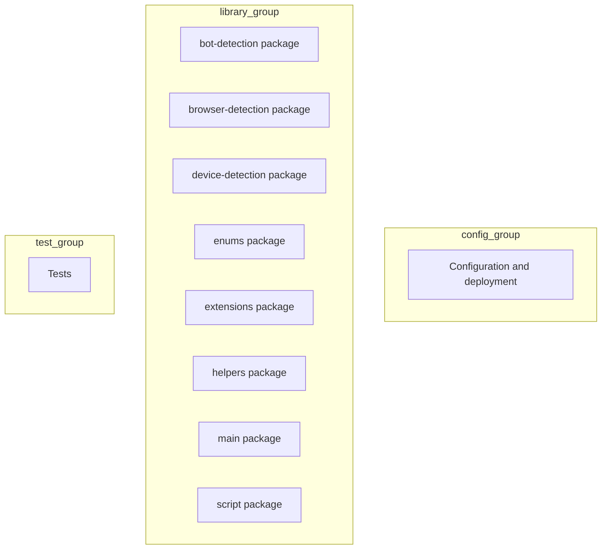

# Architecture report: faisalman/ua-parser-js

> Automated static analysis. **Observed** = directly seen in files/imports/AST; **Inferred** = interpretation from that evidence. Repository code was not executed.

## 1. Repository at a glance

| Item | Value |
| --- | --- |
| Repository | faisalman/ua-parser-js |
| Description | UAParser.js: The Essential Web Development Tool for User-Agent Detection. Detect Browsers, OS, Devices, Bots, Apps, AI Crawlers, and more. Run in Browser or Node |
| Language | JavaScript |
| Stars | 10212 |
| Licence | AGPL-3.0 |
| Analysed commit / branch | 8b7f9284d56fdfa9f94d3a1939029db197b94cf2 / master |
| Framework(s) | None detected |
| Files analysed | 393 |
| Components | 10 |

## 2. Architecture in one minute

faisalman/ua-parser-js - UAParser.js: The Essential Web Development Tool for User-Agent Detection. Detect Browsers, OS, Devices, Bots, Apps, AI Crawlers, and more. Run in Browser or Node. This repository was analysed statically from 393 file(s) (0 Python). Detected technologies (observed from imports/manifests): GitHub Actions, Docker. Files are grouped into 10 component(s): bot-detection package, browser-detection package, Configuration and deployment, device-detection package, enums package, extensions package, helpers package, main package. Findings below distinguish observed facts from inferred interpretation.

## 3. High-level block diagram

## 4. Main components

### bot-detection package (`bot_detection`)

- **Kind:** library
- **Status:** Observed
- **Confidence:** 0.85
- **Responsibility:** Groups 3 file(s) under bot-detection package (observed from repository paths and static analysis).
- **Paths:** `src/bot-detection/bot-detection.d.ts`, `src/bot-detection/bot-detection.js`, `src/bot-detection/bot-detection.mjs`
- **Evidence:** [src/bot-detection/bot-detection.d.ts](https://github.com/faisalman/ua-parser-js/blob/8b7f9284d56fdfa9f94d3a1939029db197b94cf2/src/bot-detection/bot-detection.d.ts); [src/bot-detection/bot-detection.js](https://github.com/faisalman/ua-parser-js/blob/8b7f9284d56fdfa9f94d3a1939029db197b94cf2/src/bot-detection/bot-detection.js); [src/bot-detection/bot-detection.mjs](https://github.com/faisalman/ua-parser-js/blob/8b7f9284d56fdfa9f94d3a1939029db197b94cf2/src/bot-detection/bot-detection.mjs)

### browser-detection package (`browser_detection`)

- **Kind:** library
- **Status:** Observed
- **Confidence:** 0.85
- **Responsibility:** Groups 3 file(s) under browser-detection package (observed from repository paths and static analysis).
- **Paths:** `src/browser-detection/browser-detection.d.ts`, `src/browser-detection/browser-detection.js`, `src/browser-detection/browser-detection.mjs`
- **Evidence:** [src/browser-detection/browser-detection.d.ts](https://github.com/faisalman/ua-parser-js/blob/8b7f9284d56fdfa9f94d3a1939029db197b94cf2/src/browser-detection/browser-detection.d.ts); [src/browser-detection/browser-detection.js](https://github.com/faisalman/ua-parser-js/blob/8b7f9284d56fdfa9f94d3a1939029db197b94cf2/src/browser-detection/browser-detection.js); [src/browser-detection/browser-detection.mjs](https://github.com/faisalman/ua-parser-js/blob/8b7f9284d56fdfa9f94d3a1939029db197b94cf2/src/browser-detection/browser-detection.mjs)

### Configuration and deployment (`config`)

- **Kind:** config
- **Status:** Observed
- **Confidence:** 0.85
- **Responsibility:** Groups 2 file(s) under configuration and deployment (observed from repository paths and static analysis).
- **Paths:** `Dockerfile`, `package.json`
- **Evidence:** [Dockerfile](https://github.com/faisalman/ua-parser-js/blob/8b7f9284d56fdfa9f94d3a1939029db197b94cf2/Dockerfile); [package.json](https://github.com/faisalman/ua-parser-js/blob/8b7f9284d56fdfa9f94d3a1939029db197b94cf2/package.json)

### device-detection package (`device_detection`)

- **Kind:** library
- **Status:** Observed
- **Confidence:** 0.85
- **Responsibility:** Groups 3 file(s) under device-detection package (observed from repository paths and static analysis).
- **Paths:** `src/device-detection/device-detection.d.ts`, `src/device-detection/device-detection.js`, `src/device-detection/device-detection.mjs`
- **Evidence:** [src/device-detection/device-detection.d.ts](https://github.com/faisalman/ua-parser-js/blob/8b7f9284d56fdfa9f94d3a1939029db197b94cf2/src/device-detection/device-detection.d.ts); [src/device-detection/device-detection.js](https://github.com/faisalman/ua-parser-js/blob/8b7f9284d56fdfa9f94d3a1939029db197b94cf2/src/device-detection/device-detection.js); [src/device-detection/device-detection.mjs](https://github.com/faisalman/ua-parser-js/blob/8b7f9284d56fdfa9f94d3a1939029db197b94cf2/src/device-detection/device-detection.mjs)

### enums package (`enums`)

- **Kind:** library
- **Status:** Observed
- **Confidence:** 0.85
- **Responsibility:** Groups 3 file(s) under enums package (observed from repository paths and static analysis).
- **Paths:** `src/enums/ua-parser-enums.d.ts`, `src/enums/ua-parser-enums.js`, `src/enums/ua-parser-enums.mjs`
- **Evidence:** [src/enums/ua-parser-enums.d.ts](https://github.com/faisalman/ua-parser-js/blob/8b7f9284d56fdfa9f94d3a1939029db197b94cf2/src/enums/ua-parser-enums.d.ts); [src/enums/ua-parser-enums.js](https://github.com/faisalman/ua-parser-js/blob/8b7f9284d56fdfa9f94d3a1939029db197b94cf2/src/enums/ua-parser-enums.js); [src/enums/ua-parser-enums.mjs](https://github.com/faisalman/ua-parser-js/blob/8b7f9284d56fdfa9f94d3a1939029db197b94cf2/src/enums/ua-parser-enums.mjs)

### extensions package (`extensions`)

- **Kind:** library
- **Status:** Observed
- **Confidence:** 0.85
- **Responsibility:** Groups 3 file(s) under extensions package (observed from repository paths and static analysis).
- **Paths:** `src/extensions/ua-parser-extensions.d.ts`, `src/extensions/ua-parser-extensions.js`, `src/extensions/ua-parser-extensions.mjs`
- **Evidence:** [src/extensions/ua-parser-extensions.d.ts](https://github.com/faisalman/ua-parser-js/blob/8b7f9284d56fdfa9f94d3a1939029db197b94cf2/src/extensions/ua-parser-extensions.d.ts); [src/extensions/ua-parser-extensions.js](https://github.com/faisalman/ua-parser-js/blob/8b7f9284d56fdfa9f94d3a1939029db197b94cf2/src/extensions/ua-parser-extensions.js); [src/extensions/ua-parser-extensions.mjs](https://github.com/faisalman/ua-parser-js/blob/8b7f9284d56fdfa9f94d3a1939029db197b94cf2/src/extensions/ua-parser-extensions.mjs)

### helpers package (`helpers`)

- **Kind:** library
- **Status:** Observed
- **Confidence:** 0.85
- **Responsibility:** Groups 3 file(s) under helpers package (observed from repository paths and static analysis).
- **Paths:** `src/helpers/ua-parser-helpers.d.ts`, `src/helpers/ua-parser-helpers.js`, `src/helpers/ua-parser-helpers.mjs`
- **Evidence:** [src/helpers/ua-parser-helpers.d.ts](https://github.com/faisalman/ua-parser-js/blob/8b7f9284d56fdfa9f94d3a1939029db197b94cf2/src/helpers/ua-parser-helpers.d.ts); [src/helpers/ua-parser-helpers.js](https://github.com/faisalman/ua-parser-js/blob/8b7f9284d56fdfa9f94d3a1939029db197b94cf2/src/helpers/ua-parser-helpers.js); [src/helpers/ua-parser-helpers.mjs](https://github.com/faisalman/ua-parser-js/blob/8b7f9284d56fdfa9f94d3a1939029db197b94cf2/src/helpers/ua-parser-helpers.mjs)

### main package (`main`)

- **Kind:** library
- **Status:** Observed
- **Confidence:** 0.85
- **Responsibility:** Groups 3 file(s) under main package (observed from repository paths and static analysis).
- **Paths:** `src/main/ua-parser.d.ts`, `src/main/ua-parser.js`, `src/main/ua-parser.mjs`
- **Evidence:** [src/main/ua-parser.d.ts](https://github.com/faisalman/ua-parser-js/blob/8b7f9284d56fdfa9f94d3a1939029db197b94cf2/src/main/ua-parser.d.ts); [src/main/ua-parser.js](https://github.com/faisalman/ua-parser-js/blob/8b7f9284d56fdfa9f94d3a1939029db197b94cf2/src/main/ua-parser.js); [src/main/ua-parser.mjs](https://github.com/faisalman/ua-parser-js/blob/8b7f9284d56fdfa9f94d3a1939029db197b94cf2/src/main/ua-parser.mjs)

### script package (`script`)

- **Kind:** library
- **Status:** Observed
- **Confidence:** 0.85
- **Responsibility:** Groups 4 file(s) under script package (observed from repository paths and static analysis).
- **Paths:** `script/build-dist.sh`, `script/build-esm.js`, `script/cli.js`, `script/test-all.sh`
- **Evidence:** [script/build-dist.sh](https://github.com/faisalman/ua-parser-js/blob/8b7f9284d56fdfa9f94d3a1939029db197b94cf2/script/build-dist.sh); [script/build-esm.js](https://github.com/faisalman/ua-parser-js/blob/8b7f9284d56fdfa9f94d3a1939029db197b94cf2/script/build-esm.js); [script/cli.js](https://github.com/faisalman/ua-parser-js/blob/8b7f9284d56fdfa9f94d3a1939029db197b94cf2/script/cli.js); [script/test-all.sh](https://github.com/faisalman/ua-parser-js/blob/8b7f9284d56fdfa9f94d3a1939029db197b94cf2/script/test-all.sh)

### Tests (`tests`)

- **Kind:** test
- **Status:** Observed
- **Confidence:** 0.85
- **Responsibility:** Groups 345 file(s) under tests (observed from repository paths and static analysis).
- **Paths:** `test/data/ua-ch/headers.js`, `test/data/ua/browser/115.json`, `test/data/ua/browser/2345.json`, `test/data/ua/browser/360.json`, `test/data/ua/browser/alipay.json`, `test/data/ua/browser/aloha.json`, `test/data/ua/browser/android-browser.json`, `test/data/ua/browser/arora.json`, `test/data/ua/browser/atlas.json`, `test/data/ua/browser/avant.json`, `test/data/ua/browser/avast-secure-browser.json`, `test/data/ua/browser/avg-secure-browser.json`, `test/data/ua/browser/avira-secure-browser.json`, `test/data/ua/browser/baidu.json`, `test/data/ua/browser/basilisk.json`, `test/data/ua/browser/bing.json`, `test/data/ua/browser/blazer.json`, `test/data/ua/browser/bolt.json`, `test/data/ua/browser/bowser.json`, `test/data/ua/browser/brave.json`, `test/data/ua/browser/camino.json`, `test/data/ua/browser/chatgpt.json`, `test/data/ua/browser/chimera.json`, `test/data/ua/browser/chrome-headless.json`, `test/data/ua/browser/chrome-webview.json`, `test/data/ua/browser/chrome.json`, `test/data/ua/browser/chromium.json`, `test/data/ua/browser/cobalt.json`, `test/data/ua/browser/coc-coc.json`, `test/data/ua/browser/conkeror.json`, `test/data/ua/browser/daum.json`, `test/data/ua/browser/dillo.json`, `test/data/ua/browser/dolphin.json`, `test/data/ua/browser/dooble.json`, `test/data/ua/browser/doris.json`, `test/data/ua/browser/dragon.json`, `test/data/ua/browser/duckduckgo.json`, `test/data/ua/browser/ecosia.json`, `test/data/ua/browser/edge-webview.json`, `test/data/ua/browser/edge-webview2.json`, `test/data/ua/browser/edge.json`, `test/data/ua/browser/electron.json`, `test/data/ua/browser/epiphany.json`, `test/data/ua/browser/facebook.json`, `test/data/ua/browser/falkon.json`, `test/data/ua/browser/fennec.json`, `test/data/ua/browser/firebird.json`, `test/data/ua/browser/firefox-focus.json`, `test/data/ua/browser/firefox-reality.json`, `test/data/ua/browser/firefox.json`, `test/data/ua/browser/flock.json`, `test/data/ua/browser/flow.json`, `test/data/ua/browser/gobrowser.json`, `test/data/ua/browser/gsa.json`, `test/data/ua/browser/helio.json`, `test/data/ua/browser/heytap.json`, `test/data/ua/browser/hibrowser.json`, `test/data/ua/browser/huawei-browser.json`, `test/data/ua/browser/icab.json`, `test/data/ua/browser/ice-browser.json`, `test/data/ua/browser/iceape.json`, `test/data/ua/browser/icecat.json`, `test/data/ua/browser/iceweasel.json`, `test/data/ua/browser/ie.json`, `test/data/ua/browser/iemobile.json`, `test/data/ua/browser/instagram.json`, `test/data/ua/browser/iridium.json`, `test/data/ua/browser/iron.json`, `test/data/ua/browser/jasmine.json`, `test/data/ua/browser/k-meleon.json`, `test/data/ua/browser/kakaostory.json`, `test/data/ua/browser/kakaotalk.json`, `test/data/ua/browser/kindle.json`, `test/data/ua/browser/klar.json`, `test/data/ua/browser/klarna.json`, `test/data/ua/browser/konqueror.json`, `test/data/ua/browser/ladybird.json`, `test/data/ua/browser/lbbrowser.json`, `test/data/ua/browser/lg-browser.json`, `test/data/ua/browser/librewolf.json`, `test/data/ua/browser/lighthouse.json`, `test/data/ua/browser/line.json`, `test/data/ua/browser/linkedin.json`, `test/data/ua/browser/links.json`, `test/data/ua/browser/luakit.json`, `test/data/ua/browser/lunascape.json`, `test/data/ua/browser/lynx.json`, `test/data/ua/browser/maemo-browser.json`, `test/data/ua/browser/maxthon.json`, `test/data/ua/browser/midori.json`, `test/data/ua/browser/minimo.json`, `test/data/ua/browser/miui-browser.json`, `test/data/ua/browser/mobile-chrome.json`, `test/data/ua/browser/mobile-firefox.json`, `test/data/ua/browser/mobile-safari.json`, `test/data/ua/browser/mosaic.json`, `test/data/ua/browser/mozilla.json`, `test/data/ua/browser/naver.json`, `test/data/ua/browser/netfront.json`, `test/data/ua/browser/netscape.json`, `test/data/ua/browser/netsurf.json`, `test/data/ua/browser/nokia-browser.json`, `test/data/ua/browser/norton-private-browser.json`, `test/data/ua/browser/obigo.json`, `test/data/ua/browser/oculus-browser.json`, `test/data/ua/browser/omniweb.json`, `test/data/ua/browser/opera-coast.json`, `test/data/ua/browser/opera-gx.json`, `test/data/ua/browser/opera-mini.json`, `test/data/ua/browser/opera-mobi.json`, `test/data/ua/browser/opera-neon.json`, `test/data/ua/browser/opera-tablet.json`, `test/data/ua/browser/opera-touch.json`, `test/data/ua/browser/opera.json`, `test/data/ua/browser/otter.json`, `test/data/ua/browser/ovibrowser.json`, `test/data/ua/browser/palemoon.json`, `test/data/ua/browser/phantomjs.json`, `test/data/ua/browser/phoenix.json`, `test/data/ua/browser/pico-browser.json`, `test/data/ua/browser/polaris.json`, `test/data/ua/browser/puffin.json`, `test/data/ua/browser/qqbrowser.json`, `test/data/ua/browser/qqbrowserlite.json`, `test/data/ua/browser/quark.json`, `test/data/ua/browser/qupzilla.json`, `test/data/ua/browser/qutebrowser.json`, `test/data/ua/browser/qwant.json`, `test/data/ua/browser/rekonq.json`, `test/data/ua/browser/rockmelt.json`, `test/data/ua/browser/safari.json`, `test/data/ua/browser/sailfish-browser.json`, `test/data/ua/browser/samsung-internet.json`, `test/data/ua/browser/seamonkey.json`, `test/data/ua/browser/silk.json`, `test/data/ua/browser/skyfire.json`, `test/data/ua/browser/sleipnir.json`, `test/data/ua/browser/slimboat.json`, `test/data/ua/browser/slimbrowser.json`, `test/data/ua/browser/slimjet.json`, `test/data/ua/browser/smart-lenovo-browser.json`, `test/data/ua/browser/snapchat.json`, `test/data/ua/browser/sogou-explorer.json`, `test/data/ua/browser/sogou-mobile.json`, `test/data/ua/browser/steam.json`, `test/data/ua/browser/surf.json`, `test/data/ua/browser/swiftfox.json`, `test/data/ua/browser/tesla.json`, `test/data/ua/browser/tiktok.json`, `test/data/ua/browser/tizen-browser.json`, `test/data/ua/browser/twitter.json`, `test/data/ua/browser/ucbrowser.json`, `test/data/ua/browser/up.browser.json`, `test/data/ua/browser/vivaldi.json`, `test/data/ua/browser/vivo-browser.json`, `test/data/ua/browser/w3m.json`, `test/data/ua/browser/waterfox.json`, `test/data/ua/browser/wechat.json`, `test/data/ua/browser/weibo.json`, `test/data/ua/browser/whale.json`, `test/data/ua/browser/whatsapp.json`, `test/data/ua/browser/wolvic.json`, `test/data/ua/browser/yandex.json`, `test/data/ua/browser/zalo.json`, `test/data/ua/cpu/cpu-all.json`, `test/data/ua/device/_others.json`, `test/data/ua/device/acer.json`, `test/data/ua/device/advan.json`, `test/data/ua/device/alcatel.json`, `test/data/ua/device/amazon.json`, `test/data/ua/device/anbernic.json`, `test/data/ua/device/apple.json`, `test/data/ua/device/archos.json`, `test/data/ua/device/asus.json`, `test/data/ua/device/blackberry.json`, `test/data/ua/device/blackview.json`, `test/data/ua/device/blu.json`, `test/data/ua/device/cat.json`, `test/data/ua/device/coolpad.json`, `test/data/ua/device/cubot.json`, `test/data/ua/device/energizer.json`, `test/data/ua/device/facebook.json`, `test/data/ua/device/fairphone.json`, `test/data/ua/device/google.json`, `test/data/ua/device/hisense.json`, `test/data/ua/device/hmd.json`, `test/data/ua/device/honor.json`, `test/data/ua/device/htc.json`, `test/data/ua/device/huawei.json`, `test/data/ua/device/imo.json`, `test/data/ua/device/infinix.json`, `test/data/ua/device/itel.json`, `test/data/ua/device/jolla.json`, `test/data/ua/device/kobo.json`, `test/data/ua/device/lava.json`, `test/data/ua/device/lenovo.json`, `test/data/ua/device/lg.json`, `test/data/ua/device/logitech.json`, `test/data/ua/device/meizu.json`, `test/data/ua/device/micromax.json`, `test/data/ua/device/microsoft.json`, `test/data/ua/device/motorola.json`, `test/data/ua/device/nintendo.json`, `test/data/ua/device/nokia.json`, `test/data/ua/device/nothing.json`, `test/data/ua/device/nvidia.json`, `test/data/ua/device/oneplus.json`, `test/data/ua/device/oppo.json`, `test/data/ua/device/ouya.json`, `test/data/ua/device/panasonic.json`, `test/data/ua/device/philips.json`, `test/data/ua/device/pico.json`, `test/data/ua/device/polytron.json`, `test/data/ua/device/realme.json`, `test/data/ua/device/retroid.json`, `test/data/ua/device/roku.json`, `test/data/ua/device/samsung.json`, `test/data/ua/device/sharp.json`, `test/data/ua/device/smartfren.json`, `test/data/ua/device/sony.json`, `test/data/ua/device/t-mobile.json`, `test/data/ua/device/tcl.json`, `test/data/ua/device/technisat.json`, `test/data/ua/device/tecno.json`, `test/data/ua/device/tesla.json`, `test/data/ua/device/ulefone.json`, `test/data/ua/device/valve.json`, `test/data/ua/device/vivo.json`, `test/data/ua/device/vizio.json`, `test/data/ua/device/wiko.json`, `test/data/ua/device/xiaomi.json`, `test/data/ua/device/zte.json`, `test/data/ua/engine/engine-all.json`, `test/data/ua/extension/cli.json`, `test/data/ua/extension/crawler.json`, `test/data/ua/extension/email.json`, `test/data/ua/extension/extra-devices.json`, `test/data/ua/extension/fetcher.json`, `test/data/ua/extension/inapp.json`, `test/data/ua/extension/library.json`, `test/data/ua/extension/mediaplayer.json`, `test/data/ua/extension/vehicle.json`, `test/data/ua/os/aix.json`, `test/data/ua/os/amigaos.json`, `test/data/ua/os/android-x86.json`, `test/data/ua/os/android.json`, `test/data/ua/os/arcaos.json`, `test/data/ua/os/arch.json`, `test/data/ua/os/bada.json`, `test/data/ua/os/beos.json`, `test/data/ua/os/blackberry.json`, `test/data/ua/os/centos.json`, `test/data/ua/os/chrome-os.json`, `test/data/ua/os/chromecast-android.json`, `test/data/ua/os/chromecast-fuchsia.json`, `test/data/ua/os/chromecast-linux.json`, `test/data/ua/os/chromecast-smartspeaker.json`, `test/data/ua/os/contiki.json`, `test/data/ua/os/debian.json`, `test/data/ua/os/deepin.json`, `test/data/ua/os/dragonfly.json`, `test/data/ua/os/elementary-os.json`, `test/data/ua/os/fedora.json`, `test/data/ua/os/firefox-os.json`, `test/data/ua/os/freebsd.json`, `test/data/ua/os/fuchsia.json`, `test/data/ua/os/gentoo.json`, `test/data/ua/os/ghostbsd.json`, `test/data/ua/os/haiku.json`, `test/data/ua/os/harmonyos.json`, `test/data/ua/os/hp-ux.json`, `test/data/ua/os/hurd.json`, `test/data/ua/os/ios.json`, `test/data/ua/os/joli.json`, `test/data/ua/os/kaios.json`, `test/data/ua/os/knoppix.json`, `test/data/ua/os/kubuntu.json`, `test/data/ua/os/linpus.json`, `test/data/ua/os/linspire.json`, `test/data/ua/os/linux.json`, `test/data/ua/os/macos.json`, `test/data/ua/os/maemo.json`, `test/data/ua/os/mandriva.json`, `test/data/ua/os/manjaro.json`, `test/data/ua/os/meego.json`, `test/data/ua/os/minix.json`, `test/data/ua/os/mint.json`, `test/data/ua/os/morphos.json`, `test/data/ua/os/netbsd.json`, `test/data/ua/os/netrange.json`, `test/data/ua/os/nettv.json`, `test/data/ua/os/nintendo.json`, `test/data/ua/os/openbsd.json`, `test/data/ua/os/openharmony.json`, `test/data/ua/os/os2.json`, `test/data/ua/os/palm.json`, `test/data/ua/os/pclinuxos.json`, `test/data/ua/os/pico.json`, `test/data/ua/os/plan9.json`, `test/data/ua/os/playstation.json`, `test/data/ua/os/qnx.json`, `test/data/ua/os/raspbian.json`, `test/data/ua/os/redhat.json`, `test/data/ua/os/rim-tablet-os.json`, `test/data/ua/os/risc-os.json`, `test/data/ua/os/sabayon.json`, `test/data/ua/os/sailfish.json`, `test/data/ua/os/serenityos.json`, `test/data/ua/os/series40.json`, `test/data/ua/os/slackware.json`, `test/data/ua/os/solaris.json`, `test/data/ua/os/steamos.json`, `test/data/ua/os/suse.json`, `test/data/ua/os/symbian.json`, `test/data/ua/os/tizen.json`, `test/data/ua/os/ubuntu-touch.json`, `test/data/ua/os/ubuntu.json`, `test/data/ua/os/unix.json`, `test/data/ua/os/vegaos.json`, `test/data/ua/os/watchos.json`, `test/data/ua/os/webos.json`, `test/data/ua/os/windows-ce.json`, `test/data/ua/os/windows-iot.json`, `test/data/ua/os/windows-mobile.json`, `test/data/ua/os/windows-phone.json`, `test/data/ua/os/windows-rt.json`, `test/data/ua/os/windows.json`, `test/data/ua/os/xbox.json`, `test/data/ua/os/xubuntu.json`, `test/data/ua/os/zenwalk.json`, `test/e2e/browser.spec.mjs`, `test/fuzz/redos.js`, `test/static/dts-lint.ts`, `test/unit/cli/cli.spec.js`, `test/unit/cli/input.txt`, `test/unit/cli/output.json`, `test/unit/es6.mjs`, `test/unit/main.js`, `test/unit/redos.js`, `test/unit/submodules/bot-detection.spec.js`, `test/unit/submodules/browser-detection.spec.js`, `test/unit/submodules/device-detection.spec.js`, `test/unit/submodules/extensions.spec.js`, `test/unit/submodules/helpers.spec.js`, `test/unit/ua-ch.js`
- **Evidence:** [test/data/ua-ch/headers.js](https://github.com/faisalman/ua-parser-js/blob/8b7f9284d56fdfa9f94d3a1939029db197b94cf2/test/data/ua-ch/headers.js); [test/data/ua/browser/115.json](https://github.com/faisalman/ua-parser-js/blob/8b7f9284d56fdfa9f94d3a1939029db197b94cf2/test/data/ua/browser/115.json); [test/data/ua/browser/2345.json](https://github.com/faisalman/ua-parser-js/blob/8b7f9284d56fdfa9f94d3a1939029db197b94cf2/test/data/ua/browser/2345.json); [test/data/ua/browser/360.json](https://github.com/faisalman/ua-parser-js/blob/8b7f9284d56fdfa9f94d3a1939029db197b94cf2/test/data/ua/browser/360.json); [test/data/ua/browser/alipay.json](https://github.com/faisalman/ua-parser-js/blob/8b7f9284d56fdfa9f94d3a1939029db197b94cf2/test/data/ua/browser/alipay.json); [test/data/ua/browser/aloha.json](https://github.com/faisalman/ua-parser-js/blob/8b7f9284d56fdfa9f94d3a1939029db197b94cf2/test/data/ua/browser/aloha.json); [test/data/ua/browser/android-browser.json](https://github.com/faisalman/ua-parser-js/blob/8b7f9284d56fdfa9f94d3a1939029db197b94cf2/test/data/ua/browser/android-browser.json); [test/data/ua/browser/arora.json](https://github.com/faisalman/ua-parser-js/blob/8b7f9284d56fdfa9f94d3a1939029db197b94cf2/test/data/ua/browser/arora.json)

## 5. Execution flow

**Observed** entry point(s):

- [script/cli.js](https://github.com/faisalman/ua-parser-js/blob/8b7f9284d56fdfa9f94d3a1939029db197b94cf2/script/cli.js)
- [src/main/ua-parser.js](https://github.com/faisalman/ua-parser-js/blob/8b7f9284d56fdfa9f94d3a1939029db197b94cf2/src/main/ua-parser.js)

Representative flow (derived from observed entry points and the import graph; steps beyond the entry point are **Inferred**):

1. Execution starts at an observed entry point listed above, if present.
2. No internal import relationships between components were observed.

## 6. Project structure

### `(root)`

- `.gitignore` - other (355 bytes)
- `CHANGELOG.md` - docs (21039 bytes)
- `CODE_OF_CONDUCT.md` - docs (1175 bytes)
- `CONTRIBUTING.md` - docs (4043 bytes)
- `Dockerfile` - container (309 bytes)
- `INCIDENT_RESPONSE.md` - docs (3404 bytes)
- `LICENSE.md` - docs (32095 bytes)
- `README.md` - docs (10164 bytes)
- `SECURITY.md` - docs (767 bytes)
- `THIRD_PARTY_NOTICES.md` - docs (2982 bytes)
- `package.json` - manifest (11963 bytes)

### `.github`

- `.github/ISSUE_TEMPLATE/bug_report.md` - docs (1118 bytes)
- `.github/ISSUE_TEMPLATE/feature_request.md` - docs (595 bytes)
- `.github/PULL_REQUEST_TEMPLATE.md` - docs (756 bytes)
- `.github/PULL_REQUEST_TEMPLATE/pull_request_template.md` - docs (173 bytes)
- `.github/funding.yml` - config (596 bytes)
- `.github/workflows/ai-assistant-spam-detection.yml` - ci, YAML (917 bytes)
- `.github/workflows/analysis-codeql.yml` - ci, YAML (3142 bytes)
- `.github/workflows/analysis-dependency.yml` - ci, YAML (999 bytes)
- `.github/workflows/analysis-scorecard.yml` - ci, YAML (3468 bytes)
- `.github/workflows/ci-build-test.yml` - ci, YAML (1401 bytes)
- `.github/workflows/publish-docker.yml` - ci, YAML (1862 bytes)
- `.github/workflows/publish-npm.yml` - ci, YAML (939 bytes)

### `script`

- `script/build-dist.sh` - source, Shell (668 bytes)
- `script/build-esm.js` - source, JavaScript (3076 bytes)
- `script/cli.js` - source, JavaScript (3228 bytes)
- `script/test-all.sh` - source, Shell (404 bytes)

### `src`

- `src/bot-detection/bot-detection.d.ts` - source, TypeScript (440 bytes)
- `src/bot-detection/bot-detection.js` - source, JavaScript (3958 bytes)
- `src/bot-detection/bot-detection.mjs` - source, JavaScript (4024 bytes)
- `src/browser-detection/browser-detection.d.ts` - source, TypeScript (435 bytes)
- `src/browser-detection/browser-detection.js` - source, JavaScript (1036 bytes)
- `src/browser-detection/browser-detection.mjs` - source, JavaScript (1155 bytes)
- `src/device-detection/device-detection.d.ts` - source, TypeScript (382 bytes)
- `src/device-detection/device-detection.js` - source, JavaScript (1556 bytes)
- `src/device-detection/device-detection.mjs` - source, JavaScript (1682 bytes)
- `src/enums/ua-parser-enums.d.ts` - source, TypeScript (25907 bytes)
- `src/enums/ua-parser-enums.js` - source, JavaScript (26699 bytes)
- `src/enums/ua-parser-enums.mjs` - source, JavaScript (26108 bytes)
- `src/extensions/ua-parser-extensions.d.ts` - source, TypeScript (595 bytes)
- `src/extensions/ua-parser-extensions.js` - source, JavaScript (24480 bytes)
- `src/extensions/ua-parser-extensions.mjs` - source, JavaScript (24152 bytes)
- `src/helpers/ua-parser-helpers.d.ts` - source, TypeScript (1300 bytes)
- `src/helpers/ua-parser-helpers.js` - source, JavaScript (3371 bytes)
- `src/helpers/ua-parser-helpers.mjs` - source, JavaScript (3487 bytes)
- `src/main/ua-parser.d.ts` - source, TypeScript (3751 bytes)
- `src/main/ua-parser.js` - source, JavaScript (78265 bytes)
- `src/main/ua-parser.mjs` - source, JavaScript (76291 bytes)

### `test`

- `test/data/ua-ch/headers.js` - test, JavaScript (8530 bytes)
- `test/data/ua/browser/115.json` - test (323 bytes)
- `test/data/ua/browser/2345.json` - test (982 bytes)
- `test/data/ua/browser/360.json` - test (984 bytes)
- `test/data/ua/browser/alipay.json` - test (1245 bytes)
- `test/data/ua/browser/aloha.json` - test (330 bytes)
- `test/data/ua/browser/android-browser.json` - test (1827 bytes)
- `test/data/ua/browser/arora.json` - test (283 bytes)
- `test/data/ua/browser/atlas.json` - test (300 bytes)
- `test/data/ua/browser/avant.json` - test (310 bytes)
- `test/data/ua/browser/avast-secure-browser.json` - test (344 bytes)
- `test/data/ua/browser/avg-secure-browser.json` - test (336 bytes)
- `test/data/ua/browser/avira-secure-browser.json` - test (338 bytes)
- `test/data/ua/browser/baidu.json` - test (2257 bytes)
- `test/data/ua/browser/basilisk.json` - test (288 bytes)
- `test/data/ua/browser/bing.json` - test (690 bytes)
- `test/data/ua/browser/blazer.json` - test (266 bytes)
- `test/data/ua/browser/bolt.json` - test (283 bytes)
- `test/data/ua/browser/bowser.json` - test (313 bytes)
- `test/data/ua/browser/brave.json` - test (1195 bytes)
- `test/data/ua/browser/camino.json` - test (568 bytes)
- `test/data/ua/browser/chatgpt.json` - test (247 bytes)
- `test/data/ua/browser/chimera.json` - test (261 bytes)
- `test/data/ua/browser/chrome-headless.json` - test (636 bytes)
- `test/data/ua/browser/chrome-webview.json` - test (382 bytes)
- `test/data/ua/browser/chrome.json` - test (1811 bytes)
- `test/data/ua/browser/chromium.json` - test (321 bytes)
- `test/data/ua/browser/cobalt.json` - test (1078 bytes)
- `test/data/ua/browser/coc-coc.json` - test (337 bytes)
- `test/data/ua/browser/conkeror.json` - test (252 bytes)
- `test/data/ua/browser/daum.json` - test (774 bytes)
- `test/data/ua/browser/dillo.json` - test (182 bytes)
- `test/data/ua/browser/dolphin.json` - test (289 bytes)
- `test/data/ua/browser/dooble.json` - test (344 bytes)
- `test/data/ua/browser/doris.json` - test (199 bytes)
- `test/data/ua/browser/dragon.json` - test (623 bytes)
- `test/data/ua/browser/duckduckgo.json` - test (641 bytes)
- `test/data/ua/browser/ecosia.json` - test (667 bytes)
- `test/data/ua/browser/edge-webview.json` - test (385 bytes)
- `test/data/ua/browser/edge-webview2.json` - test (408 bytes)
- `test/data/ua/browser/edge.json` - test (2296 bytes)
- `test/data/ua/browser/electron.json` - test (323 bytes)
- `test/data/ua/browser/epiphany.json` - test (260 bytes)
- `test/data/ua/browser/facebook.json` - test (1433 bytes)
- `test/data/ua/browser/falkon.json` - test (295 bytes)
- `test/data/ua/browser/fennec.json` - test (549 bytes)
- `test/data/ua/browser/firebird.json` - test (253 bytes)
- `test/data/ua/browser/firefox-focus.json` - test (327 bytes)
- `test/data/ua/browser/firefox-reality.json` - test (266 bytes)
- `test/data/ua/browser/firefox.json` - test (780 bytes)
- `test/data/ua/browser/flock.json` - test (265 bytes)
- `test/data/ua/browser/flow.json` - test (287 bytes)
- `test/data/ua/browser/gobrowser.json` - test (430 bytes)
- `test/data/ua/browser/gsa.json` - test (359 bytes)
- `test/data/ua/browser/helio.json` - test (295 bytes)
- `test/data/ua/browser/heytap.json` - test (310 bytes)
- `test/data/ua/browser/hibrowser.json` - test (389 bytes)
- `test/data/ua/browser/huawei-browser.json` - test (1760 bytes)
- `test/data/ua/browser/icab.json` - test (213 bytes)
- `test/data/ua/browser/ice-browser.json` - test (254 bytes)
- `test/data/ua/browser/iceape.json` - test (259 bytes)
- `test/data/ua/browser/icecat.json` - test (264 bytes)
- `test/data/ua/browser/iceweasel.json` - test (282 bytes)
- `test/data/ua/browser/ie.json` - test (1196 bytes)
- `test/data/ua/browser/iemobile.json` - test (297 bytes)
- `test/data/ua/browser/instagram.json` - test (456 bytes)
- `test/data/ua/browser/iridium.json` - test (297 bytes)
- `test/data/ua/browser/iron.json` - test (895 bytes)
- `test/data/ua/browser/jasmine.json` - test (290 bytes)
- `test/data/ua/browser/k-meleon.json` - test (257 bytes)
- `test/data/ua/browser/kakaostory.json` - test (415 bytes)
- `test/data/ua/browser/kakaotalk.json` - test (766 bytes)
- `test/data/ua/browser/kindle.json` - test (270 bytes)
- `test/data/ua/browser/klar.json` - test (310 bytes)
- `test/data/ua/browser/klarna.json` - test (775 bytes)
- `test/data/ua/browser/konqueror.json` - test (555 bytes)
- `test/data/ua/browser/ladybird.json` - test (219 bytes)
- `test/data/ua/browser/lbbrowser.json` - test (250 bytes)
- `test/data/ua/browser/lg-browser.json` - test (414 bytes)
- `test/data/ua/browser/librewolf.json` - test (270 bytes)
- `test/data/ua/browser/lighthouse.json` - test (338 bytes)
- `test/data/ua/browser/line.json` - test (715 bytes)
- `test/data/ua/browser/linkedin.json` - test (277 bytes)
- `test/data/ua/browser/links.json` - test (922 bytes)
- `test/data/ua/browser/luakit.json` - test (278 bytes)
- `test/data/ua/browser/lunascape.json` - test (291 bytes)
- `test/data/ua/browser/lynx.json` - test (238 bytes)
- `test/data/ua/browser/maemo-browser.json` - test (309 bytes)
- `test/data/ua/browser/maxthon.json` - test (2226 bytes)
- `test/data/ua/browser/midori.json` - test (231 bytes)
- `test/data/ua/browser/minimo.json` - test (254 bytes)
- `test/data/ua/browser/miui-browser.json` - test (386 bytes)
- `test/data/ua/browser/mobile-chrome.json` - test (1029 bytes)
- `test/data/ua/browser/mobile-firefox.json` - test (1566 bytes)
- `test/data/ua/browser/mobile-safari.json` - test (1026 bytes)
- `test/data/ua/browser/mosaic.json` - test (215 bytes)
- `test/data/ua/browser/mozilla.json` - test (443 bytes)
- `test/data/ua/browser/naver.json` - test (841 bytes)
- `test/data/ua/browser/netfront.json` - test (227 bytes)
- `test/data/ua/browser/netscape.json` - test (833 bytes)
- `test/data/ua/browser/netsurf.json` - test (435 bytes)
- `test/data/ua/browser/nokia-browser.json` - test (380 bytes)
- `test/data/ua/browser/norton-private-browser.json` - test (333 bytes)
- `test/data/ua/browser/obigo.json` - test (525 bytes)
- `test/data/ua/browser/oculus-browser.json` - test (749 bytes)
- `test/data/ua/browser/omniweb.json` - test (280 bytes)
- `test/data/ua/browser/opera-coast.json` - test (341 bytes)
- `test/data/ua/browser/opera-gx.json` - test (704 bytes)
- `test/data/ua/browser/opera-mini.json` - test (610 bytes)
- `test/data/ua/browser/opera-mobi.json` - test (284 bytes)
- `test/data/ua/browser/opera-neon.json` - test (325 bytes)
- `test/data/ua/browser/opera-tablet.json` - test (271 bytes)
- `test/data/ua/browser/opera-touch.json` - test (352 bytes)
- `test/data/ua/browser/opera.json` - test (1039 bytes)
- `test/data/ua/browser/otter.json` - test (262 bytes)
- `test/data/ua/browser/ovibrowser.json` - test (312 bytes)
- `test/data/ua/browser/palemoon.json` - test (534 bytes)
- `test/data/ua/browser/phantomjs.json` - test (287 bytes)
- `test/data/ua/browser/phoenix.json` - test (252 bytes)
- `test/data/ua/browser/pico-browser.json` - test (1051 bytes)
- `test/data/ua/browser/polaris.json` - test (245 bytes)
- `test/data/ua/browser/puffin.json` - test (710 bytes)
- `test/data/ua/browser/qqbrowser.json` - test (1923 bytes)
- `test/data/ua/browser/qqbrowserlite.json` - test (330 bytes)
- `test/data/ua/browser/quark.json` - test (667 bytes)
- `test/data/ua/browser/qupzilla.json` - test (278 bytes)
- `test/data/ua/browser/qutebrowser.json` - test (327 bytes)
- `test/data/ua/browser/qwant.json` - test (891 bytes)
- `test/data/ua/browser/rekonq.json` - test (561 bytes)
- `test/data/ua/browser/rockmelt.json` - test (320 bytes)
- `test/data/ua/browser/safari.json` - test (902 bytes)
- `test/data/ua/browser/sailfish-browser.json` - test (292 bytes)
- `test/data/ua/browser/samsung-internet.json` - test (2121 bytes)
- `test/data/ua/browser/seamonkey.json` - test (562 bytes)
- `test/data/ua/browser/silk.json` - test (255 bytes)
- `test/data/ua/browser/skyfire.json` - test (310 bytes)
- `test/data/ua/browser/sleipnir.json` - test (951 bytes)
- `test/data/ua/browser/slimboat.json` - test (309 bytes)
- `test/data/ua/browser/slimbrowser.json` - test (275 bytes)
- `test/data/ua/browser/slimjet.json` - test (304 bytes)
- `test/data/ua/browser/smart-lenovo-browser.json` - test (703 bytes)
- `test/data/ua/browser/snapchat.json` - test (396 bytes)
- `test/data/ua/browser/sogou-explorer.json` - test (317 bytes)
- `test/data/ua/browser/sogou-mobile.json` - test (360 bytes)
- `test/data/ua/browser/steam.json` - test (1028 bytes)
- `test/data/ua/browser/surf.json` - test (324 bytes)
- `test/data/ua/browser/swiftfox.json` - test (280 bytes)
- `test/data/ua/browser/tesla.json` - test (635 bytes)
- `test/data/ua/browser/tiktok.json` - test (1964 bytes)
- `test/data/ua/browser/tizen-browser.json` - test (306 bytes)
- `test/data/ua/browser/twitter.json` - test (725 bytes)
- `test/data/ua/browser/ucbrowser.json` - test (2503 bytes)
- `test/data/ua/browser/up.browser.json` - test (273 bytes)
- `test/data/ua/browser/vivaldi.json` - test (631 bytes)
- `test/data/ua/browser/vivo-browser.json` - test (354 bytes)
- `test/data/ua/browser/w3m.json` - test (180 bytes)
- `test/data/ua/browser/waterfox.json` - test (269 bytes)
- `test/data/ua/browser/wechat.json` - test (1760 bytes)
- `test/data/ua/browser/weibo.json` - test (343 bytes)
- `test/data/ua/browser/whale.json` - test (324 bytes)
- `test/data/ua/browser/whatsapp.json` - test (772 bytes)
- `test/data/ua/browser/wolvic.json` - test (261 bytes)
- `test/data/ua/browser/yandex.json` - test (2389 bytes)
- `test/data/ua/browser/zalo.json` - test (735 bytes)
- `test/data/ua/cpu/cpu-all.json` - test (9489 bytes)
- `test/data/ua/device/_others.json` - test (11551 bytes)
- `test/data/ua/device/acer.json` - test (319 bytes)
- `test/data/ua/device/advan.json` - test (986 bytes)
- `test/data/ua/device/alcatel.json` - test (860 bytes)
- `test/data/ua/device/amazon.json` - test (4757 bytes)
- `test/data/ua/device/anbernic.json` - test (302 bytes)
- `test/data/ua/device/apple.json` - test (8305 bytes)
- `test/data/ua/device/archos.json` - test (8700 bytes)
- `test/data/ua/device/asus.json` - test (5765 bytes)
- `test/data/ua/device/blackberry.json` - test (1985 bytes)
- `test/data/ua/device/blackview.json` - test (1466 bytes)
- `test/data/ua/device/blu.json` - test (3807 bytes)
- `test/data/ua/device/cat.json` - test (1237 bytes)
- `test/data/ua/device/coolpad.json` - test (1471 bytes)
- `test/data/ua/device/cubot.json` - test (2114 bytes)
- `test/data/ua/device/energizer.json` - test (1090 bytes)
- `test/data/ua/device/facebook.json` - test (1724 bytes)
- `test/data/ua/device/fairphone.json` - test (918 bytes)
- `test/data/ua/device/google.json` - test (21903 bytes)
- `test/data/ua/device/hisense.json` - test (636 bytes)
- `test/data/ua/device/hmd.json` - test (2242 bytes)
- `test/data/ua/device/honor.json` - test (6576 bytes)
- `test/data/ua/device/htc.json` - test (988 bytes)
- `test/data/ua/device/huawei.json` - test (38019 bytes)
- `test/data/ua/device/imo.json` - test (1318 bytes)
- `test/data/ua/device/infinix.json` - test (3093 bytes)
- `test/data/ua/device/itel.json` - test (2027 bytes)
- `test/data/ua/device/jolla.json` - test (289 bytes)
- `test/data/ua/device/kobo.json` - test (600 bytes)
- `test/data/ua/device/lava.json` - test (4373 bytes)
- `test/data/ua/device/lenovo.json` - test (43180 bytes)
- `test/data/ua/device/lg.json` - test (7819 bytes)
- `test/data/ua/device/logitech.json` - test (249 bytes)
- `test/data/ua/device/meizu.json` - test (745 bytes)
- `test/data/ua/device/micromax.json` - test (1159 bytes)
- `test/data/ua/device/microsoft.json` - test (1544 bytes)
- `test/data/ua/device/motorola.json` - test (11717 bytes)
- `test/data/ua/device/nintendo.json` - test (1397 bytes)
- `test/data/ua/device/nokia.json` - test (4211 bytes)
- `test/data/ua/device/nothing.json` - test (2452 bytes)
- `test/data/ua/device/nvidia.json` - test (1662 bytes)
- `test/data/ua/device/oneplus.json` - test (13275 bytes)
- `test/data/ua/device/oppo.json` - test (6291 bytes)
- `test/data/ua/device/ouya.json` - test (320 bytes)
- `test/data/ua/device/panasonic.json` - test (1486 bytes)
- `test/data/ua/device/philips.json` - test (3094 bytes)
- `test/data/ua/device/pico.json` - test (1733 bytes)
- `test/data/ua/device/polytron.json` - test (1472 bytes)
- `test/data/ua/device/realme.json` - test (2503 bytes)
- `test/data/ua/device/retroid.json` - test (373 bytes)
- `test/data/ua/device/roku.json` - test (785 bytes)
- `test/data/ua/device/samsung.json` - test (14300 bytes)
- `test/data/ua/device/sharp.json` - test (1857 bytes)
- `test/data/ua/device/smartfren.json` - test (1039 bytes)
- `test/data/ua/device/sony.json` - test (9826 bytes)
- `test/data/ua/device/t-mobile.json` - test (1170 bytes)
- `test/data/ua/device/tcl.json` - test (17556 bytes)
- `test/data/ua/device/technisat.json` - test (665 bytes)
- `test/data/ua/device/tecno.json` - test (1605 bytes)
- `test/data/ua/device/tesla.json` - test (620 bytes)
- `test/data/ua/device/ulefone.json` - test (3560 bytes)
- `test/data/ua/device/valve.json` - test (652 bytes)
- `test/data/ua/device/vivo.json` - test (2645 bytes)
- `test/data/ua/device/vizio.json` - test (631 bytes)
- `test/data/ua/device/wiko.json` - test (937 bytes)
- `test/data/ua/device/xiaomi.json` - test (26606 bytes)
- `test/data/ua/device/zte.json` - test (362 bytes)
- `test/data/ua/engine/engine-all.json` - test (5968 bytes)
- `test/data/ua/extension/cli.json` - test (2201 bytes)
- `test/data/ua/extension/crawler.json` - test (54511 bytes)
- `test/data/ua/extension/email.json` - test (15859 bytes)
- `test/data/ua/extension/extra-devices.json` - test (11119 bytes)
- `test/data/ua/extension/fetcher.json` - test (20403 bytes)
- `test/data/ua/extension/inapp.json` - test (7735 bytes)
- `test/data/ua/extension/library.json` - test (8394 bytes)
- `test/data/ua/extension/mediaplayer.json` - test (13615 bytes)
- `test/data/ua/extension/vehicle.json` - test (1951 bytes)
- `test/data/ua/os/aix.json` - test (1042 bytes)
- `test/data/ua/os/amigaos.json` - test (227 bytes)
- `test/data/ua/os/android-x86.json` - test (334 bytes)
- `test/data/ua/os/android.json` - test (755 bytes)
- `test/data/ua/os/arcaos.json` - test (497 bytes)
- `test/data/ua/os/arch.json` - test (736 bytes)
- `test/data/ua/os/bada.json` - test (321 bytes)
- `test/data/ua/os/beos.json` - test (263 bytes)
- `test/data/ua/os/blackberry.json` - test (549 bytes)
- `test/data/ua/os/centos.json` - test (215 bytes)
- `test/data/ua/os/chrome-os.json` - test (584 bytes)
- `test/data/ua/os/chromecast-android.json` - test (379 bytes)
- `test/data/ua/os/chromecast-fuchsia.json` - test (322 bytes)
- `test/data/ua/os/chromecast-linux.json` - test (344 bytes)
- `test/data/ua/os/chromecast-smartspeaker.json` - test (375 bytes)
- `test/data/ua/os/contiki.json` - test (235 bytes)
- `test/data/ua/os/debian.json` - test (1863 bytes)
- `test/data/ua/os/deepin.json` - test (313 bytes)
- `test/data/ua/os/dragonfly.json` - test (264 bytes)
- `test/data/ua/os/elementary-os.json` - test (324 bytes)
- `test/data/ua/os/fedora.json` - test (796 bytes)
- `test/data/ua/os/firefox-os.json` - test (2284 bytes)
- `test/data/ua/os/freebsd.json` - test (604 bytes)
- `test/data/ua/os/fuchsia.json` - test (702 bytes)
- `test/data/ua/os/gentoo.json` - test (944 bytes)
- `test/data/ua/os/ghostbsd.json` - test (259 bytes)
- `test/data/ua/os/haiku.json` - test (1112 bytes)
- `test/data/ua/os/harmonyos.json` - test (2292 bytes)
- `test/data/ua/os/hp-ux.json` - test (258 bytes)
- `test/data/ua/os/hurd.json` - test (263 bytes)
- `test/data/ua/os/ios.json` - test (5384 bytes)
- `test/data/ua/os/joli.json` - test (311 bytes)
- `test/data/ua/os/kaios.json` - test (249 bytes)
- `test/data/ua/os/knoppix.json` - test (285 bytes)
- `test/data/ua/os/kubuntu.json` - test (543 bytes)
- `test/data/ua/os/linpus.json` - test (263 bytes)
- `test/data/ua/os/linspire.json` - test (280 bytes)
- `test/data/ua/os/linux.json` - test (541 bytes)
- `test/data/ua/os/macos.json` - test (1407 bytes)
- `test/data/ua/os/maemo.json` - test (967 bytes)
- `test/data/ua/os/mandriva.json` - test (323 bytes)
- `test/data/ua/os/manjaro.json` - test (259 bytes)
- `test/data/ua/os/meego.json` - test (284 bytes)
- `test/data/ua/os/minix.json` - test (219 bytes)
- `test/data/ua/os/mint.json` - test (3654 bytes)
- `test/data/ua/os/morphos.json` - test (1069 bytes)
- `test/data/ua/os/netbsd.json` - test (229 bytes)
- `test/data/ua/os/netrange.json` - test (438 bytes)
- `test/data/ua/os/nettv.json` - test (295 bytes)
- `test/data/ua/os/nintendo.json` - test (315 bytes)
- `test/data/ua/os/openbsd.json` - test (259 bytes)
- `test/data/ua/os/openharmony.json` - test (311 bytes)
- `test/data/ua/os/os2.json` - test (730 bytes)
- `test/data/ua/os/palm.json` - test (229 bytes)
- `test/data/ua/os/pclinuxos.json` - test (314 bytes)
- `test/data/ua/os/pico.json` - test (955 bytes)
- `test/data/ua/os/plan9.json` - test (204 bytes)
- `test/data/ua/os/playstation.json` - test (511 bytes)
- `test/data/ua/os/qnx.json` - test (259 bytes)
- `test/data/ua/os/raspbian.json` - test (646 bytes)
- `test/data/ua/os/redhat.json` - test (1161 bytes)
- `test/data/ua/os/rim-tablet-os.json` - test (310 bytes)
- `test/data/ua/os/risc-os.json` - test (234 bytes)
- `test/data/ua/os/sabayon.json` - test (291 bytes)
- `test/data/ua/os/sailfish.json` - test (274 bytes)
- `test/data/ua/os/serenityos.json` - test (259 bytes)
- `test/data/ua/os/series40.json` - test (303 bytes)
- `test/data/ua/os/slackware.json` - test (295 bytes)
- `test/data/ua/os/solaris.json` - test (1204 bytes)
- `test/data/ua/os/steamos.json` - test (665 bytes)
- `test/data/ua/os/suse.json` - test (530 bytes)
- `test/data/ua/os/symbian.json` - test (2301 bytes)
- `test/data/ua/os/tizen.json` - test (940 bytes)
- `test/data/ua/os/ubuntu-touch.json` - test (300 bytes)
- `test/data/ua/os/ubuntu.json` - test (1470 bytes)
- `test/data/ua/os/unix.json` - test (246 bytes)
- `test/data/ua/os/vegaos.json` - test (624 bytes)
- `test/data/ua/os/watchos.json` - test (884 bytes)
- `test/data/ua/os/webos.json` - test (4473 bytes)
- `test/data/ua/os/windows-ce.json` - test (477 bytes)
- `test/data/ua/os/windows-iot.json` - test (337 bytes)
- `test/data/ua/os/windows-mobile.json` - test (1221 bytes)
- `test/data/ua/os/windows-phone.json` - test (1839 bytes)
- `test/data/ua/os/windows-rt.json` - test (506 bytes)
- `test/data/ua/os/windows.json` - test (11220 bytes)
- `test/data/ua/os/xbox.json` - test (1533 bytes)
- `test/data/ua/os/xubuntu.json` - test (613 bytes)
- `test/data/ua/os/zenwalk.json` - test (506 bytes)
- `test/e2e/browser.spec.mjs` - test, JavaScript (16164 bytes)
- `test/fuzz/redos.js` - test, JavaScript (677 bytes)
- `test/static/dts-lint.ts` - test, TypeScript (1958 bytes)
- `test/unit/cli/cli.spec.js` - test, JavaScript (1839 bytes)
- `test/unit/cli/input.txt` - test (81 bytes)
- `test/unit/cli/output.json` - test (553 bytes)
- `test/unit/es6.mjs` - test, JavaScript (1161 bytes)
- `test/unit/main.js` - test, JavaScript (26473 bytes)
- `test/unit/redos.js` - test, JavaScript (402 bytes)
- `test/unit/submodules/bot-detection.spec.js` - test, JavaScript (1996 bytes)
- `test/unit/submodules/browser-detection.spec.js` - test, JavaScript (774 bytes)
- `test/unit/submodules/device-detection.spec.js` - test, JavaScript (1363 bytes)
- `test/unit/submodules/extensions.spec.js` - test, JavaScript (6605 bytes)
- `test/unit/submodules/helpers.spec.js` - test, JavaScript (1956 bytes)
- `test/unit/ua-ch.js` - test, JavaScript (15862 bytes)

## 7. Key dependencies and integrations

| Name | Category | Status | Confidence | Evidence |
| --- | --- | --- | --- | --- |
| GitHub Actions | ci | Observed | 0.90 | [.github/workflows/ai-assistant-spam-detection.yml](https://github.com/faisalman/ua-parser-js/blob/8b7f9284d56fdfa9f94d3a1939029db197b94cf2/.github/workflows/ai-assistant-spam-detection.yml); [.github/workflows/analysis-codeql.yml](https://github.com/faisalman/ua-parser-js/blob/8b7f9284d56fdfa9f94d3a1939029db197b94cf2/.github/workflows/analysis-codeql.yml); [.github/workflows/analysis-dependency.yml](https://github.com/faisalman/ua-parser-js/blob/8b7f9284d56fdfa9f94d3a1939029db197b94cf2/.github/workflows/analysis-dependency.yml); [.github/workflows/analysis-scorecard.yml](https://github.com/faisalman/ua-parser-js/blob/8b7f9284d56fdfa9f94d3a1939029db197b94cf2/.github/workflows/analysis-scorecard.yml) |
| Docker | tooling | Observed | 0.90 | [.github/workflows/publish-docker.yml:1](https://github.com/faisalman/ua-parser-js/blob/8b7f9284d56fdfa9f94d3a1939029db197b94cf2/.github/workflows/publish-docker.yml#L1); [Dockerfile](https://github.com/faisalman/ua-parser-js/blob/8b7f9284d56fdfa9f94d3a1939029db197b94cf2/Dockerfile) |

## 8. Data and state

No database, cache, queue, or persistent-state usage was observed in the analysed files. State handling, if any, may be in-memory or in files that were not analysed.

## 9. Configuration and deployment clues

- `.github/funding.yml` (config)
- `.github/workflows/ai-assistant-spam-detection.yml` (ci)
- `.github/workflows/analysis-codeql.yml` (ci)
- `.github/workflows/analysis-dependency.yml` (ci)
- `.github/workflows/analysis-scorecard.yml` (ci)
- `.github/workflows/ci-build-test.yml` (ci)
- `.github/workflows/publish-docker.yml` (ci)
- `.github/workflows/publish-npm.yml` (ci)
- `Dockerfile` (container)
- `package.json` (manifest)

## 10. Design observations

- Tests are present alongside source code (Observed from test file paths).

These observations are interpretations (**Inferred**) of the observed structure, not guarantees about runtime design.

## 11. Limitations and unknowns

- Static analysis only: repository code was not executed, installed, or imported at runtime.
- Components and relationships are inferred from file paths, imports, and AST structure; runtime behaviour, dynamic imports, and reflection may not be visible.
- 153 file(s) were skipped during inventory (153 x vendored/generated directory excluded).
- No clear application entry point was observed in the analysed files.
- Repository text was treated as untrusted data; no instructions found in repository files were followed, and likely secret values were redacted/excluded.
- JavaScript and TypeScript files were inventoried from paths and package manifests. They were not parsed with a full language AST, and repository code was not executed.

## 12. Source references

- [.github/workflows/ai-assistant-spam-detection.yml](https://github.com/faisalman/ua-parser-js/blob/8b7f9284d56fdfa9f94d3a1939029db197b94cf2/.github/workflows/ai-assistant-spam-detection.yml)
- [.github/workflows/analysis-codeql.yml](https://github.com/faisalman/ua-parser-js/blob/8b7f9284d56fdfa9f94d3a1939029db197b94cf2/.github/workflows/analysis-codeql.yml)
- [.github/workflows/analysis-dependency.yml](https://github.com/faisalman/ua-parser-js/blob/8b7f9284d56fdfa9f94d3a1939029db197b94cf2/.github/workflows/analysis-dependency.yml)
- [.github/workflows/analysis-scorecard.yml](https://github.com/faisalman/ua-parser-js/blob/8b7f9284d56fdfa9f94d3a1939029db197b94cf2/.github/workflows/analysis-scorecard.yml)
- [.github/workflows/ci-build-test.yml](https://github.com/faisalman/ua-parser-js/blob/8b7f9284d56fdfa9f94d3a1939029db197b94cf2/.github/workflows/ci-build-test.yml)
- [.github/workflows/publish-docker.yml](https://github.com/faisalman/ua-parser-js/blob/8b7f9284d56fdfa9f94d3a1939029db197b94cf2/.github/workflows/publish-docker.yml)
- [.github/workflows/publish-docker.yml:1](https://github.com/faisalman/ua-parser-js/blob/8b7f9284d56fdfa9f94d3a1939029db197b94cf2/.github/workflows/publish-docker.yml#L1)
- [.github/workflows/publish-npm.yml](https://github.com/faisalman/ua-parser-js/blob/8b7f9284d56fdfa9f94d3a1939029db197b94cf2/.github/workflows/publish-npm.yml)
- [Dockerfile](https://github.com/faisalman/ua-parser-js/blob/8b7f9284d56fdfa9f94d3a1939029db197b94cf2/Dockerfile)
- [package.json](https://github.com/faisalman/ua-parser-js/blob/8b7f9284d56fdfa9f94d3a1939029db197b94cf2/package.json)
- [script/build-dist.sh](https://github.com/faisalman/ua-parser-js/blob/8b7f9284d56fdfa9f94d3a1939029db197b94cf2/script/build-dist.sh)
- [script/build-esm.js](https://github.com/faisalman/ua-parser-js/blob/8b7f9284d56fdfa9f94d3a1939029db197b94cf2/script/build-esm.js)
- [script/cli.js](https://github.com/faisalman/ua-parser-js/blob/8b7f9284d56fdfa9f94d3a1939029db197b94cf2/script/cli.js)
- [script/test-all.sh](https://github.com/faisalman/ua-parser-js/blob/8b7f9284d56fdfa9f94d3a1939029db197b94cf2/script/test-all.sh)
- [src/bot-detection/bot-detection.d.ts](https://github.com/faisalman/ua-parser-js/blob/8b7f9284d56fdfa9f94d3a1939029db197b94cf2/src/bot-detection/bot-detection.d.ts)
- [src/bot-detection/bot-detection.js](https://github.com/faisalman/ua-parser-js/blob/8b7f9284d56fdfa9f94d3a1939029db197b94cf2/src/bot-detection/bot-detection.js)
- [src/bot-detection/bot-detection.mjs](https://github.com/faisalman/ua-parser-js/blob/8b7f9284d56fdfa9f94d3a1939029db197b94cf2/src/bot-detection/bot-detection.mjs)
- [src/browser-detection/browser-detection.d.ts](https://github.com/faisalman/ua-parser-js/blob/8b7f9284d56fdfa9f94d3a1939029db197b94cf2/src/browser-detection/browser-detection.d.ts)
- [src/browser-detection/browser-detection.js](https://github.com/faisalman/ua-parser-js/blob/8b7f9284d56fdfa9f94d3a1939029db197b94cf2/src/browser-detection/browser-detection.js)
- [src/browser-detection/browser-detection.mjs](https://github.com/faisalman/ua-parser-js/blob/8b7f9284d56fdfa9f94d3a1939029db197b94cf2/src/browser-detection/browser-detection.mjs)
- [src/device-detection/device-detection.d.ts](https://github.com/faisalman/ua-parser-js/blob/8b7f9284d56fdfa9f94d3a1939029db197b94cf2/src/device-detection/device-detection.d.ts)
- [src/device-detection/device-detection.js](https://github.com/faisalman/ua-parser-js/blob/8b7f9284d56fdfa9f94d3a1939029db197b94cf2/src/device-detection/device-detection.js)
- [src/device-detection/device-detection.mjs](https://github.com/faisalman/ua-parser-js/blob/8b7f9284d56fdfa9f94d3a1939029db197b94cf2/src/device-detection/device-detection.mjs)
- [src/enums/ua-parser-enums.d.ts](https://github.com/faisalman/ua-parser-js/blob/8b7f9284d56fdfa9f94d3a1939029db197b94cf2/src/enums/ua-parser-enums.d.ts)
- [src/enums/ua-parser-enums.js](https://github.com/faisalman/ua-parser-js/blob/8b7f9284d56fdfa9f94d3a1939029db197b94cf2/src/enums/ua-parser-enums.js)
- [src/enums/ua-parser-enums.mjs](https://github.com/faisalman/ua-parser-js/blob/8b7f9284d56fdfa9f94d3a1939029db197b94cf2/src/enums/ua-parser-enums.mjs)
- [src/extensions/ua-parser-extensions.d.ts](https://github.com/faisalman/ua-parser-js/blob/8b7f9284d56fdfa9f94d3a1939029db197b94cf2/src/extensions/ua-parser-extensions.d.ts)
- [src/extensions/ua-parser-extensions.js](https://github.com/faisalman/ua-parser-js/blob/8b7f9284d56fdfa9f94d3a1939029db197b94cf2/src/extensions/ua-parser-extensions.js)
- [src/extensions/ua-parser-extensions.mjs](https://github.com/faisalman/ua-parser-js/blob/8b7f9284d56fdfa9f94d3a1939029db197b94cf2/src/extensions/ua-parser-extensions.mjs)
- [src/helpers/ua-parser-helpers.d.ts](https://github.com/faisalman/ua-parser-js/blob/8b7f9284d56fdfa9f94d3a1939029db197b94cf2/src/helpers/ua-parser-helpers.d.ts)
- [src/helpers/ua-parser-helpers.js](https://github.com/faisalman/ua-parser-js/blob/8b7f9284d56fdfa9f94d3a1939029db197b94cf2/src/helpers/ua-parser-helpers.js)
- [src/helpers/ua-parser-helpers.mjs](https://github.com/faisalman/ua-parser-js/blob/8b7f9284d56fdfa9f94d3a1939029db197b94cf2/src/helpers/ua-parser-helpers.mjs)
- [src/main/ua-parser.d.ts](https://github.com/faisalman/ua-parser-js/blob/8b7f9284d56fdfa9f94d3a1939029db197b94cf2/src/main/ua-parser.d.ts)
- [src/main/ua-parser.js](https://github.com/faisalman/ua-parser-js/blob/8b7f9284d56fdfa9f94d3a1939029db197b94cf2/src/main/ua-parser.js)
- [src/main/ua-parser.mjs](https://github.com/faisalman/ua-parser-js/blob/8b7f9284d56fdfa9f94d3a1939029db197b94cf2/src/main/ua-parser.mjs)
- [test/data/ua-ch/headers.js](https://github.com/faisalman/ua-parser-js/blob/8b7f9284d56fdfa9f94d3a1939029db197b94cf2/test/data/ua-ch/headers.js)
- [test/data/ua/browser/115.json](https://github.com/faisalman/ua-parser-js/blob/8b7f9284d56fdfa9f94d3a1939029db197b94cf2/test/data/ua/browser/115.json)
- [test/data/ua/browser/2345.json](https://github.com/faisalman/ua-parser-js/blob/8b7f9284d56fdfa9f94d3a1939029db197b94cf2/test/data/ua/browser/2345.json)
- [test/data/ua/browser/360.json](https://github.com/faisalman/ua-parser-js/blob/8b7f9284d56fdfa9f94d3a1939029db197b94cf2/test/data/ua/browser/360.json)
- [test/data/ua/browser/alipay.json](https://github.com/faisalman/ua-parser-js/blob/8b7f9284d56fdfa9f94d3a1939029db197b94cf2/test/data/ua/browser/alipay.json)
- [test/data/ua/browser/aloha.json](https://github.com/faisalman/ua-parser-js/blob/8b7f9284d56fdfa9f94d3a1939029db197b94cf2/test/data/ua/browser/aloha.json)
- [test/data/ua/browser/android-browser.json](https://github.com/faisalman/ua-parser-js/blob/8b7f9284d56fdfa9f94d3a1939029db197b94cf2/test/data/ua/browser/android-browser.json)
- [test/data/ua/browser/arora.json](https://github.com/faisalman/ua-parser-js/blob/8b7f9284d56fdfa9f94d3a1939029db197b94cf2/test/data/ua/browser/arora.json)
