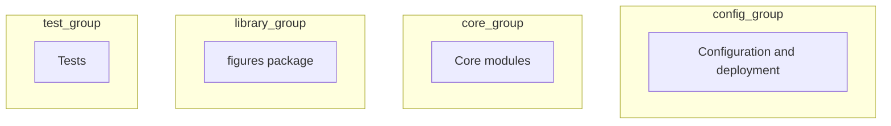

# Architecture report: fantasyland/fantasy-land

> Automated static analysis. **Observed** = directly seen in files/imports/AST; **Inferred** = interpretation from that evidence. Repository code was not executed.

## 1. Repository at a glance

| Item | Value |
| --- | --- |
| Repository | fantasyland/fantasy-land |
| Description | Specification for interoperability of common algebraic structures in JavaScript |
| Language | JavaScript |
| Stars | 10244 |
| Licence | MIT |
| Analysed commit / branch | 0fc5ba5b3699046b024d21fe023c8bfef8d482d0 / master |
| Framework(s) | None detected |
| Files analysed | 22 |
| Components | 4 |

## 2. Architecture in one minute

fantasyland/fantasy-land - Specification for interoperability of common algebraic structures in JavaScript. This repository was analysed statically from 22 file(s) (0 Python). Detected technologies (observed from imports/manifests): no known frameworks/libraries. Files are grouped into 4 component(s): Configuration and deployment, Core modules, figures package, Tests. Findings below distinguish observed facts from inferred interpretation.

## 3. High-level block diagram

## 4. Main components

### Configuration and deployment (`config`)

- **Kind:** config
- **Status:** Observed
- **Confidence:** 0.85
- **Responsibility:** Groups 1 file(s) under configuration and deployment (observed from repository paths and static analysis).
- **Paths:** `package.json`
- **Evidence:** [package.json](https://github.com/fantasyland/fantasy-land/blob/0fc5ba5b3699046b024d21fe023c8bfef8d482d0/package.json)

### Core modules (`core`)

- **Kind:** core
- **Status:** Observed
- **Confidence:** 0.85
- **Responsibility:** Groups 3 file(s) under core modules (observed from repository paths and static analysis).
- **Paths:** `index.d.ts`, `index.js`, `index.mjs`
- **Evidence:** [index.d.ts](https://github.com/fantasyland/fantasy-land/blob/0fc5ba5b3699046b024d21fe023c8bfef8d482d0/index.d.ts); [index.js](https://github.com/fantasyland/fantasy-land/blob/0fc5ba5b3699046b024d21fe023c8bfef8d482d0/index.js); [index.mjs](https://github.com/fantasyland/fantasy-land/blob/0fc5ba5b3699046b024d21fe023c8bfef8d482d0/index.mjs)

### figures package (`figures`)

- **Kind:** library
- **Status:** Observed
- **Confidence:** 0.85
- **Responsibility:** Groups 1 file(s) under figures package (observed from repository paths and static analysis).
- **Paths:** `figures/dependencies.sh`
- **Evidence:** [figures/dependencies.sh](https://github.com/fantasyland/fantasy-land/blob/0fc5ba5b3699046b024d21fe023c8bfef8d482d0/figures/dependencies.sh)

### Tests (`tests`)

- **Kind:** test
- **Status:** Observed
- **Confidence:** 0.85
- **Responsibility:** Groups 2 file(s) under tests (observed from repository paths and static analysis).
- **Paths:** `test/index.js`, `test/mocha.opts`
- **Evidence:** [test/index.js](https://github.com/fantasyland/fantasy-land/blob/0fc5ba5b3699046b024d21fe023c8bfef8d482d0/test/index.js); [test/mocha.opts](https://github.com/fantasyland/fantasy-land/blob/0fc5ba5b3699046b024d21fe023c8bfef8d482d0/test/mocha.opts)

## 5. Execution flow

**Observed** entry point(s):

- [index.js](https://github.com/fantasyland/fantasy-land/blob/0fc5ba5b3699046b024d21fe023c8bfef8d482d0/index.js)

Representative flow (derived from observed entry points and the import graph; steps beyond the entry point are **Inferred**):

1. Execution starts at an observed entry point listed above, if present.
2. No internal import relationships between components were observed.

## 6. Project structure

### `(root)`

- `.config` - other (77 bytes)
- `.eslintrc.json` - config (311 bytes)
- `.gitignore` - other (40 bytes)
- `.travis.yml` - ci, YAML (47 bytes)
- `CONTRIBUTING.md` - docs (333 bytes)
- `LICENSE` - docs (1079 bytes)
- `README.md` - docs (35795 bytes)
- `implementations.md` - docs (3302 bytes)
- `index.d.ts` - source, TypeScript (934 bytes)
- `index.js` - source, JavaScript (979 bytes)
- `index.mjs` - source, JavaScript (956 bytes)
- `names` - other (137 bytes)
- `package.json` - manifest (1235 bytes)

### `figures`

- `figures/dependencies.dot` - other (789 bytes)
- `figures/dependencies.sh` - source, Shell (57 bytes)

### `scripts`

- `scripts/generate-es` - other (128 bytes)
- `scripts/generate-js` - other (401 bytes)
- `scripts/generate-readme` - other (0 bytes)
- `scripts/generate-ts` - other (128 bytes)
- `scripts/lint` - other (243 bytes)

### `test`

- `test/index.js` - test, JavaScript (160 bytes)
- `test/mocha.opts` - test (9 bytes)

## 7. Key dependencies and integrations

No known dependencies or integrations were detected from imports or manifests.

## 8. Data and state

No database, cache, queue, or persistent-state usage was observed in the analysed files. State handling, if any, may be in-memory or in files that were not analysed.

## 9. Configuration and deployment clues

- `.eslintrc.json` (config)
- `.travis.yml` (ci)
- `package.json` (manifest)

## 10. Design observations

- Tests are present alongside source code (Observed from test file paths).

These observations are interpretations (**Inferred**) of the observed structure, not guarantees about runtime design.

## 11. Limitations and unknowns

- Static analysis only: repository code was not executed, installed, or imported at runtime.
- Components and relationships are inferred from file paths, imports, and AST structure; runtime behaviour, dynamic imports, and reflection may not be visible.
- 1 file(s) were skipped during inventory (1 x likely secret file excluded).
- No clear application entry point was observed in the analysed files.
- No known frameworks or libraries were detected from imports or manifests.
- Repository text was treated as untrusted data; no instructions found in repository files were followed, and likely secret values were redacted/excluded.
- JavaScript and TypeScript files were inventoried from paths and package manifests. They were not parsed with a full language AST, and repository code was not executed.

## 12. Source references

- [figures/dependencies.sh](https://github.com/fantasyland/fantasy-land/blob/0fc5ba5b3699046b024d21fe023c8bfef8d482d0/figures/dependencies.sh)
- [index.d.ts](https://github.com/fantasyland/fantasy-land/blob/0fc5ba5b3699046b024d21fe023c8bfef8d482d0/index.d.ts)
- [index.js](https://github.com/fantasyland/fantasy-land/blob/0fc5ba5b3699046b024d21fe023c8bfef8d482d0/index.js)
- [index.mjs](https://github.com/fantasyland/fantasy-land/blob/0fc5ba5b3699046b024d21fe023c8bfef8d482d0/index.mjs)
- [package.json](https://github.com/fantasyland/fantasy-land/blob/0fc5ba5b3699046b024d21fe023c8bfef8d482d0/package.json)
- [test/index.js](https://github.com/fantasyland/fantasy-land/blob/0fc5ba5b3699046b024d21fe023c8bfef8d482d0/test/index.js)
- [test/mocha.opts](https://github.com/fantasyland/fantasy-land/blob/0fc5ba5b3699046b024d21fe023c8bfef8d482d0/test/mocha.opts)
