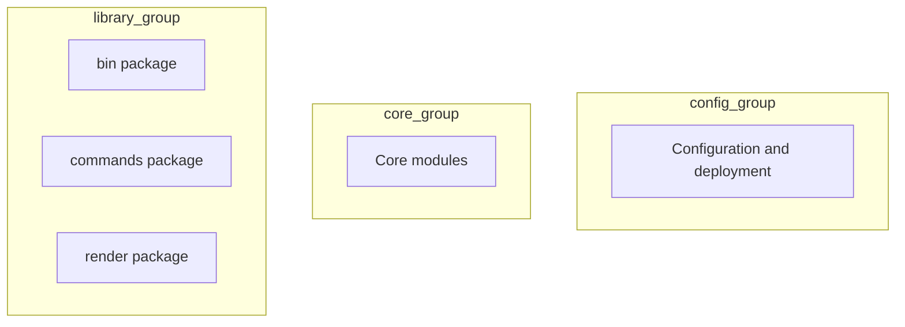

# Architecture report: faressoft/terminalizer

> Automated static analysis. **Observed** = directly seen in files/imports/AST; **Inferred** = interpretation from that evidence. Repository code was not executed.

## 1. Repository at a glance

| Item | Value |
| --- | --- |
| Repository | faressoft/terminalizer |
| Description | 🦄 Record your terminal and generate animated gif images or share a web player |
| Language | JavaScript |
| Stars | 16172 |
| Licence | MIT |
| Analysed commit / branch | 7b7da2913987f6d002b5c5555610788535a09979 / master |
| Framework(s) | Electron |
| Files analysed | 25 |
| Components | 5 |

## 2. Architecture in one minute

faressoft/terminalizer - 🦄 Record your terminal and generate animated gif images or share a web player. This repository was analysed statically from 25 file(s) (0 Python). Detected technologies (observed from imports/manifests): Electron, axios, webpack. Files are grouped into 5 component(s): bin package, commands package, Configuration and deployment, Core modules, render package. Findings below distinguish observed facts from inferred interpretation.

## 3. High-level block diagram

## 4. Main components

### bin package (`bin`)

- **Kind:** library
- **Status:** Observed
- **Confidence:** 0.85
- **Responsibility:** Groups 1 file(s) under bin package (observed from repository paths and static analysis).
- **Paths:** `bin/app.js`
- **Evidence:** [bin/app.js](https://github.com/faressoft/terminalizer/blob/7b7da2913987f6d002b5c5555610788535a09979/bin/app.js)

### commands package (`commands`)

- **Kind:** library
- **Status:** Observed
- **Confidence:** 0.85
- **Responsibility:** Groups 7 file(s) under commands package (observed from repository paths and static analysis).
- **Paths:** `commands/config.js`, `commands/generate.js`, `commands/init.js`, `commands/play.js`, `commands/record.js`, `commands/render.js`, `commands/share.js`
- **Evidence:** [commands/config.js](https://github.com/faressoft/terminalizer/blob/7b7da2913987f6d002b5c5555610788535a09979/commands/config.js); [commands/generate.js](https://github.com/faressoft/terminalizer/blob/7b7da2913987f6d002b5c5555610788535a09979/commands/generate.js); [commands/init.js](https://github.com/faressoft/terminalizer/blob/7b7da2913987f6d002b5c5555610788535a09979/commands/init.js); [commands/play.js](https://github.com/faressoft/terminalizer/blob/7b7da2913987f6d002b5c5555610788535a09979/commands/play.js); [commands/record.js](https://github.com/faressoft/terminalizer/blob/7b7da2913987f6d002b5c5555610788535a09979/commands/record.js); [commands/render.js](https://github.com/faressoft/terminalizer/blob/7b7da2913987f6d002b5c5555610788535a09979/commands/render.js); [commands/share.js](https://github.com/faressoft/terminalizer/blob/7b7da2913987f6d002b5c5555610788535a09979/commands/share.js)

### Configuration and deployment (`config`)

- **Kind:** config
- **Status:** Observed
- **Confidence:** 0.85
- **Responsibility:** Groups 2 file(s) under configuration and deployment (observed from repository paths and static analysis).
- **Paths:** `config.yml`, `package.json`
- **Evidence:** [config.yml](https://github.com/faressoft/terminalizer/blob/7b7da2913987f6d002b5c5555610788535a09979/config.yml); [package.json](https://github.com/faressoft/terminalizer/blob/7b7da2913987f6d002b5c5555610788535a09979/package.json)

### Core modules (`core`)

- **Kind:** core
- **Status:** Observed
- **Confidence:** 0.85
- **Responsibility:** Groups 4 file(s) under core modules (observed from repository paths and static analysis).
- **Paths:** `app.js`, `di.js`, `utility.js`, `webpack.config.js`
- **Evidence:** [app.js](https://github.com/faressoft/terminalizer/blob/7b7da2913987f6d002b5c5555610788535a09979/app.js); [di.js](https://github.com/faressoft/terminalizer/blob/7b7da2913987f6d002b5c5555610788535a09979/di.js); [utility.js](https://github.com/faressoft/terminalizer/blob/7b7da2913987f6d002b5c5555610788535a09979/utility.js); [webpack.config.js](https://github.com/faressoft/terminalizer/blob/7b7da2913987f6d002b5c5555610788535a09979/webpack.config.js)

### render package (`render`)

- **Kind:** library
- **Status:** Observed
- **Confidence:** 0.85
- **Responsibility:** Groups 3 file(s) under render package (observed from repository paths and static analysis).
- **Paths:** `render/index.js`, `render/preload.js`, `render/src/js/app.js`
- **Evidence:** [render/index.js](https://github.com/faressoft/terminalizer/blob/7b7da2913987f6d002b5c5555610788535a09979/render/index.js); [render/preload.js](https://github.com/faressoft/terminalizer/blob/7b7da2913987f6d002b5c5555610788535a09979/render/preload.js); [render/src/js/app.js](https://github.com/faressoft/terminalizer/blob/7b7da2913987f6d002b5c5555610788535a09979/render/src/js/app.js)

## 5. Execution flow

**Observed** entry point(s):

- [app.js](https://github.com/faressoft/terminalizer/blob/7b7da2913987f6d002b5c5555610788535a09979/app.js)
- [bin/app.js](https://github.com/faressoft/terminalizer/blob/7b7da2913987f6d002b5c5555610788535a09979/bin/app.js)
- [render/index.js](https://github.com/faressoft/terminalizer/blob/7b7da2913987f6d002b5c5555610788535a09979/render/index.js)
- [render/src/js/app.js](https://github.com/faressoft/terminalizer/blob/7b7da2913987f6d002b5c5555610788535a09979/render/src/js/app.js)

Representative flow (derived from observed entry points and the import graph; steps beyond the entry point are **Inferred**):

1. Execution starts at an observed entry point listed above, if present.
2. No internal import relationships between components were observed.

## 6. Project structure

### `(root)`

- `.gitignore` - other (263 bytes)
- `.jscsrc` - other (2307 bytes)
- `.npmignore` - other (219 bytes)
- `.prettierrc` - other (62 bytes)
- `LICENSE` - docs (1071 bytes)
- `README.md` - docs (13045 bytes)
- `app.js` - source, JavaScript (2599 bytes)
- `config.yml` - config (2423 bytes)
- `di.js` - source, JavaScript (2650 bytes)
- `package.json` - manifest (1806 bytes)
- `utility.js` - source, JavaScript (6844 bytes)
- `webpack.config.js` - source, JavaScript (1092 bytes)

### `bin`

- `bin/app.js` - source, JavaScript (124 bytes)

### `commands`

- `commands/config.js` - source, JavaScript (1039 bytes)
- `commands/generate.js` - source, JavaScript (1181 bytes)
- `commands/init.js` - source, JavaScript (1568 bytes)
- `commands/play.js` - source, JavaScript (4818 bytes)
- `commands/record.js` - source, JavaScript (7200 bytes)
- `commands/render.js` - source, JavaScript (10533 bytes)
- `commands/share.js` - source, JavaScript (5986 bytes)

### `render`

- `render/index.html` - other (275 bytes)
- `render/index.js` - source, JavaScript (2233 bytes)
- `render/preload.js` - source, JavaScript (451 bytes)
- `render/src/css/app.css` - other (188 bytes)
- `render/src/js/app.js` - source, JavaScript (2383 bytes)

## 7. Key dependencies and integrations

| Name | Category | Status | Confidence | Evidence |
| --- | --- | --- | --- | --- |
| Electron | framework | Observed | 0.85 | [package.json:51](https://github.com/faressoft/terminalizer/blob/7b7da2913987f6d002b5c5555610788535a09979/package.json#L51) |
| axios | library | Observed | 0.85 | [package.json:47](https://github.com/faressoft/terminalizer/blob/7b7da2913987f6d002b5c5555610788535a09979/package.json#L47) |
| webpack | tooling | Observed | 0.85 | [package.json:17](https://github.com/faressoft/terminalizer/blob/7b7da2913987f6d002b5c5555610788535a09979/package.json#L17) |

## 8. Data and state

No database, cache, queue, or persistent-state usage was observed in the analysed files. State handling, if any, may be in-memory or in files that were not analysed.

## 9. Configuration and deployment clues

- `config.yml` (config)
- `package.json` (manifest)

## 10. Design observations

- No strong design patterns could be established from the available evidence.

These observations are interpretations (**Inferred**) of the observed structure, not guarantees about runtime design.

## 11. Limitations and unknowns

- Static analysis only: repository code was not executed, installed, or imported at runtime.
- Components and relationships are inferred from file paths, imports, and AST structure; runtime behaviour, dynamic imports, and reflection may not be visible.
- 2 file(s) were skipped during inventory (2 x lockfile excluded).
- No clear application entry point was observed in the analysed files.
- Repository text was treated as untrusted data; no instructions found in repository files were followed, and likely secret values were redacted/excluded.
- JavaScript and TypeScript files were inventoried from paths and package manifests. They were not parsed with a full language AST, and repository code was not executed.

## 12. Source references

- [app.js](https://github.com/faressoft/terminalizer/blob/7b7da2913987f6d002b5c5555610788535a09979/app.js)
- [bin/app.js](https://github.com/faressoft/terminalizer/blob/7b7da2913987f6d002b5c5555610788535a09979/bin/app.js)
- [commands/config.js](https://github.com/faressoft/terminalizer/blob/7b7da2913987f6d002b5c5555610788535a09979/commands/config.js)
- [commands/generate.js](https://github.com/faressoft/terminalizer/blob/7b7da2913987f6d002b5c5555610788535a09979/commands/generate.js)
- [commands/init.js](https://github.com/faressoft/terminalizer/blob/7b7da2913987f6d002b5c5555610788535a09979/commands/init.js)
- [commands/play.js](https://github.com/faressoft/terminalizer/blob/7b7da2913987f6d002b5c5555610788535a09979/commands/play.js)
- [commands/record.js](https://github.com/faressoft/terminalizer/blob/7b7da2913987f6d002b5c5555610788535a09979/commands/record.js)
- [commands/render.js](https://github.com/faressoft/terminalizer/blob/7b7da2913987f6d002b5c5555610788535a09979/commands/render.js)
- [commands/share.js](https://github.com/faressoft/terminalizer/blob/7b7da2913987f6d002b5c5555610788535a09979/commands/share.js)
- [config.yml](https://github.com/faressoft/terminalizer/blob/7b7da2913987f6d002b5c5555610788535a09979/config.yml)
- [di.js](https://github.com/faressoft/terminalizer/blob/7b7da2913987f6d002b5c5555610788535a09979/di.js)
- [package.json](https://github.com/faressoft/terminalizer/blob/7b7da2913987f6d002b5c5555610788535a09979/package.json)
- [package.json:17](https://github.com/faressoft/terminalizer/blob/7b7da2913987f6d002b5c5555610788535a09979/package.json#L17)
- [package.json:47](https://github.com/faressoft/terminalizer/blob/7b7da2913987f6d002b5c5555610788535a09979/package.json#L47)
- [package.json:51](https://github.com/faressoft/terminalizer/blob/7b7da2913987f6d002b5c5555610788535a09979/package.json#L51)
- [render/index.js](https://github.com/faressoft/terminalizer/blob/7b7da2913987f6d002b5c5555610788535a09979/render/index.js)
- [render/preload.js](https://github.com/faressoft/terminalizer/blob/7b7da2913987f6d002b5c5555610788535a09979/render/preload.js)
- [render/src/js/app.js](https://github.com/faressoft/terminalizer/blob/7b7da2913987f6d002b5c5555610788535a09979/render/src/js/app.js)
- [utility.js](https://github.com/faressoft/terminalizer/blob/7b7da2913987f6d002b5c5555610788535a09979/utility.js)
- [webpack.config.js](https://github.com/faressoft/terminalizer/blob/7b7da2913987f6d002b5c5555610788535a09979/webpack.config.js)
