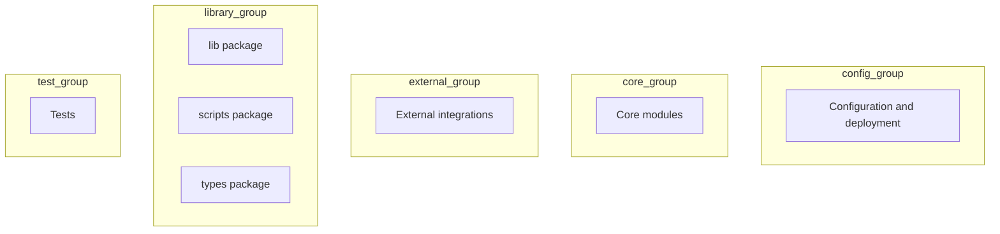

# Architecture report: fastify/fastify

> Automated static analysis. **Observed** = directly seen in files/imports/AST; **Inferred** = interpretation from that evidence. Repository code was not executed.

## 1. Repository at a glance

| Item | Value |
| --- | --- |
| Repository | fastify/fastify |
| Description | Fast and low overhead web framework, for Node.js |
| Language | JavaScript |
| Stars | 37419 |
| Licence | MIT |
| Analysed commit / branch | 7e0c8febb2a1ba4d55309cdc2ccd51694eca46d3 / main |
| Framework(s) | None detected |
| Files analysed | 391 |
| Components | 7 |

## 2. Architecture in one minute

fastify/fastify - Fast and low overhead web framework, for Node.js. This repository was analysed statically from 391 file(s) (0 Python). Detected technologies (observed from imports/manifests): GitHub Actions, TypeScript, webpack. Files are grouped into 7 component(s): Configuration and deployment, Core modules, External integrations, lib package, scripts package, Tests, types package. Findings below distinguish observed facts from inferred interpretation.

## 3. High-level block diagram

## 4. Main components

### Configuration and deployment (`config`)

- **Kind:** config
- **Status:** Observed
- **Confidence:** 0.85
- **Responsibility:** Groups 1 file(s) under configuration and deployment (observed from repository paths and static analysis).
- **Paths:** `package.json`
- **Evidence:** [package.json](https://github.com/fastify/fastify/blob/7e0c8febb2a1ba4d55309cdc2ccd51694eca46d3/package.json)

### Core modules (`core`)

- **Kind:** core
- **Status:** Observed
- **Confidence:** 0.85
- **Responsibility:** Groups 3 file(s) under core modules (observed from repository paths and static analysis).
- **Paths:** `eslint.config.js`, `fastify.d.ts`, `fastify.js`
- **Evidence:** [eslint.config.js](https://github.com/fastify/fastify/blob/7e0c8febb2a1ba4d55309cdc2ccd51694eca46d3/eslint.config.js); [fastify.d.ts](https://github.com/fastify/fastify/blob/7e0c8febb2a1ba4d55309cdc2ccd51694eca46d3/fastify.d.ts); [fastify.js](https://github.com/fastify/fastify/blob/7e0c8febb2a1ba4d55309cdc2ccd51694eca46d3/fastify.js)

### External integrations (`external_integrations`)

- **Kind:** external
- **Status:** Observed
- **Confidence:** 0.85
- **Responsibility:** Groups 2 file(s) under external integrations (observed from repository paths and static analysis).
- **Paths:** `integration/server.js`, `integration/test.sh`
- **Evidence:** [integration/server.js](https://github.com/fastify/fastify/blob/7e0c8febb2a1ba4d55309cdc2ccd51694eca46d3/integration/server.js); [integration/test.sh](https://github.com/fastify/fastify/blob/7e0c8febb2a1ba4d55309cdc2ccd51694eca46d3/integration/test.sh)

### lib package (`lib`)

- **Kind:** library
- **Status:** Observed
- **Confidence:** 0.85
- **Responsibility:** Groups 31 file(s) under lib package (observed from repository paths and static analysis).
- **Paths:** `lib/config-validator.js`, `lib/content-type-parser.js`, `lib/content-type.js`, `lib/context.js`, `lib/decorate.js`, `lib/error-handler.js`, `lib/error-serializer.js`, `lib/error-status.js`, `lib/errors.js`, `lib/four-oh-four.js`, `lib/handle-request.js`, `lib/head-route.js`, `lib/hooks.js`, `lib/initial-config-validation.js`, `lib/log-controller.js`, `lib/logger-factory.js`, `lib/logger-pino.js`, `lib/noop-set.js`, `lib/plugin-override.js`, `lib/plugin-utils.js`, `lib/reply.js`, `lib/req-id-gen-factory.js`, `lib/request.js`, `lib/route.js`, `lib/schema-controller.js`, `lib/schemas.js`, `lib/server.js`, `lib/symbols.js`, `lib/validation.js`, `lib/warnings.js`, `lib/wrap-thenable.js`
- **Evidence:** [lib/config-validator.js](https://github.com/fastify/fastify/blob/7e0c8febb2a1ba4d55309cdc2ccd51694eca46d3/lib/config-validator.js); [lib/content-type-parser.js](https://github.com/fastify/fastify/blob/7e0c8febb2a1ba4d55309cdc2ccd51694eca46d3/lib/content-type-parser.js); [lib/content-type.js](https://github.com/fastify/fastify/blob/7e0c8febb2a1ba4d55309cdc2ccd51694eca46d3/lib/content-type.js); [lib/context.js](https://github.com/fastify/fastify/blob/7e0c8febb2a1ba4d55309cdc2ccd51694eca46d3/lib/context.js); [lib/decorate.js](https://github.com/fastify/fastify/blob/7e0c8febb2a1ba4d55309cdc2ccd51694eca46d3/lib/decorate.js); [lib/error-handler.js](https://github.com/fastify/fastify/blob/7e0c8febb2a1ba4d55309cdc2ccd51694eca46d3/lib/error-handler.js); [lib/error-serializer.js](https://github.com/fastify/fastify/blob/7e0c8febb2a1ba4d55309cdc2ccd51694eca46d3/lib/error-serializer.js); [lib/error-status.js](https://github.com/fastify/fastify/blob/7e0c8febb2a1ba4d55309cdc2ccd51694eca46d3/lib/error-status.js)

### scripts package (`scripts`)

- **Kind:** library
- **Status:** Observed
- **Confidence:** 0.85
- **Responsibility:** Groups 1 file(s) under scripts package (observed from repository paths and static analysis).
- **Paths:** `scripts/validate-ecosystem-links.js`
- **Evidence:** [scripts/validate-ecosystem-links.js](https://github.com/fastify/fastify/blob/7e0c8febb2a1ba4d55309cdc2ccd51694eca46d3/scripts/validate-ecosystem-links.js)

### Tests (`tests`)

- **Kind:** test
- **Status:** Observed
- **Confidence:** 0.85
- **Responsibility:** Groups 234 file(s) under tests (observed from repository paths and static analysis).
- **Paths:** `test/404s.test.js`, `test/500s.test.js`, `test/allow-unsafe-regex.test.js`, `test/als.test.js`, `test/async-await.test.js`, `test/async-dispose.test.js`, `test/async_hooks.test.js`, `test/body-limit.test.js`, `test/buffer.test.js`, `test/build-certificate.js`, `test/bundler/README.md`, `test/bundler/esbuild/bundler-test.js`, `test/bundler/esbuild/package.json`, `test/bundler/esbuild/src/fail-plugin-version.js`, `test/bundler/esbuild/src/index.js`, `test/bundler/webpack/bundler-test.js`, `test/bundler/webpack/package.json`, `test/bundler/webpack/src/fail-plugin-version.js`, `test/bundler/webpack/src/index.js`, `test/bundler/webpack/webpack.config.js`, `test/case-insensitive.test.js`, `test/chainable.test.js`, `test/child-logger-factory.test.js`, `test/client-timeout.test.js`, `test/close-disposable.test.js`, `test/close-pipelining.test.js`, `test/close.test.js`, `test/conditional-pino.test.js`, `test/connection-timeout.test.js`, `test/constrained-routes.test.js`, `test/content-length.test.js`, `test/content-parser.test.js`, `test/content-type-parser-async-context.test.js`, `test/content-type.test.js`, `test/context-config.test.js`, `test/custom-http-server.test.js`, `test/custom-parser-async.test.js`, `test/custom-parser.0.test.js`, `test/custom-parser.1.test.js`, `test/custom-parser.2.test.js`, `test/custom-parser.3.test.js`, `test/custom-parser.4.test.js`, `test/custom-parser.5.test.js`, `test/custom-querystring-parser.test.js`, `test/decorator-instance-properties.test.js`, `test/decorator.test.js`, `test/delete.test.js`, `test/diagnostics-channel/404.test.js`, `test/diagnostics-channel/async-delay-request.test.js`, `test/diagnostics-channel/async-error-handler.test.js`, `test/diagnostics-channel/async-request.test.js`, `test/diagnostics-channel/error-before-handler.test.js`, `test/diagnostics-channel/error-request.test.js`, `test/diagnostics-channel/error-status.test.js`, `test/diagnostics-channel/init.test.js`, `test/diagnostics-channel/sync-delay-request.test.js`, `test/diagnostics-channel/sync-request-reply.test.js`, `test/diagnostics-channel/sync-request.test.js`, `test/encapsulated-child-logger-factory.test.js`, `test/encapsulated-error-handler.test.js`, `test/esm/errorCodes.test.mjs`, `test/esm/esm.test.mjs`, `test/esm/index.test.js`, `test/esm/named-exports.mjs`, `test/esm/other.mjs`, `test/esm/plugin.mjs`, `test/fastify-instance.test.js`, `test/find-route.test.js`, `test/fix-6411.test.js`, `test/fix-root-primitive-coercion.test.js`, `test/fluent-schema.test.js`, `test/genReqId.test.js`, `test/handler-context.test.js`, `test/handler-timeout.test.js`, `test/has-route.test.js`, `test/header-overflow.test.js`, `test/helper.js`, `test/hooks-async.test.js`, `test/hooks.on-listen.test.js`, `test/hooks.on-ready.test.js`, `test/hooks.test.js`, `test/http-methods/copy.test.js`, `test/http-methods/custom-http-methods.test.js`, `test/http-methods/get.test.js`, `test/http-methods/head.test.js`, `test/http-methods/lock.test.js`, `test/http-methods/mkcalendar.test.js`, `test/http-methods/mkcol.test.js`, `test/http-methods/move.test.js`, `test/http-methods/propfind.test.js`, `test/http-methods/proppatch.test.js`, `test/http-methods/report.test.js`, `test/http-methods/search.test.js`, `test/http-methods/trace.test.js`, `test/http-methods/unlock.test.js`, `test/http2/closing.test.js`, `test/http2/constraint.test.js`, `test/http2/head.test.js`, `test/http2/plain.test.js`, `test/http2/secure-with-fallback.test.js`, `test/http2/secure.test.js`, `test/http2/unknown-http-method.test.js`, `test/https/custom-https-server.test.js`, `test/https/https.test.js`, `test/imports.test.js`, `test/inject.test.js`, `test/input-validation.js`, `test/internals/all.test.js`, `test/internals/content-type-parser.test.js`, `test/internals/context.test.js`, `test/internals/decorator.test.js`, `test/internals/errors.test.js`, `test/internals/handle-request.test.js`, `test/internals/hook-runner.test.js`, `test/internals/hooks.test.js`, `test/internals/initial-config.test.js`, `test/internals/logger.test.js`, `test/internals/plugin.test.js`, `test/internals/reply-serialize.test.js`, `test/internals/reply.test.js`, `test/internals/req-id-gen-factory.test.js`, `test/internals/request-validate.test.js`, `test/internals/request.test.js`, `test/internals/schema-controller-perf.test.js`, `test/internals/server.test.js`, `test/internals/validation.test.js`, `test/issue-4959.test.js`, `test/keep-alive-timeout.test.js`, `test/listen.1.test.js`, `test/listen.2.test.js`, `test/listen.3.test.js`, `test/listen.4.test.js`, `test/listen.5.test.js`, `test/logger/instantiation.test.js`, `test/logger/logger-test-utils.js`, `test/logger/logging.test.js`, `test/logger/options.test.js`, `test/logger/request.test.js`, `test/logger/response.test.js`, `test/logger/tap-parallel-not-ok`, `test/max-requests-per-socket.test.js`, `test/middleware.test.js`, `test/noop-set.test.js`, `test/nullable-validation.test.js`, `test/options.error-handler.test.js`, `test/options.test.js`, `test/output-validation.test.js`, `test/patch.error-handler.test.js`, `test/patch.test.js`, `test/plugin.1.test.js`, `test/plugin.2.test.js`, `test/plugin.3.test.js`, `test/plugin.4.test.js`, `test/plugin.helper.js`, `test/plugin.name.display.js`, `test/post-empty-body.test.js`, `test/pretty-print.test.js`, `test/promises.test.js`, `test/proto-poisoning.test.js`, `test/put.error-handler.test.js`, `test/put.test.js`, `test/register.test.js`, `test/reply-code.test.js`, `test/reply-early-hints.test.js`, `test/reply-error.test.js`, `test/reply-media-type.test.js`, `test/reply-trailers.test.js`, `test/reply-web-stream-locked.test.js`, `test/request-error.test.js`, `test/request-header-host.test.js`, `test/request-id.test.js`, `test/request-media-type.test.js`, `test/request-port.test.js`, `test/request-timeout.test.js`, `test/rfc-10008.test.js`, `test/route-hooks.test.js`, `test/route-prefix.test.js`, `test/route-shorthand.test.js`, `test/route.1.test.js`, `test/route.2.test.js`, `test/route.3.test.js`, `test/route.4.test.js`, `test/route.5.test.js`, `test/route.6.test.js`, `test/route.7.test.js`, `test/route.8.test.js`, `test/router-compile.test.js`, `test/router-options.test.js`, `test/same-shape.test.js`, `test/schema-examples.test.js`, `test/schema-feature.test.js`, `test/schema-serialization.test.js`, `test/schema-special-usage.test.js`, `test/schema-validation.test.js`, `test/scripts/validate-ecosystem-links.test.js`, `test/serialize-response.test.js`, `test/server.test.js`, `test/set-error-handler.test.js`, `test/skip-reply-send.test.js`, `test/stream-serializers.test.js`, `test/stream.1.test.js`, `test/stream.2.test.js`, `test/stream.3.test.js`, `test/stream.4.test.js`, `test/stream.5.test.js`, `test/sync-routes.test.js`, `test/throw.test.js`, `test/trust-proxy.test.js`, `test/type-provider.test.js`, `test/types/content-type-parser.tst.ts`, `test/types/decorate-request-reply.tst.ts`, `test/types/dummy-plugin.mts`, `test/types/errors.tst.ts`, `test/types/fastify.tst.ts`, `test/types/hooks.tst.ts`, `test/types/instance.tst.ts`, `test/types/logger.tst.ts`, `test/types/plugin.tst.ts`, `test/types/register.tst.ts`, `test/types/reply.tst.ts`, `test/types/request.tst.ts`, `test/types/route.tst.ts`, `test/types/schema.tst.ts`, `test/types/serverFactory.tst.ts`, `test/types/tsconfig.json`, `test/types/type-provider.tst.ts`, `test/types/using.tst.ts`, `test/upgrade.test.js`, `test/url-rewriting.test.js`, `test/use-semicolon-delimiter.test.js`, `test/validation-error-handling.test.js`, `test/versioned-routes.test.js`, `test/web-api.test.js`, `test/wrap-thenable.test.js`
- **Evidence:** [test/404s.test.js](https://github.com/fastify/fastify/blob/7e0c8febb2a1ba4d55309cdc2ccd51694eca46d3/test/404s.test.js); [test/500s.test.js](https://github.com/fastify/fastify/blob/7e0c8febb2a1ba4d55309cdc2ccd51694eca46d3/test/500s.test.js); [test/allow-unsafe-regex.test.js](https://github.com/fastify/fastify/blob/7e0c8febb2a1ba4d55309cdc2ccd51694eca46d3/test/allow-unsafe-regex.test.js); [test/als.test.js](https://github.com/fastify/fastify/blob/7e0c8febb2a1ba4d55309cdc2ccd51694eca46d3/test/als.test.js); [test/async-await.test.js](https://github.com/fastify/fastify/blob/7e0c8febb2a1ba4d55309cdc2ccd51694eca46d3/test/async-await.test.js); [test/async-dispose.test.js](https://github.com/fastify/fastify/blob/7e0c8febb2a1ba4d55309cdc2ccd51694eca46d3/test/async-dispose.test.js); [test/async_hooks.test.js](https://github.com/fastify/fastify/blob/7e0c8febb2a1ba4d55309cdc2ccd51694eca46d3/test/async_hooks.test.js); [test/body-limit.test.js](https://github.com/fastify/fastify/blob/7e0c8febb2a1ba4d55309cdc2ccd51694eca46d3/test/body-limit.test.js)

### types package (`types`)

- **Kind:** library
- **Status:** Observed
- **Confidence:** 0.85
- **Responsibility:** Groups 15 file(s) under types package (observed from repository paths and static analysis).
- **Paths:** `types/content-type-parser.d.ts`, `types/context.d.ts`, `types/errors.d.ts`, `types/hooks.d.ts`, `types/instance.d.ts`, `types/logger.d.ts`, `types/plugin.d.ts`, `types/register.d.ts`, `types/reply.d.ts`, `types/request.d.ts`, `types/route.d.ts`, `types/schema.d.ts`, `types/server-factory.d.ts`, `types/type-provider.d.ts`, `types/utils.d.ts`
- **Evidence:** [types/content-type-parser.d.ts](https://github.com/fastify/fastify/blob/7e0c8febb2a1ba4d55309cdc2ccd51694eca46d3/types/content-type-parser.d.ts); [types/context.d.ts](https://github.com/fastify/fastify/blob/7e0c8febb2a1ba4d55309cdc2ccd51694eca46d3/types/context.d.ts); [types/errors.d.ts](https://github.com/fastify/fastify/blob/7e0c8febb2a1ba4d55309cdc2ccd51694eca46d3/types/errors.d.ts); [types/hooks.d.ts](https://github.com/fastify/fastify/blob/7e0c8febb2a1ba4d55309cdc2ccd51694eca46d3/types/hooks.d.ts); [types/instance.d.ts](https://github.com/fastify/fastify/blob/7e0c8febb2a1ba4d55309cdc2ccd51694eca46d3/types/instance.d.ts); [types/logger.d.ts](https://github.com/fastify/fastify/blob/7e0c8febb2a1ba4d55309cdc2ccd51694eca46d3/types/logger.d.ts); [types/plugin.d.ts](https://github.com/fastify/fastify/blob/7e0c8febb2a1ba4d55309cdc2ccd51694eca46d3/types/plugin.d.ts); [types/register.d.ts](https://github.com/fastify/fastify/blob/7e0c8febb2a1ba4d55309cdc2ccd51694eca46d3/types/register.d.ts)

## 5. Execution flow

**Observed** entry point(s):

- [fastify.js](https://github.com/fastify/fastify/blob/7e0c8febb2a1ba4d55309cdc2ccd51694eca46d3/fastify.js)
- [integration/server.js](https://github.com/fastify/fastify/blob/7e0c8febb2a1ba4d55309cdc2ccd51694eca46d3/integration/server.js)
- [lib/server.js](https://github.com/fastify/fastify/blob/7e0c8febb2a1ba4d55309cdc2ccd51694eca46d3/lib/server.js)

Representative flow (derived from observed entry points and the import graph; steps beyond the entry point are **Inferred**):

1. Execution starts at an observed entry point listed above, if present.
2. No internal import relationships between components were observed.

## 6. Project structure

### `(root)`

- `.borp.yaml` - config (56 bytes)
- `.editorconfig` - config (160 bytes)
- `.gitattributes` - other (80 bytes)
- `.gitignore` - other (2589 bytes)
- `.gitpod.yml` - config (198 bytes)
- `.markdownlint-cli2.yaml` - config (364 bytes)
- `.npmignore` - other (312 bytes)
- `.prettierignore` - other (2 bytes)
- `CODE_OF_CONDUCT.md` - docs (142 bytes)
- `CONTRIBUTING.md` - docs (8122 bytes)
- `EXPENSE_POLICY.md` - docs (4175 bytes)
- `GOVERNANCE.md` - docs (152 bytes)
- `LICENSE` - docs (1123 bytes)
- `PROJECT_CHARTER.md` - docs (4391 bytes)
- `README.md` - docs (16475 bytes)
- `SECURITY.md` - docs (10035 bytes)
- `SPONSORS.md` - docs (1217 bytes)
- `eslint.config.js` - source, JavaScript (793 bytes)
- `fastify.d.ts` - source, TypeScript (14265 bytes)
- `fastify.js` - source, JavaScript (34848 bytes)
- `package.json` - manifest (7154 bytes)

### `.github`

- `.github/dependabot.yml` - config (1771 bytes)
- `.github/labeler.yml` - config (366 bytes)
- `.github/problem-matcher.json` - config (313 bytes)
- `.github/scripts/lint-ecosystem.js` - source, JavaScript (3718 bytes)
- `.github/workflows/backport.yml` - ci, YAML (659 bytes)
- `.github/workflows/ci-alternative-runtime.yml` - ci, YAML (2827 bytes)
- `.github/workflows/ci.yml` - ci, YAML (6163 bytes)
- `.github/workflows/citgm-package.yml` - ci, YAML (3066 bytes)
- `.github/workflows/citgm.yml` - ci, YAML (3999 bytes)
- `.github/workflows/coverage-nix.yml` - ci, YAML (867 bytes)
- `.github/workflows/coverage-win.yml` - ci, YAML (867 bytes)
- `.github/workflows/integration-alternative-runtimes.yml` - ci, YAML (1432 bytes)
- `.github/workflows/integration.yml` - ci, YAML (1235 bytes)
- `.github/workflows/labeler.yml` - ci, YAML (281 bytes)
- `.github/workflows/links-check.yml` - ci, YAML (2449 bytes)
- `.github/workflows/lint-ecosystem-order.yml` - ci, YAML (732 bytes)
- `.github/workflows/lock-threads.yml` - ci, YAML (340 bytes)
- `.github/workflows/md-lint.yml` - ci, YAML (936 bytes)
- `.github/workflows/missing_types.yml` - ci, YAML (1228 bytes)
- `.github/workflows/package-manager-ci.yml` - ci, YAML (1908 bytes)
- `.github/workflows/pull-request-title.yml` - ci, YAML (518 bytes)
- `.github/workflows/test-compare.yml` - ci, YAML (534 bytes)
- `.github/workflows/validate-ecosystem-links.yml` - ci, YAML (753 bytes)
- `.github/workflows/website.yml` - ci, YAML (393 bytes)

### `docs`

- `docs/Guides/Benchmarking.md` - docs (1742 bytes)
- `docs/Guides/Contributing.md` - docs (7460 bytes)
- `docs/Guides/Database.md` - docs (7845 bytes)
- `docs/Guides/Delay-Accepting-Requests.md` - docs (21634 bytes)
- `docs/Guides/Detecting-When-Clients-Abort.md` - docs (5316 bytes)
- `docs/Guides/Ecosystem.md` - docs (44830 bytes)
- `docs/Guides/Fluent-Schema.md` - docs (3547 bytes)
- `docs/Guides/Getting-Started.md` - docs (16065 bytes)
- `docs/Guides/Index.md` - docs (2324 bytes)
- `docs/Guides/Migration-Guide-V3.md` - docs (8918 bytes)
- `docs/Guides/Migration-Guide-V4.md` - docs (7257 bytes)
- `docs/Guides/Migration-Guide-V5.md` - docs (26734 bytes)
- `docs/Guides/Plugins-Guide.md` - docs (17136 bytes)
- `docs/Guides/Prototype-Poisoning.md` - docs (18309 bytes)
- `docs/Guides/Recommendations.md` - docs (15766 bytes)
- `docs/Guides/Serverless.md` - docs (19705 bytes)
- `docs/Guides/Style-Guide.md` - docs (7638 bytes)
- `docs/Guides/Testing.md` - docs (10915 bytes)
- `docs/Guides/Write-Plugin.md` - docs (4880 bytes)
- `docs/Guides/Write-Type-Provider.md` - docs (1417 bytes)
- `docs/Reference/ContentTypeParser.md` - docs (10303 bytes)
- `docs/Reference/Decorators.md` - docs (11816 bytes)
- `docs/Reference/Encapsulation.md` - docs (6663 bytes)
- `docs/Reference/Errors.md` - docs (37910 bytes)
- `docs/Reference/HTTP2.md` - docs (2129 bytes)
- `docs/Reference/Hooks.md` - docs (29896 bytes)
- `docs/Reference/Index.md` - docs (3672 bytes)
- `docs/Reference/LTS.md` - docs (4649 bytes)
- `docs/Reference/Lifecycle.md` - docs (4617 bytes)
- `docs/Reference/Logging.md` - docs (7318 bytes)
- `docs/Reference/Middleware.md` - docs (2754 bytes)
- `docs/Reference/Plugins.md` - docs (7549 bytes)
- `docs/Reference/Principles.md` - docs (2559 bytes)
- `docs/Reference/Reply.md` - docs (34934 bytes)
- `docs/Reference/Request.md` - docs (17553 bytes)
- `docs/Reference/Routes.md` - docs (26995 bytes)
- `docs/Reference/Server.md` - docs (81772 bytes)
- `docs/Reference/Type-Providers.md` - docs (7650 bytes)
- `docs/Reference/TypeScript.md` - docs (61110 bytes)
- `docs/Reference/Validation-and-Serialization.md` - docs (35140 bytes)
- `docs/Reference/Warnings.md` - docs (4081 bytes)
- `docs/index.md` - docs (868 bytes)
- `docs/resources/encapsulation_context.drawio` - docs (1298 bytes)
- `docs/resources/encapsulation_context.svg` - docs (20881 bytes)

### `examples`

- `examples/asyncawait.js` - source, JavaScript (707 bytes)
- `examples/benchmark/body.json` - config (22 bytes)
- `examples/benchmark/hooks-benchmark-async-await.js` - source, JavaScript (789 bytes)
- `examples/benchmark/hooks-benchmark.js` - source, JavaScript (928 bytes)
- `examples/benchmark/parser.js` - source, JavaScript (1413 bytes)
- `examples/benchmark/simple.js` - source, JavaScript (445 bytes)
- `examples/benchmark/webstream.js` - source, JavaScript (561 bytes)
- `examples/hooks.js` - source, JavaScript (1900 bytes)
- `examples/http2.js` - source, JavaScript (744 bytes)
- `examples/https.js` - source, JavaScript (729 bytes)
- `examples/parser.js` - source, JavaScript (1713 bytes)
- `examples/plugin.js` - source, JavaScript (262 bytes)
- `examples/route-prefix.js` - source, JavaScript (763 bytes)
- `examples/shared-schema.js` - source, JavaScript (592 bytes)
- `examples/simple-stream.js` - source, JavaScript (385 bytes)
- `examples/simple.js` - source, JavaScript (452 bytes)
- `examples/simple.mjs` - source, JavaScript (433 bytes)
- `examples/typescript-server.ts` - source, TypeScript (2162 bytes)
- `examples/use-plugin.js` - source, JavaScript (441 bytes)

### `integration`

- `integration/server.js` - source, JavaScript (644 bytes)
- `integration/test.sh` - source, Shell (911 bytes)

### `lib`

- `lib/config-validator.js` - source, JavaScript (31914 bytes)
- `lib/content-type-parser.js` - source, JavaScript (13327 bytes)
- `lib/content-type.js` - source, JavaScript (7032 bytes)
- `lib/context.js` - source, JavaScript (2524 bytes)
- `lib/decorate.js` - source, JavaScript (4148 bytes)
- `lib/error-handler.js` - source, JavaScript (5527 bytes)
- `lib/error-serializer.js` - source, JavaScript (4095 bytes)
- `lib/error-status.js` - source, JavaScript (440 bytes)
- `lib/errors.js` - source, JavaScript (16436 bytes)
- `lib/four-oh-four.js` - source, JavaScript (6193 bytes)
- `lib/handle-request.js` - source, JavaScript (5929 bytes)
- `lib/head-route.js` - source, JavaScript (1109 bytes)
- `lib/hooks.js` - source, JavaScript (9210 bytes)
- `lib/initial-config-validation.js` - source, JavaScript (1008 bytes)
- `lib/log-controller.js` - source, JavaScript (6031 bytes)
- `lib/logger-factory.js` - source, JavaScript (4856 bytes)
- `lib/logger-pino.js` - source, JavaScript (1642 bytes)
- `lib/noop-set.js` - source, JavaScript (171 bytes)
- `lib/plugin-override.js` - source, JavaScript (3207 bytes)
- `lib/plugin-utils.js` - source, JavaScript (4689 bytes)
- `lib/reply.js` - source, JavaScript (31363 bytes)
- `lib/req-id-gen-factory.js` - source, JavaScript (1504 bytes)
- `lib/request.js` - source, JavaScript (11063 bytes)
- `lib/route.js` - source, JavaScript (24966 bytes)
- `lib/schema-controller.js` - source, JavaScript (5869 bytes)
- `lib/schemas.js` - source, JavaScript (7427 bytes)
- `lib/server.js` - source, JavaScript (14184 bytes)
- `lib/symbols.js` - source, JavaScript (3545 bytes)
- `lib/validation.js` - source, JavaScript (19835 bytes)
- `lib/warnings.js` - source, JavaScript (2197 bytes)
- `lib/wrap-thenable.js` - source, JavaScript (2399 bytes)

### `scripts`

- `scripts/validate-ecosystem-links.js` - source, JavaScript (4500 bytes)

### `test`

- `test/404s.test.js` - test, JavaScript (54852 bytes)
- `test/500s.test.js` - test, JavaScript (10311 bytes)
- `test/allow-unsafe-regex.test.js` - test, JavaScript (2245 bytes)
- `test/als.test.js` - test, JavaScript (1752 bytes)
- `test/async-await.test.js` - test, JavaScript (15792 bytes)
- `test/async-dispose.test.js` - test, JavaScript (530 bytes)
- `test/async_hooks.test.js` - test, JavaScript (1267 bytes)
- `test/body-limit.test.js` - test, JavaScript (6439 bytes)
- `test/buffer.test.js` - test, JavaScript (2081 bytes)
- `test/build-certificate.js` - test, JavaScript (3194 bytes)
- `test/bundler/README.md` - test (1276 bytes)
- `test/bundler/esbuild/bundler-test.js` - test, JavaScript (787 bytes)
- `test/bundler/esbuild/package.json` - test (275 bytes)
- `test/bundler/esbuild/src/fail-plugin-version.js` - test, JavaScript (283 bytes)
- `test/bundler/esbuild/src/index.js` - test, JavaScript (182 bytes)
- `test/bundler/webpack/bundler-test.js` - test, JavaScript (787 bytes)
- `test/bundler/webpack/package.json` - test (204 bytes)
- `test/bundler/webpack/src/fail-plugin-version.js` - test, JavaScript (283 bytes)
- `test/bundler/webpack/src/index.js` - test, JavaScript (182 bytes)
- `test/bundler/webpack/webpack.config.js` - test, JavaScript (303 bytes)
- `test/case-insensitive.test.js` - test, JavaScript (2332 bytes)
- `test/chainable.test.js` - test, JavaScript (703 bytes)
- `test/child-logger-factory.test.js` - test, JavaScript (3877 bytes)
- `test/client-timeout.test.js` - test, JavaScript (1076 bytes)
- `test/close-disposable.test.js` - test, JavaScript (3310 bytes)
- `test/close-pipelining.test.js` - test, JavaScript (2551 bytes)
- `test/close.test.js` - test, JavaScript (19885 bytes)
- `test/conditional-pino.test.js` - test, JavaScript (902 bytes)
- `test/connection-timeout.test.js` - test, JavaScript (1104 bytes)
- `test/constrained-routes.test.js` - test, JavaScript (28173 bytes)
- `test/content-length.test.js` - test, JavaScript (4488 bytes)
- `test/content-parser.test.js` - test, JavaScript (26633 bytes)
- `test/content-type-parser-async-context.test.js` - test, JavaScript (2463 bytes)
- `test/content-type.test.js` - test, JavaScript (8186 bytes)
- `test/context-config.test.js` - test, JavaScript (3774 bytes)
- `test/custom-http-server.test.js` - test, JavaScript (4282 bytes)
- `test/custom-parser-async.test.js` - test, JavaScript (1426 bytes)
- `test/custom-parser.0.test.js` - test, JavaScript (17525 bytes)
- `test/custom-parser.1.test.js` - test, JavaScript (6493 bytes)
- `test/custom-parser.2.test.js` - test, JavaScript (2273 bytes)
- `test/custom-parser.3.test.js` - test, JavaScript (5620 bytes)
- `test/custom-parser.4.test.js` - test, JavaScript (6650 bytes)
- `test/custom-parser.5.test.js` - test, JavaScript (3305 bytes)
- `test/custom-querystring-parser.test.js` - test, JavaScript (2708 bytes)
- `test/decorator-instance-properties.test.js` - test, JavaScript (3746 bytes)
- `test/decorator.test.js` - test, JavaScript (35807 bytes)
- `test/delete.test.js` - test, JavaScript (8308 bytes)
- `test/diagnostics-channel/404.test.js` - test, JavaScript (1418 bytes)
- `test/diagnostics-channel/async-delay-request.test.js` - test, JavaScript (2108 bytes)
- `test/diagnostics-channel/async-error-handler.test.js` - test, JavaScript (2372 bytes)
- `test/diagnostics-channel/async-request.test.js` - test, JavaScript (2056 bytes)
- `test/diagnostics-channel/error-before-handler.test.js` - test, JavaScript (1070 bytes)
- `test/diagnostics-channel/error-request.test.js` - test, JavaScript (1590 bytes)
- `test/diagnostics-channel/error-status.test.js` - test, JavaScript (4955 bytes)
- `test/diagnostics-channel/init.test.js` - test, JavaScript (1095 bytes)
- `test/diagnostics-channel/sync-delay-request.test.js` - test, JavaScript (1492 bytes)
- `test/diagnostics-channel/sync-request-reply.test.js` - test, JavaScript (1530 bytes)
- `test/diagnostics-channel/sync-request.test.js` - test, JavaScript (1660 bytes)
- `test/encapsulated-child-logger-factory.test.js` - test, JavaScript (2080 bytes)
- `test/encapsulated-error-handler.test.js` - test, JavaScript (8397 bytes)
- `test/esm/errorCodes.test.mjs` - test, JavaScript (443 bytes)
- `test/esm/esm.test.mjs` - test, JavaScript (308 bytes)
- `test/esm/index.test.js` - test, JavaScript (119 bytes)
- `test/esm/named-exports.mjs` - test, JavaScript (344 bytes)
- `test/esm/other.mjs` - test, JavaScript (189 bytes)
- `test/esm/plugin.mjs` - test, JavaScript (194 bytes)
- `test/fastify-instance.test.js` - test, JavaScript (8355 bytes)
- `test/find-route.test.js` - test, JavaScript (4492 bytes)
- `test/fix-6411.test.js` - test, JavaScript (1729 bytes)
- `test/fix-root-primitive-coercion.test.js` - test, JavaScript (757 bytes)
- `test/fluent-schema.test.js` - test, JavaScript (6160 bytes)
- `test/genReqId.test.js` - test, JavaScript (10100 bytes)
- `test/handler-context.test.js` - test, JavaScript (1197 bytes)
- `test/handler-timeout.test.js` - test, JavaScript (18982 bytes)
- `test/has-route.test.js` - test, JavaScript (2010 bytes)
- `test/header-overflow.test.js` - test, JavaScript (1201 bytes)
- `test/helper.js` - test, JavaScript (15762 bytes)
- `test/hooks-async.test.js` - test, JavaScript (28985 bytes)
- `test/hooks.on-listen.test.js` - test, JavaScript (29612 bytes)
- `test/hooks.on-ready.test.js` - test, JavaScript (10900 bytes)
- `test/hooks.test.js` - test, JavaScript (96058 bytes)
- `test/http-methods/copy.test.js` - test, JavaScript (698 bytes)
- `test/http-methods/custom-http-methods.test.js` - test, JavaScript (4051 bytes)
- `test/http-methods/get.test.js` - test, JavaScript (10064 bytes)
- `test/http-methods/head.test.js` - test, JavaScript (5933 bytes)
- `test/http-methods/lock.test.js` - test, JavaScript (3306 bytes)
- `test/http-methods/mkcalendar.test.js` - test, JavaScript (4854 bytes)
- `test/http-methods/mkcol.test.js` - test, JavaScript (745 bytes)
- `test/http-methods/move.test.js` - test, JavaScript (974 bytes)
- `test/http-methods/propfind.test.js` - test, JavaScript (4637 bytes)
- `test/http-methods/proppatch.test.js` - test, JavaScript (3387 bytes)
- `test/http-methods/report.test.js` - test, JavaScript (4679 bytes)
- `test/http-methods/search.test.js` - test, JavaScript (5737 bytes)
- `test/http-methods/trace.test.js` - test, JavaScript (431 bytes)
- `test/http-methods/unlock.test.js` - test, JavaScript (859 bytes)
- `test/http2/closing.test.js` - test, JavaScript (8094 bytes)
- `test/http2/constraint.test.js` - test, JavaScript (2856 bytes)
- `test/http2/head.test.js` - test, JavaScript (782 bytes)
- `test/http2/plain.test.js` - test, JavaScript (6839 bytes)
- `test/http2/secure-with-fallback.test.js` - test, JavaScript (2721 bytes)
- `test/http2/secure.test.js` - test, JavaScript (2134 bytes)
- `test/http2/unknown-http-method.test.js` - test, JavaScript (844 bytes)
- `test/https/custom-https-server.test.js` - test, JavaScript (1486 bytes)
- `test/https/https.test.js` - test, JavaScript (3614 bytes)
- `test/imports.test.js` - test, JavaScript (376 bytes)
- `test/inject.test.js` - test, JavaScript (11621 bytes)
- `test/input-validation.js` - test, JavaScript (9659 bytes)
- `test/internals/all.test.js` - test, JavaScript (1107 bytes)
- `test/internals/content-type-parser.test.js` - test, JavaScript (2591 bytes)
- `test/internals/context.test.js` - test, JavaScript (760 bytes)
- `test/internals/decorator.test.js` - test, JavaScript (3492 bytes)
- `test/internals/errors.test.js` - test, JavaScript (42602 bytes)
- `test/internals/handle-request.test.js` - test, JavaScript (6898 bytes)
- `test/internals/hook-runner.test.js` - test, JavaScript (10834 bytes)
- `test/internals/hooks.test.js` - test, JavaScript (2952 bytes)
- `test/internals/initial-config.test.js` - test, JavaScript (12172 bytes)
- `test/internals/logger.test.js` - test, JavaScript (14920 bytes)
- `test/internals/plugin.test.js` - test, JavaScript (4351 bytes)
- `test/internals/reply-serialize.test.js` - test, JavaScript (19395 bytes)
- `test/internals/reply.test.js` - test, JavaScript (59193 bytes)
- `test/internals/req-id-gen-factory.test.js` - test, JavaScript (3673 bytes)
- `test/internals/request-validate.test.js` - test, JavaScript (38229 bytes)
- `test/internals/request.test.js` - test, JavaScript (15408 bytes)
- `test/internals/schema-controller-perf.test.js` - test, JavaScript (2520 bytes)
- `test/internals/server.test.js` - test, JavaScript (2679 bytes)
- `test/internals/validation.test.js` - test, JavaScript (11321 bytes)
- `test/issue-4959.test.js` - test, JavaScript (3274 bytes)
- `test/keep-alive-timeout.test.js` - test, JavaScript (1137 bytes)
- `test/listen.1.test.js` - test, JavaScript (2997 bytes)
- `test/listen.2.test.js` - test, JavaScript (3375 bytes)
- `test/listen.3.test.js` - test, JavaScript (2380 bytes)
- `test/listen.4.test.js` - test, JavaScript (4594 bytes)
- `test/listen.5.test.js` - test, JavaScript (3068 bytes)
- `test/logger/instantiation.test.js` - test, JavaScript (10055 bytes)
- `test/logger/logger-test-utils.js` - test, JavaScript (978 bytes)
- `test/logger/logging.test.js` - test, JavaScript (12063 bytes)
- `test/logger/options.test.js` - test, JavaScript (18191 bytes)
- `test/logger/request.test.js` - test, JavaScript (7879 bytes)
- `test/logger/response.test.js` - test, JavaScript (5027 bytes)
- `test/logger/tap-parallel-not-ok` - test (0 bytes)
- `test/max-requests-per-socket.test.js` - test, JavaScript (3544 bytes)
- `test/middleware.test.js` - test, JavaScript (828 bytes)
- `test/noop-set.test.js` - test, JavaScript (414 bytes)
- `test/nullable-validation.test.js` - test, JavaScript (3814 bytes)
- `test/options.error-handler.test.js` - test, JavaScript (157 bytes)
- `test/options.test.js` - test, JavaScript (151 bytes)
- `test/output-validation.test.js` - test, JavaScript (3594 bytes)
- `test/patch.error-handler.test.js` - test, JavaScript (153 bytes)
- `test/patch.test.js` - test, JavaScript (147 bytes)
- `test/plugin.1.test.js` - test, JavaScript (6062 bytes)
- `test/plugin.2.test.js` - test, JavaScript (8957 bytes)
- `test/plugin.3.test.js` - test, JavaScript (6778 bytes)
- `test/plugin.4.test.js` - test, JavaScript (13134 bytes)
- `test/plugin.helper.js` - test, JavaScript (154 bytes)
- `test/plugin.name.display.js` - test, JavaScript (238 bytes)
- `test/post-empty-body.test.js` - test, JavaScript (969 bytes)
- `test/pretty-print.test.js` - test, JavaScript (9953 bytes)
- `test/promises.test.js` - test, JavaScript (3234 bytes)
- `test/proto-poisoning.test.js` - test, JavaScript (3555 bytes)
- `test/put.error-handler.test.js` - test, JavaScript (149 bytes)
- `test/put.test.js` - test, JavaScript (143 bytes)
- `test/register.test.js` - test, JavaScript (4342 bytes)
- `test/reply-code.test.js` - test, JavaScript (3510 bytes)
- `test/reply-early-hints.test.js` - test, JavaScript (2119 bytes)
- `test/reply-error.test.js` - test, JavaScript (23522 bytes)
- `test/reply-media-type.test.js` - test, JavaScript (5026 bytes)
- `test/reply-trailers.test.js` - test, JavaScript (22027 bytes)
- `test/reply-web-stream-locked.test.js` - test, JavaScript (1083 bytes)
- `test/request-error.test.js` - test, JavaScript (15482 bytes)
- `test/request-header-host.test.js` - test, JavaScript (8645 bytes)
- `test/request-id.test.js` - test, JavaScript (2912 bytes)
- `test/request-media-type.test.js` - test, JavaScript (2781 bytes)
- `test/request-port.test.js` - test, JavaScript (1163 bytes)
- `test/request-timeout.test.js` - test, JavaScript (1392 bytes)
- `test/rfc-10008.test.js` - test, JavaScript (4146 bytes)
- `test/route-hooks.test.js` - test, JavaScript (15583 bytes)
- `test/route-prefix.test.js` - test, JavaScript (24659 bytes)
- `test/route-shorthand.test.js` - test, JavaScript (2062 bytes)
- `test/route.1.test.js` - test, JavaScript (7428 bytes)
- `test/route.2.test.js` - test, JavaScript (2349 bytes)
- `test/route.3.test.js` - test, JavaScript (4555 bytes)
- `test/route.4.test.js` - test, JavaScript (2844 bytes)
- `test/route.5.test.js` - test, JavaScript (4813 bytes)
- `test/route.6.test.js` - test, JavaScript (7727 bytes)
- `test/route.7.test.js` - test, JavaScript (12536 bytes)
- `test/route.8.test.js` - test, JavaScript (6627 bytes)
- `test/router-compile.test.js` - test, JavaScript (8491 bytes)
- `test/router-options.test.js` - test, JavaScript (21033 bytes)
- `test/same-shape.test.js` - test, JavaScript (1924 bytes)
- `test/schema-examples.test.js` - test, JavaScript (13930 bytes)
- `test/schema-feature.test.js` - test, JavaScript (56817 bytes)
- `test/schema-serialization.test.js` - test, JavaScript (37676 bytes)
- `test/schema-special-usage.test.js` - test, JavaScript (31540 bytes)
- `test/schema-validation.test.js` - test, JavaScript (58628 bytes)
- `test/scripts/validate-ecosystem-links.test.js` - test, JavaScript (9815 bytes)
- `test/serialize-response.test.js` - test, JavaScript (4239 bytes)
- `test/server.test.js` - test, JavaScript (9684 bytes)
- `test/set-error-handler.test.js` - test, JavaScript (1868 bytes)
- `test/skip-reply-send.test.js` - test, JavaScript (9255 bytes)
- `test/stream-serializers.test.js` - test, JavaScript (851 bytes)
- `test/stream.1.test.js` - test, JavaScript (2709 bytes)
- `test/stream.2.test.js` - test, JavaScript (3108 bytes)
- `test/stream.3.test.js` - test, JavaScript (4774 bytes)
- `test/stream.4.test.js` - test, JavaScript (4624 bytes)
- `test/stream.5.test.js` - test, JavaScript (5059 bytes)
- `test/sync-routes.test.js` - test, JavaScript (866 bytes)
- `test/throw.test.js` - test, JavaScript (8030 bytes)
- `test/trust-proxy.test.js` - test, JavaScript (11303 bytes)
- `test/type-provider.test.js` - test, JavaScript (442 bytes)
- `test/types/content-type-parser.tst.ts` - test, TypeScript (3060 bytes)
- `test/types/decorate-request-reply.tst.ts` - test, TypeScript (371 bytes)
- `test/types/dummy-plugin.mts` - test (205 bytes)
- `test/types/errors.tst.ts` - test, TypeScript (8915 bytes)
- `test/types/fastify.tst.ts` - test, TypeScript (13706 bytes)
- `test/types/hooks.tst.ts` - test, TypeScript (24606 bytes)
- `test/types/instance.tst.ts` - test, TypeScript (22170 bytes)
- `test/types/logger.tst.ts` - test, TypeScript (7500 bytes)
- `test/types/plugin.tst.ts` - test, TypeScript (4746 bytes)
- `test/types/register.tst.ts` - test, TypeScript (11067 bytes)
- `test/types/reply.tst.ts` - test, TypeScript (12493 bytes)
- `test/types/request.tst.ts` - test, TypeScript (7777 bytes)
- `test/types/route.tst.ts` - test, TypeScript (25335 bytes)
- `test/types/schema.tst.ts` - test, TypeScript (3034 bytes)
- `test/types/serverFactory.tst.ts` - test, TypeScript (1109 bytes)
- `test/types/tsconfig.json` - test (168 bytes)
- `test/types/type-provider.tst.ts` - test, TypeScript (34681 bytes)
- `test/types/using.tst.ts` - test, TypeScript (1047 bytes)
- `test/upgrade.test.js` - test, JavaScript (1792 bytes)
- `test/url-rewriting.test.js` - test, JavaScript (3055 bytes)
- `test/use-semicolon-delimiter.test.js` - test, JavaScript (2643 bytes)
- `test/validation-error-handling.test.js` - test, JavaScript (23341 bytes)
- `test/versioned-routes.test.js` - test, JavaScript (13467 bytes)
- `test/web-api.test.js` - test, JavaScript (15109 bytes)
- `test/wrap-thenable.test.js` - test, JavaScript (837 bytes)

### `types`

- `types/content-type-parser.d.ts` - source, TypeScript (3847 bytes)
- `types/context.d.ts` - source, TypeScript (42 bytes)
- `types/errors.d.ts` - source, TypeScript (3576 bytes)
- `types/hooks.d.ts` - source, TypeScript (50657 bytes)
- `types/instance.d.ts` - source, TypeScript (37643 bytes)
- `types/logger.d.ts` - source, TypeScript (4858 bytes)
- `types/plugin.d.ts` - source, TypeScript (1726 bytes)
- `types/register.d.ts` - source, TypeScript (3346 bytes)
- `types/reply.d.ts` - source, TypeScript (7229 bytes)
- `types/request.d.ts` - source, TypeScript (5126 bytes)
- `types/route.d.ts` - source, TypeScript (12931 bytes)
- `types/schema.d.ts` - source, TypeScript (1991 bytes)
- `types/server-factory.d.ts` - source, TypeScript (968 bytes)
- `types/type-provider.d.ts` - source, TypeScript (7773 bytes)
- `types/utils.d.ts` - source, TypeScript (3446 bytes)

## 7. Key dependencies and integrations

| Name | Category | Status | Confidence | Evidence |
| --- | --- | --- | --- | --- |
| GitHub Actions | ci | Observed | 0.90 | [.github/workflows/backport.yml](https://github.com/fastify/fastify/blob/7e0c8febb2a1ba4d55309cdc2ccd51694eca46d3/.github/workflows/backport.yml); [.github/workflows/ci-alternative-runtime.yml](https://github.com/fastify/fastify/blob/7e0c8febb2a1ba4d55309cdc2ccd51694eca46d3/.github/workflows/ci-alternative-runtime.yml); [.github/workflows/ci.yml](https://github.com/fastify/fastify/blob/7e0c8febb2a1ba4d55309cdc2ccd51694eca46d3/.github/workflows/ci.yml); [.github/workflows/citgm-package.yml](https://github.com/fastify/fastify/blob/7e0c8febb2a1ba4d55309cdc2ccd51694eca46d3/.github/workflows/citgm-package.yml) |
| TypeScript | tooling | Observed | 0.85 | [package.json:205](https://github.com/fastify/fastify/blob/7e0c8febb2a1ba4d55309cdc2ccd51694eca46d3/package.json#L205) |
| webpack | tooling | Observed | 0.85 | [test/bundler/webpack/package.json:4](https://github.com/fastify/fastify/blob/7e0c8febb2a1ba4d55309cdc2ccd51694eca46d3/test/bundler/webpack/package.json#L4) |

## 8. Data and state

No database, cache, queue, or persistent-state usage was observed in the analysed files. State handling, if any, may be in-memory or in files that were not analysed.

## 9. Configuration and deployment clues

- `.borp.yaml` (config)
- `.editorconfig` (config)
- `.github/dependabot.yml` (config)
- `.github/labeler.yml` (config)
- `.github/problem-matcher.json` (config)
- `.github/workflows/backport.yml` (ci)
- `.github/workflows/ci-alternative-runtime.yml` (ci)
- `.github/workflows/ci.yml` (ci)
- `.github/workflows/citgm-package.yml` (ci)
- `.github/workflows/citgm.yml` (ci)
- `.github/workflows/coverage-nix.yml` (ci)
- `.github/workflows/coverage-win.yml` (ci)
- `.github/workflows/integration-alternative-runtimes.yml` (ci)
- `.github/workflows/integration.yml` (ci)
- `.github/workflows/labeler.yml` (ci)
- `.github/workflows/links-check.yml` (ci)
- `.github/workflows/lint-ecosystem-order.yml` (ci)
- `.github/workflows/lock-threads.yml` (ci)
- `.github/workflows/md-lint.yml` (ci)
- `.github/workflows/missing_types.yml` (ci)
- `.github/workflows/package-manager-ci.yml` (ci)
- `.github/workflows/pull-request-title.yml` (ci)
- `.github/workflows/test-compare.yml` (ci)
- `.github/workflows/validate-ecosystem-links.yml` (ci)
- `.github/workflows/website.yml` (ci)
- `.gitpod.yml` (config)
- `.markdownlint-cli2.yaml` (config)
- `examples/benchmark/body.json` (config)
- `package.json` (manifest)

## 10. Design observations

- Tests are present alongside source code (Observed from test file paths).
- External integrations appear isolated behind a boundary component (Inferred from imports/paths).

These observations are interpretations (**Inferred**) of the observed structure, not guarantees about runtime design.

## 11. Limitations and unknowns

- Static analysis only: repository code was not executed, installed, or imported at runtime.
- Components and relationships are inferred from file paths, imports, and AST structure; runtime behaviour, dynamic imports, and reflection may not be visible.
- 6 file(s) were skipped during inventory (1 x likely secret file excluded; 5 x vendored/generated directory excluded).
- No clear application entry point was observed in the analysed files.
- Repository text was treated as untrusted data; no instructions found in repository files were followed, and likely secret values were redacted/excluded.
- JavaScript and TypeScript files were inventoried from paths and package manifests. They were not parsed with a full language AST, and repository code was not executed.

## 12. Source references

- [.github/workflows/backport.yml](https://github.com/fastify/fastify/blob/7e0c8febb2a1ba4d55309cdc2ccd51694eca46d3/.github/workflows/backport.yml)
- [.github/workflows/ci-alternative-runtime.yml](https://github.com/fastify/fastify/blob/7e0c8febb2a1ba4d55309cdc2ccd51694eca46d3/.github/workflows/ci-alternative-runtime.yml)
- [.github/workflows/ci.yml](https://github.com/fastify/fastify/blob/7e0c8febb2a1ba4d55309cdc2ccd51694eca46d3/.github/workflows/ci.yml)
- [.github/workflows/citgm-package.yml](https://github.com/fastify/fastify/blob/7e0c8febb2a1ba4d55309cdc2ccd51694eca46d3/.github/workflows/citgm-package.yml)
- [.github/workflows/citgm.yml](https://github.com/fastify/fastify/blob/7e0c8febb2a1ba4d55309cdc2ccd51694eca46d3/.github/workflows/citgm.yml)
- [.github/workflows/coverage-nix.yml](https://github.com/fastify/fastify/blob/7e0c8febb2a1ba4d55309cdc2ccd51694eca46d3/.github/workflows/coverage-nix.yml)
- [.github/workflows/coverage-win.yml](https://github.com/fastify/fastify/blob/7e0c8febb2a1ba4d55309cdc2ccd51694eca46d3/.github/workflows/coverage-win.yml)
- [.github/workflows/integration-alternative-runtimes.yml](https://github.com/fastify/fastify/blob/7e0c8febb2a1ba4d55309cdc2ccd51694eca46d3/.github/workflows/integration-alternative-runtimes.yml)
- [eslint.config.js](https://github.com/fastify/fastify/blob/7e0c8febb2a1ba4d55309cdc2ccd51694eca46d3/eslint.config.js)
- [fastify.d.ts](https://github.com/fastify/fastify/blob/7e0c8febb2a1ba4d55309cdc2ccd51694eca46d3/fastify.d.ts)
- [fastify.js](https://github.com/fastify/fastify/blob/7e0c8febb2a1ba4d55309cdc2ccd51694eca46d3/fastify.js)
- [integration/server.js](https://github.com/fastify/fastify/blob/7e0c8febb2a1ba4d55309cdc2ccd51694eca46d3/integration/server.js)
- [integration/test.sh](https://github.com/fastify/fastify/blob/7e0c8febb2a1ba4d55309cdc2ccd51694eca46d3/integration/test.sh)
- [lib/config-validator.js](https://github.com/fastify/fastify/blob/7e0c8febb2a1ba4d55309cdc2ccd51694eca46d3/lib/config-validator.js)
- [lib/content-type-parser.js](https://github.com/fastify/fastify/blob/7e0c8febb2a1ba4d55309cdc2ccd51694eca46d3/lib/content-type-parser.js)
- [lib/content-type.js](https://github.com/fastify/fastify/blob/7e0c8febb2a1ba4d55309cdc2ccd51694eca46d3/lib/content-type.js)
- [lib/context.js](https://github.com/fastify/fastify/blob/7e0c8febb2a1ba4d55309cdc2ccd51694eca46d3/lib/context.js)
- [lib/decorate.js](https://github.com/fastify/fastify/blob/7e0c8febb2a1ba4d55309cdc2ccd51694eca46d3/lib/decorate.js)
- [lib/error-handler.js](https://github.com/fastify/fastify/blob/7e0c8febb2a1ba4d55309cdc2ccd51694eca46d3/lib/error-handler.js)
- [lib/error-serializer.js](https://github.com/fastify/fastify/blob/7e0c8febb2a1ba4d55309cdc2ccd51694eca46d3/lib/error-serializer.js)
- [lib/error-status.js](https://github.com/fastify/fastify/blob/7e0c8febb2a1ba4d55309cdc2ccd51694eca46d3/lib/error-status.js)
- [lib/server.js](https://github.com/fastify/fastify/blob/7e0c8febb2a1ba4d55309cdc2ccd51694eca46d3/lib/server.js)
- [package.json](https://github.com/fastify/fastify/blob/7e0c8febb2a1ba4d55309cdc2ccd51694eca46d3/package.json)
- [package.json:205](https://github.com/fastify/fastify/blob/7e0c8febb2a1ba4d55309cdc2ccd51694eca46d3/package.json#L205)
- [scripts/validate-ecosystem-links.js](https://github.com/fastify/fastify/blob/7e0c8febb2a1ba4d55309cdc2ccd51694eca46d3/scripts/validate-ecosystem-links.js)
- [test/404s.test.js](https://github.com/fastify/fastify/blob/7e0c8febb2a1ba4d55309cdc2ccd51694eca46d3/test/404s.test.js)
- [test/500s.test.js](https://github.com/fastify/fastify/blob/7e0c8febb2a1ba4d55309cdc2ccd51694eca46d3/test/500s.test.js)
- [test/allow-unsafe-regex.test.js](https://github.com/fastify/fastify/blob/7e0c8febb2a1ba4d55309cdc2ccd51694eca46d3/test/allow-unsafe-regex.test.js)
- [test/als.test.js](https://github.com/fastify/fastify/blob/7e0c8febb2a1ba4d55309cdc2ccd51694eca46d3/test/als.test.js)
- [test/async-await.test.js](https://github.com/fastify/fastify/blob/7e0c8febb2a1ba4d55309cdc2ccd51694eca46d3/test/async-await.test.js)
- [test/async-dispose.test.js](https://github.com/fastify/fastify/blob/7e0c8febb2a1ba4d55309cdc2ccd51694eca46d3/test/async-dispose.test.js)
- [test/async_hooks.test.js](https://github.com/fastify/fastify/blob/7e0c8febb2a1ba4d55309cdc2ccd51694eca46d3/test/async_hooks.test.js)
- [test/body-limit.test.js](https://github.com/fastify/fastify/blob/7e0c8febb2a1ba4d55309cdc2ccd51694eca46d3/test/body-limit.test.js)
- [test/bundler/webpack/package.json:4](https://github.com/fastify/fastify/blob/7e0c8febb2a1ba4d55309cdc2ccd51694eca46d3/test/bundler/webpack/package.json#L4)
- [types/content-type-parser.d.ts](https://github.com/fastify/fastify/blob/7e0c8febb2a1ba4d55309cdc2ccd51694eca46d3/types/content-type-parser.d.ts)
- [types/context.d.ts](https://github.com/fastify/fastify/blob/7e0c8febb2a1ba4d55309cdc2ccd51694eca46d3/types/context.d.ts)
- [types/errors.d.ts](https://github.com/fastify/fastify/blob/7e0c8febb2a1ba4d55309cdc2ccd51694eca46d3/types/errors.d.ts)
- [types/hooks.d.ts](https://github.com/fastify/fastify/blob/7e0c8febb2a1ba4d55309cdc2ccd51694eca46d3/types/hooks.d.ts)
- [types/instance.d.ts](https://github.com/fastify/fastify/blob/7e0c8febb2a1ba4d55309cdc2ccd51694eca46d3/types/instance.d.ts)
- [types/logger.d.ts](https://github.com/fastify/fastify/blob/7e0c8febb2a1ba4d55309cdc2ccd51694eca46d3/types/logger.d.ts)
- [types/plugin.d.ts](https://github.com/fastify/fastify/blob/7e0c8febb2a1ba4d55309cdc2ccd51694eca46d3/types/plugin.d.ts)
- [types/register.d.ts](https://github.com/fastify/fastify/blob/7e0c8febb2a1ba4d55309cdc2ccd51694eca46d3/types/register.d.ts)
