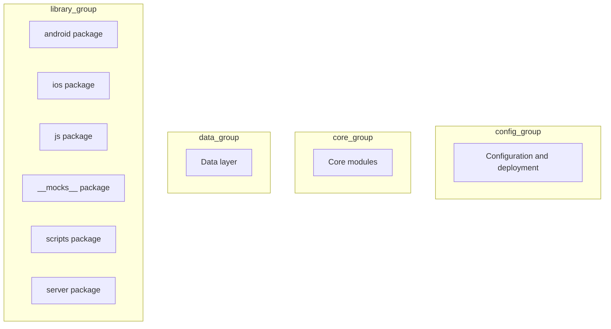

# Architecture report: fbsamples/f8app

> Automated static analysis. **Observed** = directly seen in files/imports/AST; **Inferred** = interpretation from that evidence. Repository code was not executed.

## 1. Repository at a glance

| Item | Value |
| --- | --- |
| Repository | fbsamples/f8app |
| Description | Source code of the official F8 app of 2017, powered by React Native and other Facebook open source projects. |
| Language | JavaScript |
| Stars | 13869 |
| Licence | Other |
| Analysed commit / branch | 119f062943c9d7dfa2892a178199435d6854a06f / main |
| Framework(s) | Express, React |
| Files analysed | 303 |
| Components | 9 |

## 2. Architecture in one minute

fbsamples/f8app - Source code of the official F8 app of 2017, powered by React Native and other Facebook open source projects.. This repository was analysed statically from 303 file(s) (0 Python). Detected technologies (observed from imports/manifests): MongoDB, Express, React, Redux, Docker, Docker Compose. Files are grouped into 9 component(s): android package, Configuration and deployment, Core modules, Data layer, ios package, js package, __mocks__ package, scripts package. Findings below distinguish observed facts from inferred interpretation.

## 3. High-level block diagram

## 4. Main components

### android package (`android`)

- **Kind:** library
- **Status:** Observed
- **Confidence:** 0.85
- **Responsibility:** Groups 2 file(s) under android package (observed from repository paths and static analysis).
- **Paths:** `android/app/src/main/java/com/facebook/f8/MainActivity.java`, `android/app/src/main/java/com/facebook/f8/MainApplication.java`
- **Evidence:** [android/app/src/main/java/com/facebook/f8/MainActivity.java](https://github.com/fbsamples/f8app/blob/119f062943c9d7dfa2892a178199435d6854a06f/android/app/src/main/java/com/facebook/f8/MainActivity.java); [android/app/src/main/java/com/facebook/f8/MainApplication.java](https://github.com/fbsamples/f8app/blob/119f062943c9d7dfa2892a178199435d6854a06f/android/app/src/main/java/com/facebook/f8/MainApplication.java)

### Configuration and deployment (`config`)

- **Kind:** config
- **Status:** Observed
- **Confidence:** 0.85
- **Responsibility:** Groups 47 file(s) under configuration and deployment (observed from repository paths and static analysis).
- **Paths:** `android/app/build.gradle`, `android/build.gradle`, `app.json`, `docker-compose.yml`, `ios/F82017/Images.xcassets/AppIcon.appiconset/Contents.json`, `package.json`, `server/graphql/Dockerfile`, `server/graphql/package.json`, `server/mongorestore/Dockerfile`, `server/mongorestore/data/Agenda.metadata.json`, `server/mongorestore/data/Attendance.metadata.json`, `server/mongorestore/data/Demo.metadata.json`, `server/mongorestore/data/FAQ.metadata.json`, `server/mongorestore/data/Maps.metadata.json`, `server/mongorestore/data/MeetupSponsors.metadata.json`, `server/mongorestore/data/Meetups.metadata.json`, `server/mongorestore/data/Notification.metadata.json`, `server/mongorestore/data/Page.metadata.json`, `server/mongorestore/data/PendingNotifications.metadata.json`, `server/mongorestore/data/Policy.metadata.json`, `server/mongorestore/data/Speakers.metadata.json`, `server/mongorestore/data/Survey.metadata.json`, `server/mongorestore/data/SurveyQuestions.metadata.json`, `server/mongorestore/data/SurveyResult.metadata.json`, `server/mongorestore/data/UTestAgenda.metadata.json`, `server/mongorestore/data/UnmaskedAgenda.metadata.json`, `server/mongorestore/data/Video.metadata.json`, `server/mongorestore/data/_Audience.metadata.json`, `server/mongorestore/data/_Cardinality.metadata.json`, `server/mongorestore/data/_EventDimension.metadata.json`, `server/mongorestore/data/_GlobalConfig.metadata.json`, `server/mongorestore/data/_Installation.metadata.json`, `server/mongorestore/data/_JobStatus.metadata.json`, `server/mongorestore/data/_Join:mySchedule:_User.metadata.json`, `server/mongorestore/data/_PushStatus.metadata.json`, `server/mongorestore/data/_QueryToolQuery.metadata.json`, `server/mongorestore/data/_Role.metadata.json`, `server/mongorestore/data/_SCHEMA.metadata.json`, `server/mongorestore/data/_Session.metadata.json`, `server/mongorestore/data/_User.metadata.json`, `server/mongorestore/data/_dummy.metadata.json`, `server/mongorestore/data/objectlabs-system.metadata.json`, `server/parse-dashboard/Dockerfile`, `server/parse-dashboard/config.json`, `server/parse-server/Dockerfile`, `server/parse-server/config.json`, `server/parse-server/package.json`
- **Evidence:** [android/app/build.gradle](https://github.com/fbsamples/f8app/blob/119f062943c9d7dfa2892a178199435d6854a06f/android/app/build.gradle); [android/build.gradle](https://github.com/fbsamples/f8app/blob/119f062943c9d7dfa2892a178199435d6854a06f/android/build.gradle); [app.json](https://github.com/fbsamples/f8app/blob/119f062943c9d7dfa2892a178199435d6854a06f/app.json); [docker-compose.yml](https://github.com/fbsamples/f8app/blob/119f062943c9d7dfa2892a178199435d6854a06f/docker-compose.yml); [ios/F82017/Images.xcassets/AppIcon.appiconset/Contents.json](https://github.com/fbsamples/f8app/blob/119f062943c9d7dfa2892a178199435d6854a06f/ios/F82017/Images.xcassets/AppIcon.appiconset/Contents.json); [package.json](https://github.com/fbsamples/f8app/blob/119f062943c9d7dfa2892a178199435d6854a06f/package.json); [server/graphql/Dockerfile](https://github.com/fbsamples/f8app/blob/119f062943c9d7dfa2892a178199435d6854a06f/server/graphql/Dockerfile); [server/graphql/package.json](https://github.com/fbsamples/f8app/blob/119f062943c9d7dfa2892a178199435d6854a06f/server/graphql/package.json)

### Core modules (`core`)

- **Kind:** core
- **Status:** Observed
- **Confidence:** 0.85
- **Responsibility:** Groups 2 file(s) under core modules (observed from repository paths and static analysis).
- **Paths:** `index.android.js`, `index.ios.js`
- **Evidence:** [index.android.js](https://github.com/fbsamples/f8app/blob/119f062943c9d7dfa2892a178199435d6854a06f/index.android.js); [index.ios.js](https://github.com/fbsamples/f8app/blob/119f062943c9d7dfa2892a178199435d6854a06f/index.ios.js)

### Data layer (`data_layer`)

- **Kind:** data
- **Status:** Inferred
- **Confidence:** 0.70
- **Responsibility:** Groups 0 file(s) under data layer (observed from repository paths and static analysis).
- **Evidence:** [docker-compose.yml:3](https://github.com/fbsamples/f8app/blob/119f062943c9d7dfa2892a178199435d6854a06f/docker-compose.yml#L3)

### ios package (`ios`)

- **Kind:** library
- **Status:** Observed
- **Confidence:** 0.85
- **Responsibility:** Groups 1 file(s) under ios package (observed from repository paths and static analysis).
- **Paths:** `ios/F82017/AppDelegate.h`
- **Evidence:** [ios/F82017/AppDelegate.h](https://github.com/fbsamples/f8app/blob/119f062943c9d7dfa2892a178199435d6854a06f/ios/F82017/AppDelegate.h)

### js package (`js`)

- **Kind:** library
- **Status:** Observed
- **Confidence:** 0.85
- **Responsibility:** Groups 171 file(s) under js package (observed from repository paths and static analysis).
- **Paths:** `js/F8Analytics.js`, `js/F8App.js`, `js/F8Navigator.js`, `js/FacebookSDK.js`, `js/Playground.js`, `js/PushNotificationsController.js`, `js/actions/config.js`, `js/actions/filter.js`, `js/actions/index.js`, `js/actions/installation.js`, `js/actions/login.js`, `js/actions/navigation.js`, `js/actions/notifications.js`, `js/actions/parse.js`, `js/actions/schedule.js`, `js/actions/surveys.js`, `js/actions/test.js`, `js/actions/types.js`, `js/actions/video.js`, `js/common/ActionsOverlay.js`, `js/common/Carousel.js`, `js/common/F8ActionSheet.js`, `js/common/F8BackgroundRepeat.js`, `js/common/F8Button.js`, `js/common/F8Colors.js`, `js/common/F8DrawerLayout.js`, `js/common/F8Fonts.js`, `js/common/F8Header.js`, `js/common/F8Linking.js`, `js/common/F8Modal.js`, `js/common/F8PageControl.js`, `js/common/F8ScrollingHeader.js`, `js/common/F8SegmentedControl.js`, `js/common/F8StyleSheet.js`, `js/common/F8Text.js`, `js/common/F8TimelineBackground.js`, `js/common/F8TimelineSegment.js`, `js/common/F8Toast.js`, `js/common/F8Tooltip.js`, `js/common/F8Touchable.js`, `js/common/F8WebView.js`, `js/common/Hitbox.js`, `js/common/ItemsWithSeparator.js`, `js/common/LaunchScreen.js`, `js/common/ListContainer.js`, `js/common/LoginButton.js`, `js/common/MapView.js`, `js/common/MessengerChatHead.js`, `js/common/MessengerModal.js`, `js/common/ParallaxBackground.js`, `js/common/PlayButton.js`, `js/common/ProfilePicture.js`, `js/common/PureListView.js`, `js/common/ViewPager.js`, `js/common/__tests__/convertTimes-test.js`, `js/common/convertTimes.js`, `js/env.js`, `js/filter/FilterScreen.android.js`, `js/filter/FilterScreen.ios.js`, `js/filter/FriendsList.js`, `js/filter/Header.js`, `js/filter/Section.js`, `js/filter/TopicItem.js`, `js/filter/topicIcons.js`, `js/flow-lib.js`, `js/login/LoginModal.js`, `js/login/LoginScreen.js`, `js/rating/Header.js`, `js/rating/RadioButtons.js`, `js/rating/RatingQuestion.js`, `js/rating/RatingScreen.js`, `js/rating/StarRating.js`, `js/rating/StarRatings.js`, `js/rating/WrittenResponse.js`, `js/reducers/__mocks__/parse.js`, `js/reducers/__tests__/maps-test.js`, `js/reducers/__tests__/notifications-test.js`, `js/reducers/__tests__/schedule-test.js`, `js/reducers/config.js`, `js/reducers/createParseReducer.js`, `js/reducers/faqs.js`, `js/reducers/friendsSchedules.js`, `js/reducers/index.js`, `js/reducers/maps.js`, `js/reducers/navigation.js`, `js/reducers/notifications.js`, `js/reducers/pages.js`, `js/reducers/policies.js`, `js/reducers/schedule.js`, `js/reducers/scheduleFilter.js`, `js/reducers/scheduleTopics.js`, `js/reducers/sessions.js`, `js/reducers/surveys.js`, `js/reducers/testEventDates.js`, `js/reducers/user.js`, `js/reducers/videoFilter.js`, `js/reducers/videoTopics.js`, `js/reducers/videos.js`, `js/relay-environment.js`, `js/setup.js`, `js/store/analytics.js`, `js/store/array.js`, `js/store/compatibility.js`, `js/store/configureStore.js`, `js/store/promise.js`, `js/store/track.js`, `js/tabs/F8TabsView.js`, `js/tabs/MenuItem.js`, `js/tabs/demos/DemosCarousel.js`, `js/tabs/demos/F8DemoDetails.js`, `js/tabs/demos/F8DemosView.js`, `js/tabs/demos/__generated__/F8DemosViewQuery.graphql.js`, `js/tabs/info/AboutLocation.js`, `js/tabs/info/CommonQuestions.js`, `js/tabs/info/DirectionsLink.js`, `js/tabs/info/F8AboutView.js`, `js/tabs/info/F8InfoView.js`, `js/tabs/info/LinksList.js`, `js/tabs/info/Section.js`, `js/tabs/info/WiFiDetails.js`, `js/tabs/maps/F8MapView.js`, `js/tabs/maps/F8VenueMap.js`, `js/tabs/maps/ZoomableImage.js`, `js/tabs/notifications/F8NotificationsView.js`, `js/tabs/notifications/NotificationCell.js`, `js/tabs/notifications/PushNUXModal.js`, `js/tabs/notifications/RateSessionsCell.js`, `js/tabs/notifications/allNotifications.js`, `js/tabs/notifications/findSessionByURI.js`, `js/tabs/notifications/unseenNotificationsCount.js`, `js/tabs/schedule/AddToScheduleButton.js`, `js/tabs/schedule/EmptySchedule.js`, `js/tabs/schedule/F8FriendGoing.js`, `js/tabs/schedule/F8GanttGrid.js`, `js/tabs/schedule/F8GanttNowMarker.js`, `js/tabs/schedule/F8GanttRow.js`, `js/tabs/schedule/F8ScheduleGantt.js`, `js/tabs/schedule/F8SessionCell.js`, `js/tabs/schedule/F8SessionDetails.js`, `js/tabs/schedule/F8SpeakerProfile.js`, `js/tabs/schedule/FilterHeader.js`, `js/tabs/schedule/FriendCell.js`, `js/tabs/schedule/FriendsListView.js`, `js/tabs/schedule/FriendsScheduleView.js`, `js/tabs/schedule/FriendsUsingApp.js`, `js/tabs/schedule/GeneralScheduleView.js`, `js/tabs/schedule/HideCompleted.js`, `js/tabs/schedule/InviteFriendsButton.js`, `js/tabs/schedule/MyScheduleView.js`, `js/tabs/schedule/PrivacyIcon.js`, `js/tabs/schedule/ProfileButton.js`, `js/tabs/schedule/ScheduleListView.js`, `js/tabs/schedule/SessionsCarousel.js`, `js/tabs/schedule/SessionsSectionHeader.js`, `js/tabs/schedule/SharingSettingsCommon.js`, `js/tabs/schedule/SharingSettingsModal.js`, `js/tabs/schedule/SharingSettingsScreen.js`, `js/tabs/schedule/__tests__/formatDuration-test.js`, `js/tabs/schedule/__tests__/formatTime-test.js`, `js/tabs/schedule/filterSessions.js`, `js/tabs/schedule/formatDuration.js`, `js/tabs/schedule/formatTime.js`, `js/tabs/schedule/groupSessions.js`, `js/tabs/videos/F8EmptyVideosView.js`, `js/tabs/videos/F8VideoThumb.js`, `js/tabs/videos/F8VideoView.js`, `js/tabs/videos/F8VideosView.js`, `js/tabs/videos/filterVideos.js`, `js/video/F8VideoPlayer.js`, `js/video/VideoControls.js`, `js/video/VideoLoader.js`
- **Evidence:** [js/F8Analytics.js](https://github.com/fbsamples/f8app/blob/119f062943c9d7dfa2892a178199435d6854a06f/js/F8Analytics.js); [js/F8App.js](https://github.com/fbsamples/f8app/blob/119f062943c9d7dfa2892a178199435d6854a06f/js/F8App.js); [js/F8Navigator.js](https://github.com/fbsamples/f8app/blob/119f062943c9d7dfa2892a178199435d6854a06f/js/F8Navigator.js); [js/FacebookSDK.js](https://github.com/fbsamples/f8app/blob/119f062943c9d7dfa2892a178199435d6854a06f/js/FacebookSDK.js); [js/Playground.js](https://github.com/fbsamples/f8app/blob/119f062943c9d7dfa2892a178199435d6854a06f/js/Playground.js); [js/PushNotificationsController.js](https://github.com/fbsamples/f8app/blob/119f062943c9d7dfa2892a178199435d6854a06f/js/PushNotificationsController.js); [js/actions/config.js](https://github.com/fbsamples/f8app/blob/119f062943c9d7dfa2892a178199435d6854a06f/js/actions/config.js); [js/actions/filter.js](https://github.com/fbsamples/f8app/blob/119f062943c9d7dfa2892a178199435d6854a06f/js/actions/filter.js)

### __mocks__ package (`mocks`)

- **Kind:** library
- **Status:** Observed
- **Confidence:** 0.85
- **Responsibility:** Groups 1 file(s) under __mocks__ package (observed from repository paths and static analysis).
- **Paths:** `__mocks__/react-native.js`
- **Evidence:** [__mocks__/react-native.js](https://github.com/fbsamples/f8app/blob/119f062943c9d7dfa2892a178199435d6854a06f/__mocks__/react-native.js)

### scripts package (`scripts`)

- **Kind:** library
- **Status:** Observed
- **Confidence:** 0.85
- **Responsibility:** Groups 5 file(s) under scripts package (observed from repository paths and static analysis).
- **Paths:** `scripts/generate-graphql-schema.js`, `scripts/open-ios-project.js`, `scripts/optimize-images.sh`, `scripts/pre-push-checks.sh`, `scripts/run-android-app.sh`
- **Evidence:** [scripts/generate-graphql-schema.js](https://github.com/fbsamples/f8app/blob/119f062943c9d7dfa2892a178199435d6854a06f/scripts/generate-graphql-schema.js); [scripts/open-ios-project.js](https://github.com/fbsamples/f8app/blob/119f062943c9d7dfa2892a178199435d6854a06f/scripts/open-ios-project.js); [scripts/optimize-images.sh](https://github.com/fbsamples/f8app/blob/119f062943c9d7dfa2892a178199435d6854a06f/scripts/optimize-images.sh); [scripts/pre-push-checks.sh](https://github.com/fbsamples/f8app/blob/119f062943c9d7dfa2892a178199435d6854a06f/scripts/pre-push-checks.sh); [scripts/run-android-app.sh](https://github.com/fbsamples/f8app/blob/119f062943c9d7dfa2892a178199435d6854a06f/scripts/run-android-app.sh)

### server package (`server`)

- **Kind:** library
- **Status:** Observed
- **Confidence:** 0.85
- **Responsibility:** Groups 25 file(s) under server package (observed from repository paths and static analysis).
- **Paths:** `server/graphql/src/index.js`, `server/graphql/src/schema/demo.js`, `server/graphql/src/schema/index.js`, `server/graphql/src/schema/node.js`, `server/graphql/src/schema/query.js`, `server/graphql/src/schema/typeRegistry.js`, `server/parse-server/cloud/auth.js`, `server/parse-server/cloud/functions/agenda.js`, `server/parse-server/cloud/functions/friends.js`, `server/parse-server/cloud/functions/index.js`, `server/parse-server/cloud/functions/meetups.js`, `server/parse-server/cloud/functions/messengerbot.js`, `server/parse-server/cloud/functions/notifications.js`, `server/parse-server/cloud/functions/surveyexports.js`, `server/parse-server/cloud/functions/surveys.js`, `server/parse-server/cloud/functions/tests.js`, `server/parse-server/cloud/index.js`, `server/parse-server/cloud/jobs/index.js`, `server/parse-server/cloud/jobs/installationSync.js`, `server/parse-server/cloud/jobs/unmaskAgenda.js`, `server/parse-server/cloud/jobs/unmaskDemos.js`, `server/parse-server/cloud/jobs/updateVideoSources.js`, `server/parse-server/cloud/triggers/index.js`, `server/parse-server/cloud/triggers/pushChannels.js`, `server/parse-server/cloud/triggers/videos.js`
- **Evidence:** [server/graphql/src/index.js](https://github.com/fbsamples/f8app/blob/119f062943c9d7dfa2892a178199435d6854a06f/server/graphql/src/index.js); [server/graphql/src/schema/demo.js](https://github.com/fbsamples/f8app/blob/119f062943c9d7dfa2892a178199435d6854a06f/server/graphql/src/schema/demo.js); [server/graphql/src/schema/index.js](https://github.com/fbsamples/f8app/blob/119f062943c9d7dfa2892a178199435d6854a06f/server/graphql/src/schema/index.js); [server/graphql/src/schema/node.js](https://github.com/fbsamples/f8app/blob/119f062943c9d7dfa2892a178199435d6854a06f/server/graphql/src/schema/node.js); [server/graphql/src/schema/query.js](https://github.com/fbsamples/f8app/blob/119f062943c9d7dfa2892a178199435d6854a06f/server/graphql/src/schema/query.js); [server/graphql/src/schema/typeRegistry.js](https://github.com/fbsamples/f8app/blob/119f062943c9d7dfa2892a178199435d6854a06f/server/graphql/src/schema/typeRegistry.js); [server/parse-server/cloud/auth.js](https://github.com/fbsamples/f8app/blob/119f062943c9d7dfa2892a178199435d6854a06f/server/parse-server/cloud/auth.js); [server/parse-server/cloud/functions/agenda.js](https://github.com/fbsamples/f8app/blob/119f062943c9d7dfa2892a178199435d6854a06f/server/parse-server/cloud/functions/agenda.js)

## 5. Execution flow

**Observed** entry point(s):

- [js/actions/index.js](https://github.com/fbsamples/f8app/blob/119f062943c9d7dfa2892a178199435d6854a06f/js/actions/index.js)
- [js/reducers/index.js](https://github.com/fbsamples/f8app/blob/119f062943c9d7dfa2892a178199435d6854a06f/js/reducers/index.js)
- [server/graphql/src/index.js](https://github.com/fbsamples/f8app/blob/119f062943c9d7dfa2892a178199435d6854a06f/server/graphql/src/index.js)
- [server/parse-server/cloud/index.js](https://github.com/fbsamples/f8app/blob/119f062943c9d7dfa2892a178199435d6854a06f/server/parse-server/cloud/index.js)

Representative flow (derived from observed entry points and the import graph; steps beyond the entry point are **Inferred**):

1. Execution starts at an observed entry point listed above, if present.
2. No internal import relationships between components were observed.

## 6. Project structure

### `(root)`

- `.babelrc` - other (58 bytes)
- `.buckconfig` - other (114 bytes)
- `.eslintignore` - other (19 bytes)
- `.eslintrc` - other (15337 bytes)
- `.flowconfig` - other (1486 bytes)
- `.gitattributes` - other (16 bytes)
- `.gitignore` - other (792 bytes)
- `.watchmanconfig` - other (2 bytes)
- `CODE_OF_CONDUCT.md` - docs (249 bytes)
- `CONTRIBUTING.md` - docs (2859 bytes)
- `LICENSE` - docs (1010 bytes)
- `README.md` - docs (626 bytes)
- `app.json` - config (49 bytes)
- `docker-compose.yml` - container (510 bytes)
- `index.android.js` - source, JavaScript (125 bytes)
- `index.ios.js` - source, JavaScript (125 bytes)
- `package.json` - manifest (2160 bytes)

### `.circleci`

- `.circleci/config.yml` - ci, YAML (845 bytes)

### `__mocks__`

- `__mocks__/react-native.js` - source, JavaScript (363 bytes)

### `android`

- `android/app/BUCK` - other (1499 bytes)
- `android/app/build.gradle` - manifest (6322 bytes)
- `android/app/proguard-rules.pro` - other (2480 bytes)
- `android/app/src/debug/res/values/strings.xml` - other (131 bytes)
- `android/app/src/debug/res/values/styles.xml` - other (192 bytes)
- `android/app/src/main/AndroidManifest.xml` - other (3443 bytes)
- `android/app/src/main/java/com/facebook/f8/MainActivity.java` - source, Java (759 bytes)
- `android/app/src/main/java/com/facebook/f8/MainApplication.java` - source, Java (1846 bytes)
- `android/app/src/main/res/values/strings.xml` - other (125 bytes)
- `android/app/src/main/res/values/styles.xml` - other (192 bytes)
- `android/build.gradle` - manifest (676 bytes)
- `android/gradle.properties` - other (1053 bytes)
- `android/gradle/wrapper/gradle-wrapper.properties` - other (230 bytes)
- `android/gradlew` - other (5080 bytes)
- `android/gradlew.bat` - other (2404 bytes)
- `android/keystores/BUCK` - other (138 bytes)
- `android/keystores/debug.keystore.properties` - other (105 bytes)
- `android/settings.gradle` - other (932 bytes)

### `ios`

- `ios/F82017-tvOS/Info.plist` - other (1611 bytes)
- `ios/F82017-tvOSTests/Info.plist` - other (765 bytes)
- `ios/F82017.xcodeproj/project.pbxproj` - other (65872 bytes)
- `ios/F82017.xcodeproj/xcshareddata/xcschemes/F82017-tvOS.xcscheme` - other (4968 bytes)
- `ios/F82017.xcodeproj/xcshareddata/xcschemes/F82017.xcscheme` - other (4903 bytes)
- `ios/F82017/AppDelegate.h` - source, C/C++ (451 bytes)
- `ios/F82017/AppDelegate.m` - other (5081 bytes)
- `ios/F82017/Base.lproj/LaunchScreen.xib` - other (2570 bytes)
- `ios/F82017/F82017.entitlements` - other (246 bytes)
- `ios/F82017/Images.xcassets/AppIcon.appiconset/Contents.json` - config (1104 bytes)
- `ios/F82017/Info.plist` - other (2141 bytes)
- `ios/F82017/main.m` - other (510 bytes)
- `ios/F82017Tests/F82017Tests.m` - other (2070 bytes)
- `ios/F82017Tests/Info.plist` - other (765 bytes)

### `js`

- `js/F8Analytics.js` - source, JavaScript (1269 bytes)
- `js/F8App.js` - source, JavaScript (3570 bytes)
- `js/F8Navigator.js` - source, JavaScript (5794 bytes)
- `js/FacebookSDK.js` - source, JavaScript (4758 bytes)
- `js/Playground.js` - source, JavaScript (2136 bytes)
- `js/PushNotificationsController.js` - source, JavaScript (3471 bytes)
- `js/actions/config.js` - source, JavaScript (1463 bytes)
- `js/actions/filter.js` - source, JavaScript (1778 bytes)
- `js/actions/index.js` - source, JavaScript (1856 bytes)
- `js/actions/installation.js` - source, JavaScript (1778 bytes)
- `js/actions/login.js` - source, JavaScript (4226 bytes)
- `js/actions/navigation.js` - source, JavaScript (1367 bytes)
- `js/actions/notifications.js` - source, JavaScript (3382 bytes)
- `js/actions/parse.js` - source, JavaScript (3026 bytes)
- `js/actions/schedule.js` - source, JavaScript (5321 bytes)
- `js/actions/surveys.js` - source, JavaScript (1609 bytes)
- `js/actions/test.js` - source, JavaScript (3037 bytes)
- `js/actions/types.js` - source, JavaScript (2853 bytes)
- `js/actions/video.js` - source, JavaScript (1124 bytes)
- `js/common/ActionsOverlay.js` - source, JavaScript (4427 bytes)
- `js/common/Carousel.js` - source, JavaScript (1946 bytes)
- `js/common/F8ActionSheet.js` - source, JavaScript (5929 bytes)
- `js/common/F8BackgroundRepeat.js` - source, JavaScript (3546 bytes)
- `js/common/F8Button.js` - source, JavaScript (9550 bytes)
- `js/common/F8Colors.js` - source, JavaScript (3934 bytes)
- `js/common/F8DrawerLayout.js` - source, JavaScript (2873 bytes)
- `js/common/F8Fonts.js` - source, JavaScript (2267 bytes)
- `js/common/F8Header.js` - source, JavaScript (11674 bytes)
- `js/common/F8Linking.js` - source, JavaScript (1759 bytes)
- `js/common/F8Modal.js` - source, JavaScript (3359 bytes)
- `js/common/F8PageControl.js` - source, JavaScript (2591 bytes)
- `js/common/F8ScrollingHeader.js` - source, JavaScript (3950 bytes)
- `js/common/F8SegmentedControl.js` - source, JavaScript (4483 bytes)
- `js/common/F8StyleSheet.js` - source, JavaScript (1644 bytes)
- `js/common/F8Text.js` - source, JavaScript (4577 bytes)
- `js/common/F8TimelineBackground.js` - source, JavaScript (2662 bytes)
- `js/common/F8TimelineSegment.js` - source, JavaScript (4278 bytes)
- `js/common/F8Toast.js` - source, JavaScript (4554 bytes)
- `js/common/F8Tooltip.js` - source, JavaScript (4996 bytes)
- `js/common/F8Touchable.js` - source, JavaScript (1556 bytes)
- `js/common/F8WebView.js` - source, JavaScript (11314 bytes)
- `js/common/Hitbox.js` - source, JavaScript (1867 bytes)
- `js/common/ItemsWithSeparator.js` - source, JavaScript (1954 bytes)
- `js/common/LaunchScreen.js` - source, JavaScript (2551 bytes)
- `js/common/ListContainer.js` - source, JavaScript (6293 bytes)
- `js/common/LoginButton.js` - source, JavaScript (2885 bytes)
- `js/common/MapView.js` - source, JavaScript (5685 bytes)
- `js/common/MessengerChatHead.js` - source, JavaScript (3362 bytes)
- `js/common/MessengerModal.js` - source, JavaScript (4112 bytes)
- `js/common/ParallaxBackground.js` - source, JavaScript (5109 bytes)
- `js/common/PlayButton.js` - source, JavaScript (4865 bytes)
- `js/common/ProfilePicture.js` - source, JavaScript (2107 bytes)
- `js/common/PureListView.js` - source, JavaScript (4968 bytes)
- `js/common/ViewPager.js` - source, JavaScript (5367 bytes)
- `js/common/__tests__/convertTimes-test.js` - source, JavaScript (5007 bytes)
- `js/common/convertTimes.js` - source, JavaScript (1542 bytes)
- `js/env.js` - source, JavaScript (1481 bytes)
- `js/filter/FilterScreen.android.js` - source, JavaScript (5817 bytes)
- `js/filter/FilterScreen.ios.js` - source, JavaScript (5704 bytes)
- `js/filter/FriendsList.js` - source, JavaScript (2992 bytes)
- `js/filter/Header.js` - source, JavaScript (2927 bytes)
- `js/filter/Section.js` - source, JavaScript (1774 bytes)
- `js/filter/TopicItem.js` - source, JavaScript (3156 bytes)
- `js/filter/topicIcons.js` - source, JavaScript (1213 bytes)
- `js/flow-lib.js` - source, JavaScript (1540 bytes)
- `js/login/LoginModal.js` - source, JavaScript (4257 bytes)
- `js/login/LoginScreen.js` - source, JavaScript (6616 bytes)
- `js/rating/Header.js` - source, JavaScript (3389 bytes)
- `js/rating/RadioButtons.js` - source, JavaScript (3408 bytes)
- `js/rating/RatingQuestion.js` - source, JavaScript (4030 bytes)
- `js/rating/RatingScreen.js` - source, JavaScript (5873 bytes)
- `js/rating/StarRating.js` - source, JavaScript (3599 bytes)
- `js/rating/StarRatings.js` - source, JavaScript (3095 bytes)
- `js/rating/WrittenResponse.js` - source, JavaScript (3152 bytes)
- `js/reducers/__mocks__/parse.js` - source, JavaScript (1615 bytes)
- `js/reducers/__tests__/maps-test.js` - source, JavaScript (1750 bytes)
- `js/reducers/__tests__/notifications-test.js` - source, JavaScript (2651 bytes)
- `js/reducers/__tests__/schedule-test.js` - source, JavaScript (2350 bytes)
- `js/reducers/config.js` - source, JavaScript (2397 bytes)
- `js/reducers/createParseReducer.js` - source, JavaScript (1612 bytes)
- `js/reducers/faqs.js` - source, JavaScript (1445 bytes)
- `js/reducers/friendsSchedules.js` - source, JavaScript (1553 bytes)
- `js/reducers/index.js` - source, JavaScript (1849 bytes)
- `js/reducers/maps.js` - source, JavaScript (1677 bytes)
- `js/reducers/navigation.js` - source, JavaScript (1714 bytes)
- `js/reducers/notifications.js` - source, JavaScript (3561 bytes)
- `js/reducers/pages.js` - source, JavaScript (1499 bytes)
- `js/reducers/policies.js` - source, JavaScript (1449 bytes)
- `js/reducers/schedule.js` - source, JavaScript (1752 bytes)
- `js/reducers/scheduleFilter.js` - source, JavaScript (1603 bytes)
- `js/reducers/scheduleTopics.js` - source, JavaScript (1575 bytes)
- `js/reducers/sessions.js` - source, JavaScript (2867 bytes)
- `js/reducers/surveys.js` - source, JavaScript (1752 bytes)
- `js/reducers/testEventDates.js` - source, JavaScript (1387 bytes)
- `js/reducers/user.js` - source, JavaScript (2192 bytes)
- `js/reducers/videoFilter.js` - source, JavaScript (1605 bytes)
- `js/reducers/videoTopics.js` - source, JavaScript (1569 bytes)
- `js/reducers/videos.js` - source, JavaScript (1863 bytes)
- `js/relay-environment.js` - source, JavaScript (1726 bytes)
- `js/setup.js` - source, JavaScript (2766 bytes)
- `js/store/analytics.js` - source, JavaScript (1207 bytes)
- `js/store/array.js` - source, JavaScript (1191 bytes)
- `js/store/compatibility.js` - source, JavaScript (1177 bytes)
- `js/store/configureStore.js` - source, JavaScript (2127 bytes)
- `js/store/promise.js` - source, JavaScript (1488 bytes)
- `js/store/track.js` - source, JavaScript (2347 bytes)
- `js/tabs/F8TabsView.js` - source, JavaScript (10015 bytes)
- `js/tabs/MenuItem.js` - source, JavaScript (2750 bytes)
- `js/tabs/demos/DemosCarousel.js` - source, JavaScript (4160 bytes)
- `js/tabs/demos/F8DemoDetails.js` - source, JavaScript (7562 bytes)
- `js/tabs/demos/F8DemosView.js` - source, JavaScript (9536 bytes)
- `js/tabs/demos/__generated__/F8DemosViewQuery.graphql.js` - source, JavaScript (5927 bytes)
- `js/tabs/info/AboutLocation.js` - source, JavaScript (3015 bytes)
- `js/tabs/info/CommonQuestions.js` - source, JavaScript (2785 bytes)
- `js/tabs/info/DirectionsLink.js` - source, JavaScript (3498 bytes)
- `js/tabs/info/F8AboutView.js` - source, JavaScript (5790 bytes)
- `js/tabs/info/F8InfoView.js` - source, JavaScript (4146 bytes)
- `js/tabs/info/LinksList.js` - source, JavaScript (4300 bytes)
- `js/tabs/info/Section.js` - source, JavaScript (1923 bytes)
- `js/tabs/info/WiFiDetails.js` - source, JavaScript (2815 bytes)
- `js/tabs/maps/F8MapView.js` - source, JavaScript (4290 bytes)
- `js/tabs/maps/F8VenueMap.js` - source, JavaScript (3760 bytes)
- `js/tabs/maps/ZoomableImage.js` - source, JavaScript (3102 bytes)
- `js/tabs/notifications/F8NotificationsView.js` - source, JavaScript (5156 bytes)
- `js/tabs/notifications/NotificationCell.js` - source, JavaScript (8902 bytes)
- `js/tabs/notifications/PushNUXModal.js` - source, JavaScript (3876 bytes)
- `js/tabs/notifications/RateSessionsCell.js` - source, JavaScript (2353 bytes)
- `js/tabs/notifications/allNotifications.js` - source, JavaScript (1888 bytes)
- `js/tabs/notifications/findSessionByURI.js` - source, JavaScript (1530 bytes)
- `js/tabs/notifications/unseenNotificationsCount.js` - source, JavaScript (1596 bytes)
- `js/tabs/schedule/AddToScheduleButton.js` - source, JavaScript (2902 bytes)
- `js/tabs/schedule/EmptySchedule.js` - source, JavaScript (2517 bytes)
- `js/tabs/schedule/F8FriendGoing.js` - source, JavaScript (2166 bytes)
- `js/tabs/schedule/F8GanttGrid.js` - source, JavaScript (3997 bytes)
- `js/tabs/schedule/F8GanttNowMarker.js` - source, JavaScript (2970 bytes)
- `js/tabs/schedule/F8GanttRow.js` - source, JavaScript (4244 bytes)
- `js/tabs/schedule/F8ScheduleGantt.js` - source, JavaScript (7330 bytes)
- `js/tabs/schedule/F8SessionCell.js` - source, JavaScript (6272 bytes)
- `js/tabs/schedule/F8SessionDetails.js` - source, JavaScript (9711 bytes)
- `js/tabs/schedule/F8SpeakerProfile.js` - source, JavaScript (1882 bytes)
- `js/tabs/schedule/FilterHeader.js` - source, JavaScript (3041 bytes)
- `js/tabs/schedule/FriendCell.js` - source, JavaScript (2758 bytes)
- `js/tabs/schedule/FriendsListView.js` - source, JavaScript (3768 bytes)
- `js/tabs/schedule/FriendsScheduleView.js` - source, JavaScript (4210 bytes)
- `js/tabs/schedule/FriendsUsingApp.js` - source, JavaScript (4530 bytes)
- `js/tabs/schedule/GeneralScheduleView.js` - source, JavaScript (8656 bytes)
- `js/tabs/schedule/HideCompleted.js` - source, JavaScript (4061 bytes)
- `js/tabs/schedule/InviteFriendsButton.js` - source, JavaScript (2291 bytes)
- `js/tabs/schedule/MyScheduleView.js` - source, JavaScript (11921 bytes)
- `js/tabs/schedule/PrivacyIcon.js` - source, JavaScript (4113 bytes)
- `js/tabs/schedule/ProfileButton.js` - source, JavaScript (1566 bytes)
- `js/tabs/schedule/ScheduleListView.js` - source, JavaScript (4569 bytes)
- `js/tabs/schedule/SessionsCarousel.js` - source, JavaScript (6786 bytes)
- `js/tabs/schedule/SessionsSectionHeader.js` - source, JavaScript (1910 bytes)
- `js/tabs/schedule/SharingSettingsCommon.js` - source, JavaScript (3097 bytes)
- `js/tabs/schedule/SharingSettingsModal.js` - source, JavaScript (5563 bytes)
- `js/tabs/schedule/SharingSettingsScreen.js` - source, JavaScript (4119 bytes)
- `js/tabs/schedule/__tests__/formatDuration-test.js` - source, JavaScript (1544 bytes)
- `js/tabs/schedule/__tests__/formatTime-test.js` - source, JavaScript (1345 bytes)
- `js/tabs/schedule/filterSessions.js` - source, JavaScript (2044 bytes)
- `js/tabs/schedule/formatDuration.js` - source, JavaScript (1804 bytes)
- `js/tabs/schedule/formatTime.js` - source, JavaScript (1346 bytes)
- `js/tabs/schedule/groupSessions.js` - source, JavaScript (1657 bytes)
- `js/tabs/videos/F8EmptyVideosView.js` - source, JavaScript (3026 bytes)
- `js/tabs/videos/F8VideoThumb.js` - source, JavaScript (5656 bytes)
- `js/tabs/videos/F8VideoView.js` - source, JavaScript (3865 bytes)
- `js/tabs/videos/F8VideosView.js` - source, JavaScript (6431 bytes)
- `js/tabs/videos/filterVideos.js` - source, JavaScript (3940 bytes)
- `js/video/F8VideoPlayer.js` - source, JavaScript (4774 bytes)
- `js/video/VideoControls.js` - source, JavaScript (5301 bytes)
- `js/video/VideoLoader.js` - source, JavaScript (1677 bytes)

### `scripts`

- `scripts/generate-graphql-schema.js` - source, JavaScript (1364 bytes)
- `scripts/open-ios-project.js` - source, JavaScript (2212 bytes)
- `scripts/optimize-images.sh` - source, Shell (1106 bytes)
- `scripts/pre-push-checks.sh` - source, Shell (1910 bytes)
- `scripts/run-android-app.sh` - source, Shell (1183 bytes)

### `server`

- `server/.gitignore` - other (14 bytes)
- `server/graphql/.babelrc` - other (36 bytes)
- `server/graphql/Dockerfile` - container (120 bytes)
- `server/graphql/package.json` - manifest (516 bytes)
- `server/graphql/src/index.js` - source, JavaScript (1521 bytes)
- `server/graphql/src/schema/__generated__/schema.graphql` - other (481 bytes)
- `server/graphql/src/schema/demo.js` - source, JavaScript (2816 bytes)
- `server/graphql/src/schema/index.js` - source, JavaScript (1223 bytes)
- `server/graphql/src/schema/node.js` - source, JavaScript (1418 bytes)
- `server/graphql/src/schema/query.js` - source, JavaScript (1346 bytes)
- `server/graphql/src/schema/typeRegistry.js` - source, JavaScript (1245 bytes)
- `server/mongorestore/Dockerfile` - container (138 bytes)
- `server/mongorestore/data/Agenda.metadata.json` - config (530 bytes)
- `server/mongorestore/data/Attendance.bson` - other (0 bytes)
- `server/mongorestore/data/Attendance.metadata.json` - config (203 bytes)
- `server/mongorestore/data/Demo.metadata.json` - config (90 bytes)
- `server/mongorestore/data/FAQ.metadata.json` - config (277 bytes)
- `server/mongorestore/data/Maps.metadata.json` - config (280 bytes)
- `server/mongorestore/data/MeetupSponsors.metadata.json` - config (310 bytes)
- `server/mongorestore/data/Meetups.metadata.json` - config (289 bytes)
- `server/mongorestore/data/Notification.metadata.json` - config (336 bytes)
- `server/mongorestore/data/Page.metadata.json` - config (280 bytes)
- `server/mongorestore/data/PendingNotifications.metadata.json` - config (223 bytes)
- `server/mongorestore/data/Policy.metadata.json` - config (92 bytes)
- `server/mongorestore/data/Speakers.metadata.json` - config (411 bytes)
- `server/mongorestore/data/Survey.metadata.json` - config (195 bytes)
- `server/mongorestore/data/SurveyQuestions.metadata.json` - config (101 bytes)
- `server/mongorestore/data/SurveyResult.bson` - other (0 bytes)
- `server/mongorestore/data/SurveyResult.metadata.json` - config (433 bytes)
- `server/mongorestore/data/UTestAgenda.metadata.json` - config (205 bytes)
- `server/mongorestore/data/UnmaskedAgenda.metadata.json` - config (211 bytes)
- `server/mongorestore/data/Video.metadata.json` - config (91 bytes)
- `server/mongorestore/data/_Audience.metadata.json` - config (199 bytes)
- `server/mongorestore/data/_Cardinality.metadata.json` - config (235 bytes)
- `server/mongorestore/data/_EventDimension.metadata.json` - config (101 bytes)
- `server/mongorestore/data/_GlobalConfig.metadata.json` - config (99 bytes)
- `server/mongorestore/data/_Installation.bson` - other (0 bytes)
- `server/mongorestore/data/_Installation.metadata.json` - config (865 bytes)
- `server/mongorestore/data/_JobStatus.metadata.json` - config (96 bytes)
- `server/mongorestore/data/_Join:mySchedule:_User.metadata.json` - config (525 bytes)
- `server/mongorestore/data/_PushStatus.metadata.json` - config (97 bytes)
- `server/mongorestore/data/_QueryToolQuery.metadata.json` - config (101 bytes)
- `server/mongorestore/data/_Role.bson` - other (0 bytes)
- `server/mongorestore/data/_Role.metadata.json` - config (205 bytes)
- `server/mongorestore/data/_SCHEMA.metadata.json` - config (93 bytes)
- `server/mongorestore/data/_Session.bson` - other (0 bytes)
- `server/mongorestore/data/_Session.metadata.json` - config (298 bytes)
- `server/mongorestore/data/_User.bson` - other (0 bytes)
- `server/mongorestore/data/_User.metadata.json` - config (445 bytes)
- `server/mongorestore/data/_dummy.metadata.json` - config (92 bytes)
- `server/mongorestore/data/objectlabs-system.metadata.json` - config (103 bytes)
- `server/parse-dashboard/Dockerfile` - container (197 bytes)
- `server/parse-dashboard/config.json` - config (262 bytes)
- `server/parse-server/.babelrc` - other (36 bytes)
- `server/parse-server/Dockerfile` - container (178 bytes)
- `server/parse-server/cloud/auth.js` - source, JavaScript (521 bytes)
- `server/parse-server/cloud/functions/agenda.js` - source, JavaScript (1759 bytes)
- `server/parse-server/cloud/functions/friends.js` - source, JavaScript (1897 bytes)
- `server/parse-server/cloud/functions/index.js` - source, JavaScript (324 bytes)
- `server/parse-server/cloud/functions/meetups.js` - source, JavaScript (956 bytes)
- `server/parse-server/cloud/functions/messengerbot.js` - source, JavaScript (5827 bytes)
- `server/parse-server/cloud/functions/notifications.js` - source, JavaScript (2942 bytes)
- `server/parse-server/cloud/functions/surveyexports.js` - source, JavaScript (5833 bytes)
- `server/parse-server/cloud/functions/surveys.js` - source, JavaScript (4331 bytes)
- `server/parse-server/cloud/functions/tests.js` - source, JavaScript (4313 bytes)
- `server/parse-server/cloud/index.js` - source, JavaScript (301 bytes)
- `server/parse-server/cloud/jobs/index.js` - source, JavaScript (129 bytes)
- `server/parse-server/cloud/jobs/installationSync.js` - source, JavaScript (1149 bytes)
- `server/parse-server/cloud/jobs/unmaskAgenda.js` - source, JavaScript (3011 bytes)
- `server/parse-server/cloud/jobs/unmaskDemos.js` - source, JavaScript (2534 bytes)
- `server/parse-server/cloud/jobs/updateVideoSources.js` - source, JavaScript (2093 bytes)
- `server/parse-server/cloud/triggers/index.js` - source, JavaScript (139 bytes)
- `server/parse-server/cloud/triggers/pushChannels.js` - source, JavaScript (2361 bytes)
- `server/parse-server/cloud/triggers/videos.js` - source, JavaScript (810 bytes)
- `server/parse-server/config.json` - config (143 bytes)
- `server/parse-server/package.json` - manifest (355 bytes)

## 7. Key dependencies and integrations

| Name | Category | Status | Confidence | Evidence |
| --- | --- | --- | --- | --- |
| MongoDB | database | Observed | 0.80 | [docker-compose.yml:3](https://github.com/fbsamples/f8app/blob/119f062943c9d7dfa2892a178199435d6854a06f/docker-compose.yml#L3) |
| Express | framework | Observed | 0.85 | [server/graphql/package.json:10](https://github.com/fbsamples/f8app/blob/119f062943c9d7dfa2892a178199435d6854a06f/server/graphql/package.json#L10) |
| React | framework | Observed | 0.85 | [package.json:21](https://github.com/fbsamples/f8app/blob/119f062943c9d7dfa2892a178199435d6854a06f/package.json#L21) |
| Redux | library | Observed | 0.85 | [package.json:32](https://github.com/fbsamples/f8app/blob/119f062943c9d7dfa2892a178199435d6854a06f/package.json#L32) |
| Docker | tooling | Observed | 0.90 | [server/graphql/Dockerfile](https://github.com/fbsamples/f8app/blob/119f062943c9d7dfa2892a178199435d6854a06f/server/graphql/Dockerfile); [server/mongorestore/Dockerfile](https://github.com/fbsamples/f8app/blob/119f062943c9d7dfa2892a178199435d6854a06f/server/mongorestore/Dockerfile); [server/parse-dashboard/Dockerfile](https://github.com/fbsamples/f8app/blob/119f062943c9d7dfa2892a178199435d6854a06f/server/parse-dashboard/Dockerfile); [server/parse-server/Dockerfile](https://github.com/fbsamples/f8app/blob/119f062943c9d7dfa2892a178199435d6854a06f/server/parse-server/Dockerfile) |
| Docker Compose | tooling | Observed | 0.85 | [docker-compose.yml](https://github.com/fbsamples/f8app/blob/119f062943c9d7dfa2892a178199435d6854a06f/docker-compose.yml) |
| Jest | tooling | Observed | 0.85 | [package.json:9](https://github.com/fbsamples/f8app/blob/119f062943c9d7dfa2892a178199435d6854a06f/package.json#L9) |

## 8. Data and state

- **MongoDB** (Observed, confidence 0.80) - evidence: [docker-compose.yml:3](https://github.com/fbsamples/f8app/blob/119f062943c9d7dfa2892a178199435d6854a06f/docker-compose.yml#L3)
- Data component `data_layer` (Inferred): Groups 0 file(s) under data layer (observed from repository paths and static analysis).

## 9. Configuration and deployment clues

- `.circleci/config.yml` (ci)
- `android/app/build.gradle` (manifest)
- `android/build.gradle` (manifest)
- `app.json` (config)
- `docker-compose.yml` (container)
- `ios/F82017/Images.xcassets/AppIcon.appiconset/Contents.json` (config)
- `package.json` (manifest)
- `server/graphql/Dockerfile` (container)
- `server/graphql/package.json` (manifest)
- `server/mongorestore/Dockerfile` (container)
- `server/mongorestore/data/Agenda.metadata.json` (config)
- `server/mongorestore/data/Attendance.metadata.json` (config)
- `server/mongorestore/data/Demo.metadata.json` (config)
- `server/mongorestore/data/FAQ.metadata.json` (config)
- `server/mongorestore/data/Maps.metadata.json` (config)
- `server/mongorestore/data/MeetupSponsors.metadata.json` (config)
- `server/mongorestore/data/Meetups.metadata.json` (config)
- `server/mongorestore/data/Notification.metadata.json` (config)
- `server/mongorestore/data/Page.metadata.json` (config)
- `server/mongorestore/data/PendingNotifications.metadata.json` (config)
- `server/mongorestore/data/Policy.metadata.json` (config)
- `server/mongorestore/data/Speakers.metadata.json` (config)
- `server/mongorestore/data/Survey.metadata.json` (config)
- `server/mongorestore/data/SurveyQuestions.metadata.json` (config)
- `server/mongorestore/data/SurveyResult.metadata.json` (config)
- `server/mongorestore/data/UTestAgenda.metadata.json` (config)
- `server/mongorestore/data/UnmaskedAgenda.metadata.json` (config)
- `server/mongorestore/data/Video.metadata.json` (config)
- `server/mongorestore/data/_Audience.metadata.json` (config)
- `server/mongorestore/data/_Cardinality.metadata.json` (config)
- `server/mongorestore/data/_EventDimension.metadata.json` (config)
- `server/mongorestore/data/_GlobalConfig.metadata.json` (config)
- `server/mongorestore/data/_Installation.metadata.json` (config)
- `server/mongorestore/data/_JobStatus.metadata.json` (config)
- `server/mongorestore/data/_Join:mySchedule:_User.metadata.json` (config)
- `server/mongorestore/data/_PushStatus.metadata.json` (config)
- `server/mongorestore/data/_QueryToolQuery.metadata.json` (config)
- `server/mongorestore/data/_Role.metadata.json` (config)
- `server/mongorestore/data/_SCHEMA.metadata.json` (config)
- `server/mongorestore/data/_Session.metadata.json` (config)
- `server/mongorestore/data/_User.metadata.json` (config)
- `server/mongorestore/data/_dummy.metadata.json` (config)
- `server/mongorestore/data/objectlabs-system.metadata.json` (config)
- `server/parse-dashboard/Dockerfile` (container)
- `server/parse-dashboard/config.json` (config)
- `server/parse-server/Dockerfile` (container)
- `server/parse-server/config.json` (config)
- `server/parse-server/package.json` (manifest)

## 10. Design observations

- Data-related code is grouped separately, suggesting a data-layer boundary (Inferred).

These observations are interpretations (**Inferred**) of the observed structure, not guarantees about runtime design.

## 11. Limitations and unknowns

- Static analysis only: repository code was not executed, installed, or imported at runtime.
- Components and relationships are inferred from file paths, imports, and AST structure; runtime behaviour, dynamic imports, and reflection may not be visible.
- 2 file(s) were skipped during inventory (2 x lockfile excluded).
- No clear application entry point was observed in the analysed files.
- Repository text was treated as untrusted data; no instructions found in repository files were followed, and likely secret values were redacted/excluded.
- JavaScript and TypeScript files were inventoried from paths and package manifests. They were not parsed with a full language AST, and repository code was not executed.
- The GitHub repository was marked archived at selection time.

## 12. Source references

- [__mocks__/react-native.js](https://github.com/fbsamples/f8app/blob/119f062943c9d7dfa2892a178199435d6854a06f/__mocks__/react-native.js)
- [android/app/build.gradle](https://github.com/fbsamples/f8app/blob/119f062943c9d7dfa2892a178199435d6854a06f/android/app/build.gradle)
- [android/app/src/main/java/com/facebook/f8/MainActivity.java](https://github.com/fbsamples/f8app/blob/119f062943c9d7dfa2892a178199435d6854a06f/android/app/src/main/java/com/facebook/f8/MainActivity.java)
- [android/app/src/main/java/com/facebook/f8/MainApplication.java](https://github.com/fbsamples/f8app/blob/119f062943c9d7dfa2892a178199435d6854a06f/android/app/src/main/java/com/facebook/f8/MainApplication.java)
- [android/build.gradle](https://github.com/fbsamples/f8app/blob/119f062943c9d7dfa2892a178199435d6854a06f/android/build.gradle)
- [app.json](https://github.com/fbsamples/f8app/blob/119f062943c9d7dfa2892a178199435d6854a06f/app.json)
- [docker-compose.yml](https://github.com/fbsamples/f8app/blob/119f062943c9d7dfa2892a178199435d6854a06f/docker-compose.yml)
- [docker-compose.yml:3](https://github.com/fbsamples/f8app/blob/119f062943c9d7dfa2892a178199435d6854a06f/docker-compose.yml#L3)
- [index.android.js](https://github.com/fbsamples/f8app/blob/119f062943c9d7dfa2892a178199435d6854a06f/index.android.js)
- [index.ios.js](https://github.com/fbsamples/f8app/blob/119f062943c9d7dfa2892a178199435d6854a06f/index.ios.js)
- [ios/F82017/AppDelegate.h](https://github.com/fbsamples/f8app/blob/119f062943c9d7dfa2892a178199435d6854a06f/ios/F82017/AppDelegate.h)
- [ios/F82017/Images.xcassets/AppIcon.appiconset/Contents.json](https://github.com/fbsamples/f8app/blob/119f062943c9d7dfa2892a178199435d6854a06f/ios/F82017/Images.xcassets/AppIcon.appiconset/Contents.json)
- [js/F8Analytics.js](https://github.com/fbsamples/f8app/blob/119f062943c9d7dfa2892a178199435d6854a06f/js/F8Analytics.js)
- [js/F8App.js](https://github.com/fbsamples/f8app/blob/119f062943c9d7dfa2892a178199435d6854a06f/js/F8App.js)
- [js/F8Navigator.js](https://github.com/fbsamples/f8app/blob/119f062943c9d7dfa2892a178199435d6854a06f/js/F8Navigator.js)
- [js/FacebookSDK.js](https://github.com/fbsamples/f8app/blob/119f062943c9d7dfa2892a178199435d6854a06f/js/FacebookSDK.js)
- [js/Playground.js](https://github.com/fbsamples/f8app/blob/119f062943c9d7dfa2892a178199435d6854a06f/js/Playground.js)
- [js/PushNotificationsController.js](https://github.com/fbsamples/f8app/blob/119f062943c9d7dfa2892a178199435d6854a06f/js/PushNotificationsController.js)
- [js/actions/config.js](https://github.com/fbsamples/f8app/blob/119f062943c9d7dfa2892a178199435d6854a06f/js/actions/config.js)
- [js/actions/filter.js](https://github.com/fbsamples/f8app/blob/119f062943c9d7dfa2892a178199435d6854a06f/js/actions/filter.js)
- [js/actions/index.js](https://github.com/fbsamples/f8app/blob/119f062943c9d7dfa2892a178199435d6854a06f/js/actions/index.js)
- [js/reducers/index.js](https://github.com/fbsamples/f8app/blob/119f062943c9d7dfa2892a178199435d6854a06f/js/reducers/index.js)
- [package.json](https://github.com/fbsamples/f8app/blob/119f062943c9d7dfa2892a178199435d6854a06f/package.json)
- [package.json:9](https://github.com/fbsamples/f8app/blob/119f062943c9d7dfa2892a178199435d6854a06f/package.json#L9)
- [package.json:21](https://github.com/fbsamples/f8app/blob/119f062943c9d7dfa2892a178199435d6854a06f/package.json#L21)
- [package.json:32](https://github.com/fbsamples/f8app/blob/119f062943c9d7dfa2892a178199435d6854a06f/package.json#L32)
- [scripts/generate-graphql-schema.js](https://github.com/fbsamples/f8app/blob/119f062943c9d7dfa2892a178199435d6854a06f/scripts/generate-graphql-schema.js)
- [scripts/open-ios-project.js](https://github.com/fbsamples/f8app/blob/119f062943c9d7dfa2892a178199435d6854a06f/scripts/open-ios-project.js)
- [scripts/optimize-images.sh](https://github.com/fbsamples/f8app/blob/119f062943c9d7dfa2892a178199435d6854a06f/scripts/optimize-images.sh)
- [scripts/pre-push-checks.sh](https://github.com/fbsamples/f8app/blob/119f062943c9d7dfa2892a178199435d6854a06f/scripts/pre-push-checks.sh)
- [scripts/run-android-app.sh](https://github.com/fbsamples/f8app/blob/119f062943c9d7dfa2892a178199435d6854a06f/scripts/run-android-app.sh)
- [server/graphql/Dockerfile](https://github.com/fbsamples/f8app/blob/119f062943c9d7dfa2892a178199435d6854a06f/server/graphql/Dockerfile)
- [server/graphql/package.json](https://github.com/fbsamples/f8app/blob/119f062943c9d7dfa2892a178199435d6854a06f/server/graphql/package.json)
- [server/graphql/package.json:10](https://github.com/fbsamples/f8app/blob/119f062943c9d7dfa2892a178199435d6854a06f/server/graphql/package.json#L10)
- [server/graphql/src/index.js](https://github.com/fbsamples/f8app/blob/119f062943c9d7dfa2892a178199435d6854a06f/server/graphql/src/index.js)
- [server/graphql/src/schema/demo.js](https://github.com/fbsamples/f8app/blob/119f062943c9d7dfa2892a178199435d6854a06f/server/graphql/src/schema/demo.js)
- [server/graphql/src/schema/index.js](https://github.com/fbsamples/f8app/blob/119f062943c9d7dfa2892a178199435d6854a06f/server/graphql/src/schema/index.js)
- [server/graphql/src/schema/node.js](https://github.com/fbsamples/f8app/blob/119f062943c9d7dfa2892a178199435d6854a06f/server/graphql/src/schema/node.js)
- [server/graphql/src/schema/query.js](https://github.com/fbsamples/f8app/blob/119f062943c9d7dfa2892a178199435d6854a06f/server/graphql/src/schema/query.js)
- [server/graphql/src/schema/typeRegistry.js](https://github.com/fbsamples/f8app/blob/119f062943c9d7dfa2892a178199435d6854a06f/server/graphql/src/schema/typeRegistry.js)
- [server/mongorestore/Dockerfile](https://github.com/fbsamples/f8app/blob/119f062943c9d7dfa2892a178199435d6854a06f/server/mongorestore/Dockerfile)
- [server/parse-dashboard/Dockerfile](https://github.com/fbsamples/f8app/blob/119f062943c9d7dfa2892a178199435d6854a06f/server/parse-dashboard/Dockerfile)
- [server/parse-server/Dockerfile](https://github.com/fbsamples/f8app/blob/119f062943c9d7dfa2892a178199435d6854a06f/server/parse-server/Dockerfile)
- [server/parse-server/cloud/auth.js](https://github.com/fbsamples/f8app/blob/119f062943c9d7dfa2892a178199435d6854a06f/server/parse-server/cloud/auth.js)
- [server/parse-server/cloud/functions/agenda.js](https://github.com/fbsamples/f8app/blob/119f062943c9d7dfa2892a178199435d6854a06f/server/parse-server/cloud/functions/agenda.js)
- [server/parse-server/cloud/index.js](https://github.com/fbsamples/f8app/blob/119f062943c9d7dfa2892a178199435d6854a06f/server/parse-server/cloud/index.js)
