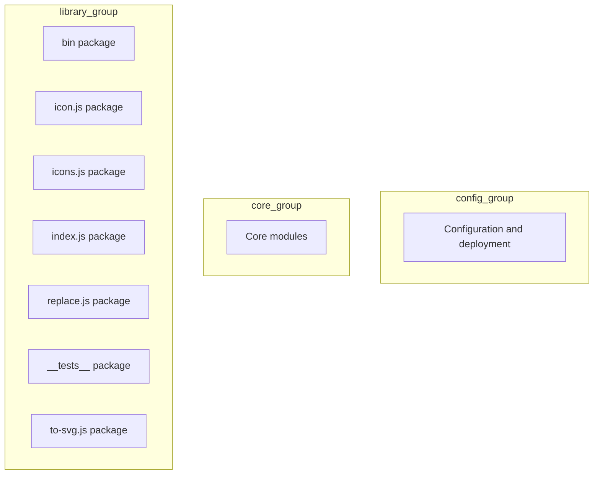

# Architecture report: feathericons/feather

> Automated static analysis. **Observed** = directly seen in files/imports/AST; **Inferred** = interpretation from that evidence. Repository code was not executed.

## 1. Repository at a glance

| Item | Value |
| --- | --- |
| Repository | feathericons/feather |
| Description | Simply beautiful open-source icons |
| Language | JavaScript |
| Stars | 26040 |
| Licence | MIT |
| Analysed commit / branch | 3dc050d97405062eba78aa57115c0a15c63abdaa / main |
| Framework(s) | None detected |
| Files analysed | 343 |
| Components | 9 |

## 2. Architecture in one minute

feathericons/feather - Simply beautiful open-source icons. This repository was analysed statically from 343 file(s) (0 Python). Detected technologies (observed from imports/manifests): GitHub Actions, Jest, webpack. Files are grouped into 9 component(s): bin package, Configuration and deployment, Core modules, icon.js package, icons.js package, index.js package, replace.js package, __tests__ package. Findings below distinguish observed facts from inferred interpretation.

## 3. High-level block diagram

## 4. Main components

### bin package (`bin`)

- **Kind:** library
- **Status:** Observed
- **Confidence:** 0.85
- **Responsibility:** Groups 12 file(s) under bin package (observed from repository paths and static analysis).
- **Paths:** `bin/__tests__/build-icons-object.test.js`, `bin/__tests__/build-sprite-string.test.js`, `bin/__tests__/optimize-svg.test.js`, `bin/build-icons-json.js`, `bin/build-icons-object.js`, `bin/build-sprite-string.js`, `bin/build-sprite.js`, `bin/build-svgs.js`, `bin/build.sh`, `bin/optimize-svg.js`, `bin/optimize-svgs.js`, `bin/setup.sh`
- **Evidence:** [bin/__tests__/build-icons-object.test.js](https://github.com/feathericons/feather/blob/3dc050d97405062eba78aa57115c0a15c63abdaa/bin/__tests__/build-icons-object.test.js); [bin/__tests__/build-sprite-string.test.js](https://github.com/feathericons/feather/blob/3dc050d97405062eba78aa57115c0a15c63abdaa/bin/__tests__/build-sprite-string.test.js); [bin/__tests__/optimize-svg.test.js](https://github.com/feathericons/feather/blob/3dc050d97405062eba78aa57115c0a15c63abdaa/bin/__tests__/optimize-svg.test.js); [bin/build-icons-json.js](https://github.com/feathericons/feather/blob/3dc050d97405062eba78aa57115c0a15c63abdaa/bin/build-icons-json.js); [bin/build-icons-object.js](https://github.com/feathericons/feather/blob/3dc050d97405062eba78aa57115c0a15c63abdaa/bin/build-icons-object.js); [bin/build-sprite-string.js](https://github.com/feathericons/feather/blob/3dc050d97405062eba78aa57115c0a15c63abdaa/bin/build-sprite-string.js); [bin/build-sprite.js](https://github.com/feathericons/feather/blob/3dc050d97405062eba78aa57115c0a15c63abdaa/bin/build-sprite.js); [bin/build-svgs.js](https://github.com/feathericons/feather/blob/3dc050d97405062eba78aa57115c0a15c63abdaa/bin/build-svgs.js)

### Configuration and deployment (`config`)

- **Kind:** config
- **Status:** Observed
- **Confidence:** 0.85
- **Responsibility:** Groups 4 file(s) under configuration and deployment (observed from repository paths and static analysis).
- **Paths:** `bin/.eslintrc.json`, `package.json`, `src/default-attrs.json`, `src/tags.json`
- **Evidence:** [bin/.eslintrc.json](https://github.com/feathericons/feather/blob/3dc050d97405062eba78aa57115c0a15c63abdaa/bin/.eslintrc.json); [package.json](https://github.com/feathericons/feather/blob/3dc050d97405062eba78aa57115c0a15c63abdaa/package.json); [src/default-attrs.json](https://github.com/feathericons/feather/blob/3dc050d97405062eba78aa57115c0a15c63abdaa/src/default-attrs.json); [src/tags.json](https://github.com/feathericons/feather/blob/3dc050d97405062eba78aa57115c0a15c63abdaa/src/tags.json)

### Core modules (`core`)

- **Kind:** core
- **Status:** Observed
- **Confidence:** 0.85
- **Responsibility:** Groups 2 file(s) under core modules (observed from repository paths and static analysis).
- **Paths:** `commitlint.config.js`, `webpack.config.js`
- **Evidence:** [commitlint.config.js](https://github.com/feathericons/feather/blob/3dc050d97405062eba78aa57115c0a15c63abdaa/commitlint.config.js); [webpack.config.js](https://github.com/feathericons/feather/blob/3dc050d97405062eba78aa57115c0a15c63abdaa/webpack.config.js)

### icon.js package (`icon_js`)

- **Kind:** library
- **Status:** Observed
- **Confidence:** 0.85
- **Responsibility:** Groups 1 file(s) under icon.js package (observed from repository paths and static analysis).
- **Paths:** `src/icon.js`
- **Evidence:** [src/icon.js](https://github.com/feathericons/feather/blob/3dc050d97405062eba78aa57115c0a15c63abdaa/src/icon.js)

### icons.js package (`icons_js`)

- **Kind:** library
- **Status:** Observed
- **Confidence:** 0.85
- **Responsibility:** Groups 1 file(s) under icons.js package (observed from repository paths and static analysis).
- **Paths:** `src/icons.js`
- **Evidence:** [src/icons.js](https://github.com/feathericons/feather/blob/3dc050d97405062eba78aa57115c0a15c63abdaa/src/icons.js)

### index.js package (`index_js`)

- **Kind:** library
- **Status:** Observed
- **Confidence:** 0.85
- **Responsibility:** Groups 1 file(s) under index.js package (observed from repository paths and static analysis).
- **Paths:** `src/index.js`
- **Evidence:** [src/index.js](https://github.com/feathericons/feather/blob/3dc050d97405062eba78aa57115c0a15c63abdaa/src/index.js)

### replace.js package (`replace_js`)

- **Kind:** library
- **Status:** Observed
- **Confidence:** 0.85
- **Responsibility:** Groups 1 file(s) under replace.js package (observed from repository paths and static analysis).
- **Paths:** `src/replace.js`
- **Evidence:** [src/replace.js](https://github.com/feathericons/feather/blob/3dc050d97405062eba78aa57115c0a15c63abdaa/src/replace.js)

### __tests__ package (`tests`)

- **Kind:** library
- **Status:** Observed
- **Confidence:** 0.85
- **Responsibility:** Groups 6 file(s) under __tests__ package (observed from repository paths and static analysis).
- **Paths:** `src/__tests__/icon.test.js`, `src/__tests__/icons.test.js`, `src/__tests__/index.test.js`, `src/__tests__/replace.node.test.js`, `src/__tests__/replace.test.js`, `src/__tests__/to-svg.test.js`
- **Evidence:** [src/__tests__/icon.test.js](https://github.com/feathericons/feather/blob/3dc050d97405062eba78aa57115c0a15c63abdaa/src/__tests__/icon.test.js); [src/__tests__/icons.test.js](https://github.com/feathericons/feather/blob/3dc050d97405062eba78aa57115c0a15c63abdaa/src/__tests__/icons.test.js); [src/__tests__/index.test.js](https://github.com/feathericons/feather/blob/3dc050d97405062eba78aa57115c0a15c63abdaa/src/__tests__/index.test.js); [src/__tests__/replace.node.test.js](https://github.com/feathericons/feather/blob/3dc050d97405062eba78aa57115c0a15c63abdaa/src/__tests__/replace.node.test.js); [src/__tests__/replace.test.js](https://github.com/feathericons/feather/blob/3dc050d97405062eba78aa57115c0a15c63abdaa/src/__tests__/replace.test.js); [src/__tests__/to-svg.test.js](https://github.com/feathericons/feather/blob/3dc050d97405062eba78aa57115c0a15c63abdaa/src/__tests__/to-svg.test.js)

### to-svg.js package (`to_svg_js`)

- **Kind:** library
- **Status:** Observed
- **Confidence:** 0.85
- **Responsibility:** Groups 1 file(s) under to-svg.js package (observed from repository paths and static analysis).
- **Paths:** `src/to-svg.js`
- **Evidence:** [src/to-svg.js](https://github.com/feathericons/feather/blob/3dc050d97405062eba78aa57115c0a15c63abdaa/src/to-svg.js)

## 5. Execution flow

**Observed** entry point(s):

- [src/index.js](https://github.com/feathericons/feather/blob/3dc050d97405062eba78aa57115c0a15c63abdaa/src/index.js)

Representative flow (derived from observed entry points and the import graph; steps beyond the entry point are **Inferred**):

1. Execution starts at an observed entry point listed above, if present.
2. No internal import relationships between components were observed.

## 6. Project structure

### `(root)`

- `.babelrc` - other (152 bytes)
- `.eslintignore` - other (13 bytes)
- `.eslintrc.js` - source, JavaScript (386 bytes)
- `.gitignore` - other (50 bytes)
- `.lintstagedrc` - other (23 bytes)
- `.prettierignore` - other (14 bytes)
- `CHANGELOG.md` - docs (662 bytes)
- `CODE_OF_CONDUCT.md` - docs (3228 bytes)
- `CONTRIBUTING.md` - docs (1763 bytes)
- `LICENSE` - docs (1082 bytes)
- `README.md` - docs (17242 bytes)
- `commitlint.config.js` - source, JavaScript (191 bytes)
- `package.json` - manifest (1430 bytes)
- `webpack.config.js` - source, JavaScript (573 bytes)

### `.changeset`

- `.changeset/README.md` - docs (500 bytes)
- `.changeset/config.json` - config (324 bytes)

### `.github`

- `.github/CODEOWNERS` - other (13 bytes)
- `.github/ISSUE_TEMPLATE/01-icon-request.yml` - config (1380 bytes)
- `.github/ISSUE_TEMPLATE/02-bug-report.yml` - config (1937 bytes)
- `.github/workflows/ci.yml` - ci, YAML (903 bytes)
- `.github/workflows/release.yml` - ci, YAML (768 bytes)

### `bin`

- `bin/.eslintrc.json` - config (93 bytes)
- `bin/__tests__/__snapshots__/build-icons-object.test.js.snap` - other (299 bytes)
- `bin/__tests__/__snapshots__/build-sprite-string.test.js.snap` - other (434 bytes)
- `bin/__tests__/__snapshots__/optimize-svg.test.js.snap` - other (556 bytes)
- `bin/__tests__/build-icons-object.test.js` - source, JavaScript (659 bytes)
- `bin/__tests__/build-sprite-string.test.js` - source, JavaScript (353 bytes)
- `bin/__tests__/optimize-svg.test.js` - source, JavaScript (719 bytes)
- `bin/build-icons-json.js` - source, JavaScript (527 bytes)
- `bin/build-icons-object.js` - source, JavaScript (973 bytes)
- `bin/build-sprite-string.js` - source, JavaScript (688 bytes)
- `bin/build-sprite.js` - source, JavaScript (310 bytes)
- `bin/build-svgs.js` - source, JavaScript (325 bytes)
- `bin/build.sh` - source, Shell (451 bytes)
- `bin/optimize-svg.js` - source, JavaScript (1012 bytes)
- `bin/optimize-svgs.js` - source, JavaScript (452 bytes)
- `bin/setup.sh` - source, Shell (93 bytes)

### `examples`

- `examples/index.html` - other (347 bytes)

### `icons`

- `icons/activity.svg` - other (239 bytes)
- `icons/airplay.svg` - other (315 bytes)
- `icons/alert-circle.svg` - other (299 bytes)
- `icons/alert-octagon.svg` - other (357 bytes)
- `icons/alert-triangle.svg` - other (367 bytes)
- `icons/align-center.svg` - other (337 bytes)
- `icons/align-justify.svg` - other (337 bytes)
- `icons/align-left.svg` - other (337 bytes)
- `icons/align-right.svg` - other (337 bytes)
- `icons/anchor.svg` - other (294 bytes)
- `icons/aperture.svg` - other (491 bytes)
- `icons/archive.svg` - other (307 bytes)
- `icons/arrow-down-circle.svg` - other (294 bytes)
- `icons/arrow-down-left.svg` - other (259 bytes)
- `icons/arrow-down-right.svg` - other (260 bytes)
- `icons/arrow-down.svg` - other (262 bytes)
- `icons/arrow-left-circle.svg` - other (293 bytes)
- `icons/arrow-left.svg` - other (261 bytes)
- `icons/arrow-right-circle.svg` - other (294 bytes)
- `icons/arrow-right.svg` - other (262 bytes)
- `icons/arrow-up-circle.svg` - other (293 bytes)
- `icons/arrow-up-left.svg` - other (258 bytes)
- `icons/arrow-up-right.svg` - other (259 bytes)
- `icons/arrow-up.svg` - other (261 bytes)
- `icons/at-sign.svg` - other (276 bytes)
- `icons/award.svg` - other (277 bytes)
- `icons/bar-chart-2.svg` - other (301 bytes)
- `icons/bar-chart.svg` - other (301 bytes)
- `icons/battery-charging.svg` - other (364 bytes)
- `icons/battery.svg` - other (282 bytes)
- `icons/bell-off.svg` - other (397 bytes)
- `icons/bell.svg` - other (280 bytes)
- `icons/bluetooth.svg` - other (254 bytes)
- `icons/bold.svg` - other (286 bytes)
- `icons/book-open.svg` - other (293 bytes)
- `icons/book.svg` - other (304 bytes)
- `icons/bookmark.svg` - other (248 bytes)
- `icons/box.svg` - other (412 bytes)
- `icons/briefcase.svg` - other (297 bytes)
- `icons/calendar.svg` - other (353 bytes)
- `icons/camera-off.svg` - other (338 bytes)
- `icons/camera.svg` - other (311 bytes)
- `icons/cast.svg` - other (346 bytes)
- `icons/check-circle.svg` - other (275 bytes)
- `icons/check-square.svg` - other (292 bytes)
- `icons/check.svg` - other (222 bytes)
- `icons/chevron-down.svg` - other (222 bytes)
- `icons/chevron-left.svg` - other (223 bytes)
- `icons/chevron-right.svg` - other (222 bytes)
- `icons/chevron-up.svg` - other (223 bytes)
- `icons/chevrons-down.svg` - other (259 bytes)
- `icons/chevrons-left.svg` - other (260 bytes)
- `icons/chevrons-right.svg` - other (259 bytes)
- `icons/chevrons-up.svg` - other (260 bytes)
- `icons/chrome.svg` - other (383 bytes)
- `icons/circle.svg` - other (219 bytes)
- `icons/clipboard.svg` - other (325 bytes)
- `icons/clock.svg` - other (256 bytes)
- `icons/cloud-drizzle.svg` - other (477 bytes)
- `icons/cloud-lightning.svg` - other (289 bytes)
- `icons/cloud-off.svg` - other (325 bytes)
- `icons/cloud-rain.svg` - other (362 bytes)
- `icons/cloud-snow.svg` - other (495 bytes)
- `icons/cloud.svg` - other (244 bytes)
- `icons/code.svg` - other (258 bytes)
- `icons/codepen.svg` - other (413 bytes)
- `icons/codesandbox.svg` - other (550 bytes)
- `icons/coffee.svg` - other (386 bytes)
- `icons/columns.svg` - other (288 bytes)
- `icons/command.svg` - other (383 bytes)
- `icons/compass.svg` - other (293 bytes)
- `icons/copy.svg` - other (310 bytes)
- `icons/corner-down-left.svg` - other (257 bytes)
- `icons/corner-down-right.svg` - other (260 bytes)
- `icons/corner-left-down.svg` - other (260 bytes)
- `icons/corner-left-up.svg` - other (257 bytes)
- `icons/corner-right-down.svg` - other (260 bytes)
- `icons/corner-right-up.svg` - other (257 bytes)
- `icons/corner-up-left.svg` - other (257 bytes)
- `icons/corner-up-right.svg` - other (260 bytes)
- `icons/cpu.svg` - other (579 bytes)
- `icons/credit-card.svg` - other (281 bytes)
- `icons/crop.svg` - other (269 bytes)
- `icons/crosshair.svg` - other (371 bytes)
- `icons/database.svg` - other (318 bytes)
- `icons/delete.svg` - other (325 bytes)
- `icons/disc.svg` - other (250 bytes)
- `icons/divide-circle.svg` - other (333 bytes)
- `icons/divide-square.svg` - other (357 bytes)
- `icons/divide.svg` - other (286 bytes)
- `icons/dollar-sign.svg` - other (286 bytes)
- `icons/download-cloud.svg` - other (326 bytes)
- `icons/download.svg` - other (315 bytes)
- `icons/dribbble.svg` - other (377 bytes)
- `icons/droplet.svg` - other (236 bytes)
- `icons/edit-2.svg` - other (254 bytes)
- `icons/edit-3.svg` - other (274 bytes)
- `icons/edit.svg` - other (324 bytes)
- `icons/external-link.svg` - other (328 bytes)
- `icons/eye-off.svg` - other (416 bytes)
- `icons/eye.svg` - other (274 bytes)
- `icons/facebook.svg` - other (264 bytes)
- `icons/fast-forward.svg` - other (268 bytes)
- `icons/feather.svg` - other (323 bytes)
- `icons/figma.svg` - other (493 bytes)
- `icons/file-minus.svg` - other (330 bytes)
- `icons/file-plus.svg` - other (369 bytes)
- `icons/file-text.svg` - other (401 bytes)
- `icons/file.svg` - other (292 bytes)
- `icons/film.svg` - other (509 bytes)
- `icons/filter.svg` - other (250 bytes)
- `icons/flag.svg` - other (293 bytes)
- `icons/folder-minus.svg` - other (312 bytes)
- `icons/folder-plus.svg` - other (351 bytes)
- `icons/folder.svg` - other (274 bytes)
- `icons/framer.svg` - other (241 bytes)
- `icons/frown.svg` - other (334 bytes)
- `icons/gift.svg` - other (418 bytes)
- `icons/git-branch.svg` - other (314 bytes)
- `icons/git-commit.svg` - other (303 bytes)
- `icons/git-merge.svg` - other (280 bytes)
- `icons/git-pull-request.svg` - other (318 bytes)
- `icons/github.svg` - other (490 bytes)
- `icons/gitlab.svg` - other (453 bytes)
- `icons/globe.svg` - other (359 bytes)
- `icons/grid.svg` - other (351 bytes)
- `icons/hard-drive.svg` - other (425 bytes)
- `icons/hash.svg` - other (336 bytes)
- `icons/headphones.svg` - other (348 bytes)
- `icons/heart.svg` - other (335 bytes)
- `icons/help-circle.svg` - other (309 bytes)
- `icons/hexagon.svg` - other (320 bytes)
- `icons/home.svg` - other (287 bytes)
- `icons/image.svg` - other (315 bytes)
- `icons/inbox.svg` - other (359 bytes)
- `icons/info.svg` - other (298 bytes)
- `icons/instagram.svg` - other (348 bytes)
- `icons/italic.svg` - other (299 bytes)
- `icons/key.svg` - other (318 bytes)
- `icons/layers.svg` - other (305 bytes)
- `icons/layout.svg` - other (315 bytes)
- `icons/life-buoy.svg` - other (495 bytes)
- `icons/link-2.svg` - other (312 bytes)
- `icons/link.svg` - other (330 bytes)
- `icons/linkedin.svg` - other (347 bytes)
- `icons/list.svg` - other (417 bytes)
- `icons/loader.svg` - other (535 bytes)
- `icons/lock.svg` - other (280 bytes)
- `icons/log-in.svg` - other (315 bytes)
- `icons/log-out.svg` - other (313 bytes)
- `icons/mail.svg` - other (309 bytes)
- `icons/map-pin.svg` - other (276 bytes)
- `icons/map.svg` - other (324 bytes)
- `icons/maximize-2.svg` - other (333 bytes)
- `icons/maximize.svg` - other (292 bytes)
- `icons/meh.svg` - other (335 bytes)
- `icons/menu.svg` - other (299 bytes)
- `icons/message-circle.svg` - other (383 bytes)
- `icons/message-square.svg` - other (260 bytes)
- `icons/mic-off.svg` - other (432 bytes)
- `icons/mic.svg` - other (366 bytes)
- `icons/minimize-2.svg` - other (337 bytes)
- `icons/minimize.svg` - other (292 bytes)
- `icons/minus-circle.svg` - other (257 bytes)
- `icons/minus-square.svg` - other (281 bytes)
- `icons/minus.svg` - other (225 bytes)
- `icons/monitor.svg` - other (320 bytes)
- `icons/moon.svg` - other (246 bytes)
- `icons/more-horizontal.svg` - other (279 bytes)
- `icons/more-vertical.svg` - other (279 bytes)
- `icons/mouse-pointer.svg` - other (261 bytes)
- `icons/move.svg` - other (405 bytes)
- `icons/music.svg` - other (275 bytes)
- `icons/navigation-2.svg` - other (233 bytes)
- `icons/navigation.svg` - other (233 bytes)
- `icons/octagon.svg` - other (277 bytes)
- `icons/package.svg` - other (457 bytes)
- `icons/paperclip.svg` - other (312 bytes)
- `icons/pause-circle.svg` - other (295 bytes)
- `icons/pause.svg` - other (270 bytes)
- `icons/pen-tool.svg` - other (332 bytes)
- `icons/percent.svg` - other (296 bytes)
- `icons/phone-call.svg` - other (535 bytes)
- `icons/phone-forwarded.svg` - other (556 bytes)
- `icons/phone-incoming.svg` - other (556 bytes)
- `icons/phone-missed.svg` - other (558 bytes)
- `icons/phone-off.svg` - other (545 bytes)
- `icons/phone-outgoing.svg` - other (556 bytes)
- `icons/phone.svg` - other (484 bytes)
- `icons/pie-chart.svg` - other (269 bytes)
- `icons/play-circle.svg` - other (260 bytes)
- `icons/play.svg` - other (225 bytes)
- `icons/plus-circle.svg` - other (295 bytes)
- `icons/plus-square.svg` - other (319 bytes)
- `icons/plus.svg` - other (263 bytes)
- `icons/pocket.svg` - other (311 bytes)
- `icons/power.svg` - other (266 bytes)
- `icons/printer.svg` - other (353 bytes)
- `icons/radio.svg` - other (345 bytes)
- `icons/refresh-ccw.svg` - other (338 bytes)
- `icons/refresh-cw.svg` - other (339 bytes)
- `icons/repeat.svg` - other (329 bytes)
- `icons/rewind.svg` - other (270 bytes)
- `icons/rotate-ccw.svg` - other (266 bytes)
- `icons/rotate-cw.svg` - other (271 bytes)
- `icons/rss.svg` - other (282 bytes)
- `icons/save.svg` - other (337 bytes)
- `icons/scissors.svg` - other (377 bytes)
- `icons/search.svg` - other (263 bytes)
- `icons/send.svg` - other (270 bytes)
- `icons/server.svg` - other (376 bytes)
- `icons/settings.svg` - other (964 bytes)
- `icons/share-2.svg` - other (377 bytes)
- `icons/share.svg` - other (312 bytes)
- `icons/shield-off.svg` - other (352 bytes)
- `icons/shield.svg` - other (242 bytes)
- `icons/shopping-bag.svg` - other (317 bytes)
- `icons/shopping-cart.svg` - other (323 bytes)
- `icons/shuffle.svg` - other (371 bytes)
- `icons/sidebar.svg` - other (279 bytes)
- `icons/skip-back.svg` - other (264 bytes)
- `icons/skip-forward.svg` - other (263 bytes)
- `icons/slack.svg` - other (921 bytes)
- `icons/slash.svg` - other (268 bytes)
- `icons/sliders.svg` - other (525 bytes)
- `icons/smartphone.svg` - other (285 bytes)
- `icons/smile.svg` - other (332 bytes)
- `icons/speaker.svg` - other (314 bytes)
- `icons/square.svg` - other (243 bytes)
- `icons/star.svg` - other (301 bytes)
- `icons/stop-circle.svg` - other (259 bytes)
- `icons/sun.svg` - other (566 bytes)
- `icons/sunrise.svg` - other (505 bytes)
- `icons/sunset.svg` - other (505 bytes)
- `icons/table.svg` - other (304 bytes)
- `icons/tablet.svg` - other (285 bytes)
- `icons/tag.svg` - other (315 bytes)
- `icons/target.svg` - other (281 bytes)
- `icons/terminal.svg` - other (261 bytes)
- `icons/thermometer.svg` - other (255 bytes)
- `icons/thumbs-down.svg` - other (332 bytes)
- `icons/thumbs-up.svg` - other (314 bytes)
- `icons/toggle-left.svg` - other (273 bytes)
- `icons/toggle-right.svg` - other (274 bytes)
- `icons/tool.svg` - other (351 bytes)
- `icons/trash-2.svg` - other (388 bytes)
- `icons/trash.svg` - other (310 bytes)
- `icons/trello.svg` - other (324 bytes)
- `icons/trending-down.svg` - other (273 bytes)
- `icons/trending-up.svg` - other (272 bytes)
- `icons/triangle.svg` - other (287 bytes)
- `icons/truck.svg` - other (354 bytes)
- `icons/tv.svg` - other (277 bytes)
- `icons/twitch.svg` - other (240 bytes)
- `icons/twitter.svg` - other (370 bytes)
- `icons/type.svg` - other (301 bytes)
- `icons/umbrella.svg` - other (251 bytes)
- `icons/underline.svg` - other (273 bytes)
- `icons/unlock.svg` - other (279 bytes)
- `icons/upload-cloud.svg` - other (362 bytes)
- `icons/upload.svg` - other (312 bytes)
- `icons/user-check.svg` - other (308 bytes)
- `icons/user-minus.svg` - other (310 bytes)
- `icons/user-plus.svg` - other (348 bytes)
- `icons/user-x.svg` - other (347 bytes)
- `icons/user.svg` - other (270 bytes)
- `icons/users.svg` - other (344 bytes)
- `icons/video-off.svg` - other (333 bytes)
- `icons/video.svg` - other (284 bytes)
- `icons/voicemail.svg` - other (302 bytes)
- `icons/volume-1.svg` - other (280 bytes)
- `icons/volume-2.svg` - other (311 bytes)
- `icons/volume-x.svg` - other (316 bytes)
- `icons/volume.svg` - other (240 bytes)
- `icons/watch.svg` - other (408 bytes)
- `icons/wifi-off.svg` - other (494 bytes)
- `icons/wifi.svg` - other (348 bytes)
- `icons/wind.svg` - other (291 bytes)
- `icons/x-circle.svg` - other (293 bytes)
- `icons/x-octagon.svg` - other (351 bytes)
- `icons/x-square.svg` - other (317 bytes)
- `icons/x.svg` - other (261 bytes)
- `icons/youtube.svg` - other (518 bytes)
- `icons/zap-off.svg` - other (365 bytes)
- `icons/zap.svg` - other (245 bytes)
- `icons/zoom-in.svg` - other (339 bytes)
- `icons/zoom-out.svg` - other (301 bytes)

### `src`

- `src/__tests__/__snapshots__/icon.test.js.snap` - other (2611 bytes)
- `src/__tests__/__snapshots__/icons.test.js.snap` - other (1142 bytes)
- `src/__tests__/__snapshots__/replace.node.test.js.snap` - other (168 bytes)
- `src/__tests__/__snapshots__/replace.test.js.snap` - other (2196 bytes)
- `src/__tests__/__snapshots__/to-svg.test.js.snap` - other (1313 bytes)
- `src/__tests__/icon.test.js` - source, JavaScript (801 bytes)
- `src/__tests__/icons.test.js` - source, JavaScript (404 bytes)
- `src/__tests__/index.test.js` - source, JavaScript (229 bytes)
- `src/__tests__/replace.node.test.js` - source, JavaScript (207 bytes)
- `src/__tests__/replace.test.js` - source, JavaScript (1184 bytes)
- `src/__tests__/to-svg.test.js` - source, JavaScript (653 bytes)
- `src/default-attrs.json` - config (227 bytes)
- `src/icon.js` - source, JavaScript (1194 bytes)
- `src/icons.js` - source, JavaScript (275 bytes)
- `src/index.js` - source, JavaScript (137 bytes)
- `src/replace.js` - source, JavaScript (1717 bytes)
- `src/tags.json` - config (9248 bytes)
- `src/to-svg.js` - source, JavaScript (599 bytes)

## 7. Key dependencies and integrations

| Name | Category | Status | Confidence | Evidence |
| --- | --- | --- | --- | --- |
| GitHub Actions | ci | Observed | 0.90 | [.github/workflows/ci.yml](https://github.com/feathericons/feather/blob/3dc050d97405062eba78aa57115c0a15c63abdaa/.github/workflows/ci.yml); [.github/workflows/release.yml](https://github.com/feathericons/feather/blob/3dc050d97405062eba78aa57115c0a15c63abdaa/.github/workflows/release.yml) |
| Jest | tooling | Observed | 0.85 | [package.json:19](https://github.com/feathericons/feather/blob/3dc050d97405062eba78aa57115c0a15c63abdaa/package.json#L19) |
| webpack | tooling | Observed | 0.85 | [package.json:49](https://github.com/feathericons/feather/blob/3dc050d97405062eba78aa57115c0a15c63abdaa/package.json#L49) |

## 8. Data and state

No database, cache, queue, or persistent-state usage was observed in the analysed files. State handling, if any, may be in-memory or in files that were not analysed.

## 9. Configuration and deployment clues

- `.changeset/config.json` (config)
- `.github/ISSUE_TEMPLATE/01-icon-request.yml` (config)
- `.github/ISSUE_TEMPLATE/02-bug-report.yml` (config)
- `.github/workflows/ci.yml` (ci)
- `.github/workflows/release.yml` (ci)
- `bin/.eslintrc.json` (config)
- `package.json` (manifest)
- `src/default-attrs.json` (config)
- `src/tags.json` (config)

## 10. Design observations

- No strong design patterns could be established from the available evidence.

These observations are interpretations (**Inferred**) of the observed structure, not guarantees about runtime design.

## 11. Limitations and unknowns

- Static analysis only: repository code was not executed, installed, or imported at runtime.
- Components and relationships are inferred from file paths, imports, and AST structure; runtime behaviour, dynamic imports, and reflection may not be visible.
- No clear application entry point was observed in the analysed files.
- Repository text was treated as untrusted data; no instructions found in repository files were followed, and likely secret values were redacted/excluded.
- JavaScript and TypeScript files were inventoried from paths and package manifests. They were not parsed with a full language AST, and repository code was not executed.

## 12. Source references

- [.github/workflows/ci.yml](https://github.com/feathericons/feather/blob/3dc050d97405062eba78aa57115c0a15c63abdaa/.github/workflows/ci.yml)
- [.github/workflows/release.yml](https://github.com/feathericons/feather/blob/3dc050d97405062eba78aa57115c0a15c63abdaa/.github/workflows/release.yml)
- [bin/.eslintrc.json](https://github.com/feathericons/feather/blob/3dc050d97405062eba78aa57115c0a15c63abdaa/bin/.eslintrc.json)
- [bin/__tests__/build-icons-object.test.js](https://github.com/feathericons/feather/blob/3dc050d97405062eba78aa57115c0a15c63abdaa/bin/__tests__/build-icons-object.test.js)
- [bin/__tests__/build-sprite-string.test.js](https://github.com/feathericons/feather/blob/3dc050d97405062eba78aa57115c0a15c63abdaa/bin/__tests__/build-sprite-string.test.js)
- [bin/__tests__/optimize-svg.test.js](https://github.com/feathericons/feather/blob/3dc050d97405062eba78aa57115c0a15c63abdaa/bin/__tests__/optimize-svg.test.js)
- [bin/build-icons-json.js](https://github.com/feathericons/feather/blob/3dc050d97405062eba78aa57115c0a15c63abdaa/bin/build-icons-json.js)
- [bin/build-icons-object.js](https://github.com/feathericons/feather/blob/3dc050d97405062eba78aa57115c0a15c63abdaa/bin/build-icons-object.js)
- [bin/build-sprite-string.js](https://github.com/feathericons/feather/blob/3dc050d97405062eba78aa57115c0a15c63abdaa/bin/build-sprite-string.js)
- [bin/build-sprite.js](https://github.com/feathericons/feather/blob/3dc050d97405062eba78aa57115c0a15c63abdaa/bin/build-sprite.js)
- [bin/build-svgs.js](https://github.com/feathericons/feather/blob/3dc050d97405062eba78aa57115c0a15c63abdaa/bin/build-svgs.js)
- [commitlint.config.js](https://github.com/feathericons/feather/blob/3dc050d97405062eba78aa57115c0a15c63abdaa/commitlint.config.js)
- [package.json](https://github.com/feathericons/feather/blob/3dc050d97405062eba78aa57115c0a15c63abdaa/package.json)
- [package.json:19](https://github.com/feathericons/feather/blob/3dc050d97405062eba78aa57115c0a15c63abdaa/package.json#L19)
- [package.json:49](https://github.com/feathericons/feather/blob/3dc050d97405062eba78aa57115c0a15c63abdaa/package.json#L49)
- [src/__tests__/icon.test.js](https://github.com/feathericons/feather/blob/3dc050d97405062eba78aa57115c0a15c63abdaa/src/__tests__/icon.test.js)
- [src/__tests__/icons.test.js](https://github.com/feathericons/feather/blob/3dc050d97405062eba78aa57115c0a15c63abdaa/src/__tests__/icons.test.js)
- [src/__tests__/index.test.js](https://github.com/feathericons/feather/blob/3dc050d97405062eba78aa57115c0a15c63abdaa/src/__tests__/index.test.js)
- [src/__tests__/replace.node.test.js](https://github.com/feathericons/feather/blob/3dc050d97405062eba78aa57115c0a15c63abdaa/src/__tests__/replace.node.test.js)
- [src/__tests__/replace.test.js](https://github.com/feathericons/feather/blob/3dc050d97405062eba78aa57115c0a15c63abdaa/src/__tests__/replace.test.js)
- [src/__tests__/to-svg.test.js](https://github.com/feathericons/feather/blob/3dc050d97405062eba78aa57115c0a15c63abdaa/src/__tests__/to-svg.test.js)
- [src/default-attrs.json](https://github.com/feathericons/feather/blob/3dc050d97405062eba78aa57115c0a15c63abdaa/src/default-attrs.json)
- [src/icon.js](https://github.com/feathericons/feather/blob/3dc050d97405062eba78aa57115c0a15c63abdaa/src/icon.js)
- [src/icons.js](https://github.com/feathericons/feather/blob/3dc050d97405062eba78aa57115c0a15c63abdaa/src/icons.js)
- [src/index.js](https://github.com/feathericons/feather/blob/3dc050d97405062eba78aa57115c0a15c63abdaa/src/index.js)
- [src/replace.js](https://github.com/feathericons/feather/blob/3dc050d97405062eba78aa57115c0a15c63abdaa/src/replace.js)
- [src/tags.json](https://github.com/feathericons/feather/blob/3dc050d97405062eba78aa57115c0a15c63abdaa/src/tags.json)
- [src/to-svg.js](https://github.com/feathericons/feather/blob/3dc050d97405062eba78aa57115c0a15c63abdaa/src/to-svg.js)
- [webpack.config.js](https://github.com/feathericons/feather/blob/3dc050d97405062eba78aa57115c0a15c63abdaa/webpack.config.js)
