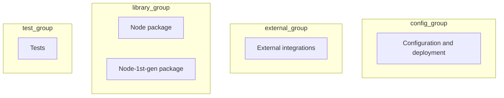

# Architecture report: firebase/functions-samples

> Automated static analysis. **Observed** = directly seen in files/imports/AST; **Inferred** = interpretation from that evidence. Repository code was not executed.

## 1. Repository at a glance

| Item | Value |
| --- | --- |
| Repository | firebase/functions-samples |
| Description | Collection of sample apps showcasing popular use cases using Cloud Functions for Firebase |
| Language | JavaScript |
| Stars | 12212 |
| Licence | Apache-2.0 |
| Analysed commit / branch | 5c5ef9a5ad4faa16215c7a406d1afe3f8c3b9c32 / main |
| Framework(s) | Express |
| Files analysed | 540 |
| Components | 5 |

## 2. Architecture in one minute

firebase/functions-samples - Collection of sample apps showcasing popular use cases using Cloud Functions for Firebase. This repository was analysed statically from 540 file(s) (0 Python). Detected technologies (observed from imports/manifests): GitHub Actions, Express, Jest, TypeScript, Vite. Files are grouped into 5 component(s): Configuration and deployment, External integrations, Node package, Node-1st-gen package, Tests. Findings below distinguish observed facts from inferred interpretation.

## 3. High-level block diagram

## 4. Main components

### Configuration and deployment (`config`)

- **Kind:** config
- **Status:** Observed
- **Confidence:** 0.85
- **Responsibility:** Groups 178 file(s) under configuration and deployment (observed from repository paths and static analysis).
- **Paths:** `Dart/codelab-dart-functions/analysis_options.yaml`, `Dart/codelab-dart-functions/firebase.json`, `Dart/codelab-dart-functions/functions/analysis_options.yaml`, `Dart/codelab-dart-functions/functions/build.yaml`, `Dart/codelab-dart-functions/functions/pubspec.yaml`, `Dart/codelab-dart-functions/packages/shared/analysis_options.yaml`, `Dart/codelab-dart-functions/packages/shared/pubspec.yaml`, `Dart/codelab-dart-functions/pubspec.yaml`, `Dart/quickstarts/callable-functions-streaming/firebase.json`, `Dart/quickstarts/callable-functions-streaming/pubspec.yaml`, `Dart/quickstarts/callable-functions/firebase.json`, `Dart/quickstarts/callable-functions/pubspec.yaml`, `Dart/quickstarts/https-time-server/firebase.json`, `Dart/quickstarts/https-time-server/pubspec.yaml`, `Dart/quickstarts/resize-image/firebase.json`, `Dart/quickstarts/resize-image/pubspec.yaml`, `Node-1st-gen/authenticated-json-api/database.rules.json`, `Node-1st-gen/authenticated-json-api/firebase.json`, `Node-1st-gen/authenticated-json-api/functions/package.json`, `Node-1st-gen/authorized-https-endpoint/firebase.json`, `Node-1st-gen/authorized-https-endpoint/functions/package.json`, `Node-1st-gen/bigquery-import/firebase.json`, `Node-1st-gen/bigquery-import/functions/package.json`, `Node-1st-gen/child-count/firebase.json`, `Node-1st-gen/child-count/functions/package.json`, `Node-1st-gen/convert-images/firebase.json`, `Node-1st-gen/convert-images/functions/package.json`, `Node-1st-gen/coupon-on-purchase/firebase.json`, `Node-1st-gen/coupon-on-purchase/functions/package.json`, `Node-1st-gen/delete-old-child-nodes/firebase.json`, `Node-1st-gen/delete-old-child-nodes/functions/package.json`, `Node-1st-gen/delete-unused-accounts-cron/firebase.json`, `Node-1st-gen/delete-unused-accounts-cron/functions/package.json`, `Node-1st-gen/developer-motivator/firebase.json`, `Node-1st-gen/developer-motivator/functions/package.json`, `Node-1st-gen/email-confirmation/database.rules.json`, `Node-1st-gen/email-confirmation/firebase.json`, `Node-1st-gen/email-confirmation/functions/package.json`, `Node-1st-gen/exif-images/database.rules.json`, `Node-1st-gen/exif-images/firebase.json`, `Node-1st-gen/exif-images/functions/package.json`, `Node-1st-gen/fcm-notifications/database.rules.json`, `Node-1st-gen/fcm-notifications/firebase.json`, `Node-1st-gen/fcm-notifications/functions/package.json`, `Node-1st-gen/ffmpeg-convert-audio/firebase.json`, `Node-1st-gen/ffmpeg-convert-audio/functions/package.json`, `Node-1st-gen/fulltext-search-firestore/firebase.json`, `Node-1st-gen/fulltext-search-firestore/functions/package.json`, `Node-1st-gen/fulltext-search/firebase.json`, `Node-1st-gen/fulltext-search/functions/package.json`, `Node-1st-gen/github-to-slack/firebase.json`, `Node-1st-gen/github-to-slack/functions/package.json`, `Node-1st-gen/google-sheet-sync/firebase.json`, `Node-1st-gen/google-sheet-sync/functions/package.json`, `Node-1st-gen/image-maker/firebase.json`, `Node-1st-gen/image-maker/functions/package.json`, `Node-1st-gen/lastmodified-tracking/database.rules.json`, `Node-1st-gen/lastmodified-tracking/firebase.json`, `Node-1st-gen/lastmodified-tracking/functions/package.json`, `Node-1st-gen/limit-children/firebase.json`, `Node-1st-gen/limit-children/functions/package.json`, `Node-1st-gen/linkedin-auth/database.rules.json`, `Node-1st-gen/linkedin-auth/firebase.json`, `Node-1st-gen/linkedin-auth/functions/package.json`, `Node-1st-gen/message-translation/firebase.json`, `Node-1st-gen/message-translation/functions/package.json`, `Node-1st-gen/minimal-webhook/firebase.json`, `Node-1st-gen/minimal-webhook/functions/package.json`, `Node-1st-gen/moderate-images/firebase.json`, `Node-1st-gen/moderate-images/functions/package.json`, `Node-1st-gen/okta-auth/firebase.json`, `Node-1st-gen/okta-auth/functions/package.json`, `Node-1st-gen/pnpm-workspace.yaml`, `Node-1st-gen/presence-firestore/firebase.json`, `Node-1st-gen/presence-firestore/functions/package.json`, `Node-1st-gen/publish-model/firebase.json`, `Node-1st-gen/publish-model/functions/package.json`, `Node-1st-gen/quickstarts/auth-blocking-functions/firebase.json`, `Node-1st-gen/quickstarts/auth-blocking-functions/functions/package.json`, `Node-1st-gen/quickstarts/big-ben/firebase.json`, `Node-1st-gen/quickstarts/big-ben/functions/package.json`, `Node-1st-gen/quickstarts/email-users/firebase.json`, `Node-1st-gen/quickstarts/email-users/functions/package.json`, `Node-1st-gen/quickstarts/https-time-server/firebase.json`, `Node-1st-gen/quickstarts/https-time-server/functions/package.json`, `Node-1st-gen/quickstarts/multicodebase-hellos/firebase.json`, `Node-1st-gen/quickstarts/multicodebase-hellos/js/package.json`, `Node-1st-gen/quickstarts/multicodebase-hellos/ts/package.json`, `Node-1st-gen/quickstarts/multicodebase-hellos/ts/tsconfig.dev.json`, `Node-1st-gen/quickstarts/multicodebase-hellos/ts/tsconfig.json`, `Node-1st-gen/quickstarts/pubsub-helloworld/firebase.json`, `Node-1st-gen/quickstarts/pubsub-helloworld/functions/package.json`, `Node-1st-gen/quickstarts/runtime-options/firebase.json`, `Node-1st-gen/quickstarts/runtime-options/functions/package.json`, `Node-1st-gen/quickstarts/taskqueues-backup-images/firebase.json`, `Node-1st-gen/quickstarts/taskqueues-backup-images/functions/package.json`, `Node-1st-gen/quickstarts/testlab-matrix-completed/firebase.json`, `Node-1st-gen/quickstarts/testlab-matrix-completed/functions/package.json`, `Node-1st-gen/quickstarts/thumbnails/firebase.json`, `Node-1st-gen/quickstarts/thumbnails/functions/package.json`, `Node-1st-gen/quickstarts/uppercase-firestore/firebase.json`, `Node-1st-gen/quickstarts/uppercase-firestore/firestore.indexes.json`, `Node-1st-gen/quickstarts/uppercase-firestore/functions/package.json`, `Node-1st-gen/quickstarts/uppercase-rtdb/database.rules.json`, `Node-1st-gen/quickstarts/uppercase-rtdb/firebase.json`, `Node-1st-gen/quickstarts/uppercase-rtdb/functions/package.json`, `Node-1st-gen/remote-config-diff/firebase.json`, `Node-1st-gen/remote-config-diff/functions/package.json`, `Node-1st-gen/spotify-auth/database.rules.json`, `Node-1st-gen/spotify-auth/firebase.json`, `Node-1st-gen/spotify-auth/functions/package.json`, `Node-1st-gen/stripe/firebase.json`, `Node-1st-gen/stripe/functions/package.json`, `Node-1st-gen/survey-app-update/firebase.json`, `Node-1st-gen/survey-app-update/functions/package.json`, `Node-1st-gen/template-handlebars/firebase.json`, `Node-1st-gen/template-handlebars/functions/package.json`, `Node-1st-gen/testlab-to-slack/firebase.json`, `Node-1st-gen/testlab-to-slack/functions/package.json`, `Node-1st-gen/text-moderation/firebase.json`, `Node-1st-gen/text-moderation/functions/package.json`, `Node-1st-gen/text-moderation/security.rules.json`, `Node-1st-gen/url-shortener/firebase.json`, `Node-1st-gen/url-shortener/functions/package.json`, `Node-1st-gen/username-password-auth/database.rules.json`, `Node-1st-gen/username-password-auth/firebase.json`, `Node-1st-gen/username-password-auth/functions/package.json`, `Node-1st-gen/vision-annotate-images/firebase.json`, `Node-1st-gen/vision-annotate-images/functions/package.json`, `Node-1st-gen/vision-annotate-images/functions/tsconfig.json`, `Node-1st-gen/youtube/firebase.json`, `Node-1st-gen/youtube/functions/package.json`, `Node/alerts-to-discord/firebase.json`, `Node/alerts-to-discord/functions/package.json`, `Node/app-distribution-feedback-to-jira/firebase.json`, `Node/app-distribution-feedback-to-jira/functions/package.json`, `Node/call-vertex-remote-config-server/client/package.json`, `Node/call-vertex-remote-config-server/firebase.json`, `Node/call-vertex-remote-config-server/functions/package.json`, `Node/delete-unused-accounts-cron/firebase.json`, `Node/delete-unused-accounts-cron/functions/package.json`, `Node/fcm-notifications/database.rules.json`, `Node/fcm-notifications/firebase.json`, `Node/fcm-notifications/functions/package.json`, `Node/instrument-with-opentelemetry/firebase.json`, `Node/instrument-with-opentelemetry/functions/package.json`, `Node/pnpm-workspace.yaml`, `Node/quickstarts/auth-blocking-functions/firebase.json`, `Node/quickstarts/auth-blocking-functions/functions/package.json`, `Node/quickstarts/callable-functions-streaming/firebase.json`, `Node/quickstarts/callable-functions-streaming/functions/package.json`, `Node/quickstarts/callable-functions/firebase.json`, `Node/quickstarts/callable-functions/functions/package.json`, `Node/quickstarts/custom-events/firebase.json`, `Node/quickstarts/custom-events/functions/package.json`, `Node/quickstarts/email-users/firebase.json`, `Node/quickstarts/email-users/functions/package.json`, `Node/quickstarts/firestore-sync-auth/firebase.json`, `Node/quickstarts/firestore-sync-auth/firestore.indexes.json`, `Node/quickstarts/firestore-sync-auth/functions/package.json`, `Node/quickstarts/genkit-helloworld/firebase.json`, `Node/quickstarts/genkit-helloworld/functions/package.json`, `Node/quickstarts/https-time-server/firebase.json`, `Node/quickstarts/https-time-server/functions/package.json`, `Node/quickstarts/monitor-cloud-logging/firebase.json`, `Node/quickstarts/monitor-cloud-logging/functions/package.json`, `Node/quickstarts/pubsub-helloworld/firebase.json`, `Node/quickstarts/pubsub-helloworld/functions/package.json`, `Node/quickstarts/testlab-matrix-completed/firebase.json`, `Node/quickstarts/testlab-matrix-completed/functions/package.json`, `Node/quickstarts/thumbnails/firebase.json`, `Node/quickstarts/thumbnails/functions/package.json`, `Node/quickstarts/uppercase-firestore/firebase.json`, `Node/quickstarts/uppercase-firestore/firestore.indexes.json`, `Node/quickstarts/uppercase-firestore/functions/package.json`, `Node/quickstarts/uppercase-rtdb/database.rules.json`, `Node/quickstarts/uppercase-rtdb/firebase.json`, `Node/test-functions-jest-ts/functions/tsconfig.dev.json`
- **Evidence:** [Dart/codelab-dart-functions/analysis_options.yaml](https://github.com/firebase/functions-samples/blob/5c5ef9a5ad4faa16215c7a406d1afe3f8c3b9c32/Dart/codelab-dart-functions/analysis_options.yaml); [Dart/codelab-dart-functions/firebase.json](https://github.com/firebase/functions-samples/blob/5c5ef9a5ad4faa16215c7a406d1afe3f8c3b9c32/Dart/codelab-dart-functions/firebase.json); [Dart/codelab-dart-functions/functions/analysis_options.yaml](https://github.com/firebase/functions-samples/blob/5c5ef9a5ad4faa16215c7a406d1afe3f8c3b9c32/Dart/codelab-dart-functions/functions/analysis_options.yaml); [Dart/codelab-dart-functions/functions/build.yaml](https://github.com/firebase/functions-samples/blob/5c5ef9a5ad4faa16215c7a406d1afe3f8c3b9c32/Dart/codelab-dart-functions/functions/build.yaml); [Dart/codelab-dart-functions/functions/pubspec.yaml](https://github.com/firebase/functions-samples/blob/5c5ef9a5ad4faa16215c7a406d1afe3f8c3b9c32/Dart/codelab-dart-functions/functions/pubspec.yaml); [Dart/codelab-dart-functions/packages/shared/analysis_options.yaml](https://github.com/firebase/functions-samples/blob/5c5ef9a5ad4faa16215c7a406d1afe3f8c3b9c32/Dart/codelab-dart-functions/packages/shared/analysis_options.yaml); [Dart/codelab-dart-functions/packages/shared/pubspec.yaml](https://github.com/firebase/functions-samples/blob/5c5ef9a5ad4faa16215c7a406d1afe3f8c3b9c32/Dart/codelab-dart-functions/packages/shared/pubspec.yaml); [Dart/codelab-dart-functions/pubspec.yaml](https://github.com/firebase/functions-samples/blob/5c5ef9a5ad4faa16215c7a406d1afe3f8c3b9c32/Dart/codelab-dart-functions/pubspec.yaml)

### External integrations (`external_integrations`)

- **Kind:** external
- **Status:** Observed
- **Confidence:** 0.85
- **Responsibility:** Groups 4 file(s) under external integrations (observed from repository paths and static analysis).
- **Paths:** `Node/call-vertex-remote-config-server/client/config.ts`, `Node/call-vertex-remote-config-server/client/main.ts`, `Node/call-vertex-remote-config-server/client/vite-env.d.ts`, `Node/call-vertex-remote-config-server/client/vite.config.js`
- **Evidence:** [Node/call-vertex-remote-config-server/client/config.ts](https://github.com/firebase/functions-samples/blob/5c5ef9a5ad4faa16215c7a406d1afe3f8c3b9c32/Node/call-vertex-remote-config-server/client/config.ts); [Node/call-vertex-remote-config-server/client/main.ts](https://github.com/firebase/functions-samples/blob/5c5ef9a5ad4faa16215c7a406d1afe3f8c3b9c32/Node/call-vertex-remote-config-server/client/main.ts); [Node/call-vertex-remote-config-server/client/vite-env.d.ts](https://github.com/firebase/functions-samples/blob/5c5ef9a5ad4faa16215c7a406d1afe3f8c3b9c32/Node/call-vertex-remote-config-server/client/vite-env.d.ts); [Node/call-vertex-remote-config-server/client/vite.config.js](https://github.com/firebase/functions-samples/blob/5c5ef9a5ad4faa16215c7a406d1afe3f8c3b9c32/Node/call-vertex-remote-config-server/client/vite.config.js)

### Node package (`node`)

- **Kind:** library
- **Status:** Observed
- **Confidence:** 0.85
- **Responsibility:** Groups 46 file(s) under node package (observed from repository paths and static analysis).
- **Paths:** `Node/alerts-to-discord/functions/eslint.config.js`, `Node/alerts-to-discord/functions/index.js`, `Node/app-distribution-feedback-to-jira/functions/eslint.config.js`, `Node/app-distribution-feedback-to-jira/functions/index.js`, `Node/call-vertex-remote-config-server/functions/index.js`, `Node/delete-unused-accounts-cron/functions/eslint.config.js`, `Node/delete-unused-accounts-cron/functions/index.js`, `Node/fcm-notifications/functions/eslint.config.js`, `Node/fcm-notifications/functions/index.js`, `Node/fcm-notifications/public/firebase-messaging-sw.js`, `Node/fcm-notifications/public/main.js`, `Node/instrument-with-opentelemetry/functions/eslint.config.js`, `Node/instrument-with-opentelemetry/functions/index.js`, `Node/instrument-with-opentelemetry/functions/timer.js`, `Node/instrument-with-opentelemetry/functions/tracing.js`, `Node/quickstarts/auth-blocking-functions/functions/eslint.config.js`, `Node/quickstarts/auth-blocking-functions/functions/index.js`, `Node/quickstarts/callable-functions-streaming/functions/eslint.config.js`, `Node/quickstarts/callable-functions-streaming/functions/index.js`, `Node/quickstarts/callable-functions/functions/eslint.config.js`, `Node/quickstarts/callable-functions/functions/index.js`, `Node/quickstarts/callable-functions/functions/sanitizer.js`, `Node/quickstarts/custom-events/functions/eslint.config.js`, `Node/quickstarts/custom-events/functions/index.js`, `Node/quickstarts/email-users/functions/deletedUserFarewell.js`, `Node/quickstarts/email-users/functions/eslint.config.js`, `Node/quickstarts/email-users/functions/index.js`, `Node/quickstarts/email-users/functions/newUserWelcome.js`, `Node/quickstarts/email-users/functions/tenants.js`, `Node/quickstarts/email-users/functions/utils/myEmailService.js`, `Node/quickstarts/firestore-sync-auth/functions/eslint.config.js`, `Node/quickstarts/firestore-sync-auth/functions/index.js`, `Node/quickstarts/genkit-helloworld/functions/eslint.config.js`, `Node/quickstarts/genkit-helloworld/functions/index.js`, `Node/quickstarts/https-time-server/functions/eslint.config.js`, `Node/quickstarts/https-time-server/functions/index.js`, `Node/quickstarts/monitor-cloud-logging/functions/eslint.config.js`, `Node/quickstarts/monitor-cloud-logging/functions/index.js`, `Node/quickstarts/pubsub-helloworld/functions/eslint.config.js`, `Node/quickstarts/pubsub-helloworld/functions/index.js`, `Node/quickstarts/testlab-matrix-completed/functions/eslint.config.js`, `Node/quickstarts/testlab-matrix-completed/functions/index.js`, `Node/quickstarts/thumbnails/functions/eslint.config.js`, `Node/quickstarts/thumbnails/functions/index.js`, `Node/quickstarts/uppercase-firestore/functions/eslint.config.js`, `Node/quickstarts/uppercase-rtdb/functions/eslint.config.js`
- **Evidence:** [Node/alerts-to-discord/functions/eslint.config.js](https://github.com/firebase/functions-samples/blob/5c5ef9a5ad4faa16215c7a406d1afe3f8c3b9c32/Node/alerts-to-discord/functions/eslint.config.js); [Node/alerts-to-discord/functions/index.js](https://github.com/firebase/functions-samples/blob/5c5ef9a5ad4faa16215c7a406d1afe3f8c3b9c32/Node/alerts-to-discord/functions/index.js); [Node/app-distribution-feedback-to-jira/functions/eslint.config.js](https://github.com/firebase/functions-samples/blob/5c5ef9a5ad4faa16215c7a406d1afe3f8c3b9c32/Node/app-distribution-feedback-to-jira/functions/eslint.config.js); [Node/app-distribution-feedback-to-jira/functions/index.js](https://github.com/firebase/functions-samples/blob/5c5ef9a5ad4faa16215c7a406d1afe3f8c3b9c32/Node/app-distribution-feedback-to-jira/functions/index.js); [Node/call-vertex-remote-config-server/functions/index.js](https://github.com/firebase/functions-samples/blob/5c5ef9a5ad4faa16215c7a406d1afe3f8c3b9c32/Node/call-vertex-remote-config-server/functions/index.js); [Node/delete-unused-accounts-cron/functions/eslint.config.js](https://github.com/firebase/functions-samples/blob/5c5ef9a5ad4faa16215c7a406d1afe3f8c3b9c32/Node/delete-unused-accounts-cron/functions/eslint.config.js); [Node/delete-unused-accounts-cron/functions/index.js](https://github.com/firebase/functions-samples/blob/5c5ef9a5ad4faa16215c7a406d1afe3f8c3b9c32/Node/delete-unused-accounts-cron/functions/index.js); [Node/fcm-notifications/functions/eslint.config.js](https://github.com/firebase/functions-samples/blob/5c5ef9a5ad4faa16215c7a406d1afe3f8c3b9c32/Node/fcm-notifications/functions/eslint.config.js)

### Node-1st-gen package (`node_1st_gen`)

- **Kind:** library
- **Status:** Observed
- **Confidence:** 0.85
- **Responsibility:** Groups 121 file(s) under node-1st-gen package (observed from repository paths and static analysis).
- **Paths:** `Node-1st-gen/authenticated-json-api/functions/eslint.config.js`, `Node-1st-gen/authenticated-json-api/functions/index.js`, `Node-1st-gen/authenticated-json-api/public/main.js`, `Node-1st-gen/authorized-https-endpoint/functions/eslint.config.js`, `Node-1st-gen/authorized-https-endpoint/functions/index.js`, `Node-1st-gen/authorized-https-endpoint/public/main.js`, `Node-1st-gen/bigquery-import/functions/eslint.config.js`, `Node-1st-gen/bigquery-import/functions/index.js`, `Node-1st-gen/child-count/functions/eslint.config.js`, `Node-1st-gen/child-count/functions/index.js`, `Node-1st-gen/convert-images/functions/eslint.config.js`, `Node-1st-gen/convert-images/functions/index.js`, `Node-1st-gen/coupon-on-purchase/functions/eslint.config.js`, `Node-1st-gen/coupon-on-purchase/functions/index.js`, `Node-1st-gen/delete-old-child-nodes/functions/index.js`, `Node-1st-gen/delete-unused-accounts-cron/functions/eslint.config.js`, `Node-1st-gen/delete-unused-accounts-cron/functions/index.js`, `Node-1st-gen/developer-motivator/functions/eslint.config.js`, `Node-1st-gen/developer-motivator/functions/index.js`, `Node-1st-gen/email-confirmation/functions/eslint.config.js`, `Node-1st-gen/email-confirmation/functions/index.js`, `Node-1st-gen/email-confirmation/public/main.js`, `Node-1st-gen/exif-images/functions/eslint.config.js`, `Node-1st-gen/exif-images/functions/index.js`, `Node-1st-gen/exif-images/public/main.js`, `Node-1st-gen/fcm-notifications/functions/eslint.config.js`, `Node-1st-gen/fcm-notifications/functions/index.js`, `Node-1st-gen/fcm-notifications/public/firebase-messaging-sw.js`, `Node-1st-gen/fcm-notifications/public/main.js`, `Node-1st-gen/ffmpeg-convert-audio/functions/eslint.config.js`, `Node-1st-gen/ffmpeg-convert-audio/functions/index.js`, `Node-1st-gen/fulltext-search-firestore/functions/elastic.js`, `Node-1st-gen/fulltext-search-firestore/functions/eslint.config.js`, `Node-1st-gen/fulltext-search-firestore/functions/index.js`, `Node-1st-gen/fulltext-search-firestore/functions/typesense.js`, `Node-1st-gen/fulltext-search-firestore/public/index.js`, `Node-1st-gen/fulltext-search/functions/eslint.config.js`, `Node-1st-gen/fulltext-search/functions/index.js`, `Node-1st-gen/github-to-slack/functions/eslint.config.js`, `Node-1st-gen/github-to-slack/functions/index.js`, `Node-1st-gen/google-sheet-sync/functions/eslint.config.js`, `Node-1st-gen/google-sheet-sync/functions/index.js`, `Node-1st-gen/image-maker/functions/clock.js`, `Node-1st-gen/image-maker/functions/eslint.config.js`, `Node-1st-gen/image-maker/functions/index.js`, `Node-1st-gen/image-maker/functions/ray.js`, `Node-1st-gen/image-maker/functions/sparkline.js`, `Node-1st-gen/lastmodified-tracking/functions/eslint.config.js`, `Node-1st-gen/lastmodified-tracking/functions/index.js`, `Node-1st-gen/limit-children/functions/eslint.config.js`, `Node-1st-gen/limit-children/functions/index.js`, `Node-1st-gen/linkedin-auth/functions/eslint.config.js`, `Node-1st-gen/linkedin-auth/functions/index.js`, `Node-1st-gen/linkedin-auth/public/main.js`, `Node-1st-gen/message-translation/functions/eslint.config.js`, `Node-1st-gen/message-translation/functions/index.js`, `Node-1st-gen/minimal-webhook/functions/eslint.config.js`, `Node-1st-gen/minimal-webhook/functions/index.js`, `Node-1st-gen/moderate-images/functions/eslint.config.js`, `Node-1st-gen/moderate-images/functions/index.js`, `Node-1st-gen/okta-auth/functions/eslint.config.js`, `Node-1st-gen/okta-auth/functions/index.js`, `Node-1st-gen/okta-auth/setup.js`, `Node-1st-gen/presence-firestore/functions/eslint.config.js`, `Node-1st-gen/presence-firestore/functions/index.js`, `Node-1st-gen/presence-firestore/public/index.js`, `Node-1st-gen/publish-model/functions/eslint.config.js`, `Node-1st-gen/publish-model/functions/index.js`, `Node-1st-gen/quickstarts/auth-blocking-functions/functions/eslint.config.js`, `Node-1st-gen/quickstarts/auth-blocking-functions/functions/index.js`, `Node-1st-gen/quickstarts/big-ben/functions/eslint.config.js`, `Node-1st-gen/quickstarts/big-ben/functions/index.js`, `Node-1st-gen/quickstarts/big-ben/public/script.js`, `Node-1st-gen/quickstarts/email-users/functions/eslint.config.js`, `Node-1st-gen/quickstarts/email-users/functions/index.js`, `Node-1st-gen/quickstarts/email-users/public/main.js`, `Node-1st-gen/quickstarts/https-time-server/functions/eslint.config.js`, `Node-1st-gen/quickstarts/https-time-server/functions/index.js`, `Node-1st-gen/quickstarts/multicodebase-hellos/js/eslint.config.js`, `Node-1st-gen/quickstarts/multicodebase-hellos/js/index.js`, `Node-1st-gen/quickstarts/multicodebase-hellos/ts/eslint.config.js`, `Node-1st-gen/quickstarts/multicodebase-hellos/ts/src/index.ts`, `Node-1st-gen/quickstarts/pubsub-helloworld/functions/eslint.config.js`, `Node-1st-gen/quickstarts/pubsub-helloworld/functions/index.js`, `Node-1st-gen/quickstarts/runtime-options/functions/eslint.config.js`, `Node-1st-gen/quickstarts/runtime-options/functions/index.js`, `Node-1st-gen/quickstarts/taskqueues-backup-images/functions/eslint.config.js`, `Node-1st-gen/quickstarts/taskqueues-backup-images/functions/index.js`, `Node-1st-gen/quickstarts/testlab-matrix-completed/functions/index.js`, `Node-1st-gen/quickstarts/thumbnails/functions/eslint.config.js`, `Node-1st-gen/quickstarts/thumbnails/functions/index.js`, `Node-1st-gen/quickstarts/uppercase-firestore/functions/eslint.config.js`, `Node-1st-gen/quickstarts/uppercase-firestore/functions/index.js`, `Node-1st-gen/quickstarts/uppercase-rtdb/functions/index.js`, `Node-1st-gen/remote-config-diff/functions/eslint.config.js`, `Node-1st-gen/remote-config-diff/functions/index.js`, `Node-1st-gen/spotify-auth/functions/eslint.config.js`, `Node-1st-gen/spotify-auth/functions/index.js`, `Node-1st-gen/spotify-auth/public/main.js`, `Node-1st-gen/stripe/functions/eslint.config.js`, `Node-1st-gen/stripe/functions/index.js`, `Node-1st-gen/stripe/public/javascript/app.js`, `Node-1st-gen/survey-app-update/functions/eslint.config.js`, `Node-1st-gen/survey-app-update/functions/index.js`, `Node-1st-gen/template-handlebars/functions/eslint.config.js`, `Node-1st-gen/template-handlebars/functions/firebaseUser.js`, `Node-1st-gen/template-handlebars/functions/index.js`, `Node-1st-gen/testlab-to-slack/functions/index.js`, `Node-1st-gen/text-moderation/functions/eslint.config.js`, `Node-1st-gen/text-moderation/functions/index.js`, `Node-1st-gen/text-moderation/public/main.js`, `Node-1st-gen/url-shortener/functions/eslint.config.js`, `Node-1st-gen/url-shortener/functions/index.js`, `Node-1st-gen/username-password-auth/functions/eslint.config.js`, `Node-1st-gen/username-password-auth/functions/index.js`, `Node-1st-gen/username-password-auth/public/main.js`, `Node-1st-gen/vision-annotate-images/functions/eslint.config.js`, `Node-1st-gen/vision-annotate-images/functions/lib/src/index.js`, `Node-1st-gen/vision-annotate-images/functions/src/index.ts`, `Node-1st-gen/youtube/functions/eslint.config.js`, `Node-1st-gen/youtube/functions/index.js`
- **Evidence:** [Node-1st-gen/authenticated-json-api/functions/eslint.config.js](https://github.com/firebase/functions-samples/blob/5c5ef9a5ad4faa16215c7a406d1afe3f8c3b9c32/Node-1st-gen/authenticated-json-api/functions/eslint.config.js); [Node-1st-gen/authenticated-json-api/functions/index.js](https://github.com/firebase/functions-samples/blob/5c5ef9a5ad4faa16215c7a406d1afe3f8c3b9c32/Node-1st-gen/authenticated-json-api/functions/index.js); [Node-1st-gen/authenticated-json-api/public/main.js](https://github.com/firebase/functions-samples/blob/5c5ef9a5ad4faa16215c7a406d1afe3f8c3b9c32/Node-1st-gen/authenticated-json-api/public/main.js); [Node-1st-gen/authorized-https-endpoint/functions/eslint.config.js](https://github.com/firebase/functions-samples/blob/5c5ef9a5ad4faa16215c7a406d1afe3f8c3b9c32/Node-1st-gen/authorized-https-endpoint/functions/eslint.config.js); [Node-1st-gen/authorized-https-endpoint/functions/index.js](https://github.com/firebase/functions-samples/blob/5c5ef9a5ad4faa16215c7a406d1afe3f8c3b9c32/Node-1st-gen/authorized-https-endpoint/functions/index.js); [Node-1st-gen/authorized-https-endpoint/public/main.js](https://github.com/firebase/functions-samples/blob/5c5ef9a5ad4faa16215c7a406d1afe3f8c3b9c32/Node-1st-gen/authorized-https-endpoint/public/main.js); [Node-1st-gen/bigquery-import/functions/eslint.config.js](https://github.com/firebase/functions-samples/blob/5c5ef9a5ad4faa16215c7a406d1afe3f8c3b9c32/Node-1st-gen/bigquery-import/functions/eslint.config.js); [Node-1st-gen/bigquery-import/functions/index.js](https://github.com/firebase/functions-samples/blob/5c5ef9a5ad4faa16215c7a406d1afe3f8c3b9c32/Node-1st-gen/bigquery-import/functions/index.js)

### Tests (`tests`)

- **Kind:** test
- **Status:** Observed
- **Confidence:** 0.85
- **Responsibility:** Groups 3 file(s) under tests (observed from repository paths and static analysis).
- **Paths:** `Dart/codelab-dart-functions/test/widget_test.dart`, `Node-1st-gen/quickstarts/uppercase-rtdb/functions/test/offline.test.js`, `Node-1st-gen/quickstarts/uppercase-rtdb/functions/test/online.test.js`
- **Evidence:** [Dart/codelab-dart-functions/test/widget_test.dart](https://github.com/firebase/functions-samples/blob/5c5ef9a5ad4faa16215c7a406d1afe3f8c3b9c32/Dart/codelab-dart-functions/test/widget_test.dart); [Node-1st-gen/quickstarts/uppercase-rtdb/functions/test/offline.test.js](https://github.com/firebase/functions-samples/blob/5c5ef9a5ad4faa16215c7a406d1afe3f8c3b9c32/Node-1st-gen/quickstarts/uppercase-rtdb/functions/test/offline.test.js); [Node-1st-gen/quickstarts/uppercase-rtdb/functions/test/online.test.js](https://github.com/firebase/functions-samples/blob/5c5ef9a5ad4faa16215c7a406d1afe3f8c3b9c32/Node-1st-gen/quickstarts/uppercase-rtdb/functions/test/online.test.js)

## 5. Execution flow

**Observed** entry point(s):

- [Node-1st-gen/quickstarts/auth-blocking-functions/functions/index.js](https://github.com/firebase/functions-samples/blob/5c5ef9a5ad4faa16215c7a406d1afe3f8c3b9c32/Node-1st-gen/quickstarts/auth-blocking-functions/functions/index.js)
- [Node-1st-gen/quickstarts/multicodebase-hellos/js/index.js](https://github.com/firebase/functions-samples/blob/5c5ef9a5ad4faa16215c7a406d1afe3f8c3b9c32/Node-1st-gen/quickstarts/multicodebase-hellos/js/index.js)
- [Node-1st-gen/quickstarts/runtime-options/functions/index.js](https://github.com/firebase/functions-samples/blob/5c5ef9a5ad4faa16215c7a406d1afe3f8c3b9c32/Node-1st-gen/quickstarts/runtime-options/functions/index.js)
- [Node-1st-gen/quickstarts/taskqueues-backup-images/functions/index.js](https://github.com/firebase/functions-samples/blob/5c5ef9a5ad4faa16215c7a406d1afe3f8c3b9c32/Node-1st-gen/quickstarts/taskqueues-backup-images/functions/index.js)
- [Node-1st-gen/youtube/functions/index.js](https://github.com/firebase/functions-samples/blob/5c5ef9a5ad4faa16215c7a406d1afe3f8c3b9c32/Node-1st-gen/youtube/functions/index.js)
- [Node/alerts-to-discord/functions/index.js](https://github.com/firebase/functions-samples/blob/5c5ef9a5ad4faa16215c7a406d1afe3f8c3b9c32/Node/alerts-to-discord/functions/index.js)
- [Node/app-distribution-feedback-to-jira/functions/index.js](https://github.com/firebase/functions-samples/blob/5c5ef9a5ad4faa16215c7a406d1afe3f8c3b9c32/Node/app-distribution-feedback-to-jira/functions/index.js)
- [Node/call-vertex-remote-config-server/functions/index.js](https://github.com/firebase/functions-samples/blob/5c5ef9a5ad4faa16215c7a406d1afe3f8c3b9c32/Node/call-vertex-remote-config-server/functions/index.js)
- [Node/fcm-notifications/functions/index.js](https://github.com/firebase/functions-samples/blob/5c5ef9a5ad4faa16215c7a406d1afe3f8c3b9c32/Node/fcm-notifications/functions/index.js)
- [Node/quickstarts/auth-blocking-functions/functions/index.js](https://github.com/firebase/functions-samples/blob/5c5ef9a5ad4faa16215c7a406d1afe3f8c3b9c32/Node/quickstarts/auth-blocking-functions/functions/index.js)
- [Node/quickstarts/callable-functions-streaming/functions/index.js](https://github.com/firebase/functions-samples/blob/5c5ef9a5ad4faa16215c7a406d1afe3f8c3b9c32/Node/quickstarts/callable-functions-streaming/functions/index.js)
- [Node/quickstarts/callable-functions/functions/index.js](https://github.com/firebase/functions-samples/blob/5c5ef9a5ad4faa16215c7a406d1afe3f8c3b9c32/Node/quickstarts/callable-functions/functions/index.js)

Representative flow (derived from observed entry points and the import graph; steps beyond the entry point are **Inferred**):

1. Execution starts at an observed entry point listed above, if present.
2. No internal import relationships between components were observed.

## 6. Project structure

### `(root)`

- `.gitignore` - other (417 bytes)
- `CONTRIBUTING.md` - docs (5015 bytes)
- `LICENSE` - docs (11341 bytes)

### `.github`

- `.github/ISSUE_TEMPLATE/bug_report.md` - docs (1323 bytes)
- `.github/ISSUE_TEMPLATE/config.yml` - config (1152 bytes)
- `.github/ISSUE_TEMPLATE/docs.md` - docs (392 bytes)
- `.github/workflows/stale.yml` - ci, YAML (3663 bytes)
- `.github/workflows/targeted-dependency-update.yml` - ci, YAML (3580 bytes)
- `.github/workflows/test_dart.yml` - ci, YAML (2014 bytes)
- `.github/workflows/test_node.yml` - ci, YAML (2113 bytes)
- `.github/workflows/test_node_1st_gen.yml` - ci, YAML (2137 bytes)
- `.github/workflows/test_python.yml` - ci, YAML (1681 bytes)

### `.opensource`

- `.opensource/project.json` - config (777 bytes)

### `Dart`

- `Dart/codelab-dart-functions/.gitignore` - other (716 bytes)
- `Dart/codelab-dart-functions/README.md` - docs (601 bytes)
- `Dart/codelab-dart-functions/analysis_options.yaml` - config (1420 bytes)
- `Dart/codelab-dart-functions/firebase.json` - config (442 bytes)
- `Dart/codelab-dart-functions/functions/analysis_options.yaml` - config (40 bytes)
- `Dart/codelab-dart-functions/functions/bin/server.dart` - other (2424 bytes)
- `Dart/codelab-dart-functions/functions/build.yaml` - config (68 bytes)
- `Dart/codelab-dart-functions/functions/pubspec.yaml` - config (312 bytes)
- `Dart/codelab-dart-functions/lib/main.dart` - other (2559 bytes)
- `Dart/codelab-dart-functions/packages/shared/.gitignore` - other (221 bytes)
- `Dart/codelab-dart-functions/packages/shared/CHANGELOG.md` - docs (29 bytes)
- `Dart/codelab-dart-functions/packages/shared/README.md` - docs (1258 bytes)
- `Dart/codelab-dart-functions/packages/shared/analysis_options.yaml` - config (1038 bytes)
- `Dart/codelab-dart-functions/packages/shared/lib/shared.dart` - other (26 bytes)
- `Dart/codelab-dart-functions/packages/shared/lib/src/models.dart` - other (587 bytes)
- `Dart/codelab-dart-functions/packages/shared/lib/src/models.g.dart` - other (711 bytes)
- `Dart/codelab-dart-functions/packages/shared/pubspec.yaml` - config (367 bytes)
- `Dart/codelab-dart-functions/pubspec.yaml` - config (367 bytes)
- `Dart/codelab-dart-functions/test/widget_test.dart` - test (333 bytes)
- `Dart/quickstarts/callable-functions-streaming/.gitignore` - other (54 bytes)
- `Dart/quickstarts/callable-functions-streaming/README.md` - docs (1277 bytes)
- `Dart/quickstarts/callable-functions-streaming/bin/server.dart` - other (3023 bytes)
- `Dart/quickstarts/callable-functions-streaming/firebase.json` - config (108 bytes)
- `Dart/quickstarts/callable-functions-streaming/pubspec.yaml` - config (272 bytes)
- `Dart/quickstarts/callable-functions/.gitignore` - other (54 bytes)
- `Dart/quickstarts/callable-functions/README.md` - docs (687 bytes)
- `Dart/quickstarts/callable-functions/bin/server.dart` - other (2473 bytes)
- `Dart/quickstarts/callable-functions/firebase.json` - config (98 bytes)
- `Dart/quickstarts/callable-functions/pubspec.yaml` - config (237 bytes)
- `Dart/quickstarts/https-time-server/.gitignore` - other (54 bytes)
- `Dart/quickstarts/https-time-server/README.md` - docs (2632 bytes)
- `Dart/quickstarts/https-time-server/bin/server.dart` - other (3004 bytes)
- `Dart/quickstarts/https-time-server/firebase.json` - config (97 bytes)
- `Dart/quickstarts/https-time-server/pubspec.yaml` - config (319 bytes)
- `Dart/quickstarts/resize-image/.gitignore` - other (54 bytes)
- `Dart/quickstarts/resize-image/bin/server.dart` - other (4113 bytes)
- `Dart/quickstarts/resize-image/firebase.json` - config (273 bytes)
- `Dart/quickstarts/resize-image/pubspec.yaml` - config (282 bytes)

### `Node`

- `Node/README.md` - docs (173 bytes)
- `Node/alerts-to-discord/.gitignore` - other (68 bytes)
- `Node/alerts-to-discord/README.md` - docs (1266 bytes)
- `Node/alerts-to-discord/firebase.json` - config (135 bytes)
- `Node/alerts-to-discord/functions/eslint.config.js` - source, JavaScript (380 bytes)
- `Node/alerts-to-discord/functions/index.js` - source, JavaScript (6349 bytes)
- `Node/alerts-to-discord/functions/package.json` - manifest (829 bytes)
- `Node/app-distribution-feedback-to-jira/.gitignore` - other (1166 bytes)
- `Node/app-distribution-feedback-to-jira/README.md` - docs (1915 bytes)
- `Node/app-distribution-feedback-to-jira/firebase.json` - config (328 bytes)
- `Node/app-distribution-feedback-to-jira/functions/.gitignore` - other (13 bytes)
- `Node/app-distribution-feedback-to-jira/functions/eslint.config.js` - source, JavaScript (378 bytes)
- `Node/app-distribution-feedback-to-jira/functions/index.js` - source, JavaScript (9035 bytes)
- `Node/app-distribution-feedback-to-jira/functions/package.json` - manifest (686 bytes)
- `Node/call-vertex-remote-config-server/README.md` - docs (3934 bytes)
- `Node/call-vertex-remote-config-server/client/README.md` - docs (2822 bytes)
- `Node/call-vertex-remote-config-server/client/config.ts` - source, TypeScript (235 bytes)
- `Node/call-vertex-remote-config-server/client/index.html` - other (1477 bytes)
- `Node/call-vertex-remote-config-server/client/main.ts` - source, TypeScript (3694 bytes)
- `Node/call-vertex-remote-config-server/client/package.json` - manifest (904 bytes)
- `Node/call-vertex-remote-config-server/client/vite-env.d.ts` - source, TypeScript (38 bytes)
- `Node/call-vertex-remote-config-server/client/vite.config.js` - source, JavaScript (187 bytes)
- `Node/call-vertex-remote-config-server/firebase.json` - config (542 bytes)
- `Node/call-vertex-remote-config-server/functions/index.js` - source, JavaScript (5484 bytes)
- `Node/call-vertex-remote-config-server/functions/package.json` - manifest (787 bytes)
- `Node/delete-unused-accounts-cron/README.md` - docs (1370 bytes)
- `Node/delete-unused-accounts-cron/firebase.json` - config (79 bytes)
- `Node/delete-unused-accounts-cron/functions/eslint.config.js` - source, JavaScript (380 bytes)
- `Node/delete-unused-accounts-cron/functions/index.js` - source, JavaScript (3725 bytes)
- `Node/delete-unused-accounts-cron/functions/package.json` - manifest (806 bytes)
- `Node/fcm-notifications/.gitignore` - other (1166 bytes)
- `Node/fcm-notifications/README.md` - docs (2751 bytes)
- `Node/fcm-notifications/database.rules.json` - config (315 bytes)
- `Node/fcm-notifications/firebase.json` - config (411 bytes)
- `Node/fcm-notifications/functions/.gitignore` - other (13 bytes)
- `Node/fcm-notifications/functions/eslint.config.js` - source, JavaScript (378 bytes)
- `Node/fcm-notifications/functions/index.js` - source, JavaScript (3759 bytes)
- `Node/fcm-notifications/functions/package.json` - manifest (658 bytes)
- `Node/fcm-notifications/public/firebase-messaging-sw.js` - source, JavaScript (1029 bytes)
- `Node/fcm-notifications/public/index.html` - other (4712 bytes)
- `Node/fcm-notifications/public/main.css` - other (1722 bytes)
- `Node/fcm-notifications/public/main.js` - source, JavaScript (9410 bytes)
- `Node/instrument-with-opentelemetry/README.md` - docs (1587 bytes)
- `Node/instrument-with-opentelemetry/firebase.json` - config (283 bytes)
- `Node/instrument-with-opentelemetry/functions/eslint.config.js` - source, JavaScript (380 bytes)
- `Node/instrument-with-opentelemetry/functions/index.js` - source, JavaScript (3153 bytes)
- `Node/instrument-with-opentelemetry/functions/package.json` - manifest (1060 bytes)
- `Node/instrument-with-opentelemetry/functions/timer.js` - source, JavaScript (923 bytes)
- `Node/instrument-with-opentelemetry/functions/tracing.js` - source, JavaScript (2138 bytes)
- `Node/pnpm-workspace.yaml` - config (68 bytes)
- `Node/quickstarts/auth-blocking-functions/.gitignore` - other (1166 bytes)
- `Node/quickstarts/auth-blocking-functions/README.md` - docs (1118 bytes)
- `Node/quickstarts/auth-blocking-functions/firebase.json` - config (141 bytes)
- `Node/quickstarts/auth-blocking-functions/functions/.gitignore` - other (13 bytes)
- `Node/quickstarts/auth-blocking-functions/functions/eslint.config.js` - source, JavaScript (380 bytes)
- `Node/quickstarts/auth-blocking-functions/functions/index.js` - source, JavaScript (4479 bytes)
- `Node/quickstarts/auth-blocking-functions/functions/package.json` - manifest (638 bytes)
- `Node/quickstarts/callable-functions-streaming/.gitignore` - other (1166 bytes)
- `Node/quickstarts/callable-functions-streaming/README.md` - docs (659 bytes)
- `Node/quickstarts/callable-functions-streaming/firebase.json` - config (180 bytes)
- `Node/quickstarts/callable-functions-streaming/functions/.gitignore` - other (13 bytes)
- `Node/quickstarts/callable-functions-streaming/functions/eslint.config.js` - source, JavaScript (380 bytes)
- `Node/quickstarts/callable-functions-streaming/functions/index.js` - source, JavaScript (2297 bytes)
- `Node/quickstarts/callable-functions-streaming/functions/package.json` - manifest (809 bytes)
- `Node/quickstarts/callable-functions-streaming/website/index.html` - other (3617 bytes)
- `Node/quickstarts/callable-functions/.gitignore` - other (1166 bytes)
- `Node/quickstarts/callable-functions/README.md` - docs (737 bytes)
- `Node/quickstarts/callable-functions/firebase.json` - config (136 bytes)
- `Node/quickstarts/callable-functions/functions/.gitignore` - other (13 bytes)
- `Node/quickstarts/callable-functions/functions/eslint.config.js` - source, JavaScript (380 bytes)
- `Node/quickstarts/callable-functions/functions/index.js` - source, JavaScript (4033 bytes)
- `Node/quickstarts/callable-functions/functions/package.json` - manifest (817 bytes)
- `Node/quickstarts/callable-functions/functions/sanitizer.js` - source, JavaScript (2418 bytes)
- `Node/quickstarts/custom-events/ README.md` - docs (613 bytes)
- `Node/quickstarts/custom-events/firebase.json` - config (131 bytes)
- `Node/quickstarts/custom-events/functions/eslint.config.js` - source, JavaScript (380 bytes)
- `Node/quickstarts/custom-events/functions/index.js` - source, JavaScript (1408 bytes)
- `Node/quickstarts/custom-events/functions/package.json` - manifest (785 bytes)
- `Node/quickstarts/email-users/.gitignore` - other (1144 bytes)
- `Node/quickstarts/email-users/README.md` - docs (4023 bytes)
- `Node/quickstarts/email-users/firebase.json` - config (264 bytes)
- `Node/quickstarts/email-users/functions/deletedUserFarewell.js` - source, JavaScript (1367 bytes)
- `Node/quickstarts/email-users/functions/eslint.config.js` - source, JavaScript (980 bytes)
- `Node/quickstarts/email-users/functions/index.js` - source, JavaScript (1038 bytes)
- `Node/quickstarts/email-users/functions/newUserWelcome.js` - source, JavaScript (1431 bytes)
- `Node/quickstarts/email-users/functions/package.json` - manifest (717 bytes)
- `Node/quickstarts/email-users/functions/tenants.js` - source, JavaScript (2158 bytes)
- `Node/quickstarts/email-users/functions/utils/myEmailService.js` - source, JavaScript (2890 bytes)
- `Node/quickstarts/firestore-sync-auth/.gitignore` - other (1144 bytes)
- `Node/quickstarts/firestore-sync-auth/README.md` - docs (2905 bytes)
- `Node/quickstarts/firestore-sync-auth/firebase.json` - config (309 bytes)
- `Node/quickstarts/firestore-sync-auth/firestore.indexes.json` - config (44 bytes)
- `Node/quickstarts/firestore-sync-auth/firestore.rules` - other (235 bytes)
- `Node/quickstarts/firestore-sync-auth/functions/.gitignore` - other (13 bytes)
- `Node/quickstarts/firestore-sync-auth/functions/eslint.config.js` - source, JavaScript (380 bytes)
- `Node/quickstarts/firestore-sync-auth/functions/index.js` - source, JavaScript (1816 bytes)
- `Node/quickstarts/firestore-sync-auth/functions/package.json` - manifest (741 bytes)
- `Node/quickstarts/genkit-helloworld/.gitignore` - other (1166 bytes)
- `Node/quickstarts/genkit-helloworld/README.md` - docs (1077 bytes)
- `Node/quickstarts/genkit-helloworld/firebase.json` - config (141 bytes)
- `Node/quickstarts/genkit-helloworld/functions/.gitignore` - other (13 bytes)
- `Node/quickstarts/genkit-helloworld/functions/eslint.config.js` - source, JavaScript (380 bytes)
- `Node/quickstarts/genkit-helloworld/functions/index.js` - source, JavaScript (2301 bytes)
- `Node/quickstarts/genkit-helloworld/functions/package.json` - manifest (851 bytes)
- `Node/quickstarts/https-time-server/README.md` - docs (2695 bytes)
- `Node/quickstarts/https-time-server/firebase.json` - config (135 bytes)
- `Node/quickstarts/https-time-server/functions/eslint.config.js` - source, JavaScript (380 bytes)
- `Node/quickstarts/https-time-server/functions/index.js` - source, JavaScript (2635 bytes)
- `Node/quickstarts/https-time-server/functions/package.json` - manifest (787 bytes)
- `Node/quickstarts/monitor-cloud-logging/README.md` - docs (398 bytes)
- `Node/quickstarts/monitor-cloud-logging/firebase.json` - config (316 bytes)
- `Node/quickstarts/monitor-cloud-logging/functions/eslint.config.js` - source, JavaScript (380 bytes)
- `Node/quickstarts/monitor-cloud-logging/functions/index.js` - source, JavaScript (3250 bytes)
- `Node/quickstarts/monitor-cloud-logging/functions/package.json` - manifest (757 bytes)
- `Node/quickstarts/pubsub-helloworld/.gitignore` - other (1166 bytes)
- `Node/quickstarts/pubsub-helloworld/README.md` - docs (2730 bytes)
- `Node/quickstarts/pubsub-helloworld/firebase.json` - config (135 bytes)
- `Node/quickstarts/pubsub-helloworld/functions/.gitignore` - other (13 bytes)
- `Node/quickstarts/pubsub-helloworld/functions/eslint.config.js` - source, JavaScript (380 bytes)
- `Node/quickstarts/pubsub-helloworld/functions/index.js` - source, JavaScript (2462 bytes)
- `Node/quickstarts/pubsub-helloworld/functions/package.json` - manifest (638 bytes)
- `Node/quickstarts/testlab-matrix-completed/README.md` - docs (1258 bytes)
- `Node/quickstarts/testlab-matrix-completed/firebase.json` - config (68 bytes)
- `Node/quickstarts/testlab-matrix-completed/functions/eslint.config.js` - source, JavaScript (380 bytes)
- `Node/quickstarts/testlab-matrix-completed/functions/index.js` - source, JavaScript (1312 bytes)
- `Node/quickstarts/testlab-matrix-completed/functions/package.json` - manifest (735 bytes)
- `Node/quickstarts/thumbnails/README.md` - docs (1662 bytes)
- `Node/quickstarts/thumbnails/firebase.json` - config (128 bytes)
- `Node/quickstarts/thumbnails/functions/eslint.config.js` - source, JavaScript (380 bytes)
- `Node/quickstarts/thumbnails/functions/index.js` - source, JavaScript (3138 bytes)
- `Node/quickstarts/thumbnails/functions/package.json` - manifest (811 bytes)
- `Node/quickstarts/uppercase-firestore/.gitignore` - other (1144 bytes)
- `Node/quickstarts/uppercase-firestore/firebase.json` - config (309 bytes)
- `Node/quickstarts/uppercase-firestore/firestore.indexes.json` - config (44 bytes)
- `Node/quickstarts/uppercase-firestore/firestore.rules` - other (235 bytes)
- `Node/quickstarts/uppercase-firestore/functions/.gitignore` - other (13 bytes)
- `Node/quickstarts/uppercase-firestore/functions/eslint.config.js` - source, JavaScript (380 bytes)
- `Node/quickstarts/uppercase-firestore/functions/package.json` - manifest (731 bytes)
- `Node/quickstarts/uppercase-rtdb/database.rules.json` - config (59 bytes)
- `Node/quickstarts/uppercase-rtdb/firebase.json` - config (247 bytes)
- `Node/quickstarts/uppercase-rtdb/functions/eslint.config.js` - source, JavaScript (380 bytes)
- `Node/remote-config-diff/README.md` - docs (546 bytes)
- `Node/test-functions-jest-ts/functions/tsconfig.dev.json` - config (42 bytes)
- `Node/test-functions-jest/functions/.gitignore` - other (13 bytes)

### `Node-1st-gen`

- `Node-1st-gen/README.md` - docs (271 bytes)
- `Node-1st-gen/authenticated-json-api/README.md` - docs (3008 bytes)
- `Node-1st-gen/authenticated-json-api/database.rules.json` - config (210 bytes)
- `Node-1st-gen/authenticated-json-api/firebase.json` - config (239 bytes)
- `Node-1st-gen/authenticated-json-api/functions/eslint.config.js` - source, JavaScript (380 bytes)
- `Node-1st-gen/authenticated-json-api/functions/index.js` - source, JavaScript (5280 bytes)
- `Node-1st-gen/authenticated-json-api/functions/package.json` - manifest (816 bytes)
- `Node-1st-gen/authenticated-json-api/public/index.html` - other (4908 bytes)
- `Node-1st-gen/authenticated-json-api/public/main.css` - other (1296 bytes)
- `Node-1st-gen/authenticated-json-api/public/main.js` - source, JavaScript (5330 bytes)
- `Node-1st-gen/authorized-https-endpoint/README.md` - docs (2684 bytes)
- `Node-1st-gen/authorized-https-endpoint/firebase.json` - config (201 bytes)
- `Node-1st-gen/authorized-https-endpoint/functions/eslint.config.js` - source, JavaScript (380 bytes)
- `Node-1st-gen/authorized-https-endpoint/functions/index.js` - source, JavaScript (3215 bytes)
- `Node-1st-gen/authorized-https-endpoint/functions/package.json` - manifest (846 bytes)
- `Node-1st-gen/authorized-https-endpoint/public/index.html` - other (3876 bytes)
- `Node-1st-gen/authorized-https-endpoint/public/main.css` - other (1132 bytes)
- `Node-1st-gen/authorized-https-endpoint/public/main.js` - source, JavaScript (4107 bytes)
- `Node-1st-gen/bigquery-import/README.md` - docs (930 bytes)
- `Node-1st-gen/bigquery-import/firebase.json` - config (66 bytes)
- `Node-1st-gen/bigquery-import/functions/eslint.config.js` - source, JavaScript (380 bytes)
- `Node-1st-gen/bigquery-import/functions/index.js` - source, JavaScript (1530 bytes)
- `Node-1st-gen/bigquery-import/functions/package.json` - manifest (815 bytes)
- `Node-1st-gen/child-count/README.md` - docs (1130 bytes)
- `Node-1st-gen/child-count/firebase.json` - config (62 bytes)
- `Node-1st-gen/child-count/functions/eslint.config.js` - source, JavaScript (380 bytes)
- `Node-1st-gen/child-count/functions/index.js` - source, JavaScript (2634 bytes)
- `Node-1st-gen/child-count/functions/package.json` - manifest (765 bytes)
- `Node-1st-gen/convert-images/README.md` - docs (1398 bytes)
- `Node-1st-gen/convert-images/firebase.json` - config (65 bytes)
- `Node-1st-gen/convert-images/functions/eslint.config.js` - source, JavaScript (380 bytes)
- `Node-1st-gen/convert-images/functions/index.js` - source, JavaScript (2905 bytes)
- `Node-1st-gen/convert-images/functions/package.json` - manifest (812 bytes)
- `Node-1st-gen/coupon-on-purchase/README.md` - docs (1227 bytes)
- `Node-1st-gen/coupon-on-purchase/firebase.json` - config (70 bytes)
- `Node-1st-gen/coupon-on-purchase/functions/eslint.config.js` - source, JavaScript (380 bytes)
- `Node-1st-gen/coupon-on-purchase/functions/index.js` - source, JavaScript (4011 bytes)
- `Node-1st-gen/coupon-on-purchase/functions/package.json` - manifest (781 bytes)
- `Node-1st-gen/delete-old-child-nodes/README.md` - docs (1242 bytes)
- `Node-1st-gen/delete-old-child-nodes/firebase.json` - config (73 bytes)
- `Node-1st-gen/delete-old-child-nodes/functions/index.js` - source, JavaScript (1949 bytes)
- `Node-1st-gen/delete-old-child-nodes/functions/package.json` - manifest (521 bytes)
- `Node-1st-gen/delete-unused-accounts-cron/README.md` - docs (1366 bytes)
- `Node-1st-gen/delete-unused-accounts-cron/firebase.json` - config (73 bytes)
- `Node-1st-gen/delete-unused-accounts-cron/functions/eslint.config.js` - source, JavaScript (380 bytes)
- `Node-1st-gen/delete-unused-accounts-cron/functions/index.js` - source, JavaScript (3000 bytes)
- `Node-1st-gen/delete-unused-accounts-cron/functions/package.json` - manifest (806 bytes)
- `Node-1st-gen/developer-motivator/README.md` - docs (1669 bytes)
- `Node-1st-gen/developer-motivator/firebase.json` - config (71 bytes)
- `Node-1st-gen/developer-motivator/functions/eslint.config.js` - source, JavaScript (380 bytes)
- `Node-1st-gen/developer-motivator/functions/index.js` - source, JavaScript (2548 bytes)
- `Node-1st-gen/developer-motivator/functions/package.json` - manifest (792 bytes)
- `Node-1st-gen/email-confirmation/README.md` - docs (2789 bytes)
- `Node-1st-gen/email-confirmation/database.rules.json` - config (142 bytes)
- `Node-1st-gen/email-confirmation/firebase.json` - config (161 bytes)
- `Node-1st-gen/email-confirmation/functions/eslint.config.js` - source, JavaScript (380 bytes)
- `Node-1st-gen/email-confirmation/functions/index.js` - source, JavaScript (2547 bytes)
- `Node-1st-gen/email-confirmation/functions/package.json` - manifest (833 bytes)
- `Node-1st-gen/email-confirmation/public/index.html` - other (5237 bytes)
- `Node-1st-gen/email-confirmation/public/main.css` - other (1422 bytes)
- `Node-1st-gen/email-confirmation/public/main.js` - source, JavaScript (3962 bytes)
- `Node-1st-gen/exif-images/README.md` - docs (2277 bytes)
- `Node-1st-gen/exif-images/database.rules.json` - config (60 bytes)
- `Node-1st-gen/exif-images/firebase.json` - config (154 bytes)
- `Node-1st-gen/exif-images/functions/eslint.config.js` - source, JavaScript (380 bytes)
- `Node-1st-gen/exif-images/functions/index.js` - source, JavaScript (3945 bytes)
- `Node-1st-gen/exif-images/functions/package.json` - manifest (860 bytes)
- `Node-1st-gen/exif-images/public/index.html` - other (3305 bytes)
- `Node-1st-gen/exif-images/public/main.css` - other (991 bytes)
- `Node-1st-gen/exif-images/public/main.js` - source, JavaScript (3359 bytes)
- `Node-1st-gen/fcm-notifications/README.md` - docs (3021 bytes)
- `Node-1st-gen/fcm-notifications/database.rules.json` - config (315 bytes)
- `Node-1st-gen/fcm-notifications/firebase.json` - config (160 bytes)
- `Node-1st-gen/fcm-notifications/functions/eslint.config.js` - source, JavaScript (380 bytes)
- `Node-1st-gen/fcm-notifications/functions/index.js` - source, JavaScript (4274 bytes)
- `Node-1st-gen/fcm-notifications/functions/package.json` - manifest (776 bytes)
- `Node-1st-gen/fcm-notifications/public/firebase-messaging-sw.js` - source, JavaScript (1027 bytes)
- `Node-1st-gen/fcm-notifications/public/index.html` - other (4712 bytes)
- `Node-1st-gen/fcm-notifications/public/main.css` - other (1722 bytes)
- `Node-1st-gen/fcm-notifications/public/main.js` - source, JavaScript (9410 bytes)
- `Node-1st-gen/ffmpeg-convert-audio/README.md` - docs (1779 bytes)
- `Node-1st-gen/ffmpeg-convert-audio/firebase.json` - config (71 bytes)
- `Node-1st-gen/ffmpeg-convert-audio/functions/eslint.config.js` - source, JavaScript (380 bytes)
- `Node-1st-gen/ffmpeg-convert-audio/functions/index.js` - source, JavaScript (3355 bytes)
- `Node-1st-gen/ffmpeg-convert-audio/functions/package.json` - manifest (869 bytes)
- `Node-1st-gen/fulltext-search-firestore/README.md` - docs (1026 bytes)
- `Node-1st-gen/fulltext-search-firestore/firebase.json` - config (128 bytes)
- `Node-1st-gen/fulltext-search-firestore/functions/.gitignore` - other (8 bytes)
- `Node-1st-gen/fulltext-search-firestore/functions/elastic.js` - source, JavaScript (3570 bytes)
- `Node-1st-gen/fulltext-search-firestore/functions/eslint.config.js` - source, JavaScript (380 bytes)
- `Node-1st-gen/fulltext-search-firestore/functions/index.js` - source, JavaScript (4764 bytes)
- `Node-1st-gen/fulltext-search-firestore/functions/package.json` - manifest (916 bytes)
- `Node-1st-gen/fulltext-search-firestore/functions/typesense.js` - source, JavaScript (3060 bytes)
- `Node-1st-gen/fulltext-search-firestore/public/index.html` - other (2692 bytes)
- `Node-1st-gen/fulltext-search-firestore/public/index.js` - source, JavaScript (6003 bytes)
- `Node-1st-gen/fulltext-search/README.md` - docs (1958 bytes)
- `Node-1st-gen/fulltext-search/firebase.json` - config (66 bytes)
- `Node-1st-gen/fulltext-search/functions/eslint.config.js` - source, JavaScript (380 bytes)
- `Node-1st-gen/fulltext-search/functions/index.js` - source, JavaScript (2711 bytes)
- `Node-1st-gen/fulltext-search/functions/package.json` - manifest (813 bytes)
- `Node-1st-gen/github-to-slack/README.md` - docs (1946 bytes)
- `Node-1st-gen/github-to-slack/firebase.json` - config (66 bytes)
- `Node-1st-gen/github-to-slack/functions/eslint.config.js` - source, JavaScript (380 bytes)
- `Node-1st-gen/github-to-slack/functions/index.js` - source, JavaScript (2536 bytes)
- `Node-1st-gen/github-to-slack/functions/package.json` - manifest (826 bytes)
- `Node-1st-gen/google-sheet-sync/README.md` - docs (2883 bytes)
- `Node-1st-gen/google-sheet-sync/firebase.json` - config (400 bytes)
- `Node-1st-gen/google-sheet-sync/functions/eslint.config.js` - source, JavaScript (380 bytes)
- `Node-1st-gen/google-sheet-sync/functions/index.js` - source, JavaScript (5819 bytes)
- `Node-1st-gen/google-sheet-sync/functions/package.json` - manifest (817 bytes)
- `Node-1st-gen/image-maker/.gitignore` - other (25 bytes)
- `Node-1st-gen/image-maker/README.md` - docs (1550 bytes)
- `Node-1st-gen/image-maker/firebase.json` - config (169 bytes)
- `Node-1st-gen/image-maker/functions/clock.js` - source, JavaScript (3457 bytes)
- `Node-1st-gen/image-maker/functions/eslint.config.js` - source, JavaScript (380 bytes)
- `Node-1st-gen/image-maker/functions/index.js` - source, JavaScript (2412 bytes)
- `Node-1st-gen/image-maker/functions/package.json` - manifest (813 bytes)
- `Node-1st-gen/image-maker/functions/ray.js` - source, JavaScript (2219 bytes)
- `Node-1st-gen/image-maker/functions/sparkline.js` - source, JavaScript (1193 bytes)
- `Node-1st-gen/image-maker/public/index.html` - other (11891 bytes)
- `Node-1st-gen/lastmodified-tracking/README.md` - docs (1309 bytes)
- `Node-1st-gen/lastmodified-tracking/database.rules.json` - config (96 bytes)
- `Node-1st-gen/lastmodified-tracking/firebase.json` - config (121 bytes)
- `Node-1st-gen/lastmodified-tracking/functions/eslint.config.js` - source, JavaScript (380 bytes)
- `Node-1st-gen/lastmodified-tracking/functions/index.js` - source, JavaScript (1083 bytes)
- `Node-1st-gen/lastmodified-tracking/functions/package.json` - manifest (790 bytes)
- `Node-1st-gen/limit-children/README.md` - docs (815 bytes)
- `Node-1st-gen/limit-children/firebase.json` - config (65 bytes)
- `Node-1st-gen/limit-children/functions/eslint.config.js` - source, JavaScript (380 bytes)
- `Node-1st-gen/limit-children/functions/index.js` - source, JavaScript (1480 bytes)
- `Node-1st-gen/limit-children/functions/package.json` - manifest (778 bytes)
- `Node-1st-gen/linkedin-auth/.gitignore` - other (21 bytes)
- `Node-1st-gen/linkedin-auth/README.md` - docs (4078 bytes)
- `Node-1st-gen/linkedin-auth/database.rules.json` - config (156 bytes)
- `Node-1st-gen/linkedin-auth/firebase.json` - config (332 bytes)
- `Node-1st-gen/linkedin-auth/functions/eslint.config.js` - source, JavaScript (380 bytes)
- `Node-1st-gen/linkedin-auth/functions/index.js` - source, JavaScript (6763 bytes)
- `Node-1st-gen/linkedin-auth/functions/package.json` - manifest (792 bytes)
- `Node-1st-gen/linkedin-auth/main.css` - other (1422 bytes)
- `Node-1st-gen/linkedin-auth/public/index.html` - other (3893 bytes)
- `Node-1st-gen/linkedin-auth/public/main.css` - other (1399 bytes)
- `Node-1st-gen/linkedin-auth/public/main.js` - source, JavaScript (3029 bytes)
- `Node-1st-gen/linkedin-auth/public/popup.html` - other (3230 bytes)
- `Node-1st-gen/message-translation/README.md` - docs (1381 bytes)
- `Node-1st-gen/message-translation/firebase.json` - config (68 bytes)
- `Node-1st-gen/message-translation/functions/eslint.config.js` - source, JavaScript (380 bytes)
- `Node-1st-gen/message-translation/functions/index.js` - source, JavaScript (1984 bytes)
- `Node-1st-gen/message-translation/functions/package.json` - manifest (815 bytes)
- `Node-1st-gen/minimal-webhook/README.md` - docs (1111 bytes)
- `Node-1st-gen/minimal-webhook/firebase.json` - config (64 bytes)
- `Node-1st-gen/minimal-webhook/functions/eslint.config.js` - source, JavaScript (380 bytes)
- `Node-1st-gen/minimal-webhook/functions/index.js` - source, JavaScript (1478 bytes)
- `Node-1st-gen/minimal-webhook/functions/package.json` - manifest (769 bytes)
- `Node-1st-gen/moderate-images/README.md` - docs (2234 bytes)
- `Node-1st-gen/moderate-images/firebase.json` - config (65 bytes)
- `Node-1st-gen/moderate-images/functions/eslint.config.js` - source, JavaScript (380 bytes)
- `Node-1st-gen/moderate-images/functions/index.js` - source, JavaScript (3970 bytes)
- `Node-1st-gen/moderate-images/functions/package.json` - manifest (800 bytes)
- `Node-1st-gen/okta-auth/.gitignore` - other (103 bytes)
- `Node-1st-gen/okta-auth/README.md` - docs (5067 bytes)
- `Node-1st-gen/okta-auth/firebase.json` - config (335 bytes)
- `Node-1st-gen/okta-auth/functions/eslint.config.js` - source, JavaScript (380 bytes)
- `Node-1st-gen/okta-auth/functions/index.js` - source, JavaScript (3394 bytes)
- `Node-1st-gen/okta-auth/functions/package.json` - manifest (910 bytes)
- `Node-1st-gen/okta-auth/public/index.html` - other (5447 bytes)
- `Node-1st-gen/okta-auth/setup.js` - source, JavaScript (6677 bytes)
- `Node-1st-gen/pnpm-workspace.yaml` - config (70 bytes)
- `Node-1st-gen/presence-firestore/README.md` - docs (2031 bytes)
- `Node-1st-gen/presence-firestore/firebase.json` - config (97 bytes)
- `Node-1st-gen/presence-firestore/functions/eslint.config.js` - source, JavaScript (380 bytes)
- `Node-1st-gen/presence-firestore/functions/index.js` - source, JavaScript (2490 bytes)
- `Node-1st-gen/presence-firestore/functions/package.json` - manifest (731 bytes)
- `Node-1st-gen/presence-firestore/public/index.html` - other (1534 bytes)
- `Node-1st-gen/presence-firestore/public/index.js` - source, JavaScript (5869 bytes)
- `Node-1st-gen/publish-model/README.md` - docs (1914 bytes)
- `Node-1st-gen/publish-model/firebase.json` - config (131 bytes)
- `Node-1st-gen/publish-model/functions/eslint.config.js` - source, JavaScript (380 bytes)
- `Node-1st-gen/publish-model/functions/index.js` - source, JavaScript (3878 bytes)
- `Node-1st-gen/publish-model/functions/package.json` - manifest (732 bytes)
- `Node-1st-gen/quickstarts/auth-blocking-functions/.gitignore` - other (1166 bytes)
- `Node-1st-gen/quickstarts/auth-blocking-functions/README.md` - docs (1110 bytes)
- `Node-1st-gen/quickstarts/auth-blocking-functions/firebase.json` - config (141 bytes)
- `Node-1st-gen/quickstarts/auth-blocking-functions/functions/.gitignore` - other (13 bytes)
- `Node-1st-gen/quickstarts/auth-blocking-functions/functions/eslint.config.js` - source, JavaScript (380 bytes)
- `Node-1st-gen/quickstarts/auth-blocking-functions/functions/index.js` - source, JavaScript (2614 bytes)
- `Node-1st-gen/quickstarts/auth-blocking-functions/functions/package.json` - manifest (677 bytes)
- `Node-1st-gen/quickstarts/big-ben/README.md` - docs (2742 bytes)
- `Node-1st-gen/quickstarts/big-ben/firebase.json` - config (224 bytes)
- `Node-1st-gen/quickstarts/big-ben/functions/eslint.config.js` - source, JavaScript (380 bytes)
- `Node-1st-gen/quickstarts/big-ben/functions/index.js` - source, JavaScript (2409 bytes)
- `Node-1st-gen/quickstarts/big-ben/functions/package.json` - manifest (832 bytes)
- `Node-1st-gen/quickstarts/big-ben/public/script.js` - source, JavaScript (1516 bytes)
- `Node-1st-gen/quickstarts/big-ben/public/style.css` - other (792 bytes)
- `Node-1st-gen/quickstarts/email-users/README.md` - docs (3042 bytes)
- `Node-1st-gen/quickstarts/email-users/firebase.json` - config (290 bytes)
- `Node-1st-gen/quickstarts/email-users/functions/eslint.config.js` - source, JavaScript (380 bytes)
- `Node-1st-gen/quickstarts/email-users/functions/index.js` - source, JavaScript (3334 bytes)
- `Node-1st-gen/quickstarts/email-users/functions/package.json` - manifest (803 bytes)
- `Node-1st-gen/quickstarts/email-users/public/index.html` - other (3800 bytes)
- `Node-1st-gen/quickstarts/email-users/public/main.css` - other (1264 bytes)
- `Node-1st-gen/quickstarts/email-users/public/main.js` - source, JavaScript (2921 bytes)
- `Node-1st-gen/quickstarts/https-time-server/README.md` - docs (2845 bytes)
- `Node-1st-gen/quickstarts/https-time-server/firebase.json` - config (68 bytes)
- `Node-1st-gen/quickstarts/https-time-server/functions/eslint.config.js` - source, JavaScript (380 bytes)
- `Node-1st-gen/quickstarts/https-time-server/functions/index.js` - source, JavaScript (2642 bytes)
- `Node-1st-gen/quickstarts/https-time-server/functions/package.json` - manifest (809 bytes)
- `Node-1st-gen/quickstarts/multicodebase-hellos/.gitignore` - other (1166 bytes)
- `Node-1st-gen/quickstarts/multicodebase-hellos/README.md` - docs (1105 bytes)
- `Node-1st-gen/quickstarts/multicodebase-hellos/firebase.json` - config (405 bytes)
- `Node-1st-gen/quickstarts/multicodebase-hellos/js/.gitignore` - other (13 bytes)
- `Node-1st-gen/quickstarts/multicodebase-hellos/js/eslint.config.js` - source, JavaScript (380 bytes)
- `Node-1st-gen/quickstarts/multicodebase-hellos/js/index.js` - source, JavaScript (830 bytes)
- `Node-1st-gen/quickstarts/multicodebase-hellos/js/package.json` - manifest (677 bytes)
- `Node-1st-gen/quickstarts/multicodebase-hellos/ts/.gitignore` - other (146 bytes)
- `Node-1st-gen/quickstarts/multicodebase-hellos/ts/eslint.config.js` - source, JavaScript (665 bytes)
- `Node-1st-gen/quickstarts/multicodebase-hellos/ts/package.json` - manifest (848 bytes)
- `Node-1st-gen/quickstarts/multicodebase-hellos/ts/src/index.ts` - source, TypeScript (832 bytes)
- `Node-1st-gen/quickstarts/multicodebase-hellos/ts/tsconfig.dev.json` - config (42 bytes)
- `Node-1st-gen/quickstarts/multicodebase-hellos/ts/tsconfig.json` - config (377 bytes)
- `Node-1st-gen/quickstarts/pubsub-helloworld/README.md` - docs (2747 bytes)
- `Node-1st-gen/quickstarts/pubsub-helloworld/firebase.json` - config (210 bytes)
- `Node-1st-gen/quickstarts/pubsub-helloworld/functions/eslint.config.js` - source, JavaScript (380 bytes)
- `Node-1st-gen/quickstarts/pubsub-helloworld/functions/index.js` - source, JavaScript (2340 bytes)
- `Node-1st-gen/quickstarts/pubsub-helloworld/functions/package.json` - manifest (756 bytes)
- `Node-1st-gen/quickstarts/runtime-options/.gitignore` - other (1166 bytes)
- `Node-1st-gen/quickstarts/runtime-options/firebase.json` - config (160 bytes)
- `Node-1st-gen/quickstarts/runtime-options/functions/.gitignore` - other (13 bytes)
- `Node-1st-gen/quickstarts/runtime-options/functions/eslint.config.js` - source, JavaScript (380 bytes)
- `Node-1st-gen/quickstarts/runtime-options/functions/index.js` - source, JavaScript (2239 bytes)
- `Node-1st-gen/quickstarts/runtime-options/functions/package.json` - manifest (693 bytes)
- `Node-1st-gen/quickstarts/taskqueues-backup-images/README.md` - docs (5108 bytes)
- `Node-1st-gen/quickstarts/taskqueues-backup-images/firebase.json` - config (76 bytes)
- `Node-1st-gen/quickstarts/taskqueues-backup-images/functions/eslint.config.js` - source, JavaScript (380 bytes)
- `Node-1st-gen/quickstarts/taskqueues-backup-images/functions/index.js` - source, JavaScript (4331 bytes)
- `Node-1st-gen/quickstarts/taskqueues-backup-images/functions/package.json` - manifest (860 bytes)
- `Node-1st-gen/quickstarts/testlab-matrix-completed/.gitignore` - other (1144 bytes)
- `Node-1st-gen/quickstarts/testlab-matrix-completed/README.md` - docs (1283 bytes)
- `Node-1st-gen/quickstarts/testlab-matrix-completed/firebase.json` - config (76 bytes)
- `Node-1st-gen/quickstarts/testlab-matrix-completed/functions/.gitignore` - other (13 bytes)
- `Node-1st-gen/quickstarts/testlab-matrix-completed/functions/index.js` - source, JavaScript (962 bytes)
- `Node-1st-gen/quickstarts/testlab-matrix-completed/functions/package.json` - manifest (712 bytes)
- `Node-1st-gen/quickstarts/thumbnails/README.md` - docs (1656 bytes)
- `Node-1st-gen/quickstarts/thumbnails/firebase.json` - config (62 bytes)
- `Node-1st-gen/quickstarts/thumbnails/functions/eslint.config.js` - source, JavaScript (380 bytes)
- `Node-1st-gen/quickstarts/thumbnails/functions/index.js` - source, JavaScript (2917 bytes)
- `Node-1st-gen/quickstarts/thumbnails/functions/package.json` - manifest (811 bytes)
- `Node-1st-gen/quickstarts/uppercase-firestore/.gitignore` - other (1144 bytes)
- `Node-1st-gen/quickstarts/uppercase-firestore/README.md` - docs (3636 bytes)
- `Node-1st-gen/quickstarts/uppercase-firestore/firebase.json` - config (309 bytes)
- `Node-1st-gen/quickstarts/uppercase-firestore/firestore.indexes.json` - config (44 bytes)
- `Node-1st-gen/quickstarts/uppercase-firestore/firestore.rules` - other (235 bytes)
- `Node-1st-gen/quickstarts/uppercase-firestore/functions/.gitignore` - other (13 bytes)
- `Node-1st-gen/quickstarts/uppercase-firestore/functions/eslint.config.js` - source, JavaScript (380 bytes)
- `Node-1st-gen/quickstarts/uppercase-firestore/functions/index.js` - source, JavaScript (2764 bytes)
- `Node-1st-gen/quickstarts/uppercase-firestore/functions/package.json` - manifest (805 bytes)
- `Node-1st-gen/quickstarts/uppercase-rtdb/README.md` - docs (2393 bytes)
- `Node-1st-gen/quickstarts/uppercase-rtdb/database.rules.json` - config (61 bytes)
- `Node-1st-gen/quickstarts/uppercase-rtdb/firebase.json` - config (247 bytes)
- `Node-1st-gen/quickstarts/uppercase-rtdb/functions/index.js` - source, JavaScript (2731 bytes)
- `Node-1st-gen/quickstarts/uppercase-rtdb/functions/package.json` - manifest (967 bytes)
- `Node-1st-gen/quickstarts/uppercase-rtdb/functions/test/offline.test.js` - test, JavaScript (4289 bytes)
- `Node-1st-gen/quickstarts/uppercase-rtdb/functions/test/online.test.js` - test, JavaScript (3915 bytes)
- `Node-1st-gen/remote-config-diff/README.md` - docs (469 bytes)
- `Node-1st-gen/remote-config-diff/firebase.json` - config (136 bytes)
- `Node-1st-gen/remote-config-diff/functions/eslint.config.js` - source, JavaScript (380 bytes)
- `Node-1st-gen/remote-config-diff/functions/index.js` - source, JavaScript (2117 bytes)
- `Node-1st-gen/remote-config-diff/functions/package.json` - manifest (718 bytes)
- `Node-1st-gen/spotify-auth/README.md` - docs (4118 bytes)
- `Node-1st-gen/spotify-auth/database.rules.json` - config (155 bytes)
- `Node-1st-gen/spotify-auth/firebase.json` - config (331 bytes)
- `Node-1st-gen/spotify-auth/functions/eslint.config.js` - source, JavaScript (380 bytes)
- `Node-1st-gen/spotify-auth/functions/index.js` - source, JavaScript (6592 bytes)
- `Node-1st-gen/spotify-auth/functions/package.json` - manifest (843 bytes)
- `Node-1st-gen/spotify-auth/main.css` - other (597 bytes)
- `Node-1st-gen/spotify-auth/public/index.html` - other (3645 bytes)
- `Node-1st-gen/spotify-auth/public/main.css` - other (1398 bytes)
- `Node-1st-gen/spotify-auth/public/main.js` - source, JavaScript (3028 bytes)
- `Node-1st-gen/spotify-auth/public/popup.html` - other (3034 bytes)
- `Node-1st-gen/stripe/README.md` - docs (3646 bytes)
- `Node-1st-gen/stripe/firebase.json` - config (210 bytes)
- `Node-1st-gen/stripe/firestore.rules` - other (382 bytes)
- `Node-1st-gen/stripe/functions/eslint.config.js` - source, JavaScript (380 bytes)
- `Node-1st-gen/stripe/functions/index.js` - source, JavaScript (7766 bytes)
- `Node-1st-gen/stripe/functions/package.json` - manifest (807 bytes)
- `Node-1st-gen/stripe/public/index.html` - other (4245 bytes)
- `Node-1st-gen/stripe/public/javascript/app.js` - source, JavaScript (9491 bytes)
- `Node-1st-gen/survey-app-update/README.md` - docs (2161 bytes)
- `Node-1st-gen/survey-app-update/firebase.json` - config (69 bytes)
- `Node-1st-gen/survey-app-update/functions/eslint.config.js` - source, JavaScript (380 bytes)
- `Node-1st-gen/survey-app-update/functions/index.js` - source, JavaScript (2973 bytes)
- `Node-1st-gen/survey-app-update/functions/package.json` - manifest (795 bytes)
- `Node-1st-gen/template-handlebars/README.md` - docs (2083 bytes)
- `Node-1st-gen/template-handlebars/firebase.json` - config (195 bytes)
- `Node-1st-gen/template-handlebars/functions/eslint.config.js` - source, JavaScript (380 bytes)
- `Node-1st-gen/template-handlebars/functions/firebaseUser.js` - source, JavaScript (2702 bytes)
- `Node-1st-gen/template-handlebars/functions/index.js` - source, JavaScript (1476 bytes)
- `Node-1st-gen/template-handlebars/functions/package.json` - manifest (935 bytes)
- `Node-1st-gen/template-handlebars/functions/views/layouts/main.handlebars` - other (2427 bytes)
- `Node-1st-gen/template-handlebars/functions/views/user.handlebars` - other (339 bytes)
- `Node-1st-gen/template-handlebars/public/main.css` - other (684 bytes)
- `Node-1st-gen/testlab-to-slack/.gitignore` - other (1142 bytes)
- `Node-1st-gen/testlab-to-slack/README.md` - docs (1562 bytes)
- `Node-1st-gen/testlab-to-slack/firebase.json` - config (65 bytes)
- `Node-1st-gen/testlab-to-slack/functions/.gitignore` - other (13 bytes)
- `Node-1st-gen/testlab-to-slack/functions/index.js` - source, JavaScript (2600 bytes)
- `Node-1st-gen/testlab-to-slack/functions/package.json` - manifest (709 bytes)
- `Node-1st-gen/text-moderation/README.md` - docs (3068 bytes)
- `Node-1st-gen/text-moderation/firebase.json` - config (158 bytes)
- `Node-1st-gen/text-moderation/functions/eslint.config.js` - source, JavaScript (380 bytes)
- `Node-1st-gen/text-moderation/functions/index.js` - source, JavaScript (3002 bytes)
- `Node-1st-gen/text-moderation/functions/package.json` - manifest (791 bytes)
- `Node-1st-gen/text-moderation/public/index.html` - other (5030 bytes)
- `Node-1st-gen/text-moderation/public/main.css` - other (1763 bytes)
- `Node-1st-gen/text-moderation/public/main.js` - source, JavaScript (4814 bytes)
- `Node-1st-gen/text-moderation/security.rules.json` - config (314 bytes)
- `Node-1st-gen/url-shortener/README.md` - docs (1597 bytes)
- `Node-1st-gen/url-shortener/firebase.json` - config (62 bytes)
- `Node-1st-gen/url-shortener/functions/eslint.config.js` - source, JavaScript (380 bytes)
- `Node-1st-gen/url-shortener/functions/index.js` - source, JavaScript (1686 bytes)
- `Node-1st-gen/url-shortener/functions/package.json` - manifest (748 bytes)
- `Node-1st-gen/user-data-cleanup/README.md` - docs (450 bytes)
- `Node-1st-gen/user-data-cleanup/doc/auto_rules_extraction.md` - docs (102 bytes)
- `Node-1st-gen/user-data-cleanup/doc/design.md` - docs (85 bytes)
- `Node-1st-gen/username-password-auth/README.md` - docs (2621 bytes)
- `Node-1st-gen/username-password-auth/database.rules.json` - config (121 bytes)
- `Node-1st-gen/username-password-auth/firebase.json` - config (165 bytes)
- `Node-1st-gen/username-password-auth/functions/eslint.config.js` - source, JavaScript (380 bytes)
- `Node-1st-gen/username-password-auth/functions/index.js` - source, JavaScript (4015 bytes)
- `Node-1st-gen/username-password-auth/functions/package.json` - manifest (804 bytes)
- `Node-1st-gen/username-password-auth/public/index.html` - other (4584 bytes)
- `Node-1st-gen/username-password-auth/public/main.css` - other (1136 bytes)
- `Node-1st-gen/username-password-auth/public/main.js` - source, JavaScript (4144 bytes)
- `Node-1st-gen/vision-annotate-images/README.md` - docs (879 bytes)
- `Node-1st-gen/vision-annotate-images/firebase.json` - config (190 bytes)
- `Node-1st-gen/vision-annotate-images/functions/.gitignore` - other (21 bytes)
- `Node-1st-gen/vision-annotate-images/functions/eslint.config.js` - source, JavaScript (665 bytes)
- `Node-1st-gen/vision-annotate-images/functions/lib/src/index.js` - source, JavaScript (3402 bytes)
- `Node-1st-gen/vision-annotate-images/functions/package.json` - manifest (808 bytes)
- `Node-1st-gen/vision-annotate-images/functions/src/index.ts` - source, TypeScript (1890 bytes)
- `Node-1st-gen/vision-annotate-images/functions/tsconfig.json` - config (440 bytes)
- `Node-1st-gen/youtube/README.md` - docs (3270 bytes)
- `Node-1st-gen/youtube/firebase.json` - config (259 bytes)
- `Node-1st-gen/youtube/functions/eslint.config.js` - source, JavaScript (380 bytes)
- `Node-1st-gen/youtube/functions/index.js` - source, JavaScript (2739 bytes)
- `Node-1st-gen/youtube/functions/package.json` - manifest (668 bytes)

## 7. Key dependencies and integrations

| Name | Category | Status | Confidence | Evidence |
| --- | --- | --- | --- | --- |
| GitHub Actions | ci | Observed | 0.90 | [.github/workflows/stale.yml](https://github.com/firebase/functions-samples/blob/5c5ef9a5ad4faa16215c7a406d1afe3f8c3b9c32/.github/workflows/stale.yml); [.github/workflows/targeted-dependency-update.yml](https://github.com/firebase/functions-samples/blob/5c5ef9a5ad4faa16215c7a406d1afe3f8c3b9c32/.github/workflows/targeted-dependency-update.yml); [.github/workflows/test_dart.yml](https://github.com/firebase/functions-samples/blob/5c5ef9a5ad4faa16215c7a406d1afe3f8c3b9c32/.github/workflows/test_dart.yml); [.github/workflows/test_node.yml](https://github.com/firebase/functions-samples/blob/5c5ef9a5ad4faa16215c7a406d1afe3f8c3b9c32/.github/workflows/test_node.yml) |
| Express | framework | Observed | 0.90 | [Node-1st-gen/authenticated-json-api/functions/package.json:6](https://github.com/firebase/functions-samples/blob/5c5ef9a5ad4faa16215c7a406d1afe3f8c3b9c32/Node-1st-gen/authenticated-json-api/functions/package.json#L6); [Node-1st-gen/authorized-https-endpoint/functions/package.json:7](https://github.com/firebase/functions-samples/blob/5c5ef9a5ad4faa16215c7a406d1afe3f8c3b9c32/Node-1st-gen/authorized-https-endpoint/functions/package.json#L7); [Node-1st-gen/fulltext-search-firestore/functions/package.json:9](https://github.com/firebase/functions-samples/blob/5c5ef9a5ad4faa16215c7a406d1afe3f8c3b9c32/Node-1st-gen/fulltext-search-firestore/functions/package.json#L9); [Node-1st-gen/image-maker/functions/package.json:6](https://github.com/firebase/functions-samples/blob/5c5ef9a5ad4faa16215c7a406d1afe3f8c3b9c32/Node-1st-gen/image-maker/functions/package.json#L6) |
| Jest | tooling | Observed | 0.85 | [Node-1st-gen/quickstarts/uppercase-rtdb/functions/package.json:12](https://github.com/firebase/functions-samples/blob/5c5ef9a5ad4faa16215c7a406d1afe3f8c3b9c32/Node-1st-gen/quickstarts/uppercase-rtdb/functions/package.json#L12) |
| TypeScript | tooling | Observed | 0.90 | [Node-1st-gen/quickstarts/multicodebase-hellos/ts/package.json:21](https://github.com/firebase/functions-samples/blob/5c5ef9a5ad4faa16215c7a406d1afe3f8c3b9c32/Node-1st-gen/quickstarts/multicodebase-hellos/ts/package.json#L21); [Node-1st-gen/vision-annotate-images/functions/package.json:26](https://github.com/firebase/functions-samples/blob/5c5ef9a5ad4faa16215c7a406d1afe3f8c3b9c32/Node-1st-gen/vision-annotate-images/functions/package.json#L26); [Node/call-vertex-remote-config-server/client/package.json:22](https://github.com/firebase/functions-samples/blob/5c5ef9a5ad4faa16215c7a406d1afe3f8c3b9c32/Node/call-vertex-remote-config-server/client/package.json#L22) |
| Vite | tooling | Observed | 0.85 | [Node/call-vertex-remote-config-server/client/package.json:23](https://github.com/firebase/functions-samples/blob/5c5ef9a5ad4faa16215c7a406d1afe3f8c3b9c32/Node/call-vertex-remote-config-server/client/package.json#L23) |

## 8. Data and state

No database, cache, queue, or persistent-state usage was observed in the analysed files. State handling, if any, may be in-memory or in files that were not analysed.

## 9. Configuration and deployment clues

- `.github/ISSUE_TEMPLATE/config.yml` (config)
- `.github/workflows/stale.yml` (ci)
- `.github/workflows/targeted-dependency-update.yml` (ci)
- `.github/workflows/test_dart.yml` (ci)
- `.github/workflows/test_node.yml` (ci)
- `.github/workflows/test_node_1st_gen.yml` (ci)
- `.github/workflows/test_python.yml` (ci)
- `.opensource/project.json` (config)
- `Dart/codelab-dart-functions/analysis_options.yaml` (config)
- `Dart/codelab-dart-functions/firebase.json` (config)
- `Dart/codelab-dart-functions/functions/analysis_options.yaml` (config)
- `Dart/codelab-dart-functions/functions/build.yaml` (config)
- `Dart/codelab-dart-functions/functions/pubspec.yaml` (config)
- `Dart/codelab-dart-functions/packages/shared/analysis_options.yaml` (config)
- `Dart/codelab-dart-functions/packages/shared/pubspec.yaml` (config)
- `Dart/codelab-dart-functions/pubspec.yaml` (config)
- `Dart/quickstarts/callable-functions-streaming/firebase.json` (config)
- `Dart/quickstarts/callable-functions-streaming/pubspec.yaml` (config)
- `Dart/quickstarts/callable-functions/firebase.json` (config)
- `Dart/quickstarts/callable-functions/pubspec.yaml` (config)
- `Dart/quickstarts/https-time-server/firebase.json` (config)
- `Dart/quickstarts/https-time-server/pubspec.yaml` (config)
- `Dart/quickstarts/resize-image/firebase.json` (config)
- `Dart/quickstarts/resize-image/pubspec.yaml` (config)
- `Node-1st-gen/authenticated-json-api/database.rules.json` (config)
- `Node-1st-gen/authenticated-json-api/firebase.json` (config)
- `Node-1st-gen/authenticated-json-api/functions/package.json` (manifest)
- `Node-1st-gen/authorized-https-endpoint/firebase.json` (config)
- `Node-1st-gen/authorized-https-endpoint/functions/package.json` (manifest)
- `Node-1st-gen/bigquery-import/firebase.json` (config)
- `Node-1st-gen/bigquery-import/functions/package.json` (manifest)
- `Node-1st-gen/child-count/firebase.json` (config)
- `Node-1st-gen/child-count/functions/package.json` (manifest)
- `Node-1st-gen/convert-images/firebase.json` (config)
- `Node-1st-gen/convert-images/functions/package.json` (manifest)
- `Node-1st-gen/coupon-on-purchase/firebase.json` (config)
- `Node-1st-gen/coupon-on-purchase/functions/package.json` (manifest)
- `Node-1st-gen/delete-old-child-nodes/firebase.json` (config)
- `Node-1st-gen/delete-old-child-nodes/functions/package.json` (manifest)
- `Node-1st-gen/delete-unused-accounts-cron/firebase.json` (config)
- `Node-1st-gen/delete-unused-accounts-cron/functions/package.json` (manifest)
- `Node-1st-gen/developer-motivator/firebase.json` (config)
- `Node-1st-gen/developer-motivator/functions/package.json` (manifest)
- `Node-1st-gen/email-confirmation/database.rules.json` (config)
- `Node-1st-gen/email-confirmation/firebase.json` (config)
- `Node-1st-gen/email-confirmation/functions/package.json` (manifest)
- `Node-1st-gen/exif-images/database.rules.json` (config)
- `Node-1st-gen/exif-images/firebase.json` (config)
- `Node-1st-gen/exif-images/functions/package.json` (manifest)
- `Node-1st-gen/fcm-notifications/database.rules.json` (config)
- `Node-1st-gen/fcm-notifications/firebase.json` (config)
- `Node-1st-gen/fcm-notifications/functions/package.json` (manifest)
- `Node-1st-gen/ffmpeg-convert-audio/firebase.json` (config)
- `Node-1st-gen/ffmpeg-convert-audio/functions/package.json` (manifest)
- `Node-1st-gen/fulltext-search-firestore/firebase.json` (config)
- `Node-1st-gen/fulltext-search-firestore/functions/package.json` (manifest)
- `Node-1st-gen/fulltext-search/firebase.json` (config)
- `Node-1st-gen/fulltext-search/functions/package.json` (manifest)
- `Node-1st-gen/github-to-slack/firebase.json` (config)
- `Node-1st-gen/github-to-slack/functions/package.json` (manifest)
- `Node-1st-gen/google-sheet-sync/firebase.json` (config)
- `Node-1st-gen/google-sheet-sync/functions/package.json` (manifest)
- `Node-1st-gen/image-maker/firebase.json` (config)
- `Node-1st-gen/image-maker/functions/package.json` (manifest)
- `Node-1st-gen/lastmodified-tracking/database.rules.json` (config)
- `Node-1st-gen/lastmodified-tracking/firebase.json` (config)
- `Node-1st-gen/lastmodified-tracking/functions/package.json` (manifest)
- `Node-1st-gen/limit-children/firebase.json` (config)
- `Node-1st-gen/limit-children/functions/package.json` (manifest)
- `Node-1st-gen/linkedin-auth/database.rules.json` (config)
- `Node-1st-gen/linkedin-auth/firebase.json` (config)
- `Node-1st-gen/linkedin-auth/functions/package.json` (manifest)
- `Node-1st-gen/message-translation/firebase.json` (config)
- `Node-1st-gen/message-translation/functions/package.json` (manifest)
- `Node-1st-gen/minimal-webhook/firebase.json` (config)
- `Node-1st-gen/minimal-webhook/functions/package.json` (manifest)
- `Node-1st-gen/moderate-images/firebase.json` (config)
- `Node-1st-gen/moderate-images/functions/package.json` (manifest)
- `Node-1st-gen/okta-auth/firebase.json` (config)
- `Node-1st-gen/okta-auth/functions/package.json` (manifest)
- `Node-1st-gen/pnpm-workspace.yaml` (config)
- `Node-1st-gen/presence-firestore/firebase.json` (config)
- `Node-1st-gen/presence-firestore/functions/package.json` (manifest)
- `Node-1st-gen/publish-model/firebase.json` (config)
- `Node-1st-gen/publish-model/functions/package.json` (manifest)
- `Node-1st-gen/quickstarts/auth-blocking-functions/firebase.json` (config)
- `Node-1st-gen/quickstarts/auth-blocking-functions/functions/package.json` (manifest)
- `Node-1st-gen/quickstarts/big-ben/firebase.json` (config)
- `Node-1st-gen/quickstarts/big-ben/functions/package.json` (manifest)
- `Node-1st-gen/quickstarts/email-users/firebase.json` (config)
- `Node-1st-gen/quickstarts/email-users/functions/package.json` (manifest)
- `Node-1st-gen/quickstarts/https-time-server/firebase.json` (config)
- `Node-1st-gen/quickstarts/https-time-server/functions/package.json` (manifest)
- `Node-1st-gen/quickstarts/multicodebase-hellos/firebase.json` (config)
- `Node-1st-gen/quickstarts/multicodebase-hellos/js/package.json` (manifest)
- `Node-1st-gen/quickstarts/multicodebase-hellos/ts/package.json` (manifest)
- `Node-1st-gen/quickstarts/multicodebase-hellos/ts/tsconfig.dev.json` (config)
- `Node-1st-gen/quickstarts/multicodebase-hellos/ts/tsconfig.json` (config)
- `Node-1st-gen/quickstarts/pubsub-helloworld/firebase.json` (config)
- `Node-1st-gen/quickstarts/pubsub-helloworld/functions/package.json` (manifest)
- `Node-1st-gen/quickstarts/runtime-options/firebase.json` (config)
- `Node-1st-gen/quickstarts/runtime-options/functions/package.json` (manifest)
- `Node-1st-gen/quickstarts/taskqueues-backup-images/firebase.json` (config)
- `Node-1st-gen/quickstarts/taskqueues-backup-images/functions/package.json` (manifest)
- `Node-1st-gen/quickstarts/testlab-matrix-completed/firebase.json` (config)
- `Node-1st-gen/quickstarts/testlab-matrix-completed/functions/package.json` (manifest)
- `Node-1st-gen/quickstarts/thumbnails/firebase.json` (config)
- `Node-1st-gen/quickstarts/thumbnails/functions/package.json` (manifest)
- `Node-1st-gen/quickstarts/uppercase-firestore/firebase.json` (config)
- `Node-1st-gen/quickstarts/uppercase-firestore/firestore.indexes.json` (config)
- `Node-1st-gen/quickstarts/uppercase-firestore/functions/package.json` (manifest)
- `Node-1st-gen/quickstarts/uppercase-rtdb/database.rules.json` (config)
- `Node-1st-gen/quickstarts/uppercase-rtdb/firebase.json` (config)
- `Node-1st-gen/quickstarts/uppercase-rtdb/functions/package.json` (manifest)
- `Node-1st-gen/remote-config-diff/firebase.json` (config)
- `Node-1st-gen/remote-config-diff/functions/package.json` (manifest)
- `Node-1st-gen/spotify-auth/database.rules.json` (config)
- `Node-1st-gen/spotify-auth/firebase.json` (config)
- `Node-1st-gen/spotify-auth/functions/package.json` (manifest)
- `Node-1st-gen/stripe/firebase.json` (config)
- `Node-1st-gen/stripe/functions/package.json` (manifest)
- `Node-1st-gen/survey-app-update/firebase.json` (config)
- `Node-1st-gen/survey-app-update/functions/package.json` (manifest)
- `Node-1st-gen/template-handlebars/firebase.json` (config)
- `Node-1st-gen/template-handlebars/functions/package.json` (manifest)
- `Node-1st-gen/testlab-to-slack/firebase.json` (config)
- `Node-1st-gen/testlab-to-slack/functions/package.json` (manifest)
- `Node-1st-gen/text-moderation/firebase.json` (config)
- `Node-1st-gen/text-moderation/functions/package.json` (manifest)
- `Node-1st-gen/text-moderation/security.rules.json` (config)
- `Node-1st-gen/url-shortener/firebase.json` (config)
- `Node-1st-gen/url-shortener/functions/package.json` (manifest)
- `Node-1st-gen/username-password-auth/database.rules.json` (config)
- `Node-1st-gen/username-password-auth/firebase.json` (config)
- `Node-1st-gen/username-password-auth/functions/package.json` (manifest)
- `Node-1st-gen/vision-annotate-images/firebase.json` (config)
- `Node-1st-gen/vision-annotate-images/functions/package.json` (manifest)
- `Node-1st-gen/vision-annotate-images/functions/tsconfig.json` (config)
- `Node-1st-gen/youtube/firebase.json` (config)
- `Node-1st-gen/youtube/functions/package.json` (manifest)
- `Node/alerts-to-discord/firebase.json` (config)
- `Node/alerts-to-discord/functions/package.json` (manifest)
- `Node/app-distribution-feedback-to-jira/firebase.json` (config)
- `Node/app-distribution-feedback-to-jira/functions/package.json` (manifest)
- `Node/call-vertex-remote-config-server/client/package.json` (manifest)
- `Node/call-vertex-remote-config-server/firebase.json` (config)
- `Node/call-vertex-remote-config-server/functions/package.json` (manifest)
- `Node/delete-unused-accounts-cron/firebase.json` (config)
- `Node/delete-unused-accounts-cron/functions/package.json` (manifest)
- `Node/fcm-notifications/database.rules.json` (config)
- `Node/fcm-notifications/firebase.json` (config)
- `Node/fcm-notifications/functions/package.json` (manifest)
- `Node/instrument-with-opentelemetry/firebase.json` (config)
- `Node/instrument-with-opentelemetry/functions/package.json` (manifest)
- `Node/pnpm-workspace.yaml` (config)
- `Node/quickstarts/auth-blocking-functions/firebase.json` (config)
- `Node/quickstarts/auth-blocking-functions/functions/package.json` (manifest)
- `Node/quickstarts/callable-functions-streaming/firebase.json` (config)
- `Node/quickstarts/callable-functions-streaming/functions/package.json` (manifest)
- `Node/quickstarts/callable-functions/firebase.json` (config)
- `Node/quickstarts/callable-functions/functions/package.json` (manifest)
- `Node/quickstarts/custom-events/firebase.json` (config)
- `Node/quickstarts/custom-events/functions/package.json` (manifest)
- `Node/quickstarts/email-users/firebase.json` (config)
- `Node/quickstarts/email-users/functions/package.json` (manifest)
- `Node/quickstarts/firestore-sync-auth/firebase.json` (config)
- `Node/quickstarts/firestore-sync-auth/firestore.indexes.json` (config)
- `Node/quickstarts/firestore-sync-auth/functions/package.json` (manifest)
- `Node/quickstarts/genkit-helloworld/firebase.json` (config)
- `Node/quickstarts/genkit-helloworld/functions/package.json` (manifest)
- `Node/quickstarts/https-time-server/firebase.json` (config)
- `Node/quickstarts/https-time-server/functions/package.json` (manifest)
- `Node/quickstarts/monitor-cloud-logging/firebase.json` (config)
- `Node/quickstarts/monitor-cloud-logging/functions/package.json` (manifest)
- `Node/quickstarts/pubsub-helloworld/firebase.json` (config)
- `Node/quickstarts/pubsub-helloworld/functions/package.json` (manifest)
- `Node/quickstarts/testlab-matrix-completed/firebase.json` (config)
- `Node/quickstarts/testlab-matrix-completed/functions/package.json` (manifest)
- `Node/quickstarts/thumbnails/firebase.json` (config)
- `Node/quickstarts/thumbnails/functions/package.json` (manifest)
- `Node/quickstarts/uppercase-firestore/firebase.json` (config)
- `Node/quickstarts/uppercase-firestore/firestore.indexes.json` (config)
- `Node/quickstarts/uppercase-firestore/functions/package.json` (manifest)
- `Node/quickstarts/uppercase-rtdb/database.rules.json` (config)
- `Node/quickstarts/uppercase-rtdb/firebase.json` (config)
- `Node/test-functions-jest-ts/functions/tsconfig.dev.json` (config)

## 10. Design observations

- Tests are present alongside source code (Observed from test file paths).
- External integrations appear isolated behind a boundary component (Inferred from imports/paths).

These observations are interpretations (**Inferred**) of the observed structure, not guarantees about runtime design.

## 11. Limitations and unknowns

- Static analysis only: repository code was not executed, installed, or imported at runtime.
- Components and relationships are inferred from file paths, imports, and AST structure; runtime behaviour, dynamic imports, and reflection may not be visible.
- 68 file(s) were skipped during inventory (2 x likely secret file excluded; 66 x lockfile excluded).
- No clear application entry point was observed in the analysed files.
- Repository text was treated as untrusted data; no instructions found in repository files were followed, and likely secret values were redacted/excluded.
- JavaScript and TypeScript files were inventoried from paths and package manifests. They were not parsed with a full language AST, and repository code was not executed.

## 12. Source references

- [.github/workflows/stale.yml](https://github.com/firebase/functions-samples/blob/5c5ef9a5ad4faa16215c7a406d1afe3f8c3b9c32/.github/workflows/stale.yml)
- [.github/workflows/targeted-dependency-update.yml](https://github.com/firebase/functions-samples/blob/5c5ef9a5ad4faa16215c7a406d1afe3f8c3b9c32/.github/workflows/targeted-dependency-update.yml)
- [.github/workflows/test_dart.yml](https://github.com/firebase/functions-samples/blob/5c5ef9a5ad4faa16215c7a406d1afe3f8c3b9c32/.github/workflows/test_dart.yml)
- [.github/workflows/test_node.yml](https://github.com/firebase/functions-samples/blob/5c5ef9a5ad4faa16215c7a406d1afe3f8c3b9c32/.github/workflows/test_node.yml)
- [.github/workflows/test_node_1st_gen.yml](https://github.com/firebase/functions-samples/blob/5c5ef9a5ad4faa16215c7a406d1afe3f8c3b9c32/.github/workflows/test_node_1st_gen.yml)
- [.github/workflows/test_python.yml](https://github.com/firebase/functions-samples/blob/5c5ef9a5ad4faa16215c7a406d1afe3f8c3b9c32/.github/workflows/test_python.yml)
- [Dart/codelab-dart-functions/analysis_options.yaml](https://github.com/firebase/functions-samples/blob/5c5ef9a5ad4faa16215c7a406d1afe3f8c3b9c32/Dart/codelab-dart-functions/analysis_options.yaml)
- [Dart/codelab-dart-functions/firebase.json](https://github.com/firebase/functions-samples/blob/5c5ef9a5ad4faa16215c7a406d1afe3f8c3b9c32/Dart/codelab-dart-functions/firebase.json)
- [Dart/codelab-dart-functions/functions/analysis_options.yaml](https://github.com/firebase/functions-samples/blob/5c5ef9a5ad4faa16215c7a406d1afe3f8c3b9c32/Dart/codelab-dart-functions/functions/analysis_options.yaml)
- [Dart/codelab-dart-functions/functions/build.yaml](https://github.com/firebase/functions-samples/blob/5c5ef9a5ad4faa16215c7a406d1afe3f8c3b9c32/Dart/codelab-dart-functions/functions/build.yaml)
- [Dart/codelab-dart-functions/functions/pubspec.yaml](https://github.com/firebase/functions-samples/blob/5c5ef9a5ad4faa16215c7a406d1afe3f8c3b9c32/Dart/codelab-dart-functions/functions/pubspec.yaml)
- [Dart/codelab-dart-functions/packages/shared/analysis_options.yaml](https://github.com/firebase/functions-samples/blob/5c5ef9a5ad4faa16215c7a406d1afe3f8c3b9c32/Dart/codelab-dart-functions/packages/shared/analysis_options.yaml)
- [Dart/codelab-dart-functions/packages/shared/pubspec.yaml](https://github.com/firebase/functions-samples/blob/5c5ef9a5ad4faa16215c7a406d1afe3f8c3b9c32/Dart/codelab-dart-functions/packages/shared/pubspec.yaml)
- [Dart/codelab-dart-functions/pubspec.yaml](https://github.com/firebase/functions-samples/blob/5c5ef9a5ad4faa16215c7a406d1afe3f8c3b9c32/Dart/codelab-dart-functions/pubspec.yaml)
- [Dart/codelab-dart-functions/test/widget_test.dart](https://github.com/firebase/functions-samples/blob/5c5ef9a5ad4faa16215c7a406d1afe3f8c3b9c32/Dart/codelab-dart-functions/test/widget_test.dart)
- [Node-1st-gen/authenticated-json-api/functions/eslint.config.js](https://github.com/firebase/functions-samples/blob/5c5ef9a5ad4faa16215c7a406d1afe3f8c3b9c32/Node-1st-gen/authenticated-json-api/functions/eslint.config.js)
- [Node-1st-gen/authenticated-json-api/functions/index.js](https://github.com/firebase/functions-samples/blob/5c5ef9a5ad4faa16215c7a406d1afe3f8c3b9c32/Node-1st-gen/authenticated-json-api/functions/index.js)
- [Node-1st-gen/authenticated-json-api/functions/package.json:6](https://github.com/firebase/functions-samples/blob/5c5ef9a5ad4faa16215c7a406d1afe3f8c3b9c32/Node-1st-gen/authenticated-json-api/functions/package.json#L6)
- [Node-1st-gen/authenticated-json-api/public/main.js](https://github.com/firebase/functions-samples/blob/5c5ef9a5ad4faa16215c7a406d1afe3f8c3b9c32/Node-1st-gen/authenticated-json-api/public/main.js)
- [Node-1st-gen/authorized-https-endpoint/functions/eslint.config.js](https://github.com/firebase/functions-samples/blob/5c5ef9a5ad4faa16215c7a406d1afe3f8c3b9c32/Node-1st-gen/authorized-https-endpoint/functions/eslint.config.js)
- [Node-1st-gen/authorized-https-endpoint/functions/index.js](https://github.com/firebase/functions-samples/blob/5c5ef9a5ad4faa16215c7a406d1afe3f8c3b9c32/Node-1st-gen/authorized-https-endpoint/functions/index.js)
- [Node-1st-gen/authorized-https-endpoint/functions/package.json:7](https://github.com/firebase/functions-samples/blob/5c5ef9a5ad4faa16215c7a406d1afe3f8c3b9c32/Node-1st-gen/authorized-https-endpoint/functions/package.json#L7)
- [Node-1st-gen/authorized-https-endpoint/public/main.js](https://github.com/firebase/functions-samples/blob/5c5ef9a5ad4faa16215c7a406d1afe3f8c3b9c32/Node-1st-gen/authorized-https-endpoint/public/main.js)
- [Node-1st-gen/bigquery-import/functions/eslint.config.js](https://github.com/firebase/functions-samples/blob/5c5ef9a5ad4faa16215c7a406d1afe3f8c3b9c32/Node-1st-gen/bigquery-import/functions/eslint.config.js)
- [Node-1st-gen/bigquery-import/functions/index.js](https://github.com/firebase/functions-samples/blob/5c5ef9a5ad4faa16215c7a406d1afe3f8c3b9c32/Node-1st-gen/bigquery-import/functions/index.js)
- [Node-1st-gen/fulltext-search-firestore/functions/package.json:9](https://github.com/firebase/functions-samples/blob/5c5ef9a5ad4faa16215c7a406d1afe3f8c3b9c32/Node-1st-gen/fulltext-search-firestore/functions/package.json#L9)
- [Node-1st-gen/image-maker/functions/package.json:6](https://github.com/firebase/functions-samples/blob/5c5ef9a5ad4faa16215c7a406d1afe3f8c3b9c32/Node-1st-gen/image-maker/functions/package.json#L6)
- [Node-1st-gen/okta-auth/functions/package.json:21](https://github.com/firebase/functions-samples/blob/5c5ef9a5ad4faa16215c7a406d1afe3f8c3b9c32/Node-1st-gen/okta-auth/functions/package.json#L21)
- [Node-1st-gen/quickstarts/auth-blocking-functions/functions/index.js](https://github.com/firebase/functions-samples/blob/5c5ef9a5ad4faa16215c7a406d1afe3f8c3b9c32/Node-1st-gen/quickstarts/auth-blocking-functions/functions/index.js)
- [Node-1st-gen/quickstarts/big-ben/functions/package.json:6](https://github.com/firebase/functions-samples/blob/5c5ef9a5ad4faa16215c7a406d1afe3f8c3b9c32/Node-1st-gen/quickstarts/big-ben/functions/package.json#L6)
- [Node-1st-gen/quickstarts/multicodebase-hellos/js/index.js](https://github.com/firebase/functions-samples/blob/5c5ef9a5ad4faa16215c7a406d1afe3f8c3b9c32/Node-1st-gen/quickstarts/multicodebase-hellos/js/index.js)
- [Node-1st-gen/quickstarts/multicodebase-hellos/ts/package.json:21](https://github.com/firebase/functions-samples/blob/5c5ef9a5ad4faa16215c7a406d1afe3f8c3b9c32/Node-1st-gen/quickstarts/multicodebase-hellos/ts/package.json#L21)
- [Node-1st-gen/quickstarts/runtime-options/functions/index.js](https://github.com/firebase/functions-samples/blob/5c5ef9a5ad4faa16215c7a406d1afe3f8c3b9c32/Node-1st-gen/quickstarts/runtime-options/functions/index.js)
- [Node-1st-gen/quickstarts/taskqueues-backup-images/functions/index.js](https://github.com/firebase/functions-samples/blob/5c5ef9a5ad4faa16215c7a406d1afe3f8c3b9c32/Node-1st-gen/quickstarts/taskqueues-backup-images/functions/index.js)
- [Node-1st-gen/quickstarts/uppercase-rtdb/functions/package.json:12](https://github.com/firebase/functions-samples/blob/5c5ef9a5ad4faa16215c7a406d1afe3f8c3b9c32/Node-1st-gen/quickstarts/uppercase-rtdb/functions/package.json#L12)
- [Node-1st-gen/quickstarts/uppercase-rtdb/functions/test/offline.test.js](https://github.com/firebase/functions-samples/blob/5c5ef9a5ad4faa16215c7a406d1afe3f8c3b9c32/Node-1st-gen/quickstarts/uppercase-rtdb/functions/test/offline.test.js)
- [Node-1st-gen/quickstarts/uppercase-rtdb/functions/test/online.test.js](https://github.com/firebase/functions-samples/blob/5c5ef9a5ad4faa16215c7a406d1afe3f8c3b9c32/Node-1st-gen/quickstarts/uppercase-rtdb/functions/test/online.test.js)
- [Node-1st-gen/template-handlebars/functions/package.json:7](https://github.com/firebase/functions-samples/blob/5c5ef9a5ad4faa16215c7a406d1afe3f8c3b9c32/Node-1st-gen/template-handlebars/functions/package.json#L7)
- [Node-1st-gen/vision-annotate-images/functions/package.json:26](https://github.com/firebase/functions-samples/blob/5c5ef9a5ad4faa16215c7a406d1afe3f8c3b9c32/Node-1st-gen/vision-annotate-images/functions/package.json#L26)
- [Node-1st-gen/youtube/functions/index.js](https://github.com/firebase/functions-samples/blob/5c5ef9a5ad4faa16215c7a406d1afe3f8c3b9c32/Node-1st-gen/youtube/functions/index.js)
- [Node/alerts-to-discord/functions/eslint.config.js](https://github.com/firebase/functions-samples/blob/5c5ef9a5ad4faa16215c7a406d1afe3f8c3b9c32/Node/alerts-to-discord/functions/eslint.config.js)
- [Node/alerts-to-discord/functions/index.js](https://github.com/firebase/functions-samples/blob/5c5ef9a5ad4faa16215c7a406d1afe3f8c3b9c32/Node/alerts-to-discord/functions/index.js)
- [Node/app-distribution-feedback-to-jira/functions/eslint.config.js](https://github.com/firebase/functions-samples/blob/5c5ef9a5ad4faa16215c7a406d1afe3f8c3b9c32/Node/app-distribution-feedback-to-jira/functions/eslint.config.js)
- [Node/app-distribution-feedback-to-jira/functions/index.js](https://github.com/firebase/functions-samples/blob/5c5ef9a5ad4faa16215c7a406d1afe3f8c3b9c32/Node/app-distribution-feedback-to-jira/functions/index.js)
- [Node/call-vertex-remote-config-server/client/config.ts](https://github.com/firebase/functions-samples/blob/5c5ef9a5ad4faa16215c7a406d1afe3f8c3b9c32/Node/call-vertex-remote-config-server/client/config.ts)
- [Node/call-vertex-remote-config-server/client/main.ts](https://github.com/firebase/functions-samples/blob/5c5ef9a5ad4faa16215c7a406d1afe3f8c3b9c32/Node/call-vertex-remote-config-server/client/main.ts)
- [Node/call-vertex-remote-config-server/client/package.json:22](https://github.com/firebase/functions-samples/blob/5c5ef9a5ad4faa16215c7a406d1afe3f8c3b9c32/Node/call-vertex-remote-config-server/client/package.json#L22)
- [Node/call-vertex-remote-config-server/client/package.json:23](https://github.com/firebase/functions-samples/blob/5c5ef9a5ad4faa16215c7a406d1afe3f8c3b9c32/Node/call-vertex-remote-config-server/client/package.json#L23)
- [Node/call-vertex-remote-config-server/client/vite-env.d.ts](https://github.com/firebase/functions-samples/blob/5c5ef9a5ad4faa16215c7a406d1afe3f8c3b9c32/Node/call-vertex-remote-config-server/client/vite-env.d.ts)
- [Node/call-vertex-remote-config-server/client/vite.config.js](https://github.com/firebase/functions-samples/blob/5c5ef9a5ad4faa16215c7a406d1afe3f8c3b9c32/Node/call-vertex-remote-config-server/client/vite.config.js)
- [Node/call-vertex-remote-config-server/functions/index.js](https://github.com/firebase/functions-samples/blob/5c5ef9a5ad4faa16215c7a406d1afe3f8c3b9c32/Node/call-vertex-remote-config-server/functions/index.js)
- [Node/delete-unused-accounts-cron/functions/eslint.config.js](https://github.com/firebase/functions-samples/blob/5c5ef9a5ad4faa16215c7a406d1afe3f8c3b9c32/Node/delete-unused-accounts-cron/functions/eslint.config.js)
- [Node/delete-unused-accounts-cron/functions/index.js](https://github.com/firebase/functions-samples/blob/5c5ef9a5ad4faa16215c7a406d1afe3f8c3b9c32/Node/delete-unused-accounts-cron/functions/index.js)
- [Node/fcm-notifications/functions/eslint.config.js](https://github.com/firebase/functions-samples/blob/5c5ef9a5ad4faa16215c7a406d1afe3f8c3b9c32/Node/fcm-notifications/functions/eslint.config.js)
- [Node/fcm-notifications/functions/index.js](https://github.com/firebase/functions-samples/blob/5c5ef9a5ad4faa16215c7a406d1afe3f8c3b9c32/Node/fcm-notifications/functions/index.js)
- [Node/quickstarts/auth-blocking-functions/functions/index.js](https://github.com/firebase/functions-samples/blob/5c5ef9a5ad4faa16215c7a406d1afe3f8c3b9c32/Node/quickstarts/auth-blocking-functions/functions/index.js)
- [Node/quickstarts/callable-functions-streaming/functions/index.js](https://github.com/firebase/functions-samples/blob/5c5ef9a5ad4faa16215c7a406d1afe3f8c3b9c32/Node/quickstarts/callable-functions-streaming/functions/index.js)
- [Node/quickstarts/callable-functions/functions/index.js](https://github.com/firebase/functions-samples/blob/5c5ef9a5ad4faa16215c7a406d1afe3f8c3b9c32/Node/quickstarts/callable-functions/functions/index.js)
