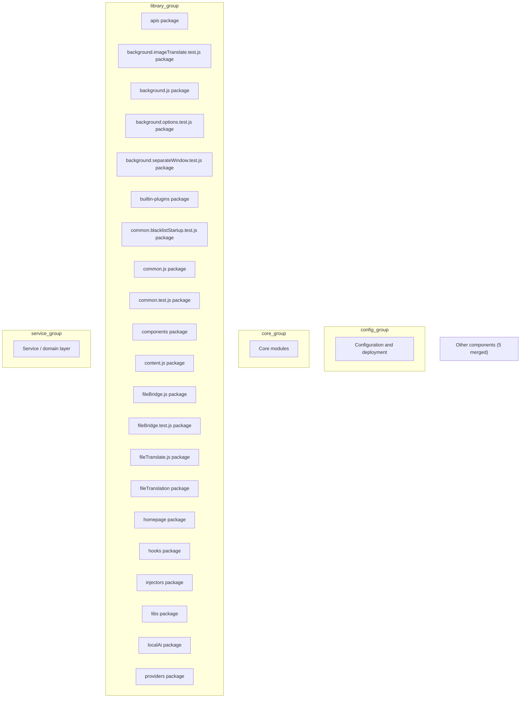

# Architecture report: fishjar/kiss-translator

> Automated static analysis. **Observed** = directly seen in files/imports/AST; **Inferred** = interpretation from that evidence. Repository code was not executed.

## 1. Repository at a glance

| Item | Value |
| --- | --- |
| Repository | fishjar/kiss-translator |
| Description | A simple, open source bilingual translation extension & Greasemonkey script (一个简约、开源的 双语对照翻译扩展 & 油猴脚本) |
| Language | JavaScript |
| Stars | 13337 |
| Licence | GPL-3.0 |
| Analysed commit / branch | 9dba2e86d524a8ec85f56bc08ef645a555707bdc / dev |
| Framework(s) | React |
| Files analysed | 799 |
| Components | 29 |

## 2. Architecture in one minute

fishjar/kiss-translator - A simple, open source bilingual translation extension & Greasemonkey script (一个简约、开源的 双语对照翻译扩展 & 油猴脚本). This repository was analysed statically from 799 file(s) (0 Python). Detected technologies (observed from imports/manifests): GitHub Actions, React, React Router, TypeScript, Vite, Vitest. Files are grouped into 29 component(s): apis package, background.imageTranslate.test.js package, background.js package, background.options.test.js package, background.separateWindow.test.js package, builtin-plugins package, common.blacklistStartup.test.js package, common.js package. Findings below distinguish observed facts from inferred interpretation.

## 3. High-level block diagram

## 4. Main components

### apis package (`apis`)

- **Kind:** library
- **Status:** Observed
- **Confidence:** 0.85
- **Responsibility:** Groups 26 file(s) under apis package (observed from repository paths and static analysis).
- **Paths:** `src/apis/baidu.js`, `src/apis/deepl.js`, `src/apis/deepl.test.js`, `src/apis/history.js`, `src/apis/history.test.js`, `src/apis/index.batchCancellation.test.js`, `src/apis/index.dictCache.test.js`, `src/apis/index.js`, `src/apis/index.openaiXml.test.js`, `src/apis/index.test.js`, `src/apis/opencode.js`, `src/apis/trans.batchLine.test.js`, `src/apis/trans.deepl.test.js`, `src/apis/trans.dict.test.js`, `src/apis/trans.explicitPrompts.test.js`, `src/apis/trans.js`, `src/apis/trans.localai.test.js`, `src/apis/trans.opencode.test.js`, `src/apis/trans.orcarouter.test.js`, `src/apis/trans.poolCancellation.test.js`, `src/apis/trans.requesty.test.js`, `src/apis/trans.subtitle.test.js`, `src/apis/trans.translate.test.js`, `src/apis/vision.js`, `src/apis/vision.test.js`, `src/apis/zdic.js`
- **Evidence:** [src/apis/baidu.js](https://github.com/fishjar/kiss-translator/blob/9dba2e86d524a8ec85f56bc08ef645a555707bdc/src/apis/baidu.js); [src/apis/deepl.js](https://github.com/fishjar/kiss-translator/blob/9dba2e86d524a8ec85f56bc08ef645a555707bdc/src/apis/deepl.js); [src/apis/deepl.test.js](https://github.com/fishjar/kiss-translator/blob/9dba2e86d524a8ec85f56bc08ef645a555707bdc/src/apis/deepl.test.js); [src/apis/history.js](https://github.com/fishjar/kiss-translator/blob/9dba2e86d524a8ec85f56bc08ef645a555707bdc/src/apis/history.js); [src/apis/history.test.js](https://github.com/fishjar/kiss-translator/blob/9dba2e86d524a8ec85f56bc08ef645a555707bdc/src/apis/history.test.js); [src/apis/index.batchCancellation.test.js](https://github.com/fishjar/kiss-translator/blob/9dba2e86d524a8ec85f56bc08ef645a555707bdc/src/apis/index.batchCancellation.test.js); [src/apis/index.dictCache.test.js](https://github.com/fishjar/kiss-translator/blob/9dba2e86d524a8ec85f56bc08ef645a555707bdc/src/apis/index.dictCache.test.js); [src/apis/index.js](https://github.com/fishjar/kiss-translator/blob/9dba2e86d524a8ec85f56bc08ef645a555707bdc/src/apis/index.js)

### background.imageTranslate.test.js package (`background_imagetranslate_test_js`)

- **Kind:** library
- **Status:** Observed
- **Confidence:** 0.85
- **Responsibility:** Groups 1 file(s) under background.imagetranslate.test.js package (observed from repository paths and static analysis).
- **Paths:** `src/background.imageTranslate.test.js`
- **Evidence:** [src/background.imageTranslate.test.js](https://github.com/fishjar/kiss-translator/blob/9dba2e86d524a8ec85f56bc08ef645a555707bdc/src/background.imageTranslate.test.js)

### background.js package (`background_js`)

- **Kind:** library
- **Status:** Observed
- **Confidence:** 0.85
- **Responsibility:** Groups 1 file(s) under background.js package (observed from repository paths and static analysis).
- **Paths:** `src/background.js`
- **Evidence:** [src/background.js](https://github.com/fishjar/kiss-translator/blob/9dba2e86d524a8ec85f56bc08ef645a555707bdc/src/background.js)

### background.options.test.js package (`background_options_test_js`)

- **Kind:** library
- **Status:** Observed
- **Confidence:** 0.85
- **Responsibility:** Groups 1 file(s) under background.options.test.js package (observed from repository paths and static analysis).
- **Paths:** `src/background.options.test.js`
- **Evidence:** [src/background.options.test.js](https://github.com/fishjar/kiss-translator/blob/9dba2e86d524a8ec85f56bc08ef645a555707bdc/src/background.options.test.js)

### background.separateWindow.test.js package (`background_separatewindow_test_js`)

- **Kind:** library
- **Status:** Observed
- **Confidence:** 0.85
- **Responsibility:** Groups 1 file(s) under background.separatewindow.test.js package (observed from repository paths and static analysis).
- **Paths:** `src/background.separateWindow.test.js`
- **Evidence:** [src/background.separateWindow.test.js](https://github.com/fishjar/kiss-translator/blob/9dba2e86d524a8ec85f56bc08ef645a555707bdc/src/background.separateWindow.test.js)

### builtin-plugins package (`builtin_plugins`)

- **Kind:** library
- **Status:** Observed
- **Confidence:** 0.85
- **Responsibility:** Groups 50 file(s) under builtin-plugins package (observed from repository paths and static analysis).
- **Paths:** `src/builtin-plugins/baidu.js`, `src/builtin-plugins/capabilities.js`, `src/builtin-plugins/capabilities.test.js`, `src/builtin-plugins/chat.js`, `src/builtin-plugins/chat.test.js`, `src/builtin-plugins/claude.js`, `src/builtin-plugins/cloudflare.js`, `src/builtin-plugins/credentials.js`, `src/builtin-plugins/deepl-free.js`, `src/builtin-plugins/deepl.js`, `src/builtin-plugins/definitions.js`, `src/builtin-plugins/discovery.js`, `src/builtin-plugins/emptyMessages.test.js`, `src/builtin-plugins/fields.js`, `src/builtin-plugins/fields.test.js`, `src/builtin-plugins/gemini.js`, `src/builtin-plugins/google.js`, `src/builtin-plugins/index.js`, `src/builtin-plugins/languageMappings.js`, `src/builtin-plugins/local-asr-runtime.js`, `src/builtin-plugins/local-asr-runtime.test.js`, `src/builtin-plugins/local.js`, `src/builtin-plugins/local.test.js`, `src/builtin-plugins/messages.js`, `src/builtin-plugins/microsoft.js`, `src/builtin-plugins/modelThinking.test.js`, `src/builtin-plugins/ollama.js`, `src/builtin-plugins/openai-compat.js`, `src/builtin-plugins/openai.js`, `src/builtin-plugins/presets.js`, `src/builtin-plugins/presets.test.js`, `src/builtin-plugins/qwen-mt.js`, `src/builtin-plugins/requests.js`, `src/builtin-plugins/responses.js`, `src/builtin-plugins/routers.js`, `src/builtin-plugins/runtime.js`, `src/builtin-plugins/runtime.test.js`, `src/builtin-plugins/scenes.test.js`, `src/builtin-plugins/speech-runtime.js`, `src/builtin-plugins/speech-runtime.test.js`, `src/builtin-plugins/streamResponses.js`, `src/builtin-plugins/system-speech.js`, `src/builtin-plugins/system-speech.test.js`, `src/builtin-plugins/tencent.js`, `src/builtin-plugins/textResponses.js`, `src/builtin-plugins/textResponses.test.js`, `src/builtin-plugins/thinking.js`, `src/builtin-plugins/thinkingCapabilities.js`, `src/builtin-plugins/volcengine.js`, `src/builtin-plugins/yandex.js`
- **Evidence:** [src/builtin-plugins/baidu.js](https://github.com/fishjar/kiss-translator/blob/9dba2e86d524a8ec85f56bc08ef645a555707bdc/src/builtin-plugins/baidu.js); [src/builtin-plugins/capabilities.js](https://github.com/fishjar/kiss-translator/blob/9dba2e86d524a8ec85f56bc08ef645a555707bdc/src/builtin-plugins/capabilities.js); [src/builtin-plugins/capabilities.test.js](https://github.com/fishjar/kiss-translator/blob/9dba2e86d524a8ec85f56bc08ef645a555707bdc/src/builtin-plugins/capabilities.test.js); [src/builtin-plugins/chat.js](https://github.com/fishjar/kiss-translator/blob/9dba2e86d524a8ec85f56bc08ef645a555707bdc/src/builtin-plugins/chat.js); [src/builtin-plugins/chat.test.js](https://github.com/fishjar/kiss-translator/blob/9dba2e86d524a8ec85f56bc08ef645a555707bdc/src/builtin-plugins/chat.test.js); [src/builtin-plugins/claude.js](https://github.com/fishjar/kiss-translator/blob/9dba2e86d524a8ec85f56bc08ef645a555707bdc/src/builtin-plugins/claude.js); [src/builtin-plugins/cloudflare.js](https://github.com/fishjar/kiss-translator/blob/9dba2e86d524a8ec85f56bc08ef645a555707bdc/src/builtin-plugins/cloudflare.js); [src/builtin-plugins/credentials.js](https://github.com/fishjar/kiss-translator/blob/9dba2e86d524a8ec85f56bc08ef645a555707bdc/src/builtin-plugins/credentials.js)

### common.blacklistStartup.test.js package (`common_blackliststartup_test_js`)

- **Kind:** library
- **Status:** Observed
- **Confidence:** 0.85
- **Responsibility:** Groups 1 file(s) under common.blackliststartup.test.js package (observed from repository paths and static analysis).
- **Paths:** `src/common.blacklistStartup.test.js`
- **Evidence:** [src/common.blacklistStartup.test.js](https://github.com/fishjar/kiss-translator/blob/9dba2e86d524a8ec85f56bc08ef645a555707bdc/src/common.blacklistStartup.test.js)

### common.js package (`common_js`)

- **Kind:** library
- **Status:** Observed
- **Confidence:** 0.85
- **Responsibility:** Groups 1 file(s) under common.js package (observed from repository paths and static analysis).
- **Paths:** `src/common.js`
- **Evidence:** [src/common.js](https://github.com/fishjar/kiss-translator/blob/9dba2e86d524a8ec85f56bc08ef645a555707bdc/src/common.js)

### common.test.js package (`common_test_js`)

- **Kind:** library
- **Status:** Observed
- **Confidence:** 0.85
- **Responsibility:** Groups 1 file(s) under common.test.js package (observed from repository paths and static analysis).
- **Paths:** `src/common.test.js`
- **Evidence:** [src/common.test.js](https://github.com/fishjar/kiss-translator/blob/9dba2e86d524a8ec85f56bc08ef645a555707bdc/src/common.test.js)

### components package (`components`)

- **Kind:** library
- **Status:** Observed
- **Confidence:** 0.85
- **Responsibility:** Groups 23 file(s) under components package (observed from repository paths and static analysis).
- **Paths:** `src/components/ApiProviderIcon.js`, `src/components/ApiProviderIcon.test.js`, `src/components/ExtensionLocalServiceNotice.js`, `src/components/FloatingButton.js`, `src/components/FloatingButton.styles.js`, `src/components/LocalServiceNotice.js`, `src/components/LocalServiceNotice.test.js`, `src/components/Logo/icon.base64.js`, `src/components/Logo/index.js`, `src/components/TerminologySelect.js`, `src/components/TextareaResizeGrip.js`, `src/components/TextareaResizeGrip.test.js`, `src/components/TouchTranslateControl.js`, `src/components/TouchTranslateControl.test.js`, `src/components/TranslationPanel/Content.js`, `src/components/TranslationPanel/DictionaryPanels.js`, `src/components/TranslationPanel/DictionaryPanels.test.js`, `src/components/TranslationPanel/Header.js`, `src/components/TranslationPanel/Header.test.js`, `src/components/TranslationPanel/Surface.js`, `src/components/TranslationPanel/interactions.test.js`, `src/components/TranslationPanel/sourceSpeech.test.js`, `src/components/TranslationPanel/styles.js`
- **Evidence:** [src/components/ApiProviderIcon.js](https://github.com/fishjar/kiss-translator/blob/9dba2e86d524a8ec85f56bc08ef645a555707bdc/src/components/ApiProviderIcon.js); [src/components/ApiProviderIcon.test.js](https://github.com/fishjar/kiss-translator/blob/9dba2e86d524a8ec85f56bc08ef645a555707bdc/src/components/ApiProviderIcon.test.js); [src/components/ExtensionLocalServiceNotice.js](https://github.com/fishjar/kiss-translator/blob/9dba2e86d524a8ec85f56bc08ef645a555707bdc/src/components/ExtensionLocalServiceNotice.js); [src/components/FloatingButton.js](https://github.com/fishjar/kiss-translator/blob/9dba2e86d524a8ec85f56bc08ef645a555707bdc/src/components/FloatingButton.js); [src/components/FloatingButton.styles.js](https://github.com/fishjar/kiss-translator/blob/9dba2e86d524a8ec85f56bc08ef645a555707bdc/src/components/FloatingButton.styles.js); [src/components/LocalServiceNotice.js](https://github.com/fishjar/kiss-translator/blob/9dba2e86d524a8ec85f56bc08ef645a555707bdc/src/components/LocalServiceNotice.js); [src/components/LocalServiceNotice.test.js](https://github.com/fishjar/kiss-translator/blob/9dba2e86d524a8ec85f56bc08ef645a555707bdc/src/components/LocalServiceNotice.test.js); [src/components/Logo/icon.base64.js](https://github.com/fishjar/kiss-translator/blob/9dba2e86d524a8ec85f56bc08ef645a555707bdc/src/components/Logo/icon.base64.js)

### Configuration and deployment (`config`)

- **Kind:** config
- **Status:** Observed
- **Confidence:** 0.85
- **Responsibility:** Groups 74 file(s) under configuration and deployment (observed from repository paths and static analysis).
- **Paths:** `package.json`, `pnpm-workspace.yaml`, `public/_locales/de/messages.json`, `public/_locales/en/messages.json`, `public/_locales/es/messages.json`, `public/_locales/fr/messages.json`, `public/_locales/ja/messages.json`, `public/_locales/ko/messages.json`, `public/_locales/ru/messages.json`, `public/_locales/tr/messages.json`, `public/_locales/vi/messages.json`, `public/_locales/zh_CN/messages.json`, `public/_locales/zh_TW/messages.json`, `public/manifest.firefox.json`, `public/manifest.json`, `public/manifest.thunderbird.json`, `src/builtin-plugins/fixtures/native-preset-baseline.json`, `src/builtin-plugins/fixtures/native-response-fixtures.json`, `src/config/api.js`, `src/config/api.test.js`, `src/config/apiConstants.js`, `src/config/app.js`, `src/config/client.js`, `src/config/defaultServices.js`, `src/config/defaultServices.test.js`, `src/config/fab.js`, `src/config/fileTranslationSites.json`, `src/config/i18n.popup.js`, `src/config/i18n.ru.js`, `src/config/i18n.ruleEditor.js`, `src/config/i18n.test.js`, `src/config/i18n.touch.js`, `src/config/index.js`, `src/config/localModelTasks.json`, `src/config/localModelTasks.test.js`, `src/config/locales/asr.js`, `src/config/locales/customApiHelp.js`, `src/config/locales/diagnostics.js`, `src/config/locales/fileTranslate.js`, `src/config/locales/imageTranslate.js`, `src/config/locales/localAi.js`, `src/config/locales/providerPlugins.js`, `src/config/locales/settings.js`, `src/config/locales/subtitlePlayground.js`, `src/config/locales/terminology.js`, `src/config/locales/terminology.test.js`, `src/config/locales/terminologyPlayground.js`, `src/config/locales/youtubeCaptions.js`, `src/config/msg.js`, `src/config/prompt.js`, `src/config/prompt.test.js`, `src/config/quotes.js`, `src/config/rules.js`, `src/config/serviceSelection.js`, `src/config/serviceSelection.test.js`, `src/config/setting.js`, `src/config/setting.test.js`, `src/config/storage.js`, `src/config/styles.js`, `src/config/textareaGripStyles.js`, `src/config/tranboxFont.js`, `src/config/tranboxFont.test.js`, `src/config/tranbtn.js`, `src/config/tranbtn.test.js`, `src/config/url.js`, `src/localAi/core/__tests__/fixtures/pdfNativeAbsoluteFormulas.json`, `src/localAi/core/__tests__/fixtures/pdfNativeDisplayFormulas.json`, `src/localAi/core/__tests__/fixtures/pdfNativeFormulaText.json`, `src/localAi/core/__tests__/fixtures/pdfNativeParagraph.json`, `src/localAi/core/__tests__/fixtures/pdfNavierEquationLayout.json`, `src/localAi/core/__tests__/fixtures/pdfNavierLayout.json`, `src/providers/sdk/defaultTextTaskPrompts.json`, `src/providers/sdk/defaultTranslationPrompts.json`, `src/providers/sdk/translationProtocolPrompts.json`
- **Evidence:** [package.json](https://github.com/fishjar/kiss-translator/blob/9dba2e86d524a8ec85f56bc08ef645a555707bdc/package.json); [pnpm-workspace.yaml](https://github.com/fishjar/kiss-translator/blob/9dba2e86d524a8ec85f56bc08ef645a555707bdc/pnpm-workspace.yaml); [public/_locales/de/messages.json](https://github.com/fishjar/kiss-translator/blob/9dba2e86d524a8ec85f56bc08ef645a555707bdc/public/_locales/de/messages.json); [public/_locales/en/messages.json](https://github.com/fishjar/kiss-translator/blob/9dba2e86d524a8ec85f56bc08ef645a555707bdc/public/_locales/en/messages.json); [public/_locales/es/messages.json](https://github.com/fishjar/kiss-translator/blob/9dba2e86d524a8ec85f56bc08ef645a555707bdc/public/_locales/es/messages.json); [public/_locales/fr/messages.json](https://github.com/fishjar/kiss-translator/blob/9dba2e86d524a8ec85f56bc08ef645a555707bdc/public/_locales/fr/messages.json); [public/_locales/ja/messages.json](https://github.com/fishjar/kiss-translator/blob/9dba2e86d524a8ec85f56bc08ef645a555707bdc/public/_locales/ja/messages.json); [public/_locales/ko/messages.json](https://github.com/fishjar/kiss-translator/blob/9dba2e86d524a8ec85f56bc08ef645a555707bdc/public/_locales/ko/messages.json)

### content.js package (`content_js`)

- **Kind:** library
- **Status:** Observed
- **Confidence:** 0.85
- **Responsibility:** Groups 1 file(s) under content.js package (observed from repository paths and static analysis).
- **Paths:** `src/content.js`
- **Evidence:** [src/content.js](https://github.com/fishjar/kiss-translator/blob/9dba2e86d524a8ec85f56bc08ef645a555707bdc/src/content.js)

### Core modules (`core`)

- **Kind:** core
- **Status:** Observed
- **Confidence:** 0.85
- **Responsibility:** Groups 1 file(s) under core modules (observed from repository paths and static analysis).
- **Paths:** `config-overrides.js`
- **Evidence:** [config-overrides.js](https://github.com/fishjar/kiss-translator/blob/9dba2e86d524a8ec85f56bc08ef645a555707bdc/config-overrides.js)

### fileBridge.js package (`filebridge_js`)

- **Kind:** library
- **Status:** Observed
- **Confidence:** 0.85
- **Responsibility:** Groups 1 file(s) under filebridge.js package (observed from repository paths and static analysis).
- **Paths:** `src/fileBridge.js`
- **Evidence:** [src/fileBridge.js](https://github.com/fishjar/kiss-translator/blob/9dba2e86d524a8ec85f56bc08ef645a555707bdc/src/fileBridge.js)

### fileBridge.test.js package (`filebridge_test_js`)

- **Kind:** library
- **Status:** Observed
- **Confidence:** 0.85
- **Responsibility:** Groups 1 file(s) under filebridge.test.js package (observed from repository paths and static analysis).
- **Paths:** `src/fileBridge.test.js`
- **Evidence:** [src/fileBridge.test.js](https://github.com/fishjar/kiss-translator/blob/9dba2e86d524a8ec85f56bc08ef645a555707bdc/src/fileBridge.test.js)

### fileTranslate.js package (`filetranslate_js`)

- **Kind:** library
- **Status:** Observed
- **Confidence:** 0.85
- **Responsibility:** Groups 1 file(s) under filetranslate.js package (observed from repository paths and static analysis).
- **Paths:** `src/fileTranslate.js`
- **Evidence:** [src/fileTranslate.js](https://github.com/fishjar/kiss-translator/blob/9dba2e86d524a8ec85f56bc08ef645a555707bdc/src/fileTranslate.js)

### fileTranslation package (`filetranslation`)

- **Kind:** library
- **Status:** Observed
- **Confidence:** 0.85
- **Responsibility:** Groups 16 file(s) under filetranslation package (observed from repository paths and static analysis).
- **Paths:** `src/fileTranslation/backend.js`, `src/fileTranslation/backend.test.js`, `src/fileTranslation/bridgeRecovery.js`, `src/fileTranslation/bridgeRecovery.test.js`, `src/fileTranslation/client.js`, `src/fileTranslation/client.test.js`, `src/fileTranslation/imageLayout.js`, `src/fileTranslation/imageLayout.test.js`, `src/fileTranslation/onlineFile.js`, `src/fileTranslation/pipelineCore.js`, `src/fileTranslation/pipelineCore.test.js`, `src/fileTranslation/pluginTranslation.integration.test.js`, `src/fileTranslation/protocol.js`, `src/fileTranslation/recognition.js`, `src/fileTranslation/recognition.test.js`, `src/fileTranslation/resultCache.js`
- **Evidence:** [src/fileTranslation/backend.js](https://github.com/fishjar/kiss-translator/blob/9dba2e86d524a8ec85f56bc08ef645a555707bdc/src/fileTranslation/backend.js); [src/fileTranslation/backend.test.js](https://github.com/fishjar/kiss-translator/blob/9dba2e86d524a8ec85f56bc08ef645a555707bdc/src/fileTranslation/backend.test.js); [src/fileTranslation/bridgeRecovery.js](https://github.com/fishjar/kiss-translator/blob/9dba2e86d524a8ec85f56bc08ef645a555707bdc/src/fileTranslation/bridgeRecovery.js); [src/fileTranslation/bridgeRecovery.test.js](https://github.com/fishjar/kiss-translator/blob/9dba2e86d524a8ec85f56bc08ef645a555707bdc/src/fileTranslation/bridgeRecovery.test.js); [src/fileTranslation/client.js](https://github.com/fishjar/kiss-translator/blob/9dba2e86d524a8ec85f56bc08ef645a555707bdc/src/fileTranslation/client.js); [src/fileTranslation/client.test.js](https://github.com/fishjar/kiss-translator/blob/9dba2e86d524a8ec85f56bc08ef645a555707bdc/src/fileTranslation/client.test.js); [src/fileTranslation/imageLayout.js](https://github.com/fishjar/kiss-translator/blob/9dba2e86d524a8ec85f56bc08ef645a555707bdc/src/fileTranslation/imageLayout.js); [src/fileTranslation/imageLayout.test.js](https://github.com/fishjar/kiss-translator/blob/9dba2e86d524a8ec85f56bc08ef645a555707bdc/src/fileTranslation/imageLayout.test.js)

### homepage package (`homepage`)

- **Kind:** library
- **Status:** Observed
- **Confidence:** 0.85
- **Responsibility:** Groups 6 file(s) under homepage package (observed from repository paths and static analysis).
- **Paths:** `src/homepage/App.js`, `src/homepage/App.test.js`, `src/homepage/content.js`, `src/homepage/content.test.js`, `src/homepage/theme.js`, `src/homepage/useHomepageSettings.js`
- **Evidence:** [src/homepage/App.js](https://github.com/fishjar/kiss-translator/blob/9dba2e86d524a8ec85f56bc08ef645a555707bdc/src/homepage/App.js); [src/homepage/App.test.js](https://github.com/fishjar/kiss-translator/blob/9dba2e86d524a8ec85f56bc08ef645a555707bdc/src/homepage/App.test.js); [src/homepage/content.js](https://github.com/fishjar/kiss-translator/blob/9dba2e86d524a8ec85f56bc08ef645a555707bdc/src/homepage/content.js); [src/homepage/content.test.js](https://github.com/fishjar/kiss-translator/blob/9dba2e86d524a8ec85f56bc08ef645a555707bdc/src/homepage/content.test.js); [src/homepage/theme.js](https://github.com/fishjar/kiss-translator/blob/9dba2e86d524a8ec85f56bc08ef645a555707bdc/src/homepage/theme.js); [src/homepage/useHomepageSettings.js](https://github.com/fishjar/kiss-translator/blob/9dba2e86d524a8ec85f56bc08ef645a555707bdc/src/homepage/useHomepageSettings.js)

### hooks package (`hooks`)

- **Kind:** library
- **Status:** Observed
- **Confidence:** 0.85
- **Responsibility:** Groups 70 file(s) under hooks package (observed from repository paths and static analysis).
- **Paths:** `src/hooks/Alert.js`, `src/hooks/Alert.test.js`, `src/hooks/Api.js`, `src/hooks/Api.test.js`, `src/hooks/Audio.js`, `src/hooks/ColorMode.js`, `src/hooks/Commands.js`, `src/hooks/Commands.test.js`, `src/hooks/Confirm.js`, `src/hooks/CustomStyles.js`, `src/hooks/CustomStyles.test.js`, `src/hooks/DebouncedCallback.js`, `src/hooks/Fab.js`, `src/hooks/FavWords.js`, `src/hooks/FavWords.reducers.test.js`, `src/hooks/Fetch.js`, `src/hooks/Fetch.test.js`, `src/hooks/I18n.js`, `src/hooks/I18n.test.js`, `src/hooks/InputRule.js`, `src/hooks/Loading.js`, `src/hooks/M2Theme.js`, `src/hooks/M2Theme.test.js`, `src/hooks/M3Theme.js`, `src/hooks/M3Theme.test.js`, `src/hooks/MediaQuery.js`, `src/hooks/MediaQuery.test.js`, `src/hooks/MouseHover.js`, `src/hooks/Prompt.js`, `src/hooks/ProviderI18n.js`, `src/hooks/ProviderPackages.js`, `src/hooks/Rules.js`, `src/hooks/SeparateWindowBounds.js`, `src/hooks/SeparateWindowBounds.test.js`, `src/hooks/Setting.js`, `src/hooks/Setting.migration.acceptance.test.js`, `src/hooks/Setting.persistence.test.js`, `src/hooks/Shortcut.js`, `src/hooks/Storage.js`, `src/hooks/Storage.lifecycle.test.js`, `src/hooks/Storage.test.js`, `src/hooks/SubRules.js`, `src/hooks/SubRules.test.js`, `src/hooks/Subtitle.js`, `src/hooks/Sync.js`, `src/hooks/Sync.regression.test.js`, `src/hooks/Sync.test.js`, `src/hooks/SyncLegacyMigration.acceptance.test.js`, `src/hooks/SyncRevision.acceptance.test.js`, `src/hooks/SyncRollbackSerialization.acceptance.test.js`, `src/hooks/SystemColorScheme.js`, `src/hooks/Terminology.js`, `src/hooks/Theme.js`, `src/hooks/Tranbox.js`, `src/hooks/ValidationInput.js`, `src/hooks/ValidationInput.test.js`, `src/hooks/WindowSize.js`, `src/hooks/themeStyles.js`, `src/hooks/themeStyles.test.js`, `src/hooks/useAutoHideTranBtn.js`, `src/hooks/useFullscreenDetect.js`, `src/hooks/useSelectionController.js`, `src/hooks/useSelectionController.test.js`, `src/hooks/useTextareaHeightLock.js`, `src/hooks/useTextareaHeightLock.test.js`, `src/hooks/useTranBoxState.js`, `src/hooks/useTranBoxState.test.js`, `src/hooks/useTranboxFocus.js`, `src/hooks/useTranboxShortcuts.js`, `src/hooks/useTranboxShortcuts.test.js`
- **Evidence:** [src/hooks/Alert.js](https://github.com/fishjar/kiss-translator/blob/9dba2e86d524a8ec85f56bc08ef645a555707bdc/src/hooks/Alert.js); [src/hooks/Alert.test.js](https://github.com/fishjar/kiss-translator/blob/9dba2e86d524a8ec85f56bc08ef645a555707bdc/src/hooks/Alert.test.js); [src/hooks/Api.js](https://github.com/fishjar/kiss-translator/blob/9dba2e86d524a8ec85f56bc08ef645a555707bdc/src/hooks/Api.js); [src/hooks/Api.test.js](https://github.com/fishjar/kiss-translator/blob/9dba2e86d524a8ec85f56bc08ef645a555707bdc/src/hooks/Api.test.js); [src/hooks/Audio.js](https://github.com/fishjar/kiss-translator/blob/9dba2e86d524a8ec85f56bc08ef645a555707bdc/src/hooks/Audio.js); [src/hooks/ColorMode.js](https://github.com/fishjar/kiss-translator/blob/9dba2e86d524a8ec85f56bc08ef645a555707bdc/src/hooks/ColorMode.js); [src/hooks/Commands.js](https://github.com/fishjar/kiss-translator/blob/9dba2e86d524a8ec85f56bc08ef645a555707bdc/src/hooks/Commands.js); [src/hooks/Commands.test.js](https://github.com/fishjar/kiss-translator/blob/9dba2e86d524a8ec85f56bc08ef645a555707bdc/src/hooks/Commands.test.js)

### index.js package (`index_js`)

- **Kind:** library
- **Status:** Observed
- **Confidence:** 0.85
- **Responsibility:** Groups 1 file(s) under index.js package (observed from repository paths and static analysis).
- **Paths:** `src/index.js`
- **Evidence:** [src/index.js](https://github.com/fishjar/kiss-translator/blob/9dba2e86d524a8ec85f56bc08ef645a555707bdc/src/index.js)

### injector-shadowroot.js package (`injector_shadowroot_js`)

- **Kind:** library
- **Status:** Observed
- **Confidence:** 0.85
- **Responsibility:** Groups 1 file(s) under injector-shadowroot.js package (observed from repository paths and static analysis).
- **Paths:** `src/injector-shadowroot.js`
- **Evidence:** [src/injector-shadowroot.js](https://github.com/fishjar/kiss-translator/blob/9dba2e86d524a8ec85f56bc08ef645a555707bdc/src/injector-shadowroot.js)

### injector-subtitle.js package (`injector_subtitle_js`)

- **Kind:** library
- **Status:** Observed
- **Confidence:** 0.85
- **Responsibility:** Groups 1 file(s) under injector-subtitle.js package (observed from repository paths and static analysis).
- **Paths:** `src/injector-subtitle.js`
- **Evidence:** [src/injector-subtitle.js](https://github.com/fishjar/kiss-translator/blob/9dba2e86d524a8ec85f56bc08ef645a555707bdc/src/injector-subtitle.js)

### injectors package (`injectors`)

- **Kind:** library
- **Status:** Observed
- **Confidence:** 0.85
- **Responsibility:** Groups 7 file(s) under injectors package (observed from repository paths and static analysis).
- **Paths:** `src/injectors/index.js`, `src/injectors/shadowroot.js`, `src/injectors/xmlhttp.js`, `src/injectors/youtubeAudioBridge.js`, `src/injectors/youtubeAudioBridge.test.js`, `src/injectors/youtubeBridge.js`, `src/injectors/youtubeBridge.test.js`
- **Evidence:** [src/injectors/index.js](https://github.com/fishjar/kiss-translator/blob/9dba2e86d524a8ec85f56bc08ef645a555707bdc/src/injectors/index.js); [src/injectors/shadowroot.js](https://github.com/fishjar/kiss-translator/blob/9dba2e86d524a8ec85f56bc08ef645a555707bdc/src/injectors/shadowroot.js); [src/injectors/xmlhttp.js](https://github.com/fishjar/kiss-translator/blob/9dba2e86d524a8ec85f56bc08ef645a555707bdc/src/injectors/xmlhttp.js); [src/injectors/youtubeAudioBridge.js](https://github.com/fishjar/kiss-translator/blob/9dba2e86d524a8ec85f56bc08ef645a555707bdc/src/injectors/youtubeAudioBridge.js); [src/injectors/youtubeAudioBridge.test.js](https://github.com/fishjar/kiss-translator/blob/9dba2e86d524a8ec85f56bc08ef645a555707bdc/src/injectors/youtubeAudioBridge.test.js); [src/injectors/youtubeBridge.js](https://github.com/fishjar/kiss-translator/blob/9dba2e86d524a8ec85f56bc08ef645a555707bdc/src/injectors/youtubeBridge.js); [src/injectors/youtubeBridge.test.js](https://github.com/fishjar/kiss-translator/blob/9dba2e86d524a8ec85f56bc08ef645a555707bdc/src/injectors/youtubeBridge.test.js)

### libs package (`libs`)

- **Kind:** library
- **Status:** Observed
- **Confidence:** 0.85
- **Responsibility:** Groups 236 file(s) under libs package (observed from repository paths and static analysis).
- **Paths:** `src/libs/__fixtures__/htmlText.js`, `src/libs/aiDictionary.js`, `src/libs/aiDictionary.test.js`, `src/libs/aiResponseParser.js`, `src/libs/aiResponseParser.test.js`, `src/libs/apiSelection.js`, `src/libs/apiSelection.test.js`, `src/libs/batchQueue.cancellation.test.js`, `src/libs/batchQueue.js`, `src/libs/batchQueue.test.js`, `src/libs/blacklist.js`, `src/libs/blacklistStartup.js`, `src/libs/blacklistStartup.test.js`, `src/libs/browser.js`, `src/libs/builtinAI.js`, `src/libs/builtinAI.test.js`, `src/libs/cache.js`, `src/libs/cache.test.js`, `src/libs/cacheDigest.js`, `src/libs/cacheDigest.test.js`, `src/libs/client.js`, `src/libs/clipboard.js`, `src/libs/clipboard.test.js`, `src/libs/customElementsContainer.test.js`, `src/libs/detect.js`, `src/libs/detect.test.js`, `src/libs/detectFast.js`, `src/libs/detectFast.test.js`, `src/libs/diagnostics/background.js`, `src/libs/diagnostics/background.test.js`, `src/libs/diagnostics/export.js`, `src/libs/diagnostics/export.privacy.test.js`, `src/libs/diagnostics/export.test.js`, `src/libs/diagnostics/http.js`, `src/libs/diagnostics/http.test.js`, `src/libs/diagnostics/policy.js`, `src/libs/diagnostics/policy.test.js`, `src/libs/diagnostics/privacy.js`, `src/libs/diagnostics/privacy.test.js`, `src/libs/diagnostics/record.js`, `src/libs/diagnostics/record.test.js`, `src/libs/diagnostics/store.js`, `src/libs/diagnostics/store.test.js`, `src/libs/diagnostics/task.js`, `src/libs/diagnostics/task.test.js`, `src/libs/diagnostics/transport.browser.test.js`, `src/libs/diagnostics/transport.js`, `src/libs/diagnostics/transport.test.js`, `src/libs/docInfo.js`, `src/libs/document/assets.js`, `src/libs/document/export.js`, `src/libs/document/markdown.js`, `src/libs/domManager.js`, `src/libs/editEntrypoints.acceptance.test.js`, `src/libs/epub/epubDomHandler.js`, `src/libs/epub/epubDomHandler.test.js`, `src/libs/epub/epubPacker.js`, `src/libs/epub/epubPacker.test.js`, `src/libs/epub/epubParser.js`, `src/libs/epub/epubParser.test.js`, `src/libs/epub/fileTranslateEpub.test.js`, `src/libs/fabManager.js`, `src/libs/fabManager.test.js`, `src/libs/fabVisibility.js`, `src/libs/fabVisibility.test.js`, `src/libs/fetch.js`, `src/libs/fetch.test.js`, `src/libs/fileTranslate.js`, `src/libs/fileTranslate.test.js`, `src/libs/fileTranslationScheduling.test.js`, `src/libs/fileTranslationService.js`, `src/libs/fileTranslationService.test.js`, `src/libs/gm.js`, `src/libs/gm.storageListeners.test.js`, `src/libs/gm.test.js`, `src/libs/gmMethods.js`, `src/libs/html.js`, `src/libs/html.test.js`, `src/libs/html.worker.test.js`, `src/libs/htmlTextDecoder.js`, `src/libs/htmlTextDecoder.worker.js`, `src/libs/htmlTextTags.js`, `src/libs/iframe.js`, `src/libs/imageTranslate/downloadImage.js`, `src/libs/imageTranslate/downloadImage.test.js`, `src/libs/imageTranslate/imageHoverDetector.js`, `src/libs/imageTranslate/imageHoverDetector.test.js`, `src/libs/imageTranslate/imageReader.js`, `src/libs/imageTranslate/imageReader.test.js`, `src/libs/imageTranslate/imageSourceHighlight.js`, `src/libs/imageTranslate/imageTranslateManager.js`, `src/libs/imageTranslate/imageTranslateManager.test.js`, `src/libs/imageTranslate/screenshotOverlay.js`, `src/libs/imageTranslate/screenshotOverlay.test.js`, `src/libs/imageTranslate/screenshotSupport.js`, `src/libs/imageTranslate/screenshotSupport.test.js`, `src/libs/injector.js`, `src/libs/inputTranslate.js`, `src/libs/inputTranslate.test.js`, `src/libs/interpreter.js`, `src/libs/kissUi.js`, `src/libs/kissUi.test.js`, `src/libs/language.js`, `src/libs/language.test.js`, `src/libs/localAiBackground.js`, `src/libs/localAiBackground.test.js`, `src/libs/localAiTransport.js`, `src/libs/localAiTransport.test.js`, `src/libs/log.js`, `src/libs/log.test.js`, `src/libs/mathParse.js`, `src/libs/mathParse.test.js`, `src/libs/mathParseTables.js`, `src/libs/menuFocus.js`, `src/libs/menuFocus.test.js`, `src/libs/mobile.js`, `src/libs/modelList.js`, `src/libs/modelList.test.js`, `src/libs/msg.js`, `src/libs/msg.test.js`, `src/libs/navigation.js`, `src/libs/navigation.test.js`, `src/libs/pdf/equationNumbers.js`, `src/libs/pdf/formula.js`, `src/libs/pdf/formulaGeometry.js`, `src/libs/pdf/incremental.js`, `src/libs/pdf/nativeTables.js`, `src/libs/pdf/pdfDocument.js`, `src/libs/pdf/pdfParser.js`, `src/libs/pdf/recognition.js`, `src/libs/pdf/recognition.test.js`, `src/libs/pdf/structure-worker.js`, `src/libs/pdf/structure.js`, `src/libs/pool.js`, `src/libs/pool.provider.test.js`, `src/libs/pool.test.js`, `src/libs/popupDocument.js`, `src/libs/popupDocument.test.js`, `src/libs/popupManager.js`, `src/libs/request.cancellation.test.js`, `src/libs/request.js`, `src/libs/request.test.js`, `src/libs/requestPort.js`, `src/libs/requestStream.js`, `src/libs/requestStream.test.js`, `src/libs/response.js`, `src/libs/response.test.js`, `src/libs/ruleEditorDom.js`, `src/libs/ruleEditorManager.js`, `src/libs/ruleEditorPicker.js`, `src/libs/ruleEditorPicker.test.js`, `src/libs/ruleEditorSession.js`, `src/libs/ruleEditorSession.test.js`, `src/libs/ruleEditorStorage.js`, `src/libs/ruleEditorStorage.test.js`, `src/libs/rules.js`, `src/libs/rules.test.js`, `src/libs/selectorList.js`, `src/libs/shadowDomManager.js`, `src/libs/shadowDomManager.test.js`, `src/libs/shadowHost.js`, `src/libs/shadowHost.test.js`, `src/libs/shortcut.js`, `src/libs/shortcutLabel.js`, `src/libs/speech.js`, `src/libs/speech.test.js`, `src/libs/storage.gm-compatibility.test.js`, `src/libs/storage.gm-destination.regression.test.js`, `src/libs/storage.js`, `src/libs/storage.regression.test.js`, `src/libs/storage.test.js`, `src/libs/storageCoordination.indexedDb.test.js`, `src/libs/storageCoordination.js`, `src/libs/storageCoordination.test.js`, `src/libs/storageEquality.js`, `src/libs/storageEquality.test.js`, `src/libs/storageEvents.js`, `src/libs/storageEvents.test.js`, `src/libs/storageRefresh.js`, `src/libs/storageRefresh.test.js`, `src/libs/storageState.acceptance.test.js`, `src/libs/storageState.js`, `src/libs/storageSyncController.js`, `src/libs/storageTransactions.test.js`, `src/libs/stream.js`, `src/libs/stream.test.js`, `src/libs/stubs/empty-object.js`, `src/libs/stubs/interpreter-gm.js`, `src/libs/stubs/webdav-stub.js`, `src/libs/style.js`, `src/libs/style.test.js`, `src/libs/subRules.js`, `src/libs/subtitleIndexAlign.js`, `src/libs/subtitleIndexAlign.test.js`, `src/libs/svg.js`, `src/libs/svg.test.js`, `src/libs/sync.destination-attempt.regression.test.js`, `src/libs/sync.first-read-verification.test.js`, `src/libs/sync.gist-destination.regression.test.js`, `src/libs/sync.js`, `src/libs/sync.rules-migration.regression.test.js`, `src/libs/sync.test.js`, `src/libs/sync.webdav-cache.regression.test.js`, `src/libs/syncCrypto.js`, `src/libs/syncCrypto.test.js`, `src/libs/termTestUtils.js`, `src/libs/termTestUtils.test.js`, `src/libs/terminology.js`, `src/libs/terminology.test.js`, `src/libs/terminologyStorage.js`, `src/libs/terminologyStorage.test.js`, `src/libs/terminologySync.js`, `src/libs/terminologySync.test.js`, `src/libs/terminologyWarning.js`, `src/libs/terms.js`, `src/libs/terms.test.js`, `src/libs/touch.js`, `src/libs/touchCapability.js`, `src/libs/touchParagraph.js`, `src/libs/touchParagraph.test.js`, `src/libs/tranbox.js`, `src/libs/tranbox.test.js`, `src/libs/tranboxPosition.js`, `src/libs/tranboxPosition.test.js`, `src/libs/translationTargets.js`, `src/libs/translationTargets.test.js`, `src/libs/translationTasks.js`, `src/libs/translatorManager.js`, `src/libs/translatorManager.test.js`, `src/libs/trustedTypes.js`, `src/libs/trustedTypes.test.js`, `src/libs/url.js`, `src/libs/utils.js`, `src/libs/utils.test.js`, `src/libs/youtubeBridgeRegistration.js`, `src/libs/youtubeBridgeRegistration.test.js`
- **Evidence:** [src/libs/__fixtures__/htmlText.js](https://github.com/fishjar/kiss-translator/blob/9dba2e86d524a8ec85f56bc08ef645a555707bdc/src/libs/__fixtures__/htmlText.js); [src/libs/aiDictionary.js](https://github.com/fishjar/kiss-translator/blob/9dba2e86d524a8ec85f56bc08ef645a555707bdc/src/libs/aiDictionary.js); [src/libs/aiDictionary.test.js](https://github.com/fishjar/kiss-translator/blob/9dba2e86d524a8ec85f56bc08ef645a555707bdc/src/libs/aiDictionary.test.js); [src/libs/aiResponseParser.js](https://github.com/fishjar/kiss-translator/blob/9dba2e86d524a8ec85f56bc08ef645a555707bdc/src/libs/aiResponseParser.js); [src/libs/aiResponseParser.test.js](https://github.com/fishjar/kiss-translator/blob/9dba2e86d524a8ec85f56bc08ef645a555707bdc/src/libs/aiResponseParser.test.js); [src/libs/apiSelection.js](https://github.com/fishjar/kiss-translator/blob/9dba2e86d524a8ec85f56bc08ef645a555707bdc/src/libs/apiSelection.js); [src/libs/apiSelection.test.js](https://github.com/fishjar/kiss-translator/blob/9dba2e86d524a8ec85f56bc08ef645a555707bdc/src/libs/apiSelection.test.js); [src/libs/batchQueue.cancellation.test.js](https://github.com/fishjar/kiss-translator/blob/9dba2e86d524a8ec85f56bc08ef645a555707bdc/src/libs/batchQueue.cancellation.test.js)

### localAi package (`localai`)

- **Kind:** library
- **Status:** Observed
- **Confidence:** 0.85
- **Responsibility:** Groups 23 file(s) under localai package (observed from repository paths and static analysis).
- **Paths:** `src/localAi/fileOperations.ts`, `src/localAi/offscreen.ts`, `src/localAi/paddleBuild.ts`, `src/localAi/patchOpencvCsp.ts`, `src/localAi/runtime/rpc.ts`, `src/localAi/runtime/runtimeHostAdapter.ts`, `src/localAi/runtime/runtimeManager.ts`, `src/localAi/runtime/runtimeManager.webpack.js`, `src/localAi/runtime/runtimePool.ts`, `src/localAi/runtime/taskScheduler.ts`, `src/localAi/runtime/workerUrls.ts`, `src/localAi/serviceModelOptions.test.ts`, `src/localAi/stubs/opencv-stub.ts`, `src/localAi/types/fs-access.d.ts`, `src/localAi/types/vite-assets.d.ts`, `src/localAi/workers/asr-worker.ts`, `src/localAi/workers/doc-worker.ts`, `src/localAi/workers/jev-worker.ts`, `src/localAi/workers/llm-onnx-worker.ts`, `src/localAi/workers/llm-worker.ts`, `src/localAi/workers/ortAssets.ts`, `src/localAi/workers/ortOpfsBridge.ts`, `src/localAi/workers/tts-worker.ts`
- **Evidence:** [src/localAi/fileOperations.ts](https://github.com/fishjar/kiss-translator/blob/9dba2e86d524a8ec85f56bc08ef645a555707bdc/src/localAi/fileOperations.ts); [src/localAi/offscreen.ts](https://github.com/fishjar/kiss-translator/blob/9dba2e86d524a8ec85f56bc08ef645a555707bdc/src/localAi/offscreen.ts); [src/localAi/paddleBuild.ts](https://github.com/fishjar/kiss-translator/blob/9dba2e86d524a8ec85f56bc08ef645a555707bdc/src/localAi/paddleBuild.ts); [src/localAi/patchOpencvCsp.ts](https://github.com/fishjar/kiss-translator/blob/9dba2e86d524a8ec85f56bc08ef645a555707bdc/src/localAi/patchOpencvCsp.ts); [src/localAi/runtime/rpc.ts](https://github.com/fishjar/kiss-translator/blob/9dba2e86d524a8ec85f56bc08ef645a555707bdc/src/localAi/runtime/rpc.ts); [src/localAi/runtime/runtimeHostAdapter.ts](https://github.com/fishjar/kiss-translator/blob/9dba2e86d524a8ec85f56bc08ef645a555707bdc/src/localAi/runtime/runtimeHostAdapter.ts); [src/localAi/runtime/runtimeManager.ts](https://github.com/fishjar/kiss-translator/blob/9dba2e86d524a8ec85f56bc08ef645a555707bdc/src/localAi/runtime/runtimeManager.ts); [src/localAi/runtime/runtimeManager.webpack.js](https://github.com/fishjar/kiss-translator/blob/9dba2e86d524a8ec85f56bc08ef645a555707bdc/src/localAi/runtime/runtimeManager.webpack.js)

### options.js package (`options_js`)

- **Kind:** library
- **Status:** Observed
- **Confidence:** 0.85
- **Responsibility:** Groups 1 file(s) under options.js package (observed from repository paths and static analysis).
- **Paths:** `src/options.js`
- **Evidence:** [src/options.js](https://github.com/fishjar/kiss-translator/blob/9dba2e86d524a8ec85f56bc08ef645a555707bdc/src/options.js)

### popup.js package (`popup_js`)

- **Kind:** library
- **Status:** Observed
- **Confidence:** 0.85
- **Responsibility:** Groups 1 file(s) under popup.js package (observed from repository paths and static analysis).
- **Paths:** `src/popup.js`
- **Evidence:** [src/popup.js](https://github.com/fishjar/kiss-translator/blob/9dba2e86d524a8ec85f56bc08ef645a555707bdc/src/popup.js)

### providers package (`providers`)

- **Kind:** library
- **Status:** Observed
- **Confidence:** 0.85
- **Responsibility:** Groups 101 file(s) under providers package (observed from repository paths and static analysis).
- **Paths:** `src/providers/asrLimits.js`, `src/providers/asrWords.js`, `src/providers/asrWords.test.js`, `src/providers/assetPackets.js`, `src/providers/assetPackets.test.js`, `src/providers/audioAsset.js`, `src/providers/audioAsset.test.js`, `src/providers/audioTransport.test.js`, `src/providers/background.js`, `src/providers/background.test.js`, `src/providers/backgroundInvocation.js`, `src/providers/backgroundInvocation.test.js`, `src/providers/bridge.js`, `src/providers/bridgeInvocation.js`, `src/providers/cache.js`, `src/providers/cache.test.js`, `src/providers/capabilities.js`, `src/providers/capabilityLabels.js`, `src/providers/compatibility.js`, `src/providers/compatibility.test.js`, `src/providers/contracts.ts`, `src/providers/declarative.js`, `src/providers/declarative.test.js`, `src/providers/declarativeIntegration.test.js`, `src/providers/declarativeRules.js`, `src/providers/defaultPrompts.js`, `src/providers/defaultPrompts.test.js`, `src/providers/enabledCapabilities.test.js`, `src/providers/fallback.test.js`, `src/providers/features.js`, `src/providers/host.js`, `src/providers/host.test.js`, `src/providers/hostLease.js`, `src/providers/hostLease.test.js`, `src/providers/instances.js`, `src/providers/invocation.diagnostics.test.js`, `src/providers/invocation.js`, `src/providers/invocation.test.js`, `src/providers/legacyHooks.js`, `src/providers/legacyHooks.test.js`, `src/providers/lifecycle.js`, `src/providers/localAsrRouting.js`, `src/providers/localization.js`, `src/providers/localization.test.js`, `src/providers/models.test.js`, `src/providers/package.js`, `src/providers/package.test.js`, `src/providers/packageCatalog.js`, `src/providers/packageDirectory.test.js`, `src/providers/packageDownload.test.js`, `src/providers/packageFingerprint.js`, `src/providers/packageNetwork.js`, `src/providers/packageNetwork.test.js`, `src/providers/packageSource.js`, `src/providers/packageSource.test.js`, `src/providers/packageStore.js`, `src/providers/pluginDirectory.js`, `src/providers/pluginDirectory.test.js`, `src/providers/prompt.test.js`, `src/providers/protocolCapabilities.js`, `src/providers/protocolCapabilities.test.js`, `src/providers/providers.test.js`, `src/providers/registry.js`, `src/providers/resources.js`, `src/providers/resources.test.js`, `src/providers/runtime.js`, `src/providers/savedService.js`, `src/providers/savedService.test.js`, `src/providers/sceneAdapter.js`, `src/providers/sceneAdapter.test.js`, `src/providers/sceneInvocation.js`, `src/providers/sceneInvocation.test.js`, `src/providers/scriptExecutor.js`, `src/providers/scriptExecutor.test.js`, `src/providers/scriptIntegration.test.js`, `src/providers/scriptWorker.js`, `src/providers/sdk/audio.js`, `src/providers/sdk/audio.test.js`, `src/providers/sdk/encoding.js`, `src/providers/sdk/encoding.test.js`, `src/providers/sdk/index.js`, `src/providers/sdk/languageDictionary.js`, `src/providers/sdk/languages.js`, `src/providers/sdk/messages.js`, `src/providers/sdk/messages.test.js`, `src/providers/sdk/openai.js`, `src/providers/sdk/promptFallback.test.js`, `src/providers/sdk/segments.js`, `src/providers/sdk/segments.test.js`, `src/providers/sdk/stream.js`, `src/providers/sdk/template.js`, `src/providers/sdk/textTasks.js`, `src/providers/sdk/translation.js`, `src/providers/sdk/translationProtocols.test.js`, `src/providers/sdk/version.js`, `src/providers/serviceRuntime.js`, `src/providers/speechRouting.test.js`, `src/providers/testInput.js`, `src/providers/testInput.test.js`, `src/providers/testSupport/packages.js`, `src/providers/timeout.js`
- **Evidence:** [src/providers/asrLimits.js](https://github.com/fishjar/kiss-translator/blob/9dba2e86d524a8ec85f56bc08ef645a555707bdc/src/providers/asrLimits.js); [src/providers/asrWords.js](https://github.com/fishjar/kiss-translator/blob/9dba2e86d524a8ec85f56bc08ef645a555707bdc/src/providers/asrWords.js); [src/providers/asrWords.test.js](https://github.com/fishjar/kiss-translator/blob/9dba2e86d524a8ec85f56bc08ef645a555707bdc/src/providers/asrWords.test.js); [src/providers/assetPackets.js](https://github.com/fishjar/kiss-translator/blob/9dba2e86d524a8ec85f56bc08ef645a555707bdc/src/providers/assetPackets.js); [src/providers/assetPackets.test.js](https://github.com/fishjar/kiss-translator/blob/9dba2e86d524a8ec85f56bc08ef645a555707bdc/src/providers/assetPackets.test.js); [src/providers/audioAsset.js](https://github.com/fishjar/kiss-translator/blob/9dba2e86d524a8ec85f56bc08ef645a555707bdc/src/providers/audioAsset.js); [src/providers/audioAsset.test.js](https://github.com/fishjar/kiss-translator/blob/9dba2e86d524a8ec85f56bc08ef645a555707bdc/src/providers/audioAsset.test.js); [src/providers/audioTransport.test.js](https://github.com/fishjar/kiss-translator/blob/9dba2e86d524a8ec85f56bc08ef645a555707bdc/src/providers/audioTransport.test.js)

### Service / domain layer (`service_layer`)

- **Kind:** service
- **Status:** Observed
- **Confidence:** 0.85
- **Responsibility:** Groups 91 file(s) under service / domain layer (observed from repository paths and static analysis).
- **Paths:** `src/localAi/core/__tests__/asrLanguages.test.ts`, `src/localAi/core/__tests__/asrSegments.test.ts`, `src/localAi/core/__tests__/audio8TtsOnnx.test.ts`, `src/localAi/core/__tests__/backendScheduler.test.ts`, `src/localAi/core/__tests__/catalog.test.ts`, `src/localAi/core/__tests__/deviceManager.test.ts`, `src/localAi/core/__tests__/docLayout.test.ts`, `src/localAi/core/__tests__/docRuntime.test.ts`, `src/localAi/core/__tests__/documentAssets.test.ts`, `src/localAi/core/__tests__/documentExport.test.ts`, `src/localAi/core/__tests__/documentMarkdown.test.ts`, `src/localAi/core/__tests__/documentProtection.test.ts`, `src/localAi/core/__tests__/exportModel.test.ts`, `src/localAi/core/__tests__/fileResultCache.test.ts`, `src/localAi/core/__tests__/inferenceCache.test.ts`, `src/localAi/core/__tests__/inputFiles.test.ts`, `src/localAi/core/__tests__/inputLimits.test.ts`, `src/localAi/core/__tests__/jev.test.ts`, `src/localAi/core/__tests__/languageModelServices.test.ts`, `src/localAi/core/__tests__/localTranslation.test.ts`, `src/localAi/core/__tests__/ocrVlmPrompts.test.ts`, `src/localAi/core/__tests__/opencvCsp.test.ts`, `src/localAi/core/__tests__/paddleOcrVlOnnx.test.ts`, `src/localAi/core/__tests__/pdfEquationNumbers.test.ts`, `src/localAi/core/__tests__/pdfFormula.test.ts`, `src/localAi/core/__tests__/pdfIncremental.test.ts`, `src/localAi/core/__tests__/pdfInlineRecognition.test.ts`, `src/localAi/core/__tests__/pdfRegionMask.test.ts`, `src/localAi/core/__tests__/pdfStructure.test.ts`, `src/localAi/core/__tests__/pendingSubscriptions.test.ts`, `src/localAi/core/__tests__/progress.test.ts`, `src/localAi/core/__tests__/recorder.test.ts`, `src/localAi/core/__tests__/runtimeDiagnostics.test.ts`, `src/localAi/core/__tests__/runtimeInferenceCache.test.ts`, `src/localAi/core/__tests__/runtimeResources.test.ts`, `src/localAi/core/__tests__/runtimeScheduler.test.ts`, `src/localAi/core/__tests__/senseVoice.test.ts`, `src/localAi/core/__tests__/serviceTimeout.test.ts`, `src/localAi/core/__tests__/settingsStorage.test.ts`, `src/localAi/core/__tests__/sha256.test.ts`, `src/localAi/core/__tests__/ttsG2p.test.ts`, `src/localAi/core/__tests__/whisperLanguage.test.ts`, `src/localAi/core/__tests__/workerUrls.test.ts`, `src/localAi/core/asrClient.ts`, `src/localAi/core/asrLanguages.ts`, `src/localAi/core/asrSegments.ts`, `src/localAi/core/audio8PresetVoices.ts`, `src/localAi/core/audio8TtsOnnx.ts`, `src/localAi/core/backendScheduler.ts`, `src/localAi/core/catalog.ts`, `src/localAi/core/deviceManager.ts`, `src/localAi/core/docClient.ts`, `src/localAi/core/docLayout.ts`, `src/localAi/core/docOpenCv.d.ts`, `src/localAi/core/docVision.ts`, `src/localAi/core/downloadManager.ts`, `src/localAi/core/exportModel.ts`, `src/localAi/core/idb.ts`, `src/localAi/core/inferenceCache.ts`, `src/localAi/core/inputFiles.ts`, `src/localAi/core/inputLimits.ts`, `src/localAi/core/jev/calibration.ts`, `src/localAi/core/jev/index.ts`, `src/localAi/core/jev/lang.ts`, `src/localAi/core/jev/presets.ts`, `src/localAi/core/jev/pyjson.ts`, `src/localAi/core/jev/questions.ts`, `src/localAi/core/jev/sequence.ts`, `src/localAi/core/jev/tokenizer.ts`, `src/localAi/core/jev/types.ts`, `src/localAi/core/jevClient.ts`, `src/localAi/core/llmClient.ts`, `src/localAi/core/modelManager.ts`, `src/localAi/core/modelMemory.ts`, `src/localAi/core/modelTarget.ts`, `src/localAi/core/ocrClient.ts`, `src/localAi/core/ocrVlmPrompts.ts`, `src/localAi/core/opfs.ts`, `src/localAi/core/paddleOcrVlOnnx.ts`, `src/localAi/core/progress.ts`, `src/localAi/core/recorder.ts`, `src/localAi/core/runtimeClient.ts`, `src/localAi/core/senseVoice.ts`, `src/localAi/core/settings.ts`, `src/localAi/core/sha256.ts`, `src/localAi/core/shared.ts`, `src/localAi/core/ttsClient.ts`, `src/localAi/core/ttsG2p.ts`, `src/localAi/core/types.ts`, `src/localAi/core/vlmClient.ts`, `src/localAi/core/whisperLanguage.ts`
- **Evidence:** [src/localAi/core/__tests__/asrLanguages.test.ts](https://github.com/fishjar/kiss-translator/blob/9dba2e86d524a8ec85f56bc08ef645a555707bdc/src/localAi/core/__tests__/asrLanguages.test.ts); [src/localAi/core/__tests__/asrSegments.test.ts](https://github.com/fishjar/kiss-translator/blob/9dba2e86d524a8ec85f56bc08ef645a555707bdc/src/localAi/core/__tests__/asrSegments.test.ts); [src/localAi/core/__tests__/audio8TtsOnnx.test.ts](https://github.com/fishjar/kiss-translator/blob/9dba2e86d524a8ec85f56bc08ef645a555707bdc/src/localAi/core/__tests__/audio8TtsOnnx.test.ts); [src/localAi/core/__tests__/backendScheduler.test.ts](https://github.com/fishjar/kiss-translator/blob/9dba2e86d524a8ec85f56bc08ef645a555707bdc/src/localAi/core/__tests__/backendScheduler.test.ts); [src/localAi/core/__tests__/catalog.test.ts](https://github.com/fishjar/kiss-translator/blob/9dba2e86d524a8ec85f56bc08ef645a555707bdc/src/localAi/core/__tests__/catalog.test.ts); [src/localAi/core/__tests__/deviceManager.test.ts](https://github.com/fishjar/kiss-translator/blob/9dba2e86d524a8ec85f56bc08ef645a555707bdc/src/localAi/core/__tests__/deviceManager.test.ts); [src/localAi/core/__tests__/docLayout.test.ts](https://github.com/fishjar/kiss-translator/blob/9dba2e86d524a8ec85f56bc08ef645a555707bdc/src/localAi/core/__tests__/docLayout.test.ts); [src/localAi/core/__tests__/docRuntime.test.ts](https://github.com/fishjar/kiss-translator/blob/9dba2e86d524a8ec85f56bc08ef645a555707bdc/src/localAi/core/__tests__/docRuntime.test.ts)

## 5. Execution flow

**Observed** entry point(s):

- [src/apis/index.js](https://github.com/fishjar/kiss-translator/blob/9dba2e86d524a8ec85f56bc08ef645a555707bdc/src/apis/index.js)
- [src/builtin-plugins/index.js](https://github.com/fishjar/kiss-translator/blob/9dba2e86d524a8ec85f56bc08ef645a555707bdc/src/builtin-plugins/index.js)
- [src/components/Logo/index.js](https://github.com/fishjar/kiss-translator/blob/9dba2e86d524a8ec85f56bc08ef645a555707bdc/src/components/Logo/index.js)
- [src/config/app.js](https://github.com/fishjar/kiss-translator/blob/9dba2e86d524a8ec85f56bc08ef645a555707bdc/src/config/app.js)
- [src/config/index.js](https://github.com/fishjar/kiss-translator/blob/9dba2e86d524a8ec85f56bc08ef645a555707bdc/src/config/index.js)
- [src/homepage/App.js](https://github.com/fishjar/kiss-translator/blob/9dba2e86d524a8ec85f56bc08ef645a555707bdc/src/homepage/App.js)
- [src/index.js](https://github.com/fishjar/kiss-translator/blob/9dba2e86d524a8ec85f56bc08ef645a555707bdc/src/index.js)
- [src/injectors/index.js](https://github.com/fishjar/kiss-translator/blob/9dba2e86d524a8ec85f56bc08ef645a555707bdc/src/injectors/index.js)
- [src/providers/sdk/index.js](https://github.com/fishjar/kiss-translator/blob/9dba2e86d524a8ec85f56bc08ef645a555707bdc/src/providers/sdk/index.js)

Representative flow (derived from observed entry points and the import graph; steps beyond the entry point are **Inferred**):

1. Execution starts at an observed entry point listed above, if present.
2. No internal import relationships between components were observed.

## 6. Project structure

### `(root)`

- `.babelrc` - other (55 bytes)
- `.gitattributes` - other (19 bytes)
- `.gitignore` - other (806 bytes)
- `.pnpm-version` - other (7 bytes)
- `.prettierignore` - other (65 bytes)
- `.prettierrc` - other (547 bytes)
- `CHANGELOG.md` - docs (17531 bytes)
- `LICENSE` - docs (35149 bytes)
- `README.en.md` - docs (18567 bytes)
- `README.ja.md` - docs (22843 bytes)
- `README.ko.md` - docs (21822 bytes)
- `README.md` - docs (17344 bytes)
- `VERSION_MANAGEMENT.md` - docs (4462 bytes)
- `config-overrides.js` - source, JavaScript (22647 bytes)
- `custom-api.md` - docs (8445 bytes)
- `custom-api_v2.md` - docs (7229 bytes)
- `dev-server-check.log` - other (165 bytes)
- `package.json` - manifest (5382 bytes)
- `pnpm-workspace.yaml` - config (69 bytes)

### `.agents`

- `.agents/skills/release-kiss-translator/SKILL.md` - docs (6112 bytes)
- `.agents/skills/release-kiss-translator/agents/openai.yaml` - config (262 bytes)

### `.github`

- `.github/ISSUE_TEMPLATE/bug_report.md` - docs (875 bytes)
- `.github/ISSUE_TEMPLATE/feature_request.md` - docs (1005 bytes)
- `.github/workflows/deploy-web.yml` - ci, YAML (571 bytes)
- `.github/workflows/release.yml` - ci, YAML (3133 bytes)

### `docs`

- `docs/README.md` - docs (2135 bytes)
- `docs/prompt-template-contract.md` - docs (2109 bytes)

### `public`

- `public/.nojekyll` - other (0 bytes)
- `public/404.html` - other (6621 bytes)
- `public/_locales/de/messages.json` - config (938 bytes)
- `public/_locales/en/messages.json` - config (876 bytes)
- `public/_locales/es/messages.json` - config (961 bytes)
- `public/_locales/fr/messages.json` - config (1005 bytes)
- `public/_locales/ja/messages.json` - config (1113 bytes)
- `public/_locales/ko/messages.json` - config (1013 bytes)
- `public/_locales/ru/messages.json` - config (1179 bytes)
- `public/_locales/tr/messages.json` - config (922 bytes)
- `public/_locales/vi/messages.json` - config (948 bytes)
- `public/_locales/zh_CN/messages.json` - config (909 bytes)
- `public/_locales/zh_TW/messages.json` - config (916 bytes)
- `public/api/APIMart.svg` - other (725 bytes)
- `public/api/AliyunBailian.svg` - other (1353 bytes)
- `public/api/AzureAI.svg` - other (2606 bytes)
- `public/api/Baidu.svg` - other (1384 bytes)
- `public/api/BuiltinAI.svg` - other (1966 bytes)
- `public/api/Cerebras.svg` - other (1250 bytes)
- `public/api/Claude.svg` - other (1696 bytes)
- `public/api/CloudflareAI.svg` - other (1073 bytes)
- `public/api/DeepL.svg` - other (1038 bytes)
- `public/api/DeepSeek.svg` - other (2164 bytes)
- `public/api/Gemini.svg` - other (2836 bytes)
- `public/api/Google.svg` - other (920 bytes)
- `public/api/GoogleCloud.svg` - other (1026 bytes)
- `public/api/Microsoft.svg` - other (399 bytes)
- `public/api/Ollama.svg` - other (4769 bytes)
- `public/api/OpenAI.svg` - other (1883 bytes)
- `public/api/OpenCodeGo.svg` - other (368 bytes)
- `public/api/OpenRouter.svg` - other (383 bytes)
- `public/api/OrcaRouter.svg` - other (3114 bytes)
- `public/api/QwenMT.svg` - other (909 bytes)
- `public/api/Requesty.svg` - other (473 bytes)
- `public/api/SiliconFlow.svg` - other (835 bytes)
- `public/api/Tencent.svg` - other (277 bytes)
- `public/api/Volcengine.svg` - other (858 bytes)
- `public/api/XiaomiMimo.svg` - other (2545 bytes)
- `public/api/Yandex.svg` - other (324 bytes)
- `public/api/Zai.svg` - other (319 bytes)
- `public/content.html` - other (730 bytes)
- `public/file-translate.html` - other (4788 bytes)
- `public/index.html` - other (5415 bytes)
- `public/manifest.firefox.json` - config (2187 bytes)
- `public/manifest.json` - config (2603 bytes)
- `public/manifest.thunderbird.json` - config (2197 bytes)
- `public/robots.txt` - docs (80 bytes)
- `public/sitemap.xml` - other (1616 bytes)

### `src`

- `src/apis/baidu.js` - source, JavaScript (53 bytes)
- `src/apis/deepl.js` - source, JavaScript (62 bytes)
- `src/apis/deepl.test.js` - source, JavaScript (735 bytes)
- `src/apis/history.js` - source, JavaScript (3755 bytes)
- `src/apis/history.test.js` - source, JavaScript (6568 bytes)
- `src/apis/index.batchCancellation.test.js` - source, JavaScript (6402 bytes)
- `src/apis/index.dictCache.test.js` - source, JavaScript (6675 bytes)
- `src/apis/index.js` - source, JavaScript (41237 bytes)
- `src/apis/index.openaiXml.test.js` - source, JavaScript (2371 bytes)
- `src/apis/index.test.js` - source, JavaScript (49844 bytes)
- `src/apis/opencode.js` - source, JavaScript (1300 bytes)
- `src/apis/trans.batchLine.test.js` - source, JavaScript (40342 bytes)
- `src/apis/trans.deepl.test.js` - source, JavaScript (1896 bytes)
- `src/apis/trans.dict.test.js` - source, JavaScript (5466 bytes)
- `src/apis/trans.explicitPrompts.test.js` - source, JavaScript (16133 bytes)
- `src/apis/trans.js` - source, JavaScript (53425 bytes)
- `src/apis/trans.localai.test.js` - source, JavaScript (11885 bytes)
- `src/apis/trans.opencode.test.js` - source, JavaScript (7417 bytes)
- `src/apis/trans.orcarouter.test.js` - source, JavaScript (7645 bytes)
- `src/apis/trans.poolCancellation.test.js` - source, JavaScript (2655 bytes)
- `src/apis/trans.requesty.test.js` - source, JavaScript (6204 bytes)
- `src/apis/trans.subtitle.test.js` - source, JavaScript (13455 bytes)
- `src/apis/trans.translate.test.js` - source, JavaScript (69132 bytes)
- `src/apis/vision.js` - source, JavaScript (3459 bytes)
- `src/apis/vision.test.js` - source, JavaScript (8057 bytes)
- `src/apis/zdic.js` - source, JavaScript (5080 bytes)
- `src/background.imageTranslate.test.js` - source, JavaScript (2876 bytes)
- `src/background.js` - source, JavaScript (36176 bytes)
- `src/background.options.test.js` - source, JavaScript (7049 bytes)
- `src/background.separateWindow.test.js` - source, JavaScript (15011 bytes)
- `src/builtin-plugins/baidu.js` - source, JavaScript (1354 bytes)
- `src/builtin-plugins/capabilities.js` - source, JavaScript (2787 bytes)
- `src/builtin-plugins/capabilities.test.js` - source, JavaScript (2912 bytes)
- `src/builtin-plugins/chat.js` - source, JavaScript (4280 bytes)
- `src/builtin-plugins/chat.test.js` - source, JavaScript (3646 bytes)
- `src/builtin-plugins/claude.js` - source, JavaScript (1933 bytes)
- `src/builtin-plugins/cloudflare.js` - source, JavaScript (422 bytes)
- `src/builtin-plugins/credentials.js` - source, JavaScript (817 bytes)
- `src/builtin-plugins/deepl-free.js` - source, JavaScript (2559 bytes)
- `src/builtin-plugins/deepl.js` - source, JavaScript (759 bytes)
- `src/builtin-plugins/definitions.js` - source, JavaScript (6007 bytes)
- `src/builtin-plugins/discovery.js` - source, JavaScript (4132 bytes)
- `src/builtin-plugins/emptyMessages.test.js` - source, JavaScript (1909 bytes)
- `src/builtin-plugins/fields.js` - source, JavaScript (3313 bytes)
- `src/builtin-plugins/fields.test.js` - source, JavaScript (1881 bytes)
- `src/builtin-plugins/fixtures/native-preset-baseline.json` - config (373 bytes)
- `src/builtin-plugins/fixtures/native-response-fixtures.json` - config (1976 bytes)
- `src/builtin-plugins/gemini.js` - source, JavaScript (4994 bytes)
- `src/builtin-plugins/google.js` - source, JavaScript (1305 bytes)
- `src/builtin-plugins/index.js` - source, JavaScript (1949 bytes)
- `src/builtin-plugins/languageMappings.js` - source, JavaScript (5283 bytes)
- `src/builtin-plugins/local-asr-runtime.js` - source, JavaScript (2203 bytes)
- `src/builtin-plugins/local-asr-runtime.test.js` - source, JavaScript (3749 bytes)
- `src/builtin-plugins/local.js` - source, JavaScript (6291 bytes)
- `src/builtin-plugins/local.test.js` - source, JavaScript (13071 bytes)
- `src/builtin-plugins/messages.js` - source, JavaScript (408 bytes)
- `src/builtin-plugins/microsoft.js` - source, JavaScript (1066 bytes)
- `src/builtin-plugins/modelThinking.test.js` - source, JavaScript (11179 bytes)
- `src/builtin-plugins/ollama.js` - source, JavaScript (1369 bytes)
- `src/builtin-plugins/openai-compat.js` - source, JavaScript (475 bytes)
- `src/builtin-plugins/openai.js` - source, JavaScript (1502 bytes)
- `src/builtin-plugins/presets.js` - source, JavaScript (7425 bytes)
- `src/builtin-plugins/presets.test.js` - source, JavaScript (5675 bytes)
- `src/builtin-plugins/qwen-mt.js` - source, JavaScript (1628 bytes)
- `src/builtin-plugins/requests.js` - source, JavaScript (3903 bytes)
- `src/builtin-plugins/responses.js` - source, JavaScript (9189 bytes)
- `src/builtin-plugins/routers.js` - source, JavaScript (4346 bytes)
- `src/builtin-plugins/runtime.js` - source, JavaScript (10779 bytes)
- `src/builtin-plugins/runtime.test.js` - source, JavaScript (4408 bytes)
- `src/builtin-plugins/scenes.test.js` - source, JavaScript (7788 bytes)
- `src/builtin-plugins/speech-runtime.js` - source, JavaScript (1433 bytes)
- `src/builtin-plugins/speech-runtime.test.js` - source, JavaScript (1216 bytes)
- `src/builtin-plugins/streamResponses.js` - source, JavaScript (3438 bytes)
- `src/builtin-plugins/system-speech.js` - source, JavaScript (1539 bytes)
- `src/builtin-plugins/system-speech.test.js` - source, JavaScript (1509 bytes)
- `src/builtin-plugins/tencent.js` - source, JavaScript (795 bytes)
- `src/builtin-plugins/textResponses.js` - source, JavaScript (5923 bytes)
- `src/builtin-plugins/textResponses.test.js` - source, JavaScript (2841 bytes)
- `src/builtin-plugins/thinking.js` - source, JavaScript (6010 bytes)
- `src/builtin-plugins/thinkingCapabilities.js` - source, JavaScript (28935 bytes)
- `src/builtin-plugins/volcengine.js` - source, JavaScript (447 bytes)
- `src/builtin-plugins/yandex.js` - source, JavaScript (944 bytes)
- `src/common.blacklistStartup.test.js` - source, JavaScript (7864 bytes)
- `src/common.js` - source, JavaScript (11451 bytes)
- `src/common.test.js` - source, JavaScript (16821 bytes)
- `src/components/ApiProviderIcon.js` - source, JavaScript (6512 bytes)
- `src/components/ApiProviderIcon.test.js` - source, JavaScript (5471 bytes)
- `src/components/ExtensionLocalServiceNotice.js` - source, JavaScript (1440 bytes)
- `src/components/FloatingButton.js` - source, JavaScript (1222 bytes)
- `src/components/FloatingButton.styles.js` - source, JavaScript (1565 bytes)
- `src/components/LocalServiceNotice.js` - source, JavaScript (1427 bytes)
- `src/components/LocalServiceNotice.test.js` - source, JavaScript (4793 bytes)
- `src/components/Logo/icon.base64.js` - source, JavaScript (20320 bytes)
- `src/components/Logo/index.js` - source, JavaScript (942 bytes)
- `src/components/TerminologySelect.js` - source, JavaScript (3245 bytes)
- `src/components/TextareaResizeGrip.js` - source, JavaScript (35089 bytes)
- `src/components/TextareaResizeGrip.test.js` - source, JavaScript (55613 bytes)
- `src/components/TouchTranslateControl.js` - source, JavaScript (7183 bytes)
- `src/components/TouchTranslateControl.test.js` - source, JavaScript (8353 bytes)
- `src/components/TranslationPanel/Content.js` - source, JavaScript (686 bytes)
- `src/components/TranslationPanel/DictionaryPanels.js` - source, JavaScript (8178 bytes)
- `src/components/TranslationPanel/DictionaryPanels.test.js` - source, JavaScript (11572 bytes)
- `src/components/TranslationPanel/Header.js` - source, JavaScript (12178 bytes)
- `src/components/TranslationPanel/Header.test.js` - source, JavaScript (4391 bytes)
- `src/components/TranslationPanel/Surface.js` - source, JavaScript (1138 bytes)
- `src/components/TranslationPanel/interactions.test.js` - source, JavaScript (15935 bytes)
- `src/components/TranslationPanel/sourceSpeech.test.js` - source, JavaScript (8452 bytes)
- `src/components/TranslationPanel/styles.js` - source, JavaScript (7632 bytes)
- `src/config/api.js` - source, JavaScript (26358 bytes)
- `src/config/api.test.js` - source, JavaScript (19898 bytes)
- `src/config/apiConstants.js` - source, JavaScript (10862 bytes)
- `src/config/app.js` - source, JavaScript (1330 bytes)
- `src/config/client.js` - source, JavaScript (1042 bytes)
- `src/config/defaultServices.js` - source, JavaScript (1617 bytes)
- `src/config/defaultServices.test.js` - source, JavaScript (1585 bytes)
- `src/config/fab.js` - source, JavaScript (984 bytes)
- `src/config/fileTranslationSites.json` - config (604 bytes)
- `src/config/i18n.popup.js` - source, JavaScript (5412 bytes)
- `src/config/i18n.ru.js` - source, JavaScript (57112 bytes)
- `src/config/i18n.ruleEditor.js` - source, JavaScript (7945 bytes)
- `src/config/i18n.test.js` - source, JavaScript (8143 bytes)
- `src/config/i18n.touch.js` - source, JavaScript (10386 bytes)
- `src/config/index.js` - source, JavaScript (543 bytes)
- `src/config/localModelTasks.json` - config (3062 bytes)
- `src/config/localModelTasks.test.js` - source, JavaScript (683 bytes)
- `src/config/locales/asr.js` - source, JavaScript (69896 bytes)
- `src/config/locales/customApiHelp.js` - source, JavaScript (8112 bytes)
- `src/config/locales/diagnostics.js` - source, JavaScript (17112 bytes)
- `src/config/locales/fileTranslate.js` - source, JavaScript (96452 bytes)
- `src/config/locales/imageTranslate.js` - source, JavaScript (38492 bytes)
- `src/config/locales/localAi.js` - source, JavaScript (119029 bytes)
- `src/config/locales/providerPlugins.js` - source, JavaScript (73382 bytes)
- `src/config/locales/settings.js` - source, JavaScript (14576 bytes)
- `src/config/locales/subtitlePlayground.js` - source, JavaScript (28938 bytes)
- `src/config/locales/terminology.js` - source, JavaScript (28826 bytes)
- `src/config/locales/terminology.test.js` - source, JavaScript (402 bytes)
- `src/config/locales/terminologyPlayground.js` - source, JavaScript (82060 bytes)
- `src/config/locales/youtubeCaptions.js` - source, JavaScript (15866 bytes)
- `src/config/msg.js` - source, JavaScript (6394 bytes)
- `src/config/prompt.js` - source, JavaScript (47994 bytes)
- `src/config/prompt.test.js` - source, JavaScript (24243 bytes)
- `src/config/quotes.js` - source, JavaScript (51027 bytes)
- `src/config/rules.js` - source, JavaScript (14543 bytes)
- `src/config/serviceSelection.js` - source, JavaScript (4769 bytes)
- `src/config/serviceSelection.test.js` - source, JavaScript (9905 bytes)
- `src/config/setting.js` - source, JavaScript (22381 bytes)
- `src/config/setting.test.js` - source, JavaScript (2537 bytes)
- `src/config/storage.js` - source, JavaScript (3024 bytes)
- `src/config/styles.js` - source, JavaScript (2379 bytes)
- `src/config/textareaGripStyles.js` - source, JavaScript (689 bytes)
- `src/config/tranboxFont.js` - source, JavaScript (380 bytes)
- `src/config/tranboxFont.test.js` - source, JavaScript (427 bytes)
- `src/config/tranbtn.js` - source, JavaScript (746 bytes)
- `src/config/tranbtn.test.js` - source, JavaScript (613 bytes)
- `src/config/url.js` - source, JavaScript (1782 bytes)
- `src/content.js` - source, JavaScript (210 bytes)
- `src/fileBridge.js` - source, JavaScript (2796 bytes)
- `src/fileBridge.test.js` - source, JavaScript (6274 bytes)
- `src/fileTranslate.js` - source, JavaScript (607 bytes)
- `src/fileTranslation/backend.js` - source, JavaScript (31773 bytes)
- `src/fileTranslation/backend.test.js` - source, JavaScript (27407 bytes)
- `src/fileTranslation/bridgeRecovery.js` - source, JavaScript (1282 bytes)
- `src/fileTranslation/bridgeRecovery.test.js` - source, JavaScript (5148 bytes)
- `src/fileTranslation/client.js` - source, JavaScript (12426 bytes)
- `src/fileTranslation/client.test.js` - source, JavaScript (18490 bytes)
- `src/fileTranslation/imageLayout.js` - source, JavaScript (6431 bytes)
- `src/fileTranslation/imageLayout.test.js` - source, JavaScript (10883 bytes)
- `src/fileTranslation/onlineFile.js` - source, JavaScript (3193 bytes)
- `src/fileTranslation/pipelineCore.js` - source, JavaScript (20945 bytes)
- `src/fileTranslation/pipelineCore.test.js` - source, JavaScript (36342 bytes)
- `src/fileTranslation/pluginTranslation.integration.test.js` - source, JavaScript (8118 bytes)
- `src/fileTranslation/protocol.js` - source, JavaScript (1263 bytes)
- `src/fileTranslation/recognition.js` - source, JavaScript (2651 bytes)
- `src/fileTranslation/recognition.test.js` - source, JavaScript (2172 bytes)
- `src/fileTranslation/resultCache.js` - source, JavaScript (2851 bytes)
- `src/homepage/App.js` - source, JavaScript (24353 bytes)
- `src/homepage/App.test.js` - source, JavaScript (4557 bytes)
- `src/homepage/content.js` - source, JavaScript (51799 bytes)
- `src/homepage/content.test.js` - source, JavaScript (2946 bytes)
- `src/homepage/theme.js` - source, JavaScript (2140 bytes)
- `src/homepage/useHomepageSettings.js` - source, JavaScript (1720 bytes)
- `src/hooks/Alert.js` - source, JavaScript (2900 bytes)
- `src/hooks/Alert.test.js` - source, JavaScript (1391 bytes)
- `src/hooks/Api.js` - source, JavaScript (13570 bytes)
- `src/hooks/Api.test.js` - source, JavaScript (12708 bytes)
- `src/hooks/Audio.js` - source, JavaScript (3697 bytes)
- `src/hooks/ColorMode.js` - source, JavaScript (747 bytes)
- `src/hooks/Commands.js` - source, JavaScript (2263 bytes)
- `src/hooks/Commands.test.js` - source, JavaScript (2125 bytes)
- `src/hooks/Confirm.js` - source, JavaScript (4172 bytes)
- `src/hooks/CustomStyles.js` - source, JavaScript (3558 bytes)
- `src/hooks/CustomStyles.test.js` - source, JavaScript (1831 bytes)
- `src/hooks/DebouncedCallback.js` - source, JavaScript (1341 bytes)
- `src/hooks/Fab.js` - source, JavaScript (445 bytes)
- `src/hooks/FavWords.js` - source, JavaScript (2910 bytes)
- `src/hooks/FavWords.reducers.test.js` - source, JavaScript (3287 bytes)
- `src/hooks/Fetch.js` - source, JavaScript (4912 bytes)
- `src/hooks/Fetch.test.js` - source, JavaScript (1991 bytes)
- `src/hooks/I18n.js` - source, JavaScript (1612 bytes)
- `src/hooks/I18n.test.js` - source, JavaScript (536 bytes)
- `src/hooks/InputRule.js` - source, JavaScript (574 bytes)
- `src/hooks/Loading.js` - source, JavaScript (615 bytes)
- `src/hooks/M2Theme.js` - source, JavaScript (5336 bytes)
- `src/hooks/M2Theme.test.js` - source, JavaScript (3213 bytes)
- `src/hooks/M3Theme.js` - source, JavaScript (13429 bytes)
- `src/hooks/M3Theme.test.js` - source, JavaScript (9680 bytes)
- `src/hooks/MediaQuery.js` - source, JavaScript (1043 bytes)
- `src/hooks/MediaQuery.test.js` - source, JavaScript (1774 bytes)
- `src/hooks/MouseHover.js` - source, JavaScript (706 bytes)
- `src/hooks/Prompt.js` - source, JavaScript (3216 bytes)
- `src/hooks/ProviderI18n.js` - source, JavaScript (433 bytes)
- `src/hooks/ProviderPackages.js` - source, JavaScript (928 bytes)
- `src/hooks/Rules.js` - source, JavaScript (2851 bytes)
- `src/hooks/SeparateWindowBounds.js` - source, JavaScript (2788 bytes)
- `src/hooks/SeparateWindowBounds.test.js` - source, JavaScript (10336 bytes)
- `src/hooks/Setting.js` - source, JavaScript (3782 bytes)
- `src/hooks/Setting.migration.acceptance.test.js` - source, JavaScript (12295 bytes)
- `src/hooks/Setting.persistence.test.js` - source, JavaScript (4249 bytes)
- `src/hooks/Shortcut.js` - source, JavaScript (1016 bytes)
- `src/hooks/Storage.js` - source, JavaScript (2966 bytes)
- `src/hooks/Storage.lifecycle.test.js` - source, JavaScript (17353 bytes)
- `src/hooks/Storage.test.js` - source, JavaScript (20545 bytes)
- `src/hooks/SubRules.js` - source, JavaScript (4381 bytes)
- `src/hooks/SubRules.test.js` - source, JavaScript (5472 bytes)
- `src/hooks/Subtitle.js` - source, JavaScript (675 bytes)
- `src/hooks/Sync.js` - source, JavaScript (3054 bytes)
- `src/hooks/Sync.regression.test.js` - source, JavaScript (15493 bytes)
- `src/hooks/Sync.test.js` - source, JavaScript (5815 bytes)
- `src/hooks/SyncLegacyMigration.acceptance.test.js` - source, JavaScript (5962 bytes)
- `src/hooks/SyncRevision.acceptance.test.js` - source, JavaScript (19501 bytes)
- `src/hooks/SyncRollbackSerialization.acceptance.test.js` - source, JavaScript (6877 bytes)
- `src/hooks/SystemColorScheme.js` - source, JavaScript (159 bytes)
- `src/hooks/Terminology.js` - source, JavaScript (1058 bytes)
- `src/hooks/Theme.js` - source, JavaScript (2592 bytes)
- `src/hooks/Tranbox.js` - source, JavaScript (685 bytes)
- `src/hooks/ValidationInput.js` - source, JavaScript (2580 bytes)
- `src/hooks/ValidationInput.test.js` - source, JavaScript (2493 bytes)
- `src/hooks/WindowSize.js` - source, JavaScript (1156 bytes)
- `src/hooks/themeStyles.js` - source, JavaScript (2666 bytes)
- `src/hooks/themeStyles.test.js` - source, JavaScript (3070 bytes)
- `src/hooks/useAutoHideTranBtn.js` - source, JavaScript (2235 bytes)
- `src/hooks/useFullscreenDetect.js` - source, JavaScript (1809 bytes)
- `src/hooks/useSelectionController.js` - source, JavaScript (25299 bytes)
- `src/hooks/useSelectionController.test.js` - source, JavaScript (43013 bytes)
- `src/hooks/useTextareaHeightLock.js` - source, JavaScript (10727 bytes)
- `src/hooks/useTextareaHeightLock.test.js` - source, JavaScript (24496 bytes)
- `src/hooks/useTranBoxState.js` - source, JavaScript (5827 bytes)
- `src/hooks/useTranBoxState.test.js` - source, JavaScript (3932 bytes)
- `src/hooks/useTranboxFocus.js` - source, JavaScript (4055 bytes)
- `src/hooks/useTranboxShortcuts.js` - source, JavaScript (2745 bytes)
- `src/hooks/useTranboxShortcuts.test.js` - source, JavaScript (2898 bytes)
- `src/index.js` - source, JavaScript (242 bytes)
- `src/injector-shadowroot.js` - source, JavaScript (183 bytes)
- `src/injector-subtitle.js` - source, JavaScript (375 bytes)
- `src/injectors/index.js` - source, JavaScript (1513 bytes)
- `src/injectors/shadowroot.js` - source, JavaScript (1191 bytes)
- `src/injectors/xmlhttp.js` - source, JavaScript (146 bytes)
- `src/injectors/youtubeAudioBridge.js` - source, JavaScript (18865 bytes)
- `src/injectors/youtubeAudioBridge.test.js` - source, JavaScript (17756 bytes)
- `src/injectors/youtubeBridge.js` - source, JavaScript (15234 bytes)
- `src/injectors/youtubeBridge.test.js` - source, JavaScript (8813 bytes)
- `src/libs/__fixtures__/htmlText.js` - source, JavaScript (1255 bytes)
- `src/libs/aiDictionary.js` - source, JavaScript (2186 bytes)
- `src/libs/aiDictionary.test.js` - source, JavaScript (2354 bytes)
- `src/libs/aiResponseParser.js` - source, JavaScript (8080 bytes)
- `src/libs/aiResponseParser.test.js` - source, JavaScript (2542 bytes)
- `src/libs/apiSelection.js` - source, JavaScript (930 bytes)
- `src/libs/apiSelection.test.js` - source, JavaScript (4034 bytes)
- `src/libs/batchQueue.cancellation.test.js` - source, JavaScript (9437 bytes)
- `src/libs/batchQueue.js` - source, JavaScript (6508 bytes)
- `src/libs/batchQueue.test.js` - source, JavaScript (7894 bytes)
- `src/libs/blacklist.js` - source, JavaScript (1057 bytes)
- `src/libs/blacklistStartup.js` - source, JavaScript (2750 bytes)
- `src/libs/blacklistStartup.test.js` - source, JavaScript (6520 bytes)
- `src/libs/browser.js` - source, JavaScript (2427 bytes)
- `src/libs/builtinAI.js` - source, JavaScript (12780 bytes)
- `src/libs/builtinAI.test.js` - source, JavaScript (4343 bytes)
- `src/libs/cache.js` - source, JavaScript (5247 bytes)
- `src/libs/cache.test.js` - source, JavaScript (3248 bytes)
- `src/libs/cacheDigest.js` - source, JavaScript (1453 bytes)
- `src/libs/cacheDigest.test.js` - source, JavaScript (3066 bytes)
- `src/libs/client.js` - source, JavaScript (987 bytes)
- `src/libs/clipboard.js` - source, JavaScript (837 bytes)
- `src/libs/clipboard.test.js` - source, JavaScript (2214 bytes)
- `src/libs/customElementsContainer.test.js` - source, JavaScript (6330 bytes)
- `src/libs/detect.js` - source, JavaScript (3414 bytes)
- `src/libs/detect.test.js` - source, JavaScript (1691 bytes)
- `src/libs/detectFast.js` - source, JavaScript (6103 bytes)
- `src/libs/detectFast.test.js` - source, JavaScript (2722 bytes)
- `src/libs/diagnostics/background.js` - source, JavaScript (3286 bytes)
- `src/libs/diagnostics/background.test.js` - source, JavaScript (5041 bytes)
- `src/libs/diagnostics/export.js` - source, JavaScript (1535 bytes)
- `src/libs/diagnostics/export.privacy.test.js` - source, JavaScript (962 bytes)
- `src/libs/diagnostics/export.test.js` - source, JavaScript (1147 bytes)
- `src/libs/diagnostics/http.js` - source, JavaScript (5306 bytes)
- `src/libs/diagnostics/http.test.js` - source, JavaScript (7763 bytes)
- `src/libs/diagnostics/policy.js` - source, JavaScript (874 bytes)
- `src/libs/diagnostics/policy.test.js` - source, JavaScript (985 bytes)
- `src/libs/diagnostics/privacy.js` - source, JavaScript (6462 bytes)
- `src/libs/diagnostics/privacy.test.js` - source, JavaScript (1835 bytes)
- `src/libs/diagnostics/record.js` - source, JavaScript (5006 bytes)
- `src/libs/diagnostics/record.test.js` - source, JavaScript (2463 bytes)
- `src/libs/diagnostics/store.js` - source, JavaScript (4264 bytes)
- `src/libs/diagnostics/store.test.js` - source, JavaScript (3310 bytes)
- `src/libs/diagnostics/task.js` - source, JavaScript (1136 bytes)
- `src/libs/diagnostics/task.test.js` - source, JavaScript (1138 bytes)
- `src/libs/diagnostics/transport.browser.test.js` - source, JavaScript (6726 bytes)
- `src/libs/diagnostics/transport.js` - source, JavaScript (3633 bytes)
- `src/libs/diagnostics/transport.test.js` - source, JavaScript (2688 bytes)
- `src/libs/docInfo.js` - source, JavaScript (2300 bytes)
- `src/libs/document/assets.js` - source, JavaScript (3274 bytes)
- `src/libs/document/export.js` - source, JavaScript (2928 bytes)
- `src/libs/document/markdown.js` - source, JavaScript (27120 bytes)
- `src/libs/domManager.js` - source, JavaScript (4435 bytes)
- `src/libs/editEntrypoints.acceptance.test.js` - source, JavaScript (10712 bytes)
- `src/libs/epub/epubDomHandler.js` - source, JavaScript (42500 bytes)
- `src/libs/epub/epubDomHandler.test.js` - source, JavaScript (37024 bytes)
- `src/libs/epub/epubPacker.js` - source, JavaScript (20829 bytes)
- `src/libs/epub/epubPacker.test.js` - source, JavaScript (13496 bytes)
- `src/libs/epub/epubParser.js` - source, JavaScript (18481 bytes)
- `src/libs/epub/epubParser.test.js` - source, JavaScript (17261 bytes)
- `src/libs/epub/fileTranslateEpub.test.js` - source, JavaScript (19519 bytes)
- `src/libs/fabManager.js` - source, JavaScript (2181 bytes)
- `src/libs/fabManager.test.js` - source, JavaScript (5162 bytes)
- `src/libs/fabVisibility.js` - source, JavaScript (309 bytes)
- `src/libs/fabVisibility.test.js` - source, JavaScript (1021 bytes)
- `src/libs/fetch.js` - source, JavaScript (4520 bytes)
- `src/libs/fetch.test.js` - source, JavaScript (4688 bytes)
- `src/libs/fileTranslate.js` - source, JavaScript (60828 bytes)
- `src/libs/fileTranslate.test.js` - source, JavaScript (26512 bytes)
- `src/libs/fileTranslationScheduling.test.js` - source, JavaScript (4289 bytes)
- `src/libs/fileTranslationService.js` - source, JavaScript (2948 bytes)
- `src/libs/fileTranslationService.test.js` - source, JavaScript (2263 bytes)
- `src/libs/gm.js` - source, JavaScript (11709 bytes)
- `src/libs/gm.storageListeners.test.js` - source, JavaScript (7056 bytes)
- `src/libs/gm.test.js` - source, JavaScript (9823 bytes)
- `src/libs/gmMethods.js` - source, JavaScript (699 bytes)
- `src/libs/html.js` - source, JavaScript (1370 bytes)
- `src/libs/html.test.js` - source, JavaScript (850 bytes)
- `src/libs/html.worker.test.js` - source, JavaScript (857 bytes)
- `src/libs/htmlTextDecoder.js` - source, JavaScript (416 bytes)
- `src/libs/htmlTextDecoder.worker.js` - source, JavaScript (499 bytes)
- `src/libs/htmlTextTags.js` - source, JavaScript (130 bytes)
- `src/libs/iframe.js` - source, JavaScript (1715 bytes)
- `src/libs/imageTranslate/downloadImage.js` - source, JavaScript (563 bytes)
- `src/libs/imageTranslate/downloadImage.test.js` - source, JavaScript (1223 bytes)
- `src/libs/imageTranslate/imageHoverDetector.js` - source, JavaScript (18253 bytes)
- `src/libs/imageTranslate/imageHoverDetector.test.js` - source, JavaScript (2435 bytes)
- `src/libs/imageTranslate/imageReader.js` - source, JavaScript (5481 bytes)
- `src/libs/imageTranslate/imageReader.test.js` - source, JavaScript (8680 bytes)
- `src/libs/imageTranslate/imageSourceHighlight.js` - source, JavaScript (1988 bytes)
- `src/libs/imageTranslate/imageTranslateManager.js` - source, JavaScript (18932 bytes)
- `src/libs/imageTranslate/imageTranslateManager.test.js` - source, JavaScript (29337 bytes)
- `src/libs/imageTranslate/screenshotOverlay.js` - source, JavaScript (35247 bytes)
- `src/libs/imageTranslate/screenshotOverlay.test.js` - source, JavaScript (25566 bytes)
- `src/libs/imageTranslate/screenshotSupport.js` - source, JavaScript (622 bytes)
- `src/libs/imageTranslate/screenshotSupport.test.js` - source, JavaScript (1194 bytes)
- `src/libs/injector.js` - source, JavaScript (2767 bytes)
- `src/libs/inputTranslate.js` - source, JavaScript (21371 bytes)
- `src/libs/inputTranslate.test.js` - source, JavaScript (10238 bytes)
- `src/libs/interpreter.js` - source, JavaScript (1414 bytes)
- `src/libs/kissUi.js` - source, JavaScript (1119 bytes)
- `src/libs/kissUi.test.js` - source, JavaScript (2205 bytes)
- `src/libs/language.js` - source, JavaScript (2146 bytes)
- `src/libs/language.test.js` - source, JavaScript (1613 bytes)
- `src/libs/localAiBackground.js` - source, JavaScript (5402 bytes)
- `src/libs/localAiBackground.test.js` - source, JavaScript (7049 bytes)
- `src/libs/localAiTransport.js` - source, JavaScript (1844 bytes)
- `src/libs/localAiTransport.test.js` - source, JavaScript (1464 bytes)
- `src/libs/log.js` - source, JavaScript (6527 bytes)
- `src/libs/log.test.js` - source, JavaScript (2110 bytes)
- `src/libs/mathParse.js` - source, JavaScript (30089 bytes)
- `src/libs/mathParse.test.js` - source, JavaScript (16522 bytes)
- `src/libs/mathParseTables.js` - source, JavaScript (9631 bytes)
- `src/libs/menuFocus.js` - source, JavaScript (2952 bytes)
- `src/libs/menuFocus.test.js` - source, JavaScript (4428 bytes)
- `src/libs/mobile.js` - source, JavaScript (1044 bytes)
- `src/libs/modelList.js` - source, JavaScript (9916 bytes)
- `src/libs/modelList.test.js` - source, JavaScript (6577 bytes)
- `src/libs/msg.js` - source, JavaScript (3802 bytes)
- `src/libs/msg.test.js` - source, JavaScript (4602 bytes)
- `src/libs/navigation.js` - source, JavaScript (1404 bytes)
- `src/libs/navigation.test.js` - source, JavaScript (1584 bytes)
- `src/libs/pdf/equationNumbers.js` - source, JavaScript (4137 bytes)
- `src/libs/pdf/formula.js` - source, JavaScript (2288 bytes)
- `src/libs/pdf/formulaGeometry.js` - source, JavaScript (1310 bytes)
- `src/libs/pdf/incremental.js` - source, JavaScript (1461 bytes)
- `src/libs/pdf/nativeTables.js` - source, JavaScript (2369 bytes)
- `src/libs/pdf/pdfDocument.js` - source, JavaScript (4941 bytes)
- `src/libs/pdf/pdfParser.js` - source, JavaScript (39059 bytes)
- `src/libs/pdf/recognition.js` - source, JavaScript (3349 bytes)
- `src/libs/pdf/recognition.test.js` - source, JavaScript (1853 bytes)
- `src/libs/pdf/structure-worker.js` - source, JavaScript (1522 bytes)
- `src/libs/pdf/structure.js` - source, JavaScript (28499 bytes)
- `src/libs/pool.js` - source, JavaScript (7600 bytes)
- `src/libs/pool.provider.test.js` - source, JavaScript (1210 bytes)
- `src/libs/pool.test.js` - source, JavaScript (2515 bytes)
- `src/libs/popupDocument.js` - source, JavaScript (2288 bytes)
- `src/libs/popupDocument.test.js` - source, JavaScript (4913 bytes)
- `src/libs/popupManager.js` - source, JavaScript (1304 bytes)
- `src/libs/request.cancellation.test.js` - source, JavaScript (8025 bytes)
- `src/libs/request.js` - source, JavaScript (10317 bytes)
- `src/libs/request.test.js` - source, JavaScript (6065 bytes)
- `src/libs/requestPort.js` - source, JavaScript (3190 bytes)
- `src/libs/requestStream.js` - source, JavaScript (11304 bytes)
- `src/libs/requestStream.test.js` - source, JavaScript (9533 bytes)
- `src/libs/response.js` - source, JavaScript (2445 bytes)
- `src/libs/response.test.js` - source, JavaScript (1576 bytes)
- `src/libs/ruleEditorDom.js` - source, JavaScript (12169 bytes)
- `src/libs/ruleEditorManager.js` - source, JavaScript (1496 bytes)
- `src/libs/ruleEditorPicker.js` - source, JavaScript (5889 bytes)
- `src/libs/ruleEditorPicker.test.js` - source, JavaScript (9563 bytes)
- `src/libs/ruleEditorSession.js` - source, JavaScript (23639 bytes)
- `src/libs/ruleEditorSession.test.js` - source, JavaScript (25976 bytes)
- `src/libs/ruleEditorStorage.js` - source, JavaScript (6051 bytes)
- `src/libs/ruleEditorStorage.test.js` - source, JavaScript (12075 bytes)
- `src/libs/rules.js` - source, JavaScript (17726 bytes)
- `src/libs/rules.test.js` - source, JavaScript (20478 bytes)
- `src/libs/selectorList.js` - source, JavaScript (503 bytes)
- `src/libs/shadowDomManager.js` - source, JavaScript (4622 bytes)
- `src/libs/shadowDomManager.test.js` - source, JavaScript (7617 bytes)
- `src/libs/shadowHost.js` - source, JavaScript (10040 bytes)
- `src/libs/shadowHost.test.js` - source, JavaScript (24271 bytes)
- `src/libs/shortcut.js` - source, JavaScript (5248 bytes)
- `src/libs/shortcutLabel.js` - source, JavaScript (781 bytes)
- `src/libs/speech.js` - source, JavaScript (3545 bytes)
- `src/libs/speech.test.js` - source, JavaScript (4897 bytes)
- `src/libs/storage.gm-compatibility.test.js` - source, JavaScript (4874 bytes)
- `src/libs/storage.gm-destination.regression.test.js` - source, JavaScript (10751 bytes)
- `src/libs/storage.js` - source, JavaScript (27774 bytes)
- `src/libs/storage.regression.test.js` - source, JavaScript (1726 bytes)
- `src/libs/storage.test.js` - source, JavaScript (32251 bytes)
- `src/libs/storageCoordination.indexedDb.test.js` - source, JavaScript (5330 bytes)
- `src/libs/storageCoordination.js` - source, JavaScript (9797 bytes)
- `src/libs/storageCoordination.test.js` - source, JavaScript (20333 bytes)
- `src/libs/storageEquality.js` - source, JavaScript (932 bytes)
- `src/libs/storageEquality.test.js` - source, JavaScript (1118 bytes)
- `src/libs/storageEvents.js` - source, JavaScript (4511 bytes)
- `src/libs/storageEvents.test.js` - source, JavaScript (10280 bytes)
- `src/libs/storageRefresh.js` - source, JavaScript (873 bytes)
- `src/libs/storageRefresh.test.js` - source, JavaScript (1026 bytes)
- `src/libs/storageState.acceptance.test.js` - source, JavaScript (9389 bytes)
- `src/libs/storageState.js` - source, JavaScript (11373 bytes)
- `src/libs/storageSyncController.js` - source, JavaScript (2583 bytes)
- `src/libs/storageTransactions.test.js` - source, JavaScript (15891 bytes)
- `src/libs/stream.js` - source, JavaScript (18984 bytes)
- `src/libs/stream.test.js` - source, JavaScript (14075 bytes)
- `src/libs/stubs/empty-object.js` - source, JavaScript (202 bytes)
- `src/libs/stubs/interpreter-gm.js` - source, JavaScript (1121 bytes)
- `src/libs/stubs/webdav-stub.js` - source, JavaScript (508 bytes)
- `src/libs/style.js` - source, JavaScript (5793 bytes)
- `src/libs/style.test.js` - source, JavaScript (7127 bytes)
- `src/libs/subRules.js` - source, JavaScript (3601 bytes)
- `src/libs/subtitleIndexAlign.js` - source, JavaScript (6058 bytes)
- `src/libs/subtitleIndexAlign.test.js` - source, JavaScript (6850 bytes)
- `src/libs/svg.js` - source, JavaScript (5762 bytes)
- `src/libs/svg.test.js` - source, JavaScript (2153 bytes)
- `src/libs/sync.destination-attempt.regression.test.js` - source, JavaScript (2990 bytes)
- `src/libs/sync.first-read-verification.test.js` - source, JavaScript (12463 bytes)
- `src/libs/sync.gist-destination.regression.test.js` - source, JavaScript (2505 bytes)
- `src/libs/sync.js` - source, JavaScript (26057 bytes)
- `src/libs/sync.rules-migration.regression.test.js` - source, JavaScript (2374 bytes)
- `src/libs/sync.test.js` - source, JavaScript (22927 bytes)
- `src/libs/sync.webdav-cache.regression.test.js` - source, JavaScript (2344 bytes)
- `src/libs/syncCrypto.js` - source, JavaScript (4391 bytes)
- `src/libs/syncCrypto.test.js` - source, JavaScript (2188 bytes)
- `src/libs/termTestUtils.js` - source, JavaScript (40033 bytes)
- `src/libs/termTestUtils.test.js` - source, JavaScript (54647 bytes)
- `src/libs/terminology.js` - source, JavaScript (7181 bytes)
- `src/libs/terminology.test.js` - source, JavaScript (6191 bytes)
- `src/libs/terminologyStorage.js` - source, JavaScript (3774 bytes)
- `src/libs/terminologyStorage.test.js` - source, JavaScript (2623 bytes)
- `src/libs/terminologySync.js` - source, JavaScript (1646 bytes)
- `src/libs/terminologySync.test.js` - source, JavaScript (2385 bytes)
- `src/libs/terminologyWarning.js` - source, JavaScript (1166 bytes)
- `src/libs/terms.js` - source, JavaScript (37137 bytes)
- `src/libs/terms.test.js` - source, JavaScript (63856 bytes)
- `src/libs/touch.js` - source, JavaScript (3819 bytes)
- `src/libs/touchCapability.js` - source, JavaScript (112 bytes)
- `src/libs/touchParagraph.js` - source, JavaScript (9897 bytes)
- `src/libs/touchParagraph.test.js` - source, JavaScript (10073 bytes)
- `src/libs/tranbox.js` - source, JavaScript (3975 bytes)
- `src/libs/tranbox.test.js` - source, JavaScript (10203 bytes)
- `src/libs/tranboxPosition.js` - source, JavaScript (2581 bytes)
- `src/libs/tranboxPosition.test.js` - source, JavaScript (4349 bytes)
- `src/libs/translationTargets.js` - source, JavaScript (6162 bytes)
- `src/libs/translationTargets.test.js` - source, JavaScript (7521 bytes)
- `src/libs/translationTasks.js` - source, JavaScript (958 bytes)
- `src/libs/translatorManager.js` - source, JavaScript (38328 bytes)
- `src/libs/translatorManager.test.js` - source, JavaScript (72409 bytes)
- `src/libs/trustedTypes.js` - source, JavaScript (3019 bytes)
- `src/libs/trustedTypes.test.js` - source, JavaScript (5170 bytes)
- `src/libs/url.js` - source, JavaScript (5169 bytes)
- `src/libs/utils.js` - source, JavaScript (15462 bytes)
- `src/libs/utils.test.js` - source, JavaScript (5223 bytes)
- `src/libs/youtubeBridgeRegistration.js` - source, JavaScript (2995 bytes)
- `src/libs/youtubeBridgeRegistration.test.js` - source, JavaScript (8059 bytes)
- `src/localAi/assets/DOC-NOTICE.txt` - docs (609 bytes)
- `src/localAi/core/__tests__/asrLanguages.test.ts` - source, TypeScript (2546 bytes)
- `src/localAi/core/__tests__/asrSegments.test.ts` - source, TypeScript (6123 bytes)
- `src/localAi/core/__tests__/audio8TtsOnnx.test.ts` - source, TypeScript (5360 bytes)
- `src/localAi/core/__tests__/backendScheduler.test.ts` - source, TypeScript (2734 bytes)
- `src/localAi/core/__tests__/catalog.test.ts` - source, TypeScript (4914 bytes)
- `src/localAi/core/__tests__/deviceManager.test.ts` - source, TypeScript (1346 bytes)
- `src/localAi/core/__tests__/docLayout.test.ts` - source, TypeScript (2147 bytes)
- `src/localAi/core/__tests__/docRuntime.test.ts` - source, TypeScript (5362 bytes)
- `src/localAi/core/__tests__/documentAssets.test.ts` - source, TypeScript (4204 bytes)
- `src/localAi/core/__tests__/documentExport.test.ts` - source, TypeScript (7310 bytes)
- `src/localAi/core/__tests__/documentMarkdown.test.ts` - source, TypeScript (19188 bytes)
- `src/localAi/core/__tests__/documentProtection.test.ts` - source, TypeScript (6484 bytes)
- `src/localAi/core/__tests__/exportModel.test.ts` - source, TypeScript (3615 bytes)
- `src/localAi/core/__tests__/fileResultCache.test.ts` - source, TypeScript (5777 bytes)
- `src/localAi/core/__tests__/fixtures/pdfNativeAbsoluteFormulas.json` - config (23960 bytes)
- `src/localAi/core/__tests__/fixtures/pdfNativeDisplayFormulas.json` - config (15251 bytes)
- `src/localAi/core/__tests__/fixtures/pdfNativeFormulaText.json` - config (10611 bytes)
- `src/localAi/core/__tests__/fixtures/pdfNativeParagraph.json` - config (12668 bytes)
- `src/localAi/core/__tests__/fixtures/pdfNavierEquationLayout.json` - config (2186 bytes)
- `src/localAi/core/__tests__/fixtures/pdfNavierLayout.json` - config (2595 bytes)
- `src/localAi/core/__tests__/inferenceCache.test.ts` - source, TypeScript (4751 bytes)
- `src/localAi/core/__tests__/inputFiles.test.ts` - source, TypeScript (1753 bytes)
- `src/localAi/core/__tests__/inputLimits.test.ts` - source, TypeScript (4453 bytes)
- `src/localAi/core/__tests__/jev.test.ts` - source, TypeScript (6165 bytes)
- `src/localAi/core/__tests__/languageModelServices.test.ts` - source, TypeScript (13865 bytes)
- `src/localAi/core/__tests__/localTranslation.test.ts` - source, TypeScript (6657 bytes)
- `src/localAi/core/__tests__/ocrVlmPrompts.test.ts` - source, TypeScript (1738 bytes)
- `src/localAi/core/__tests__/opencvCsp.test.ts` - source, TypeScript (859 bytes)
- `src/localAi/core/__tests__/paddleOcrVlOnnx.test.ts` - source, TypeScript (2697 bytes)
- `src/localAi/core/__tests__/pdfEquationNumbers.test.ts` - source, TypeScript (5287 bytes)
- `src/localAi/core/__tests__/pdfFormula.test.ts` - source, TypeScript (1327 bytes)
- `src/localAi/core/__tests__/pdfIncremental.test.ts` - source, TypeScript (3082 bytes)
- `src/localAi/core/__tests__/pdfInlineRecognition.test.ts` - source, TypeScript (36158 bytes)
- `src/localAi/core/__tests__/pdfRegionMask.test.ts` - source, TypeScript (1828 bytes)
- `src/localAi/core/__tests__/pdfStructure.test.ts` - source, TypeScript (11763 bytes)
- `src/localAi/core/__tests__/pendingSubscriptions.test.ts` - source, TypeScript (1526 bytes)
- `src/localAi/core/__tests__/progress.test.ts` - source, TypeScript (1241 bytes)
- `src/localAi/core/__tests__/recorder.test.ts` - source, TypeScript (1090 bytes)
- `src/localAi/core/__tests__/runtimeDiagnostics.test.ts` - source, TypeScript (9548 bytes)
- `src/localAi/core/__tests__/runtimeInferenceCache.test.ts` - source, TypeScript (7409 bytes)
- `src/localAi/core/__tests__/runtimeResources.test.ts` - source, TypeScript (22071 bytes)
- `src/localAi/core/__tests__/runtimeScheduler.test.ts` - source, TypeScript (34826 bytes)
- `src/localAi/core/__tests__/senseVoice.test.ts` - source, TypeScript (5772 bytes)
- `src/localAi/core/__tests__/serviceTimeout.test.ts` - source, TypeScript (3246 bytes)
- `src/localAi/core/__tests__/settingsStorage.test.ts` - source, TypeScript (2150 bytes)
- `src/localAi/core/__tests__/sha256.test.ts` - source, TypeScript (10410 bytes)
- `src/localAi/core/__tests__/ttsG2p.test.ts` - source, TypeScript (4058 bytes)
- `src/localAi/core/__tests__/whisperLanguage.test.ts` - source, TypeScript (3293 bytes)
- `src/localAi/core/__tests__/workerUrls.test.ts` - source, TypeScript (548 bytes)
- `src/localAi/core/asrClient.ts` - source, TypeScript (5752 bytes)
- `src/localAi/core/asrLanguages.ts` - source, TypeScript (3811 bytes)
- `src/localAi/core/asrSegments.ts` - source, TypeScript (4903 bytes)
- `src/localAi/core/audio8PresetVoices.ts` - source, TypeScript (72726 bytes)
- `src/localAi/core/audio8TtsOnnx.ts` - source, TypeScript (17657 bytes)
- `src/localAi/core/backendScheduler.ts` - source, TypeScript (1087 bytes)
- `src/localAi/core/catalog.ts` - source, TypeScript (42680 bytes)
- `src/localAi/core/deviceManager.ts` - source, TypeScript (4253 bytes)
- `src/localAi/core/docClient.ts` - source, TypeScript (4192 bytes)
- `src/localAi/core/docLayout.ts` - source, TypeScript (6776 bytes)
- `src/localAi/core/docOpenCv.d.ts` - source, TypeScript (75 bytes)
- `src/localAi/core/docVision.ts` - source, TypeScript (4765 bytes)
- `src/localAi/core/downloadManager.ts` - source, TypeScript (2938 bytes)
- `src/localAi/core/exportModel.ts` - source, TypeScript (8977 bytes)
- `src/localAi/core/idb.ts` - source, TypeScript (1602 bytes)
- `src/localAi/core/inferenceCache.ts` - source, TypeScript (7293 bytes)
- `src/localAi/core/inputFiles.ts` - source, TypeScript (593 bytes)
- `src/localAi/core/inputLimits.ts` - source, TypeScript (3428 bytes)
- `src/localAi/core/jev/calibration.ts` - source, TypeScript (4745 bytes)
- `src/localAi/core/jev/index.ts` - source, TypeScript (190 bytes)
- `src/localAi/core/jev/lang.ts` - source, TypeScript (3114 bytes)
- `src/localAi/core/jev/presets.ts` - source, TypeScript (5966 bytes)
- `src/localAi/core/jev/pyjson.ts` - source, TypeScript (2608 bytes)
- `src/localAi/core/jev/questions.ts` - source, TypeScript (3837 bytes)
- `src/localAi/core/jev/sequence.ts` - source, TypeScript (3715 bytes)
- `src/localAi/core/jev/tokenizer.ts` - source, TypeScript (6970 bytes)
- `src/localAi/core/jev/types.ts` - source, TypeScript (4330 bytes)
- `src/localAi/core/jevClient.ts` - source, TypeScript (5200 bytes)
- `src/localAi/core/llmClient.ts` - source, TypeScript (7094 bytes)
- `src/localAi/core/modelManager.ts` - source, TypeScript (25509 bytes)
- `src/localAi/core/modelMemory.ts` - source, TypeScript (623 bytes)
- `src/localAi/core/modelTarget.ts` - source, TypeScript (4914 bytes)
- `src/localAi/core/ocrClient.ts` - source, TypeScript (6177 bytes)
- `src/localAi/core/ocrVlmPrompts.ts` - source, TypeScript (2058 bytes)
- `src/localAi/core/opfs.ts` - source, TypeScript (4579 bytes)
- `src/localAi/core/paddleOcrVlOnnx.ts` - source, TypeScript (6595 bytes)
- `src/localAi/core/progress.ts` - source, TypeScript (867 bytes)
- `src/localAi/core/recorder.ts` - source, TypeScript (4569 bytes)
- `src/localAi/core/runtimeClient.ts` - source, TypeScript (977 bytes)
- `src/localAi/core/senseVoice.ts` - source, TypeScript (15764 bytes)
- `src/localAi/core/settings.ts` - source, TypeScript (3524 bytes)
- `src/localAi/core/sha256.ts` - source, TypeScript (6678 bytes)
- `src/localAi/core/shared.ts` - source, TypeScript (730 bytes)
- `src/localAi/core/ttsClient.ts` - source, TypeScript (5252 bytes)
- `src/localAi/core/ttsG2p.ts` - source, TypeScript (4452 bytes)
- `src/localAi/core/types.ts` - source, TypeScript (7035 bytes)
- `src/localAi/core/vlmClient.ts` - source, TypeScript (251 bytes)
- `src/localAi/core/whisperLanguage.ts` - source, TypeScript (3201 bytes)
- `src/localAi/fileOperations.ts` - source, TypeScript (9082 bytes)
- `src/localAi/offscreen.ts` - source, TypeScript (4000 bytes)
- `src/localAi/paddleBuild.ts` - source, TypeScript (2212 bytes)
- `src/localAi/patchOpencvCsp.ts` - source, TypeScript (18142 bytes)
- `src/localAi/runtime/rpc.ts` - source, TypeScript (2981 bytes)
- `src/localAi/runtime/runtimeHostAdapter.ts` - source, TypeScript (27752 bytes)
- `src/localAi/runtime/runtimeManager.ts` - source, TypeScript (87910 bytes)
- `src/localAi/runtime/runtimeManager.webpack.js` - source, JavaScript (231 bytes)
- `src/localAi/runtime/runtimePool.ts` - source, TypeScript (4505 bytes)
- `src/localAi/runtime/taskScheduler.ts` - source, TypeScript (6104 bytes)
- `src/localAi/runtime/workerUrls.ts` - source, TypeScript (568 bytes)
- `src/localAi/serviceModelOptions.test.ts` - source, TypeScript (3497 bytes)
- `src/localAi/stubs/opencv-stub.ts` - source, TypeScript (302 bytes)
- `src/localAi/types/fs-access.d.ts` - source, TypeScript (303 bytes)
- `src/localAi/types/vite-assets.d.ts` - source, TypeScript (209 bytes)
- `src/localAi/workers/asr-worker.ts` - source, TypeScript (15253 bytes)
- `src/localAi/workers/doc-worker.ts` - source, TypeScript (3725 bytes)
- `src/localAi/workers/jev-worker.ts` - source, TypeScript (9214 bytes)
- `src/localAi/workers/llm-onnx-worker.ts` - source, TypeScript (19202 bytes)
- `src/localAi/workers/llm-worker.ts` - source, TypeScript (8406 bytes)
- `src/localAi/workers/ortAssets.ts` - source, TypeScript (221 bytes)
- `src/localAi/workers/ortOpfsBridge.ts` - source, TypeScript (3559 bytes)
- `src/localAi/workers/tts-worker.ts` - source, TypeScript (29285 bytes)
- `src/options.js` - source, JavaScript (1081 bytes)
- `src/popup.js` - source, JavaScript (909 bytes)
- `src/providers/asrLimits.js` - source, JavaScript (418 bytes)
- `src/providers/asrWords.js` - source, JavaScript (933 bytes)
- `src/providers/asrWords.test.js` - source, JavaScript (990 bytes)
- `src/providers/assetPackets.js` - source, JavaScript (7501 bytes)
- `src/providers/assetPackets.test.js` - source, JavaScript (4296 bytes)
- `src/providers/audioAsset.js` - source, JavaScript (4060 bytes)
- `src/providers/audioAsset.test.js` - source, JavaScript (4219 bytes)
- `src/providers/audioTransport.test.js` - source, JavaScript (4807 bytes)
- `src/providers/background.js` - source, JavaScript (6426 bytes)
- `src/providers/background.test.js` - source, JavaScript (9823 bytes)
- `src/providers/backgroundInvocation.js` - source, JavaScript (3170 bytes)
- `src/providers/backgroundInvocation.test.js` - source, JavaScript (4767 bytes)
- `src/providers/bridge.js` - source, JavaScript (4919 bytes)
- `src/providers/bridgeInvocation.js` - source, JavaScript (1956 bytes)
- `src/providers/cache.js` - source, JavaScript (861 bytes)
- `src/providers/cache.test.js` - source, JavaScript (2395 bytes)
- `src/providers/capabilities.js` - source, JavaScript (3042 bytes)
- `src/providers/capabilityLabels.js` - source, JavaScript (592 bytes)
- `src/providers/compatibility.js` - source, JavaScript (2740 bytes)
- `src/providers/compatibility.test.js` - source, JavaScript (5808 bytes)
- `src/providers/contracts.ts` - source, TypeScript (10261 bytes)
- `src/providers/declarative.js` - source, JavaScript (9298 bytes)
- `src/providers/declarative.test.js` - source, JavaScript (17069 bytes)
- `src/providers/declarativeIntegration.test.js` - source, JavaScript (9827 bytes)
- `src/providers/declarativeRules.js` - source, JavaScript (10227 bytes)
- `src/providers/defaultPrompts.js` - source, JavaScript (7962 bytes)
- `src/providers/defaultPrompts.test.js` - source, JavaScript (6853 bytes)
- `src/providers/enabledCapabilities.test.js` - source, JavaScript (3637 bytes)
- `src/providers/fallback.test.js` - source, JavaScript (7906 bytes)
- `src/providers/features.js` - source, JavaScript (584 bytes)
- `src/providers/host.js` - source, JavaScript (6343 bytes)
- `src/providers/host.test.js` - source, JavaScript (5438 bytes)
- `src/providers/hostLease.js` - source, JavaScript (239 bytes)
- `src/providers/hostLease.test.js` - source, JavaScript (373 bytes)
- `src/providers/instances.js` - source, JavaScript (14378 bytes)
- `src/providers/invocation.diagnostics.test.js` - source, JavaScript (1944 bytes)
- `src/providers/invocation.js` - source, JavaScript (5722 bytes)
- `src/providers/invocation.test.js` - source, JavaScript (2492 bytes)
- `src/providers/legacyHooks.js` - source, JavaScript (1639 bytes)
- `src/providers/legacyHooks.test.js` - source, JavaScript (1725 bytes)
- `src/providers/lifecycle.js` - source, JavaScript (477 bytes)
- `src/providers/localAsrRouting.js` - source, JavaScript (572 bytes)
- `src/providers/localization.js` - source, JavaScript (2354 bytes)
- `src/providers/localization.test.js` - source, JavaScript (3832 bytes)
- `src/providers/models.test.js` - source, JavaScript (2605 bytes)
- `src/providers/package.js` - source, JavaScript (12742 bytes)
- `src/providers/package.test.js` - source, JavaScript (6232 bytes)
- `src/providers/packageCatalog.js` - source, JavaScript (565 bytes)
- `src/providers/packageDirectory.test.js` - source, JavaScript (4644 bytes)
- `src/providers/packageDownload.test.js` - source, JavaScript (3642 bytes)
- `src/providers/packageFingerprint.js` - source, JavaScript (367 bytes)
- `src/providers/packageNetwork.js` - source, JavaScript (1846 bytes)
- `src/providers/packageNetwork.test.js` - source, JavaScript (2164 bytes)
- `src/providers/packageSource.js` - source, JavaScript (6463 bytes)
- `src/providers/packageSource.test.js` - source, JavaScript (5897 bytes)
- `src/providers/packageStore.js` - source, JavaScript (2231 bytes)
- `src/providers/pluginDirectory.js` - source, JavaScript (12436 bytes)
- `src/providers/pluginDirectory.test.js` - source, JavaScript (16719 bytes)
- `src/providers/prompt.test.js` - source, JavaScript (2900 bytes)
- `src/providers/protocolCapabilities.js` - source, JavaScript (1447 bytes)
- `src/providers/protocolCapabilities.test.js` - source, JavaScript (18959 bytes)
- `src/providers/providers.test.js` - source, JavaScript (9853 bytes)
- `src/providers/registry.js` - source, JavaScript (6267 bytes)
- `src/providers/resources.js` - source, JavaScript (1439 bytes)
- `src/providers/resources.test.js` - source, JavaScript (3110 bytes)
- `src/providers/runtime.js` - source, JavaScript (2271 bytes)
- `src/providers/savedService.js` - source, JavaScript (2614 bytes)
- `src/providers/savedService.test.js` - source, JavaScript (7465 bytes)
- `src/providers/sceneAdapter.js` - source, JavaScript (3572 bytes)
- `src/providers/sceneAdapter.test.js` - source, JavaScript (3862 bytes)
- `src/providers/sceneInvocation.js` - source, JavaScript (819 bytes)
- `src/providers/sceneInvocation.test.js` - source, JavaScript (3794 bytes)
- `src/providers/scriptExecutor.js` - source, JavaScript (5181 bytes)
- `src/providers/scriptExecutor.test.js` - source, JavaScript (3626 bytes)
- `src/providers/scriptIntegration.test.js` - source, JavaScript (11200 bytes)
- `src/providers/scriptWorker.js` - source, JavaScript (4372 bytes)
- `src/providers/sdk/audio.js` - source, JavaScript (4255 bytes)
- `src/providers/sdk/audio.test.js` - source, JavaScript (3321 bytes)
- `src/providers/sdk/defaultTextTaskPrompts.json` - config (9420 bytes)
- `src/providers/sdk/defaultTranslationPrompts.json` - config (727 bytes)
- `src/providers/sdk/encoding.js` - source, JavaScript (1744 bytes)
- `src/providers/sdk/encoding.test.js` - source, JavaScript (916 bytes)
- `src/providers/sdk/index.js` - source, JavaScript (2253 bytes)
- `src/providers/sdk/languageDictionary.js` - source, JavaScript (2329 bytes)
- `src/providers/sdk/languages.js` - source, JavaScript (1235 bytes)
- `src/providers/sdk/messages.js` - source, JavaScript (2841 bytes)
- `src/providers/sdk/messages.test.js` - source, JavaScript (1596 bytes)
- `src/providers/sdk/openai.js` - source, JavaScript (4333 bytes)
- `src/providers/sdk/promptFallback.test.js` - source, JavaScript (5989 bytes)
- `src/providers/sdk/segments.js` - source, JavaScript (4831 bytes)
- `src/providers/sdk/segments.test.js` - source, JavaScript (1551 bytes)
- `src/providers/sdk/stream.js` - source, JavaScript (1370 bytes)
- `src/providers/sdk/template.js` - source, JavaScript (1209 bytes)
- `src/providers/sdk/textTasks.js` - source, JavaScript (5881 bytes)
- `src/providers/sdk/translation.js` - source, JavaScript (8632 bytes)
- `src/providers/sdk/translationProtocolPrompts.json` - config (1207 bytes)
- `src/providers/sdk/translationProtocols.test.js` - source, JavaScript (8545 bytes)
- `src/providers/sdk/version.js` - source, JavaScript (306 bytes)
- `src/providers/serviceRuntime.js` - source, JavaScript (3372 bytes)
- `src/providers/speechRouting.test.js` - source, JavaScript (1140 bytes)
- `src/providers/testInput.js` - source, JavaScript (2969 bytes)
- `src/providers/testInput.test.js` - source, JavaScript (7233 bytes)
- `src/providers/testSupport/packages.js` - source, JavaScript (8827 bytes)
- `src/providers/timeout.js` - source, JavaScript (1946 bytes)

## 7. Key dependencies and integrations

| Name | Category | Status | Confidence | Evidence |
| --- | --- | --- | --- | --- |
| GitHub Actions | ci | Observed | 0.90 | [.github/workflows/deploy-web.yml](https://github.com/fishjar/kiss-translator/blob/9dba2e86d524a8ec85f56bc08ef645a555707bdc/.github/workflows/deploy-web.yml); [.github/workflows/release.yml](https://github.com/fishjar/kiss-translator/blob/9dba2e86d524a8ec85f56bc08ef645a555707bdc/.github/workflows/release.yml) |
| React | framework | Observed | 0.90 | [package.json:11](https://github.com/fishjar/kiss-translator/blob/9dba2e86d524a8ec85f56bc08ef645a555707bdc/package.json#L11); [package.json:33](https://github.com/fishjar/kiss-translator/blob/9dba2e86d524a8ec85f56bc08ef645a555707bdc/package.json#L33) |
| React Router | library | Observed | 0.85 | [package.json:35](https://github.com/fishjar/kiss-translator/blob/9dba2e86d524a8ec85f56bc08ef645a555707bdc/package.json#L35) |
| TypeScript | tooling | Observed | 0.85 | [package.json:132](https://github.com/fishjar/kiss-translator/blob/9dba2e86d524a8ec85f56bc08ef645a555707bdc/package.json#L132) |
| Vite | tooling | Observed | 0.85 | [package.json:76](https://github.com/fishjar/kiss-translator/blob/9dba2e86d524a8ec85f56bc08ef645a555707bdc/package.json#L76) |
| Vitest | tooling | Observed | 0.85 | [package.json:76](https://github.com/fishjar/kiss-translator/blob/9dba2e86d524a8ec85f56bc08ef645a555707bdc/package.json#L76) |

## 8. Data and state

No database, cache, queue, or persistent-state usage was observed in the analysed files. State handling, if any, may be in-memory or in files that were not analysed.

## 9. Configuration and deployment clues

- `.agents/skills/release-kiss-translator/agents/openai.yaml` (config)
- `.github/workflows/deploy-web.yml` (ci)
- `.github/workflows/release.yml` (ci)
- `package.json` (manifest)
- `pnpm-workspace.yaml` (config)
- `public/_locales/de/messages.json` (config)
- `public/_locales/en/messages.json` (config)
- `public/_locales/es/messages.json` (config)
- `public/_locales/fr/messages.json` (config)
- `public/_locales/ja/messages.json` (config)
- `public/_locales/ko/messages.json` (config)
- `public/_locales/ru/messages.json` (config)
- `public/_locales/tr/messages.json` (config)
- `public/_locales/vi/messages.json` (config)
- `public/_locales/zh_CN/messages.json` (config)
- `public/_locales/zh_TW/messages.json` (config)
- `public/manifest.firefox.json` (config)
- `public/manifest.json` (config)
- `public/manifest.thunderbird.json` (config)
- `src/builtin-plugins/fixtures/native-preset-baseline.json` (config)
- `src/builtin-plugins/fixtures/native-response-fixtures.json` (config)
- `src/config/fileTranslationSites.json` (config)
- `src/config/localModelTasks.json` (config)
- `src/localAi/core/__tests__/fixtures/pdfNativeAbsoluteFormulas.json` (config)
- `src/localAi/core/__tests__/fixtures/pdfNativeDisplayFormulas.json` (config)
- `src/localAi/core/__tests__/fixtures/pdfNativeFormulaText.json` (config)
- `src/localAi/core/__tests__/fixtures/pdfNativeParagraph.json` (config)
- `src/localAi/core/__tests__/fixtures/pdfNavierEquationLayout.json` (config)
- `src/localAi/core/__tests__/fixtures/pdfNavierLayout.json` (config)
- `src/providers/sdk/defaultTextTaskPrompts.json` (config)
- `src/providers/sdk/defaultTranslationPrompts.json` (config)
- `src/providers/sdk/translationProtocolPrompts.json` (config)

## 10. Design observations

- Service/domain code is distinct from entry and data code, suggesting layered separation (Inferred).

These observations are interpretations (**Inferred**) of the observed structure, not guarantees about runtime design.

## 11. Limitations and unknowns

- Static analysis only: repository code was not executed, installed, or imported at runtime.
- Components and relationships are inferred from file paths, imports, and AST structure; runtime behaviour, dynamic imports, and reflection may not be visible.
- 1 file(s) were skipped during inventory (1 x likely secret file excluded).
- No clear application entry point was observed in the analysed files.
- Repository text was treated as untrusted data; no instructions found in repository files were followed, and likely secret values were redacted/excluded.
- JavaScript and TypeScript files were inventoried from paths and package manifests. They were not parsed with a full language AST, and repository code was not executed.

## 12. Source references

- [.github/workflows/deploy-web.yml](https://github.com/fishjar/kiss-translator/blob/9dba2e86d524a8ec85f56bc08ef645a555707bdc/.github/workflows/deploy-web.yml)
- [.github/workflows/release.yml](https://github.com/fishjar/kiss-translator/blob/9dba2e86d524a8ec85f56bc08ef645a555707bdc/.github/workflows/release.yml)
- [config-overrides.js](https://github.com/fishjar/kiss-translator/blob/9dba2e86d524a8ec85f56bc08ef645a555707bdc/config-overrides.js)
- [package.json](https://github.com/fishjar/kiss-translator/blob/9dba2e86d524a8ec85f56bc08ef645a555707bdc/package.json)
- [package.json:11](https://github.com/fishjar/kiss-translator/blob/9dba2e86d524a8ec85f56bc08ef645a555707bdc/package.json#L11)
- [package.json:33](https://github.com/fishjar/kiss-translator/blob/9dba2e86d524a8ec85f56bc08ef645a555707bdc/package.json#L33)
- [package.json:35](https://github.com/fishjar/kiss-translator/blob/9dba2e86d524a8ec85f56bc08ef645a555707bdc/package.json#L35)
- [package.json:76](https://github.com/fishjar/kiss-translator/blob/9dba2e86d524a8ec85f56bc08ef645a555707bdc/package.json#L76)
- [package.json:132](https://github.com/fishjar/kiss-translator/blob/9dba2e86d524a8ec85f56bc08ef645a555707bdc/package.json#L132)
- [pnpm-workspace.yaml](https://github.com/fishjar/kiss-translator/blob/9dba2e86d524a8ec85f56bc08ef645a555707bdc/pnpm-workspace.yaml)
- [public/_locales/de/messages.json](https://github.com/fishjar/kiss-translator/blob/9dba2e86d524a8ec85f56bc08ef645a555707bdc/public/_locales/de/messages.json)
- [public/_locales/en/messages.json](https://github.com/fishjar/kiss-translator/blob/9dba2e86d524a8ec85f56bc08ef645a555707bdc/public/_locales/en/messages.json)
- [public/_locales/es/messages.json](https://github.com/fishjar/kiss-translator/blob/9dba2e86d524a8ec85f56bc08ef645a555707bdc/public/_locales/es/messages.json)
- [public/_locales/fr/messages.json](https://github.com/fishjar/kiss-translator/blob/9dba2e86d524a8ec85f56bc08ef645a555707bdc/public/_locales/fr/messages.json)
- [public/_locales/ja/messages.json](https://github.com/fishjar/kiss-translator/blob/9dba2e86d524a8ec85f56bc08ef645a555707bdc/public/_locales/ja/messages.json)
- [public/_locales/ko/messages.json](https://github.com/fishjar/kiss-translator/blob/9dba2e86d524a8ec85f56bc08ef645a555707bdc/public/_locales/ko/messages.json)
- [src/apis/baidu.js](https://github.com/fishjar/kiss-translator/blob/9dba2e86d524a8ec85f56bc08ef645a555707bdc/src/apis/baidu.js)
- [src/apis/deepl.js](https://github.com/fishjar/kiss-translator/blob/9dba2e86d524a8ec85f56bc08ef645a555707bdc/src/apis/deepl.js)
- [src/apis/deepl.test.js](https://github.com/fishjar/kiss-translator/blob/9dba2e86d524a8ec85f56bc08ef645a555707bdc/src/apis/deepl.test.js)
- [src/apis/history.js](https://github.com/fishjar/kiss-translator/blob/9dba2e86d524a8ec85f56bc08ef645a555707bdc/src/apis/history.js)
- [src/apis/history.test.js](https://github.com/fishjar/kiss-translator/blob/9dba2e86d524a8ec85f56bc08ef645a555707bdc/src/apis/history.test.js)
- [src/apis/index.batchCancellation.test.js](https://github.com/fishjar/kiss-translator/blob/9dba2e86d524a8ec85f56bc08ef645a555707bdc/src/apis/index.batchCancellation.test.js)
- [src/apis/index.dictCache.test.js](https://github.com/fishjar/kiss-translator/blob/9dba2e86d524a8ec85f56bc08ef645a555707bdc/src/apis/index.dictCache.test.js)
- [src/apis/index.js](https://github.com/fishjar/kiss-translator/blob/9dba2e86d524a8ec85f56bc08ef645a555707bdc/src/apis/index.js)
- [src/background.imageTranslate.test.js](https://github.com/fishjar/kiss-translator/blob/9dba2e86d524a8ec85f56bc08ef645a555707bdc/src/background.imageTranslate.test.js)
- [src/background.js](https://github.com/fishjar/kiss-translator/blob/9dba2e86d524a8ec85f56bc08ef645a555707bdc/src/background.js)
- [src/background.options.test.js](https://github.com/fishjar/kiss-translator/blob/9dba2e86d524a8ec85f56bc08ef645a555707bdc/src/background.options.test.js)
- [src/background.separateWindow.test.js](https://github.com/fishjar/kiss-translator/blob/9dba2e86d524a8ec85f56bc08ef645a555707bdc/src/background.separateWindow.test.js)
- [src/builtin-plugins/baidu.js](https://github.com/fishjar/kiss-translator/blob/9dba2e86d524a8ec85f56bc08ef645a555707bdc/src/builtin-plugins/baidu.js)
- [src/builtin-plugins/capabilities.js](https://github.com/fishjar/kiss-translator/blob/9dba2e86d524a8ec85f56bc08ef645a555707bdc/src/builtin-plugins/capabilities.js)
- [src/builtin-plugins/capabilities.test.js](https://github.com/fishjar/kiss-translator/blob/9dba2e86d524a8ec85f56bc08ef645a555707bdc/src/builtin-plugins/capabilities.test.js)
- [src/builtin-plugins/chat.js](https://github.com/fishjar/kiss-translator/blob/9dba2e86d524a8ec85f56bc08ef645a555707bdc/src/builtin-plugins/chat.js)
- [src/builtin-plugins/chat.test.js](https://github.com/fishjar/kiss-translator/blob/9dba2e86d524a8ec85f56bc08ef645a555707bdc/src/builtin-plugins/chat.test.js)
- [src/builtin-plugins/claude.js](https://github.com/fishjar/kiss-translator/blob/9dba2e86d524a8ec85f56bc08ef645a555707bdc/src/builtin-plugins/claude.js)
- [src/builtin-plugins/cloudflare.js](https://github.com/fishjar/kiss-translator/blob/9dba2e86d524a8ec85f56bc08ef645a555707bdc/src/builtin-plugins/cloudflare.js)
- [src/builtin-plugins/credentials.js](https://github.com/fishjar/kiss-translator/blob/9dba2e86d524a8ec85f56bc08ef645a555707bdc/src/builtin-plugins/credentials.js)
- [src/builtin-plugins/index.js](https://github.com/fishjar/kiss-translator/blob/9dba2e86d524a8ec85f56bc08ef645a555707bdc/src/builtin-plugins/index.js)
- [src/common.blacklistStartup.test.js](https://github.com/fishjar/kiss-translator/blob/9dba2e86d524a8ec85f56bc08ef645a555707bdc/src/common.blacklistStartup.test.js)
- [src/common.js](https://github.com/fishjar/kiss-translator/blob/9dba2e86d524a8ec85f56bc08ef645a555707bdc/src/common.js)
- [src/common.test.js](https://github.com/fishjar/kiss-translator/blob/9dba2e86d524a8ec85f56bc08ef645a555707bdc/src/common.test.js)
- [src/components/ApiProviderIcon.js](https://github.com/fishjar/kiss-translator/blob/9dba2e86d524a8ec85f56bc08ef645a555707bdc/src/components/ApiProviderIcon.js)
- [src/components/ApiProviderIcon.test.js](https://github.com/fishjar/kiss-translator/blob/9dba2e86d524a8ec85f56bc08ef645a555707bdc/src/components/ApiProviderIcon.test.js)
- [src/components/ExtensionLocalServiceNotice.js](https://github.com/fishjar/kiss-translator/blob/9dba2e86d524a8ec85f56bc08ef645a555707bdc/src/components/ExtensionLocalServiceNotice.js)
- [src/components/FloatingButton.js](https://github.com/fishjar/kiss-translator/blob/9dba2e86d524a8ec85f56bc08ef645a555707bdc/src/components/FloatingButton.js)
- [src/components/FloatingButton.styles.js](https://github.com/fishjar/kiss-translator/blob/9dba2e86d524a8ec85f56bc08ef645a555707bdc/src/components/FloatingButton.styles.js)
- [src/components/LocalServiceNotice.js](https://github.com/fishjar/kiss-translator/blob/9dba2e86d524a8ec85f56bc08ef645a555707bdc/src/components/LocalServiceNotice.js)
- [src/components/LocalServiceNotice.test.js](https://github.com/fishjar/kiss-translator/blob/9dba2e86d524a8ec85f56bc08ef645a555707bdc/src/components/LocalServiceNotice.test.js)
- [src/components/Logo/icon.base64.js](https://github.com/fishjar/kiss-translator/blob/9dba2e86d524a8ec85f56bc08ef645a555707bdc/src/components/Logo/icon.base64.js)
- [src/components/Logo/index.js](https://github.com/fishjar/kiss-translator/blob/9dba2e86d524a8ec85f56bc08ef645a555707bdc/src/components/Logo/index.js)
- [src/config/app.js](https://github.com/fishjar/kiss-translator/blob/9dba2e86d524a8ec85f56bc08ef645a555707bdc/src/config/app.js)
- [src/config/index.js](https://github.com/fishjar/kiss-translator/blob/9dba2e86d524a8ec85f56bc08ef645a555707bdc/src/config/index.js)
- [src/content.js](https://github.com/fishjar/kiss-translator/blob/9dba2e86d524a8ec85f56bc08ef645a555707bdc/src/content.js)
- [src/fileBridge.js](https://github.com/fishjar/kiss-translator/blob/9dba2e86d524a8ec85f56bc08ef645a555707bdc/src/fileBridge.js)
- [src/fileBridge.test.js](https://github.com/fishjar/kiss-translator/blob/9dba2e86d524a8ec85f56bc08ef645a555707bdc/src/fileBridge.test.js)
- [src/fileTranslate.js](https://github.com/fishjar/kiss-translator/blob/9dba2e86d524a8ec85f56bc08ef645a555707bdc/src/fileTranslate.js)
- [src/fileTranslation/backend.js](https://github.com/fishjar/kiss-translator/blob/9dba2e86d524a8ec85f56bc08ef645a555707bdc/src/fileTranslation/backend.js)
- [src/fileTranslation/backend.test.js](https://github.com/fishjar/kiss-translator/blob/9dba2e86d524a8ec85f56bc08ef645a555707bdc/src/fileTranslation/backend.test.js)
- [src/fileTranslation/bridgeRecovery.js](https://github.com/fishjar/kiss-translator/blob/9dba2e86d524a8ec85f56bc08ef645a555707bdc/src/fileTranslation/bridgeRecovery.js)
- [src/fileTranslation/bridgeRecovery.test.js](https://github.com/fishjar/kiss-translator/blob/9dba2e86d524a8ec85f56bc08ef645a555707bdc/src/fileTranslation/bridgeRecovery.test.js)
- [src/fileTranslation/client.js](https://github.com/fishjar/kiss-translator/blob/9dba2e86d524a8ec85f56bc08ef645a555707bdc/src/fileTranslation/client.js)
- [src/fileTranslation/client.test.js](https://github.com/fishjar/kiss-translator/blob/9dba2e86d524a8ec85f56bc08ef645a555707bdc/src/fileTranslation/client.test.js)
- [src/fileTranslation/imageLayout.js](https://github.com/fishjar/kiss-translator/blob/9dba2e86d524a8ec85f56bc08ef645a555707bdc/src/fileTranslation/imageLayout.js)
- [src/fileTranslation/imageLayout.test.js](https://github.com/fishjar/kiss-translator/blob/9dba2e86d524a8ec85f56bc08ef645a555707bdc/src/fileTranslation/imageLayout.test.js)
- [src/homepage/App.js](https://github.com/fishjar/kiss-translator/blob/9dba2e86d524a8ec85f56bc08ef645a555707bdc/src/homepage/App.js)
- [src/homepage/App.test.js](https://github.com/fishjar/kiss-translator/blob/9dba2e86d524a8ec85f56bc08ef645a555707bdc/src/homepage/App.test.js)
- [src/homepage/content.js](https://github.com/fishjar/kiss-translator/blob/9dba2e86d524a8ec85f56bc08ef645a555707bdc/src/homepage/content.js)
- [src/homepage/content.test.js](https://github.com/fishjar/kiss-translator/blob/9dba2e86d524a8ec85f56bc08ef645a555707bdc/src/homepage/content.test.js)
- [src/homepage/theme.js](https://github.com/fishjar/kiss-translator/blob/9dba2e86d524a8ec85f56bc08ef645a555707bdc/src/homepage/theme.js)
- [src/homepage/useHomepageSettings.js](https://github.com/fishjar/kiss-translator/blob/9dba2e86d524a8ec85f56bc08ef645a555707bdc/src/homepage/useHomepageSettings.js)
- [src/hooks/Alert.js](https://github.com/fishjar/kiss-translator/blob/9dba2e86d524a8ec85f56bc08ef645a555707bdc/src/hooks/Alert.js)
- [src/hooks/Alert.test.js](https://github.com/fishjar/kiss-translator/blob/9dba2e86d524a8ec85f56bc08ef645a555707bdc/src/hooks/Alert.test.js)
- [src/hooks/Api.js](https://github.com/fishjar/kiss-translator/blob/9dba2e86d524a8ec85f56bc08ef645a555707bdc/src/hooks/Api.js)
- [src/hooks/Api.test.js](https://github.com/fishjar/kiss-translator/blob/9dba2e86d524a8ec85f56bc08ef645a555707bdc/src/hooks/Api.test.js)
- [src/hooks/Audio.js](https://github.com/fishjar/kiss-translator/blob/9dba2e86d524a8ec85f56bc08ef645a555707bdc/src/hooks/Audio.js)
- [src/hooks/ColorMode.js](https://github.com/fishjar/kiss-translator/blob/9dba2e86d524a8ec85f56bc08ef645a555707bdc/src/hooks/ColorMode.js)
- [src/hooks/Commands.js](https://github.com/fishjar/kiss-translator/blob/9dba2e86d524a8ec85f56bc08ef645a555707bdc/src/hooks/Commands.js)
- [src/hooks/Commands.test.js](https://github.com/fishjar/kiss-translator/blob/9dba2e86d524a8ec85f56bc08ef645a555707bdc/src/hooks/Commands.test.js)
- [src/index.js](https://github.com/fishjar/kiss-translator/blob/9dba2e86d524a8ec85f56bc08ef645a555707bdc/src/index.js)
- [src/injector-shadowroot.js](https://github.com/fishjar/kiss-translator/blob/9dba2e86d524a8ec85f56bc08ef645a555707bdc/src/injector-shadowroot.js)
- [src/injector-subtitle.js](https://github.com/fishjar/kiss-translator/blob/9dba2e86d524a8ec85f56bc08ef645a555707bdc/src/injector-subtitle.js)
- [src/injectors/index.js](https://github.com/fishjar/kiss-translator/blob/9dba2e86d524a8ec85f56bc08ef645a555707bdc/src/injectors/index.js)
- [src/injectors/shadowroot.js](https://github.com/fishjar/kiss-translator/blob/9dba2e86d524a8ec85f56bc08ef645a555707bdc/src/injectors/shadowroot.js)
- [src/injectors/xmlhttp.js](https://github.com/fishjar/kiss-translator/blob/9dba2e86d524a8ec85f56bc08ef645a555707bdc/src/injectors/xmlhttp.js)
- [src/injectors/youtubeAudioBridge.js](https://github.com/fishjar/kiss-translator/blob/9dba2e86d524a8ec85f56bc08ef645a555707bdc/src/injectors/youtubeAudioBridge.js)
- [src/injectors/youtubeAudioBridge.test.js](https://github.com/fishjar/kiss-translator/blob/9dba2e86d524a8ec85f56bc08ef645a555707bdc/src/injectors/youtubeAudioBridge.test.js)
- [src/injectors/youtubeBridge.js](https://github.com/fishjar/kiss-translator/blob/9dba2e86d524a8ec85f56bc08ef645a555707bdc/src/injectors/youtubeBridge.js)
- [src/injectors/youtubeBridge.test.js](https://github.com/fishjar/kiss-translator/blob/9dba2e86d524a8ec85f56bc08ef645a555707bdc/src/injectors/youtubeBridge.test.js)
- [src/libs/__fixtures__/htmlText.js](https://github.com/fishjar/kiss-translator/blob/9dba2e86d524a8ec85f56bc08ef645a555707bdc/src/libs/__fixtures__/htmlText.js)
- [src/libs/aiDictionary.js](https://github.com/fishjar/kiss-translator/blob/9dba2e86d524a8ec85f56bc08ef645a555707bdc/src/libs/aiDictionary.js)
- [src/libs/aiDictionary.test.js](https://github.com/fishjar/kiss-translator/blob/9dba2e86d524a8ec85f56bc08ef645a555707bdc/src/libs/aiDictionary.test.js)
- [src/libs/aiResponseParser.js](https://github.com/fishjar/kiss-translator/blob/9dba2e86d524a8ec85f56bc08ef645a555707bdc/src/libs/aiResponseParser.js)
- [src/libs/aiResponseParser.test.js](https://github.com/fishjar/kiss-translator/blob/9dba2e86d524a8ec85f56bc08ef645a555707bdc/src/libs/aiResponseParser.test.js)
- [src/libs/apiSelection.js](https://github.com/fishjar/kiss-translator/blob/9dba2e86d524a8ec85f56bc08ef645a555707bdc/src/libs/apiSelection.js)
- [src/libs/apiSelection.test.js](https://github.com/fishjar/kiss-translator/blob/9dba2e86d524a8ec85f56bc08ef645a555707bdc/src/libs/apiSelection.test.js)
- [src/libs/batchQueue.cancellation.test.js](https://github.com/fishjar/kiss-translator/blob/9dba2e86d524a8ec85f56bc08ef645a555707bdc/src/libs/batchQueue.cancellation.test.js)
- [src/localAi/core/__tests__/asrLanguages.test.ts](https://github.com/fishjar/kiss-translator/blob/9dba2e86d524a8ec85f56bc08ef645a555707bdc/src/localAi/core/__tests__/asrLanguages.test.ts)
- [src/localAi/core/__tests__/asrSegments.test.ts](https://github.com/fishjar/kiss-translator/blob/9dba2e86d524a8ec85f56bc08ef645a555707bdc/src/localAi/core/__tests__/asrSegments.test.ts)
- [src/localAi/core/__tests__/audio8TtsOnnx.test.ts](https://github.com/fishjar/kiss-translator/blob/9dba2e86d524a8ec85f56bc08ef645a555707bdc/src/localAi/core/__tests__/audio8TtsOnnx.test.ts)
- [src/localAi/core/__tests__/backendScheduler.test.ts](https://github.com/fishjar/kiss-translator/blob/9dba2e86d524a8ec85f56bc08ef645a555707bdc/src/localAi/core/__tests__/backendScheduler.test.ts)
- [src/localAi/core/__tests__/catalog.test.ts](https://github.com/fishjar/kiss-translator/blob/9dba2e86d524a8ec85f56bc08ef645a555707bdc/src/localAi/core/__tests__/catalog.test.ts)
- [src/localAi/core/__tests__/deviceManager.test.ts](https://github.com/fishjar/kiss-translator/blob/9dba2e86d524a8ec85f56bc08ef645a555707bdc/src/localAi/core/__tests__/deviceManager.test.ts)
- [src/localAi/core/__tests__/docLayout.test.ts](https://github.com/fishjar/kiss-translator/blob/9dba2e86d524a8ec85f56bc08ef645a555707bdc/src/localAi/core/__tests__/docLayout.test.ts)
- [src/localAi/core/__tests__/docRuntime.test.ts](https://github.com/fishjar/kiss-translator/blob/9dba2e86d524a8ec85f56bc08ef645a555707bdc/src/localAi/core/__tests__/docRuntime.test.ts)
- [src/localAi/fileOperations.ts](https://github.com/fishjar/kiss-translator/blob/9dba2e86d524a8ec85f56bc08ef645a555707bdc/src/localAi/fileOperations.ts)
- [src/localAi/offscreen.ts](https://github.com/fishjar/kiss-translator/blob/9dba2e86d524a8ec85f56bc08ef645a555707bdc/src/localAi/offscreen.ts)
- [src/localAi/paddleBuild.ts](https://github.com/fishjar/kiss-translator/blob/9dba2e86d524a8ec85f56bc08ef645a555707bdc/src/localAi/paddleBuild.ts)
- [src/localAi/patchOpencvCsp.ts](https://github.com/fishjar/kiss-translator/blob/9dba2e86d524a8ec85f56bc08ef645a555707bdc/src/localAi/patchOpencvCsp.ts)
- [src/localAi/runtime/rpc.ts](https://github.com/fishjar/kiss-translator/blob/9dba2e86d524a8ec85f56bc08ef645a555707bdc/src/localAi/runtime/rpc.ts)
- [src/localAi/runtime/runtimeHostAdapter.ts](https://github.com/fishjar/kiss-translator/blob/9dba2e86d524a8ec85f56bc08ef645a555707bdc/src/localAi/runtime/runtimeHostAdapter.ts)
- [src/localAi/runtime/runtimeManager.ts](https://github.com/fishjar/kiss-translator/blob/9dba2e86d524a8ec85f56bc08ef645a555707bdc/src/localAi/runtime/runtimeManager.ts)
- [src/localAi/runtime/runtimeManager.webpack.js](https://github.com/fishjar/kiss-translator/blob/9dba2e86d524a8ec85f56bc08ef645a555707bdc/src/localAi/runtime/runtimeManager.webpack.js)
- [src/options.js](https://github.com/fishjar/kiss-translator/blob/9dba2e86d524a8ec85f56bc08ef645a555707bdc/src/options.js)
- [src/popup.js](https://github.com/fishjar/kiss-translator/blob/9dba2e86d524a8ec85f56bc08ef645a555707bdc/src/popup.js)
- [src/providers/asrLimits.js](https://github.com/fishjar/kiss-translator/blob/9dba2e86d524a8ec85f56bc08ef645a555707bdc/src/providers/asrLimits.js)
- [src/providers/asrWords.js](https://github.com/fishjar/kiss-translator/blob/9dba2e86d524a8ec85f56bc08ef645a555707bdc/src/providers/asrWords.js)
- [src/providers/asrWords.test.js](https://github.com/fishjar/kiss-translator/blob/9dba2e86d524a8ec85f56bc08ef645a555707bdc/src/providers/asrWords.test.js)
- [src/providers/assetPackets.js](https://github.com/fishjar/kiss-translator/blob/9dba2e86d524a8ec85f56bc08ef645a555707bdc/src/providers/assetPackets.js)
- [src/providers/assetPackets.test.js](https://github.com/fishjar/kiss-translator/blob/9dba2e86d524a8ec85f56bc08ef645a555707bdc/src/providers/assetPackets.test.js)
- [src/providers/audioAsset.js](https://github.com/fishjar/kiss-translator/blob/9dba2e86d524a8ec85f56bc08ef645a555707bdc/src/providers/audioAsset.js)
- [src/providers/audioAsset.test.js](https://github.com/fishjar/kiss-translator/blob/9dba2e86d524a8ec85f56bc08ef645a555707bdc/src/providers/audioAsset.test.js)
- [src/providers/audioTransport.test.js](https://github.com/fishjar/kiss-translator/blob/9dba2e86d524a8ec85f56bc08ef645a555707bdc/src/providers/audioTransport.test.js)
- [src/providers/sdk/index.js](https://github.com/fishjar/kiss-translator/blob/9dba2e86d524a8ec85f56bc08ef645a555707bdc/src/providers/sdk/index.js)
